# DSH StackChan 工程入口

**2026-11-23 设计中：**[身体机能接口](body-interface.md) 列出手册里每个零件的机能、DSH 现在拿到的部分和缺口，以及读、订阅、写、事件四种开放方式。只交机能，不交含义和动作套路。

**2026-11-22 最新：**候选 `dsh-agent-v63-lively-ota`（3,744,608 字节），按 v62 真机反馈改了头顶误报、嘴型、首句提前播放、两条灯带分工与渐变、鲸鱼娘默认「呆萌盯着」和更多小表情；只过了主机测试、Node 测试和 QEMU，未上真机，音色待选。 [v63](validation.md#2026-11-22-v63按-v62-反馈逐项修改源码主机测试与-qemu未上真机)

**2026-11-21 状态：**当时候选 `dsh-agent-v60-body-ota`（3,270,160 字节）。按 [分离式设计](split-design.md)，设备只做感知、执行和安全：鲸鱼娘形象、常连挂机、未连接时的摸头反应；识别和判断都在 Mac：本机识别「小D在吗」、停止/待机与静默回到等待、`stackchan_say` 主动说话、头顶触摸与身体事件通道、待机转头。v58 的设备本机唤醒已删除。主机测试、Node 测试和 11 项 QEMU 离线审查通过。声纹（只认主人的声音）已在 Mac 端实现，未用真人声音验证。**2026-11-21 v60 真机试装：开机后触屏无响应、设备发烫，联调未开始，已逐字节恢复原厂并换回原插件。**2026-11-22 诊断版 `dsh-agent-v61-diag-ota` 真机：静置 5 分钟不卡、不空转，芯片约 50 °C；之后的「按不动」是读取现场的方式触发了看门狗，已改读取方式；v60 的卡住和对话时的发热仍未测到，已恢复原厂。第二次 v61 真机：开机即可点屏；运行中接 USB 调试口会让设备出事，该读取方法已停用；回滚后原厂重写了一个 NVS 扇区（设置不变），按不改 NVS 的约束保留，其余已恢复。v62 真机：运行 43 分钟不卡、芯片 45–47 °C 不是热源；对话被头顶电容的误报打断（只回答了一次）；结束时从 RTC 取记录的方法已验证；已恢复原厂，保留用户保存的「允许灯条」。在场感知未实现。素材仅限私人非商业设备。 [v62 真机](validation.md#2026-11-22-v62-真机不卡芯片不热头顶电容乱报打断了对话) · [v62](validation.md#2026-11-22-v62对话期间经-usb-连接上报健康数据不再用调试口) · [v61 第二次](validation.md#2026-11-22-v61-第二次真机开机即可点屏运行中接-usb-调试口会扰动设备) · [v61 真机](validation.md#2026-11-22-v61-诊断版真机静置正常卡住由读取方式引起) · [v61 诊断版](validation.md#2026-11-21-v61-诊断版温度cpu-占用与触屏轮询记录) · [v60 真机](validation.md#2026-11-21-v60-真机试装开机后触屏无响应并发烫已恢复) · [声纹](validation.md#2026-11-21-mac-端声纹只认主人的声音) · [v60](validation.md#2026-11-21-v60-按分离式设计给设备减负) · [v59](validation.md#2026-11-21-v59-常连挂机小d在吗与主动说话) · [v57](validation.md#2026-11-21-v57-鲸鱼娘固件构建与离线审查)

StackChan 负责收音、播报及设备动作，Mac 上的插件将它接到用户选定的 DSH 会话。先看 [全部六类图示](diagrams.md)，或直接打开一张图。

| 想看什么 | 原图 | 说明与源码 |
|---|---|---|
| 分工 · 设备、Mac 和 DSH 各担什么（2026-11-21 设计） | — | [分离式设计](split-design.md) |
| 玩法 · 头耦合透视：屏幕里的小空间、帧库（2026-11-25 设计） | — | [头耦合透视](head-coupled-view.md) |
| 常驻 · 让 DSH 平时就能用身体（2026-11-26 已完成 R1） | — | [常驻方案](residency.md) |
| 切换 · 开机后短按一下电源键进 DSH（2026-11-26 真机通过） | — | [开机选择器](boot-selector-power-key.md) |
| 架构 · 人格、语音和硬件怎样分工 | [V1 架构图](assets/views/architecture.svg) | [责任结构](system-views.md#责任结构) |
| 流程 · 从配置到对话、停止和返回 | [V3 流程图](assets/views/user-flow.svg) | [目标用户流程](system-views.md#目标用户流程) |
| 时序 · 一句话如何进 DSH、再由 Sion 播出 | [V4 时序图](assets/views/conversation-sequence.svg) | [连续对话与既有会话](runtime-sequences.md#连续对话与既有会话) |
| 状态 · 断线、停止和超时以后会怎样 | [V6 状态图](assets/views/device-state.svg) | [设备生命周期](runtime-sequences.md#独立设备状态) |
| 数据模型 · 偏好、配对与活动记录如何关联 | [V9 数据模型图](assets/views/device-data.svg) | [设备记录](system-views.md#设备记录模型) |
| 部署 · Mac 和机器人分别运行什么 | [V2 部署图](assets/views/deployment.svg) | [当前与目标部署](system-views.md#当前与目标部署) |

其他常用时序：[停止与资源释放](runtime-sequences.md#停止与-home) · [独立启动与原厂返回](dual-boot-updates.md#v23-尾部布局与返回时序) · [安装回读与恢复](installation-recovery.md#v24-离线安装包和恢复演练) · [设备动作](motion.md#认证动作与两端设置)。

Mac 安装见 [桌面配置档安装与会话核对](settings-ui.md#桌面配置档安装与会话核对)。本机已只读复核原选会话，支持 [按 ID 独立核对](settings-ui.md#按-id-核对当前会话)。v56 短按 RST 启动后已实测空闲触屏和 USB 认证。真机麦克风的音频已转写并送入绑定会话，Mac 输入过载后关闭了语音链路，首轮无播报。连续两轮和语音停止仍待验收。 [USB 真机证据](validation.md#v56-usb-真机收音与首轮中断) · [触屏验收](validation.md#v56-短按-rst-触屏复测) · [手册全项对照](manual-alignment.md#产品手册全项对照) · [Mac 配对操作](settings-ui.md#用户路径与字段归属)

最新 Mac 开发包经 [官方安装和卸载演练](settings-ui.md#首句预合成开发包安装与卸载) 验证既有测试会话、重启偏好及卸载后完整历史。演练使用隔离配置档。

[本地音色试听](voice-environment.md#本地音色试听) 已在隔离 DSH 的实际设置页验收。选择 Kokoro 后，可以先听草稿中的音色和语速，再决定是否保存。 [Mac 归档与验收](validation.md#mac-本地音色试听)

[v51 原版启动器路线的写入和撤销](installation-recovery.md#v51-app-center-试发行的写入和撤销)已用原厂应用同版本的 ESP-IDF writer 和备份副本复验，覆盖下载中断、重试和回原厂后重新下载。 [V69 写入时序](app-center.md#v51-的实际-sdk-写入顺序)

[拍照回传测试](camera.md#deepseek-messages-图片回传演练) 已核对正式 DeepSeek Messages 适配器发往本机的两种请求，Flash 收到图片，纯文字 Pro 收到省略说明。两种配置都在原测试会话保留照片。

图源及实现、测试、真机验收范围见对应功能页。也可直接看 [设备能力的读取流程 V47](device-capabilities.md#设备能力状态查询)、[能力响应的数据模型 V48](device-capabilities.md#报告字段与生命周期)，或 [Mac 与设备的维护部署 V49](installation-recovery.md#v26-维护部署边界)。

[Sion 的连接、声音和屏幕 · V52](product-plan.md#连接声音和屏幕)汇总三种通道在两端的选择、说完到出声的计时方式、鱼脸及文字语音搭配。

[正式包局域网演练](validation.md#局域网正式-host-演练) 验证 Mac 私有地址上的认证 WSS、端口占用后重试、同一会话连续语音及断线重接。托管 v3 隔离组合另用实际 C++ 会话核心复验了局域网首帧后 Stop 和 Home。Sion 的实体 Wi-Fi 和三种连接的声学延迟待现场验收。 [托管 v3 局域网验收](validation.md#托管-v3-的局域网语音验收)

[十轮持续对话与播报中停止](validation.md#十轮持续对话与播报中停止验收) 检查同一个已选会话的上下文、说「不要停止」的普通问答，以及播放仍有待播帧时语音 Stop 的资源回执。

[首句预合成与对照样本](voice-runtime.md#首句预合成) 已在 DSH 隔离会话接实跑。模拟设备收到首帧的总耗时在两轮中分别减少约 490 ms 与 280 ms。真实句尾到设备出声仍待实测。

[Whisper 输入对照](local-speech.md#whisper-输入和搜索参数对照) 确认改走 stdin 后同批转写一致。缩短上下文会改变个别转写，现有句尾规则和识别参数继续使用。

[常驻 Whisper](local-speech.md#常驻识别后端对照) 已接入 Mac 托管安装和语音连接的预热及退出。旧托管环境和自定义 CLI 路径仍可用。 [安装与回退](voice-installation.md)

[声学首音、停止与 V56](voice-runtime.md#真机声学延迟) 提供同一录音时间轴的打点方法，以及 USB、同网 Wi-Fi、外出中继的 p50、p95 和失败数汇总工具。

外出连接已接 [可自托管中继与时序 V53](agent-transport.md#外出连接中继)、[正式 DSH 设置](settings-ui.md#外出中继设置)、设备 **Relay** 入口与 [USB 私有配置](agent-pairing.md#relay-配置轮换与撤销)。v35 已生成私有离线安装和恢复审查，实机 USB 和双网待验收。 [v35 验收范围](validation.md#v35-relay-usb-配置和离线恢复)

候选 Host 支持 [外出待命](voice-runtime.md#外出待命)。在 Mac 开启后，可从 Sion 的 Relay 入口接通已选会话；Mac 锁屏、手机热点与真机重连待现场验收。

[v35 中断后的恢复方案](installation-recovery.md#v35-中断后恢复到原厂启动)覆盖三次安装写入和两次恢复写入中任一步骤中断，恢复后在 QEMU 验证到原厂 v1.6.2 入口。真机写入及原厂服务回归待现场验收。

[v35 现场只读预检](hardware-check.md#v35-现场只读预检)确认 Sion 最新两份整片备份与历史状态一致，原厂 v1.6.2、OTA 记录、语音资产及 NVS 均对上。私有安装预览已按这次双读复核，尚未执行写入。

[v49 首装与恢复核对](installation-recovery.md#v49-首装与恢复核对)连接当前设备与 Mac 候选、两条启动路线的中断演练，以及原厂 v1.6.2 的现场验收。官方 App Center 分发和可重复进入仍待确认。 [原版启动器状态 V64](app-center.md#v47-原版启动器候选)

[Sion 首装核对单](installation-recovery.md#sion-的首装核对单)连接 v35 安装、原厂恢复与最新 Mac 插件。隔离升级和回退从当前 Desktop 安装的同一份旧包演练，已比对原会话与偏好。

DSH 设置页的 [外出中继配置与 V54](settings-ui.md#外出中继设置) 已接本机文件检查、USB 读回、写入和撤销。真实设备仍需经 v35 安装与现场验收。 [隔离 DSH 验收](validation.md#dsh-图形外出配置验收)

[外出三端配置生成与 V55](agent-transport.md#从一份输入准备三端配置) 将已有证书、位置和配对输入生成 Mac、Sion 与中继所需文件。生成产物已供本地中继和隔离 DSH 语音回归使用。

v30 设备 Settings → Display 支持 [默认脸与大肥鱼](device-settings.md#默认脸与大肥鱼)。本地 320×240 画面、认证表情与播放动画、目标构建和离线启动均已验证，Sion 的实体屏幕待验收。见 [验证记录](validation.md#v30-外观构建与离线验收)。

v31 增加 [纯文字模式](device-settings.md#纯文字模式) 和设备本地播报静音。USB 与 Wi‑Fi 的加密回环配合原生 DSH 测过连续字幕、语音 Stop 与迟到答复过滤。字库和真机仍待验收。

新版 Mac Host 的 [仅字幕](settings-ui.md#仅字幕) 配合设备 Text 页使用，省略播报合成和 PCM 传输，继续收音和语音 Stop。

v32 增加 [只读原厂中文字库](device-settings.md#中文字库)，已用历史备份实测 Mac LVGL 中文渲染与资源失败回退。目标编译、容量和 QEMU 启动结果见 [验收](validation.md#v32-原厂中文字库验收)。

v28 已接通 [设备 USB 入口](agent-transport.md#usb-有线音频的加密传输) 和 [DSH 串口设置](settings-ui.md#usb-有线与局域网设置)。目标构建、模拟端 TLS 握手和离线启动恢复演练通过。底座 USB 和真机使用待验收。见 [v28 离线安装审查](installation-recovery.md#v28-有线候选离线安装审查)。

v27 已接 [保存网络有界回退](agent-transport.md#v27-已存网络回退)，目标构建 2,000,400 字节，离线布局余 12 KiB。真机仍为原厂，v27 未生成安装包。详见 [v27 验收](validation.md#v27-已存-wi-fi-回退的构建与验收)。

v26 开发构建接入 [灯环 v1](device-capabilities.md#灯环-v1-的命令与退出)。两端设置和认证工具已验证，固件镜像 1,999,824 字节，按尾部布局对齐后余 12 KiB。Sion 实体灯效和释放待验收。

v24 完整构建加入独立入口的原厂返回确认。镜像 1,991,920 字节，离线布局仍有 20 KiB 对齐余量。启动器候选、Home 与跨镜像返回的区别见 [V43](dual-boot-updates.md#选择器原型与-v24-原厂返回) 和 [应用收据](../firmware/agent-factory-return-build.json)。真机启动、原厂升级回退和恢复仍待验证。

v23 完整构建将应用从 2,165,120 缩至 1,991,344 字节。保留原厂分区及独立配置后对齐余量 20 KiB，追加布局已通过离线验证，启动入口、手动返回、实际升级与恢复仍待验证。见 [v23 构建收据](../firmware/agent-size-build.json) 和 [离线布局](installation-recovery.md#v23-容量与布局复现)。

前一版 v22 完整构建已接动作 v1、DSH 原生工具及两端设置，镜像 2,165,120 字节。离线布局在保留原分区和独立配置区后仍缺 148 KiB。可安装布局、原厂入口与真机验收仍待完成。见 [v22 构建收据](../firmware/agent-motion-control-build.json) 和 [动作请求时序](motion.md#认证动作与两端设置)。

历史 v20 已接设备与 DSH 两端相机状态，完整构建及本地 Host/C++/TLS 验证通过；设备许可、传输与 Host 保存阶段分别显示。镜像 2,143,632 字节，保留原分区并预留配置的候选仍缺 128 KiB，尚不可安装。配套版本、构建收据与恢复限制由 [安装方案](installation-recovery.md) 维护；[两端状态](camera.md#两端相机状态与照片保留说明) 和 [验收](validation.md) 说明实现与真机边界。

相机开发：[采集与停止时序 V31](camera.md)。资源核心、ESP 任务、设备许可和 Stop/Home 已接线并构建；认证请求/有界传输也已接并构建，DSH 图片工具与解码/附件已接；设置状态投影已接并通过本地验证；实际照片与模型推理未验收。

设备能力新进展：[DSH 表情工具与设备 Avatar 页面](device-capabilities.md)已接六种官方表情；按当前已接通会话授权，Stop/Home 清理，真实用户与真机仍未安装。

语音安装新进展：[托管安装、显式修复与取消](voice-installation.md)已接 Host/设置，新增 V26 时序和 V27 状态图。自检通过才发布，运行默认读取活动环境；基础工具检查与官方安装指引已接；旧环境清理、用户实例和真机仍待完成。

语音环境新进展：[环境检查与离线自检](voice-environment.md)已接设置页，区分缺依赖/缺文件/校验通过/实际加载通过；Start 在获取身份和监听前重新检查。本机新安装环境已通过实际自检；基础工具引导已接，用户实例与真机仍未完成。

运行控制新进展：[Host 语音服务](voice-runtime.md)与设置页已接线，新增 [V23 操作时序](voice-runtime.md#用户操作与状态)、[V24 身份锁与退出时序](voice-runtime.md#配对身份租约与退出)。先启动 listener，设备认证后再接通；Stop 保留服务，关闭服务才释放身份锁。用户 profile/真机未安装。

本地输入新进展：[回声消除、重采样与分句](local-audio.md)已有原生实现、有界进程协议和真实模型实验；LocalVQE 生产输入进程通过六种合成回声/短命令场景，[持续语音消费者](local-voice.md)已接线并通过真实模型组合，正式 Host 已接，用户实例/真机验收仍待接。V21 给出预热、逐帧处理和实际退出时序。合成样本通过不代表真实房间声学验收通过。

持续语音新进展：[LocalVoice 与 V22 时序](local-voice.md)已接输入/ASR/TTS/会话桥；问答等待和播放期间仍可处理 Stop。正式插件/设置运行控制和模型安装 UI 已接并通过隔离测试；用户会话与真机仍待验收。

目标：让 StackChan 成为用户选择的 DSH 会话的身体和语音终端；一次接通后持续转接，停止到 DSH 空闲，手动 Home 返回原助手（设备返回仍待验证）。人格与记忆策略由 DSH 持有。

先读 [成品实施计划](product-plan.md)：P0–P8 依赖、A1–A9 验收、已定选择与待验证决定。设备实现从 [双模式切换](device-handoff.md) 进入，随后读 [固件契约与复现](firmware-runtime.md)、[兼容与恢复](device-compatibility.md)。配对/撤销与日常控制见 [配对指南](pairing.md)，原机证据见 [检查记录](hardware-check.md)，安装文件、阻塞条件与分级恢复见 [安装恢复方案](installation-recovery.md)。

最新方向：用户允许手动选择助手，独立 DSH.AGENT + Mac 本地语音 + 原选定 DSH 会话的软件边界已确定（安装布局未定）；见 [应用与共享能力设计](product-plan.md#独立-dshagent-方向手动切换已获允许)。自动返回原助手不再是前置要求，原语音和绑定保留不变。

独立配对当前入口：[配对存储与设备状态](agent-pairing.md)，USB 授权已实现/构建，DSH 手动配对页面已接入；已支持只读 USB 候选枚举；实际身份确认、认证网络和真机验收仍待完成。

Host 新进展：[持久化配对与未知结果恢复](host-pairing.md)，原生 Remote、owner 检查及手动页面已接线；环境检查/候选选择已接入，81 项测试通过，默认不允许设备访问。[配置档专用环境安装](runtime-installation.md)已通过临时环境验证；[安装包原生 Host 加载与撤销](settings-ui.md#安装包与原生加载器验证)已通过隔离验证；实际固件识别、用户实例安装与语音验收仍待完成。

两端配置是成品必需项：[DSH StackChan 插件与设备设置](settings-ui.md)，对应 P8/A9；DSH 页面/原生保存已通过隔离 profile 验证，设备设置/音频控制也已构建；手动配对接线已通过本地测试，模型自动配置、用户实例与真机运行生效闭环仍待实现。

认证音频传输：[Mac WSS 与 PCM 契约](agent-transport.md)已通过真实回环 TLS/生命周期测试，全套 93 项；设备 AgentSession 与 AudioEngine 已经 C++/Mac TLS carrier 互通；ESP 网络任务及 main/UI 已接线；本地 ASR/TTS 后端已通过合成样本验证，VAD/AEC、设备播放与插件运行组合已有本地证据；真实用户实例与真机仍缺，见上述最新入口。

当前开发入口：[手册操作对齐](manual-alignment.md) · [独立 Agent 实现](independent-agent.md) · [开发 Wiki gate](development-workflow.md)。

历史 v19（以下缺口为该批次记录，当前状态见页首）已将认证拍照请求、相机任务与有界图片回传接通；完整构建 `dsh-agent-v19` 为 2,141,376 字节，SHA256 `0944acd34384d93e7666650e32c386f61692bf705c98197340112a2b7651d48f`，见 [构建收据](../firmware/agent-camera-transfer-build.json)。比 v18 增加 4,800 字节，原分区表未变；对齐并预留配置后仍缺 126,976 字节（124 KiB），尚不可安装。真实 TLS/C++ 已验证合成包络的最大 256 KiB 回传、音频并行与取消；Host JPEG 解码/DSH 图片工具已接，DSH 相机设置投影、实体相机与安装恢复仍未完成。

当前安装状态：旧同进程候选的原配置保护与试运行确认已构建，但其官方鉴权/刷新未闭合；新独立应用的软件核心不依赖该鉴权，安装入口、返回及真机验收仍未闭合，见 [最新审查](installation-recovery.md)。

当前阶段：部分核心有契约测试；本地语音 adapter 与 Host 组合已测，用户实例和真机安装未完成。实际状态见 [运行核心与验收](runtime.md)；原厂 MCP 限制见 [原厂接管门槛](factory-voice.md)。

| 你的问题 | 去哪里 | 验收重点 |
|---|---|---|
| IR Remote 等商店应用怎样实现，我们能否照做？ | [应用中心审查](app-center.md) | 独立 OTA 镜像；第三方上架与返回原助手分别核实 |
| 原厂怎样进入开发模式，升级会覆盖什么？ | [入口与升级共存](dual-boot-updates.md) | 管理 MCP 安装不等于切换；官方 A/B 与独立开发区的容量/启动门槛 |
| 原厂能开发到哪里，怎样折中？ | [量产边界与方案](production-boundaries.md) | MCP/BLE/AVATAR/应用中心边界；双启动的入口与升级保护 |
| 为什么不从零写？ | [共享审查](../../StackChan/docs/community-audit-2026-11-18.md) | dsh-xiaozhi-bridge 最贴近会话，kisaragi 硬件活跃但拒绝小智云方向 |
| 一次接通，到说停止才退出？ | [转接与恢复](design.md#转接与恢复) | 输入路由由状态机持有，退出取消播放并归还资源 |
| 人格、项目记忆怎么保留或切换？ | [DSH 会话边界](design.md#dsh-会话边界) · [已有会话切换](voice-runtime.md#切换已有的-dsh-会话) | 系统引导和历史由相应会话持有，结束旧语音服务后才应用新选择 |
| 摄像头、收音、表情都能用吗？ | [设备能力](design.md#设备能力) | 每项报告 supported/unsupported/unverified，并有实机证据 |
| 上游要改哪里？ | [贡献与验收](design.md#贡献与验收) | 小 PR、可复现检查、避免已被上游拒绝的范围 |

共享调查维护在相邻 StackChan 工作区，发布前迁移到稳定公共文档位置。任何接线图与测试都不代表已改变当前设备。

## 开发维护

功能收尾、暂停待真机和续做见 [开发收尾与续做](development-workflow.md#开发收尾与续做)。构建、运行夹具和备份分开放置，按 [开发存储与归档](development-workflow.md#开发存储与归档) 盘点。当前语音修复的决策、试验和现场验收见 [v54 收音过载修复候选](validation.md#v54-收音过载修复候选)。

[锁定的上游源码](sources.md) · [设计详解](design.md)

[本轮验证与限制](validation.md)

最新选型：[本地免费语音与文字转接](local-voice-options.md)。原云同一音色复用已不是硬要求，保留可返回的原助手仍是要求。
