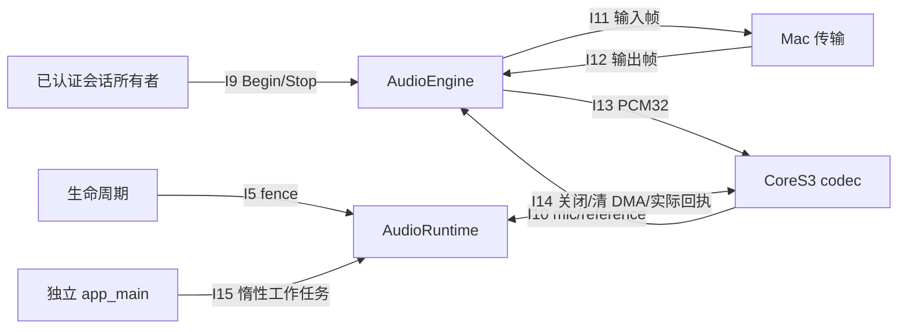
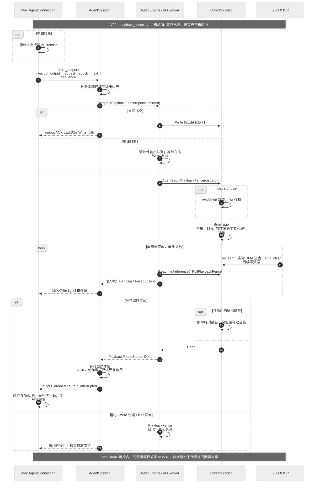
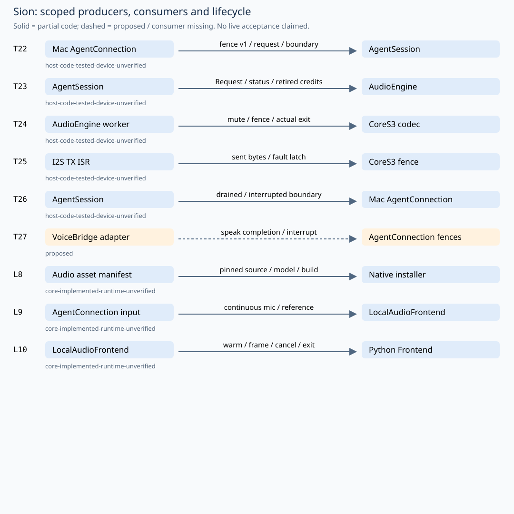

# 独立 Agent 音频服务

Mac 接续：[认证 PCM 传输](agent-transport.md)与 [LocalVoice](local-voice.md)已在官方 DSH 隔离配置档演练。Mac 收音暂存与本页设备侧 I2S 队列各有独立上限。设备音频仍待真机验收。

先看 [Stop/Home 与音频 worker 的并发释放时序](runtime-sequences.md#停止与-home)，再看下面的帧格式、队列与 codec 契约。

归属 P1/P2、A2/A3/A5；本页负责设备 PCM 采集/播放与取消，不负责人格、ASR/TTS 或配对授权。实施前核对官方 StackChan 手册及锁定 ESP-IDF 的 `docs/en/api-reference/peripherals/i2s.rst`、`i2s_common.c` 和 CoreS3 codec。硬件为 ES7210 输入/AW88298 输出；官方配置是 24 kHz、输入麦克风/回声参考双通道、输出 PCM16 转 PCM32。参考通道不是已完成 AEC，更不是播报中停止的声学验收。

接口已实现，`firmware/agent/audio_engine.h` 是唯一字段/状态定义。固定 10 ms 帧（每通道 240 样本）、24 kHz PCM16，输入含 2 通道，输出单通道。两个方向各最多 20 帧（200 ms 配置预算，非实测延迟），无无限队列。输入满意味着消费者失联/过慢，停止采集并报错；输出满返回 backpressure，未接受帧不推进序号。epoch 只由会话所有者传入，旧帧/重复序号不能进新会话；Home 后重新进入保持代次递增。`read_started_us` 是设备本次读取开始的软件时间，不冒充样本实际采集时间；后续传输必须处理 DMA 延迟及 Mac 时钟映射。传输尚未接入前不主动 Begin、不开麦克风。

音频只有一个 I/O 工作任务，所有打开、读写、关闭在此任务执行；UI/网络只能调用同步短锁控制/队列方法。Stop 先撤销 epoch、清队列，再由工作任务关硬件和清 DMA；硬件确认之前 `Stopped` 保持 pending，失败保持 failed。取消时正在执行的单次 I/O 可以返回，但其输入不发布、后续输出不执行；不能在取消时直接给出 idle 回执。单次 I2S 读写使用 50 ms 超时，初始化/驱动内部互斥不因此获得硬实时上限；总退出仍受生命周期 drain 超时约束。

CoreS3 扩展复用原驱动初始化和格式配置，通过直接 I2S 返回码及实际字节数判断读写，不依赖原 `Read` 忽略错误、`OutputData` 隐藏短写的接口。关闭时检查 codec disable、关闭设备、停 TX/RX，TX 在 READY 状态用零 PCM preload 清理全部 DMA；不把 `esp_codec_dev_close` 自身总返回 OK 当硬件成功证据。没有更改原音量 namespace 或启用原 Application。准备脚本只给固定上游 class 添加声明，扩展实现保存在本仓，旧候选不变。

`core_audio_bridge.cc` 另外注册 RX 队列溢出 ISR，使用 ESP-IDF 的 ISR/任务临界区保护锁存标志；下一次读取检查失败并进入关闭，不静默延续损坏的声音流。重新打开才清标志。音量由 DevicePreferences 传入并限制在 0–100，保留 0 静音，不使用原 `AudioCodec::Start` 的零音量升至 10 行为；原音量仅在没有 DSH 保存记录时作为只读初始值。输出沿用 AW88298 硬件音量接口。工作任务在 running 时由 I2S 读取节拍推进，不在每个 10 ms 帧后再加入一个默认 10 ms 的 RTOS 延迟；idle/fault 时休眠。初始化内部互斥和 I2C 仍可能阻塞，生命周期超时不等于可强制杀死驱动任务。

工作者读写失败会清队列并关闭硬件，错误保留到下一次 Begin；它不跨线程擅自修改 SessionLifecycle。后续连接所有者必须消费 AudioStatus 的错误并终止对应会话，不能只看 phase=idle 就当作正常完成。输出返回成功只证明数据交给 I2S，不是用户已听完；独立播放排空/打断确认现已接入，见本页末尾。

| 边 | 生产者 → 消费者 | 数据、失败、验收 |
|---|---|---|
| I9 | 配对会话所有者 → AudioEngine | Begin/Stop、epoch；仅在已认证连接中调用（网络消费者已接，实体链路未验收）；拒绝忙碌/旧 epoch |
| I10 | CoreS3 I2S → AudioEngine | mic/reference 帧、序号、读取时间；读错误/溢出停止，不把旧数据当新语音 |
| I11 | AudioEngine → Mac 传输 | TakeInput 有界帧；AgentSession/网络队列已接，未消费导致停止 |
| I12 | Mac 传输 → AudioEngine | 带 epoch/序号的单声道帧；网络生产者已接，满队列 backpressure |
| I13 | AudioEngine → CoreS3 I2S | PCM16 转 PCM32；短写失败，输出不关闭麦克风 |
| I14 | AudioRuntime → codec/DMA → 释放回执 | I5 生命周期 fence 后实际关闭、清 DMA；超时/失败不能进入新会话，Home 等待回执 |
| I15 | 独立 app_main → AudioRuntime | 建立单一工作任务，未 Begin 时不获取 codec、不录音；任务建立失败显示服务不可用 |

同一账本的渲染视图：[音频关系图](assets/relationships-6.svg)。原助手资源、相机/动作不是这个服务的隐含消费者；后续加入时须扩展释放汇总。

实施退出证据：实际 engine 代码的取消竞态、并行输入/输出、过载、短读写/关闭失败、重试和旧回调测试；固定 ESP32-S3 完整链接；最终真机连续中文、播放回声/停止、DMA 残音和关闭失败验收。前两者不代替后者。UI 继续显示语音未连接直到认证传输/本地语音消费者接入。相机/动作随后加入同一资源释放汇总，不以仅音频释放宣布全部硬件已释放。

当前主机证据：7 组音频场景通过 ASan/UBSan，其中真实线程阻塞 Read 时 Stop 仍能撤销输入，直到 I/O 返回并 Close 完成才确认；生命周期与音频的 Home/再进入组合通过。实际 CoreS3 扩展在可注入 SDK 下检查静音、PCM 极值、短读写/错误、RX 溢出锁存和重新开启、codec disable 失败、DMA 清零/预算失败；伪 SDK 测试不证明物理硬件和声学效果。仍缺认证连接、ASR/TTS、回声处理及播报中停止验收。

2026-11-18：同一 7 组音频场景另通过 ThreadSanitizer；`independent-audio-v4` 完整 ESP32-S3 构建通过，2,219,904 字节，见 [音频构建收据](../firmware/agent-audio-build.json)。目标编译曾发现 Mac 隐藏的两项差异：目标配置 C++ atomics 不保证无锁、GetInt 的 int32_t 与 int 模板推导不同；已改 SDK 临界区与显式 int32_t clamp。后续改动可用已生成编译响应文件及新准备目录的头文件先做目标编译，再完成新镜像链接；这个快速检查不是完整固件验收。

目标 ELF 的 AudioEngine 静态对象为 29,664 字节；音频工作任务配置 8,192 字节栈。两项不包含 codec/I2S DMA、网络和模型内存，不能当峰值运行资源测量。目标源码 `i2s_tx_channel_start` 重置 TX FIFO，AgentClose 另外清 DMA；重开残音仍需真机验证。

## 设备设置消费者（independent-settings-v6）

[设备设置](device-settings.md) 已接入 SetVolume/AllowCapture。AudioStatus 区分 requested_volume 与 applied_volume（-1 表示未打开/关闭后），codec Open 接收 DSH 音量；运行中 Volume 失败进入关闭并报 AudioError::Volume。禁麦短锁清队列/转 Closing，Begin 拒绝；正在读的输入在返回后丢弃，硬件 Close 完成前不是 idle。重新允许只恢复门槛，不自动 Begin。新增测试包括真实阻塞读取线程时禁麦及音量错误，8 组音频测试通过 ASan/UBSan 和 TSan；仍无声学验证。当前完整构建与资源大小见设备设置页，v4 数据仅为历史基线。

## 设备传输消费与播放容量

AgentSession 已实际消费 Begin/Push/TakeInput/status/Stopped，并通过 C++ 与 Mac TLS carrier 互通；ESP 任务和 main 已接入，但不能称真机网络可用。AudioStatus.output_written 是当前 epoch 成功交给 AudioPort::Write 的序号高水位（最后成功序号 + 1），Begin 清零，Stop 后迟到写和失败不计数。控制器据此归还 Host 未确认窗口，避免入队即确认导致播放缓存溢出；不是 DMA 排空或声音已播完。具体协议、失败和 T9–T14 关系归 [设备会话控制](agent-transport.md#设备会话所有者与跨语言接线)。

## 播放排空与单独打断

本批已实现 AudioEngine → CoreS3 播放屏障和 AgentSession/Mac 控制协议，主机测试通过；真机数字输出、功放尾音和播报中停止仍未验证。官方 [I2S 文档](https://docs.espressif.com/projects/esp-idf/en/v6.1/esp32s3/api-reference/peripherals/i2s.html) 与锁定 i2s_common.c：write 把数据复制到 DMA，on_sent 才反映 DMA 发送进度；CoreS3 已配置 auto_clear_after_cb=true。不能用 output_written、固定 sleep 或文本长度当播放完成。

实际 API `RequestPlaybackFence(epoch, discard)` / `PlaybackFenceStatus(epoch)`：自然排空先写完已接受队列；discard 清待播队列，worker 先静音 AW88298 输出，不关输入。两个路径均在最后写入后捕获 ISR 累计发送字节，等两轮实际 DMA 容量发送后确认，覆盖全环及 FIFO 后续零数据。期间持续 Read/TakeInput，拒绝新输出直至屏障完成；停止/禁麦/Home 撤销代次，迟到屏障不得宣布成功。这个边界证明数字输出缓冲进度，不测量房间回声或模拟功放尾音。

硬件调用归唯一音频 worker；ISR 只在 SDK 临界区内累计整数、锁存异常，不分配或运行模型。容量从 i2s_channel_get_info 读取，禁止零容量/过大容量/计数溢出。静音或恢复错误进入故障关闭，不能假称可继续播放。原 codec/NVS 配置和已有 Stop 全部资源释放语义不变。Host 的 drainOutput/interruptOutput 与版本化回执已接线；真实 VoiceBridge 语音消费者仍缺，不因此将原始传输标为完整 VoiceBridge。

自然排空等待已接受软件队列耗尽，再开始数字屏障。单独打断立即清软件队列，唯一 I/O worker 静音输出后开始屏障；在途 Write 必须先返回，不能提前完成。屏障 Requested/Waiting 时拒绝新输出且不推进序号；Done 后才可继续。`output_received` 是已接收的下一序号，`output_written` 是实际成功写入的序号高水位；打断产生的空洞由 AgentSession 的明确边界回执作废，不发送假 Write ACK。Stop/禁麦/Home 对旧屏障返回失败并执行完整资源关闭。

worker 的第一次屏障调用记录设备单调时间；连续 2 秒未完成、时钟倒退、异常 ISR 事件、容量无效、计数耗尽、静音/解除静音失败都转 AudioError::PlaybackFence 并关闭。2 秒为配置故障期限，不是硬实时承诺。输入仍由每次 Pump 的实际 Read 推进，不能在屏障期间暂停消费 mic/reference。

图表来源：[AudioEngine](../firmware/agent/audio_engine.h)、[CorePort](../firmware/agent/audio_runtime.cc)、[CoreS3 扩展](../firmware/agent/core_audio_bridge.cc)、[AgentSession](../firmware/agent/agent_session.cc) 与 [Mac 传输](../src/agent-transport.mjs)。实际固定 SDK 的 AW88298 mute 只设置输出芯片静音位；输入 codec 不关闭。DMA on_sent 的整数累计由 SDK 临界区保护，auto_clear_after_cb 来自固定 CoreS3 初始化；两轮实测回调进度不是固定等待时长。

T22/T23/T24/T25/T26 均已有代码和主机/SDK 夹具证据；T27 的语音循环调用方仍缺。完整资源 Stop 的 I14 和现有 I10 输入并行消费仍保留，原存储消费者未变。源码检查和测试不能替代实际无线/声学验收。
