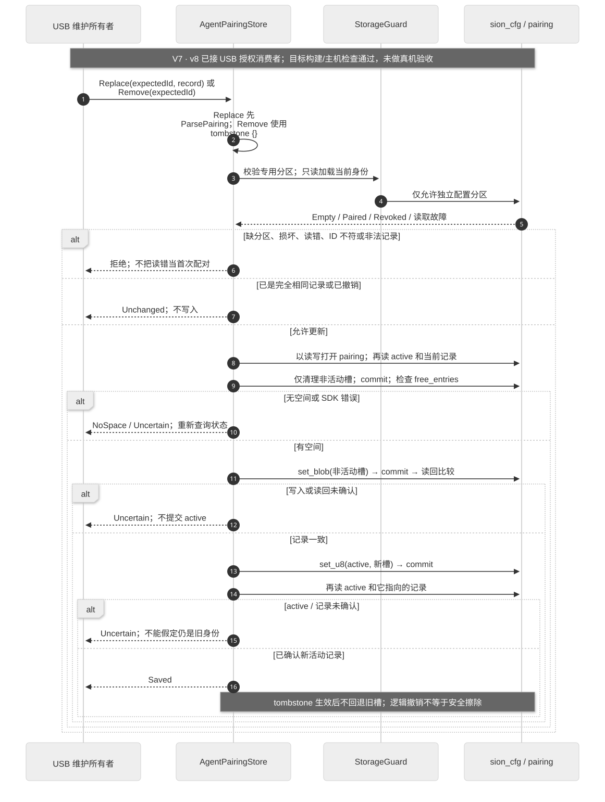
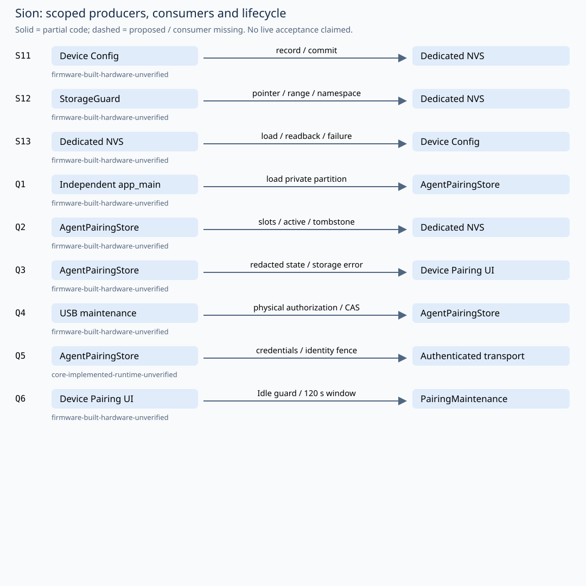
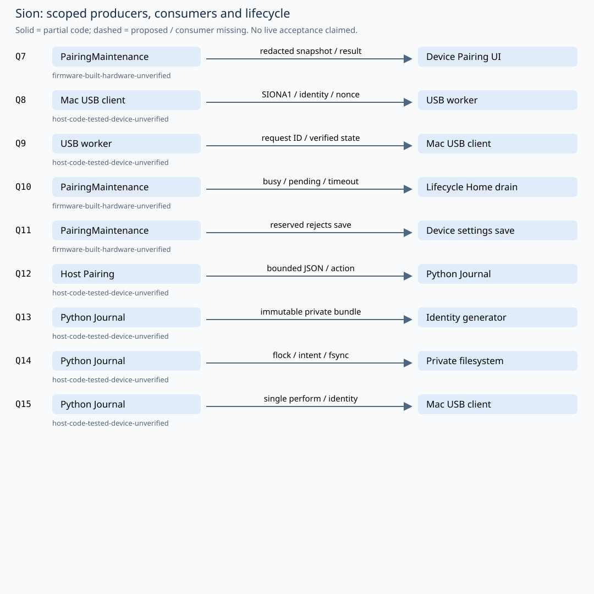
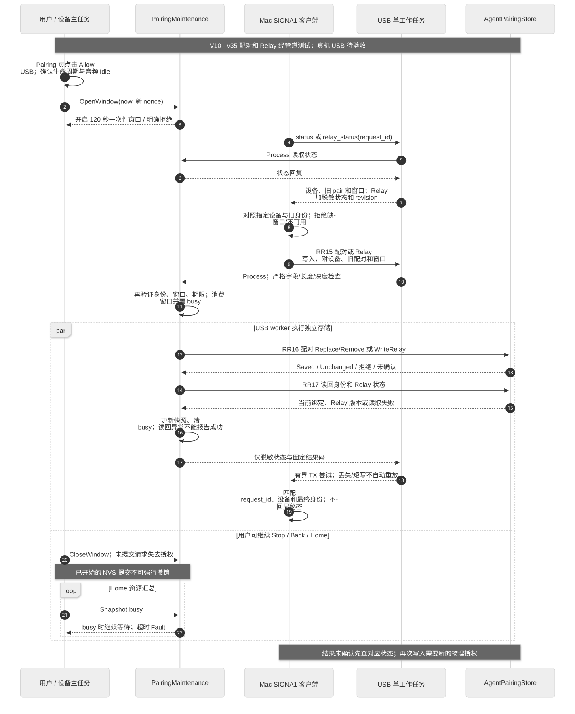

# 独立应用配对存储与状态

归属 P1/P8；本页为独立 Agent 的接入入口，旧同进程协议保留在 [配对历史](pairing.md)。独立持久化、设备授权窗口与 USB 工作任务已实现/构建，Mac 协议客户端已通过管道互通；DSH 手动配对页面已接入，完整自动配置与真机验收仍缺；认证网络已有首版接线；不能将存储实现当已配对真机。没有自动导入原厂 sion_pair 或读取原云凭据。

Mac 网络接续见 [认证音频传输](agent-transport.md)：复用独立配对 CA/host 证书/local_token；真实回环已测，Host active journal 已经由[身份租约](voice-runtime.md)接入 listener，用户实例/真机仍待验收；设备网络所有者已接线，预约与凭据读取见下节。

保持出厂分区表的存储试验链接真实 `AgentPairingStore` 与 ESP-IDF NVS，配对记录使用合成输入。首次写入后经原厂启动再重新进入，能按原格式读回相同记录。测试不进行配对网络握手或 StackChan World 登录。 [独立保存验证](validation.md#原分区表下的配对与偏好)

## 网络身份预约与私有读取

ReserveTransport 仅接受当前 Paired 状态、有效设备/配对 ID，且没有 USB 窗口、busy 或另一个网络预约。ticket 单调递增；旧 ticket 不能读取或释放后续预约。ReadTransport 调用 Repository::ReadPrivate / AgentPairingStore::Read(&record)，核对真实记录与快照身份；读失败清输出，不向 USB 状态/UI 暴露秘密。它不跨 NVS 持有快照 mutex，所以状态查询仍可响应；读取中不能 Release。

网络预约期间 OpenWindow 和 USB mutation 拒绝；AgentSession 的 reserved() 仍专指 USB 窗口/busy，不把自己持有的网络预约误判为禁止开始。worker 销毁客户端、停 Wi-Fi、注销回调后才 Release；清理失败保留预约，防止新身份复用未退出的连接。main 在网络 Finished 前也拒绝设置保存和重新连接。Q5/T16 的文本与渲染视图见 [V18 与网络关系](agent-transport.md#esp-网络所有者与显式连接)。

实际维护服务的阻塞读取/并发 status、USB 拒绝、陈旧 ticket、失败输出清空通过 ASan/UBSan 和 TSan；实际网络 worker 的 SDK 夹具验证延迟 destroy 期间预约保持。它不验证 Flash 实物、无线握手或持久秘密清除。原厂语音、手机绑定和默认 NVS 写保护未改。以下 v8/v7 段落保留历史实现边界。

## 独立 USB 维护契约

Host 接续已实现并离线测试：[持久化配对事务](host-pairing.md)。先保存候选凭据和写入意图，再调用一次 USB；结果不明确时保留旧/候选身份，下一次只读查询设备后决定当前身份。POSIX flock 串行化、原子状态文件和异步 Cordis 服务已接入；真实 Remote 与手动页面已接入，自动发现/安装检测仍待完成。未打开设备串口。

使用独立 `SIONA1 ` JSON 行协议。配对动作保持 `status`、`install`、`remove`，v35 另加 `relay_status`、`relay_install`、`relay_remove`。设备执行写入时检查 expected_device、expected_pair_id 和本次 window。设备 Pairing 页明确开启一个 120 秒、一次写入的随机窗口，仅生命周期和音频均 Idle 且存储状态正常时允许。Stop、Back、Home 关闭未消费窗口。状态查询不开放窗口，不录音、不重启。窗口过期或写入已经开始后均不能重用，失败后必须读回状态再由用户重新授权。

USB 单工作任务执行有界帧解析和实际 NVS 写入；mutex 仅保护快照/预约，不在存储 I/O 期间持有。应用任务保持 Stop/Home 可用；进行中的 NVS 提交不可强行撤销，Home 需等维护 busy 清除才能确认资源全部释放，超时仍 Fault。打开维护窗口期间保留资源预约，未来认证 Begin 生产者必须拒绝这一状态。设备设置保存也不能与维护写入并行。

协议行最多 8192 字节，分片空闲超时 5 秒；JSON 先限制对象嵌套深度再交给 cJSON，拒绝重复/缺字段/嵌入 NUL。回复仅含请求 ID、设备身份、配对 ID/状态、窗口、busy 与结果，不回显 record/PEM/token。记录沿用现有 schema，TLS 消费者随后验证证书。原厂数据不加入协议。

核对 [官方 USB Serial/JTAG 指南](https://docs.espressif.com/projects/esp-idf/en/stable/esp32s3/api-guides/usb-serial-jtag-console.html) 与固定 SDK driver/usb_serial_jtag.h：读写均有 ticks 超时，write 返回入队字节数不等于 Host 已收到；驱动安装/卸载有同核要求。v8 已关闭新镜像的 secondary USB 日志，保留 UART 日志，避免与协议帧混杂；原设备配置未改。启动工作任务不等于真机刷写/打开本机串口。USB 控制线、深睡断连、真实提交掉电仍须真机验收。

Mac 客户端 scripts/agent_pairing_usb.py 默认 dry-run；--apply 才延迟导入 pySerial 并打开明确指定的端口。写入前获取 status，核对用户指定的设备和旧配对 ID；只使用设备刚返回的非空窗口。每个请求独立 request_id，回复按该 ID 匹配且校验固定字段/枚举；未知响应和串口错误不会回显原始字节或秘密。任何写入后超时/短写都报告未确认，不自动重试；恢复先执行 status。设备窗口是物理授权的单次关联值，不是独立密码或远程认证替代品。正式 DSH 配对引导仍须调用相同契约并呈现状态；CLI 不关闭两端设置验收。

发送端在每个请求前加 NUL 和换行。NUL 使接收端仍缓冲的旧行无效，再由换行回到新的行首。只有换行会使内容完整且仍持有效窗口的旧写请求被执行。新请求仍走原来的设备身份、窗口和请求 ID 检查，既有固件的行解析器可直接处理。该串口边界改动保留了短写与未知结果处理，旧写的结果仍靠读回确认。 [Host 实现](../scripts/agent_pairing_usb.py) · [配对残包回归](validation.md#usb-配对在串口残包后的恢复)

### 可省略局域网地址

v50 的独立应用允许 v1 配对记录的 `local_url` 为空，字段仍需存在。带地址的记录继续使用原私有 WSS 校验。设备接受 `optional_lan_status` 只读查询。普通 `status`、写入授权、回执和存储事务沿用已有格式。USB 和 Relay 继续使用原配对标识与密钥。选 LAN 时，设备在初始化 Wi-Fi 前提示「Set LAN address in Mac pairing」，并释放身份预约。Mac 同样在创建监听前报告缺地址。 [独立记录解析](../firmware/overlay/sion/pairing_config.h) · [网络入口](../firmware/agent/agent_network.cc) · [Mac 设置](host-pairing.md#选择本地语音服务地址)

## Relay 配置、轮换与撤销

Relay 配置文件只提供给已配对设备。Mac 端使用 [USB CLI](../scripts/agent_pairing_usb.py) 读取本机账户所有的 `0600` JSON 文件。顶层只有 `record`，字段按[设备 Relay 描述符](agent-transport.md#外出连接中继)。其中 `revision` 是每次计划写入生成的随机 32 位小写十六进制标识，用来核对本次写入。它不由密码或 token 派生。若 Wi-Fi 使用已保存网络，`ssid` 和 `password` 都留空。

| 关系 | 生效范围与失败结果 |
|---|---|
| RR14 本机私有文件 → Mac USB CLI | `relay_install` 校验本机文件所有者、权限、大小和版本标识，拒绝符号链接。角色 token、CA、SSID 和密码不出现在命令行参数、UI 或回复里。CLI 默认 dry-run。 |
| RR15 Mac USB CLI 与 Allow USB → PairingMaintenance | 先读 `relay_status` 并核对设备及独立配对。单次物理授权和有效旧配对 ID 才能写。老固件的 `status/install/remove` 回复结构照旧，`relay_status` 不支持时 CLI 不试写。 |
| RR16 PairingMaintenance → AgentPairingStore | `relay_install` 校验描述符和 CA 的 X.509 格式，再替换独立 NVS 中一个 blob。以相同 revision 和相同字节重试返回 unchanged，相同 revision 内容冲突返回 invalid_record。`relay_remove` 只删除该 blob，保留配对、原厂信息与 LAN/USB。轮换或撤销独立配对时，会在发布新的配对状态前清理旧 Relay 条目。若身份提交随后失败，旧配对可能保留，Relay 需重新登记。 |
| RR17 已提交存储 → USB 回复、设备 Pairing 页和网络任务 | commit 后再读回。`relay_status` 在空闲时重新读取，返回脱敏状态和 revision。丢失回复后用它核对原 revision 或 Empty，设备只展示是否已保存。实际连接前网络任务仍按当前配对读取私有记录。 |

实际部署时在设备 Pairing 页点 **Allow USB**，再从 Mac 对已识别的串口、设备 ID 和当前独立配对 ID 执行 `relay_install`。写入和撤销共享上一节的物理窗口。

| CLI 动作 | 参数和结果 |
|---|---|
| `relay_status` | `--port` 和 `--apply` 读取指定设备，`--expected-device` 可用于确认目标。无须打开物理窗口。 |
| `relay_install` | 需要 `--port`、`--expected-device`、`--expected-pair`、`--bundle` 和 `--apply`。成功回复应为 `ready` 且 revision 对应本次文件。 |
| `relay_remove` | 参数同安装，省略 `--bundle`。成功后应为 `empty`，独立配对 ID 仍然相同。它只撤销设备本地配置。要让原设备 token 在服务端失效，仍需在中继替换对应角色哈希。 |

这些操作要等获准安装后的实机验收。目前协议通过 Mac 客户端与 C++ 管道演练，NVS 掉电恢复仍待实体检查。 [v35 验收](validation.md#v35-relay-usb-配置和离线恢复) · [RR14–RR17](assets/relationships-31.svg) · [ESP-IDF NVS 恢复规则](https://docs.espressif.com/projects/esp-idf/en/v6.1/esp32s3/api-reference/storage/nvs_flash.html)

## 配对提交时序

图表来源：[pairing_store.cc](../firmware/agent/pairing_store.cc) `Read/ReadActive/Save/Replace/Remove`；[storage_guard.cc](../firmware/agent/storage_guard.cc) 的分区与 namespace guard；[共享 schema](../firmware/overlay/sion/pairing_config.h) `ParsePairing`。维护所有者已接入设备授权窗口与 busy/drain，见 V10；这张图聚焦存储顺序，不表示真机 USB 已验收。

关键顺序是先完整写入并读回非活动槽，再更改 active；重新打开后的身份检查若不一致也会拒绝。任何变更后的错误都需重新查询，不能从失败返回推断 Flash 未变。空间不足可已清理非活动槽，但不改变当前 active。章节来源为下面的实现契约和测试记录。

## 存储和故障契约

复用 overlay/sion/pairing_config.h 与 endpoint_policy.h 的 version 1 JSON 校验；构建时复制同一权威源码，禁止另一份字段解析器。凭据格式检查不等于 X.509 有效性，后续 TLS 必须验证证书和对端身份。主机测试使用随仓保留许可证的 cJSON 1.7.19，与当前目标依赖版本一致。

仅 sion_cfg / pairing 命名空间可写；与 settings 共用专用 16 KiB，原厂分区仍只读。初始化可能修复专用区；没有创建/格式化分区或无空间自动擦除。每次读区分 Empty、Paired、Revoked、Unavailable、Corrupt、StorageError。仅前三类允许合法 expected pair ID 的更新；读取错误不能被当成首次安装。返回给 UI 的状态不含私钥/token/地址。

存储使用 slot0/slot1 和 active。先核对当前身份与待写记录；相同 ID 的不同内容拒绝，完全相同记录返回未变。保存仅清理非活动槽，检查剩余容量，然后写入、commit、读回，最后提交并验证 active。开始任何 NVS 变更后返回失败表示结果需要重新读取，不能假定没写入或自动重放。撤销将 {} 作为活动 tombstone，不回退旧槽；旧槽随后按需清理。这是逻辑撤销，不是物理安全擦除。16 KiB 的真实碎片/掉电行为仍需目标验收，容量不足明确失败。

所有操作由单一应用/维护所有者串行执行；网络回调不能直接访问或修改 NVS。配对改变须先停止并等待所有资源释放，再阻止旧连接。v8 已启动 USB 状态服务，写入仅在显式物理窗口内接受；没有启动网络。Home 还等待维护 busy 清除；未来网络 Begin 生产者必须检查 reserved()。

## 编辑、影响与验证

入口 firmware/agent/pairing_store.h/.cc、storage_guard.cc、device_main.cc，prepare_agent.py 复制并固定共享解析器；test_agent.py 编译真实存储及 cJSON。设备 Pairing 状态页实际消费启动读取结果；USB worker 已接入，Host 配对向导与认证网络消费者仍缺失。

关系 Q1 独立 app_main → PairingStore：启动读取；Q2 PairingStore → Dedicated NVS：双槽/指针/撤销；Q3 PairingStore → Device Pairing UI：脱敏状态；Q4 USB maintenance → PairingStore：已构建的授权写入；Q5 PairingStore → Authenticated transport：拟接入的凭据加载/身份轮换。Q6 页面开启维护窗口；Q7 维护快照更新页面；Q8/Q9 Mac 客户端与 USB worker 请求/结果；Q10 busy 阻止 Home 提前完成；Q11 reserved 拒绝设备设置保存。统一账本与下面两张图使用相同 ID；Q5 已由网络预约、私有读取与 worker 接线实现，仍未做真机验收。

检查包括实际解析器、首次/重复/轮换/撤销/重启读取、错身份、损坏 marker/blob、各 NVS 失败点、无空间、故障后不覆盖、原区拒写和真实入口页面导航。主机模型不证明 NVS 实物掉电原子性、证书握手或 USB 控制线安全；完整目标构建与真机验收分别记录。

官方依据：[ESP-IDF NVS](https://docs.espressif.com/projects/esp-idf/en/v6.1/esp32s3/api-reference/storage/nvs_flash.html)，已核对本地固定 SDK 的 nvs_flash.rst（专用 partition、commit、掉电恢复与独立出厂区说明）；[StackChan 手册](https://docs.m5stack.com/en/StackChan/) 的解绑与 Home 行为沿用既有基线。不得调用原厂解绑作为 DSH 配对撤销。

## v7 实现历史与后续接缝

已接入 AgentPairingStore 的实际 NVS API 和共享解析器；启动只读取脱敏状态，设备主界面新增 Pairing 页，提供 Back/Stop/Home。页面明确 USB 尚未接通，不显示成功连接、凭据、地址或可用的安装按钮。原厂手机配对不从此页操作。

116 个失败注入覆盖首次写入、轮换、撤销，在 SDK 失败返回前/后持久变更的两种模型中重新读取，检查旧/新完整身份或撤销；另覆盖缺区、损坏/缺失 active blob、容量不足和重启读取。SDK 模型的写入是立即持久化，commit 可以失败；不是对真实 Flash 原子性的证明。首次测试因上游 cJSON 的 sprintf 被 Apple SDK 标为 deprecated 而失败；保持上游不变，仅该第三方 C 文件将 deprecated 警告降为可见 warning，本项目 C++ 继续 -Werror。

下一消费者不能直接搬用旧 pairing_usb.cc：它依赖原 Application::Schedule 并无超时等待，且设备侧 Process 不检查 expected_device（旧 Host 有身份预查，不能替代设备执行时校验）。新入口必须检查设备身份、限定维护授权时间和队列、先确认资源 drain，安装/撤销结果重新读取后投影，禁止凭据在日志/界面回显。当前没有启动 USB worker 或网络任务；配对写入 API 仅由测试调用。

## v7 构建与接通边界

`independent-pairing-v7` 完整 ESP32-S3 编译/链接成功，镜像 2,228,800 字节，SHA256 `35c90f36e87e90d19aa973b146d23d2ef7c5d8a284875349acfbc53ff0982408`；[构建收据](../firmware/agent-pairing-build.json)。离线 checksum/hash 有效，prepare 收据复核通过。实际 ELF 保留 AgentPairingStore::Read、PairingStateText 和写保护包装；Replace/Remove/Save 已由目标编译器编译，但由于没有运行时写入消费者，其函数被链接器移除。不得称 USB 配对写入已装入运行路径。

分区表与 v6 逐字节相同，没有分配 sion_cfg；镜像超过原尾部空间 197,184 字节，另需 16 KiB 独立配置空间；installable=false / hardwareValidated=false。原 v6 构建和收据保留。

`test_agent.py --prepared-source work/firmware-agent-pairing-v7/firmware` 完整通过 ASan/UBSan：新增 116 个 NVS 故障注入、缺区/损坏/身份冲突/重复/容量/重启读取、实际设备 UI 配对页 Stop/Back/Home。还调用 Mac 的真实 createPairing 生成临时 X.509 bundle，通过实际设备 JSON 解析器保存/重新读取/撤销；临时目录自动删除，没有真实 TLS 握手或用户身份写入。原 6 组生命周期、8 组音频、CoreS3 错误注入、设置和真实 HAL 检查一并通过。本批没有改音频并发实现，未重复 TSan 或未涉及的 JS 套件。

文档已回写关系 Q1–Q5，显式 Wiki gate；未改变宿主 hook 安装。没有设备连接、刷写、录音、DSH 输入或原配置更改。下一步是有设备身份检查和有限授权窗口的 USB 维护入口、DSH 插件配对引导及认证传输，P1/P8 仍未完成。

## USB 授权与维护时序

图表来源：firmware/agent/pairing_service.h/.cc 的 OpenWindow/Process/Snapshot/CloseWindow，pairing_usb.cc 的 UsbWorker，device_main.cc 的 AllowPairing/DeviceEffects，scripts/agent_pairing_usb.py 的 exchange/perform。Window 在设备上开启一次，可被 Stop/Back/Home 关闭；开始提交后不能保证撤回。状态锁不跨 NVS 调用，主任务持续可响应。串口 TX 成功只表示入队，不证明 Host 收到。

章节来源为上述实现与官方 pySerial API。独立 CLI 在手动指定通用串口时先设置 DTR/RTS=false 再打开。Mac 托管配对在确认原生 ESP32-S3 USB 描述符后，使用与语音相同的仅收发数据路径，省去 pySerial 主动更新 DTR/RTS。底层驱动的复位行为待实体对照。独立 CLI 默认 dry-run，可用 `python3 scripts/agent_pairing_usb.py status` 查看动作；实体安装和撤销须配合已获准的安装方案、明确设备与旧配对标识及设备侧物理窗口。 [串口与认证传输](agent-transport.md#usb-有线音频的加密传输) · [pySerial API](https://pyserial.readthedocs.io/en/latest/pyserial_api.html#serial.Serial.open)

## v8 验证与边界

`independent-usb-v8` 完整 ESP32-S3 构建通过，2,242,448 字节，SHA256 `fe5cea1162a6825daa0a5532f123e273d3db72dbaff53e78e03041c6b0eb41c0`；[收据](../firmware/agent-usb-build.json)。最终 ELF 保留 UsbWorker、PairingMaintenance::Process、AgentPairingStore::Save/Replace/Remove 和 USB read/write 驱动。源收据复核及镜像 checksum/hash 有效。实际 sdkconfig 保留 UART 主日志并选择 SECONDARY_NONE，只有新应用禁用 USB 日志镜像。

分区表与 v7 逐字节一致，没有 sion_cfg；镜像超过尾部空间 210,832 字节，另需 16 KiB 专用配置空间。installable=false / hardwareValidated=false，当前 Sion 未安装此代码。

ASan/UBSan 完整检查通过：原 116 次存储失败注入、临时 X.509 bundle、音频/codec/HAL/设置检查，加上窗口期限/错设备/旧身份/重复请求/无空间/读回错误/深层 JSON/秘密不回显/慢存储时并发读取。实际入口测试覆盖 Allow USB 及 Stop/Back/Home 关闭窗口、无自动录音。维护服务并发另通过 TSan。Mac 客户端 9 项测试含分片、错身份、超时不重放、dry-run 不导入串口及打开前控制线设置；它通过管道与实际 C++ Process 完成 status/install/remove/重放拒绝。管道端使用 fake repository，真实 NVS 适配另有前述故障测试，不是实体 Flash 或真实 USB 驱动验收。

配对改变当前只更新存储和状态，尚无网络连接需要重载；未来认证所有者必须在 reserved()==false 时取得资源，并用新身份建立新连接。DSH 设置页的配对向导、真实 TLS/音频和语音模型消费者仍缺，P1/P8 不关闭。本批没有打开设备、刷写、录音或调用用户会话。
