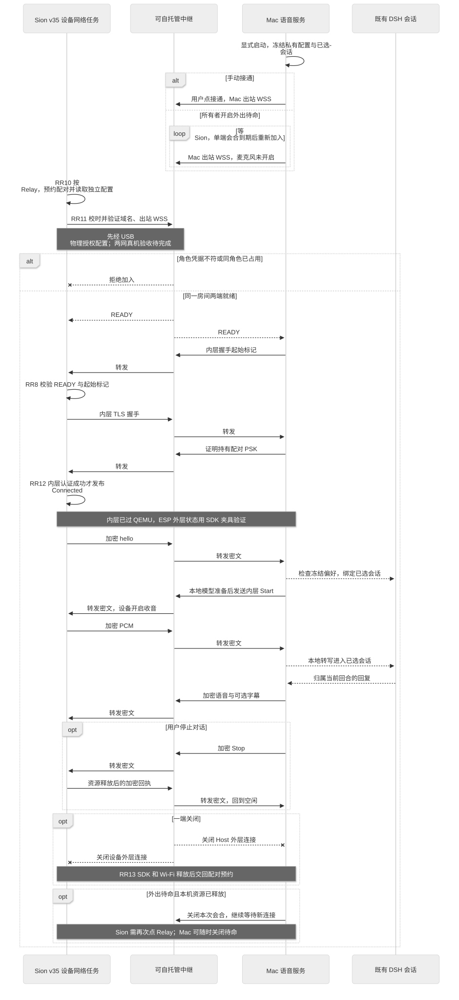
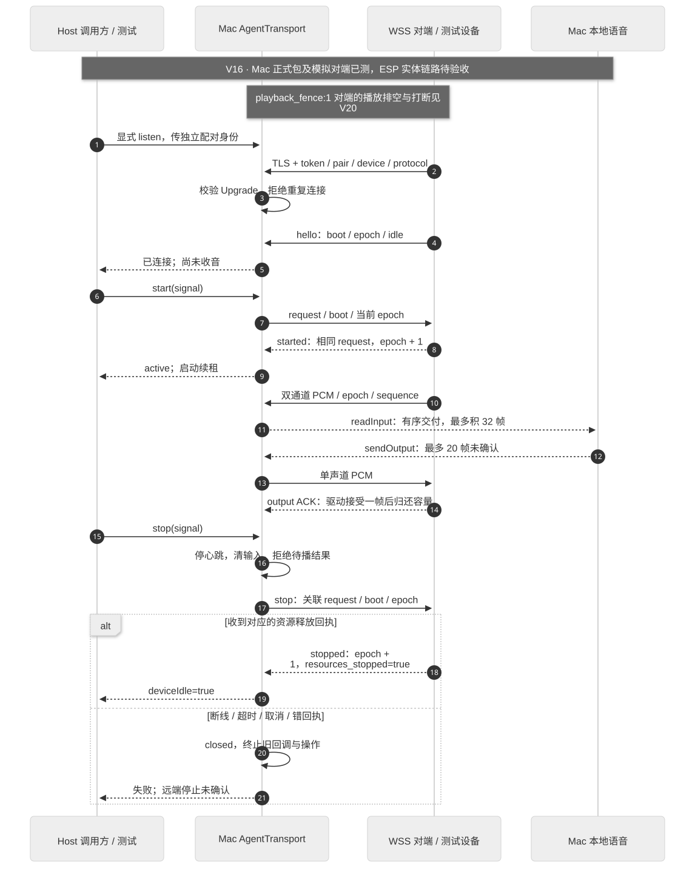
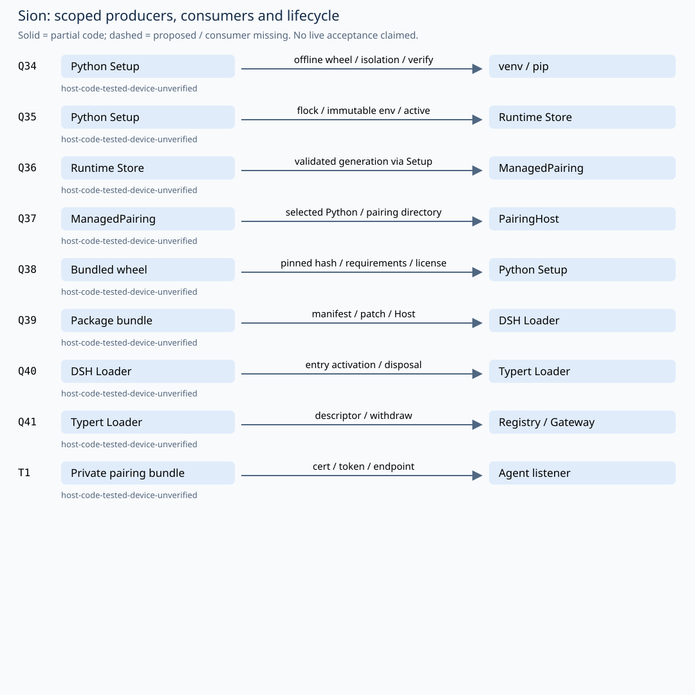
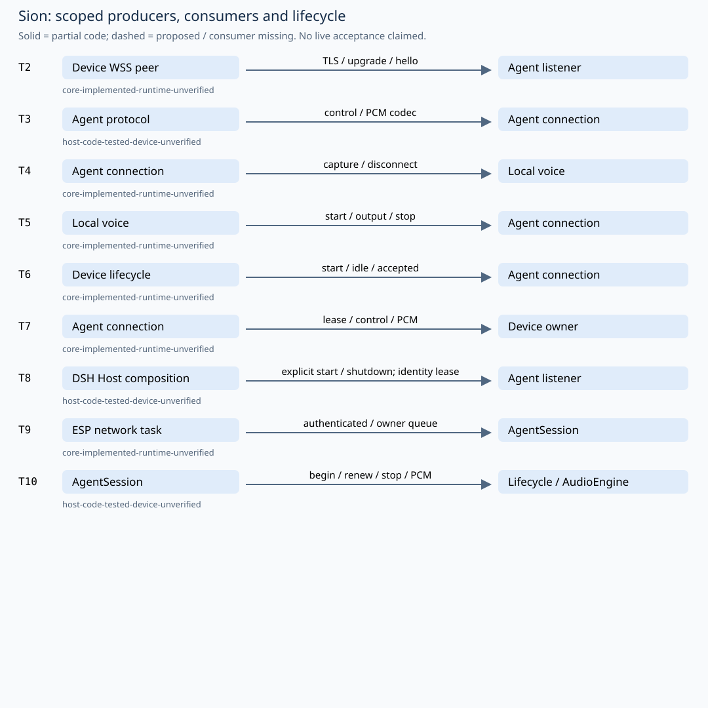
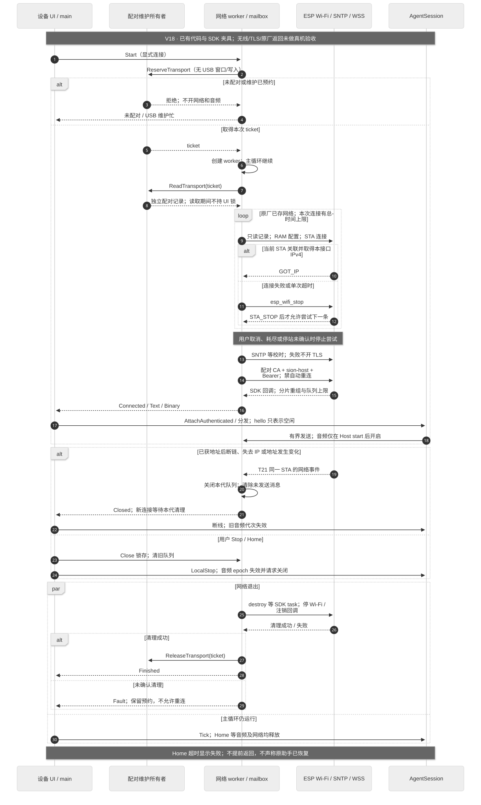
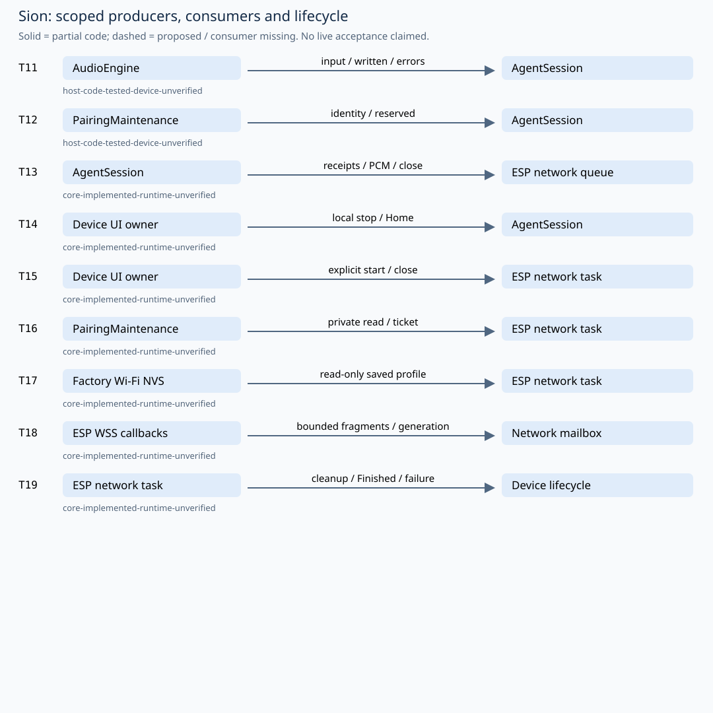
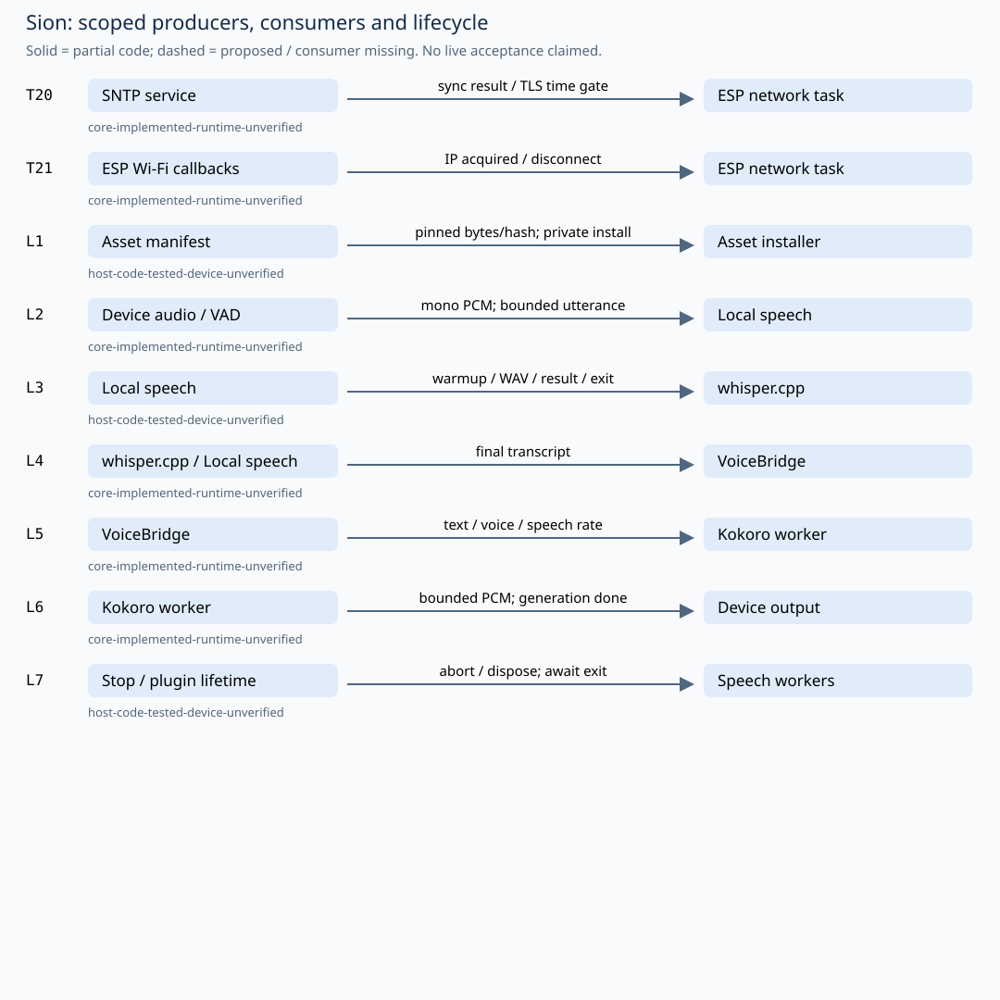
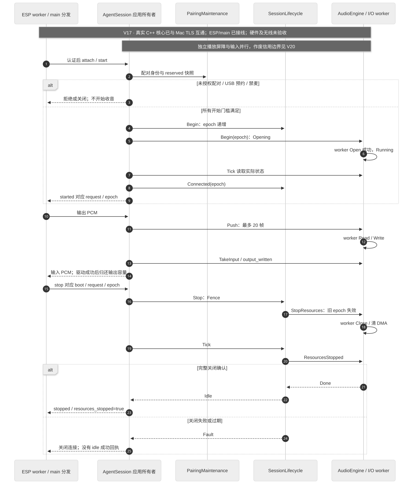

# 独立 Agent 的认证音频传输

动作 v1 复用此认证连接和租约。位置请求、取消、闭合结果和状态新鲜度由 [动作协议](motion.md#认证动作与两端设置) 维护。

文字字幕由设备主动声明 `caption:1`。发送仅限当前 Active epoch，使用原有有序加密通道与 2 KiB 命令上限。正文采用 UTF‑8 的小写 hex，解码长度最多 896 字节。没有屏幕回执或重发。播报模式的字幕在积压时跳过；DSH 的「仅字幕」使用同一传输的总缓冲上限，允许在普通字幕暂停时入队，失败则向 Host 报告。见 [字幕契约和界面](device-settings.md#纯文字模式)。

v20 增加可选 camera_status:1 与 camera_state；同 boot/epoch 报告在六秒内才作为当前观测，过期显示未知。实际 C++/TLS carrier 已覆盖采集/传输/Idle 状态与停止后的新 epoch；设备为假 codec/生成数据。严格版本兼容要求与字段归属见 [两端状态](camera.md#两端相机状态与照片保留说明)。

新增 camera:1 可选协议：认证 Active 请求、单图片拉取、预留队列与最后确认已接，严格包络/取消与边界见 [相机传输](camera.md#有界图片回传协议与实际接线)。它不代表 DSH 图片工具、真实解码或实体相机已验收。

新增可选 expression v1 协商与请求/回执，音频格式不变，旧 peer 本地拒绝不发送；完整协议/取消见 [设备能力](device-capabilities.md)。

归属 P1/P2/P4。Mac TLS/WebSocket 与 PCM、设备 AgentSession、ESP 网络工作任务及 main/UI 接线已实现；网络 SDK 接缝测试与目标构建分开验证，真机尚未安装。[LocalVoice adapter](local-voice.md)已接传输与桥并通过 TLS carrier；[Host 设置运行](voice-runtime.md)已接线并通过隔离测试，用户实例未验收，不代表已经接通 Sion。最新设备路径见下方“ESP 网络所有者”；不改原厂语音、绑定或启动配置。

官方依据：[Node TLS](https://nodejs.org/api/tls.html)、[ws API](https://github.com/websockets/ws/blob/master/doc/ws.md)、[ESP WebSocket Client](https://docs.espressif.com/projects/esp-protocols/esp_websocket_client/docs/latest/index.html)。固定 ESP 客户端 1.8.0，提交 `70bf122fc8bc74622dcf7e15233b5b2af9088df5`；实际字段是 cert_pem/cert_common_name，显式验证配对 CA 和 sion-host，不使用默认不验证的 TLS。Host 复用现有配对 serverAuth 证书和独立 local_token；不是 mTLS，不需要重签设备证书。token 证明配对秘密持有者，device_id 字段本身不是硬件身份认证。

实现入口：src/agent-protocol.mjs 负责版本化有界控制/PCM 编解码；src/agent-transport.mjs 负责显式监听、TLS/HTTP upgrade 鉴权、单连接与请求/代次归属。默认无监听；测试只绑定回环。必须显式私有 IPv4 或回环地址，不绑定通配地址。

[USB 加密字节流](#usb-有线音频的加密传输) 已接设备端入口、Mac 串口进程与 DSH 设置。真机双向音频和延迟仍待验收。

## 外出连接中继

Sion 和 Mac 都出站连中继，家里的 Mac 无需开放入站端口。Host 的 `AgentTransport.attachRelay` 与 USB、LAN 共用单一连接所有者。正式 [DSH 设置与运行入口](settings-ui.md#外出中继设置)、设备 **Relay** 运行入口与 [USB 配置](agent-pairing.md#relay-配置轮换与撤销) 已接；两张真实网络待验收。中继默认监听回环，实际部署由操作者显式配置监听地址和与域名匹配的证书。参见 [Node TLS](https://nodejs.org/api/tls.html) 和 [ESP WebSocket Client](https://docs.espressif.com/projects/esp-protocols/esp_websocket_client/docs/latest/index.html)。



| 关系 | 输入、运行机制和失败 |
|---|---|
| RR1 配置 → 中继 | 当前最多 64 个静态房间。每个 roomId 是独立随机 128 位标识。Host 和设备分别使用独立的 256 位随机 token。中继只配置两份 token 的 SHA‑256（小写 64 位十六进制 token 的 ASCII 字节）。 |
| RR2 Host、设备 → 中继 | 两个 TLS 验证的 WSS 用角色路径、独立 Bearer token 和 rendezvous 子协议加入同一房间。拒绝错误角色、Origin、重复角色或其他路由。单端等候默认 30 秒，双方就绪才允许二进制转发。 |
| RR3 中继 → 另一端 | 外层 WSS 在中继终止，转发的二进制是端到端 TLS 数据。中继能看到房间、连接时间与流量大小。单帧 16 KiB、待发缓冲 64 KiB。积压、超时、无效帧或一端关闭时释放双方。 |
| RR4 Mac ↔ Sion 内层认证 | 复用独立配对的本地 token，按独立 ALPN、pair_id 及 device_id 派生 PSK。外层中继凭据不能替代此 PSK。TLS 握手后才处理 Agent hello，已配对会话的原有开始/停止/epoch 继续生效。ESP32-S3 QEMU 已与真实 Mac TLS 互测。 |
| RR5 AgentTransport → 既有运行控制 | 先占有连接名额再加入房间，防止 LAN 或 USB 抢占。等待取消和内层失败时释放外层句柄，认证完成后由 Host 持有连接。原 AgentConnection 消费播放、会话绑定和控制；回环已接 PCM、字幕和 Stop。 |
| RR6 Mac 私有配置档 → VoiceRuntime | 外出模式 Start 打开私有 .stackchan-relay.json，校验所有者、文件权限、格式、TLS 地址和配对 ID。认证材料冻结在本次运行，Remote 只看到模式、状态和固定错误码。 |
| RR7 DSH 设置 → VoiceRuntime | 原生偏好保存值 relay。手动接通执行一次出站。所有者开启外出待命后，Host 反复建立同样的会合，单次等待和认证契约沿用，失败退避 250–2,000 ms。新配对连接成功后使用冻结的已选会话；Mac 停止或关闭服务会撤销待命。 [待命生命周期](voice-runtime.md#外出待命) |
| RR8 外层 WSS 接收 → AgentRelayStream | 第一条消息是 `SION-RELAY-READY 1` 文本，之后只接受二进制。允许 SDK 把单个帧分成多次回调，核对长度、偏移和顺序。内层启动标记 `\nSIONR1\n` 可跨帧。单帧至多 16 KiB，内存 FIFO 32 KiB，格式错误或溢出即锁定失败。 |
| RR9 AgentRelayStream → AgentPskTls | 工作线程在 READY 与标记完整后发起 TLS 1.2 握手，读取 FIFO 中的密文。Mbed TLS 通过各载体的 BIO 读写，要求独立 ALPN 和指定 ECDHE-PSK 套件；USB 继续使用原 ALPN 和引导标记。握手成功才能发送 Agent hello。 |
| RR10 设备 Relay 与配对预约 → AgentNetwork | 点击才预约。Wi-Fi、USB 和物理维护窗口已有互斥。当前配对在前，随后从独立配置区读取同一配对的 relay 描述。缺失、损坏或配对 ID 不符均在联网前报 `Relay setup required`。 |
| RR11 设备私有配置 → ESP Wi-Fi / WSS | 提供独立热点时只尝试该网络。留空时只读原厂已存槽，沿用回退规则。获得 IP 后先校时，以描述符 CA 和 URI 主机名验证外层 WSS，再发送设备角色 Bearer。独立构建将 SDK 的 3xx upgrade 结果按连接错误中止，LAN 与 Relay 共用此限制。 |
| RR12 AgentPskTls ↔ 既有设备 mailbox | 外层连上只进入等待。先收到 READY 和内层标记，再完成 PSK，才发布 Connected。已有 AgentSession 消费认证消息；保活维持连接，录音仍由现有 start 和续租控制。 |
| RR13 Stop、Home 或错误 → 网络所有者 | 关闭置闩，取消等待并丢弃旧消息。SDK task 销毁、Wi‑Fi 和回调退场后才交回配对预约。没有收到完整内层消息 15 秒或写入不完整会关闭，界面不会自动重连。 |

中继进程入口为 `node scripts/run_agent_relay.mjs <配置文件>`，要求随包安装锁定的 Node 依赖。JSON 提供 `certFile`、`keyFile`（相对于配置文件或绝对路径）、`host`、`port` 及 `rooms`，每个房间提供 `roomId`、`hostTokenSha256`、`deviceTokenSha256`。默认地址为 `127.0.0.1:8443`。端点证书须有效，私有 CA 可在 Host connect 参数显式提供。端点 token 和独立配对秘密留在各自端点。更换角色 token 时通过私有配置重启中继并更新对应端点，当前没有在线修改接口。

### 从一份输入准备三端配置

将以下字段保存在当前账户所有的 `0600` JSON 文件，替换示例域名、独立配对 ID 和 PEM 文件名。`certFile` 是中继证书链，`keyFile` 是匹配的服务器私钥，`caFile` 是两端用于验证中继的信任链。路径可相对输入文件或使用绝对路径。可省略 `ssid` 和 `password` 以复用设备已存的网络，或加上独立的 2.4 GHz 热点。备份文件、密码和生成结果均放在私有目录。 [官方 ESP WebSocket TLS 说明](https://docs.espressif.com/projects/esp-protocols/esp_websocket_client/docs/latest/index.html#tls)

```json
{
  "endpoint": "wss://relay.example.test:8443/",
  "pairId": "0123456789abcdef0123456789abcdef",
  "certFile": "fullchain.pem",
  "keyFile": "privkey.pem",
  "caFile": "trust.pem",
  "bindHost": "127.0.0.1",
  "bindPort": 8443
}
```

在项目根目录运行。输出路径必须是不存在的新目录，父目录需存在。

```sh
node scripts/prepare_agent_relay.mjs .local/relay-input.json .local/relay-new
```



| 关系 | 产物与消费者 |
|---|---|
| RR21 私有输入 → 配置生成器 | 校验字段及固件限制，以内存 TLS 握手验证服务器域名、CA 链和私钥。验证期间没有联网、打开端口或访问 USB。失败不发布配置。 |
| RR22 生成器 → Mac Host | `profile/.stackchan-relay.json` 使用新房间、原独立配对 ID、Host 角色 token 和可信 CA。部署时保留文件名和 `0600` 权限，放入当前 DSH 配置档。 |
| RR23 生成器 → Sion | `profile/.stackchan-relay-device.json` 采用同一房间和独立配对 ID、不同角色 token，以及新 revision 和热点设置。放入同一 DSH 配置档，再从设置页经物理授权写入。 |
| RR24 生成器 → 中继服务 | `relay/relay.json` 仅含房间与角色 token 摘要、监听参数及相对 TLS 文件名。`relay/` 另含服务器证书、私钥，部署时只把这一个目录交给中继服务。 |

`bindHost` 和 `bindPort` 控制中继进程监听，`endpoint` 是 Sion 和 Mac 实际使用的地址。允许这两者在使用反向代理时不同。默认监听本机回环；部署时应根据拓扑明确填写监听地址和暴露方式。生成器不签发证书，也不启动服务、覆盖已有目录或更改 DSH 配置档。生成新目录会得到新房间和新角色凭据。切换两端前需在服务端配置新房间，确认两端使用新文件后再下线旧房间。现有服务配置支持多个房间，生成器每次输出一个独立房间配置。 [源码](../scripts/prepare_agent_relay.mjs) · [两端设置](settings-ui.md#外出中继设置) · [关系图 RR21–RR22](assets/relationships-31.svg) · [关系图 RR23–RR24](assets/relationships-32.svg)

设备读取独立 `sion_cfg` / `pairing` / `relay` 下最多 4096 字节的 JSON blob。v35 写入字段为 `version`（值为 1）、`pair_id`、`revision`、`origin`、`room_id`、`token`、`ca`、`ssid` 和 `password`。配对 ID、revision 和 room ID 各为 32 位小写十六进制。`token` 为 64 位小写十六进制的设备角色凭据。`origin` 使用 `wss://`、小写主机名、可选端口和可选末尾斜线。`ca` 是非空 PEM，最多 3072 字节，TLS 由 ESP SDK 进行证书链和主机名校验。SSID 最多 32 字节，密码可空或 8–63 个可打印 ASCII 字符。v35 仍可读早期未带 revision 的配置，新的 USB 写入须携带 revision。配置不存在时仍可手动选择 LAN/USB。 [写入与撤销](agent-pairing.md#relay-配置轮换与撤销)

ESP32-S3 QEMU 已用实际目标 Mbed TLS 测通内层握手。测试用外层 Node WSS 收到的帧经虚拟 UART 模拟 SDK 回调。v34 另用实际 `AgentNetwork` 加 SDK 夹具测等待、短写、关闭和 UI 入口，并验证最终目标链接。ESP 外层 WSS 还需上真机验证证书、双网连接、重连和声学延迟。SDK 可请求 WebSocket 子协议，设备用 READY 和内层认证约束转发协议。 [Espressif WebSocket 限制](https://docs.espressif.com/projects/esp-protocols/esp_websocket_client/docs/latest/index.html#limitations-and-known-issues) · [网络任务](../firmware/agent/agent_network.cc) · [设备设置读取](../firmware/agent/agent_relay_config.cc) · [关系图 RR1–RR4](assets/relationships-29.svg) · [关系图 RR5–RR13](assets/relationships-30.svg)

## 通道共用的会话规则

每条载体按其凭据通过认证后，设备 hello 只表示连接空闲；显式 start 收到对应 started 才接受音频。每回合 epoch 来自设备生命周期，以 uint64 字符串/二进制整数传输，不转 JS Number。Stop 清本机输入与待播帧，只有匹配 boot/request/下一 epoch 且 resources_stopped=true 的回执才确认 deviceIdle；断线或超时不能伪造成功。旧 boot/epoch/重复序号拒绝。心跳不代替音频硬件排空。

同一次启动且通过协议校验的相机、表情、动作和灯环回执，若属于已退休的旧 epoch，Host 丢弃该回执并保留认证连接。停止中的当期能力回执也已失效。当前操作仍须匹配 boot、epoch 和 request_id，未来 epoch 或当前请求不匹配会报协议错误。这样迟到回执无法完成旧工具，也不会把刚重新接通的语音断开。 [真实 TLS 与安装包回归](validation.md#安装包能力与停止后重入验收)

意外断线后的显式重连仍经过本文的认证及 idle hello。Host 在旧载体关闭、本地语音清理完成后允许建立新租约，沿用原配对和本次服务所选会话。旧连接缺失的 Stop 回执保持未知。 [重连操作](voice-runtime.md#断线后接回所选会话)

终止 Mac 传输进程后，如果设备任务收到载体关闭事件，直接进入资源释放。如果关闭事件未到达，设备按本地单调时钟以最后一次有效续租为基准，尚未续租时从 Start 计，在下次处理到期时退休旧 epoch。每次释放先使输入和待播队列失效，再等音频、相机、舵机和灯环实际报告完成。未完成的情况下拒绝新 Agent 会话，释放成功后回独立应用空闲。新连接的 hello 只能报告当前空闲，新 Start 才开麦。旧连接缺少的停止回执仍按未知处理。 [设备状态图](runtime-sequences.md#独立设备状态) · [Mac 强制退出演练](validation.md#mac-突然退出与设备租约到期)

PCM 沿用 AudioEngine：24 kHz、PCM16LE、每帧每通道 240 样本，输入 mic/reference 两通道、输出单通道。网络格式使用显式序列化，不发送 C++ struct 内存。设备会话控制将输出 ACK 延后到 AudioPort::Write 成功，作为归还播放容量；仍不能当已经播完；数字播放排空与单独打断已新增版本化回执；声学回声消除与实际尾音仍待验收，见下方播放屏障。

验收：真实临时证书/TLS，错误 CA/名称/token/设备/协议拒绝，唯一连接，帧字节向量、序号/溢出/取消、断线/迟到回执、真实停止确认。设备认证 Begin、维护预约、codec 错误、Home、Wi-Fi 与时间基线现有接线；实际硬件行为仍须真机验收。不能用 Host 测试关闭 P1/P2/P4。


## 帧与会话权威

[agent-protocol.mjs](../src/agent-protocol.mjs) 是当前 Mac 端消息 schema 与 serializer 权威；设备编解码见 firmware/agent/agent_wire.h，会话见 agent_session.h/.cc；相同字节向量与真实 Mac TLS carrier 已跨语言验证。[agent-transport.mjs](../src/agent-transport.mjs) 的 AgentConnection 是连接生命周期权威；不是已装入固件的代码。

`createAgentTransport` 构造不读文件、不监听。VoiceRuntime 从配对 journal 的已确认 active bundle 加载并持身份锁；存在 pending 时不得猜候选身份。正式接线已由 [身份租约](voice-runtime.md) 实现，验证仍只使用临时生成的配对。配对轮换须关闭旧 listener/连接，再用新身份创建，不支持原地替换秘密。回环或显式 RFC1918 地址才可 listen，不接受 0.0.0.0；端口 0 仅用于系统分配测试端口，生产仍须和设备 local_url 一致。

WSS Upgrade 必须精确路径、GET、`sion-agent-v1` 子协议、Bearer local_token、X-Sion-Pair-Id 和 X-Sion-Device-Id；拒绝 Origin，不能从网页跨站打开。比较 token 使用恒定时间比较，但协议整体不是无时序侧信道的证明。使用 serverAuth TLS >=1.2，不要求 client certificate；设备 ID 是配对秘密关联声明，不是制造商硬件证明。连接后的 hello 再检查协议/设备/配对 ID、boot ID 与 idle。每个 listener 只接受一个配对连接，重复连接返回冲突，不驱逐原连接。

[正式包的局域网演练](voice-runtime.md#正式包的局域网演练) 从已确认的临时配对读取监听地址，在 Mac 指定私有 IPv4 上实跑 WSS。端口被占后可重试。即使 WSS 已通过，设备发送有效 hello 前也不能开始收音。关停后原端口可重新绑定。Sion Wi-Fi 与设备证书校验仍将在真机验收。 [本批验证](validation.md#局域网正式-host-演练)

控制消息是有界 UTF-8 JSON，字段严格按 Zod schema；uint64 使用规范十进制字符串，不经过 Number。Host 命令为 start/stop（request_id、boot_id、当前 epoch）和 renew（boot_id/epoch）。started/stopped 回执须对应 request/boot/下一 epoch；stopped 额外强制 resources_stopped=true。hello 不启动麦克风。设备须在 Begin/音频实际打开后才发 started，在 StopResources 完整 drain 后才发 stopped；这两条逻辑现已由 AgentSession 调用真实 AudioEngine/SessionLifecycle；ESP 认证网络现经有界队列进入 main；真机握手及音频仍未验收。

| PCM 字段 | 偏移 / 字节 | 编码与规则 |
|---|---|---|
| magic | 0 / 4 | ASCII SIA1，独立协议 v1 |
| kind | 4 / 1 | 1=输入 mic/reference，2=输出单声道 |
| reserved | 5 / 3 | 必须全 0 |
| epoch | 8 / 8 | uint64 大端 |
| sequence | 16 / 8 | uint64 大端，每次 started 后从 0 严格连续 |
| read_started_us | 24 / 8 | uint64 大端，输入为设备软件读开始时间；输出必须为 0 |
| pcm | 32 / 960 或 480 | 24 kHz PCM16LE；双通道输入交错，单通道输出；每通道 240 样本 |

头部总 32 字节；输入总 992 字节，输出总 512 字节。没有 C++ 内存布局、Opus、压缩或自动重采样；payload 复制给调用方，不能让后续缓冲复用修改既有帧。时间戳不是 Mac 时间或硬件采样时刻，AEC/同步仍需后续处理。

### 头顶触摸 v2 传输

设备在 hello 可声明 `head_touch:1` 或 `head_touch:2`。两者继续通过 `head_touch_state` 上报瞬时等级。v2 在活动 epoch 内额外发布 `head_touch_gesture`，按 boot ID、epoch、序号标识。字段包括 1 起递增的 uint32 序号、手势种类、毫秒时长、峰值等级、本机发送时距完成的毫秒数。瞬时读数另有有效期，瞬时报告为 `null` 时，已完成且仍有效的手势仍可查询。

设备允许低优先级队列拒绝，不阻塞音频。拒绝后在有界保留期内重试，覆盖或过期可令序号出现间隙。Mac 忽略已退休及重复事件，使用发送年龄加本地经过时间估算事件时效。跨设备传播时延未计入年龄。Stop 开始即隐藏历史。新 Host 可接旧设备，v44 需要识别头顶触摸 v2 的 Host。 [字段 schema](../src/agent-protocol.mjs) · [能力和消费者](device-capabilities.md#头顶手势-v2)

### 对话状态灯协商

声明 `voice_indicator:1` 的固件同时提供 `ring:1`。活动代次内，Mac 发送 `voice_indicator`，包含 `boot_id`、`epoch` 和 `state`。状态是 `listening` 或 `waiting`。Host 在发送缓冲积压时保留最新值，在下一次有余量的续租周期重试。设备拒绝错误 boot、未来代次、不匹配的活动状态和未知值，丢弃已退休代次的状态。扬声器写入和峰值在设备本地决定蓝灯。 [Host 控制](../src/agent-transport.mjs) · [设备命令](../firmware/agent/agent_session.cc) · [灯光行为](device-capabilities.md#对话状态灯-v1)

## 顺序、失败与边界



图表来源：agent-transport.mjs 的 listen/receive/command/readInput/sendOutput/fail，agent-protocol.mjs 的 schema/encodePcm/decodePcm；[真实 TLS 测试](../test/agent-transport.test.mjs)。图中的对端是 ws 测试程序；不把其回执当真实 codec 已关闭。局部控制顺序不证明所有状态×事件组合或硬实时期限。

| 状态 / 输入 | 行为 |
|---|---|
| hello / 合法 hello | idle，公开 connection；未开音频 |
| idle / start | starting，唯一 request；epoch 保留 Begin 和 Stop 两次递增空间 |
| starting / 对应 started | active，清序号并启动心跳 |
| active / PCM 输入 | 精确 epoch 和序号。交给等待中的单一读者，或在 Mac 最多暂存 32 帧。正式语音 Host 启用下文的过载恢复 |
| active / 输出 | 最多 20 个未确认帧；满返回 backpressure；对应 output ACK 归还驱动已接受帧的容量，不能当已听完 |
| active / stop | stopping，停止心跳、清输入、拒绝待播结果；不提前声称 idle |
| stopping / 同 epoch 的在途输入/ACK/renewed | 丢弃，不进入后续会话 |
| stopping / 对应 stopped 且 resources_stopped | idle，报告 deviceIdle=true；重新 start 使用更高 epoch |
| 任意已连接状态 / 断线、超时、错误 boot/epoch/序号、协议错误 | closed；拒绝待处理操作，不生成 deviceIdle=true |
| active / 设备 ended | closed；等待新的显式接入，不自动重启录音 |

`readInput` 的 AbortSignal 只取消该次读取等待。取消 `start` 或 `stop` 会终止连接，远端停止仍待确认。断线时设备侧由 AgentSession、SessionLifecycle 和 AudioEngine 执行停止。支持播放排空和单独打断的对端有数字回执。Mac 的 [LocalVoice](local-voice.md) 通过这条接口消费收音并写入合成音频。Home 和真机释放另见[设备生命周期](runtime-sequences.md#停止与-home)。

默认 hello、命令和输出回执等待 10 秒。心跳每 4 秒按单调时钟检查续租回执，设备租约为 15 秒。当前 Mac 收音队列上限 400 帧，按 10ms 帧计最多容纳 4s PCM；默认 FIFO 批读最多四帧，收到后立即交给等待中的消费者。播放窗口上限 20 个未确认帧。WS 发送缓冲上限 32768 字节，每条消息最多 2048 字节、32 个 fragments 和 64 个 buffered chunks。HTTP header 最多 4096 字节，握手 5 秒，TCP 最大连接 8。禁用 permessage-deflate。这些是配置上限，首音和停止延迟另见[声学测量](voice-runtime.md#真机声学延迟)。

### 实时收音过载恢复

2026-11-21 复核当前共享 `AgentConnection`：输入队列为 400 帧 FIFO，不按入队年龄淘汰。启用 `recoverInput` 时，实际序号缺口或容量越界会清空已排队旧帧、增加 `inputGeneration`，再接入新帧；boot、epoch 和序号仍按协议校验。严格消费者保留原来的溢出断链语义。该生产代码本轮未改。

`readInputBatch` 等首帧，最多取四帧已排队音频及其代次，不等待凑满；帧龄仅用于诊断。LocalVoice 检查代次，丢弃旧批次和迟到识别，清识别队列并重置前端。当前代码没有“三次淘汰即 Stop”的旧策略；停止仍须收到对应资源释放回执才能确认空闲。原先 32 帧、淘汰最老 16 帧及 240ms 帧龄预算属于 v54 历史候选，不能套用于当前源码或据此调阈值。827ms 两种内存回放均不触发缺口，不证明 v56 真机故障已修复。 [软件回归](validation.md#2026-11-21-a-方案软件回归) · [消费与代次](local-voice.md#输入连续性丢失后的恢复) · [诊断字段](voice-runtime.md#mac-语音诊断日志) · [v54 历史候选](validation.md#v54-收音过载修复候选)

## 生产者、消费者与剩余接线

| ID | 生产者 → 消费者 | 当前范围 |
|---|---|---|
| T1 | Private pairing bundle → Agent listener | 现有证书/token/目标路径；临时 bundle 已测，正式 active journal 载入待接 |
| T2 | Device WSS peer → Agent listener | TLS/Upgrade/hello；ESP 工作任务已实现，SDK 配置/回调夹具已测，实体 ESP TLS 未验收 |
| T3 | Agent protocol → Agent connection | 严格控制 schema、PCM 字节编解码与 uint64；已测 |
| T4 | Agent connection → Local voice | readInput 双通道帧/断线；LocalVoice ASR/AEC 已接，真机未验收 |
| T5 | Local voice → Agent connection | start/sendOutput/stop；LocalVoice TTS/桥已接，用户 Host 未接 |
| T6 | Device lifecycle → Agent connection | started/stopped/output 回执；AgentSession → 队列 → ESP SDK 已接线，真实无线发送未验收 |
| T7 | Agent connection → Device owner | start/renew/stop、PCM；main 串行分发给 AgentSession，真实 Mac/设备连通仍待验收 |
| T8 | DSH Host composition → Agent listener | 显式启停、配对轮换/卸载；尚未注册到插件，不自动启动监听 |




间接链：设备 AudioEngine 的 I9/I11/I12、配对存储的 Q5，以及 VoiceBridge/DSH 的 I1/I2 保持各自功能页定义。设备网络现已接到前三条；VoiceBridge 的真实本地语音消费者仍缺。

## 验收记录

新增 12 项真实本机 TLS/协议检查，全套 93/93（work/agent-transport-tests-final.log）：独立临时 CA/错误名称/错误 token/设备/配对 ID/网页 Origin 拒绝；重复连接；真实 start/PCM/stop/re-entry；输入满/重复序号；有界输出与 Stop；取消/断线/错回执；hello/启动/续租/输出确认超时；超长与过多分片；uint64 大数与最终 fence；read 取消；listen/close 竞争与端口释放。所有监听仅 127.0.0.1、证书随后清理，不访问真实设备或用户会话。

首轮输出窗口测试失败：Stop 正常拒绝未确认输出，sendOutput 的统一 catch 却把该拒绝误判为发送错误，关闭了等待停止确认的连接。已分开发送错误和操作结果，后续测试通过；保留 work/agent-transport-v1.log。不以把 Stop 的失败隐藏掉来通过。

未验收：设备网络/TLS/时间基线、认证 Begin 与维护预约互斥、codec/drain 回执、真实 Wi-Fi 重连与功耗、ASR/TTS/AEC、播报打断/播放完成、Host journal/原生 UI 生效，以及真机连续会话。下一步接入设备网络所有者并跨语言测试，再连接语音消费者；无需为这些离线实现刷写真机。


## 设备会话所有者与跨语言接线

[agent_session.h](../firmware/agent/agent_session.h) / [agent_session.cc](../firmware/agent/agent_session.cc) 是单应用任务所有者；[agent_wire.h](../firmware/agent/agent_wire.h) 显式编码 SIA1 和 PCM 字节。控制器不自行建立 TLS；app_main 现已实例化它，AgentNetwork 通过官方 WSS 客户端验证对端并投递有界事件，main 再 AttachAuthenticated。方法名不是认证证据，SDK 配置、握手和真实设备行为分别验收。

Attach 要求设备/配对/boot ID 合法且配对快照匹配、无 USB 预约、生命周期/音频 Idle。每次 start 再查配对与 reserved，阻止已连接但随后打开维护窗口的客户端开始录音；随后 Begin lifecycle、Begin audio。AudioEngine Begin 继续拒绝禁麦。只有 worker 真正打开成功、生命周期 Connected 才发 started。失败、陈旧命令或发送队列拒绝均断开并令生命周期停止资源。Disconnected 后应用任务仍须 Tick，让已经开始的关闭完成。

控制 JSON 最多 2048 字节；设备在 cJSON 递归解析前限制为平坦 ASCII 对象，禁止转义/数组/NUL/嵌套，拒绝重复/未知字段与错误类型。当前 Host 序列化只产生这类 ASCII ID/动作，不需要转义；uint64 用 from_chars 校验完整十进制字符串与溢出。epoch 预留 Begin 和 Stop 递增空间。网络客户端重放旧 request/epoch 会关闭连接，而不执行另一次 Begin。

Stop 调生命周期 Fence，旧音频立即失效，实际 worker Close/清 DMA 完成之前无 stopped。LocalStop(home=true) 先 drain 后 ReturnHome；网络 ended 只提示中止，不充当 originalReady。main 已串行仲裁 UI 与网络事件；USB worker 不能自行开窗口。本地 Stop/Home 先关闭网络队列，ended 属于尽力通知，不能依赖其送达；Host 仍按断线处理。

同一实际 C++ 会话核心已接入 [原生 DSH 与固件会话核心组合演练](voice-runtime.md#原生-dsh-与固件会话核心组合演练)。USB 伪终端和回环中继都经 PSK 内层 TLS，局域网使用 Mac 私有地址上的配对证书和 Bearer WSS。收到 Stop 回执后仍可在原连接开始新代次。Home 关闭连接和设备资源，Mac 按旧连接关闭处理。USB 核对随包串口进程退出，局域网在停止服务后复核同一地址和端口可以重新绑定。声学输入、实体 CDC 和 ESP 网络接入、跨镜像加载分别验收。

## ESP 网络所有者与显式连接

权威实现：[agent_network.cc](../firmware/agent/agent_network.cc) 的 Start/Run/SocketEvent、[agent_network_queue.h](../firmware/agent/agent_network_queue.h) 的 Begin/Receive/Close/Finish，以及 [device_main.cc](../firmware/agent/device_main.cc)。打开应用只显示页面；点击 Connect / retry 才预约身份、创建网络 worker。main 独占 AgentSession，SDK 回调不调用生命周期、NVS 或 LVGL；所有阻塞网络操作留在 worker。设备控制器收到已认证的 Host start 后才打开音频，不把 Connected 当正在聆听。Mac 语音组合仍缺，因此这不是可用聊天演示。



图表来源：上述真实实现；配对预约来自 pairing_service.cc 的 ReserveTransport/ReadTransport/ReleaseTransport。图中 ESP API 现有夹具测试和目标编译证据，不是实体 Wi-Fi/TLS 运行证据。Home 仍只回本镜像入口，原厂导航未实现。

| ID | 生产者 → 消费者 | 顺序与失败规则 |
|---|---|---|
| T15 | Device UI owner → ESP network task | 显式 Start/Close；活动中拒绝二次 Start；不自动重连/恢复收音 |
| T16 | PairingMaintenance → ESP network task | Q5 的私有记录通过 ticket 读取；有窗口/busy 时拒绝，直到 worker 清理才释放；旧 ticket 不能释放新预约 |
| T17 | Factory Wi-Fi NVS → ESP network task | 只读 wifi 的 ssid/password 系列；nvs_enable=false、WIFI_STORAGE_RAM，无信道保存、配网或重置 |
| T18 | ESP WSS callbacks → Network mailbox | 回调、分片与错误；按连接 generation 隔离；满/畸形/过期关闭，不丢帧后继续 |
| T19 | ESP network task → Device lifecycle | Finished 仅在客户端销毁、无线与回调清理后发布；Home 等待，失败保留预约和明确错误 |
| T20 | SNTP service → ESP network task | 同步结果是 TLS 前置条件；超时/失败关闭，不跳过有效期 |
| T21 | ESP Wi-Fi/IP callbacks → 当前代次 mailbox 与网络任务 | 首次取得本接口有效 IP 才准许连接。之后链路断开、失去 IP 或 DHCP 地址/路由变化时，关闭本代次队列并通知 UI；未改变的续租和其他接口事件忽略。worker 负责退出，用户重接须重新认证。 |




每向队列最多 24 条、32768 字节，单消息 2048 字节；一个消息最多 32 个 WS fragments、64 个 SDK chunks，未完成消息最多 5 秒。SDK payload_len/offset 属于单帧，不是完整消息；Receive 同时重组 SDK chunks 和 RFC continuation。Close 是独立锁存，清空旧队列；只在旧 worker Finish 后允许 Begin 新连接。正在发送的一次 SDK 调用可能完成，停止后的旧 epoch 不得被当作新音频。限制是配置值，未测无线延迟或内存峰值。

配对预约不等同 USB reserved()：它禁止 OpenWindow 和 USB mutation，但允许 AgentSession 检查同一已配对身份并开始音频。ReadTransport 不持快照锁跨 NVS；读取尚未完成时拒绝 Release。原厂 sion_pair、手机绑定、云凭据不参与此路径。设置保存还检查网络 Finished，避免后台读配置与写存储并发。

官方接口核对：[Wi-Fi](https://docs.espressif.com/projects/esp-idf/en/latest/esp32s3/api-reference/network/esp_wifi.html)、[SNTP/系统时间](https://docs.espressif.com/projects/esp-idf/en/latest/esp32s3/api-reference/system/system_time.html)、[RNG](https://docs.espressif.com/projects/esp-idf/en/latest/esp32s3/api-reference/system/random.html)。固定上游 Wi-Fi manager 的 GOT_IP 会调用 UpdateSsidChannel，所以不用它启动。v26 只尝试第一条已存配置；v27 改为按保存顺序、有界尝试，见 [已存网络回退](#v27-已存网络回退)。Wi-Fi 启动后生成本次连接的 boot_id，epoch 仍跨页面重入保留。

当前时间基线是 pool.ntp.org 的一次 SNTP 同步，最多等 15 秒；失败则不开 WSS，不从证书日期伪造时间、不跳过有效期校验。SNTP 本身没有认证；需要可达的时间服务，因此不能称完全离线。可配置 LAN 时间源、可信时间引导和网络设置仍需后续实现。连接最大等 10 秒，SDK 网络超时 5 秒、发送超时 250 ms；SDK destroy 可能等待内部任务，UI 不阻塞，Home 20 秒 drain 超时后显示失败。不能将这些配置当硬实时保证。

ESP 客户端请求 sion-agent-v1，但官方实现不检查响应子协议；我们依赖配对 CA/名称认证与严格 v1 应用消息，不能声称响应头已校验。真实 Host 的 upgrade 校验仍有独立测试。没有回退明文、自动重新配对或读取原云 token。

本批检查：全套 C++ ASan/UBSan（含实际网络 Run 的可注入 SDK、真实 UI 入口、原存储/音频/跨语言 TLS carrier）通过；新 mailbox 与配对并发另通过 TSan。SDK 夹具检查只读 NVS、RAM Wi-Fi、CA/名称/token 配置、分片回调、延迟 destroy 阻止 Home/配对，以及校时失败清理。它不实现真实 ESP TLS；无线/校时/功耗和真实屏幕仍需真机验收。

构建可复现性：v10 完整编译成功且 ELF 已保留 AgentNetwork/AgentSession，但 Component Manager 更新了五个无关依赖，构建后来源复核失败，不作为稳定基线。新增 agent-dependencies.lock 保持原依赖版本，只加入固定 WebSocket 组件与对应 manifest hash；build_agent.py 在构建后再次 verify，任何输入或锁文件漂移都不出成功收据。v11 在新目录重新验证，最终结果见独立 Agent 及构建收据。

### 播放容量确认的修正

原先仅在 Push 入队即发 ACK，会让 Mac 在播放队列尚未消耗时继续发送，20 个未确认窗口不能约束设备库存。现在 AudioStatus 新增 output_written：每次 Begin 归零，仅当前 epoch 的 AudioPort::Write 成功后递增；Write 失败或 Stop 后返回的旧写不递增。AgentSession 根据该计数顺序发 output ACK，Host 原有 20 个未确认帧窗口因此跟随设备消耗，两个完整窗口的跨语言测试已验证。

这项修改没有把驱动写入当声学播放完成。已核对锁定 ESP-IDF v6.1 `docs/en/api-reference/peripherals/i2s.rst` 的 DMA 与阻塞读写说明；具体实现沿 [CoreS3 驱动](../firmware/agent/core_audio_bridge.cc) 检查实际返回字节。后续仍需独立播放排空和中断回执。InputFrame.read_started_us 也仍是软件读取开始时间。



图表来源：AgentSession::AttachAuthenticated/Text/Binary/Tick/Disconnected/LocalStop、SessionLifecycle::Begin/Connected/Stop/Tick，以及 AudioEngine::Begin/Pump/Stopped/status。外侧 ESP WSS 生产/消费者仍未接入，图明确保留该缺口。

| ID | 生产者 → 消费者 | 当前范围 |
|---|---|---|
| T9 | ESP network task → AgentSession | SDK 回调 → 有界队列 → main 串行 attach/消息/断线；SDK 夹具与目标构建分别记录 |
| T10 | AgentSession → Lifecycle / AudioEngine | Begin/Connected/Renew/Stop、PCM Push；真实核心实现已测试 |
| T11 | AudioEngine → AgentSession | 输入帧、错误、output_written 与关闭状态；实际代码已测试，codec 用可注入 Port |
| T12 | PairingMaintenance → AgentSession | paired identity、reserved/busy 门槛；读快照不写原配置 |
| T13 | AgentSession → ESP network queue | hello/started/renewed/stopped、PCM/driver credit、Close；有界非阻塞 sink 和 SDK 发送工作任务已接 |
| T14 | Device UI owner → AgentSession | main 已实例化控制器，Stop/Home/禁麦调用 LocalStop；Home 等实际网络清理 |


## 设备会话本批证据

`scripts/test_agent.py` 编译真实 AgentSession、PairingMaintenance、AudioEngine 和固定 cJSON，通过 ASan/UBSan；覆盖字节向量/PCM 极值、开始等待打开、停止等待关闭、跨回合旧包、维护窗口二次检查、禁麦、畸形命令、续租/过期、Home、Open/Write/Close/网络队列失败。新增 output_written 的成功、失败、重入清零及 Stop 中迟到写断言；音频并发 TSan 通过。

[scripts/test_agent_transport.mjs](../scripts/test_agent_transport.mjs) 将真实 C++ 对象通过管道 carrier 接到 Mac 的真实 TLS/WSS：开始、双通道输入、PCM 输出、两个完整 20 帧窗口、连续读取、实际 C++ Close 后回执与重新进入均通过。这里的 AudioPort 和 ESP 网络驱动仍是夹具；不得称真实 I2S/TLS/麦克风验收。首次 C++ 测试编译因混合字符串 initializer_list 推导失败，改为显式 vector<string> 后通过；未降级本项目 -Werror。

完整 `independent-session-v9` 构建通过，镜像 2,242,480 字节，SHA256 `069d3a733d3637dfc69c3caa2d236b5744b7dfb3f1ef98dde3cb8651f0b54695`，收据 [agent-session-build.json](../firmware/agent-session-build.json)。prepare 收据与离线 image-info 校验通过，分区表与 v8 字节一致；仍无 sion_cfg，镜像超尾部空间 210,864 字节，installable=false / hardwareValidated=false。AgentSession 目标对象有 8 个符号，但最终 ELF 没有该类符号：main 尚无运行时消费者，链接器已去除它。不能把目标编译或测试 carrier 当真实设备服务。下一步接 ESP WSS 工作任务/消息队列、用户进入/退出、Wi-Fi 与证书时间基线，再接本地语音。


## 播放屏障能力 v1

hello 保留协议 1 和 sion-agent-v1，新增可选 `playback_fence: 1` 能力版本。没有声明的旧 peer 可以连接，但 drainOutput/interruptOutput 明确报 playback-unsupported，不发送它不认识的命令。未知能力版本拒绝；新增能力不伪造旧固件支持。

| 消息/API | 字段与完成条件 |
|---|---|
| `drainOutput({signal})` → `drain_output` | request_id、boot_id、epoch、next_sequence；最后一项是本会话已发送输出的下一序号，设备必须匹配实际已接收边界 |
| `interruptOutput({signal})` → `interrupt_output` | 同字段；Host 拒绝未完成输出 Promise，设备丢弃未播队列并先静音输出；输入采集继续 |
| `output_drained` / `output_interrupted` | 原 request/boot/epoch/next_sequence 精确匹配；仅实际 AudioEngine/CoreS3 屏障 Done 后发送；epoch 不变 |
| 返回值 | `{playbackIdle:true, discarded:boolean, nextSequence:string}`；证明数字输出排空，不能视作房间回声已消失 |
| 输入与背压 | 一次只允许一个屏障，interruptOutput 不能覆盖进行中的 drainOutput（返回 not-ready）；完整 Stop 可以抢占。等待时 readInput 和续租保持，sendOutput 报 playback-busy；成功后序号连续递增、不重置、不复用被丢弃的序号 |
| 打断信用处理 | 被丢弃的序号由 interrupted 边界回执作废；迟到但小于边界的 output ACK 丢弃，不能错误记成下一句信用 |
| 排空顺序 | drained 不能越过尚未发送的 Write ACK；AudioEngine 与 main 并发快照变化时，下一 Tick 补齐 ACK 后才发完成 |
| Stop/Home/断线 | Stop 抢占播放操作，仍等待更强的 resources_stopped；在途旧播放回执丢弃。错误身份/边界、超时/取消关闭连接；不能猜设备已执行或继续复用未知状态 |

实现入口：agent-protocol.mjs 的严格 schema、AgentConnection.playbackFence/receive/clearOutput、AgentSession Parse/Text/Tick 和 [设备播放屏障](agent-audio.md#播放排空与单独打断)。设备 2 秒屏障期限与 Host 默认 10 秒命令期限分别属于数字进度/网络等待，不当作声学 SLA。

Mac TLS 测试覆盖旧能力拒绝、完成顺序、输入并行、打断作废、下一句序号、Stop 抢占、错误/提前回执、超时与取消；C++/Node 实际 TLS carrier 也执行 drain/interrupt/继续播放，底层 codec 仍为夹具。真实 ESP 网络和功放尚未验收。

### v27 已存网络回退

在用户主动 Connect／retry 后，worker 只读取原厂 `wifi` 的十个 SSID／密码槽。空槽跳过，每次尝试最多等待 15 秒，整体等待预算 30 秒。SDK 报断线可提前尝试下一条。回退前先停止 STA，再等待同一 ID 的 `STA_STOP`，确认超时上限 1 秒且计入总预算。固定 IDF 的默认停站处理先停止 netif 并清理 DHCP。仅在本次 STA 已关联、事件来自该 netif 且 IPv4 非零时进入校时。缺少可用保存条目时设备显示「No usable saved Wi-Fi」。这些时间是代码等待上限，设备整体耗时还取决于 SDK 调用和清理。

取消使当前 worker 进入已有清理路径。v55 在本接口首次取得 IP 后，将链路断开、`STA_LOST_IP` 和带 `ip_changed` 的后续 `STA_GOT_IP` 视为本次载体失效。SDK 回调关闭本代队列，阻止新帧进入；已经交给 SDK 的一次发送按旧连接处理。worker 清理 WSS、无线和事件回调后释放配对预约。用户再次 Connect 或 Relay 时建立新连接。仍使用 `NVS_READONLY`、`WIFI_STORAGE_RAM`、配对预约及既有 TLS 校验。这个功能使用现有原厂 Wi-Fi，新增网络仍走原厂设置。 [实现](../firmware/agent/agent_network.cc) · [验证](validation.md#wi-fi-地址变化后的连接清理) · [ESP-IDF Wi-Fi 事件说明](https://docs.espressif.com/projects/esp-idf/en/stable/esp32s3/api-guides/wifi-driver/overview.html)

## USB 有线音频的加密传输

M5Stack 说明底座和主机 USB-C 均支持数据。独立 Agent 已由单一任务占用 Serial/JTAG CDC 驱动做配对维护。Mac 新增 `createAgentTransport.attachUsb(stream)`，接收调用者显式提供的已打开双向字节流，不自行打开设备或监听 IP。USB 和 LAN 都通过 `attach` 取得同一个 AgentConnection，握手期间也占用唯一位置。LAN 的 WSS 握手保持原有证书和 Bearer 规则。 [StackChan 手册](https://docs.m5stack.com/en/StackChan/#download-mode) · [ESP32-S3 Serial/JTAG](https://docs.espressif.com/projects/esp-idf/en/stable/esp32s3/api-guides/usb-serial-jtag-console.html)

| 层 | 当前 Host 契约 |
|---|---|
| 打开 | 用户在独立应用点 USB。手动接通直接发 SIONU1。待命收到就绪行后再发相同前导行。设备随后作为 TLS 客户端发起握手。开场行不携带凭据，也不启用录音。 |
| 传输 | Mac 为 TLS server，设备为 TLS client。仅 TLS 1.2 `ECDHE-PSK-CHACHA20-POLY1305`，ALPN 必须是 `sion-usb-v1`。握手双方证明持有配对秘密，使用临时 ECDH，离线 USB 不需要先校时才能认证 |
| 身份与派生 | PSK identity 是 ASCII `sion-usb-v1:<device_id>:<pair_id>`。用 32 字节十六进制解码后的 `local_token` 为 HMAC-SHA256 密钥，以上述完整 identity 为消息，32 字节摘要作为 USB PSK。TLS 验证后仍核对 Agent hello、设备、配对和 boot/epoch |
| TLS 内消息 | 1 字节类型（1 控制 JSON，2 二进制 PCM，3 Mac 有线保活），接 2 字节大端长度及 1–2048 字节 payload。Mac 每 4 秒发类型 3、长度 1、内容 0。它只维持空闲载体，不续期录音租约。长度或类型不合规即关闭 |
| 释放 | 任一方向关闭／读写失败由原 AgentConnection 终止等待、清队列，关闭 TLS 与传入 stream。实际字节流发出 close 前保留所有权，避免端口释放中接入新通道。Stop 成功仍需匹配 `resources_stopped`；拔线不会生成该回执 |

Host 仅在 USB 模式显式开启待命或接通时使用配对环境里的 pySerial。进程核验当前 `/dev/cu.usbmodem…` 为 Espressif 303a:1001 字符设备，拒绝链接。当前私有配对租约还提供预期设备编号。打开前，USB 描述符的序列号须与该编号匹配，接受大小写和冒号分隔。打开后复核文件句柄和当前路径的设备节点，再重新枚举核对编号。缺序列号、序列号不一致或打开期间节点变化时终止，前导行、TLS 和音频都不发送。 [配对身份与 V65](host-pairing.md#串口音频的设备匹配)

串口以独占模式打开。Mac 校验 ESP32-S3 USB Serial/JTAG 描述符和配对设备后，语音和托管配对共用数据端口配置。该路径省去 pySerial 主动更新 DTR/RTS 的 ioctl，打开后继续核对句柄和枚举。内核仍可能在打开或关闭过程中改变控制线，实际底座的打开、重新打开及稳定性待真机对照。就绪消息与双向转发分开。端口或 TLS 失败关闭进程，保留已启动服务供用户重试。启动 USB 模式不监听 IP。 [Host 串口进程](../src/usb-serial.mjs) · [Python 打开与转发](../scripts/agent_usb_audio.py) · [pySerial API](https://pyserial.readthedocs.io/en/latest/pyserial_api.html#serial.Serial.open)

源码见 [agent-usb-wire.mjs](../src/agent-usb-wire.mjs) 和 [共享 AgentConnection](../src/agent-transport.mjs)。双向 PCM 基线 150,400 B/s，额外计入帧头、TLS、ACK 和控制，实际 CDC 调度延迟需在底座测量。 [Node TLS/PSK](https://nodejs.org/api/tls.html#pre-shared-keys)

[安装包有线演练](validation.md#随包串口与有线语音组合验收) 把 Mac 程序和伪终端接在同一条链路。手动模式下正常 Stop 保留已认证串口和会话位置。虚拟拔线后设备回执保持未知，Mac 释放本机语音资源。新串口和 TLS hello 通过后才进入同一个已选会话。 [演练入口](voice-runtime.md#原生-dsh-连续语音演练)

设备的 [USB worker](../firmware/agent/pairing_usb.cc) 在同一个任务里交替处理配对维护与有线音频。接入须获得已有配对预约，排斥配对窗口和 Wi-Fi worker。实际设备界面上的 USB 和 Wi-Fi 选择共用 [AgentSession](../firmware/agent/device_main.cc)，Home 要等待该工作任务和相关硬件释放。配对串口日志未混入 TLS 数据。SDK 的 CDC 已连接状态只反映 USB 帧到达，保活可发现主机关闭串口但线还插着的情况。未收到开场行的上限 15 秒，握手 6 秒，无完整消息 15 秒，发送卡住 3 秒。这些是代码时限。拔线、超时、关闭或协议失败后释放配对预约，Stop 的资源回执沿原状态机处理。

v48 提供 USB 待命。Mac 在已核过设备编号的串口上每隔 500 ms 发送 SIONU0 探测行。只有 Sion 已点 USB、独立应用取得配对预约并进入 15 秒连接窗口，固件才回复一次 SIONU0 READY。探测及回复要求完整行。旧 Host 不发探测，设备继续走原 SIONU1。收到就绪后，Mac 停止探测、核对冻结偏好，再启动原有配对 TLS 和会话验证。 [设备端等待](../firmware/agent/pairing_usb.cc) · [Mac 有线传输](../src/agent-usb-wire.mjs)

待命中说「停止」并收到设备资源释放回执后，Mac 先发 TLS 关闭通知，用至多 750 ms 等待对端关闭，再回收串口。前一次句柄退出后才重新等待设备触屏。异常断开、握手失败或无法打开该端口时停止 USB 待命。拔线及缺少设备回执保持释放未知。手动接通仍可在语音 Stop 后保留已认证线路。 [待命控制](voice-runtime.md#usb-待命)

ESP-IDF v6.1 的 Mbed TLS 用 PSA 派生 PSK。握手期间在独立固件已拥有串口并排斥其他无线连接时启用芯片 SAR 物理熵，握手结束后关闭。当前独立入口使用外接音频 ADC，TLS 重新协商保持关闭。真机熵源、与硬件资源的共存及底座持续吞吐仍待验收。 [ESP32-S3 随机数依赖](https://docs.espressif.com/projects/esp-idf/en/stable/esp32s3/api-reference/system/random.html) · [验证记录](validation.md#v28-有线设备端构建与验证)
