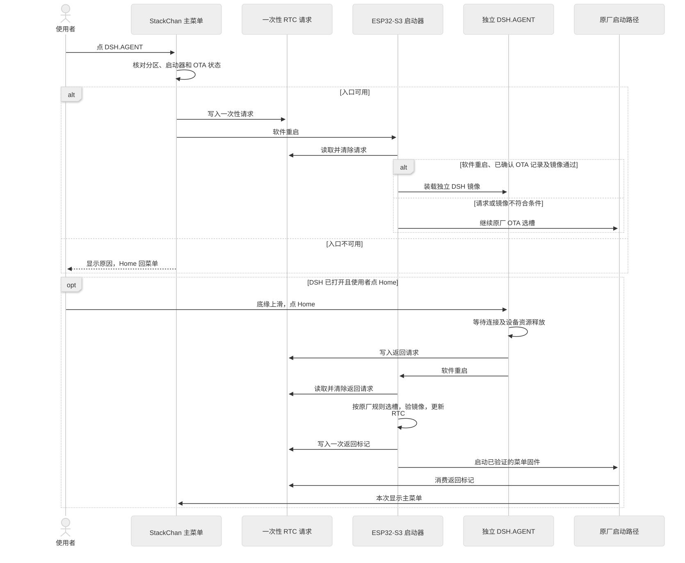
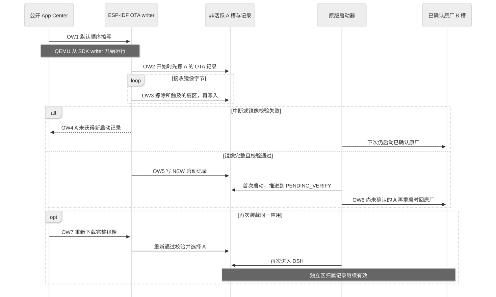
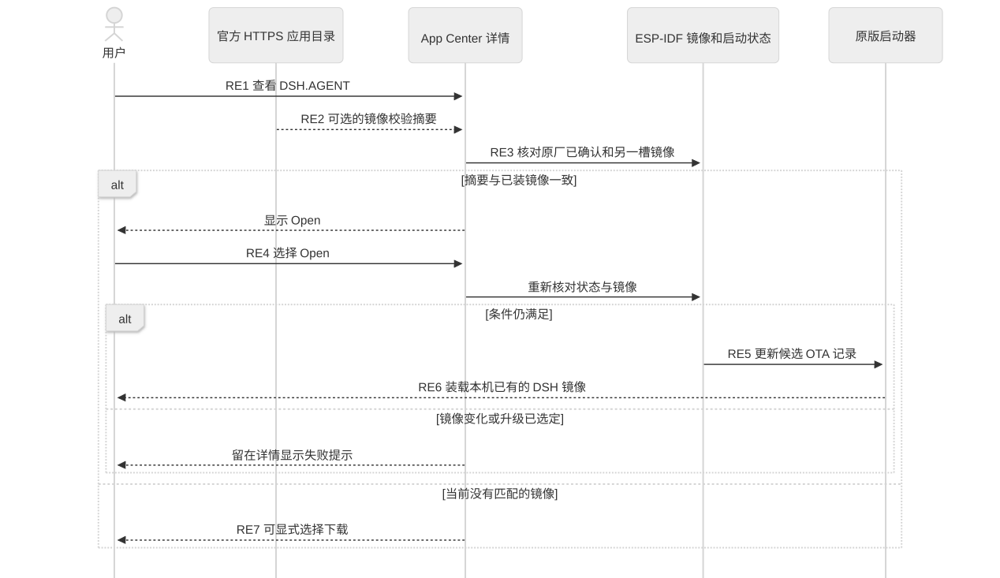
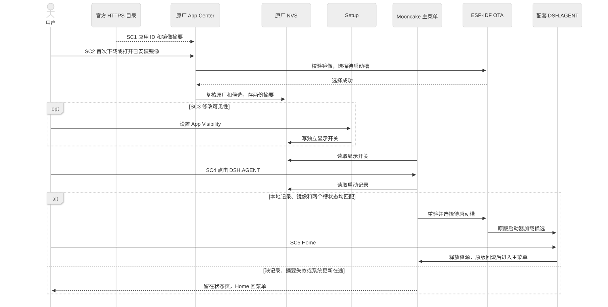
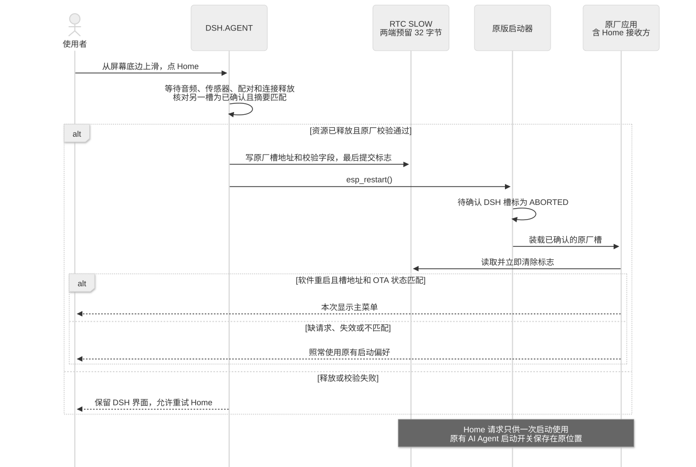
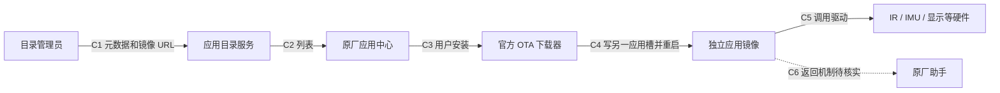

# 应用中心、IR Remote 与 DSH.AGENT

## 从 Sion 主菜单打开 DSH.AGENT

成品操作是从机身菜单点 **DSH.AGENT**，进入 Mac 上选定的 DSH 会话。语音「停止」结束当前对话并停留在 DSH，底缘上滑点 **Home** 回菜单。配套遥控器与 Grove 按钮均为可选配件。现有 v35 USB 入口属于设备联调和恢复验证，DSH 进入后有触屏页面。原厂菜单里还没有 DSH 入口。

- **原厂主菜单。** 锁定的公开源代码在 `app_main` 用 Mooncake 注册 AI.Agent、Avatar、App Center 等入口。自编译可以注册 DSH 应用。上游 issue #134 的 M140 试验实际报告了自编译加入本地应用后小智继续工作，StackChan World 的握手却失败。M5Stack 维护者确认小智连接独立，原厂 M5Stack 服务与 StackChan World 使用未公开的生产鉴权，当前没有自编译接入流程。生产菜单入口应优先寻求 M5Stack 支持的发行或独立应用接缝。 [主菜单注册](https://github.com/m5stack/StackChan/blob/28b9f0c8bd6acd81cb3c70f1a93c3e373b39d400/firmware/main/main.cpp) · [上游鉴权答复](https://github.com/m5stack/StackChan/issues/134)
- **应用中心。** App Center 从服务端目录取得镜像 URL，用户选应用后通过 OTA 写入另一槽并启动。官方公开文档只展示目录管理员管理条目的接口。原厂界面里的第三方入口仍需要 M5Stack 提供分发渠道或受支持的本地导入方式。就算目录上架，也要另验退出后回原厂、下一次屏幕进入以及 OTA 更新共存。 [官方 App Center 客户端](https://github.com/m5stack/StackChan/blob/28b9f0c8bd6acd81cb3c70f1a93c3e373b39d400/firmware/main/hal/hal_app_center.cpp) · [服务端目录说明](https://github.com/m5stack/StackChan/blob/main/server/README.MD#63-add-an-app-store-item)
- **Sion 原机证据。** 重新校验历史双读后，在 `stack-chan 1.6.2` 所在槽中找到 `AI.AGENT`、`APP.CENTER`、`/stackChan/apps` 和 `firmwareUrl` 标记。另一槽的镜像身份为 `ir_remote`。这一结果与公开源代码所示的两条路径吻合。IR Remote 的退出机制以实际应用或上游证据为准。 [原机只读检查](hardware-check.md)

入口验收做两次来回。第一次从原厂主菜单进入 DSH，接原选会话，说「停止」，上滑点 Home。第二次从主菜单再次点开 DSH。验收同时核对原厂 AI Agent 能回答、StackChan World 仍能连同一设备。至此才能把屏幕进入和原厂共存标为交付。试装可以先验设备音频和原厂恢复。

2026-11-19，M5Stack 在 #134 关闭议题。维护者确认公开固件仍使用占位鉴权，自建服务可以使用自有账号和鉴权，保留现有 StackChan World 绑定的公开接入方式仍待发布。维护者将需求记录给产品团队，并建议社区方案另开 Discussion。对 Sion，仍以保留生产鉴权的官方配套发行或受支持的扩展接口为装机前提。 [M5Stack 最新回复](https://github.com/m5stack/StackChan/issues/134)

### App Visibility 与 OTA 槽的关系

用户在 Sion 的 Setup 中看到 **App Visibility**。公开 v1.6.2 的启动代码在同一份固件里注册 AI.AGENT、AVATAR、ESPNOW.REMOTE、APP.CENTER、EZDATA、DANCE 与 SETUP。设置页为其中前六项生成显示开关。它保存 `feature_toggles/visible_mask`，主菜单用这个值筛选已经注册的 Mooncake 应用。Setup 保持可见。Sion 历史备份中的原厂镜像也含相同页面、设置及应用标记。 [菜单注册](https://github.com/m5stack/StackChan/blob/28b9f0c8bd6acd81cb3c70f1a93c3e373b39d400/firmware/main/main.cpp) · [应用显示开关](https://github.com/m5stack/StackChan/blob/28b9f0c8bd6acd81cb3c70f1a93c3e373b39d400/firmware/main/hal/hal_toggles.h) · [v1.6.2 发布变更](https://github.com/m5stack/StackChan/pull/128)

两个 OTA 槽各放一份可启动镜像，每个镜像能包含多个菜单入口。App Center 本身是一个内置入口，它下载的独立应用走另一条镜像写入和启动路径。DSH.AGENT 采用同样的 Mooncake 注册方式成为主菜单图标。保留量产服务的发行版本需要 M5Stack 接入这个入口或提供受支持的扩展接口。是否将 DSH 完整运行时和原厂应用一起装进同一镜像，还要核对共享驱动、内存和应用生命周期。 [官方出厂分区表](https://github.com/m5stack/StackChan/blob/28b9f0c8bd6acd81cb3c70f1a93c3e373b39d400/firmware/partitions.csv) · [上游生产鉴权说明](https://github.com/m5stack/StackChan/issues/134)

### DSH.AGENT 显示设置

启用菜单接入的候选在 **Setup → Apps → App visibility** 加上 **DSH.AGENT**，默认显示。修改开关后从 Setup 回主菜单时，启动器重新读取设置并按注册的 Mooncake ID 筛选图标。Setup 始终可见，随时可以进去重新打开 DSH.AGENT。已有应用登记顺序和 Home 返回索引沿用原版。 [原厂显示功能的社区 PR](https://github.com/m5stack/StackChan/pull/31)

DSH 的开关单独保存为 `feature_toggles/dsh_visible`。只改这项时保留原六项的 `visible_mask`，早期版本存在的逐项键也原样保留。关闭编译选项时按原六项格式读写。DSH 设置缺失或值异常时默认显示，原有六项仍按各自有效的设置加载。Reset 重置屏幕列出的设置，保存失败沿原有设置页流程重新读取。此设置与 AI Agent 自动启动以及 StackChan World 绑定分开。 [设置补丁](../firmware/menu-entry/app_visibility.patch) · [覆盖的场景](validation.md#dshagent-显示开关)

### 触屏启动原型

在锁定的公开 v1.6.2 源码中，菜单用 Mooncake 注册独立的 `AppDshEntry`，放在已有应用之后，保留其登记顺序和返回索引。用户点击后，应用先检查 CPU、启动器版本、当前 OTA 应用和独立镜像标识。条件不符会显示原因，Home 回到菜单。条件符合会在 ESP-IDF 预留的 RTC FAST 内存留下八字节请求，再软件重启。

| 来源 → 消费者 | 数据和失败处理 |
|---|---|
| Mooncake 原厂菜单 → `AppDshEntry::onOpen` | 点击调用命名为 DSH.AGENT 的应用。CPU、布局或 OTA 确认状态不符时留在提示页，不提交重启。 |
| `AppDshEntry` → ESP-IDF 预留 RTC → 配套启动器 | v6.1 应用和 v5.5.4 启动器预留区对齐。请求只在软件重启时有效。消费时清零，旧请求或普通启动仍进原厂选槽。 |
| 配套启动器 → 已校验独立镜像 / 原厂 OTA | 先验证布局，按原 SDK 规则只读核对当前 OTA 记录已确认，再验证独立镜像摘要。通过则装载 test 分区，跳过写原厂 OTA 选择。校验失败继续原厂路径。 |

### 官方升级确认期间的触屏入口

旧触屏候选从待确认的原厂槽进入 DSH 后，点 Home 会触发 SDK 原有回滚，导致这次升级退出。新候选只有在运行槽、下一次启动槽一致且 OTA 记录为 VALID 时才发起 DSH 重启。更新已经排队、首次启动仍待确认或状态读取失败时，显示提示并留在同一固件。用户可按正常 Home 回主菜单，等原厂自己完成确认后再点 DSH。补丁不更改原厂确认条件、不代签确认。配套启动器也拒绝未确认期间残留的 DSH 请求，正常 OTA 仍由 SDK 处理。 [v1.6.2 原厂确认逻辑](https://github.com/m5stack/StackChan/blob/28b9f0c8bd6acd81cb3c70f1a93c3e373b39d400/firmware/main/hal/hal.cpp) · [升级共存](dual-boot-updates.md#触屏入口与官方升级确认)

### Home 返回同一主菜单

配套 v38 在直接进入独立应用后打开会话页面。Stop 收拢本次对话并停留在 DSH。Home 等现有生命周期确认音频、相机、动作、灯环、光线近接、配对维护和连接释放，再在 LVGL 锁释放后提交一次软件重启。

| 来源 → 消费者 | 一次性返回数据和失败处理 |
|---|---|
| DSH Home → RTC → 配套启动器 | DSH 只在确认配套启动器和独立镜像分区后启用。启动器区分进入、返回和已确认的原厂菜单三种请求。断电、其他复位和旧请求被清除。 |
| 启动器 → 公开版主程序 | 返回沿用原厂 OTA 选槽，布局匹配后才传递一次“本次回菜单”。匹配应用在启动时消费请求，原“开机进入 AI Agent”设置不保存新值。普通启动继续遵循已有偏好。 |
| 原厂菜单 → 使用者 | 重新显示 Mooncake 主菜单，使用者可以再次点开 DSH 或选择原助手。原厂实体屏幕、语音与绑定仍按首轮真机流程验收。 |

RTC 预留采用同一协议版本。ESP-IDF 完成回到原厂选槽的镜像验证与 RTC 保留数据更新后，配套启动器才写入返回标记。这样即使 SDK 在更新时清理了无效的保留数据，已验证的原厂镜像仍能收到本次请求。源码、配套启动器和独立镜像只在离线候选中接线。量产部署仍需要保留 StackChan World 鉴权的官方支持路径。 [ESP-IDF RTC 预留区](https://docs.espressif.com/projects/esp-idf/en/release-v5.5/esp32s3/api-reference/kconfig-reference.html#config-bootloader-custom-reserve-rtc-size) · [DSH Home 源码](../firmware/agent/device_main.cc) · [原厂启动消费方](../firmware/menu-entry/menu_device.h) · [触屏往返验收](validation.md#v38-触屏往返与原偏好)

### M5Stack 入口审查包

补丁基于公开 v1.6.2 的固定提交。新增入口通过 `CONFIG_STACKCHAN_DSH_MENU` 单独打开。默认构建省去入口和 Home 返回请求消费者。打开时保留原有 Mooncake 安装顺序，并按当前 OTA 状态决定能否进入 DSH。审查包包含 App Visibility 集成、参考启动器和独立主机测试。在官方固定提交上应用补丁后，可直接运行归档内的 `tests/run.py --stock <检出目录>`。入口验证不需要本仓、固件镜像或设备备份。 [英文审查说明](../contributions/m5stack-stackchan-launcher/README.md) · [可复现导出](../scripts/export_agent_menu_review.py)

维护者需要评审的是量产启动器与菜单入口。现有试验提供源代码、公开参考启动器及首次升级确认回归。部署需要官方确认独立应用及设置的区域、对应用镜像的校验和签名，以及后续官方升级继续带兼容入口。原厂 AI Agent 与手机绑定按官方发行流程验收。 [M5Stack 维护者回复](https://github.com/m5stack/StackChan/issues/134)

v49 的归档记录公开菜单与原版启动器两种试验的证据和边界。暂存菜单时仍从原厂槽启动，未确认重启也回到原厂槽。正式发行需要用官方支持的候选和新双读重新核对。 [恢复方案](installation-recovery.md#v49-首装与恢复核对) · [审查包验收](validation.md#v49-上游入口审查包)

### 保留量产镜像的 OTA 返回试验

已用 Sion 历史双读里的原版启动器、未改分区表和量产 v1.6.2 镜像验证另一种返回方式。独立探针核对另一槽是已确认的原厂镜像，SHA-256 与原存档相符，再利用 ESP-IDF 的显式回退 API 结束当前应用。应用原地保留，只有它的 OTA 启动记录变为 INVALID。原厂槽的 VALID 记录、镜像、启动器和分区表均按原字节保留。模拟在原厂应用入口停止。当前主菜单没有 DSH.AGENT，试验不假定 IR Remote 用了同一种退出方式。 [离线验收](validation.md#量产启动器下的独立应用返回) · [ESP-IDF 回滚 API](https://docs.espressif.com/projects/esp-idf/en/stable/esp32s3/api-reference/system/ota.html#app-rollback)

| 成品条件 | 对应接口及现状 |
|---|---|
| 保留原厂语音和绑定 | 原版启动器可回到同一份量产镜像，模拟读回仅改独立应用的 OTA 扇区。实际云语音、手机绑定及长期更新待真机验收。 |
| 每次从屏幕直接打开 DSH | 公开 v1.6.2 的 App Center 每次从 `firmwareUrl` 下载，没有复用已装镜像的入口。官方 A/B 更新也会复用其非活跃槽。成品需要官方目录授权，以及能以可验证的应用身份重新进入、与官方更新共存的启动机制。 |
| DSH 持久保存配对与偏好 | 已通过运行期登记独立 `sion_cfg`、保存后切回原厂及再次进入读回的仿真。该路径保留原分区表和原助手 NVS。发行前需确认尾部 20 KiB 可正式分配。 [验证记录](validation.md#原分区表下的配对与偏好) |
| DSH Home 直接回主菜单 | 本次交接保留原厂开机设置，若原厂启用了开机进 AI Agent，会照常进入它。公开源码中的原厂 Home 用一次性 `warm_boot/app_index` 记录打开主菜单。未通过探针写入原 NVS。需要原厂支持的返回约定，或保留量产鉴权的 v38 等价入口。 |

可向 M5Stack 确认三个交付接口。官方 App Center 是否接受第三方试发行，量产启动器是否可暴露可重复启动的应用入口，以及应用可否依照文档回到主菜单并拥有独立配置空间。维护者已将生产鉴权 SDK 的建议转达产品团队，并在 #134 邀请开发者使用 Discussions 讨论集成。 [维护者回复](https://github.com/m5stack/StackChan/issues/134) · [StackChan Discussions](https://github.com/m5stack/StackChan/discussions)

社区对照采用 GitHub 仓库元数据记录维护活动。2026-11-19 核查时，这三仓都未归档。 [GitHub 元数据接口](https://docs.github.com/en/rest/repos/repos#get-a-repository)

| 项目 | 最近推送（UTC） | 与量产共存的距离 |
|---|---|---|
| [stackchan_alive](https://github.com/RobVanProd/stackchan_alive/blob/main/docs/LAN_OTA.md) | 2026-10-06 | 它自己的固件已使用 ESP-IDF OTA 回退，并将 Wi‑Fi 和显示健康检查纳入确认。量产 App Center 入口仍无现成方案。 |
| [stackchan-mcp-mod](https://github.com/yaniv-golan/stackchan-mcp-mod/blob/main/docs/device-notes.md) | 2026-09-18 | 设备笔记描述了在 Moddable 宿主上运行其 MOD，并提到另一项带 REMOTE.AGENT 的自编译集成。两种安装都需换用对应固件。 |
| [原开源 Stack-chan](https://github.com/stack-chan/stack-chan) | 2026-11-14 | Moddable 的 MOD 可独立更新，宿主需先换成社区固件。可为官方常驻入口的设计提供参考。 |

### v39 原版启动器候选

完整 DSH.AGENT 候选通过原厂 OTA 生命周期启动。它只接受锁定的量产分区表、自己处于 PENDING_VERIFY、另一槽为已确认且摘要匹配的 v1.6.2。通过后登记独立存储并直进 DSH 会话页。核对失败时在初始化硬件前退出并在日志报告。尾部有未知数据时只禁用独立存储。

Stop 结束会话后留在 DSH。侧边服务、配对维护、音频、动作和网络全部释放后，Home 在显示锁外再次校验原厂槽，再软件重启。原版启动器将仍待确认的 DSH 槽标成 ABORTED 并加载原厂镜像，DSH 自己不改 OTA 记录。Home 核对失败会返回到 DSH 页面并允许重试。若原厂偏好开机进入 AI Agent，回原厂仍照常应用该偏好。

该候选保留冷启动回退，也意味着重新进入需要 App Center 发起另一次 OTA 选择。正式机身入口仍以可重复触屏打开并能回主菜单为验收条件。 [固件连接](../firmware/agent/device_main.cc) · [原厂槽校验](../firmware/app-center/return_to_stock.cc) · [ESP-IDF OTA 回退](https://docs.espressif.com/projects/esp-idf/en/stable/esp32s3/api-reference/system/ota.html#app-rollback)

### v47 原版启动器候选

`dsh-agent-v47-ota` 将当前文字页、音频和设备能力带到原版启动器路线，使用同一份 v47 设备逻辑。它仍要求另一槽是经摘要核对、已确认的量产 v1.6.2。Home 沿待确认的 OTA 回退交接原厂镜像，由原厂启动偏好决定显示主菜单还是自动进入 AI Agent。后续重新选择仍需要官方目录或受支持的入口。 [安装条件](installation-recovery.md#v47-原版启动器的离线装载与恢复) · [v47 构建收据](../firmware/agent-text-app-center-build.json)

V64 中原厂 OTA 写入记录并选择下一次启动。原版启动器将 DSH 的记录推进至待确认，DSH 检查原厂槽与独立存储。用户 Stop 留在 DSH，Home 等资源释放并复核原厂槽。下一次启动由原版启动器完成回退。模拟中的选择与冷重启见审查脚本，设备 Home 则由主机界面测试验证。 [官方 OTA 状态](https://docs.espressif.com/projects/esp-idf/en/stable/esp32s3/api-reference/system/ota.html#app-ota-state) · [DSH 退出流程](../firmware/agent/device_main.cc) · [QEMU 场景](../scripts/audit_app_center_agent.py)

`dsh-agent-v48-ota` 在同一试发行边界增加 USB 待命。6 个整片读回场景均以该版本的实际镜像重跑。回退仍依赖已确认的同一份原厂 v1.6.2。 [v48 验收](validation.md#v48-usb-待命) · [构建收据](../firmware/agent-usb-standby-ota-build.json)

v49 增加独立镜像暂存中断、候选 OTA 记录缺 CRC、尾部分区归属标记写入中断三类离线验收。前两种状态仍可进入原厂镜像。归属不完整时保持现有尾部字节，独立设置不可保存，随后重启仍回到原厂。 [v49 首装核对](installation-recovery.md#v49-首装与恢复核对)

截至 2026-11-19，官方手册描述用户如何下载应用，公开服务端仍只记录管理员添加目录项的接口。维护者在 #134 记录了生产鉴权接缝的建议。若已有第三方试发行渠道，也需要确认该渠道是否允许原厂应用保留、独立存储以及退出后的重复进入。社区 Stack-chan 的 MOD 已可作为宿主上的扩展运行，其发布步骤需要先换用社区宿主。 [App Center 手册](https://docs.m5stack.com/en/StackChan/#app-center) · [目录管理文档](https://github.com/m5stack/StackChan/blob/main/server/README.MD#63-add-an-app-store-item) · [维护者回复](https://github.com/m5stack/StackChan/issues/134) · [社区宿主安装](https://github.com/stack-chan/stack-chan/blob/develop/firmware/README.md)

### 社区 Launcher 的分区先例

StackChan Realtime 的作者报告，在已装 Launcher、原程序和 Muse 的设备上，新增尾部 `ota_2` 并核对其他镜像的校验和。此后从 SD 卡安装单一应用镜像。仓库截至 2026-11-19 未归档，最近推送为 2026-10-31。报告使用的 1.375 MiB 应用槽容不下 v51，且用的是另一份分区表。 [作者的安装与保留记录](https://github.com/huydx/stackchan-firmware#keep-launcher)

bmorcelli/Launcher 截至同日未归档，最近推送为 2026-11-12。它安装独立常驻启动程序，菜单可从 SD 选择应用。其安装流程可能调整分区，还会清理 `nvs.net80211`。上述记录可参考单应用制品和逐区域读回的设计。Sion 继续按保留原厂启动器、绑定和 Wi-Fi 配置的条件审查。 [Launcher 启动与安装说明](https://github.com/bmorcelli/Launcher/wiki/Explaining-the-project)

### v51 的实际 SDK 写入顺序

公开 App Center 只设置 HTTP 配置，交给 ESP-IDF HTTPS OTA 使用默认顺序擦写。历史双读中的原厂应用 v1.6.2 使用 ESP-IDF v6.1。离线试验用同版本的锁定公开 SDK 编译写入夹具，从临时 Flash 副本将 v51 流式送入实际 writer。启动交接使用同一备份中原版 v5.5.4 启动器的实际字节。 [公开 App Center 调用点](https://github.com/m5stack/StackChan/blob/28b9f0c8bd6acd81cb3c70f1a93c3e373b39d400/firmware/main/hal/utils/ota/ota.c#L181) · [SDK 默认选择](https://github.com/espressif/esp-idf/blob/fff9895c82d744c7237be8847347bdd1b07c6643/components/esp_https_ota/src/esp_https_ota.c#L738)

| ID | 生产者 → 消费者 | v51 验证与边界 |
| --- | --- | --- |
| OW1 | App Center → SDK writer | 公开配置为顺序擦写。QEMU 的写入夹具从 `esp_ota_begin` 开始。官方目录、网络、实际量产应用是否采用相同配置仍需另验。 |
| OW2 | `esp_ota_begin` → 非活跃 A 的 OTA 记录 | 已确认原厂 B 保留。在历史双读上，先擦除 A 的 `0xd000–0xe000`，此时还没擦应用数据。旧 A 记录状态为 ABORTED，但 CRC 完整。 |
| OW3 | `esp_ota_write` → 非活跃 A 槽 | 4,133 字节中断时触及两个 4 KiB 扇区。完整 v51 仅触及 `0x20000–0x1d0000`。保留原厂 B、原厂 NVS 和语音资产。 |
| OW4 | 中断或校验失败 → 旧原厂启动 | A 没有新的启动记录，A 的已擦扇区和被清空的记录均需纳入完整撤销。中断后重新下载时，A 原记录已空白，SDK 直到通过完整校验后才重新写选择记录。 |
| OW5 | 校验通过与 `esp_ota_set_boot_partition` → A 的启动记录 | 写入 NEW 后，原版启动器首次推进到 PENDING_VERIFY 并到达候选入口。 |
| OW6 | 再次重启 → A 的记录与原厂 B | 未确认的候选转为 ABORTED，原版启动器到达原厂 v1.6.2 入口。原厂在线语音和绑定须实机验证。 |
| OW7 | 重新下载 → 写入器、原版启动器、DSH | 从已经回原厂的副本再次完整下载并完成选槽，原版启动器再次到达 DSH HAL。第一次运行写入的独立区归属记录逐字节保留。此处验证重复下载后的路径。 [实测回归](validation.md#v51-app-center-实际-sdk-擦写) |

复现和确切扇区见 [安装与撤销核对](installation-recovery.md#v51-app-center-试发行的写入和撤销)。完整 DSH 的首次启动另会在通过布局核对后登记独立设置，见 [V64](#v47-原版启动器候选)。

v53 使用同一 SDK 写入规则，分别从两个已确认的原厂槽实测。`esp_ota_begin` 成功后，即使随后没有应用数据写入，另一槽的旧 OTA 记录也已经被擦除。撤销时将该记录与实际触及的镜像扇区一起纳入读回。 [两个方向的实测范围](installation-recovery.md#v53-双槽安装写入与撤销范围)

撤销预检同时对照安装前和当前的双读。若完整写入并回退后，OTA 记录恰好与之前的 ABORTED 记录完全相同，报告只列仍有差异的镜像扇区。候选仍待确认时先等回到原厂，不提出恢复扇区。 [只读流程 V72](installation-recovery.md#撤销范围的只读核对)

### 打开已安装应用的上游补丁

公开版 App Center 已实现可选的 **Open**。用户在应用详情直接启动仍留在非活跃槽中的已安装镜像，省去再次下载和写入镜像。功能默认关闭，需官方应用构建启用，并由官方 HTTPS 目录声明可再次启动的精确镜像。固件选用标准应用回滚的配置。原厂量产版本仍走其现有入口。 [上游源码补丁](../contributions/m5stack-app-center-reopen/reopen.patch) · [英文接入说明](../contributions/m5stack-app-center-reopen/README.md)

| ID | 生产者 → 消费者 | 条件和结果 |
| --- | --- | --- |
| RE1 | 用户 → App Center | 选择应用进入详情。在 LVGL 显示锁之外核对镜像。 |
| RE2 | HTTPS 应用目录 → 详情 | 可选字段 `reopenImageSha256` 为 64 位小写十六进制字符。值取 ESP 应用的 validation hash。目录没有该字段时保留原有 Launch。 [摘要 API](https://docs.espressif.com/projects/esp-idf/en/v6.1/esp32s3/api-reference/storage/partition.html) |
| RE3 | 详情 → ESP-IDF | 只支持标准两个 OTA 槽，当前运行槽也是已选中并确认的槽。另一个槽须处于 ABORTED，且通过 ESP 镜像摘要校验。通过时显示 Open。 |
| RE4 | 用户 Open → App Center HAL | 点击时重验镜像和当前选槽。校验失败留在详情并显示提示，继续下载需再次点按钮。 |
| RE5 | App Center HAL → SDK | 调用 `esp_ota_set_boot_partition`。QEMU 中成功写入的范围只有候选 OTA 扇区。与已排队的系统升级冲突时维持原选择。开启 SDK anti-rollback 的构建无法启用这个入口，因为其选槽 API 可能擦除版本过旧的镜像。 |
| RE6 | 原版启动器 → DSH 或已确认原厂 | 候选首次进入待确认。仿真通过两次进入和回原厂，完整比对证实镜像没有重写。带配套 Home 接收方时，显式 Home 只在这次进菜单。普通启动照常应用原厂偏好。 [v52 两次往返](validation.md#配套-v52-的两次打开与返回) |
| RE7 | 下载按钮 → 原 App Center OTA | 无匹配摘要时，用户可明确选择下载。针对声明了本功能的目录项，下载动作仍先核对原厂是否已确认且无其他启动选择。普通目录项的路径继续使用原下载器。 |

现有 Setup 升级和 App Center 在同一应用任务同步运行。以后如果增加后台写入器，需要同步协调其选槽和检查。官方更新可以复用非活跃 OTA 槽，届时摘要不再吻合。正式配套 DSH 镜像须使用支持这一入口的原厂发行版摘要复核返回。主菜单直接显示 DSH 图标和 Home 的原厂行为仍由官方常驻入口决定。 [官方 A/B 边界](dual-boot-updates.md#官方升级具体会动哪里) · [验证记录](validation.md#app-center-重复打开已安装镜像)

### App Center 应用的主菜单快捷入口

公开 v1.6.2 的默认关闭补丁支持直接从主菜单点 **DSH.AGENT**。整合构建保留原版启动器与分区表。初次由用户在官方 App Center 下载，或对已经装好的匹配镜像点一次 Open。之后可离线从主菜单重复打开。正式入口仍依赖带生产鉴权的官方配套接收方和已分配的应用条目。当前 `31337` 仅供开发构建与仿真。 [源码补丁和启用说明](../contributions/m5stack-app-center-shortcut/README.md) · [官方 App Center](https://docs.m5stack.com/en/StackChan/#app-center)

| ID | 生产者 → 消费者 | 条件和结果 |
| --- | --- | --- |
| SC1 | 官方 HTTPS 目录 → App Center | 构建指定数值型 `id`，目录同时提供 `reopenImageSha256`。本地记录由一次明确的 App Center 操作建立。 |
| SC2 | 用户下载或 Open → OTA → App Center → NVS | ESP-IDF 成功选中候选后，复核原厂已确认、DSH 镜像有效、版本标识及已公布摘要。`app_dsh_menu/launch_v1` 保存原厂和候选摘要。NVS 保存失败留给用户下次从 App Center 建立。 |
| SC3 | Setup → NVS → Mooncake 主菜单 | `feature_toggles/dsh_visible` 默认显示，沿用独立设置键。主菜单中的其他入口和原厂显示开关照常。 |
| SC4 | 主菜单快捷入口 → NVS 和 OTA | 读取记录后复核镜像和选槽。原厂升级、应用被替换、记录无效或更新进行时留在状态页。成功路径无需网络、重下应用或写 NVS。 |
| SC5 | DSH Home → 原版启动器 → Mooncake 主菜单 | 复用一次性返回。DSH 配套构建锁定这份原厂接收方摘要。 [Home 接口](#一次性-home-返回原厂菜单) |

核对运行中的原厂镜像时，先由 ESP-IDF 解析镜像范围，再以固定的 4 KiB 缓冲区分块读取，计算 SHA-256 并与镜像末尾保存的摘要比对。这样不会为了计算摘要把正在执行的应用映射成一片新的 Flash 区域。非运行中的 DSH 镜像沿用 SDK 分区摘要和选槽接口。快捷入口读错或摘要不匹配时显示状态。首次登记遇到此类错误则不保存记录，App Center 已完成的选槽仍生效。 [ESP 镜像格式](https://docs.espressif.com/projects/esp-idf/en/v6.1/esp32s3/api-reference/system/app_image_format.html)

### App Center 的量产接入审查包

此包面向 M5Stack 的生产构建与 App Center 维护方。它包含按 Home、Open、主菜单快捷入口排列的补丁、公开 SDK 与依赖锁、主机测试和目标探针源码。导出前用全新的公开检出重放补丁，校对每个修改文件，再把实际编译的原厂接收方和 DSH 镜像摘要与离线报告对上。归档只包含公开源码与合成试验摘要。 [量产评审说明](../contributions/m5stack-app-center-shortcut/PRODUCTION-REVIEW.md) · [导出脚本](../scripts/export_app_center_review.py)

v54 审查包绑定同一公开接收方和 `dsh-agent-v54-home-ota`。新增的 SDK writer 验证矩阵按原厂槽位列实际完整擦写范围。导出要求矩阵对应同一候选及锁定 SDK，核对两个槽位的写入、首次启动与恢复交接。M5Stack 可以用此矩阵审查正式包同位置的写入与恢复行为。 [v54 审查包验收](validation.md#app-center-量产接入审查包)

维护者需要确认能否在生产流程中带上接收方，提供正式测试目录 ID 和精确镜像摘要，并支持原有两槽状态与独立配对区域。发行方保管生产鉴权。使用者的首装与回退继续采用现场双读和同一台 Sion 的语音、绑定验收。拿到正式材料后可先用只读预检验证下载实际字节和回退边界。 [量产鉴权回复](https://github.com/m5stack/StackChan/issues/134) · [首装证据预检](installation-recovery.md#app-center-首装证据预检)

### 一次性 Home 返回原厂菜单

在保留原版启动器和分区表的 App Center 路线上，配对实验给公开原厂应用增加了默认关闭的 Home 接收方。它只在这一次启动进入 Mooncake 主菜单。平时仍读取原有 `startAiAgentOnBoot`。原版量产 v1.6.2 仍按自己的启动偏好选择界面。 [原厂启动补丁](../contributions/m5stack-app-center-home/home.patch) · [官方导航](https://docs.m5stack.com/en/StackChan/#ui-navigation)

| ID | 生产者 → 消费者 | 条件和结果 |
| --- | --- | --- |
| HM1 | 屏幕 Home → DSH 生命周期 | 走现有资源回收，等音频、相机、动作、灯光、传感器、配对维护和载体释放。普通 Stop 留在 DSH。 |
| HM2 | DSH 应用任务 → 两端预留的 RTC Slow | 显示锁外重查布局、当前待确认选槽和另一槽的 VALID/镜像摘要。通过后写目标地址、反码和版本标志。标志最后提交。DSH 启动时先清除旧标志。 [DSH 入口](../firmware/agent/device_main.cc) · [原厂镜像确认](../firmware/app-center/return_to_stock.cc) |
| HM3 | `esp_restart()` → 原版启动器 → 原厂应用 | 启动器按正常 OTA 规则把 DSH 槽标为 ABORTED，再装载已确认的槽。两端链接器从 `0x50000020` 起分配 RTC Slow，保留的前 32 字节不装载 ULP 程序。 [ESP-IDF 内存说明](https://docs.espressif.com/projects/esp-idf/en/v6.1/esp32s3/api-guides/memory-types.html#rtc-slow-memory) |
| HM4 | RTC → 原厂 `app_main` | 读取即清除。仅接纳 `ESP_RST_SW`，运行和启动选择都须等于请求中的槽，当前槽须 VALID，另一槽须 ABORTED。断电、普通重启、残缺和错槽仍按默认启动规则。 [共享协议](../firmware/app-center/home_menu_request.h) · [ESP-IDF 复位类型](https://docs.espressif.com/projects/esp-idf/en/v6.1/esp32s3/api-reference/system/misc_system_api.html#reset-reason) |
| HM5 | 原厂 `app_main` → Mooncake → 使用者 | 接纳请求后，在这次启动运行启动器。请求层不修改 NVS。原厂启动器原有的配置检查和历史位置恢复继续执行。正式界面和两次往返需现场验收。 |

公开构建用于评审两端交接。M5Stack 仍需在有生产鉴权的版本中提供接收方和目录入口，DSH 镜像才可绑定该发行镜像的确切摘要。开发探针的 Flash 比对覆盖原厂配置和资源所在区域。 [验证](validation.md#原版启动器的一次性-home) · [安装边界](installation-recovery.md#一次性-home-候选的安装边界)

配套 v52 已在带独立配对和偏好的同一份副本上跑完两次 Open 和 Home。重复打开省去镜像下载，返回后独立配对仍可读。若系统更新已经选槽，Open 让出本次启动选择。更新若已覆盖 DSH 镜像，旧目录摘要会被拒绝，需等兼容候选重新安装。 [重复进入与更新冲突的验证](validation.md#配套-v52-的两次打开与返回)

### 升级后识别原厂所在槽

v53 的 `--app-center-baseline` 可以读取原厂在 `ota_0` 或 `ota_1` 的双读。从有效 OTA 记录的 `ota_seq` 识别槽，要求选中的镜像已经 VALID，且原厂镜像版本、布局和安全条件仍在已审查范围。生成的返回校验绑定确切镜像摘要，运行时再核对当前槽与另一槽，不把历史 B 槽写进应用。 [准备脚本](../scripts/prepare_agent.py) · [OTA 状态](https://docs.espressif.com/projects/esp-idf/en/v6.1/esp32s3/api-reference/system/ota.html#app-ota-state)

曾安装过 DSH 的设备可以保留自己的配对和偏好。尾部全空或带有与完整分区表匹配的独立归属记录时，可以准备候选。无标记的非空尾部、不完整标记或归属扇区中的额外数据会使准备流程退出。此检查只确认配置区归属。实际数据是否可读，在重进时由设备存储代码验证。 [配对区审查](../scripts/app_center_baseline.py) · [安装与回退](installation-recovery.md#一次性-home-候选的安装边界)

## 已核对的链路

| ID | 生产者 → 消费者 | 事实与依据 |
|---|---|---|
| C1 | 管理员 → 服务端 app_store | 官方 server/README.MD §6.3 和 api/admin/v1/app_store.go 提供名称、图标、描述、firmwareUrl 的新增接口；需要管理员身份。自建服务的管理能力不能推导为拥有官方目录管理权 |
| C2 | 服务端目录 → 原厂 App Center | hal_app_center.cpp::fetchAppList GET /stackChan/apps，解析应用元数据和固件 URL；来源由服务器配置决定 |
| C3 | 用户点击安装 → OTA 下载器 | app_app_center.cpp::onRunning → Hal::launchApp → start_ota_update；view 提供详情与安装进度。不是加载动态链接插件 |
| C4 | OTA 下载器 → 非运行应用槽与启动选择 | ota.c 调用 esp_https_ota_begin/perform/finish，成功后 esp_restart；SDK 下一槽选择见 dual-boot-updates.md。该链路不负责复制原 NVS 或 assets，也不是整片擦除操作；新应用启动后会否写共享区要另审 |
| C5 | 新应用 → 自己的界面/硬件 | 官方文档将跳管小游戏、IMU 稳定器、万能红外学习遥控器列为应用中心实例。官方 Arduino IR 教程展示直接收发 NEC 信号；它不是商店 IR Remote 完整源码 |
| C6 | 新应用退出 → 原厂启动 | 独立探针已用原版启动器离线验证显式回退。IR Remote 的完整源码与自身返回契约仍待确认 |

固定源码：m5stack/StackChan @ 28b9f0c8bd6acd81cb3c70f1a93c3e373b39d400，路径均相对于 firmware/main 或 server。本轮核对了 C1–C4 具体实现；C5 商店应用功能来自官方说明，未把功能说明视为完整源码审查。

## IR Remote 查到了什么

既有只读备份的 ota_0 包含 ir_remote / 1b7145c，原助手在 ota_1；备份 SHA 已重新核验一致。先前 OTA 元数据为 ABORTED，说明该槽不是当前有效原助手备用。**不能区分主动退出、未确认回退或运行失败，也不能据此证明“重启即可切回”。** 本轮只对本地副本提取少量启动/返回相关标签，没有打开设备串口或改变状态。

已搜索官方主仓、官方 GitHub 仓库和公开搜索索引，未定位对应完整 IR Remote 工程或 1b7145c 源提交；该结论有搜索范围限制。官方 IR 示例使用 IRremote 库初始化接收/发送、解码地址和命令、发送 NEC 并恢复接收；学习存储、完整协议覆盖和返回系统仍不是该示例所证明的能力。

## 手册导航与跨镜像返回的区别

官方手册 UI Navigation 明确底部上滑显示 Home，点击返回主菜单；用户报告 Sion 也支持上滑两次。此前将 AI.AGENT 返回笼统描述为“通过重启”会误导用户操作，应纠正为上滑/Home。固定公开源码中的 warm reboot 只是其内部回调，不表示用户需要操作重启键，也不能用它证明商店独立镜像的返回契约。保留现有上滑/Home 操作作为 DSH.AGENT 的交互目标；跨镜像实现仍单独验收。

## 对我们的决定

采用同类独立设备应用作为开发方向：DSH.AGENT 提供音频、相机、表情、动作与连接管理，Mac 提供本地 ASR/TTS，原选定 DSH 会话拥有人格/记忆。需要 IR 时增加共享驱动能力，不要求同时启动商店 IR Remote。

**应用结构与分发授权分开。** 可以构建适配已知分区的 ESP 应用镜像；官方应用中心上架尚未有公开接入流程证据。M5Burner 社区固件发布也不能自动当作机身 App Center 上架。自建目录理论上有官方服务器代码支持，但重定向原厂全局服务地址可能影响绑定和官方服务，本项目不采用这种未经验证的改动。

C6 返回使用可验证的原应用身份与分区，不固定原厂槽号。退出先回收音频和动作。v39 用一次启动待确认的 OTA 模式验证量产回退，常驻触屏路径继续要求 DSH 独立于原厂 A/B 槽。两条路径都保护原厂配置。官方升级和再次下载其他应用的槽位冲突见 [升级共存](dual-boot-updates.md)。

实施接缝与验收：P1 新应用入口及资源生命周期；P2/P3 语音与会话；P5 能力；P0/P7 明确安装入口、写入范围、保留分区、手动返回、故障恢复、官方升级后的重装规则。关闭安装门槛需要真实退出/断电/失败恢复及原语音和绑定验证；当前全部未作真机安装验收。既有 preservation-trial-v3 不能直接标为商店兼容成品。

## 来源与返回路径

- [官方设备文档：App Center](https://docs.m5stack.com/en/StackChan/)
- [官方应用中心客户端](https://github.com/m5stack/StackChan/blob/28b9f0c8bd6acd81cb3c70f1a93c3e373b39d400/firmware/main/hal/hal_app_center.cpp)
- [官方 OTA 实现](https://github.com/m5stack/StackChan/blob/28b9f0c8bd6acd81cb3c70f1a93c3e373b39d400/firmware/main/hal/utils/ota/ota.c)
- [官方服务端管理说明](https://github.com/m5stack/StackChan/blob/28b9f0c8bd6acd81cb3c70f1a93c3e373b39d400/server/README.MD)
- [官方 Arduino IR 示例](https://docs.m5stack.com/en/arduino/stackchan/ir_nec)

返回 [成品计划](product-plan.md) · [原机证据](hardware-check.md) · [安装恢复](installation-recovery.md)。本页记录源码/文档研究，不代表官方为 DSH.AGENT 背书或设备已运行新应用。
