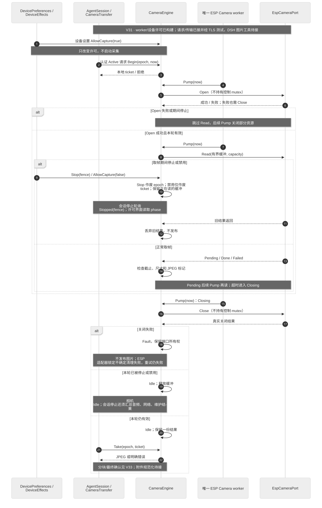
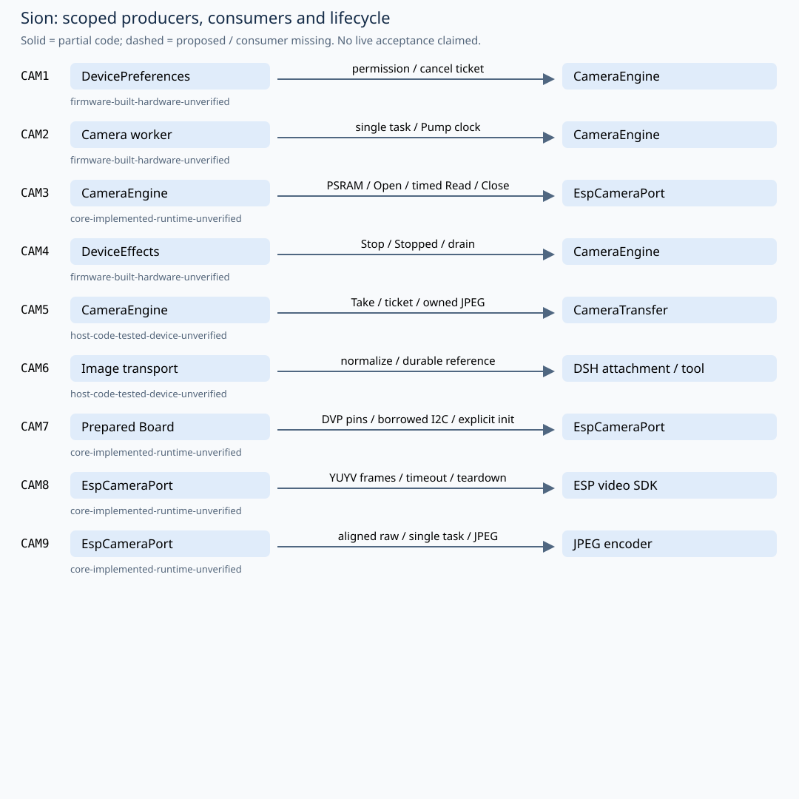
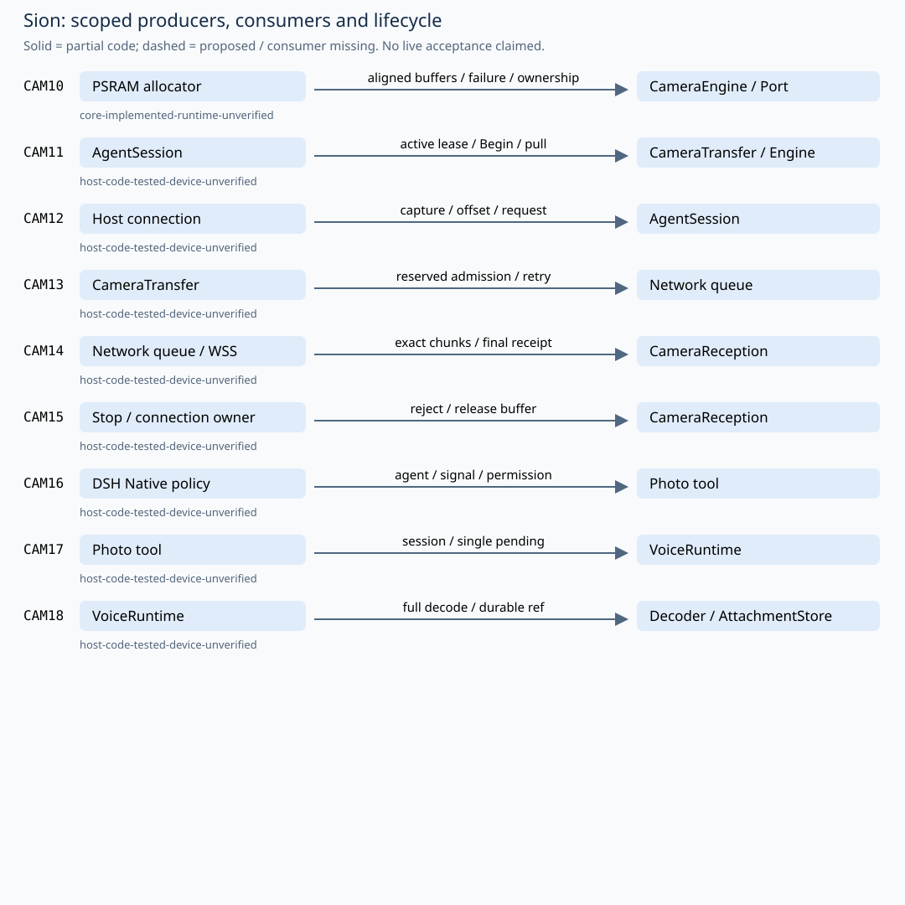
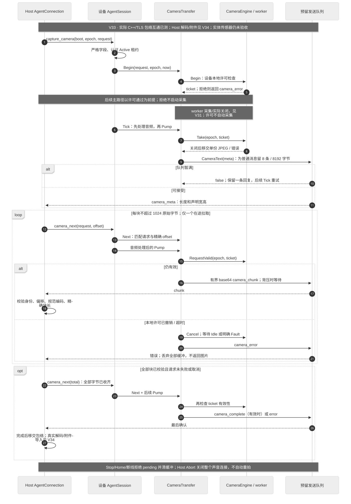
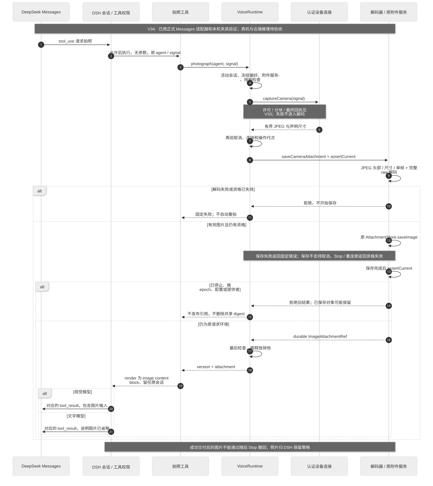
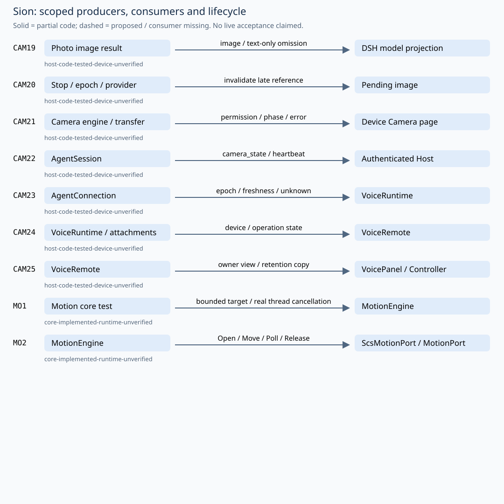
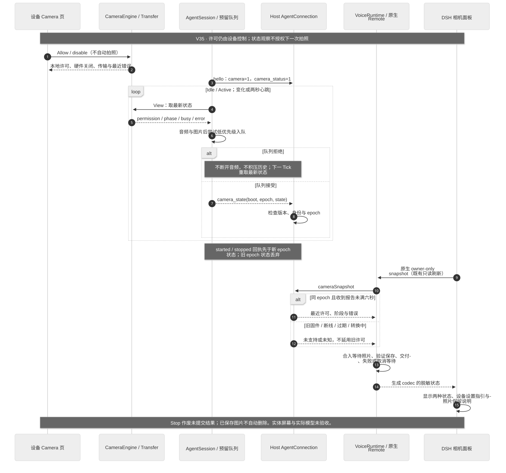

# 相机：采集资源、图片传输与 DSH 消费

相机状态新进展：设备端已实现 camera_status:1 / camera_state，许可、硬件阶段、传输和最近错误经认证连接投影到 DSH 相机面板；Host 另报等待照片、验证保存、已交付、失败和作废等待。旧固件/过期报告显示未知，许可仍只在设备修改。实现与验证范围见 [两端状态](#两端相机状态与照片保留说明)；v20 目标构建与源码/镜像核验已通过，见 [收据](../firmware/agent-camera-status-build.json) 和 [验收](validation.md)；尚未安装或进行真机验证。

Host 新进展：`stackchan_take_photo` 已接原生工具权限、当前已接通会话、完整 JPEG 解码和原 DSH AttachmentStore。真实回环 TLS → VoiceRuntime → 原生工具 → 本地附件服务的组合通过，设备对端使用生成图片；没有实体采集或真实模型请求。两端相机状态投影已接并通过本地验证；用户实例和真机仍未完成，见下方 [DSH 图片消费](#dsh-图片消费与结果提交)。

最新 v19 已将认证拍照请求、相机任务与有界图片回传接通；完整构建 `dsh-agent-v19` 为 2,141,376 字节，SHA256 `0944acd34384d93e7666650e32c386f61692bf705c98197340112a2b7651d48f`，见 [构建收据](../firmware/agent-camera-transfer-build.json)。比 v18 增加 4,800 字节，原分区表未变；对齐并预留配置后仍缺 126,976 字节（124 KiB），尚不可安装。真实 TLS/C++ 已验证合成包络的最大 256 KiB 回传、音频并行与取消；Host 解码/工具现已另行接线，DSH 相机设置投影、实体相机与安装恢复仍未完成。

此前 v18 已接相机 worker、设备许可与 Stop/Home 释放汇总，最终 ELF 保留实际驱动。完整构建为 `dsh-agent-v18`，2,136,576 字节，比 v17 增加 72,624 字节；[构建收据](../firmware/agent-camera-runtime-build.json)。分区表未变，按对齐并预留 16 KiB 配置后仍缺 122,880 字节，尚不可安装。该 v18 镜像未包含拍照协议；当前源码新增请求/分块回传，见下方传输契约。DSH 图片工具/设置和真机验收仍待完成。

归属 P5/A6，与 P4 停止、P8 两端设置交叉。成品要求：选定 DSH 会话能请求真实照片、看到明确能力/权限/失败结果，图片经原 DSH 附件管线消费；拍照不阻塞收音和 Stop/Home，不新增人格或视觉代理。采集核心与 ESP 驱动适配已有源码和 SDK 夹具；固件 worker、设备许可与生命周期释放已接线并完整构建；当前源码已接请求/分块回传并通过本地 TLS/C++ 测试，声明 camera:1 表示协议支持；DSH 工具已接 Host，设置状态投影与真机仍未完成。构建证据单独记录，不把编译成功当可拍照。

## 官方依据与接入决定

2026-11-19 重读 [官方 StackChan 手册](https://docs.m5stack.com/en/StackChan/)：GC0308、640×480、ESP32-S3、8 MiB PSRAM。固定官方提交 `28b9f0c8bd6acd81cb3c70f1a93c3e373b39d400` 的 `firmware/main/hal/board/stackchan_camera.cc` 中 Capture 先调用 `hal_bridge::app_play_sound(OGG_CAMERA_SHUTTER)`；其父类 EspVideo::Capture 默认预览并丢两帧。StreamCaptures 关闭预览/丢帧，但仍调用相同阻塞 DQBUF。独立应用不能直接把这些方法放到 UI/会话任务或重新启动原 AI 声音服务。

固定构建依赖 espressif__esp_video 的 esp_video.c 默认 dqbuf_timeout_ticks=portMAX_DELAY；esp_video_ioctl.c 支持 VIDIOC_S_DQBUF_TIMEOUT，参数 timeval，内部转换为 RTOS tick，等不到 ready_sem 返回 ESP_ERR_TIMEOUT，VFS 映射为 ETIMEDOUT。EspVideo 的私有 fd 不能由外部随意设超时；本批采用独立 EspCameraPort 调用官方 V4L2/编码 API。设置取帧超时不证明初始化、JPEG 编码、STREAMOFF、close/deinit 的所有路径都有时限；互斥与 I2C 仍可能等待，任务不得强制删除后假称硬件已停。

本机固定 DSH SDK 0.2.2-rc.3 的 dsh-tools/contracts.ts 允许工具 render 返回 ContentBlock[]；dsh-llm/content.ts 使用 durable ImageAttachmentRef，并为 text-only 模型生成明确的省略提示。现沿原 AttachmentStore 的导入/规范化路径，不能仅返回 base64 字符串或文本路径就声称模型看到了图。工具调用仍校验选定会话、原权限管线与本次有效租约，不添加第二份 system prompt。

## 已实现的采集核心

权威实现：[camera_engine.h](../firmware/agent/camera_engine.h)，验证：[camera_engine_test.cc](../firmware/agent/camera_engine_test.cc)。CameraEngine 的控制方法可与唯一 Pump worker 并发；CameraPort::Open/Read/Close 只属于 worker，调用期间不持有引擎 mutex。端口必须有界返回，Read 可 Pending；即使 Open 失败也要 Close 清理部分资源。只有 Close 成功后才允许 Take 取得图片/错误。Close 失败保留 Fault 和端口所有权，Stop 可显式重试关闭；绝不提前报告 idle。

默认 allowed=false。Begin 要求显式许可、非零且未失效的 epoch、Idle、没有待取结果；返回单调本地 ticket，零表示拒绝。一个活动 epoch 可以顺序拍多张，但不能并发拍摄或覆盖未消费结果。ticket 不是 wire request_id；AgentSession 校验 boot/epoch/请求关联，Begin 本身不提供网络鉴权。

核心最多持有一份 256 KiB 编码缓冲，尺寸非零且不超过 640×480；这里只检查大小和 JPEG 起止标记，不能证明 JPEG 可解码或尺寸与码流一致。Mac 端必须实际解码/规范化后再提供附件。目标使用 16 字节对齐、SPIRAM|8BIT 专用分配与匹配释放；普通主机测试使用 nothrow new，SDK 夹具单独检查 ESP 分配路径。分配失败返回 Memory，不触碰端口。结果移交后内存归调用者；其传输队列也必须独立受限，驱动的原始帧内存另计。

5 秒从 Begin 的单调毫秒开始计，是设计限制而非实测延迟。每次 Pump 检查截止与时钟回退，超时仍等待 Close；无法中断正在执行的端口调用。Stop 先使本轮 epoch 无效、清待取结果，worker 返回的旧帧不能发布；正在 Read 的缓冲只由 worker 释放。Stopped 只有匹配 fence 且 Idle 才 Done，Fault 返回 Failed。会话 Stop 后需要新 epoch。设备禁用相机只取消当前 ticket，不封锁仍有效的音频 epoch；关闭完成、重新许可后，同一会话可用新 ticket 请求。两种取消都丢弃旧结果，重新许可不会自动拍照。

## ESP 驱动适配与不可重试的关闭

实现：[EspCameraPort](../firmware/agent/camera_port.cc)、[接口](../firmware/agent/camera_port.h)；[准备脚本](../scripts/prepare_agent.py)将官方 Board 原 InitializeCamera 的引脚/I2C 配置改为显式 InitializeAgentCameraVideo 接缝，仅初始化 DVP，不构造原 AI camera。板初始化依然不调用它。SCCB 使用 init_sccb=false，借用已有 I2C bus；固定 esp_video_init.c 仅把自己创建的 bus 放入清理表，不把该借用 bus 注册为自有资源。camera_runtime.cc 以板级生命周期对象持有唯一端口/引擎，仅其 worker 调用 Pump。

端口固定请求 640×480 YUYV，S_FMT 后 G_FMT 重验尺寸、格式、行距与帧大小；不支持就明确失败，不悄悄缩小或把错误像素格式交编码器。该 GC0308 模式存在于当前固定 SDK 配置，颜色/方向/实际曝光仍待真机。只申请一个 V4L2 帧缓冲，额外分配 614,400 字节对齐 PSRAM 原始副本；丢两帧后复制、归还驱动缓冲，再用 esp_new_jpeg 编码为 quality=75、420、task_enable=false。DQBUF 设置 50 ms，超时返回 Pending；这是取帧等待配置，不是整个编码或 Stop 的实测上限。

SDK mmap 失败返回 NULL（也防御 MAP_FAILED）；munmap 在该版本是空操作，真正帧缓冲释放发生在成功关闭视频设备。正常关闭顺序为 STREAMOFF → munmap → close → DVP deinit → encoder close → 原始副本释放。仅视频取帧、raw 副本和核心 JPEG 缓冲的配置总量为 1,490,944 字节，另有 DMA/驱动/编码器及其他服务占用；不是峰值测量，图片移交后传输也须限制内存。

以下失败锁定 poisoned 状态，Close 持续失败，不重试同一 SDK 对象、不允许重新 Open：

| 失败点 | 不能盲目重试的源码原因 |
|---|---|
| video 初始化或 STREAMON | 上游回滚中若干关闭错误被忽略，返回失败不证明所有部分资源已归还 |
| STREAMOFF | 传感器、控制器 stop/disable/delete 分阶段执行，后段失败会留下部分已关闭状态 |
| POSIX close | 固定 IDF esp_vfs_close 无论回调是否成功都 unregister_fd；旧编号可能已被别处复用 |
| DVP deinit | destroy_dvp_video_device 先删 SCCB、sensor，再销毁设备/端口；中途失败不是可重复事务 |
| munmap / encoder close | 无法从失败判定是否完整释放，保留故障，不重复操作不确定句柄 |

这是明确故障语义，不是自动恢复方案。设备 Camera 设置页现已显示相机释放失败，不能宣布整体 idle/Home 成功，也不能偷偷重启或改原厂启动；实际恢复机制仍需安装/真机阶段验证。常规格式/分配/取帧/编码失败在可确认的 Close 成功后返回具体错误，允许新请求。

## 设备任务、许可与关闭汇总

[camera_runtime.cc](../firmware/agent/camera_runtime.cc) 的 StartCameraWorker 在 app_main 启动时创建空闲任务，重复调用不新建；创建失败返回 false，UI 显示服务不可用。栈 12,288 字节、优先级 1、每轮让出至少一个 tick（配置 10 ms）；这些是配置，不是栈峰值或延迟测量。AgentSession 在认证 Active 租约下响应 capture_camera 才调用 Begin；是否允许仍由设备本地许可决定。

先核对 [官方 IDF FreeRTOS 文档](https://docs.espressif.com/projects/esp-idf/en/stable/esp32s3/api-reference/system/freertos_idf.html)：IDF 栈大小按字节计，任务不得返回；正在持有锁或资源的任务不应由另一核强行删除。固定工具链仍为 v6.1。Camera worker 与板同寿命，Home 后关闭相机并继续空闲，不销毁任务冒充设备已关闭。

设备 Settings → Camera 有 Allow / disable、Save、Stop、Back 和 Home；许可不触发拍照。许可由 [设备偏好 v2](device-settings.md#字段线程和失败) 独立保存；旧 v1 默认关闭，无自动迁移写入。禁用取消当前图片，不停止音频；Stop/Home/断线/租约退出经 DeviceEffects 同时 fence 音频与相机，释放汇总等待两者、网络和配对维护。相机失败则整体失败，关闭未完成不能 Home；Connect、Allow USB 和 Save 也要求相机 Idle 且无待取结果。

图表来源：CameraEngine::Begin/Pump/AllowCapture/Stop/Stopped/Take 与 device_main.cc 的 DeviceEffects/camera_idle。V32 区分相位与 result_ready；Idle 本身不等于可以接新请求。Fault 的引擎重试入口不保证 ESP 驱动可恢复：poisoned 端口继续失败。此图是源码状态投影，不是物理采集验收。

## 顺序与影响范围

图表来源：CameraEngine::Begin/Pump/Stop/Stopped/Take、EspCameraPort 及线程/SDK 测试。真实 worker 与 AgentSession → CameraTransfer → Begin/Take 已接；目标 v19 已完整构建，TLS/C++ 互通使用合成 JPEG 标记数据，SDK 适配夹具不是硬件验收。引擎支持端口声明可重试的关闭；EspCameraPort 的不确定清理失败会持续拒绝重试，不会被下一次 Stop 变成假成功。

| ID | 生产者 → 消费者 | 数据、失败与实际范围 |
|---|---|---|
| CAM1 | DevicePreferences → CameraEngine | 设备许可/撤销已接线；不触发 Begin，不停止音频 |
| CAM11 | AgentSession → CameraTransfer → CameraEngine | 已接有效 Active 租约、Begin/Cancel/RequestValid 与 wire 请求关联；TLS/C++ 测试 |
| CAM2 | Camera worker → CameraEngine | 唯一实际 ESP task 的 Pump 时钟；任务创建/空闲/取消经 SDK 调度夹具 |
| CAM3 | CameraEngine → EspCameraPort | PSRAM / Open / timeout Read / Close；真实 adapter 经 SDK 夹具，物理采集未验收 |
| CAM4 | Session termination → CameraEngine | DeviceEffects 的 Stop/Stopped 已汇入音频、网络、维护释放；UI 等待/失败已测 |
| CAM5 | CameraEngine → CameraTransfer | 已接 Take 的 ticket/epoch、单图片或错误；关闭确认后移交，未传完可撤销 |
| CAM6 | Image transport → DSH attachment/tool | 已接：完整 JPEG 解码、原服务规范化与图片引用；实际模型/真机尚未验收 |
| CAM7 | Prepared Board → EspCameraPort | 复用 DVP pins / 借用 I2C bus，显式 init 接缝；板启动不调用 |
| CAM8 | EspCameraPort ↔ ESP video SDK | 格式/帧/50 ms 等待/实际关闭；不确定清理失败锁定，SDK seam 已测 |
| CAM9 | EspCameraPort → JPEG encoder | 对齐 YUYV 副本、单任务、quality 75、有界 JPEG；实际编码库尚无真机结果 |
| CAM10 | PSRAM allocator → CameraEngine / Port | 两份对齐 buffer 的独占所有权/释放/分配失败，SDK seam 已测 |

## 后续实现顺序与验收

1. ESP CameraPort 已有实现及 SDK 故障注入；保持新目录目标构建、最终调用链/配置检查与真实照片验收分开。进一步核对实际颜色、方向、曝光、并发 I2C 与内存/取消时延。
2. 主循环 worker、设备许可、DeviceEffects 关闭汇总及授权请求/结果回传已接；camera:1 是协议支持，实体图像和 DSH 消费仍缺。保持 Stop/Home/断线/租约过期作废图片并等待释放。
3. 有界分块、最后确认和独立队列预留已实现，详见下节；继续验收真实无线背压、峰值内存与音频并行。JPEG 包络检查不替代 Host 解码/规范化。
4. DSH 拍照工具、原会话权限与 AttachmentStore 已接。视觉与纯文字的实际 Messages 请求格式已在回环验证，真实云端推理和实体相机仍待验收。两端设置与取消范围见本页后续章节。
5. 新固件构建、容量和安装方案重新审查。获具体方案授权之后才做真机图像、拍照期间收音/停止、资源峰值与原助手返回验收。目标仍包含全部设备能力，不能用此核心代替相机完成。

此前 [v17 编译收据](../firmware/agent-camera-port-build.json)：完整 ESP 构建通过，2,063,952 字节，版本 dsh-agent-v17。camera_port 对象含实际方法，但最终 ELF 没有调用者而将其移除；任务/协议未接，所以这不是可拍照镜像，不能以相同体积认定相机零成本。原分区未变，预留配置后仍缺 49,152 字节。完整测试与哈希见 [验收](validation.md)。原厂语音、绑定、备份、设备配置及用户 DSH profile 均未修改。

## 有界图片回传：协议与实际接线

先核对官方 ESP WebSocket Client 文档的发送超时、分片事件与回调内禁止 stop/destroy，再沿本仓既有网络 worker 实现；不改变证书/名称校验或 2048 字节单消息限制。设备请求只在原认证 Active 租约下接受。使用可选 camera:1 协商；未声明的旧固件由 Host 本地拒绝，不发送未知命令。

已接 capture_camera → camera_meta → camera_next(offset) / camera_chunk → camera_next(total) / camera_complete。每次仅一张不超过 256 KiB 的 JPEG，每块最多 1024 原始字节，以严格 base64 编码于平面 JSON；boot_id/epoch/request_id 与准确 offset 全程校验。元信息不等于图片完成；Host 收到全部字节和最终完成确认后才返回缓冲。JPEG 解码和 DSH AttachmentStore 的后续规范化是独立门槛。

设备图片回复在音频回执/输入处理后尝试入队，给普通队列保留 8 条/8192 字节；背压不关闭连接，也不堆积另一份图片。只有上一块回复被消费后才能请求下一块。设备本地许可撤销按 ticket 作废在途图片；即使先前块已入网，也不得再发成功完成。Stop/Home/断线清除传输所有权并取消采集；引擎实际关闭仍由 worker 完成。

单图片总期限 30 秒（配置、非实测），不因对端拖延不断延长。Host 工具 Abort/协议错误/超时按现有连接规则关闭声音会话；不冒充只取消了拍照，也不自动重试。设备许可禁用则只取消图片，音频可继续。明确区分 refused、capture/open/memory/invalid/timeout/close/cancelled 错误与成功；未知结果不交给模型。

实际实现：CameraEngine 增加按 epoch/ticket 的取消与有效性查询；CameraTransfer 持有移交结果、请求/offset 和待发送一块；AgentSession 校验租约并在音频后调度；AgentNetworkQueue 非关闭式预留发送；Mac 严格 schema/有界接收。验收覆盖部分块、背压、重放、错身份/偏移、最大长度、许可撤销、Stop/断线/超时，以及真实 TLS 与实际 C++ 会话互通。DSH 附件/工具已接，下一步补双端可见设置，不能以传输测试关闭 A6/A9。

权威代码：[设备 CameraTransfer](../firmware/agent/camera_transfer.h)、[AgentSession](../firmware/agent/agent_session.cc)、[队列预留](../firmware/agent/agent_network_queue.h)、[Host schema](../src/agent-protocol.mjs)、[Host 接收器](../src/agent-camera.mjs) 与 [连接所有者](../src/agent-transport.mjs)。只保存最近已结束的 request_id，用来拒绝立即重复 capture；不是跨连接持久防重放库。认证 epoch、当前请求和精确 offset 才是每块数据的有效性边界。旧块、重复 metadata、错误/截断 base64、尺寸越界或提前 complete 均拒绝。

设备许可被撤销之后，先前已经发送的 chunk 无法从网络撤回，Host 必须等最后 camera_complete；若收到 camera_error 则丢弃缓冲。撤销发生在最终确认已发送之后不能撤回已交付的照片。本地禁用的在途 camera_next 允许在当前失败或最近退休请求下被忽略，避免正常取消竞争误关音频；不执行新采集。Host Abort 和超时仍关闭整个声音连接，设备按断线释放。

Host 返回的是经过大小、顺序、身份和 JPEG 起止标记检查的原始图片包络，还没有真实 JPEG 解码；宽高是设备声明值。当前不得直接作为已规范化的 DSH 附件，不在工具层宣称模型已看见。每连接最多一个请求和 256 KiB 接收缓冲，完成/失败/停止后释放；后续完整解码、附件持久化和取消边界见下节。

图表来源：上述实际 CameraTransfer::Begin/Next/Pump/Reset、AgentSession::Text/Tick、AgentConnection::captureCamera/receive/clearAudio。图中的 JPEG 仍为包络；DSH 后续消费者另见 V34，不属于 V33 的传输投影。CAM12 Host → AgentSession 请求/拉取，CAM13 CameraTransfer → Queue 预留发送，CAM14 Queue/WSS → CameraReception 验证/移交，CAM15 Stop/连接所有者 → 接收器清理；文本与关系投影共享这些 ID。

## DSH 图片消费与结果提交

实现：[saveCameraAttachment](../src/camera-attachment.mjs)、[VoiceRuntime.photograph](../src/voice-runtime.mjs)、[stackchan_take_photo](../src/capability-tools.mjs)。采用与固定 DSH 0.2.2-rc.3 相同版本的 sharp 0.35.5；仅拍照时惰性加载。官方依据是发行包 dsh-attachment 的 SaveImageAttachment/saveImage、dsh-attachment-local 的 prepareImageFile/normalization、dsh-llm 的 projectImagesForTextModel/adapterStream，以及 [sharp 构造参数](https://sharp.pixelplumbing.com/api-constructor/) 和 [metadata 只读头部的语义](https://sharp.pixelplumbing.com/api-input/)。检查的是 npm 固定发行源码，未升级用户 DSH 或把最新 master 当运行版本。

`stackchan_take_photo` 无输入参数，不能指定其他 session、文件路径、上传目的地或模型。返回 `{version:1,attachment}`；render 产出正式 `{type:'image',attachment}`。原 DSH Native allow/deny/ask 决策先于执行，VoiceRuntime 再检查 exec.agent.id 等于启动冻结的会话、bridge=bridged、phase=listening、偏好未改变、认证连接有效。未挂载附件服务时在拍摄前拒绝。工具注册不启动服务或采集；没有第二套人格、记忆或视觉代理。

单个 VoiceRuntime 服务最多一项拍照/解码/存储操作，排他跨 Shutdown/Start 保留直到旧附件保存结束，不能在传输完成后立即排队第二张。完整传输后验证 ≤256 KiB、正尺寸且宽≤640/高≤480；sharp 的 limitInputPixels=307200，metadata 必须是 JPEG、准确匹配声明尺寸、单帧且无旋转 EXIF。随后 failOn=warning 完整 raw 解码，避免只有 SOI/EOI 或头部的坏文件进入附件存储。256 KiB 是编码输入上限，不是 Host 总内存；raw raster、库内部缓冲和 DSH 规范化另占内存，未测峰值/延迟。缺编解码库或原生二进制时操作失败，不回退到未验证图片。

原挂载 AttachmentStore.saveImage 接收 JPEG bytes 与固定显示名 `stackchan-camera.jpg`，由该服务按其部署策略完整校验、规范化并保存；返回的 mediaType/尺寸可能因规范化改变。插件不创建替代附件库、不携带 Host 路径、不上传原厂云。已有 DSH 配置决定后续哪个模型消费图片：文字模型保留明确省略说明，图像模型沿原请求图片转换；插件不自动换模型，也不以附件返回成功声称模型已经看懂。

每次 await 前后检查取消、原 runtime、原连接 boot/epoch/phase、操作代次、冻结偏好及附件提供者。Stop 后再 Connect、设备自行换 epoch、断线/关闭、provider 撤销或配置改变，旧结果均不能返回。Cordis get() 会创建新 traceable proxy；比较固定版本导出的 symbols.original 提供者身份，方法仍通过 traced service 调用，不能以新代理对象误报服务更换。原生 TLS/工具/服务组合测试覆盖了该差异。

saveImage 没有 AbortSignal 和逐对象删除 API。Stop 可以即时作废提交资格，但不能保证已开始的磁盘保存回滚；完成后只丢弃引用，可能留下未被会话引用的内容寻址对象，归 DSH 保留策略处理。不得删除相同 digest 以免伤及其他会话。已经成功交付的图片也不能因随后 Stop 或禁用相机被撤回。工具描述明确照片由 DSH 保存；DSH 设置页仍需补充相机状态/保留说明，A9 未完成。设备禁用的最终回执边界见 V33。

图表来源：上述三个实现及官方 AttachmentStore、Native executor、LLM 内容投影与 Messages tool_result 的序列化。V34 把设备传输收敛为 V33；相机失败、禁用或超时在进入解码前拒绝。模型请求及后续图片格式已在隔离配置档验证，实体和云端仍待验收。 [DeepSeek 的图片和工具结果格式](https://api-docs.deepseek.com/guides/anthropic_api/)

| ID | 生产者 → 消费者 | 规则与证据 |
|---|---|---|
| CAM16 | DSH Native pipeline → photo tool | 原工具权限、无参数、exec.agent/signal；拒绝不触发采集 |
| CAM17 | photo tool → VoiceRuntime | 已接通会话/冻结偏好、单操作排他；无外部会话选择参数 |
| CAM18 | VoiceRuntime → decoder / AttachmentStore | 当前租约下完整 JPEG 解码、规范化与 durable ref；异步后再验 |
| CAM19 | photo result → DSH content / model request | 结果在原会话保留 image block。真实 Messages 适配器按所选模型决定图片或省略说明，已捕获两种本机回环请求。 |
| CAM20 | Stop / epoch / provider lifetime → pending image | 作废旧结果；已保存对象可能保留，不删共享 digest |

复现：`PATH=/opt/homebrew/bin:$PATH node --test test/camera-attachment.test.mjs test/voice-runtime.test.mjs test/capability-tools.test.mjs`。测试使用临时 DSH_HOME 与生成 JPEG；原生附件保存/读回/请求转换是真的，传感器、DSH session controller 与声学后端是夹具。清理临时目录，不读取用户照片或调用用户模型。sharp 为 Apache-2.0，配套 libvips 二进制为 LGPL-3.0-or-later；依赖版本/完整性由 package-lock 固定，不把全套依赖标为单一 MIT。

### DeepSeek Messages 图片回传演练

使用安装后的 StackChan 插件、实际 DSH 0.2.2-rc.3 `deepseek-official` 适配器和本机替代 API。从合成语音「请拍一张照片」进入已选会话，测试端点通过 Messages 流请求 `stackchan_take_photo`。设备夹具交出一张生成的 JPEG，后续 `/v1/messages` 请求关联同一 `tool_use_id`。`deepseek-flash` 的请求包含可解码的 640×480 JPEG。`deepseek-v4-pro` 的请求含明确的图片省略说明。两种情况下，原测试会话保有可读的图片附件，设备只播报工具结果之后的最终文本。 [复现方式](voice-runtime.md#从安装包演练已有会话) · [DeepSeek 视觉文档](https://api-docs.deepseek.com/guides/vision/)

同一流程也可加 `--cpp-device` 使用真实 C++ `AgentSession`、`CameraEngine` 与图片分段传输。JPEG 由主机生成，设备端在普通采集接口交出它，收到 Home 时走与触屏共用的会话关闭逻辑。第二次采集停在等待帧时触发 Home，核对相机和音频关闭、未完成操作无图、原测试会话已有附件仍可读。 [C++ 复现](voice-runtime.md#原生-dsh-与固件会话核心组合演练) · [分层验收](validation.md#原生-dsh-与-c-相机组合验收)

此演练验证本机选定模型对应的请求投影。真实云端识图准确率、用户选择的模型、实机相机与授权仍须现场验收。使用支持图片的配置时，照片可随同该模型的正常请求传递，具体表示由 DSH 适配器决定。

## 两端相机状态与照片保留说明

归属 P5/P8/A6/A9。先重新核对 [StackChan 官方手册](https://docs.m5stack.com/en/StackChan/) 的设置/触屏与 Home 导航，以及 [ESP WebSocket Client](https://docs.espressif.com/projects/esp-protocols/esp_websocket_client/docs/latest/index.html) 的分片/回调与发送语义。保持现有单应用 owner、网络队列、TLS 校验与原生 DSH Settings/Remote 接缝；没有远端开启相机的新接口。DSH 配置页只显示状态、故障和保留说明，许可与保存继续在设备 Settings → Camera。

权威来源：[CameraTransfer::View](../firmware/agent/camera_transfer.h)、[AgentSession::PublishCameraState](../firmware/agent/agent_session.cc)、[device_main](../firmware/agent/device_main.cc)、[deviceControl](../src/agent-protocol.mjs)、[AgentConnection.cameraSnapshot](../src/agent-transport.mjs)、[VoiceRuntime.snapshot/photograph](../src/voice-runtime.mjs)、[VoiceSnapshot](../src/remote-api/index.ts) 与 [CameraPanel](../src/settings-voice-view.mjs)。Remote Host/Client codec 由固定官方 Typert generator 重生成；页面继续使用既有 owner-only snapshot 与只读刷新，不新增拍照按钮或自动采集。

| 状态字段 | 生产与实际语义 |
|---|---|
| hello.camera_status=1 | 可选状态流版本；同时必须 camera=1。仅 worker/引擎已接入时声明，不表示当前许可已开 |
| camera_state.boot_id / epoch | 原认证 boot 与当前生命周期 epoch；无 token、图片、路径、会话历史或 request_id |
| permission | allowed / disabled，来自当前 CameraEngine 许可，不由上次成功拍照推断 |
| phase / busy | idle/opening/capturing/closing/transferring/fault；busy 包括未交付请求、未关闭硬件及待取结果，idle 不必然表示没有错误回复待发 |
| error | 空或固定 disabled/unavailable/memory/open/capture/invalid/timeout/close/cancelled；最近请求错误持续到新 Begin，Fault 强制 close |
| Host capability / status | available/unsupported/disconnected 与 current/waiting/stale/unavailable；unsupported 表示对端未声明，不是硬件永不支持 |
| Host operation / operationError | 原请求捕获中、验证保存中、已交付、失败或取消等待；不等同物理 camera phase；只投影当前 runtime 的结果 |
| attachmentsAvailable | 当前挂载服务是否提供 saveImage；不保证后续磁盘保存或模型视觉成功 |

设备只在会话 Idle/Active 报告，状态变化时发送，未变化时每 2000 ms 尝试一次（配置）。先处理音频和图片回传，再用相同 CameraText 低优先级队列入队；不额外预排无限历史。队列拒绝不关闭音频，下一 Tick 取最新值重试。Stopping/Starting 不提前发送下一 epoch 状态；stopped/started 回执先于对应状态。网络断开停止报告。许可改变、打开/关闭、图片移交/清理和 Fault 都通过真实所有者快照，未增加摄像或硬件操作。

Host 要求能力声明与 boot 匹配，未来 epoch/未声明状态流关闭协议连接；旧 epoch 忽略。报告仅在匹配当前 epoch 且连接 Idle/Active、距接收小于 6000 ms 时为 current；否则 permission/phase 归 unknown，busy 不作为许可依据。两秒心跳与六秒新鲜期都是配置，不是无线延迟保证；排队延迟仍可能存在，状态是最近观测而非下一次拍照的授权。真正 Begin 仍重新检查设备许可。

兼容性：新 Host 接受不含 camera_status 的旧设备，显示未知状态并保留其原拍照功能。旧 Host 的严格 hello schema 不认识新字段，不能声称可直接连接 v20；具体安装包须先更新配套 Host，再装匹配设备版本。本批没有修改 subprotocol 或放宽未知字段校验，不把双向兼容当作已证明。

设备 Camera 页新增 Sending photo to DSH，避免硬件已关闭但 JPEG 尚未传完时误显完全空闲；同时独立显示当前许可、保存状态及最近失败/取消。该页面无法知道 Host 的磁盘保存或模型是否看懂，传完不显示“模型已收到”。Mac 相机面板区分设备观测与 Host 处理；刷新失败时不继续显示旧许可为当前事实。页面说明照片进入 DSH 附件存储，可能随所选模型请求发送，停止/禁用不会删除已保存照片，保存中取消也可能留下未被会话引用的对象。模型仍由原会话决定。

图表来源：上述状态生产者、transport/remote/schema 和真实 VoicePanel/Controller。短暂阶段可能在两次 UI 刷新间完成，不保证每个瞬态都可见，也不把 latest-state 投影当事件审计。用户 profile、实体屏幕、实际无线时延及相机仍待验证。

| ID | 生产者 → 消费者 | 关系与限制 |
|---|---|---|
| CAM21 | CameraEngine / CameraTransfer → device Camera page | 许可、实际硬件状态、传输、最近错误；不推断 Host 保存 |
| CAM22 | AgentSession → authenticated Host connection | 有界 camera_state、变化/心跳、低优先级拒绝后取最新重试 |
| CAM23 | AgentConnection → VoiceRuntime | epoch/新鲜度检查后的状态；未知与未支持明确分开 |
| CAM24 | VoiceRuntime / original attachments → VoiceRemote | 设备观测、当前图片处理/取消、附件服务可用性；owner-only，无图片内容 |
| CAM25 | VoiceRemote → VoicePanel / Controller | 原生 codec 与既有只读刷新；两端权限指引、失败与保留文案 |

