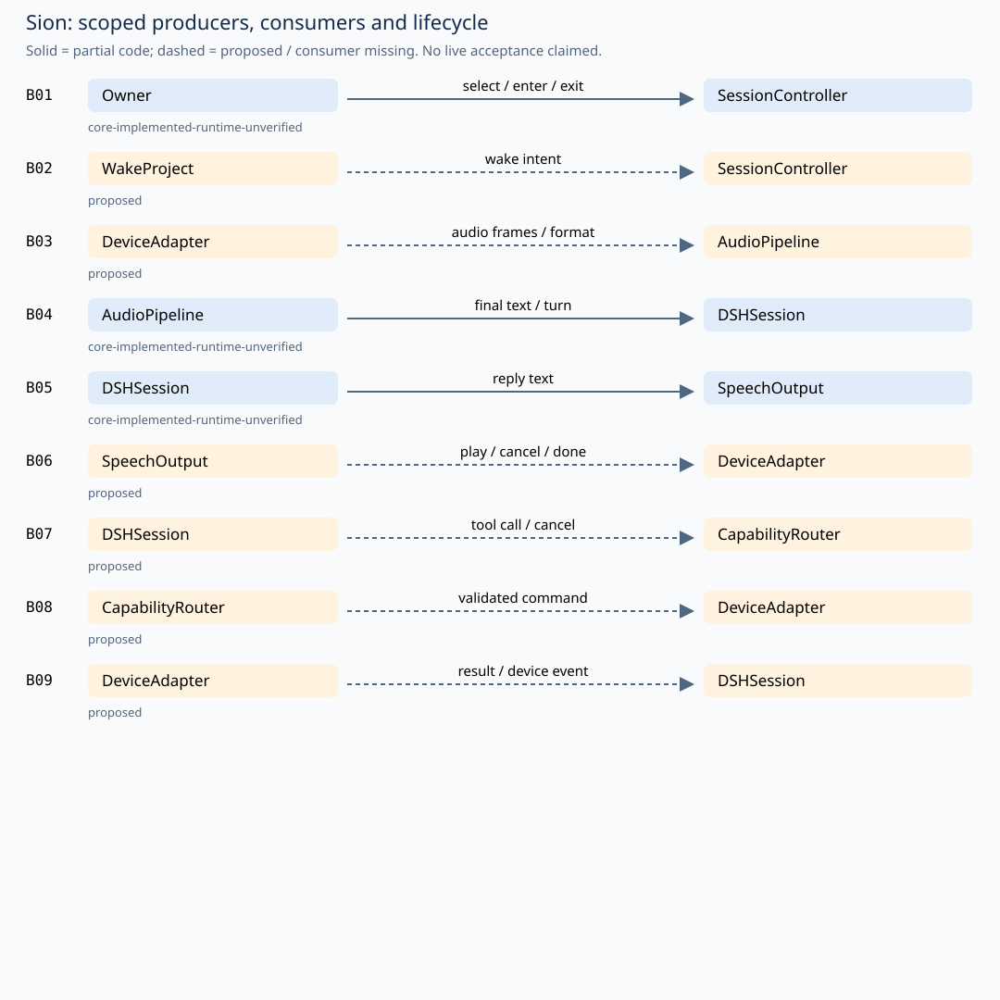
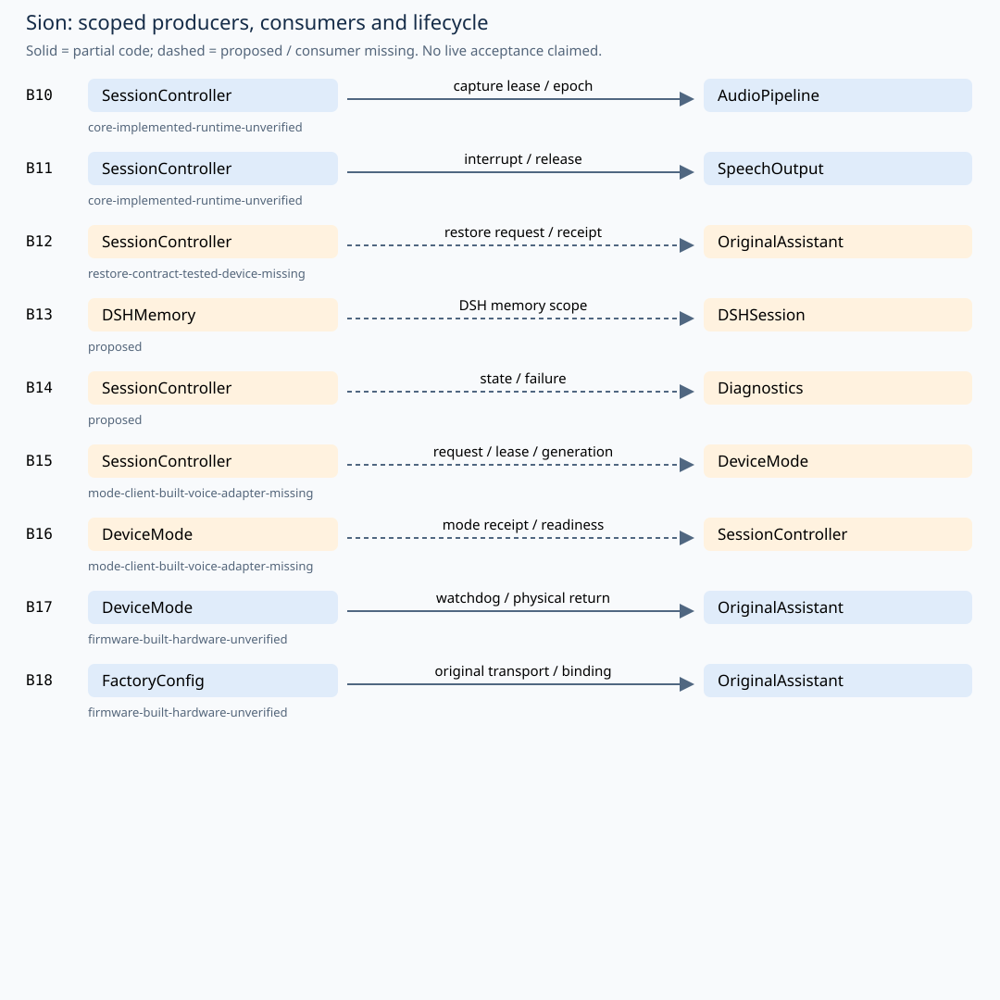
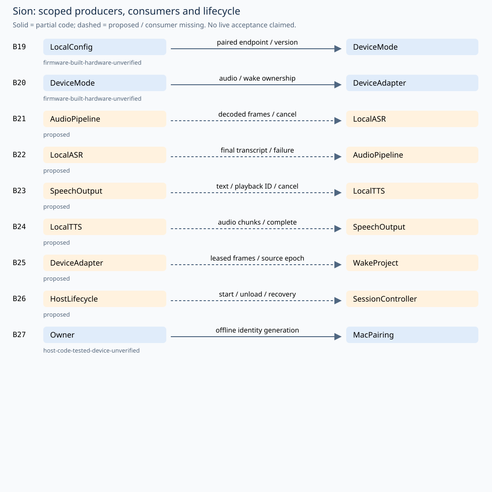
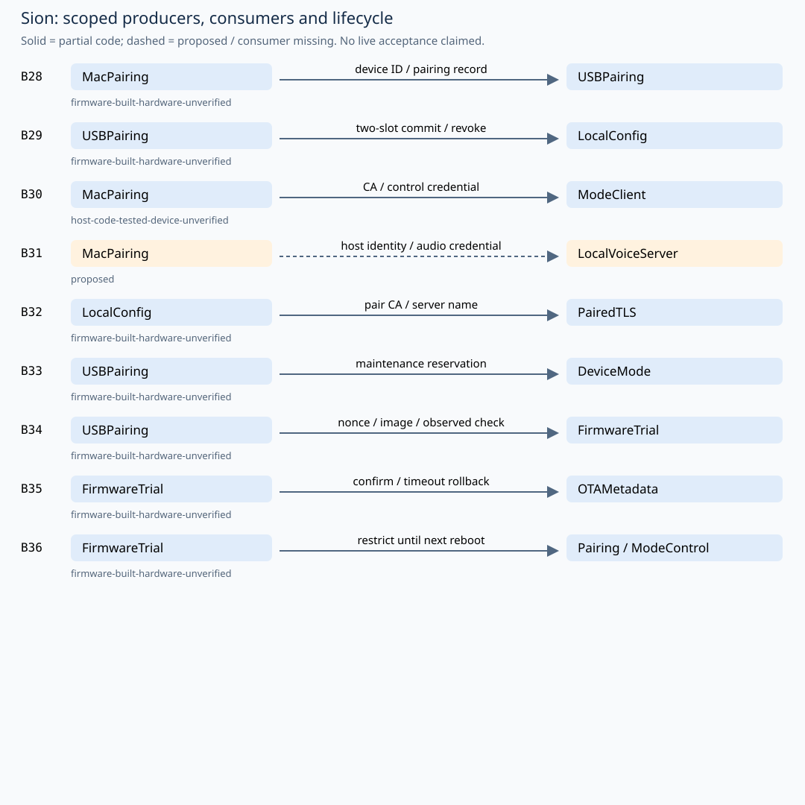
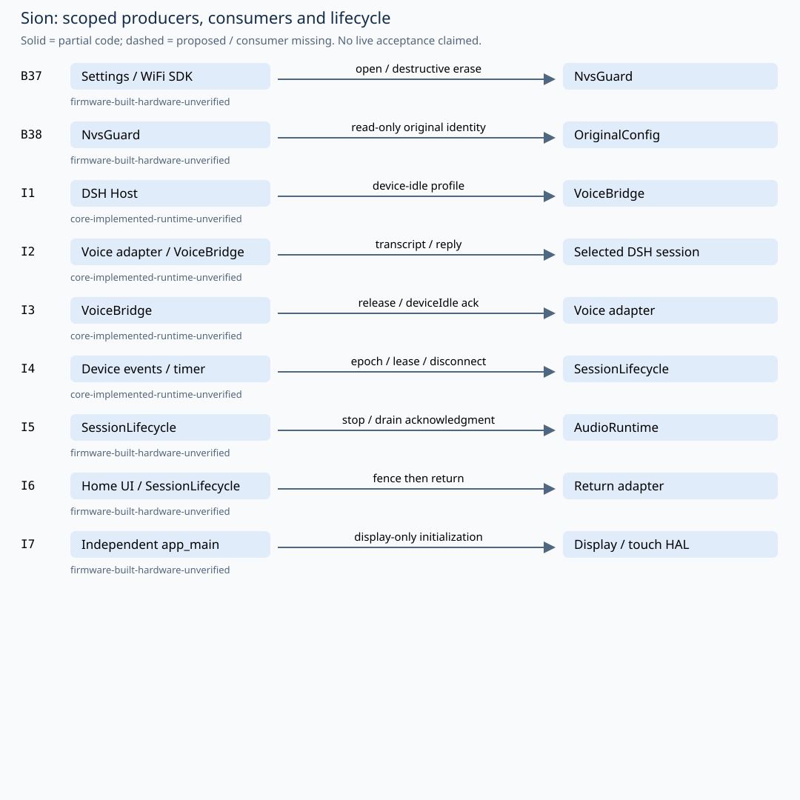

# 会话与硬件桥接设计

本项目已实现部分运行核心，状态与限制见 [运行核心](runtime.md)；真机 adapter 尚未实现。上游来源、提交和维护证据统一见 [社区审查](../../StackChan/docs/community-audit-2026-11-18.md)。以下明确区分上游现状与提案。

## DSH 会话边界

社区 `howecheung/dsh-xiaozhi-bridge/lib/dsh-agent.js` 已通过 agents.create → followup → whenIdle → sessions.flush 驱动 Agent，跨 MCP 调用复用同一个进程内 handle。cwd 或 newSession 改变会重建。它创建专用 session，不能由此断言共享用户当前桌面会话、preset 或长期记忆；重启后恢复也未实现。

当前 `src/dsh-session.mjs` 已有精确已有会话适配，记录 sessionId/workspace/preset 引用；使用已核对的 Session Controller 接口，Host 实际加载及多客户端真机效果尚未验收。记忆服务只通过 DSH 已启用的接口访问，不自动读取、复制或合并其他会话。

桥接不添加固定 personality、不替换 system prompt、不把所有响应强制转成某种性格。机器人能否拍照、使用什么表情、何时调用工具由 DSH 决策；设备侧仅执行能力和时序约束。长回复可以分段播放，语音呈现与原始 Agent 消息分离。

## 设备能力

`CapabilityDescriptor` 为拟定接口：能力名、版本、可用状态、输入 schema、结果 schema、限制、取消方式。启动时发现能力；unsupported 要明确返回，不假装成功。MCP 工具只是控制面；连续音频另需事件/流通道。

| 能力分组 | 社区证据 | 本机/原厂状态与完成条件 |
|---|---|---|
| 麦克风、VAD、音频输入 | kisaragi audio_input_hook + listen 生命周期；mountgram 双向音频 | 未验证原厂连续音频出口；需持续帧、时间戳、取消、丢帧策略 |
| 语音与扬声器 | 社区 say/PCM；当前小智工具回复可由原语音播报 | 独立免费 TTS 接口未知；需打断、音量、排队和完成事件 |
| 摄像头 | 社区 camera 命令 | 未验证当前设备工具；需格式、尺寸、失败和用户可见启用状态 |
| 面部/眼睛/嘴部、头部、LED | 社区设备工具；官方有多种 emotion 映射 | 表情映射不等于原厂已开放任意远程接口；需范围、节奏、占用取消 |
| 触摸/按钮/IMU/电量等事件 | 社区 hello/telemetry 和工具发现 | 按型号枚举；没有的传感器报告 unsupported |
| 应用/舞蹈等原厂扩展 | 官方能力存在，远程入口未核实 | 不承诺统一接口；发现后逐项补 adapter 和验收 |

“所有功能”定义为：实际固件暴露能力清单逐项适配、有明确不支持项与原因；在没有完整清单前不能宣称全覆盖。

## 接口与影响方

图与下表共享 ID；relationships.json 标明核心已实现与仍为提案的边。没有任何边被标成真机已验证。

[完整关系图](assets/relationships.svg)（分图与完整图来自同一账本，ID 不变。）

| ID | 生产者 → 消费者 | 契约/影响 |
|---|---|---|
| B01 | Owner → SessionController | 选择会话、进入、退出；受 DSH 原权限流程约束 |
| B02 | WakeProject → SessionController | 去重唤醒事件；不等于授权所有工具 |
| B03 | DeviceAdapter → AudioPipeline | 帧、来源、采样格式、捕获状态；应用独占/共享待设备核实 |
| B04 | AudioPipeline → DSHSession | 当前 binding 的转写、turnId；不加人格提示 |
| B05 | DSHSession → SpeechOutput | 原始回复与分段信息；不修改会话记忆 |
| B06 | SpeechOutput → DeviceAdapter | 播放、停止、完成；原厂 speech provider 有正式接口才复用 |
| B07 | DSHSession → CapabilityRouter | 工具命令与取消；DSH 决定行为 |
| B08 | CapabilityRouter → DeviceAdapter | 经过能力 schema 校验的动作/截图/设备请求 |
| B09 | DeviceAdapter → DSHSession | 工具结果、摄像头、触摸/状态事件；来源标识和失败语义 |
| B10 | SessionController → AudioPipeline | capture lease/取消/代次；退出后旧帧拒收 |
| B11 | SessionController → SpeechOutput | interrupt/释放；旧回复不得在原助手模式迟到播放 |
| B12 | SessionController → OriginalAssistant | 退出确认、资源归还；原云会话如何恢复待实机验证 |
| B13 | DSHMemory → DSHSession | DSH 原有记忆策略；桥不自行建立第二套人格 |
| B14 | SessionController → Diagnostics | 状态、故障和恢复结果；默认不保存音视频和凭据 |

成品计划补充的控制、恢复与间接消费者（全部为提案）：

| ID | 生产者 → 消费者 | 数据/责任 |
|---|---|---|
| B15 | SessionController → DeviceMode | 租约、模式请求；设备是实际音频所有者，不能用 Mac 状态替代设备确认 |
| B16 | DeviceMode → SessionController | 关联 boot/lease 的实际确认与故障；设备状态投影到界面 |
| B17 | DeviceMode → OriginalAssistant | 设备独立超时或物理返回；原模式选定不等于原云可用 |
| B18 | FactoryConfig → OriginalAssistant | 保留官方 MQTT/WebSocket 配置与绑定，不把原云 token 发本地后端 |
| B19 | LocalConfig → DeviceMode | 独立本地端点与配对配置；不写原厂默认服务 |
| B20 | DeviceMode → DeviceAdapter | 互斥捕获、播放和唤醒；注销旧回调并清理旧代次任务 |
| B21 | AudioPipeline → LocalASR | 本地模型消费者；返回 final 转写，由 AudioPipeline 转入 B04 |
| B22 | LocalASR → AudioPipeline | 来源/代次校验，识别失败不发空提示；停止走控制路径 |
| B23 | SpeechOutput → LocalTTS | 只合成 DSH 原文；模型/音色与取消绑定 |
| B24 | LocalTTS → SpeechOutput | 有界音频与结束/错误；TTS 完成不等于设备播放完成 |
| B25 | DeviceAdapter → WakeProject | 可选个性化检测和注册音源；音频所有权/旧帧约束同 P1 |
| B26 | HostLifecycle → SessionController | 安装版本检查、插件卸载、服务退出影响现有租约；状态不得假报恢复 |
| B27 | Owner → MacPairing | 主人离线生成私有包；不附带 DSH 会话权限 |
| B28 | MacPairing → USBPairing | USB 信任边界；检查设备 ID 和旧配对 ID |
| B29 | USBPairing → LocalConfig | 容量拒绝、失败读回、撤销 tombstone；不擦除原 NVS |
| B30 | MacPairing → ModeClient | Mac HTTPS 客户端验证设备身份并持有模式 epoch |
| B31 | MacPairing → LocalVoiceServer | P2 语音服务尚未加载 host TLS 配置；不是已有消费者 |
| B32 | LocalConfig → PairedTLS | 本地 WSS 只信任配对主机；原云 trust store 不变 |
| B33 | USBPairing → DeviceMode | 只在 original 预约，暂停新的进入；下次主动重启生效 |
| B34 | USBPairing → FirmwareTrial | 本次 boot nonce、镜像摘要、人工语音/App 验收声明 |
| B35 | FirmwareTrial → OTAMetadata | 显式确认或十分钟到期请求回滚；启动器消费元数据，未实机验收 |
| B36 | FirmwareTrial → Pairing / ModeControl | 试运行期间限制配对/本地模式，确认后仍等主动重启 |
| B37 | Settings / WiFi SDK → NvsGuard | 关键 namespace 打开只读，整区擦除拒绝 |
| B38 | NvsGuard → OriginalConfig | 保留原身份/服务配置；不是全部 NVS 字节永不变化 |

## 转接与恢复

提案状态：Original → Connecting → Bridged → Releasing → Original。连接失败回 Original；设备/DSH 断开进入 Recovering，暂停接收新轮次并显示故障；恢复超时归还资源。退出优先于重连，不自动重入。

一次进入获得捕获/播放租约与 binding generation；只有该代次的输入输出可通过。每轮带 turnId，返回已退出代次的回复丢弃。按最新要求，单独说“停止”结束转接；“退出 DeepSeek”“回到原助手”同义。明确控制指令的识别应在编排层有独立策略，不能只靠 Agent 愿意调用退出工具。

退出顺序：停收新帧 → 取消本轮播报/解除本地订阅（不全局取消共享 Agent）→ 等待或标记未能取消 → 清除队列 → 释放设备租约 → 确认原助手可用。不能因为取消请求已发送就宣称已归还。重连必须幂等，不重复执行有副作用的动作。具体超时/缓冲预算需测量后设定。

## 六个视角

- 架构：DSH 持有认知，桥持有 binding/资源，设备 adapter 持有硬件协议，唤醒项目是可替换事件来源；上图列全范围边。
- 流程：选择会话 → 探测能力 → 获得音频资源 → 持续轮次 → 退出归还原助手。
- 时序：唤醒/连接确认 → 音频转写 → DSH 请求/工具 → 播放与状态事件；退出可以抢占任意阶段，必须隔离迟到结果。
- 数据：SessionBinding(sessionId, workspace, presetRef, generation)、CapabilityDescriptor、Turn(turnId, generation)、DeviceEvent(id, timestamp, source)；记忆归 DSH，不写入 binding。
- 部署：Mac 上插件/桥，机器人 adapter，原语音云为既有服务；不向公网开放管理接口。优先免刷，原厂出口缺失时需官方兼容扩展，不能隐藏更换固件依赖。
- 状态：见上方 Original/Connecting/Bridged/Releasing/Recovering，设备与会话失败分别反馈，退出最终必须有资源释放证据。

## 贡献与验收

优先上游 howecheung 的会话正确性和绑定接缝；本地 `contributions` 保存可审查补丁、复现和 PR 描述。完整硬件接管不冒充现有插件已支持。kisaragi 的云对话范围已被拒绝，设备修复需按其贡献指南先讨论。

实施依赖以 [成品计划 P0–P7](product-plan.md#按依赖推进的工作包) 为准；设备切换接缝见 [源码决策](device-handoff.md)。当前接缝为 `src/dsh-session.mjs`、`src/bridge.mjs`、`src/factory-voice.mjs`；模块与检查见运行核心章节。

验收必须包含：指定会话多轮连续性、切换人格无污染、记忆访问遵循 DSH、DSH 桌面同时使用、打断/退出优先级、断连和重启、迟到回复拒收、相机/音量/表情/动作逐项结果、原助手仍可唤醒与说话。当前只有上游源码证据与局部单元测试可做，端到端均未通过。

设计方向可保留；原厂导航/安装、正式 Host/设置对本地语音的运行接线和用户会话验收仍是决定性缺口；LocalVoice 组件组合见 local-voice.md；复用官方同一云语音已不再是必需条件。wiki 的结构/源码自检不能替代硬件测试或独立评审。

配对新增 B27–B33 的字段、访问、写入/撤销、故障和操作入口见 [配对指南](pairing.md)。

安装保护新增 B34–B38，当前完整构建和主机测试通过、真机未验证；详见 [安装保护与试运行](installation-recovery.md#当前保护实现与试运行契约)。第四页同时包含 B34–B36；下图补全共享配置消费者。

## 独立应用生命周期扩展

I1–I6 的生产者/消费者、状态与缺口见 [独立 Agent](independent-agent.md)，并登记在统一 relationships.json。原 B 系列中涉及自动恢复的消费者仍描述旧 profile；新 profile 的停止只确认设备空闲，手动 Home 的返回需设备执行器，尚未安装。
