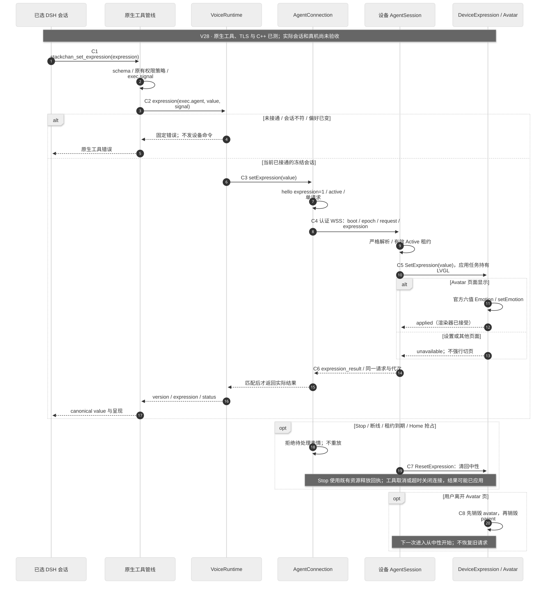
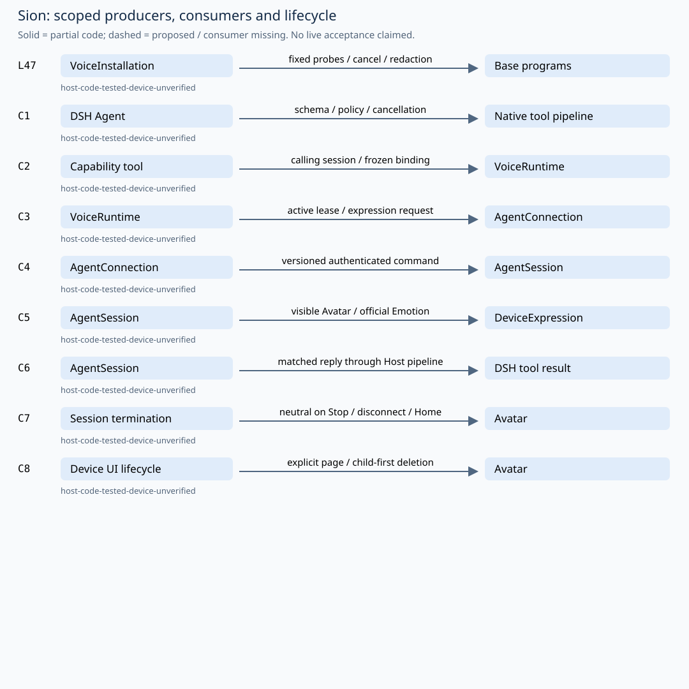
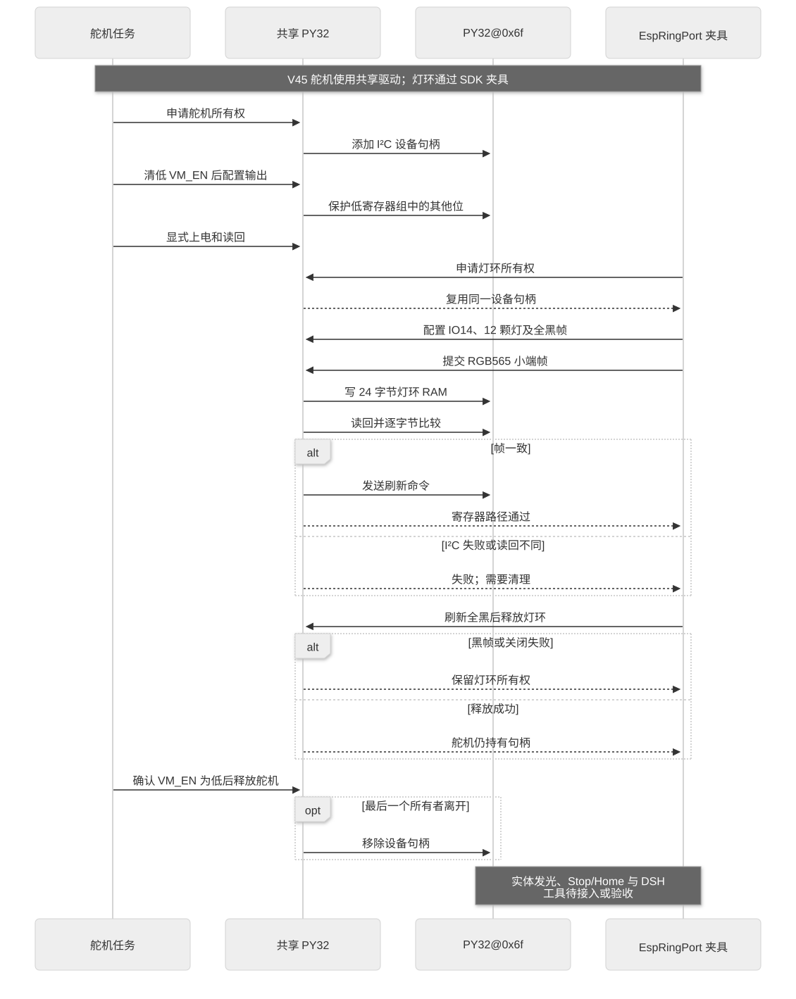
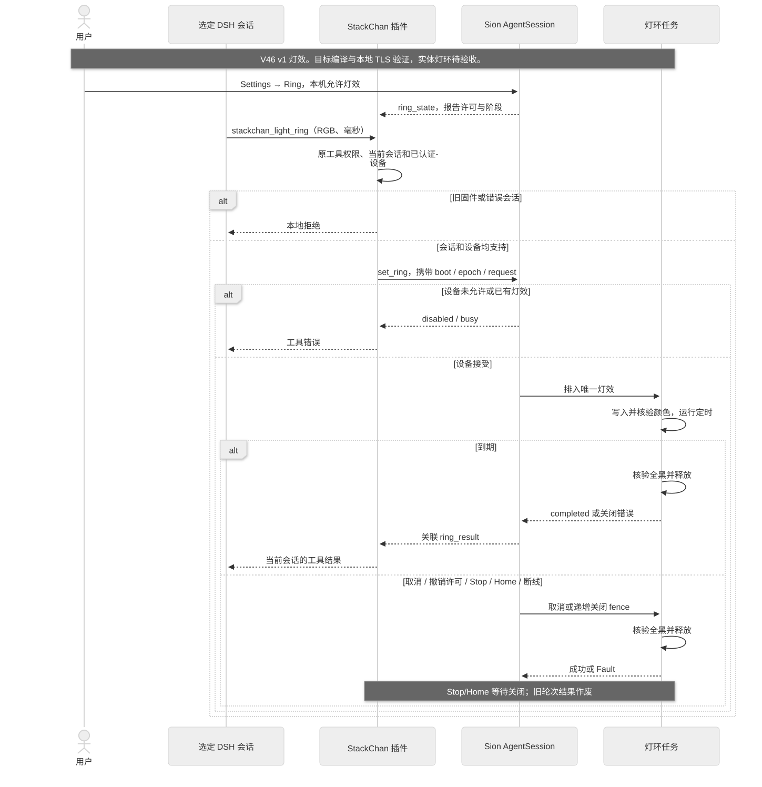
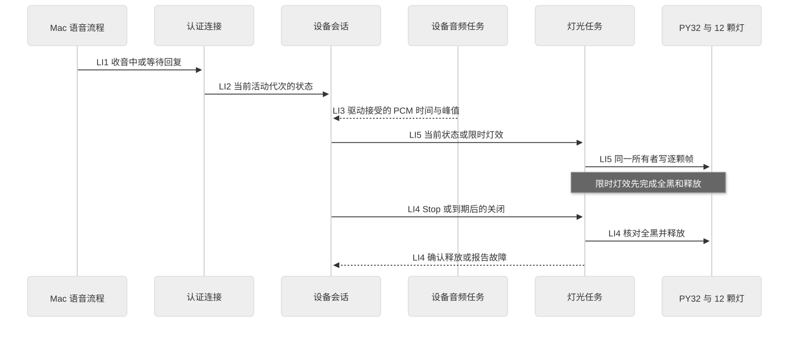
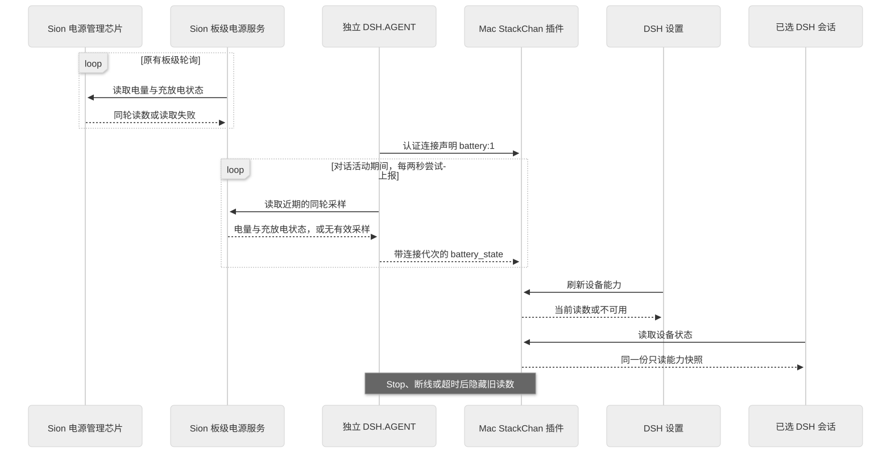
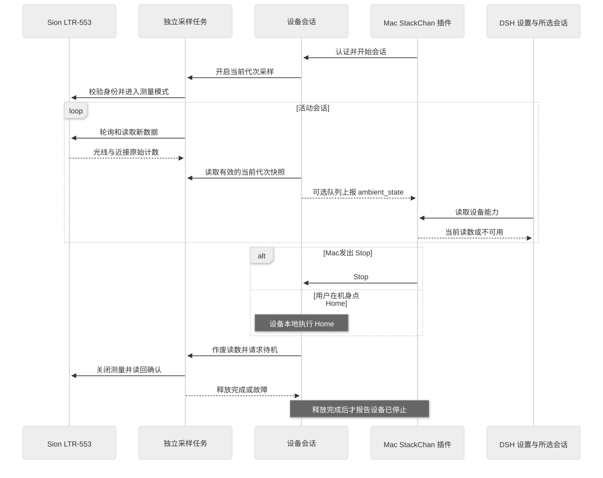
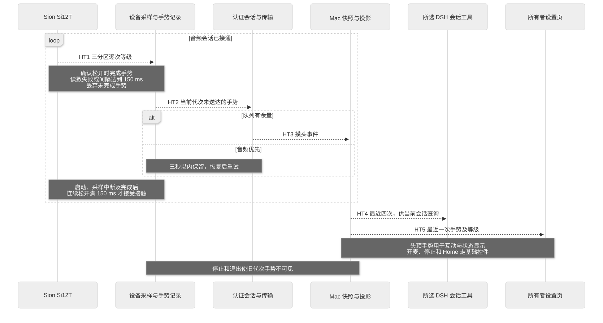

# 版本化设备能力与 DSH 工具

灯环已接 [v1 认证命令与两端设置](#灯环-v1-的命令与退出)。实际灯效与关闭待真机验收。

[安装后的 DSH 原生工具联调](validation.md#安装包能力与停止后重入验收)已在实际打包 Host 和回环认证 Relay 上验证相机、表情、动作及灯环。隔离测试使用一个已有选择的会话；第二个会话不能借这条连接控制设备。Stop 后迟到的能力回执被丢弃，重新接通可继续在原会话使用工具。

[动作 v1](motion.md#认证动作与两端设置)已接 DSH 原生转头工具、认证通道、设备许可与两端状态。用户会话和实体动作仍待验收。

相机新增进展：[采集、设备许可与有界回传](camera.md)已接实际 AgentSession 和 Host 接收器；旧设备本地拒绝，许可关闭返回明确错误。DSH 拍照工具与原附件服务已接，真实生成 JPEG 的原生工具/TLS 组合通过；两端设置状态投影已通过本地协议、页面与目标构建验证；实体采集、用户模型推理和真机设置仍未验收。

归属 P5/A6。官方 DefaultAvatar 六种基础表情已接认证通道、DSH 原生工具和独立设备页面；相机、头部、灯光、传感器等仍为独立缺口，不能把仅表情完成当全部能力完成。Host 相关 42 项、C++/SDK 夹具与原生工具→真实 TLS→C++ 回执通过；ESP v13/v14 目标构建通过，v14 实际应用版本已区分原厂；最终证据见验收记录。原厂固件、绑定与配置不参与该通道。

## 所有者、使用与边界

人格、记忆及工具决策属于用户选定 DSH 会话。工具只描述合法操作与实际结果，不添加性格提示或固定情绪策略。设备的 LVGL 应用任务持有表情对象；网络任务不得直接修改 UI。使用官方 `stackchan::avatar::DefaultAvatar::init/setEmotion/update`，不启动小智 Application 或全局 StackChan 更新任务。

v30 的鱼脸复用同一个 ExpressionPort 和六值枚举，由设备用户选择。协议及 Host 不需新增表情值。具体绘制、播报指示和状态清理见 [设备外观](device-settings.md#默认脸与大肥鱼)。

在独立 Agent 增加用户可进入的 Avatar 页面，仍保留 Back、Stop 与官方上滑/Home；设置/配对页不会被远端命令强行覆盖。只有头像显示时可报告 applied；不显示返回 unavailable。离开头像页、停止、断线、Home 清回中性，销毁顺序为先 avatar 后 parent，防止陈旧 LVGL 指针。当前计划不提供持续动作队列或自动表情。

## 协议与取消

使用 hello 可选 `expression:1` 协商；旧设备不声明时 Host 本地拒绝，不发送它不认识的命令。`set_expression` 携带现有 boot_id、epoch、随机 request_id 和六值 expression；设备只在有效 Active 租约处理。`expression_result` 原样关联身份、请求与表情，并报告 applied/unavailable。输入保持平面 ASCII、有界 2048 字节和严格字段；接口版本由能力字段确定，不修改音频帧。

Host 每连接最多一个表情请求；音频继续独立，Stop 抢占并拒绝 pending。超时、取消或连接丢失不能冒充无副作用成功，不重放命令；取消断开连接，设备按既有租约/断线释放。Stop 后在途旧表情回执可丢弃但不能完成新请求。

DSH 工具入口使用固定 SDK 0.2.2-rc.3 的 `defineTool/register` 与原生 Native 管线（PTC 可按其标准机制调用，未在本批另验收）。只能使用当前已接通的所选会话，不能让其他会话借已配对连接控制；工具描述不给第二份人格。Host 原始路径/token 不进入工具结果。只按设备回执报告应用，不宣称实体屏幕已真机验收。

## 实现入口与验证范围

实现入口：[agent-protocol](../src/agent-protocol.mjs) EXPRESSIONS/deviceControl、[AgentConnection](../src/agent-transport.mjs) receive/setExpression/clearAudio、[AgentSession](../firmware/agent/agent_session.cc) Parse/Text/Disconnected、[ExpressionPort](../firmware/agent/expression_port.h)、[device_main](../firmware/agent/device_main.cc) DeviceExpression/show、[VoiceRuntime](../src/voice-runtime.mjs) expression、[工具注册](../src/capability-tools.mjs) registerCapabilityTools 和 [正式插件](../src/plugin.mjs) tools 注入。

`stackchan_set_expression` 只接受 expression；输入由 defineTool 枚举校验，额外 root 字段在执行体拒绝。输出是 `{version:1,expression,status}`，不是让模型解析自由文本。运行方法要求 bridge=bridged、phase=listening、未关闭、exec.agent.id 等于冻结 sessionId 且偏好未变。外部 Client 无此方法，也不能传 sessionId 接管其他会话。没有系统提示、记忆、模型或 API key 的写入。无 Agent 的独立调用拒绝；工具在 Host 全局注册，其他会话可能看到 schema，但执行被上述身份校验拒绝。

插件通过可选 tools 注入注册；晚加载 ToolsService 也能接入，插件停用后撤销。原 DSH allow/deny/ask 管线不绕过；新增依赖固定 dsh-tools/dsh-error 0.2.2-rc.3，Native executor 仅开发测试依赖，不替用户选择执行模式。已知失败转换 HarnessError 固定码，未知故障脱敏；取消保留原 AbortSignal 原因。没有自动重试。

验证范围：非法字段/枚举、旧 peer、不匹配回执、并发/Stop/取消/断线；真实 C++/Node carrier；官方 SDK 实际工具注册、会话隔离及卸载；UI/原生组件的 SDK 夹具；最终 ESP 目标构建与符号/分区审查。模拟或目标编译不替代真机表情、触摸、物理 Home 与原助手恢复。需要写设备时另报具体安装/恢复方案。

## 官方来源

2026-11-19 先核对 [StackChan 手册](https://docs.m5stack.com/en/StackChan/)；固定官方提交 `28b9f0c8bd6acd81cb3c70f1a93c3e373b39d400` 的 firmware/main/stackchan/avatar/avatar/elements/emotion.h、avatar.h、skins/default/default.h/default.cpp 与 eyes.cpp 已在 v12 源码审查：六值枚举、LVGL parent 所有权和眼睛映射存在。motion 与 camera 的生命周期/失败确认还需独立设计。DSH [工具编写契约](https://github.com/deepseek-ai/deepseek-harness/blob/2e39e70496aa02986ca6a820c5d497e816b69d7e/docs/cookbook/adding-a-tool.md) 明确 defineTool、canonical result、exec.signal、效果式卸载和原生权限管线；实际包版本为 0.2.2-rc.3，运行接口仍以安装源码为准。

## 生产者、消费者与时序

图表来源：上文实际六处实现；官方 Avatar `setEmotion` 只是渲染器状态接受，不是相机或实体屏幕已观察到的证明。头像由应用任务每 20 ms 循环更新，底层真实显示时序尚未测量。

| ID | 生产者 → 消费者 | 数据、失败与间接影响 |
|---|---|---|
| C1 | DSH Agent → Native tool pipeline | expression、权限、signal；无第二套人格 |
| C2 | Capability tool → VoiceRuntime | exec.agent 身份、原有会话状态/偏好检查 |
| C3 | VoiceRuntime → AgentConnection | 原连接/本次租约；不建立替代会话 |
| C4 | AgentConnection → AgentSession | 认证通道、版本协商、严格字段及单请求 |
| C5 | AgentSession → DeviceExpression | 单应用线程，只有头像显示时写官方 Emotion |
| C6 | AgentSession → DSH tool result | 匹配回执经 Connection/Runtime/工具管线返回 canonical result；工具记录可由原 DSH UI 呈现 |
| C7 | Session termination → Avatar | Stop/断线/租约/Home 清中性；无动作队列 |
| C8 | Device UI lifecycle → Avatar | 显式 Avatar/Back/Home、先 child 后 parent；无强制远端切页 |

## 当前缺口

相机的官方接口审查、采集资源核心、取消时序和后续接线归 [相机能力](camera.md)。`CameraEngine` 和 `EspCameraPort` 已有核心/SDK 夹具测试，任务/协议/设备许可与 DSH 图片消费者现已接；真机及 Host 相机状态面板未验收，目标构建与最终调用链单独记录，旧 v16 收据保留。

底层显示已拆为 [AgentDisplay](independent-agent.md#独立显示适配)，Avatar 的页面所有权和六表情协议不变；原 AI 预览路径不作为 DSH 相机实现，拍摄/传输/呈现仍要接独立能力。

本批只完成表情软件调用链；未安装到用户 DSH/Sion，尚无实际所选会话、物理屏幕和手势验收。头像页像素布局只使用官方组件并经目标编译，SDK 假对象不证明视觉质量。摄像头数据传输/视觉消费、舵机范围/取消/反馈、灯光、传感器、设备能力设置面板和完整 manifest 仍需实现。保留原语音与绑定的安装布局/恢复门槛不变。

## 灯环与舵机共用的 PY32

V45 记录 v25 底层实现，回答灯环怎样取得访问权限、验证帧及关闭，同时保证舵机的 VM_EN 仍由独立的动作任务控制。StackChan 有 12 颗 WS2812C，由 PY32 的 IO14 串行输出。固定官方 HAL 调用中的 pin index 13 对应该原理图上的 IO14。官方 HAL 的组合初始化同时给舵机供电，独立应用从以下分开的寄存器范围访问。参见 [M5Stack 手册](https://docs.m5stack.com/en/StackChan/#pinmap)、[底座电源板原理图](https://m5stack-doc.oss-cn-shenzhen.aliyuncs.com/1205/SCH_Power.pdf)、[官方寄存器驱动](https://github.com/m5stack/StackChan/blob/28b9f0c8bd6acd81cb3c70f1a93c3e373b39d400/firmware/main/hal/drivers/PY32IOExpander_Class/PY32IOExpander_Class.cpp)。

| 生产者 → 消费者 | 范围、失败及完成条件 |
|---|---|
| 动作任务 → EspServoPower → Py32Expander | 仅 VM_EN（低寄存器组 bit 0）与版本读取。保留先清低再设方向、上电等待、方向与输出/输入读回、故障断电与关闭重试。 |
| EspRingPort 夹具 → Py32Expander | 仅 IO14 方向/驱动/拉电阻配置、0x24 控制和 0x30–0x47 的 12 颗灯 RGB565 LE。配置成功后先刷全黑。 |
| 两个所有者 → board I²C bus | 同一 0x6f、100 kHz device handle；逐事务互斥，完整帧写入、核验、刷新放在同一临界区。单次 I²C 调用超时 20 ms。最后一个所有者结束才移除 device，board bus 由原 HAL 保留。若 SDK 分配结果不确定，锁住该芯片的新申请。 |
| RGB RAM 与刷新 → EspRingPort | RAM 逐字节匹配后才发刷新。刷新成功代表控制命令返回成功。失效时拒绝新帧，显式 Close 以可核验的全黑清理；清理或释放失败保留所有权。 |
| 设备许可 → 灯环任务 → 认证会话 → DSH | v25 时待接入，现见 V46。设备决定是否授权及如何关闭。 |

源码为 [共享 PY32](../firmware/agent/py32_expander.cc)、[运动供电](../firmware/agent/motion_power.cc)、[灯环驱动](../firmware/agent/ring_port.cc) 和 [灯环故障夹具](../firmware/agent/ring_port_test.cc)。RGB 读回只用于核对控制器 RAM，灯的实际亮度、颜色顺序、关闭及实体 Stop/Home 须现场测量。后续版本的任务、认证和工具见下节。

[独立 v25 构建收据](../firmware/agent-board-expander-build.json)的应用为 1,992,912 字节，按扇区对齐后仍余 20 KiB。ESP-IDF v6.1 目标已编译 ring_port 和 py32_expander。最终 ELF 链接的是舵机使用的共享所有权与 VM_EN 寄存器路径，v25 尚缺灯环消费者，EspRingPort 未进入该版本的最终 ELF。v25 是独立开发镜像，v24 的待审批安装包仍采用其原始文件和计划 ID。

## 灯环 v1 的命令与退出

V46 解释原生工具如何发灯效，以及停止为何要等全黑与驱动释放。官方工具管线保持对 `stackchan_light_ring` 的许可。该工具只用当前已接通的会话、固定连接和设备 epoch，接收一种 `#RRGGBB` 颜色及 250–10000 ms 的时长，默认 1000 ms。一次照亮整环，单请求，无自动重放。设备端通过独立配置 v4 的 `ring_allowed` 授权，默认关闭。保存只写专用配置区。DSH 设置页只显示设备报告的许可和阶段。

| 生产者 → 消费者 | 接口与结果 |
|---|---|
| 设备 Settings → DevicePreferences → RingEngine | 许可立即更新，显式保存写 v4。撤销在任意活动阶段排入清理。 |
| DSH Native → VoiceRuntime → AgentConnection | 原工具策略、固定会话/偏好、当前连接和 epoch。旧固件不广告 ring:1 时拒绝，结束前再次核对会话。 |
| AgentConnection → AgentSession | set_ring 与 cancel_ring 带关联 ID，颜色使用六位小写十六进制字符串、时长使用十进制字符串。设备也检查 epoch 和边界。 |
| AgentSession → RingEngine → BoardRingPort | 单任务执行 Open、Show、定时、Close。回读黑帧并发送刷新、释放占用后才确认 completed。软件确认针对控制器，实体灯光单独验证。 |
| Stop、Home、断线、lease 到期 → DeviceEffects → RingEngine | 先废止旧轮次，再在设备侧等待清理。Mac 主动发 Stop 时，等到 resources_stopped 才报告 idle。清理失败时进入 Fault，等待本地重试。停止后的旧回执不得完成新一轮。 |
| AgentSession → 认证报告 → DSH Settings | ring_state 投影 preparing、lit、clearing、idle 或 fault；状态超过 6 秒、失去连接或换 epoch 时显示未知。 |

图源为 [AgentSession](../firmware/agent/agent_session.cc)、[RingEngine](../firmware/agent/ring_engine.h)、[设备设置](../firmware/agent/device_main.cc)、[认证传输](../src/agent-transport.mjs)、[DSH 工具](../src/capability-tools.mjs) 和 [VoiceRuntime](../src/voice-runtime.mjs)。保持原 DSH 工具权限的契约见 [官方工具开发文档](https://github.com/deepseek-ai/deepseek-harness/blob/2e39e70496aa02986ca6a820c5d497e816b69d7e/docs/cookbook/adding-a-tool.md)。

v26 已完整构建，最终 ELF 包含 AgentSession 的灯环状态、灯环工作任务及实际 PY32 Open/Show/Close。镜像为 1,999,824 字节，按 4 KiB 对齐后在已审查尾部布局余 12 KiB。v26 为开发镜像，仍需独立审查安装与恢复。现有 v24 安装计划继续绑定其原文件。
[构建收据](../firmware/agent-light-ring-build.json) · [验证记录](validation.md#v26-灯环工具两端设置与关闭)

### 对话状态灯 v1

在独立 DSH.AGENT 的 Settings → Ring 开启灯光许可。**v63 起两条灯带分工：左＝耳朵（麦克风），右＝声音（扬声器）。**接通可收音时左条柔绿常亮，说话声把左条从第一颗往上提亮（设备本机麦克风峰值）；等 DSH 回复时一点琥珀光 1.2 秒从左条流到右条；播报时右条按扬声器实际 PCM 峰值做蓝到青的音量条（无声间隙保持暗蓝，不闪黑），左条暗蓝表示正在说。挂机（standby）熄灭，与原厂空闲灭灯一致。颜色变化学原厂 NeonLight：50 Hz 刷新、约 0.3 秒缓动；熄灭先渐暗再释放灯条，Stop 和收回许可仍立即熄灭。灯条硬件是 PY32 的 RGB565，帧按 565 量化后比较，渐变只在 LED 实际会变时写 I²C。两组各六颗使用逻辑编号，左右和排列在真机逐颗核对。[预览由真实引擎逐帧导出](../../StackChan/.local/previews/light-strip-v63.html)（本地忽略目录）。Mac 的等待信号来自语音流程，范围包括排队、回复生成及合成等待。 [官方 AI Agent 指示灯习惯](https://docs.m5stack.com/en/StackChan/#ai-agent) · [实际画帧](../firmware/agent/ring_engine.h)

| 关系 | 生产者 → 消费者 | 条件与退出 |
| --- | --- | --- |
| LI1 | LocalVoice / VoiceBridge → AgentConnection | 接通后监听，语音回合等待期间切换 waiting，处理完成时回监听。停止后的旧语音回合不再更新。 |
| LI2 | AgentConnection → AgentSession | 只发给声明 `voice_indicator:1` 的当前活动 epoch。积压时按现有心跳重试最新值。 |
| LI3 | AudioEngine → AgentSession | 当前有效的设备驱动写入近 140 ms 时优先显示播报，峰值从已写的帧计算。 |
| LI4 | 机身 Ring 设置 / DeviceEffects → RingEngine | 沿用同一显式灯光许可。撤销许可、Stop、Home、断线和租约到期清灯并释放驱动。 |
| LI5 | DSH 原生灯效 / 状态灯 → RingEngine → PY32 | 单工作任务发帧，状态灯最多每 100 ms 更新，无变化不重写。限时灯效优先，等全黑和释放确认后再恢复状态灯。 |

状态灯使用已协商的语音会话和本机权限，独立于触屏或头顶感应。离线检查覆盖收音、等待、播报、人工灯效抢占和释放失败。真实颜色、低亮度、I²C 占用及声学延迟留待设备验收。 [设备会话](../firmware/agent/agent_session.cc) · [灯光测试](../firmware/agent/ring_engine_test.cc)

## 设备能力状态查询

在选定 DSH 会话调用 `stackchan_device_status` 可以查询能力，即使语音服务已停。工具不接收参数、使用 DSH 自己的 Native 权限，并在 Host 校验所选会话。服务启动后，活跃配置与会话冻结在本次运行，直到服务重启。owner 也可在 DSH 的 StackChan 语音页展开「设备能力与限制」，从同一份 Host 快照读取。查询不会发设备命令，也不会打开麦克风、拍照或启动服务。

| 边 | 来源 → 去向 | 数据与适用条件 |
|---|---|---|
| D1 | M1 认证 hello → M4 快照 | 认证连接给出当前能力版本，并携带是否为本次连接请求字幕的 `caption:1`。音频随协议 v1，其他能力需声明。断线后清除旧连接的字幕和能力声明。 |
| D2 | M2 设备报告 → M4 快照 | 相机、动作和灯环要求当前连接的相同 epoch，状态超过 6 秒后不沿用旧许可。音频许可取当前会话状态。 |
| D3 | M3 Mac 运行状态 → M4 快照 | 运行阶段、保存后尚未生效的配置、在途请求和附件服务决定当前条件。当前回复方式以该运行实际冻结的仅字幕偏好为准。 |
| D4 / D6 | M4 快照 → M5 只读工具 → M7 DSH 会话 | 原生权限照常适用。只允许所选会话读取；自服务启动至退出使用冻结会话。结果经 Native 工具以结构化字段返回。 |
| D5 / D7 | M4 快照 → M6 owner 设置接口 → M8 设置面板 | `VoiceSnapshot.capabilities` 随设置刷新。Remote 不可达时不展示上次连接详情。 |

图源与边界见 [AgentConnection.negotiatedCapabilities](../src/agent-transport.mjs)、[VoiceRuntime.snapshot / deviceStatus](../src/voice-runtime.mjs)、[原生工具](../src/capability-tools.mjs)、[owner Remote](../src/remote-api/index.ts) 和 [设置页投影](../src/settings-voice-view.mjs)。工具和设置分别验证调用身份；相机、动作、灯环、表情和音频各自的命令仍检查其运行与设备条件。闭环范围为本地 Host 和隔离 DSH，实体设备暂未提供报告。参见 [DSH 原生工具契约](https://github.com/deepseek-ai/deepseek-harness/blob/2e39e70496aa02986ca6a820c5d497e816b69d7e/docs/cookbook/adding-a-tool.md)。

### 报告字段与生命周期

| 字段 | 值与含义 |
|---|---|
| `version`、`voicePhase` | 报告格式版本固定为 1，语音阶段取本地 VoiceRuntime。 |
| `features` | 固定 audio、playbackFence、expression、camera、motion、ring。每项独立报告。 |
| `availability`、`version?` | `supported` 已声明、`unsupported` 当前连接未声明、`unknown` 无已认证 peer。仅支持时出现能力版本。 |
| `permission` | `allowed`、`disabled`、`unknown`、`not-applicable`。有支持声明也可能没有当前许可。 |
| `condition` | 可执行条件。包括语音未接通、需重启服务、故障、忙碌、需开 Avatar 页面、附件服务缺失。 |
| `conversation?` | 在新版 Host 中出现。旧 Host 省略，设置页可继续显示其六项基础能力。 |
| `conversation.replyMode` | `spoken` 表示当前对话的 Mac 播报路径已启用，`caption-only` 表示保留输入且跳过 Mac 合成和播放，`inactive` 表示当前没有活动对话。尚未应用的偏好不会改这个字段。 |
| `conversation.captionChannel` | `requested` 表示当前已认证连接声明 `caption:1`，`not-requested` 表示已认证连接没有该声明，`unknown` 表示无认证连接。它描述本次连接上请求的输出，不是已显示字幕或实体屏幕回执。 |
| `battery?` | Sion 声明电量 v1 时出现。仅活动会话的当前有效报告包含百分比和充放电状态。见 [电量 v1](#电量-v1)。 |
| `headTouch?` | Sion 声明头顶触摸 v1 或 v2 时出现。有效的瞬时报告带三个等级。v2 还可在活动代次读取 [最近的完成手势](#头顶手势-v2)。 |
| `notExposed` | 本版本明确未提供 DSH 接口的类别，例如传感器、IR、NFC、microSD、Grove、原厂应用和自定义唤醒。设备接口以官方规格为准，后续逐项验收。 |

在仅字幕对话中，已声明支持播放排空的固件仍列为支持，当前条件显示不可用。设备扬声器的音量、静音或实体出声不在报告内。 [纯文字模式](device-settings.md#纯文字模式)

### 电量 v1

v36 独立固件复用 StackChan 原有的电源管理芯片采样。读取百分比和充放电状态必须在同一次板级轮询中均成功，读取时距成功采样不超过 2.5 秒。读取失败时上报无有效读数。该路径没有增加一次 I²C 读取，也没有增加电源设置命令。 [官方电量说明](https://docs.m5stack.com/en/arduino/stackchan/battery) · [上游板级电源服务](https://github.com/m5stack/StackChan/blob/28b9f0c8bd6acd81cb3c70f1a93c3e373b39d400/firmware/main/hal/board/stackchan.cc) · [独立板适配](../scripts/prepare_agent.py)

| 来源 → 消费者 | 触发与失效 |
|---|---|
| 电源芯片 → 板级轮询 → AgentSession | 只读复用原有采样。只有活动会话会尝试每两秒上报一次。可选消息发送队列繁忙时跳过本次上报。 |
| AgentSession → 认证传输 → AgentConnection | 声明 `battery:1` 后才接受当前代次的 `battery_state`。Stop 后丢弃迟到的旧代次，断线后不展示旧读数。Mac 超过 6 秒没收到当前报告就将其标记为过期。 |
| AgentConnection → VoiceRuntime → 原生工具与 owner 设置 | `current` 带 0–100 的整数和充电 / 放电 / 未检测到充放电。未收到、采样失败、或过期时分别为 `waiting`、`unavailable`、`stale`，均省略读数。仅字幕模式也可读取电量。工具使用已选会话，面板使用 owner 权限。 |

新版 Host 可接旧版 v35。电量字段随能力协商省略，仍沿用 `batteryAndClock` 缺口。使用 v36 时先更新 Host，以便接收新增能力声明。时钟仍未开放。 [协议与 Mac 读取](../src/agent-transport.mjs) · [Host 投影](../src/device-capabilities.mjs) · [设备上报](../firmware/agent/agent_session.cc) · [v36 验收](validation.md#v36-电量能力与首装包回归)

### 光线、近接与惯性传感器

官方列出 LTR‑553ALS‑WA 光线和近接传感器，以及由 BMI270 和 BMM150 组成的九轴 IMU。固定上游的 `Hal::imu_init()` 只启动 BMI270 的加速度计和陀螺仪，并将结果用于摇晃事件。独立 v42 新增 [六轴 DSH 报告](#惯性读数-v1)，BMM150 的读数和校准仍待实现。LTR‑553 的 ESP-IDF 适配见 [光线与近接 v1](#光线与近接-v1)。现有 [舵机位置反馈](motion.md) 来自另一套硬件。 [官方规格](https://docs.m5stack.com/en/StackChan/#specifications) · [固定上游 IMU 入口](https://github.com/m5stack/StackChan/blob/28b9f0c8bd6acd81cb3c70f1a93c3e373b39d400/firmware/main/hal/hal_imu.cpp)

| 设备 | 实现接缝与真实验收 |
|---|---|
| LTR‑553ALS‑WA | 使用板载 I²C 读取光线双通道和近接采样，检查数据是否新鲜及是否有效。近接值是反射强度计数，单位换算要有单独的标定和证据。测试遮挡、不同光线、饱和及 I²C 失败。应用通过原有认证连接向所选会话提供读数，Stop 后的读数与传感器待机状态须验收。 [官方示例](https://docs.m5stack.com/en/arduino/stackchan/ltr553) · [数据手册](https://m5stack.oss-cn-shenzhen.aliyuncs.com/resource/docs/datasheet/core/K128%20CoreS3/LTR-553ALS-WA.PDF) |
| BMI270 | 固定上游板级接线在 I²C `0x69`。仅保留 Bosch 初始化和寄存器接口的试验仍有 4 KiB，应用接线、采样任务、停机与传输代码尚未计入。保留芯片要求的初始化配置，验证静止、已知转轴、饱和、I²C 错误和停止。 [BMI270 数据手册](https://m5stack.oss-cn-shenzhen.aliyuncs.com/resource/docs/datasheet/core/K128%20CoreS3/BMI270.PDF) · [容量实测](validation.md#传感器的目标镜像容量测量) |
| BMM150 | 单独验证量程、轴朝向、校准和磁干扰。官方提示附近的磁铁会干扰读数。需要拿到实体校准数据后才能把磁场用于面向方位的功能。 [官方磁干扰说明](https://docs.m5stack.com/en/StackChan/#bmm150-magnetic-interference) · [BMM150 数据手册](https://m5stack.oss-cn-shenzhen.aliyuncs.com/resource/docs/datasheet/core/K128%20CoreS3/BMM150.PDF) |

容量测量以已有目标构建为基准。v37 接入光线和近接后仍余 12 KiB，单独保留 Bosch 初始化和寄存器入口时已用完对齐后的剩余容量。新增惯性与磁场功能的容量和实体证据单独核对。当前优先验证 [机身菜单入口和原厂共存](app-center.md#从-sion-主菜单打开-dshagent)。

### 光线与近接 v1

| 来源 → 消费者 | 行为与失败 |
|---|---|
| LTR‑553 → 独立设备采样任务 | 只在认证对话开始后启用板载 I²C `0x23`，确认器件身份。每 750 ms 尝试读取新数据。ALS 的 CH0 和 CH1 是 1× 增益下的 16 位计数，PS 是 11 位反射强度。无新数据、饱和、无效或 I²C 失败时省略相应通道。 |
| 采样任务 → 设备会话 → Mac Host | 设备宣告 `ambient:1`。每两秒尝试用可选队列上报同一代次的读数，丢弃超过 1.5 秒的本机采样。Mac 6 秒后隐藏过期报告。 |
| Mac Host → DSH owner 设置与 Native 工具 | 设置和所选会话的 `stackchan_device_status` 呈现同一只读快照。新 Host 兼容 v35/v36，旧设备省略 `ambient`。v37 先配新版 Host，才能解析新增能力声明。 |
| Stop、Home 或失联 → 设备会话 → 采样任务 | 清旧代次样本，恢复相应模式控制设置并进入待机，等待寄存器读回和 I²C 句柄释放。无法确认待机时不发成功回执。 |

量程和标定需在实体 Sion 核验。 [官方示例](https://docs.m5stack.com/en/arduino/stackchan/ltr553) · [芯片寄存器驱动](../firmware/agent/ltr553.h) · [采样生命周期](../firmware/agent/ambient_engine.h) · [Host 报告](../src/device-capabilities.mjs) · [验收](validation.md#v37-光线与近接)

### 头顶三分区触摸 v1

Sion 的头顶触摸板通过 Si12T 提供三个区域。公开原厂驱动读取 I²C `0x68` 的 `OUT1`–`OUT3`。数据手册第 12.2.5 节给出仅启用通道 1 的复位值。独立应用记录 `0x0c` 原值，只清除 1–3 通道的保持位并读回确认。启用后先等 200 ms，再每 50 ms 尝试采样。保持其他通道、灵敏度和校准控制不变。 [设备手册](https://docs.m5stack.com/en/StackChan/#specifications) · [Si12T 数据手册](https://m5stack-doc.oss-cn-shenzhen.aliyuncs.com/1205/Si12T_Datasheet_EN.pdf) · [原厂驱动](https://github.com/m5stack/StackChan/blob/28b9f0c8bd6acd81cb3c70f1a93c3e373b39d400/firmware/main/hal/hal_head_touch.cpp) · [DSH 驱动](../firmware/agent/si12t.h)

设备认证时可声明 `head_touch:1`。活跃时每 200 ms 尝试上报 `head_touch_state`，本机样本有效期 300 ms，Mac 收到后有效期 1 秒。`levels` 依次为通道 1–3 的当前等级，0 是未触摸，1–3 对应从低到高的等级。采样失败时用 `null`，Mac 显示暂不可读。选定会话的 `stackchan_device_status` 和 Mac 设置页共享同一快照。该接口提供瞬时等级，DSH 可以自行决定如何使用。头顶短触、滑动识别和实体方向仍待真机验证。新版 Host 可配旧固件使用，v40 需先更新 Host 接收能力声明。 [协议](../src/agent-protocol.mjs) · [状态投影](../src/device-capabilities.mjs)

Stop、Home、断线或租约到期时，原代次读数失效。共享 I²C 采样任务恢复并读回原通道设置，再释放传感器句柄。恢复或解除登记失败会拦住成功回执。屏幕的点脸开始和停止见独立页面。 [资源回收](../firmware/agent/device_main.cc) · [设备分层验收](validation.md#v40-头顶三分区触摸) · [触屏行为](device-settings.md#点脸开始和停止)

### 头顶手势 v2

头顶 Si12T 的轻点、长按和滑动是可选互动。已接通的 DSH 会话可按需查询，Mac 设置页显示最近一次。到 v58 为止只记录事件：不打开麦克风、不发起 DSH 回合、不停止收音或播报、不触发 Home。**v59 源码起（实体未验收）桥接会使用它们：**长按唤醒处于等待的常连设备；轻点只打断正在播的这一句；抚摸（两个方向的滑动）先唤醒，再以「（摸了摸你的头）」作为一条输入交给所选会话，由会话自己决定怎么回应；同类事件 30 秒内最多一次，全部事件每小时最多 12 次。任何手势都不触发 Home，也不释放连接。扶正机身时的误触可能被识别成轻点或长按，后果限于打断一句或开始聆听。 [桥接行为](voice-runtime.md#常连挂机与唤醒词)点脸开始或停止、语音 Stop、底边上滑后点 Home 各走基础控制。 [触屏行为](device-settings.md#点脸开始和停止) · [官方头顶触摸示例](https://docs.m5stack.com/en/arduino/stackchan/touchsensor) · [官方触屏接口](https://docs.m5stack.com/en/arduino/stackchan/touch)

v44 开始逐样本识别头顶手势。v45 要求连续两次有效触摸才确认接触，连续两次有效未触摸才确认松开，忽略单个样本的抖动。启动和读数失败后先等稳定未触摸。v49 沿用瞬时读数的 300 ms 有效期作为采样中断阈值。相邻样本间隔达到此值时，丢弃正在识别的手势，等到连续两个有效的松开样本再识别下一次接触。已完成事件仍按原时限过期。事件保留峰值感应等级 1–3，时长从首个接触样本到首个松手样本，上限 60 秒。未检测到滑动时，400 ms 起归类为长按。沿用原厂三分区加权位置思路与 40 点位移阈值，连续两次同向满足才判为滑动。滑动按区号标记，实体方向、误判率和最短可检测触碰须上机测。 [设备识别器](../firmware/agent/head_touch_gestures.h) · [原厂识别器](https://github.com/m5stack/StackChan/blob/28b9f0c8bd6acd81cb3c70f1a93c3e373b39d400/firmware/main/hal/hal_head_touch.cpp)

当前源码在启动、读数失败、采样中断或确认松开后，均要求连续观察到未触摸满 150 ms 才接受新手势。通常每 50 ms 采样一次，相邻样本间隔达到 150 ms 即取消未完成手势并重新等待。瞬时等级的 300 ms 有效期独立计算。完成的手势仍在第二次松开读数时报告，轻点保留等级 1。确认松开后不足 150 ms 的回碰及快连点只报告第一下。阈值须用 Sion 上的轻触、拿起、扶正和擦碰结果复核。 [回弹与轻点测试](../firmware/agent/head_touch_gestures_test.cc) · [现场及离线验收](validation.md#头顶轻点与基础输入隔离)

| ID | 生产者 → 消费者 | 交接与失败边界 |
| --- | --- | --- |
| HT1 | Si12T → 设备采样与手势记录 | 正常时约 50 ms 一次。读数失败或间隔达到 150 ms 时丢弃未完成手势。启动、中断及完成手势后均等待 150 ms 连续未触摸。瞬时等级独立上报。 [采样](../firmware/agent/ambient_engine.h) |
| HT2 | 设备采样 → 认证会话 | 最早尚可发送的事件优先，最多保留最近四次、完成后最多三秒。当前 epoch 之外不可读。 [手势记录](../firmware/agent/head_touch_gestures.h) |
| HT3 | 认证会话与传输 → Mac | 音频预留队列不够时保留事件重试。接纳后按序号推进。三种载体使用同一会话和 schema。 [设备发布](../firmware/agent/agent_session.cc) · [接收](../src/agent-transport.mjs) |
| HT4 | Host 快照与能力投影 → 所选 DSH 会话 | `stackchan_device_status` 的 `headTouch.recentGestures` 返回近 30 秒最多四个事件，最早的排前面。可按同次音频会话的序号判断是否见过。读取工具供会话按需调用。v59 起手势另由桥接直接消费，见上文。 [能力报告](../src/device-capabilities.mjs) |
| HT5 | Host 快照与能力投影 → 所有者设置页 | 同一快照显示最近手势、持续时间和峰值等级。该快照在 Stop、Home 或断线时立即隐藏。 [页面](../src/settings-voice-view.mjs) |

新 Host 兼容头顶触摸 v1，仅 v2 上报手势。设备不会记录未接通的触摸、写入原厂配置或改动原厂助手反应。会话解除绑定后不提供此前历史。 [传输字段](agent-transport.md#头顶触摸-v2-传输) · [验证](validation.md#v44-头顶手势)

### 惯性读数 v1

独立应用 v42 使用官方 Bosch 初始化代码和板上 BMI270。目标量程为 ±2 g、±2000°/s，芯片采样率 100 Hz。独立采样任务每 100 ms 尝试取得两个传感器的新读数，报告路径每 250 ms 左右尝试投递一次。Mac 把芯片坐标的六个有符号原始轴换算为 `accelerationMg` 和 `angularVelocityMdps`，经所选会话工具和 owner 设置页读取。加速度包含重力。未收到有效报告、旧代次、断线或收到报告超过一秒时不再暴露旧轴值。Stop 和 Home 等待复原并读回原寄存器设置。真机安装前保留轴向、静止噪声、舵机振动和磁力计为独立验收事项。 [固件驱动](../firmware/agent/bmi270_agent.h) · [Host 快照](../src/agent-transport.mjs) · [v42 记录](validation.md#v42-惯性读数)

V48 是运行时结构化响应。权威定义为 [报告投影和工具 schema](../src/device-capabilities.mjs) 与 [Remote 类型](../src/remote-api/index.ts)；[V9](system-views.md#设备记录模型) 则记录独立持久化配置。输出不带会话 ID、配对凭据或音频。测试入口和结果见 [能力快照验收](validation.md#能力快照的本地验收)。[M5Stack 规格和接口](https://docs.m5stack.com/en/StackChan/#specifications)
