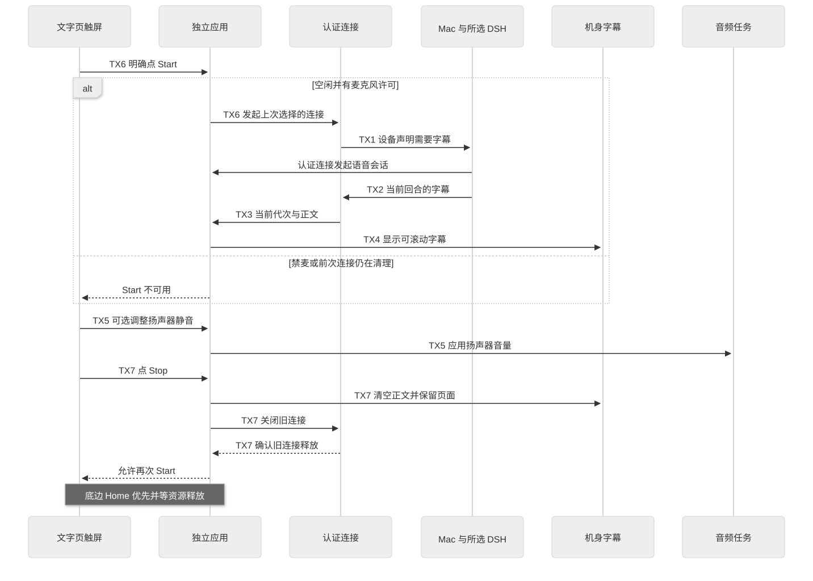
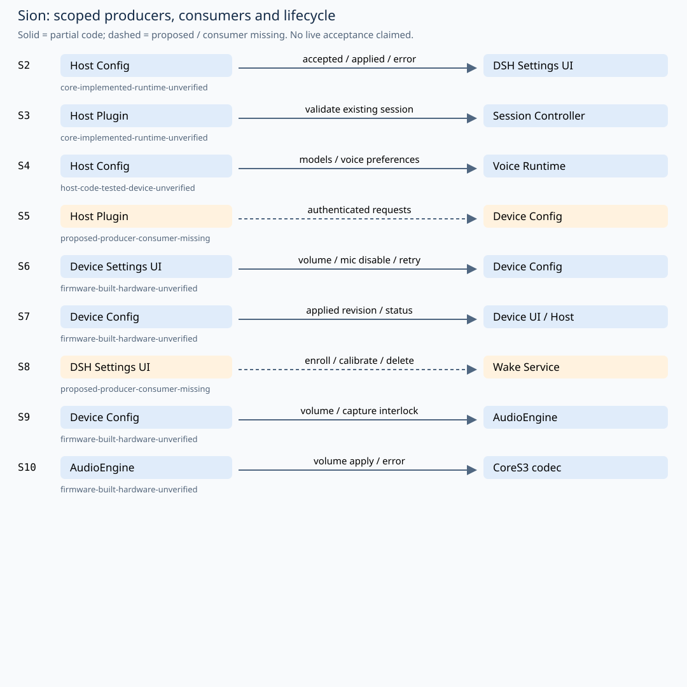
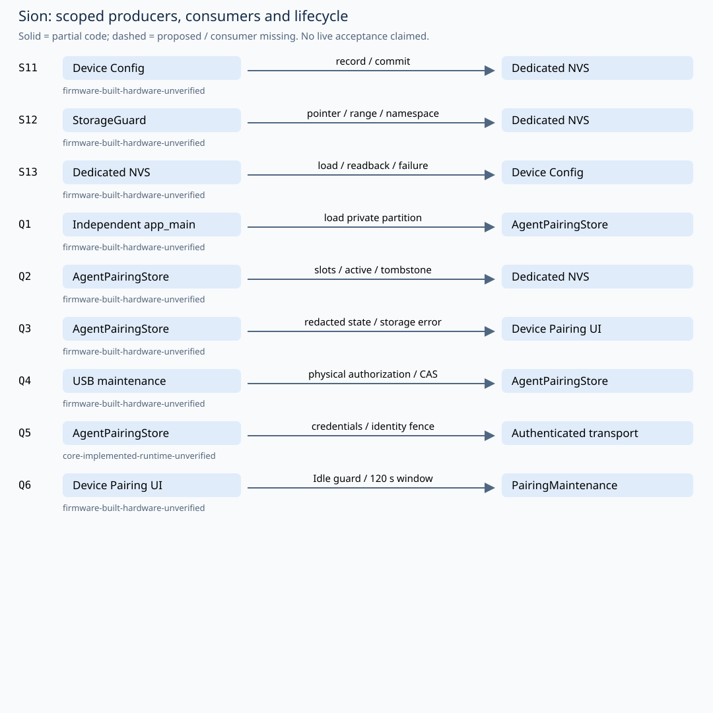

# 设备设置、音频生效与独立存储

Settings → Motion 可改变本次动作许可、查看运行/释放故障，Save 可持久化。两端界面的状态与认证命令见 [动作 v1](motion.md#认证动作与两端设置)。

显示基础现由 [独立 AgentDisplay](independent-agent.md#独立显示适配) 持有，页面/Home/Avatar 仍由主任务控制。保留官方文本字体 fallback，但原字体缺少部分常用中文字形，完整中文设置和字幕需要独立字体覆盖/布局验收；不能因目标编译或 SDK 夹具通过就认为中文显示完成。

设备 Avatar 页面支持默认脸和大肥鱼。Back/Stop/Home 与表情退出契约见 [设备能力](device-capabilities.md)。

从 v34 开始，DSH.AGENT 首页第一行有同网 **Connect / retry**、**USB** 和 **Relay**。第二行是设置、配对和 Avatar/Text。v35 的 Pairing 页显示 Relay 配置状态，通过 **Allow USB** 授权 Mac 写入，热点密码和 token 不在屏幕展示。Relay 使用同一设备配对。Stop 和上滑后 Home 等待实际断开前一通道。 [外出连接状态](agent-transport.md#外出连接中继) · [USB 配置](agent-pairing.md#relay-配置轮换与撤销)

最新网络接线：DSH 页面已增加 Connect / retry、实际网络阶段与音频状态；打开页面不自动连接/录音。Stop/Home/禁麦关闭连接，Home 等网络和音频清理；超时显示释放失败。网络活动时拒绝 Allow USB 与保存，仍可调整本次音量/禁麦。配置范围、时序与限制见 [设备网络](agent-transport.md#esp-网络所有者与显式连接)。

归属 P1/P8/A9。设备 Settings 管理音量、静音、麦克风、外观和独立配置，Home 沿用统一资源释放。独立 USB 配对及授权见 [配对契约](agent-pairing.md)。LVGL 控件投递事件，应用任务持有配置，音频任务独占 codec。

## 默认脸与大肥鱼

在 DSH.AGENT 中进入 Settings → Display，选 Default face 或 Chubby fish。选择立即用于下一次打开 Avatar。需要跨重启使用时，在设备空闲状态点 Save。外观属于设备偏好，当前 Mac 插件没有改变它的接口。Avatar 保留 Back、Stop 和上滑显示 Home。

| 关系 | 数据和运行边界 |
|---|---|
| AP1 Display 控件 → DevicePreferences | 应用任务处理 Default/Fish 选择，未保存会明确显示。选择不会打开音频设备。 |
| AP2 DevicePreferences ↔ 独立 NVS | 当前编码将 Default/Whale 写为 v6、外观值为 0/3；Fish/Text 写同长度 v5、外观值为 1/2，均受已有 CRC 保护。从 v1–v4 读取时保留默认脸，不再静默迁移 Whale；v5/v6 也保留原选择。旧独立固件遇未知版本或值会安全读失败；当前 Default 保存也使用 v6，降级需另审兼容转换或恢复已验证备份，不可假设选择 Default 就能兼容。原厂 v1.6.2 不读取这个分区。本轮仅 host 测试，未写设备。 |
| AP3 DevicePreferences → Avatar 页面 | 显示一个皮肤。离开页面即销毁，其 LVGL 对象随页面释放。 |
| AP4 AgentSession → 可见 Avatar | 复用 expression:1。Stop/断线清回中性。Avatar 关闭时报告 unavailable。 |
| AP5 AudioEngine → FishAvatar | 读取当前 epoch 的驱动写入计数。未静音的连续写入触发短窗口动嘴；关闭、静音或切换 epoch 清除窗口。计数反映驱动接受了 PCM，嘴形采用简单动画。 |
| AP6 DeviceEffects → Avatar 页面 | Home 等原有资源释放后回入口并移除页面。 |

外观绘制使用少量 LVGL 形状，包含眨眼和六种简化的表情。用户自备皮肤仍见 [产品计划](product-plan.md#设备端显示与声音偏好)。 [关系图 AP1–AP6](assets/relationships-28.svg) · [源码](../firmware/agent/fish_avatar.h) · [设置/事件处理](../firmware/agent/device_main.cc) · [ESP-IDF NVS](https://docs.espressif.com/projects/esp-idf/en/stable/esp32s3/api-reference/storage/nvs_flash.html)

## 社区鲸鱼娘形象

爹指定「鲸鱼娘」为社区图集里的蓝发、鲸尾拟人角色。**Chubby fish** 是现有卡通鱼脸。2026-11-21 已在源码加入 Whale 显式选择、Face/Talk/Blink/Hand 四层渲染、表情与当前 epoch 播报计数接线；离开页面先销毁实例再删除 LVGL 页面，不自动改旧 Default/Fish/Text 选择，会话人格仍由 DSH 管理。

**2026-11-21 资源已重新生成并编进 v57 固件，实体屏幕仍未验收。**新 blob 带布局 2 标记，运行时启用；在设备 Settings → Display 选 **Whale** 后进入 Avatar 页显示，需要重启后沿用时显式 Save。九张整脸按眼位对齐自素材包原图：聆听、开心、生气、难过（用「吃醋」）、疑惑、犯困/离线、惊讶、等回复（与疑惑同图）、摸头（用「得意」）。说话口型和眨眼是从同一素材包的原图截取后融合的贴片；摸头的手和爱心由脚本绘制，素材包里没有现成的摸头图。从 v58 起，鲸鱼娘页面在未接通时也在本机采样头顶触摸条，摸头在待机和对话中都有反应；读数不离开设备，不带动舵机。点脸除了原有的开始/停止，还会先做一个「被戳」的表情。[预览](assets/whale-avatar-preview.png)

**v63（源码与主机测试，实体未验收）：**默认神态改为「呆萌盯着」：微笑原图换上「疑惑歪头」贴纸的小平嘴，睁大眼直直看着你。被「小D在吗」叫醒先笑两秒再回到盯着；对话中和刚说完 1.5 秒内是微笑脸。挂机时每 18–36 秒随机做一次小动作（六成微笑、四成歪头疑惑），然后回到盯着。摸头结束后害羞脸红 1.6 秒（素材包「害羞脸红胸像」P2）。眨眼改为半闭→闭→半闭→睁四帧，间隔 2.2–5.6 秒随机，约四分之一连眨两下；半闭是闭眼贴片只盖上半部的「眼皮」，不是半透明叠图。嘴按扬声器实际音量分闭、半张、张三档，每 60 毫秒更新，不会从张直接跳到闭。摸头的手每 200 毫秒换位。新增素材都是小贴片，只重绘该区域，不做整屏平移，不增加屏幕刷新负担。资源 35 张贴图、1,958,560 字节（布局 3）。

素材只用于这一台私人、非商业设备。图集说明角色整体为 CC BY-NC-SA 4.0，素材包仓库没有 LICENSE 文件；**不要公开发布素材目录、生成的 blob、含它的固件镜像或预览图**，公开前需先向素材包作者确认或换掉素材。 [本轮验收](validation.md#2026-11-21-v57-鲸鱼娘固件构建与离线审查) · [素材与许可记录](../firmware/whale-sources/NOTICE.md) · [角色图集](https://iphsiibl.github.io/deepseek-whale-girl-gallery/) · [逐图署名](https://github.com/Iphsiibl/deepseek-whale-girl-gallery/blob/main/ATTRIBUTION.md)

## 挂机待命与语音唤醒

v60 源码，**实体设备未验收**。按 [分离式设计](split-design.md)，设备不识别任何唤醒词；挂机只是「保持连着，等 Mac 判断有没有人叫它」。 [v60 验收](validation.md#2026-11-21-v60-按分离式设计给设备减负)

| 项目 | 行为与边界 |
|---|---|
| 开启 | 设备 Settings 顶栏的 **Wake off / Wake on**，默认关闭。需要重启后沿用时显式 Save。开启后的偏好记录为版本 7；未开启时仍写旧版本，旧固件可读。 |
| 连接 | 形象页空闲、麦克风许可打开时，设备自己发起连接并保持；断了约 8 秒后再试，不需要点脸。本次开机在首页选过载体就用它，否则检测到 USB 主机在枚举设备时走 USB，没有则走局域网。握手 hello 带 `standby:2`。Mac 必须处于待命才连得上。 |
| 等待时 | 麦克风的声音持续送到 Mac，由 Mac 本机判断有没有人说「小D在吗」。设备灯条熄灭，鲸鱼娘是「呆萌盯着」的默认脸，偶尔微笑或歪头；没连上时是犯困脸。自动连接的过程不显示「连接中」的表情。 |
| 点脸 | 已连接时向 Mac 请求注意（等待时唤醒，对话中回到等待），不挂断。未连接时发起连接。 |
| Stop | 断开并保持静音，直到再次点脸或重新进入该页。 |
| 开机页 | 已配对的设备开机直接进形象页；未配对仍进 DSH.AGENT 首页完成配对。 |
| 摸头 | 鲸鱼娘页面未连接时也在本机采样头顶触摸条，摸头立刻换脸；连接后手势另外上报给 Mac。 |

唤醒词、停止词、静默回到等待、待机转头、主动说话都在 Mac 一侧，见 [常连挂机与唤醒词](voice-runtime.md#常连挂机与唤醒词)。v58 曾在设备上加载原厂「Hi, Stack Chan」唤醒模型做本机唤醒，v60 已整体删除（[当时的记录](validation.md#2026-11-21-v58-挂机唤醒与待机摸头)）。 [主循环](../firmware/agent/device_main.cc) · [会话与 hello](../firmware/agent/agent_session.cc)

## 纯文字模式

在设备 Settings → Display 选 Text，返回 DSH.AGENT 后打开 Text 页。选入或选出文字模式需要先停止当前连接。选择 Text 后重新连接，设备才在认证 hello 声明 `caption:1`。需要重启后沿用时，在设备空闲状态显式保存。用新版 Mac Host 配合 Text。默认脸和鱼脸的 hello 不携带此字段，旧固件仍可接新版 Host。

页面显示最近一轮的用户转写和助手公开回答，可换行、垂直滚动。每段保留最多 896 UTF‑8 字节，超过上限附省略标记，完整内容在原 DSH 会话。设备上的 **Sound on/off** 控制本地音量，立即生效，可回设备设置显式保存。若要让 Mac 也停止合成，在 DSH 设置勾选 **仅字幕**，保存后关闭并重启语音服务。此模式仍使用 Sion 麦克风，支持同一会话的连续问答与语音 Stop。Stop、Home 或断线清除屏幕正文；独立设备设置区保存显示及音量偏好。 [DSH 设置](settings-ui.md#仅字幕)

从 v47 开始，文字页顶部并排放置 **Back**、**Sound on/off**、**Start** 和 **Stop**。Start 按本次开机上次选择的连接方式发起连接，首次默认局域网。Start 只在麦克风许可打开、应用空闲且上一条连接和设备资源已经释放时可用。若 Mac 已开启对应待命，触屏发起连接后由 Host 接通。USB 待命需要 v48，从首页先选择一次 USB。设备认证后仍须收到 Host 的 Start 才打开收音。Stop 停留在本页并清空旧字幕。 [USB 待命](voice-runtime.md#usb-待命) · [局域网待命](voice-runtime.md#局域网待命) · [本机代码](../firmware/agent/device_main.cc)

| 关系 | 来源、消费者和边界 |
|---|---|
| TX1 设备 Display → AgentSession/Host | 建连时冻结 Text 选择，只有该连接有资格收正文。 |
| TX2 VoiceBridge → AgentConnection | 最终转写进入队列并开始处理时送 user。所属 DSH 回合完成后才送 assistant。Stop 指令和迟到回复不送。播报模式下字幕发送积压时可丢。仅字幕模式如果不能入队，Host 报错，已经提交的回复仍可在 DSH 会话查看。 |
| TX3 AgentConnection → AgentSession | `caption` 消息含 boot_id、epoch、speaker 和 text_hex，沿原有 USB TLS 或 WSS。每条上限 2 KiB，内容为严格 UTF‑8 前缀。应用任务拒绝非法字段或编码，丢弃上一 epoch。 |
| TX4 AgentSession → Text 页 | 内存只留该连接的一问一答，不入 NVS。新用户转写替换上一轮，正文没有用户段时忽略。文本标签不执行内容。停止或断线清空，Home 等资源释放。 |
| TX5 设备 Sound → AudioEngine | 本机静音独立于 Text 页和麦克风，回设置可保存。 |
| TX6 文字页触屏 → 应用所有者 → 当前载体 | Start 只发起连接，禁麦、清理中或收到重复 Start 时由应用所有者拒绝。区域位于字幕滚动区上方。 |
| TX7 文字页触屏 → 生命周期 → 字幕与页面 | Stop 释放资源并撤掉字幕，页面保持。已完成清理的连接允许重新进入。底边 Home 优先，完整关闭后回上级入口。 |

v32 在 Text 正文启用 [只读原厂字库](#中文字库)。字库不可用时继续用基础字体，仍能接通及显示字幕。 [关系图 TX1–TX3](assets/relationships-28.svg) · [关系图 TX4–TX8](assets/relationships-29.svg) · [字段实现](../firmware/agent/caption.h) · [页面实现](../firmware/agent/device_main.cc) · [LVGL 9.5 标签](https://github.com/lvgl/lvgl/blob/v9.5.0/docs/src/widgets/label.rst)

### 中文字库

加载只发生在断开连接后选择 Text，或从入口打开已保存 Text 的独立应用时。读取原厂 `assets` 分区的目录与唯一匹配的已审查 Puhui 字体，校验分区身份与大小、目录计数与范围、资产魔数、字节数和 SHA‑256。适配层将已验证的 CBIN 字形与字符映射偏移装配进 LVGL 9.5 的原生描述符。备份文件、固件产物与 Host 包均独立；Puhui 字节从设备现有分区读取。

| 关系 | 来源、消费者和边界 |
|---|---|
| TX6 原厂 assets → 字库适配器 | 仅 `esp_partition_read`，范围检查先于读取。已验证字库在 PSRAM 占 1,240,332 字节。 |
| TX7 字库适配器 → Text 正文 | 用户与助手两段原生 LVGL 标签使用 Puhui，标题及按钮沿用界面字体，缺字用内置 Noto。未知字库、多个匹配、损坏、读失败或 PSRAM 不足都使用基础字库。 |
| TX8 应用任务 → 字库适配器 | 同一 DSH 打开周期内保留一次已校验字库。Home 或断开后改为另一显示模式时，销毁原标签后释放。原厂助手和 Mac 会话不参与加载。 |

现有备份的 Puhui cmap 含 GB2312 一级汉字的 3,603／3,755。Mac 使用真实字库与同版本 LVGL 验证 58 次中文与标点的字形、位图查找和 320×240 长文滚动。ESP32-S3 构建验证目标结构尺寸，真机 Flash 到 PSRAM 的时延、内存峰值与实体屏幕仍待验收。 [字库实现](../firmware/agent/factory_caption_font.cc) · [ESP-IDF 分区](https://docs.espressif.com/projects/esp-idf/en/stable/esp32s3/api-reference/storage/partition.html) · [LVGL 字体描述](https://github.com/lvgl/lvgl/blob/v9.5.0/src/font/fmt_txt/lv_font_fmt_txt.h)

## 存储决定与官方证据

2026-11-18 核对 [官方 NVS 文档](https://docs.espressif.com/projects/esp-idf/en/stable/esp32s3/api-reference/storage/nvs_flash.html) 及固定 ESP-IDF 的 nvs_flash.rst：命名空间隔离键名，但垃圾回收/初始化恢复可能改写同分区页，官方建议重要出厂数据放独立只读分区。因此不放宽原厂 nvs 分区保护；DSH 配置仅允许专用 `sion_cfg` NVS 分区的 `settings` namespace（后续独立配对新增 `pairing`，见 [配对存储](agent-pairing.md)）。公开源码同名标签不表示 Sion 已有此分区。

量产分区表没有 sion_cfg。v38 由安装方案提供独立分区，缺分区显示保存不可用，音频初始禁麦和静音。只在显式保存后记录跨重启偏好。v39 的独立 OTA 候选会在打开设备界面前登记同样的独立分区，读写沿用现有存储代码。 [v39 生命周期](app-center.md#v39-原版启动器候选)

写保护仅允许 SDK 返回的 sion_cfg 指针，类型 data/nvs、大小 0x4000、4 KiB 对齐，范围在已核对的 16 MiB Sion 尾部 0xe10000–0x1000000。此为本板兼容限制，不是选定实际安装地址；其他板/布局须重审。仅这一分区允许 NVS 内部页写/回收，原厂 nvs、镜像、assets、OTA 元数据和默认 namespace 仍拒绝写入。初始化可能修复专用区，其效果不属于纯读取；真机执行仍需安装授权。

### 在原分区表上验证独立保存

历史双读确认最后 20 KiB 当时为空。试验在 `0xffb000` 留存所有权标记，后面四个扇区供 `sion_cfg`。ESP-IDF 在内存登记分区，现有配对、偏好和写保护代码读取同一标签。首次使用先校验 Flash 容量、未加密模式和完整原厂分区表的 SHA-256，检查整个候选范围为空，写入并读回标记，然后才允许 NVS 初始化。已有标记必须完整匹配，标记扇区余下字节须保持擦除状态。遇到布局变化、无标记的非空范围、标记不完整或读写错误时，应用拒绝打开配置。 [ESP-IDF 分区登记](https://docs.espressif.com/projects/esp-idf/en/stable/esp32s3/api-reference/storage/partition.html) · [共享存储源码](../firmware/app-center/tail_storage.cc)

在虚拟 Flash 上保存后，实测重新启动到原版 v1.6.2 应用入口，模拟再选择 DSH 镜像后读回原配对及设置的全部字段。读回没有发生存储写入。启用到正式固件前需确认 M5Stack 的正式升级不会占用尾部，并将这段区间加入私有安装和恢复审查。 [离线验证](validation.md#原分区表下的配对与偏好)

## 点脸开始和停止

屏幕和头顶是两套输入。屏幕中央轻点用于开始或停止，底边上滑保留 Home。头顶的 Si12T 三个电容区只生成摸头手势供所选会话查询，出现偶发误触时也不会开麦、停止对话或触发 Home。 [头顶手势及去抖](device-capabilities.md#头顶手势-v2)

在 DSH 的普通脸和大肥鱼页，轻点中央区域按当前状态执行本机动作。空闲且麦克风许可打开时，使用本次运行上次选过的 USB、局域网或 Relay 连接。首次默认局域网。连接中或对话中轻点走现有 Stop 路径，取消连接、收音和播报，保留当前外观页。释放期间的连点不会重连。明确选过的连接方式保存在运行内存，固件重启后从局域网开始。 [触屏入口和优先级](../firmware/agent/device_main.cc) · [原厂 AI Agent 手册](https://docs.m5stack.com/en/StackChan/#ai-agent)

中央目标保留屏幕底边的 Home 手势起点及顶部 Back、Stop 按钮。Home 在意图同一拍出现时优先，走原有释放与返回路径。文字页使用单独的开始和停止按钮，正文区域用于滚动。一轮真机验收须分别覆盖两种头像与文字页、唤醒后断线、播报中触碰、连点、拇指在底边起滑及禁麦状态。滑过头像与屏幕驱动的实际事件仍需上机核对。 [固件 UI 夹具](../firmware/agent/device_ui_test.cc) · [真机调试入口](device-compatibility.md#底座-usb-c-真机调试)

## 字段、线程和失败

`preferences.h` 定义固定 12 字节 LE 记录。音量范围 0–100，另有静音、禁麦、相机/动作/灯环许可、外观和保存 revision。当前默认脸和 Whale 保存为 v6，鱼脸和文字保存为 v5，仍可读取旧 v1–v4 默认脸且不强迁移，全部字段受 CRC32 校验。读取未知版本、未知外观或发生数据/SDK 错误时，禁麦和静音，且不静默覆盖记录。没有记录时只读原厂音量作首次默认。保存先调用 set_blob 和 commit，再读回比较；所有步骤成功才显示已保存。失败或断电后可能已留下新记录，重启按实际记录重新读取。

设置调整立即更新运行偏好，但与保存分别显示；调整不自动开始收音。禁麦在 AudioEngine 内阻止 Begin、清除输入/输出并请求关闭；应用所有者另外停止生命周期。进行中的一次 I/O 可返回，但输入不得发布，真实关闭前不能报告硬件已停。重新允许麦克风仅恢复许可，不自动重连。Home/Stop 优先于普通设置操作。

音量由唯一音频任务传给 CoreS3 AW88298，明确报告 requested/applied；0 保持静音。打开时传入 DSH 的有效音量，不再在每次打开 codec 时读取原厂 volume。运行中音量失败转入音频关闭错误；设备空闲时标明下次连接应用。专用区保存失败不改变原厂配置。当前没有真实连接，不能用音量控件存在证明已经有可听输出。

从零计数的第 2 字节传输许可位。bit 0/1 为静音/禁麦，bit 2 为相机，bit 3 为动作，bit 4 为灯环。读 v1 时相机关闭，读 v1/v2 时动作关闭，读 v1–v3 时灯环关闭。只有显式 Save 才写记录。旧独立 DSH 固件遇到未知版本进入禁麦/静音的安全初始状态。原厂 NVS 和绑定使用独立格式。

Settings → Camera 的许可调整立即生效，关闭当前请求并等待 worker 清理；重新允许不自动拍照，不改变当前音频会话。保存仍需生命周期、音频、相机（含待取结果）、网络和维护全部满足空闲条件；缺 sion_cfg 时不能持久化。实际状态与 V31/V32 见 [相机](camera.md#设备任务许可与关闭汇总)。Host 只读状态投影已接；许可仍在设备修改，不提供远端开启。设备页面另显示传输和最近失败/取消，详见 [两端相机状态](camera.md#两端相机状态与照片保留说明)。实体屏幕与持久化仍待真机验收。

Settings → Ring 在设备本机允许或撤销灯效，调整立即生效。撤销时取消灯效并等待独立灯环任务确认全黑。Save 还会检查灯环已空闲，设置只写 `sion_cfg`。DSH 只读许可和当前状态。参见 [灯环 v1](device-capabilities.md#灯环-v1-的命令与退出)。

## 生产者与消费者

S6 设备设置 UI → Device Config：本次运行偏好/显式保存；S7 Device Config → Device UI：偏好、保存错误/缺区；Host 状态投影仍缺失。新增 S9 Device Config → AudioEngine：有效音量和禁麦门槛；S10 AudioEngine → CoreS3 codec：唯一 I/O 任务应用及失败；S11 Device Config → Dedicated NVS：编码记录/提交；S13 Dedicated NVS → Device Config：读取/校验/错误；S12 StorageGuard → Dedicated NVS：限定指针/范围/命名空间，所有原区写入仍拒绝。相机新增 CAM1 DevicePreferences → CameraEngine（许可/撤销），CAM4 DeviceEffects → CameraEngine（停止与释放结果），CAM11 的授权拍照请求仍拟接。这些边加入统一账本与渲染图，状态以本批验证回写为准。

## 编辑与验收

编辑入口：firmware/agent/preferences.h、settings_store.cc、storage_guard.cc、audio_engine.h、core_audio_bridge.cc、device_main.cc；准备脚本声明接缝与测试 fake SDK 同步更新。已读手册、安装保护、音频、设置界面契约；不改变认证协议和原厂导航接口，追踪在这些未变边界停止。

检查必须包括记录损坏/未知版本、缺分区/缺 key、写/提交/读回失败、跨重启、原区写拒绝、仅专用区写允许；真实音频实现的音量失败、禁麦与阻塞读取竞态、不能绕过禁麦 Begin。随后独立新目录完整 ESP32-S3 构建。主机 fake SDK 不证明 Flash 掉电恢复、真机控件触摸或声学静音，P1/P8 保持未完成。

## 本批证据与剩余门槛

- `scripts/test_agent.py --prepared-source work/firmware-agent-settings-v6/firmware`：6 组生命周期、8 组音频场景（含真实阻塞读线程时禁麦）、独立存储范围/伪指针拒绝、记录 CRC/读取失败安全状态、实际 NVS adapter 的提交/读回失败、实际 CoreS3 音量错误，以及实际 device_main 的设置/保存/Stop/Home/Back/重入，均通过 ASan/UBSan。后者使用可注入 HAL/LVGL，验证逻辑与控件边界，未验证像素布局/手势识别。
- 新音频路径另通过 ThreadSanitizer。设备禁止自动收音：测试中进入、调整和保存均未调用 codec Open；真实启用仍需认证连接所有者。设置页的保存只在生命周期与音频均 idle 时执行，避免 NVS 写阻塞活动语音的停止路径。
- `independent-settings-v6` 完整 ESP32-S3 构建成功：2,224,320 字节，bin SHA256 `3cad4a9aaffe667536935b78b124d85ccd7f436d6b3ba1db2a92b86ed9384203`。收据见 [agent-settings-build.json](../firmware/agent-settings-build.json)，prepared source 再校验通过。最终 ELF 有 AgentVolume、NvsPreferenceStore::Save 和原始页写 wrapper；镜像校验有效。版本字符串 1.6.2 继承固定上游，不代表官方量产固件。
- 分区表与上一独立构建逐字节一致，未添加 sion_cfg。镜像比原尾部空闲区大 192,704 字节，还需独立 16 KiB 配置空间；没有选安装布局，installable=false / hardwareValidated=false。v5 仅完成准备，随后发现 SDK 页头使用 write_raw 而重开 v6；v5 没有完整构建或安装。
- 检查锁定 SDK 的 nvs_partition.cpp / nvs_page.cpp 发现页头/状态位走 esp_partition_write_raw；本批补上 wrapper，仅许可独立区，其余区域拒绝。不能继续用旧的“9 项写 API”描述当前实现；旧构建证据保留。

实际驱动测试使用 fake SDK，不能证明 Flash 掉电恢复或真实声学结果。固件未连接/安装在 Sion；原助手与绑定沿用此前用户现场确认，本批没有改变。Host 同步、配对状态/重连、声学链路与设备信息页仍缺失，P1/P8 不关闭。

后续配对批次：storage_guard 另允许 sion_cfg/pairing，原厂 sion_pair 仍只读。设备身份配置与音量设置共用专用分区，但 namespace/键分别隔离。v8 的 Pairing 页可开启 USB 写入窗口；维护 reserved（窗口开启或 busy）时拒绝设置保存，避免两个写入所有者同时操作 NVS。真实设备未安装，网络仍未接入；具体状态/提交语义见 [独立配对](agent-pairing.md)。
