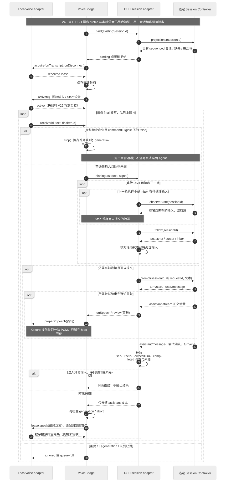

# 图示导航

按问题选择视角。点击「原图」可放大 SVG，每个功能页附源码依据、分支说明与验证范围。

| 视角 | 回答的问题 | 代表图 |
|---|---|---|
| [架构图](#架构图) · 2 张 | 人格、语音和设备分别由谁负责？ | [V1 系统责任原图](assets/views/architecture.svg) |
| [流程图](#流程图) · 10 张 | 从配置、接通到停止，下一步怎么走？ | [V3 用户流程原图](assets/views/user-flow.svg) |
| [时序图](#时序图) · 52 张 | 设备、Mac、DSH 谁先调用，谁等回复？ | [V4 连续对话原图](assets/views/conversation-sequence.svg) |
| [状态图](#状态图) · 8 张 | 断线、超时或停止后，哪些操作还允许？ | [V6 设备状态原图](assets/views/device-state.svg) |
| [数据模型图](#数据模型图) · 2 张 | 偏好、配对和活动记录怎样关联？ | [V9 设备数据原图](assets/views/device-data.svg) |
| [部署图](#部署图) · 2 张 | Mac 和设备各运行什么，通过什么连接？ | [V2 部署原图](assets/views/deployment.svg) |

## 先看一张时序图

连续聊天时，Mac 把转写发给你选定的 DSH 会话，收到属于这一轮的最终文本后再播报。横向是参与者，纵向向下是时间。图中的循环对应每条最终转写，条件分支标出忙碌、拒绝和停止。桥接和本地语音已完成组合测试，用户会话与真机闭环待验收。详见 [V4 连续对话](runtime-sequences.md#连续对话与既有会话)、[V5 停止与资源释放](runtime-sequences.md#停止与-home) 和 [Mermaid 时序图说明](https://mermaid.js.org/syntax/sequenceDiagram.html)。

## 全部图示与源码

第一列直达 SVG 原图。图示覆盖 76 个场景或视角。接口的全部生产者及影响方见 [关系账本](design.md#接口与影响方)。本页为导航，行为及验证结论由各功能页维护。

### 架构图

| 图示 | 回答的问题 | 说明与来源 | Mermaid 源码 |
|---|---|---|---|
| [V1 架构](assets/views/architecture.svg) | 谁负责人格、语音、设备与原助手？ | [结构与部署](system-views.md) | [architecture.mmd](diagrams/architecture.mmd) |
| [V52 架构](assets/views/sion-modes-architecture.svg) | 三种连接怎样复用原会话，语音与外观各由谁负责？ | [连接、声音与屏幕](product-plan.md#连接声音和屏幕) | [sion-modes-architecture.mmd](diagrams/sion-modes-architecture.mmd) |

### 流程图

| 图示 | 回答的问题 | 说明与来源 | Mermaid 源码 |
|---|---|---|---|
| [V3 流程](assets/views/user-flow.svg) | 用户从配置到说话、停止、Home 怎样走？ | [目标用户流程](system-views.md#目标用户流程) | [user-flow.mmd](diagrams/user-flow.mmd) |
| [V13 流程](assets/views/environment-flow.svg) | 怎样获得 USB 和本地 WSS 地址候选，何时才会配对？ | [环境检查](host-pairing.md#环境检查与候选端口) | [environment-flow.mmd](diagrams/environment-flow.mmd) |
| [V25 流程](assets/views/voice-environment-flow.svg) | 环境检查与模型自检分别证明什么，Start 怎样重验？ | [语音环境](voice-environment.md) | [voice-environment-flow.mmd](diagrams/voice-environment-flow.mmd) |
| [V30 流程](assets/views/capacity-review-flow.svg) | 已有备份与候选怎样变成容量结论，为什么 fit 不等于可安装？ | [离线容量审查](installation-recovery.md#独立容量审查器) | [capacity-review-flow.mmd](diagrams/capacity-review-flow.mmd) |
| [V47 流程](assets/views/device-capability-status.svg) | 设备能力与许可怎样到达所选会话和设置？ | [能力查询](device-capabilities.md#设备能力状态查询) | [device-capability-status.mmd](diagrams/device-capability-status.mmd) |
| [V51 流程](assets/views/managed-usb-pairing-flow.svg) | 默认安装的单次操作怎样获准打开串口，失败后如何恢复？ | [单次 USB 授权](host-pairing.md#默认托管安装的单次-usb-授权) | [managed-usb-pairing-flow.mmd](diagrams/managed-usb-pairing-flow.mmd) |
| [V55 流程](assets/views/relay-provision-flow.svg) | 一份本机输入如何生成三个消费者各自的配置？ | [三端配置生成](agent-transport.md#从一份输入准备三端配置) | [relay-provision-flow.mmd](diagrams/relay-provision-flow.mmd) |
| [V56 流程](assets/views/acoustic-latency-flow.svg) | 怎样在同一条录音时间轴上比较三种连接的首音和停止？ | [真机声学延迟](voice-runtime.md#真机声学延迟) | [acoustic-latency-flow.mmd](diagrams/acoustic-latency-flow.mmd) |
| [V74 流程](assets/views/app-center-install-review.svg) | 哪些材料必须匹配，才能判断 App Center 会下载还是 Open？ | [首装证据预检](installation-recovery.md#app-center-首装证据预检) | [app-center-install-review.mmd](diagrams/app-center-install-review.mmd) |

### 时序图

#### 对话、语音和停止

| 图示 | 回答的问题 | 说明与来源 | Mermaid 源码 |
|---|---|---|---|
| [V4 时序](assets/views/conversation-sequence.svg) | 转写怎样进入选定 DSH，首句何时能提前合成及播出？ | [连续对话](runtime-sequences.md#连续对话与既有会话) | [conversation-sequence.mmd](diagrams/conversation-sequence.mmd) |
| [V5 时序](assets/views/stop-sequence.svg) | Stop/Home 为什么要等待 codec 关闭？ | [停止与 Home](runtime-sequences.md#停止与-home) | [stop-sequence.mmd](diagrams/stop-sequence.mmd) |
| [V16 时序](assets/views/agent-transport-sequence.svg) | 认证连接、音频与实际停止回执怎样关联？ | [Agent 传输](agent-transport.md) | [agent-transport-sequence.mmd](diagrams/agent-transport-sequence.mmd) |
| [V53 时序](assets/views/agent-relay-sequence.svg) | Mac 如何持续待命，Sion 按 Relay 后怎样认证、收音和释放旧连接？ | [远程中继](agent-transport.md#外出连接中继) | [agent-relay-sequence.mmd](diagrams/agent-relay-sequence.mmd) |
| [V54 时序](assets/views/relay-setup-sequence.svg) | DSH 设置如何检查私有文件、授权 USB 写入及核对未知结果？ | [外出中继设置](settings-ui.md#外出中继设置) | [relay-setup-sequence.mmd](diagrams/relay-setup-sequence.mmd) |
| [V57 时序](assets/views/battery-state-sequence.svg) | Sion 的电量来源是什么，Stop 或过期后 DSH 看到什么？ | [电量 v1](device-capabilities.md#电量-v1) | [battery-state-sequence.mmd](diagrams/battery-state-sequence.mmd) |
| [V58 时序](assets/views/ambient-state-sequence.svg) | 光线与近接读数如何上报，什么时候确认芯片已待机？ | [光线与近接 v1](device-capabilities.md#光线与近接-v1) | [ambient-state-sequence.mmd](diagrams/ambient-state-sequence.mmd) |
| [V60 时序](assets/views/head-touch-gesture-sequence.svg) | 短触如何确认，松手回碰如何过滤，谁能读取手势？ | [头顶手势 v2](device-capabilities.md#头顶手势-v2) | [head-touch-gesture-sequence.mmd](diagrams/head-touch-gesture-sequence.mmd) |
| [V61 时序](assets/views/voice-indicator-sequence.svg) | 对话状态和限时灯效怎样共用灯条，停止时怎样熄灯？ | [对话状态灯](device-capabilities.md#对话状态灯-v1) | [voice-indicator-sequence.mmd](diagrams/voice-indicator-sequence.mmd) |
| [V62 时序](assets/views/text-controls-sequence.svg) | 怎样从文字页开始、停止和重连，谁发布字幕？ | [文字模式](device-settings.md#纯文字模式) | [text-controls-sequence.mmd](diagrams/text-controls-sequence.mmd) |
| [V63 时序](assets/views/lan-standby-sequence.svg) | 同网时 Sion 如何接通所选会话，谁能撤销待命？ | [局域网待命](voice-runtime.md#局域网待命) | [lan-standby-sequence.mmd](diagrams/lan-standby-sequence.mmd) |
| [V64 状态](assets/views/app-center-stock-state.svg) | 原版启动器何时进入 DSH，何时退回原厂？ | [App Center 试发行](app-center.md#v47-原版启动器候选) | [app-center-stock-state.mmd](diagrams/app-center-stock-state.mmd) |
| [V65 时序](assets/views/usb-voice-port-sequence.svg) | USB 音频如何确认串口连的是已配对设备？ | [串口身份匹配](host-pairing.md#串口音频的设备匹配) | [usb-voice-port-sequence.mmd](diagrams/usb-voice-port-sequence.mmd) |
| [V66 时序](assets/views/usb-standby-sequence.svg) | USB 待命时，设备怎样通过触屏接通并在语音停止后再进入？ | [USB 待命](voice-runtime.md#usb-待命) | [usb-standby-sequence.mmd](diagrams/usb-standby-sequence.mmd) |
| [V67 状态](assets/views/standby-synthesis-state.svg) | 说「停止」后，Kokoro 何时保留、重载或退出？ | [合成进程](local-voice.md#待命中的合成进程) | [standby-synthesis-state.mmd](diagrams/standby-synthesis-state.mmd) |
| [V68 时序](assets/views/voice-preview-sequence.svg) | 设置草稿如何生成试听，取消怎样关闭合成进程？ | [音色试听](voice-environment.md#本地音色试听) | [voice-preview-sequence.mmd](diagrams/voice-preview-sequence.mmd) |
| [V69 时序](assets/views/app-center-ota-writer-sequence.svg) | OTA 开始和结束分别写哪段，断开后会启动谁？ | [App Center 擦写与启动](app-center.md#v51-的实际-sdk-写入顺序) | [app-center-ota-writer-sequence.mmd](diagrams/app-center-ota-writer-sequence.mmd) |
| [V75 时序](assets/views/stock-trial-sequence.svg) | 保留原版启动器的单次联调，先写什么，如何回到原厂？ | [保留原厂的单次联调](installation-recovery.md#v54-保留原厂的单次联调) | [stock-trial-sequence.mmd](diagrams/stock-trial-sequence.mmd) |
| [V76 时序](assets/views/device-diagnostics-sequence.svg) | Sion 断线后，如何读取独立诊断并与 Mac 对照？ | [双端诊断时间线](hardware-check.md#双端诊断时间线) | [device-diagnostics-sequence.mmd](diagrams/device-diagnostics-sequence.mmd) |
| [V70 时序](assets/views/app-center-reopen-sequence.svg) | App Center 何时能打开已装镜像？ | [已安装应用入口](app-center.md#打开已安装应用的上游补丁) | [app-center-reopen-sequence.mmd](diagrams/app-center-reopen-sequence.mmd) |
| [V71 时序](assets/views/app-center-home-sequence.svg) | DSH 点 Home 怎样让原厂只在本次启动显示主菜单？ | [一次性菜单请求](app-center.md#一次性-home-返回原厂菜单) | [app-center-home-sequence.mmd](diagrams/app-center-home-sequence.mmd) |
| [V72 流程](assets/views/app-center-recovery-review.svg) | 安装中断后，两份双读如何决定能否列出撤销范围？ | [撤销范围的只读核对](installation-recovery.md#撤销范围的只读核对) | [app-center-recovery-review.mmd](diagrams/app-center-recovery-review.mmd) |
| [V73 时序](assets/views/app-center-shortcut-sequence.svg) | 如何从 App Center 建立快捷入口并离线再打开？ | [主菜单快捷入口](app-center.md#app-center-应用的主菜单快捷入口) | [app-center-shortcut-sequence.mmd](diagrams/app-center-shortcut-sequence.mmd) |
| [V59 时序](assets/views/touch-menu-entry-sequence.svg) | 怎样从机身菜单进入 DSH，再点 Home 回到同一菜单？ | [触屏往返](app-center.md#从-sion-主菜单打开-dshagent) | [touch-menu-entry-sequence.mmd](diagrams/touch-menu-entry-sequence.mmd) |
| [V17 时序](assets/views/device-session-sequence.svg) | 设备怎样等待打开/关闭并归还播放容量？ | [设备会话控制](agent-transport.md#设备会话所有者与跨语言接线) | [device-session-sequence.mmd](diagrams/device-session-sequence.mmd) |
| [V18 时序](assets/views/device-network-sequence.svg) | 显式连接、USB 身份预约与 Home 怎样等待网络清理？ | [设备网络所有者](agent-transport.md#esp-网络所有者与显式连接) | [device-network-sequence.mmd](diagrams/device-network-sequence.mmd) |
| [V19 时序](assets/views/local-speech-sequence.svg) | 本地识别/合成怎样消费、取消并等待进程退出？ | [本地语音](local-speech.md#实际-api-与进程时序) | [local-speech-sequence.mmd](diagrams/local-speech-sequence.mmd) |
| [V20 时序](assets/views/playback-fence-sequence.svg) | 怎样确认播完、单独打断且保持收音？ | [播放屏障](agent-audio.md#播放排空与单独打断) | [playback-fence-sequence.mmd](diagrams/playback-fence-sequence.mmd) |
| [V21 时序](assets/views/local-audio-sequence.svg) | 本地输入怎样处理批次、跳过缺帧的句子并恢复分句？ | [本地音频](local-audio.md#实际接口顺序与影响方) | [local-audio-sequence.mmd](diagrams/local-audio-sequence.mmd) |
| [V22 时序](assets/views/local-voice-sequence.svg) | 收音如何独立于问答/播报，释放为什么不能提前确认？ | [连续本地语音](local-voice.md) | [local-voice-sequence.mmd](diagrams/local-voice-sequence.mmd) |
| [V23 时序](assets/views/voice-runtime-sequence.svg) | 设置操作怎样驱动 listener/会话，保存何时生效？ | [语音运行](voice-runtime.md) | [voice-runtime-sequence.mmd](diagrams/voice-runtime-sequence.mmd) |
| [V24 时序](assets/views/identity-lease-sequence.svg) | 身份锁怎样防止维护并发，异常退出如何清理？ | [身份租约](voice-runtime.md#配对身份租约与退出) | [identity-lease-sequence.mmd](diagrams/identity-lease-sequence.mmd) |

#### 两端设置、配对和环境安装

| 图示 | 回答的问题 | 说明与来源 | Mermaid 源码 |
|---|---|---|---|
| [V7 时序](assets/views/pairing-sequence.svg) | 配对轮换何时改变有效身份，失败能否重试？ | [配对存储](agent-pairing.md#配对提交时序) | [pairing-sequence.mmd](diagrams/pairing-sequence.mmd) |
| [V8 时序](assets/views/settings-sequence.svg) | DSH 设置怎样校验已有会话并拒绝陈旧保存？ | [DSH 设置](settings-ui.md#原生设置保存时序) | [settings-sequence.mmd](diagrams/settings-sequence.mmd) |
| [V10 时序](assets/views/usb-pairing-sequence.svg) | USB 授权何时消费，写入期间 Home 怎样等待？ | [USB 授权](agent-pairing.md#usb-授权与维护时序) | [usb-pairing-sequence.mmd](diagrams/usb-pairing-sequence.mmd) |
| [V11 时序](assets/views/host-pairing-sequence.svg) | 设备已写入而 Host 没收到回复，怎样恢复？ | [Host 配对事务](host-pairing.md) | [host-pairing-sequence.mmd](diagrams/host-pairing-sequence.mmd) |
| [V12 时序](assets/views/pairing-ui-sequence.svg) | 页面如何调用原生 Gateway，谁验证 owner、谁取消？ | [配对页面](host-pairing.md#原生-remote-与手动配对页面) | [pairing-ui-sequence.mmd](diagrams/pairing-ui-sequence.mmd) |
| [V14 时序](assets/views/runtime-setup-sequence.svg) | 插件怎样离线安装环境，中断或重启后用哪一个？ | [运行环境安装](runtime-installation.md) | [runtime-setup-sequence.mmd](diagrams/runtime-setup-sequence.mmd) |
| [V15 时序](assets/views/plugin-load-sequence.svg) | 安装包怎样自动注册接口，禁用时怎样撤销？ | [原生加载验证](settings-ui.md#安装包与原生加载器验证) | [plugin-load-sequence.mmd](diagrams/plugin-load-sequence.mmd) |
| [V26 时序](assets/views/voice-installation-sequence.svg) | 构建、自检、提交与退出谁先完成？ | [语音安装](voice-installation.md) | [voice-installation-sequence.mmd](diagrams/voice-installation-sequence.mmd) |
| [V29 时序](assets/views/device-display-sequence.svg) | 独立屏幕怎样初始化，触摸与 Avatar 怎样共享，失败何时终止？ | [独立显示适配](independent-agent.md#独立显示适配) | [device-display-sequence.mmd](diagrams/device-display-sequence.mmd) |

#### 相机、表情和动作

| 图示 | 回答的问题 | 说明与来源 | Mermaid 源码 |
|---|---|---|---|
| [V28 时序](assets/views/device-expression-sequence.svg) | 表情命令怎样经过权限、会话与租约检查，如何回执和清理？ | [设备表情](device-capabilities.md) | [device-expression-sequence.mmd](diagrams/device-expression-sequence.mmd) |
| [V31 时序](assets/views/camera-capture-sequence.svg) | 相机为何必须实际关闭后才发布，停止如何丢弃旧帧？ | [相机采集核心](camera.md) | [camera-capture-sequence.mmd](diagrams/camera-capture-sequence.mmd) |
| [V33 时序](assets/views/camera-transfer-sequence.svg) | 图片怎样分块回传，何时才可以返回完整结果？ | [相机传输](camera.md#有界图片回传协议与实际接线) | [camera-transfer-sequence.mmd](diagrams/camera-transfer-sequence.mmd) |
| [V34 时序](assets/views/camera-attachment-sequence.svg) | 已授权的拍照怎样回到视觉或文字模型？停止时如何作废旧结果？ | [DSH 图片消费](camera.md#dsh-图片消费与结果提交) | [camera-attachment-sequence.mmd](diagrams/camera-attachment-sequence.mmd) |
| [V35 时序](assets/views/camera-status-sequence.svg) | 设备许可与 Host 处理状态怎样到达设置页，何时失效？ | [两端相机状态](camera.md#两端相机状态与照片保留说明) | [camera-status-sequence.mmd](diagrams/camera-status-sequence.mmd) |
| [V36 时序](assets/views/motion-sequence.svg) | 动作接受、位置反馈、取消和驱动释放是什么顺序？ | [动作核心](motion.md#核心接口与完成条件) | [motion-sequence.mmd](diagrams/motion-sequence.mmd) |
| [V38 时序](assets/views/motion-scs-sequence.svg) | 接受位置、校验反馈与双轴释放的应答如何检查？ | [SCS 寄存器适配](motion.md#scs-寄存器适配与平台接缝) | [motion-scs-sequence.mmd](diagrams/motion-scs-sequence.mmd) |
| [V39 时序](assets/views/motion-uart-sequence.svg) | 缺标定、通信超时和部分关闭如何拒绝或重试？ | [ESP UART](motion.md#esp-串口原标定与部分清理) | [motion-uart-sequence.mmd](diagrams/motion-uart-sequence.mmd) |
| [V41 时序](assets/views/motion-hardware-sequence.svg) | 标定、串口、供电、任务与 Home 怎样按顺序组合？ | [资源组合](motion.md#资源组合唯一任务与-home) | [motion-hardware-sequence.mmd](diagrams/motion-hardware-sequence.mmd) |
| [V46 时序](assets/views/ring-command-sequence.svg) | 灯效怎样经所选会话发到设备，停止怎样等待熄灯？ | [灯环 v1](device-capabilities.md#灯环-v1-的命令与退出) | [ring-command-sequence.mmd](diagrams/ring-command-sequence.mmd) |
| [V45 时序](assets/views/py32-ring-sequence.svg) | 12 颗灯如何与舵机共用 PY32，失败后怎样确认关闭？ | [共享 PY32](device-capabilities.md#灯环与舵机共用的-py32) | [py32-ring-sequence.mmd](diagrams/py32-ring-sequence.mmd) |
| [V42 时序](assets/views/motion-command-sequence.svg) | 动作请求怎样从选定会话到舵机，取消后什么还能返回？ | [认证动作](motion.md#认证动作与两端设置) | [motion-command-sequence.mmd](diagrams/motion-command-sequence.mmd) |

#### 系统启动、安装及恢复

| 图示 | 回答的问题 | 说明与来源 | Mermaid 源码 |
|---|---|---|---|
| [V43 时序（本地验证）](assets/views/isolated-slot-sequence.svg) | 原厂 A/B 与独立应用的进入、停止和返回怎样区分？ | [启动与返回契约](dual-boot-updates.md#v23-尾部布局与返回时序) | [isolated-slot-sequence.mmd](diagrams/isolated-slot-sequence.mmd) |
| [V44 时序（真机只读与阶段演练）](assets/views/install-recovery-sequence.svg) | 三段写入与两段恢复如何按序核验？ | [v35 安装与恢复](installation-recovery.md#v35-relay-候选离线审查) | [install-recovery-sequence.mmd](diagrams/install-recovery-sequence.mmd) |

### 状态图

| 图示 | 回答的问题 | 说明与来源 | Mermaid 源码 |
|---|---|---|---|
| [V6 状态](assets/views/device-state.svg) | 独立设备连接、过期、释放、返回、失败如何转换？ | [生命周期状态](runtime-sequences.md#独立设备状态) | [device-state.mmd](diagrams/device-state.mmd) |
| [V27 状态](assets/views/voice-installation-state.svg) | 失败和取消之后，阶段与 active 怎样区分？ | [语音安装](voice-installation.md) | [voice-installation-state.mmd](diagrams/voice-installation-state.mmd) |
| [V32 状态](assets/views/camera-state.svg) | 许可、取消、待取结果和关闭失败怎样限制下一步？ | [相机任务与许可](camera.md#设备任务许可与关闭汇总) | [camera-state.mmd](diagrams/camera-state.mmd) |
| [V37 状态](assets/views/motion-state.svg) | 动作超时或释放失败后怎样拒绝新命令、何时可重试？ | [动作核心](motion.md#核心接口与完成条件) | [motion-state.mmd](diagrams/motion-state.mmd) |
| [V40 状态](assets/views/motion-power-state.svg) | 供电准备、Enable、Ready 和失败清理分别表示什么？ | [供电所有权](motion.md#py32-供电控制与所有权) | [motion-power-state.mmd](diagrams/motion-power-state.mmd) |
| [V50 状态](assets/views/boot-selection-state.svg) | 上电、按键和镜像校验怎样决定启动哪套应用？ | [启动选择与返回状态](dual-boot-updates.md#启动选择与返回状态) | [boot-selection-state.mmd](diagrams/boot-selection-state.mmd) |

### 数据模型图

| 图示 | 回答的问题 | 说明与来源 | Mermaid 源码 |
|---|---|---|---|
| [V9 数据模型](assets/views/device-data.svg) | 两种设备配置怎样隔离，active 指向什么？ | [设备记录](system-views.md#设备记录模型) | [device-data.mmd](diagrams/device-data.mmd) |
| [V48 数据模型](assets/views/device-capability-data.svg) | 能力 v1 包含哪些字段，哪一项可以缺省？ | [能力报告字段](device-capabilities.md#报告字段与生命周期) | [device-capability-data.mmd](diagrams/device-capability-data.mmd) |

### 部署图

| 图示 | 回答的问题 | 说明与来源 | Mermaid 源码 |
|---|---|---|---|
| [V2 部署](assets/views/deployment.svg) | 当前哪些已运行、哪些仅构建，目标跨哪些边界？ | [结构与部署](system-views.md) | [deployment.mmd](diagrams/deployment.mmd) |
| [V49 部署](assets/views/maintenance-deployment.svg) | Mac 维护、设备 ROM 和两个 Flash 应用在哪里运行？ | [维护部署边界](installation-recovery.md#v26-维护部署边界) | [maintenance-deployment.mmd](diagrams/maintenance-deployment.mmd) |

## 更新与复现

本地连续语音批次更新 V4 的验证范围，加入同一隔离 profile 的原生 DSH、语音和 Stop 证据。V5 实体释放路径按现有接线保留。见 [原生 DSH 连续语音演练](voice-runtime.md#原生-dsh-连续语音演练)。

图示导航已按 WikiSkill #72 的项目和章节规则复审。首页显示 V1 并直达六类代表图，目录按视角分组，时序按场景再分四组。保留 44 张功能图的 ID、Mermaid 文件和原图。V1、V4、V43 和 V44 的图示调用关系已核对，无需重新绘制。QEMU 启动结果与现场预检分别留在启动和安装章节，实体切换仍待验收。

V43 展示启动器候选与 v24 返回。布局、主机夹具与本地构建已验证，真机待验收。

v22 新增 V42 请求与状态时序，当前 42 张主图、30 张时序。V41 记录 v21 的板级资源组合。

动作任务批次新增 V41，更新 V5/V36/V38/V39/V40 的组合状态与入口。当前 41 张主图、29 张时序、5 张状态、243 个唯一关系 ID；请求/许可/工具仍待接，任务存在不代表可用动作协议。

供电批次新增 V40 状态，当前 40 张主图、28 张时序、5 张状态、241 个关系 ID。GPIO0 的独立适配已测试，MO15/MO17 的实际组合和任务仍待接，不把 enabled 标志当实时电压。

UART 批次新增 V39，当前 39 张主图、28 张时序、238 个关系 ID。V38 增加 Close 部分失败后只重试清理的分支；原 NVS/UART 已有实际适配，板级供电所有者与生产 worker 仍待接。

SCS 适配批次新增 V38，当前 38 张主图、27 张时序、235 个关系 ID。MO2 具备真实寄存器消费者，平台串口/供电接缝仍标待接。V36 的释放说明改为取消后续命令，不暗示擦除舵机内部 Goal 寄存器。

动作核心批次新增 V36 时序、V37 状态与 MO1–MO8：共 37 张主图、26 张时序、231 个关系 ID。图中生产 worker、驱动、协议和工具仍标待接；核心测试不能替代真实电机反馈。渲染与具体检查见验收记录。

图示入口审查：按现有 Mermaid 文件核对到 35 张主图，其中 25 张时序；补入已存在的 V35 导航，并在 Wiki 首页直接嵌入 V4。此次只修复阅读入口与目录计数，未改变图中接口或实现状态。检查首页图片、目录链接目标与 SVG 可解析性；下方各批次数量均为历史快照，当前数量以本页开头为准。没有将图的存在视为真机验收。

容量审查批次新增 V30 流程与 K1–K4，当前 30 张主图、198 个关系 ID；时序图仍为 21 张。验证与未完成安装门槛见 validation.md。

显示拆分批次新增 V29 与 G1–G5，当前 29 张主图、21 张时序、194 个关系 ID。实际构建/图像检查结果见验收记录；历史批次计数不代表当前总数。

本次表情批次新增 V28，分别画出原生权限、冻结会话、能力协商、头像不可见与终止清理；28 张主图、20 张时序，189 个关系 ID。目标构建与真机状态见验收记录。

2026-11-20 更新 V26，画出 v3 自检后原子发布、保留两条旧指针与实际启动选择顺序。已重新渲染并检查发布、取消及读回标签。 [托管事务](voice-installation.md#事务发布与恢复)

2026-11-19 基础条件批次：V26 增加显式只读检查、工具选择/缺失和取消等待，仍保持 27 张主图；L37/L45 更新，新增 L47 查询边，共 181 个唯一关系。变化时序已重新渲染并实际查看，检查 ready 与模型发布 ready 分开。入口：[首次安装条件](voice-installation.md#首次安装条件检查与引导)。

2026-11-19 安装批次新增 V26 时序和 V27 状态，更新 V23 长操作轮询与 V19 发音数据清理。27 张主图重新渲染；实际检查新增图、更新图及关系第 19/20 页，180 个关系 ID 唯一。时序图回答发布顺序，状态图独立表达失败后的阶段与 active 事实；不是多画一张关系图代替两者。真实安装、自检、模拟会话和真机边界分别见 [验收记录](validation.md)。

更新方法调用或异步回调时看 V4/V5/V7/V8；改生命周期事件/guard 时看 V5/V6；改记录字段看 V7/V9；改运行进程和安装方式看 V1/V2/V3。图旁来源表给出稳定符号，修改后重新审查对应分支，再运行渲染并检查实际图像。不要只刷新日期或生成 SVG 就当语义正确。

使用官方 Mermaid CLI 12.2.0，工具独立装在忽略的 work/wiki-renderer，不加入设备/插件运行依赖。可用命令：`npm install --prefix work/wiki-renderer --ignore-scripts --save-exact @mermaid-js/mermaid-cli@12.2.0`；随后 `python3 scripts/render_diagrams.py --browser '/Applications/Google Chrome.app/Contents/MacOS/Google Chrome' --png-dir work/wiki-diagram-preview`。使用隔离的无头浏览器渲染本地定义，不操作用户浏览器标签页。图形 SVG 放 assets/views，PNG 只作本地可读性检查。

本次审查是熟悉代码的作者自查，不是独立盲审。先前原生 Mermaid 仅有 7 张 flowchart、1 张旧 stateDiagram，没有 sequenceDiagram；关系 SVG 是另一类影响方清单。新增九张图的渲染、来源和缺口在完成后回写，不用“六类齐全”证明成品已完成。

## 网络接线审查记录（历史 V18 批次）

最新网络接线批次新增 V18，当时 18 张 V 图、12 张时序。全量渲染通过，实际查看 V2/V16/V17/V18 和网络关系投影；修正 V18 的 Start → ReserveTransport 调用归属后再次渲染并查看。身份预约、只读 Wi-Fi、校时门槛、分片事件和 Home 清理对应实际代码；SDK 夹具与 v11 目标构建不等于真机验收。155 个本地文件目标检查无缺失，不代表锚点和语义自动证明。

## 首次九图审查记录

新增 9 张图：4 张时序、1 张独立设备状态、1 张记录模型，以及架构/部署/用户流程各 1 张。九张均由真实 Mermaid CLI 解析并生成 SVG/PNG，逐张查看过标签与布局；状态图由横向改纵向，流程节点增大换行宽度。9/9 有紧邻图的源码或计划来源说明；关键时序包含取消、读取/提交失败、陈旧 revision、混合回合和真实资源释放确认。故障/未接入步骤没有涂成完成状态。

已检查本次 12 个关联页面的 183 个本地链接目标存在；它不验证每个锚点或每条文案正确性。所有新增图仍是作者对当前源码的人工语义投影，不声称自动证明、独立评审或真实用户可用性测量。首次渲染遇到 CLI 12.2.0 移除旧 -w 参数，按实际 --help 改用 --size 后通过；工具版本和可复现命令留在上文。

发现的是本仓未落实已有 skill 六视角要求，暂未发现需给 skill 增加新功能的理由；没有为图数量重复开 PR。后续按变更影响维护本地时序/状态图，同时保持关系账本。

## v8 配对变更回写

新增 V10 USB 授权时序，当前共 10 张 V 图，其中 5 张时序。更新 V2 部署、V5 音频关闭与 V7 配对存储，全部重新渲染；本批查看这四张变化图及关系图 Q1–Q11，核对实际请求/返回、单次窗口消费、并发存储和 Home 等待。V10 的 Host 结果校验置于 USB 分支内，不误画成必须等待用户 Home；status 回复经过 USB worker。图和正文仍区分主机管道测试、目标构建及未做的真机验证。

Host 配对批次新增 V11，现为 11 张 V 图、6 张时序；全量 Mermaid 渲染通过，并查看新时序及 Q12–Q18 所在两张关系图。实际 Host 返回经 PairingHost 校验后交调用方；未接入的 Client Remote 保持虚线。历史检查计数不改写成新的检查记录。

## Remote 与页面批次回写

新增 V12，当前为 12 张 V 图、7 张时序，六类视角均有对应入口。全量 Mermaid 渲染通过；查看 V12、更新后的 V11 和关系 Q16–Q24 的实际图像，核对请求/返回方向、owner 拒绝、取消与未知提交结果。V11 描述 Host 事务，V12 描述页面到 Gateway/Host 的上层调用；Q17 现已有本地测试依据，改为实线，仍不代表用户实例或真机已验收。未更改历史批次计数。

环境检查批次新增 V13 流程，当前 13 张 V 图、仍为 7 张时序。全量渲染通过，人工查看 V13 与 Q25–Q29 关系图，核对显式入口、owner 拒绝、系统/版本分支、无串口打开及候选选择的限制。它描述环境发现，不冒充实际固件识别或配对成功。

专用运行环境批次新增 V14，当前 14 张 V 图、8 张时序。全量渲染通过；查看 V14 与 Q30–Q38 所在两张关系图，核对 profile 所有权、离线安装、验证后发布、重复复用与取消后的实际状态。目标固件未改；图的安装成功仅指辅助 Python 环境。

安装包批次新增 V15（当前 15 张 V 图、9 张时序）：实际 tarball 的原生 Loader/Typert 注册、禁用撤销和重启用已测。全量渲染通过，查看 V15 与 Q39–Q41 关系投影，修正 owner 校验归属为 Host PairingRemote；保留 Client 与用户实例未验收说明。

认证传输批次新增 V16：当前 16 张 V 图、10 张时序。全量渲染通过，已查看 V16 与 T1–T8 两张关系投影；实际已测 Mac 对端和缺失 ESP/语音消费者分开标记。135 个相关本地文件链接目标存在，115 个关系 ID 唯一；这些结构检查不替代协议语义或真机验收。

设备会话批次新增 V17，当前 17 张 V 图、11 张时序；全量渲染通过，查看 V17 及 T9–T14 关系图。更新 V16 的输出 ACK 为驱动接受后归还容量；图与正文区分 C++/Mac carrier、目标编译和未接入的 ESP/main 消费者。

## 本地语音批次

新增 V19，把 WhisperBackend 的私有文件/子进程、KokoroBackend 的常驻模型/拉取背压，以及取消后等待实际退出画成时序；调用者明确为测试，正式桥和设备消费者仍待接。19 张图全量渲染通过，人工查看 V19 与 L1–L7 所在关系第 15 页；配套来源、协议界限和实际中英合成往返证据在 local-speech.md。此为作者自查，不是用户会话/真机验收。

## 播放屏障批次

新增 V20，更新 V16/V17 到对应分支；20 张图全量重渲染通过，人工查看三张变化时序和 T22–T27 关系第 16 页。V20 修正了 Host 作废待播 Promise 的发生顺序，再渲染检查。全仓 141 个唯一关系 ID；旧 peer 能力缺失、异步完成、输入并行、信用作废和 Stop 抢占按代码解释，未把数字输出排空当真实声学证明。

## 输入音频批次

新增 V21：当前 21 张主图、15 张时序；148 个唯一关系 ID。全量渲染通过，实际查看 V21 与新增 L8–L14 所在关系第 16/17 页。图只把当前离线测试、实际输入进程与 ASR 消费画成调用；正式 Host/设备/设置仍标待接，声学验收失败在图顶部明确显示。渲染成功不证明回声消除合格。

## LocalVQE 修复回写

V21 已改为双通道重采样 → LocalVQE 持续 256 样本 hop → 512 样本 VAD，启动先校验两份库并预热/reset。顶部区分六种合成场景通过与正式 Host/设备、真机声学未验收。L11 生产者同步更新；前一批“质量失败”为历史 Speex/AEC3 结果，当前状态见 local-audio.md。保持 21 张主图与 148 个关系 ID，不为本次替换新增重复图。

本批 21 张主图全部重渲染成功，人工查看 V21 和 L11–L14 的第 17 页关系投影；已检查 7 个关联页面的 188 个本地文件目标无缺失、148 个关系 ID 唯一。文件存在/图形渲染与字节 gate 不能证明锚点、语义或硬件行为；当前为作者自查。

## 持续语音组合批次

新增 V22 并更新 V4 的 lease 保留/activate 与实际 LocalVoice 消费；当前 22 张主图、16 张时序，155 个关系 ID。L9/L13/T4/T5 现在有组合消费者，L21 正式 Host/设置接线仍待做。图示与测试分别区分组件、实际 TLS、真实模型合成场景及未验收的用户会话/真机。

本批 22 张主图全量渲染成功；人工查看 V1/V2/V4/V22 及关系第 15/17/18 页，修正 V22 对 interrupt/release 加入同次释放的时序表达。14 个相关页面的 293 个本地文件目标存在，155 个关系 ID 唯一；不声称锚点/语义自动证明或真机验收。

## Host 运行控制批次

新增 V23（设置操作与运行状态）和 V24（身份租约与关闭），区分用户控制、内部资源顺序和异常退出。同步 V1/V2 的正式 Host 接线状态，仍明确用户实例与真机未安装。正文和关系账本新增 L22–L29；S4/T1/T8/L7/L21 从缺失消费者更新为本地已接线，模型引导和用户部署仍缺。渲染和人工图像审查结果见 validation.md；图数不能作为成品完成证明。
