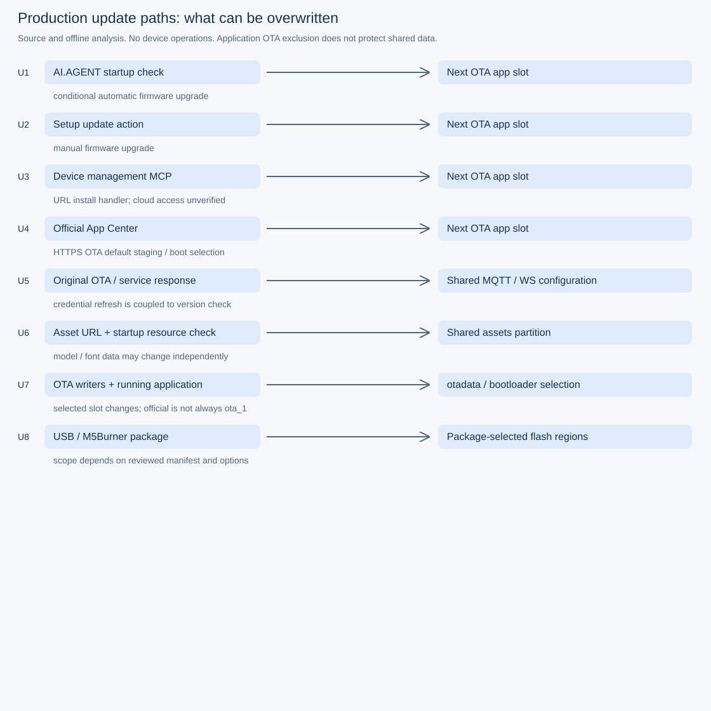
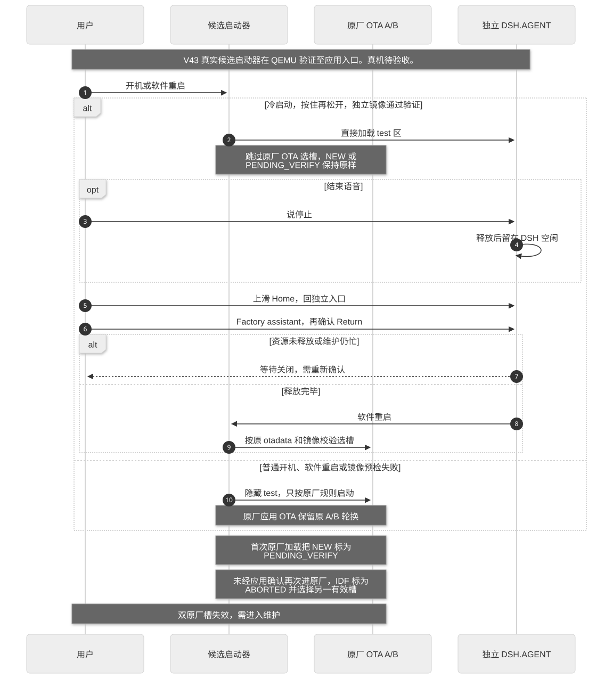

# 量产入口与官方升级共存审查

2026-11-18；P0/P1 兼容研究，接续 [量产边界](production-boundaries.md)。**结论：当前未找到已验证、无需重写镜像的量产“启动开发槽”入口；现有两 OTA 槽不能同时保证常驻开发固件与不受约束的官方升级。** 有一个此前遗漏的设备管理安装入口，但它并不解决日常切换。本轮不刷写、不连接设备、不发设备/云管理请求。

## 入口审查结果

| 入口 | 具体生产者 → 消费者 | 判断与缺口 |
|---|---|---|
| 原厂菜单 / `warm_boot/app_index` | `Hal::requestWarmReboot` → NVS → 重启 → `AppLauncher::create_launcher_view` | 保存的是同一镜像内的 App 列表索引，消费时 clamp 到已有范围。不是 Flash 槽编号，也不是动态载入新 App；把 index 改成另一数字不能启动开发固件 |
| 小智设备管理 MCP | `AddUserOnlyTools` → `self.upgrade_firmware(url)` → `Application::UpgradeFirmware` → `Ota::Upgrade` | **存在任意 URL 参数的安装处理器。** 量产镜像中有工具名、withUserTools 和升级日志，公开初始化也注册此工具。正常 tools/list 隐藏 user-only 工具，withUserTools 控制列出。未发现已查官方 App/服务端界面直接开放它；量产云的路由、账号权限和可调用性未验证。它会下载、擦写、设置启动槽和重启，不是启动已装槽，也不是 Mac MCP endpoint 自动获得的设备权限 |
| MCP `self.reboot` | 设备管理请求 → `Application::Reboot` | 只重启，不接受目标槽；原厂正常 OTA 选择不因此改变 |
| 应用中心 | 官方 `/stackChan/apps` → firmwareUrl → `Hal::launchApp` → `esp_https_ota` | 是网络安装路径，目录受官方服务控制；未见原厂可输入任意 URL 或选择已安装槽的 UI。不得把源码中的下载函数视为用户已有入口 |
| BLE / AVATAR / ESP-NOW | 数据消息 → 表情/运动/视频/设置处理器 | 已查消息分支未找到启动应用槽命令。配网与身份配置 characteristic 不是开发选择器；不以改身份/NVS 绕过 |
| USB 日志 / stdin 示例 | 串口控制台 / 条件编译 `FROM_STDIN` → URL | 源码中的 stdin 分支有编译条件且位于已经调用 OTA 后；当前基线无该开关，不能把它视为量产通用命令终端。ROM 下载模式允许维护写入，但属于刷写路径 |
| 原厂启动器 / 物理按钮 | ROM → 二级 bootloader → 分区表/otadata → 镜像 | 原表没有 factory/test 应用分区。量产入口局部反汇编中初始化前后 hook 均为零，选槽到加载之间未见 GPIO 测试应用选择分支。没有找到可推荐的既有按键开发启动方式；官方长按 RST 的下载模式不是第二系统选择菜单 |

定位来源：[官方固定源码](https://github.com/m5stack/StackChan/tree/28b9f0c8bd6acd81cb3c70f1a93c3e373b39d400/firmware/main)、[小智 mcp_server.cc](https://github.com/78/xiaozhi-esp32/blob/49b4380b3faa0ceadd28a3e78aaf0f311c46c57e/main/mcp_server.cc)、[官方操作文档](https://docs.m5stack.com/en/StackChan/)。小智源码需结合官方 `firmware/patches/xiaozhi-esp32.patch` 阅读，不能套用我们扩展中的更新拦截。

**证据分级：** MCP 工具为“源码注册 + 量产字符串存在”，不等于端到端可调用；启动器为“实际量产入口的有界反汇编 + 实际分区”，并非整个量产应用的完全反汇编。原 bootloader 23,792 字节，公开基线构建 24,208 字节，二者不同；不能把基线 sdkconfig 直接当量产配置。源码基线未启用 APP_TEST/FACTORY_RESET 仅作旁证。未知的量产私有分支仍不能被一次搜索排除。

本轮私有证据目录 `work/stock-boot-audit/` 权限 0700：`entry-review.json`、`production-boot-entry.disasm`、`markers.json`。量产入口为 0x403c89c4，核对两个初始化 hook literal 为零；按分支目标重新解码，未将代码段中的常量池/填充当作指令。没有修改原镜像、分析/移植生产鉴权秘密或执行固件。

## 官方升级具体会动哪里

| 边 ID / 触发方 | 调用链 / 写入方 | 应用槽 | 共用状态与结论 |
|---|---|---|---|
| U1 AI.AGENT 启动检查 | `CheckNewVersion` → `HasNewVersion` → `UpgradeFirmware` → `Ota::Upgrade` | 选择下一个 OTA 槽 | **不必手动点击升级也可能发生**；仅当服务器返回新版本等条件成立，不表示本轮真的有升级或已执行 |
| U2 Setup 手动更新 | `Hal::updateFirmware` → `Ota::CheckVersion/Upgrade` | 同上 | 手动入口不覆盖全部自动路径 |
| U3 管理 MCP 安装 | `self.upgrade_firmware` → `Application::UpgradeFirmware` | 同上 | 是写入行为；工具返回排队成功不代表下载/刷写/启动已成功 |
| U4 应用中心 | `start_ota_update` → `esp_https_ota_begin/perform/finish` | 默认 staging 为下一个 OTA 槽，finish 设置启动选择 | 未指定非 OTA 隔离目标；安装第三方应用同样占用 OTA 槽 |
| U5 原服务配置 | `Ota::CheckVersion` → `Settings(mqtt/websocket)` | 不写应用的这一步仍会更新配置 | 不能仅阻止固件下载便称整个配置不变；也不能直接屏蔽整个版本/激活服务而保证原免费语音持续正常 |
| U6 资源更新 | `self.assets.set_download_url` → `assets/download_url` → `CheckAssetsVersion/Assets::Download` | 不写应用槽 | 会写共享 assets，可能改变原模型/字体；按源码发生于对应启动资源检查 |
| U7 启动与确认 | OTA 写入方 → otadata；bootloader 读取，应用确认 | 选槽与 rollback 状态 | 不是“固定 ota_1 永远原厂”。官方升级后运行原厂可能换到 ota_0 |
| U8 USB / M5Burner | 选定发行包及写入参数 → ROM 下载器 | 取决于文件清单 | 可能包含 bootloader、分区表、otadata、assets；未检查具体包前不声称只写 App，也不笼统说每次必整片擦除 |

原厂第一次升级若从 ota_1 开始，将选择 ota_0，替换其中开发镜像；新原厂启动成功后，下一次通常反向写 ota_1。写入中断、验收失败和回滚要结合实际 bootloader 状态判断；“有两个槽”不等于开发版本也有永远保留的副本。

从配套 v53 开始，从双读的 `otadata` 按 CRC 和序号识别已确认的原厂槽。物理应用槽由 `(ota_seq - 1) % 2` 决定，记录在哪个扇区是另一个字段。写入已计划、仍待确认，或者两份有效 CRC 记录指向同一槽时，准备流程会停下。已认领的独立配对区通过完整归属记录确认后可以继续用。 [双槽准备与回退](app-center.md#升级后识别原厂所在槽)

公开 App Center 的默认路径在接收镜像之前就可能改变 OTA 元数据。v51 离线演练中，与原厂应用同版本的 ESP-IDF v6.1 在开始时擦掉非活跃 A 的原记录，保留已确认的原厂 B。下载中断后，原版 v5.5.4 启动器仍选择原厂。完整撤销还须恢复 A 的记录。 [写入时序 V69](app-center.md#v51-的实际-sdk-写入顺序)



## 实际 SDK 选择规则的离线验证

使用锁定 IDF v6.1，commit `fff9895c82d744c7237be8847347bdd1b07c6643` 的 `components/app_update/esp_ota_ops.c::esp_ota_get_next_update_partition`。新增 [audit_ota_selection.py](../scripts/audit_ota_selection.py) 抽取真实函数体，在主机提供分区枚举 stub，使用 ASan/UBSan 编译执行；没有设备接口、写入或启动选择生成。运行：`python3 scripts/audit_ota_selection.py`。

10 个断言通过：

- 两 OTA 槽互相选中，应用名称或“原厂/开发”标签不形成保护。
- 增加 ota_2 仍进入循环；第三个槽叫 protected-developer 也会被选中。
- 两个 OTA + 非 OTA test 应用：原厂 OTA 在两个 OTA 槽间轮换，跳过 test；但从 test 调默认 OTA 更新器仍会选 ota_0，所以开发侧也必须拥有独立更新策略。
- 只留一个 OTA 槽会返回正在运行的槽，并不能制造安全双启动；没有 OTA 槽则返回空。

这是实际选择函数的主机证据，不是 Flash 写入/断电/设备验收。资源、NVS 和 bootloader 更新不受这个函数排除 test 的结果保护。[IDF 官方 OTA 文档](https://docs.espressif.com/projects/esp-idf/en/v6.1/esp32s3/api-reference/system/ota.html)

## 共存方式的可行范围

### 路线一：维持现有布局，官方更新期间暂停开发模式

这是改动较少的维护协议候选，**不是永久常驻共存**：

1. 安装前保存开发配对材料和已确认原厂快照；日常仍需先解决原厂进入开发槽的入口。
2. 当原厂更新覆盖开发槽，设备退化为纯原厂状态，主机必须明确报告开发模式不可用，不能继续向旧镜像发控制。
3. 待新原厂语音、绑定、资源和启动状态实测通过，再读取新快照、识别当前原厂槽并重新生成安装审查。
4. 经明确安装授权后，才考虑向非运行槽重新放开发固件；此时会替换旧原厂的本机 OTA 回退副本，必须先记录该取舍并保留外部备份。

不能固定记住 ota_1 是原厂，也不能在官方升级未验收时立即把旧原厂槽覆盖。原厂自动更新仍可发生，所以开发模式可用性无法保证；此策略适合允许更新后重新安装扩展的产品，不满足两套程序始终常驻的更强要求。

### 路线二：两个官方 OTA 槽 + 一个不参与 OTA 轮换的开发区域

这是更稳健的结构候选：保留官方自己的 A/B 升级和回滚循环；开发程序放在非 OTA 区域，由另行实现的启动选择器进入，默认仍走原厂 otadata。它不要求把原生产鉴权搬进开发固件，开发模式只连本地服务、不注册另一套小智云身份。开发区的升级/失败恢复需单独实现，不能直接调用默认 OTA updater。

此前首次容量审查没有放得下：保留全部现有分区后，0xe10000–0x1000000 仅剩 **2,031,616 字节（约 1.94 MiB）**，而当时的开发镜像为 **3,801,600 字节（约 3.63 MiB）**。这只是未分配地址空间，尚未确认可作为部署区；该历史数据已由下方 v23 的实际构建和布局复算更新。

两个方向须离线定量验证：

- 精简成只负责本地硬件/音频的开发固件，能否在尾部容量及未来增长预算内运行；仍要新增分区/启动器或等效显式描述，不能悄悄写未分配空间。
- 重新分区为较小的官方 A/B 加开发区，原资源与 NVS 保留/迁移有计划；会缩小官方未来镜像上限，不能只看今天 v1.6.2 放得下。不能占用 assets 来假装解决容量。

物理选择入口也需设计：IDF 有 APP_TEST 的 GPIO 选择机制，但量产没有可用 test 分区，也未找到启用的对应路径。头部触控和 RST 不可直接假设为这个 GPIO；需核对电路、开机可读性与下载模式冲突。若修改启动器，原来的“保留 bootloader”安装方案必须重审。`test` 不在标准 OTA 状态轮换中，其自动确认/恢复不能照搬双 OTA 契约。

此结构可让**已审查的应用 OTA**不碰开发区，不代表任意未来官方固件、资源迁移或 M5Burner 整包永远兼容。每次官方版本仍应做兼容审查；必要时按原包恢复到纯官方布局再升级。

### 不采用的捷径

- 三个都标成 OTA 的槽：真实 SDK 测试已表明会轮流覆盖开发槽。
- 修改 app_index 或只是改分区标签：不改变启动/升级规则。
- 让开发代码禁止 OTA：它只在开发固件运行时生效，约束不了原厂运行期间的自动更新。
- 改云 OTA 地址/拦整个激活服务：服务配置和凭据更新与版本检查耦合，可能损伤原语音；本轮没有采用。
- 直接复制另一个项目 bootloader/分区表：与原 otadata、NVS、资源和生产固件 API 不一定兼容。

## 官方及社区已有工作

| 项目 / 2026-11-18 查询 | 维护证据 | 可复用范围 / 不可直接套用的原因 |
|---|---|---|
| [m5stack/stackchan-idf-gemini](https://github.com/m5stack/stackchan-idf-gemini) | 未归档；HEAD `cfbf5fd` 2026-10-16；pushed 10-23；BSL-1.0 | [Recovery](https://github.com/m5stack/stackchan-idf-gemini/blob/cfbf5fd7486038926d1b4cc32356efc534fa22bf/recovery/README.md) 记录 CoreS3 的自定义启动器/恢复实测；已查看 ADR、启动器和分区表。它用 bootctl 替换原 otadata 地址的语义，Main/Recovery 一起改，不能直接承载未修改的官方 v1.6.2。属于设计参考，并非官方量产双启动插件 |
| [RobVanProd/stackchan_alive](https://github.com/RobVanProd/stackchan_alive) | 未归档；HEAD `a47c491` 2026-08-14；pushed 10-06；Apache-2.0 | [LAN OTA](https://github.com/RobVanProd/stackchan_alive/blob/a47c4919eb28502245ff1e551ab613678a97673b/docs/LAN_OTA.md) 提供健康确认与升级状态思路；其自身程序仍用非运行 OTA 槽，未解决原厂与开发版独立常驻 |
| M5Stack 量产及 Kawaii BLE 方案 | 官方/社区已有维护记录见量产边界页 | 原厂管理安装入口值得确认权限，但未见无需重写的已装槽选择；BLE 行为控制不增加启动入口 |

搜索结论仅限检查的候选，不宣称穷尽社区。没有发 issue、PR 或联系维护者，也没有下载运行第三方安装脚本。

## 决策与下一项可完成证据

当前推荐从“简单两槽双启动”调整为：**先做纯本地开发镜像的容量评估，再决定是否研究“官方 A/B + 独立开发区”的启动器。** 这仍是可行性阶段，不是批准重分区。若容量/入口代价过高，再向用户明确展示路线一的更新后重装成本，不能暗中把永久常驻改为维护模式。

可继续独立做：纯本地开发镜像的组件/资源预算；官方实际 I/O 引脚与只读启动选择契约；官方版本增长和 shared-state 兼容矩阵。原厂管理 MCP 可达性的下一步也仅应在有授权的管理通道确认能力，不能用执行 upgrade 来“测试有没有入口”。真机写入前仍须给出确切文件、地址、恢复与验收方案。本轮原语音、手机绑定及选定 DSH 会话均未改变。

## v23 尾部布局与返回时序

v23 镜像已通过离线容量门槛。固定 ESP-IDF 工具将候选布局在内存中序列化、解析和验证，保留两份备份里七条原始分区记录的所有字节。备份中的整个尾部为擦除态。提案只在末尾增加 `dsh_agent`（app/test，自 `0xe10000` 起 2,015,232 字节）和 `sion_cfg`（data/nvs，自 `0xffc000` 起 16 KiB）。v23 按扇区对齐后剩 20 KiB。现有两槽和 assets 的边界完全保留。验证只产生 JSON，未生成部署分区表。见 [v23 容量与布局复现](installation-recovery.md#v23-容量与布局复现)。



图表来源：[M5Stack 手册的 Home 操作](https://docs.m5stack.com/en/StackChan/#ui-navigation)、[ESP-IDF app/test 分区定义](https://docs.espressif.com/projects/esp-idf/en/v6.1/esp32s3/api-guides/partition-tables.html)、固定 IDF 的 `bootloader_start.c::selected_boot_partition`、`bootloader_utility.c::bootloader_utility_load_boot_image`、既有 [DSH Stop/Home](runtime-sequences.md#停止与-home)。启动器候选与 v24 返回已通过本地验证。真机 GPIO 和原厂回退仍待验收。

现有 SDK 的 `APP_TEST` 不能原样当成双启动方案。固定源码先执行原厂 OTA 选槽，再检查 test GPIO。开启 rollback 时，第一次调用可能把 NEW 改为 PENDING_VERIFY，或把 PENDING_VERIFY 改为 ABORTED。即使之后选择 test 区，也已触及原厂的启动状态。默认镜像装载在两个官方槽都失效时还会尝试 test 区，而显式选 test 后镜像无效会直接走 reset。成品契约要求显式开发模式判断先于原厂 OTA 状态推进，开发镜像无效时回到原厂校验流程，原厂双槽同时失效时进入维护。普通开机仍走原厂路径。该差异来自固定源码检查。当前选择器已用实际镜像验证两槽首次启动、独立模式保持 OTA 和未确认镜像的标准回滚。 [v35 双向 OTA 演练](#v35-原厂-ota-确认与回滚)

M5Stack 手册区分底部 RST 和上滑 Home，也列出可扩展 GPIO。RST 长按已有官方下装含义。GPIO9 已作候选输入，实物和电气适用性未验收。原厂 Home 继续遵循手册。下一版选择器应同时验证输入释放、深睡唤醒、开发镜像损坏、原厂 OTA 验证前后和复位循环；准备受控的原始启动器与分区表恢复材料。日常 Home 仍在应用里操作。独立镜像跨回原厂如需软件重启，应由独立入口的显式操作触发，在音频、相机、动作、网络及维护全部释放后进行，不要求用户把官方 Home 换成按 RST。

## 选择器原型与 v24 原厂返回

在保存的双份备份里，量产二级启动器和 `ota_0` 的 IR Remote 镜像使用 ESP-IDF **v5.5.4**，当前 v1.6.2 所在 `ota_1` 为 **v6.1**。读到的 OTA 记录包含 VALID 与 ABORTED，故候选保留标准回滚选择。ESP-IDF 把旧启动器加载新应用列为兼容方向。基于 v6.1 的首版启动器保留为编译与流程证据，不能用于要求保留旧回退槽的方案。版本相同也不能代替真实旧槽启动验证。[ESP-IDF v5.5.4 启动器兼容说明](https://docs.espressif.com/projects/esp-idf/en/v5.5.4/esp32s3/api-guides/bootloader.html#bootloader-compatibility)

候选采用 [官方 bootloader override 工程约定](https://docs.espressif.com/projects/esp-idf/en/v5.5.4/esp32s3/api-guides/bootloader.html#custom-bootloader)，使用本地 [startup 源码](../firmware/boot-selector/bootloader_components/main/bootloader_start.c)。

| 生产者 → 消费者 | 已实现契约 |
|---|---|
| 候选 Grove Port B 输入 → 冷启动选择器 | 只有正确分区布局和冷启动复位原因才读取 GPIO9。按住超过 600 ms 后还需要在 1.5 s 窗口内稳定松开约 40 ms。高电平、抖动、一直按住、软件重启和深睡唤醒进原厂路径。检查后恢复引脚 MUX。按键为可选外接原型，所用端口与电气特性尚待核对。 |
| 选择器 → 独立镜像验证与装载 | 显式请求后先用 SDK 校验 test 镜像，要求带有效附加摘要及合法长度。成功直进 SDK test 装载，未调用原厂 OTA 选槽。摘要用于检测损坏，未经签名不能证明外部镜像来源。 |
| 选择器 → 原厂 A/B | 请求缺失或独立镜像预检失败时，从此启动器的内存视图中清除 test 再交给 SDK。原厂校验和回滚按标准流程执行，原厂应用 OTA 跳过 test。显式 test 的第二次校验若失败，SDK 软件重启，下一次进入原厂选槽。两个原厂槽皆不可用时由 SDK 重启，需用户用官方下装模式恢复。 |
| DSH 入口 → 软件重启 | v24 只在运行分区确为尾部 `dsh_agent` app/test 时显示 **Factory assistant**。Home 等待资源释放后进入 DSH 入口。用户另行确认 **Return** 时重新检查生命周期、音频、相机、动作、认证连接、网络任务和 USB 维护均已空闲。忙时保留确认页并提示重试。通过后离开 LVGL 锁再调用 `esp_restart()`，未改写启动槽或 `otadata`。 |

集成边界见上方 [V43](#v23-尾部布局与返回时序)。本地测试和构建不能证明真机 GPIO 输入、看门狗时间、原厂回退槽或返回后原语音可用。原有备用启动器、两个应用和配置区保持为外部恢复基线。可安装方案仍需核对现场恢复执行条件。

### 基于原厂 SDK 的候选复现

[stock SDK 锁](../firmware/boot-selector/stock-sdk.lock.json) 固定 ESP-IDF v5.5.4 的提交 735507283d5b2f9fb363a1901172dbd9e847945d。工具链使用该 release 的 macOS Xtensa 14.2.0。通过官方 Python 环境和 CMake/Ninja，在工作区独立运行：

```sh
python scripts/build_agent_selector.py --stock-base \
  --destination <新的选择器工作目录> \
  --reference work/firmware-agent-board-size-v23/firmware
```

构建器检查 v23 参考收据、分区输入与 SDK 版本。v24 应用的 SDK 配置和构建分区表与 v23 字节相同。启动器只构建第二阶段目标，真正装入设备的软件分区表另行生成。[入口测试](../scripts/test_agent_selector.py) 运行实际生产入口并替换 ROM 与 SDK 边界，15 个分支通过。v5.5.4 和 v6.1 的分区工具均在内存中接受追加布局。v5.5.4 启动器二进制、ELF 及来源见 [构建收据](../firmware/agent-selector-stock-build.json)。本地构建未提供 ROM GDB 符号文件，产生调试初始化警告，镜像仍通过核验。启动器兼容性与恢复仍待实体测试。


### Grove 输入的现场前置检查

首装核对使用 **HY2.0-4P Grove Port B 接头和无源常开按钮**。按钮两端只接黄线 GPIO9 和黑线 GND，红线 5 V 与白线 GPIO8 各自绝缘。夹具和设备分开时用万用表测通断，确认松开时开路、按下时导通、黄线和黑线到另外两根线均开路。StackChan 随附的 1.25-4P 延长线规格不同。 [官方引脚表](https://docs.m5stack.com/en/StackChan/#expand-interface) · [官方包装清单](https://docs.m5stack.com/en/StackChan/#includes)

| 成品附件 | 按钮线路与当前选择器的对应关系 |
|---|---|
| Unit Button U027 | 黄线未接信号，白线是按钮输出，对应 GPIO8。 [引脚表](https://docs.m5stack.com/en/unit/Unit_Button#pinmap) |
| Unit Key U144 | 白线输出按钮状态，黄线用于灯的 DIN。 [引脚表](https://docs.m5stack.com/en/unit/Unit_Key#pinmap) |
| Unit Dual Button U025 v1.1 | 黄线确实是红按钮，但板上还有接 5 V 和 GND 的 10 kΩ/20 kΩ 分压。5 V 时按键释放约为 3.33 V，断开红线后仍有 20 kΩ 到地。这套首装用无源常开夹具，U025 不按干接点夹具验收。 [引脚表](https://docs.m5stack.com/en/unit/Unit_Dual_Button#pinmap) · [官方电路图](https://m5stack-doc.oss-cn-shenzhen.aliyuncs.com/578/Sch_UNIT_DualButton_v1.1.pdf) |

候选启动器只在符合布局的芯片冷上电读取 GPIO9，并启用内部上拉。采样首值需为低，随后有 600 ms 持续低电平，再在 1.5 秒窗口内连续取得五个高电平样本。时间从启动器采样算起。先测夹具通断，再验证实际冷启动进入和软件返回；本次已核对图纸和代码，现场通断和启动仍待验证。原厂应用的普通回菜单使用上滑 Home。 [选择器代码](../firmware/boot-selector/bootloader_components/main/bootloader_start.c)

### 仅用 USB 数据线的启动入口试验

Espressif 的 USB Serial/JTAG 控制器支持串口收发。官方说明通过 USB 串口控制线进行复位时，芯片可只复位数字核心而不重新采样启动绑定位。冻结的 v35 启动器没有 USB 请求入口，数据线目前用于维护、独立配对及已启动后的音频。试验另复制启动器源码，验证是否能在 Mac 已可识别的 USB 路径上增加一次性启动选择。 [ESP32-S3 USB Serial/JTAG](https://docs.espressif.com/projects/esp-idf/en/stable/esp32s3/api-guides/usb-serial-jtag-console.html) · [Espressif 复位行为](https://docs.espressif.com/projects/esptool/en/latest/esp32s3/esptool/advanced-options.html#reset-modes)

在布局匹配且冷启动或 SDK 报告 USB 串口核心复位时，试验检查新 USB 帧，清掉早先的接收字节，再由启动器发出本轮就绪行。Mac 端按照设计只在收到就绪行后发送明确的独立启动请求。收到完整且符合格式的请求后仍执行原有镜像校验，在调用原厂 OTA 选槽前装载独立应用。响应缺失、格式错误、超时或镜像无效时走原厂选择。冷启动时原 Grove 手势可直接选独立入口。软件返回、深睡及布局不符跳过 USB 请求。停留在独立模式期间，网络入口仍由 v35 应用管理。 [原厂槽边界](#v35-原厂-ota-确认与回滚)

试验在 `work/v35-usb-entry-probe` 通过原厂版本 ESP-IDF v5.5.4 的 ESP32-S3 编译，镜像 21,616 字节，仍在六个 4 KiB 启动扇区内。16 个 USB 夹具场景及既有 15 个选择器场景通过。USB 状态、芯片复位原因和 Flash 装载是夹具。未接 Mac 的真实串口，尚需确认底座 USB 枚举时机、打开串口对 DTR/RTS 的影响、正常连接无请求时的启动、实际回复窗口和软件返回。无 USB 活动的额外等待上限在试验中为 25 ms，有链路时另有发送和响应期限。新镜像摘要与 v35 首装收据不同，执行器离线核对拒绝用它替换。 [证据](validation.md#usb-启动入口的隔离试验)

续测用 Mac 上真实 pySerial 和伪终端接入同一份 C 启动逻辑。主机晚开串口时，首次就绪行会随串口输入缓冲重置丢失。第二份试验在这次启动的固定 600 ms 响应窗口内，每隔 100 ms 检查是否需要再次发就绪行。收到请求的首字节后停止重发。Mac 只对完整匹配的就绪行回应一次，标记「请求已发出」。设备后续需通过独立应用的认证连接才能报告接通。续测镜像 21,696 字节，仍是试验件。pySerial 官方说明某些系统或驱动可能在打开设备时自动改变 RTS/DTR，因此伪终端测试的通过范围是主机读写和应用协议。 [pySerial 串口打开](https://pyserial.readthedocs.io/en/latest/pyserial_api.html#serial.Serial.open) · [续测结果](validation.md#usb-启动入口的-mac-串口往返)

随后用 Espressif QEMU 启动同一份续测镜像。调试器按锁定 ELF 的指令注入 USB 帧、字节、GPIO 和复位原因，由目标代码实际执行请求解析、镜像校验及 ESP-IDF 的选槽和装载。在按 Sion 的槽状态重建的虚拟 Flash 上，先从 USB 进入独立镜像，再把该次完整读回交给软件返回测试，成功启动原厂 v1.6.2，整片内容保持相同。两种待确认的 OTA 状态在显式 USB 启动时也保持原值。实体 USB 及启动后语音还需真机验收。 [QEMU 结果](validation.md#usb-启动入口的-qemu-装载与原厂返回)

Mac 端试验工具 [agent_usb_entry.py](../scripts/agent_usb_entry.py) 从已验证的本地双读取得设备身份，再筛选相同序列号、Espressif VID/PID 和 macOS USB callout 字符设备。默认只枚举。显式 `--listen` 才打开唯一匹配的端口，打开后核对文件描述符，收到完整就绪行时再次枚举核对。发送前断开时可等待同一设备重新枚举；进行了写尝试后便结束本次操作，回执不确定时不重发。返回 `request-queued` 只表示串口写入队列已接收。能否接通独立应用仍由已有认证会话确认。 [串口身份验证](validation.md#mac-启动工具的设备识别)

现场操作时，开始寻找设备和确认打开串口各有一条 stderr 提示。打开提示仅在实际文件描述符已核对后发出，一次运行最多提示一次。USB 试装和 Grove 版按各自入口启动，并使用各自的安装包和字节核对参数。 [USB 试装步骤](installation-recovery.md#仅用底座-usb-c-进入独立应用)

### 可选的摇杆操作

首装使用底座 USB-C 的试验入口时，操作和恢复无需摇杆或 Grove 按钮。进入 DSH.AGENT 后，通过屏幕选 USB、LAN 或 Relay。需要结束时可点屏幕 Stop，也可在语音正常时说「停止」。底缘上滑显示 Home，再点 Home 回独立入口，从 **Factory assistant → Return** 回原厂。摇杆是应用运行期间的可选输入。 [首次试装核对单](installation-recovery.md#sion-的首装核对单) · [设备退出处理](../firmware/agent/device_main.cc)

这台遥控器通过 USB-C 接 Mac，屏幕有 Channel、Receiver ID、摇杆模式和 IMU 姿态模式。按用户描述与官方手册，对应随套装的 StickC-Plus + Hat Mini JoyC。Mac 只读枚举看到 Sion 的 Espressif USB Serial/JTAG 和另一只名为 `M5stack` 的 FTDI USB 串口（VID/PID `0403:6001`）。Sion 的启动与配对按既有 Espressif USB 身份匹配。 [StickC-Plus 官方 USB 说明](https://docs.m5stack.com/en/core/StickC-Plus#usb-driver) · [套装和遥控器操作](https://docs.m5stack.com/en/StackChan/#esp-now-remote-control)

| 接入方式 | 正式接入前需核对 |
|---|---|
| Grove Unit Joystick | U024 / U024-C 在 I²C 地址 `0x52`，Joystick2 U024-V2 默认 `0x63`。两者均由应用读取 X/Y 及中按，Joystick2 还可控制灯。Port A 可供 I²C 外设，接线核对实际 SKU 和端口。 |
| StickC / StickC-Plus + Hat Mini JoyC | Hat 通过 StickC 的 I²C 读取，默认地址 `0x54`。官方独立遥控应用通过 ESP-NOW 发送转头数据，正面 A 键切换摇杆和 IMU 模式，侧面 B 键在设置页面切换信道和接收端 ID。官方源代码的方向数据和 BtnB 状态经无线包发送，USB 串口枚举无法证明 Mac 收到摇杆输入。 [官方遥控功能](https://docs.m5stack.com/en/StackChan/#esp-now-remote-control) · [官方遥控固件](https://github.com/m5stack/StackChan/tree/28b9f0c8bd6acd81cb3c70f1a93c3e373b39d400/remote/code) |

Grove 摇杆的中按状态由 I²C 寄存器返回。当前 Grove 选择器在冷启动直接读 GPIO9 与 GND 的通断，只接受无源常开夹具。两个方式采用独立电气和软件接口。实际能否接入、控制映射以及断开行为需按现场型号验证。 [StackChan 扩展口](https://docs.m5stack.com/en/StackChan/#expand-interface) · [Unit Joystick v1.1](https://docs.m5stack.com/en/unit/Unit_Joystick_v1.1) · [Unit Joystick2](https://docs.m5stack.com/en/unit/Unit-JoyStick2) · [Hat Mini JoyC](https://docs.m5stack.com/en/hat/Hat_Mini_JoyC) · [官方遥控功能](https://docs.m5stack.com/en/StackChan/#esp-now-remote-control)

拟接入时，方向可在设置页浏览选项，在用户明确进入手动模式后转头。可识别的按下动作可绑定 Stop，走与触屏同一条本地停止和资源释放路径。配对授权和回原厂沿用屏幕确认。DSH.AGENT 尚未接摇杆。套装遥控器的原厂发送端使用 ESP-NOW 广播，Receiver ID 用于目标筛选。若后续同时启用无线遥控和 DSH 的 LAN/Relay，验收须覆盖同信道下的收发，避免遥控要求改变 Sion 已连接的 Wi-Fi 信道。若让遥控器触发 DSH 会话操作，须通过明确的设备授权与操作映射。摇杆启用后的现场验收覆盖断开、方向归中、按住不重复触发，以及拔掉后仍可开始、停止、回菜单和回原厂。 [Espressif ESP-NOW 信道与认证](https://docs.espressif.com/projects/esp-idf/en/stable/esp32s3/api-reference/network/esp_now.html#add-paired-device)

### v24 的 QEMU 启动验证

[离线审查器](../scripts/audit_agent_qemu.py) 使用 Espressif QEMU 9.2.2（esp_develop_9.2.2_20260417）、正式 v5.5.4 候选启动器 ELF 及 v24 安装包，验证第二阶段加载结果。虚拟 Flash 仅加入必要的应用镜像、安装文件和合成 OTA 元数据。关闭虚拟网络，测试在应用入口或启动器复位前停下。该 QEMU 模型未提供普通 GPIO 电平，调试器在固定 ELF 的采样指令注入电平，ESP-IDF 的计时、镜像校验和 OTA 代码正常执行。[Espressif QEMU 文档](https://docs.espressif.com/projects/esp-idf/en/stable/esp32s3/api-guides/tools/qemu.html) · [固定版本 GPIO 实现](https://raw.githubusercontent.com/espressif/qemu/esp-develop-9.2.2-20260417/hw/gpio/esp32_gpio.c)

| 场景 | 实际加载结果 | 合成 OTA 状态 |
|---|---|---|
| 普通开机，分别选择两个原厂分区 | 0x510000 的 v1.6.2、0x20000 的 IR Remote 分别到达入口 | VALID 保持 |
| GPIO 一直按住 | 走原厂 v1.6.2，未选择独立镜像 | VALID 保持 |
| 有效开发按键和 v24 镜像 | 0xe10000 到达独立应用入口 | NEW 保持 |
| 有效开发按键、v24 镜像头损坏 | 回到原厂 v1.6.2 加载 | NEW → PENDING_VERIFY |
| 当前原厂镜像头损坏 | 加载合成配置中的另一有效槽 | VALID 保持 |
| 两个原厂镜像头均损坏 | 进入启动器复位，未加载 v24 | VALID 保持 |

以上共七个通过场景，收据在本地工作目录 work/agent-v24-qemu-audit.json。实体 Sion 的 IR Remote 槽曾读到 ABORTED，模拟选择它只验证启动器兼容，恢复原助手仍以该设备保存的 v1.6.2、当前 OTA 记录和备份为依据。GPIO9 接线和电气时序、真机启动与返回、语音和绑定仍按真实验收流程检查。

### v26 的 QEMU 回归

在 [v26 离线包](installation-recovery.md#v26-的独立离线安装审查) 上以同一 v5.5.4 选择器和 ESP32-S3 模拟器通过八个场景。保留原有七种情况，新增只翻转 v26 镜像末尾的一位 SHA-256 摘要。该测试保留镜像头与校验和，确认 UART 同时报出 SDK 摘要校验失败和选择器的原厂回退。结果仍为 0x510000 的原厂 v1.6.2，合成 NEW 记录随后按原厂启动路径变为 PENDING_VERIFY。完好的 v26 到达 0xe10000 入口，合成原厂 NEW 记录逐字节不变。双原厂槽不可用时不加载 v26。

用于模拟的 GPIO 是 GDB 指令注入，OTA 状态为合成，应用入口或启动器复位前停止。原厂应用分区只复制可执行镜像。旧槽模拟可被选中属于加载兼容，实体此前记录为 ABORTED。模拟不包含原厂账户、本地 NVS 或语音。报告在本机 `work/agent-v26-qemu-audit.json`，入口 [audit_agent_qemu.py](../scripts/audit_agent_qemu.py) 传入 `--candidate v26`。参见 [Espressif ESP32-S3 QEMU](https://docs.espressif.com/projects/esp-idf/en/stable/esp32s3/api-guides/tools/qemu.html)。

## 启动选择与返回状态



V50 覆盖正在审查的 v26 安装布局。冷启动且布局匹配时才采样 Grove GPIO9。连续低电平 600 ms 后，须在 1.5 秒窗口内得到连续五个高样本，相邻样本间隔 10 ms。接受手势后仍需校验独立镜像与摘要；错误镜像回到原厂 OTA 路径。原厂选择时隐藏独立槽，原厂镜像均无法加载时复位。独立应用的 [Home](runtime-sequences.md#停止与-home) 先回独立入口；用户再选择原厂助手并确认，资源收拢后软件重启，绕过只允许上电复位的 GPIO 手势分支。

图源为 [第二阶段启动器](../firmware/boot-selector/bootloader_components/main/bootloader_start.c) 的 `call_start_cpu0`、`layout_matches`、`read_entry_gesture` 及 `agent_image_valid`，和 [独立应用返回](../firmware/agent/device_main.cc) 的 `FactoryReturnConfigured`、`ConfirmFactoryReturn`。独立镜像加载成功和摘要损坏回退已在 QEMU 验证；实体按键、切换和原助手回归待现场验证。

## 按现场槽状态验证 v35 恢复

[QEMU 审查器](../scripts/audit_agent_qemu.py) 的 `--recovery` 模式在九项选择器测试之后，额外模拟 11 种安装和恢复状态。输入为同一台 Sion 的历史双读及匹配的 v35 包。OTA 从原有 A/B 状态重建，保留一条 ABORTED 与一条 VALID 的选择；模拟器使用 SDK 的测试 eFuse，仅加入原厂可执行镜像与审核过的阶段文件。原 NVS、语音资产与账户数据不进入模拟器。

新增软件返回场景在已固定摘要的启动器中，用调试器在 ROM 查询返回后注入 ESP32-S3 的 CPU0 软件复位原因。第一条 GPIO 访问的断点未命中，启动器按原 OTA 状态交接到 v1.6.2 的 `0x510000`，整片虚拟 Flash 字节一致。此场景验证选择器在软件复位条件下的分支。界面确认、设备真机复位和原助手完成启动仍各自验收。 [ESP-IDF 启动器](https://docs.espressif.com/projects/esp-idf/en/v5.5.4/esp32s3/api-guides/bootloader.html) · [交叉验收](validation.md#合成启动时的设备退出与原厂返回)

测试覆盖正常安装的原厂默认启动、仅写应用、表已追加、完整选择器、原分区表已恢复、全部恢复，以及五个写入阶段各一次模拟中断并走分段恢复。每场在 v1.6.2 应用入口停止，核对启动日志选择 `0x510000`，并比较完整虚拟 Flash，确认到达入口时字节没有变化。安装中断模式在目标范围模拟擦除并仅写前 32 字节。此证据止于模拟器的应用交接；原厂语音、绑定、实体 Flash 写入与真实断电仍需现场确认。 [Espressif ESP32‑S3 QEMU](https://docs.espressif.com/projects/esp-idf/en/stable/esp32s3/api-guides/tools/qemu.html) · [具体安装与恢复范围](installation-recovery.md#v35-relay-候选离线审查)

## v35 原厂 OTA 确认与回滚

`audit_agent_qemu.py --candidate v35 --ota-lifecycle` 在同一包上额外测试两个 OTA 方向，每个方向六次交接。每次把前一轮实得的虚拟 Flash 带入下一次。正式候选选择器及其 ELF 都对应已核验的摘要，原厂槽使用从备份提取的可执行镜像，OTA 状态和三个守护标记是合成数据。

| 操作 | 启动及 OTA 结果 |
|---|---|
| 新槽标为 `NEW` 时从 Grove 进入独立应用 | 加载 `dsh_agent`，OTA 元数据和其余虚拟 Flash 均保持字节一致。 |
| 正常进入原厂新槽，随后从 Grove 进入独立应用 | 原厂启动器把 `NEW` 置为 `PENDING_VERIFY`。独立应用再进入时保持待确认状态。 |
| 在原厂新槽仍待确认时从独立模式软件返回 | 标记新槽 `ABORTED`，选择并验证另一有效原厂槽。再重启仍选择该槽。 |
| 模拟设为 `VALID` 后正常开机 | 继续选已确认的新槽，虚拟 Flash 保持字节一致。应用确认被建模，模拟在应用入口停止。 |

每次都校验整片虚拟 Flash 与预期一致。QEMU 未运行原厂更新器，也未加载 NVS、语音资源或账号数据。测试使用现有两槽验证启动选择，不包含未来原厂更新包的布局迁移。旧恢复预览遇到已改变的 `otadata` 会要求重新检查，现场确认完原厂版本、语音和绑定后，再用新的双读审查。 [Espressif OTA 确认与回滚](https://docs.espressif.com/projects/esp-idf/en/v5.5.4/esp32s3/api-reference/system/ota.html#app-rollback) · [实测记录](validation.md#v35-原厂槽确认与回滚演练)

## 触屏入口与官方升级确认

官方槽的第一次启动要经过 NEW、PENDING_VERIFY，再由原厂确认成 VALID。旧触屏候选允许从待确认槽软件重启进入独立 DSH，DSH 再重启返回时 SDK 会按规定回滚未确认的原厂升级。菜单侧的新检查仅在当前运行槽同时是准备启动的已确认槽时发起重启。启动器侧用 SDK 只读解析原厂 OTA 记录，确认状态后才运行 DSH 独立槽。原厂自己保留确认与回滚权限。 [菜单检查](../firmware/menu-entry/menu_ota_status.h) · [启动器检查](../firmware/menu-entry/boot_ota_guard.h)

原厂升级不会因普通切换把独立镜像写入 A/B。下一份官方应用若未编入菜单扩展，会按自身功能启动，即使独立 DSH 镜像仍在。保留图标需要官方在其后续发行继续提供兼容入口。原厂资产和完整版本迁移仍须按真实 OTA 与绑定验收。 [触屏入口](app-center.md#官方升级确认期间的触屏入口)
