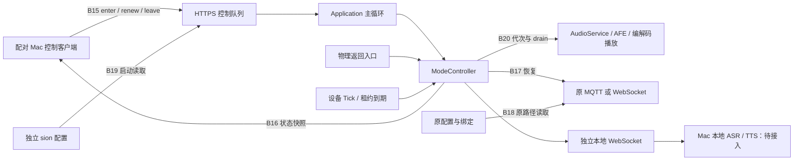
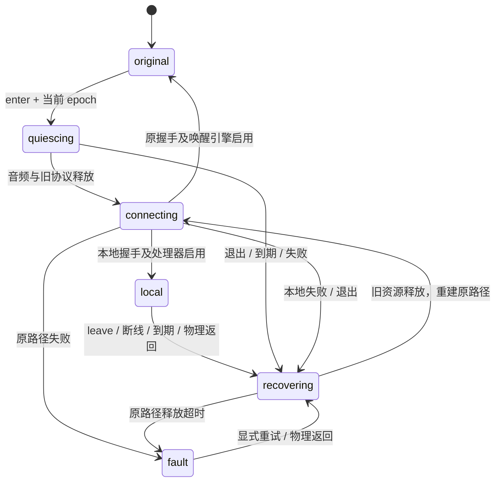

# 双模式固件实现与检查

范围说明：本页保留此前同进程候选的实现契约，并非新独立应用已部署的行为。当前入口见 [独立 Agent](independent-agent.md)，用户操作见 [官方手册对齐](manual-alignment.md)。

入口：[设备切换决策](device-handoff.md)，依赖与状态只在 [P0 / P1 计划](product-plan.md#按依赖推进的工作包) 维护。这里记录已存在的源码契约；构建成功不等于真实收音、恢复或原绑定已验收。最新 [安装审查](installation-recovery.md) 记录了已构建的 NVS/资源/更新保护与试运行确认；官方鉴权和真机兼容仍未解决，不能安装。

## 源码与消费者

| 修改目标 | 可审查入口 | 消费者及边界 |
|---|---|---|
| 模式与到期回退 | [mode_controller.h](../firmware/overlay/sion/mode_controller.h) | 主循环 Tick；物理返回、控制命令、连接结果。独立于 Mac 的租约 |
| 控制服务与配置 | [backend_runtime.cc](../firmware/overlay/sion/backend_runtime.cc) | 配对客户端 → 有界队列 → Application；状态快照反向查询。Mac DeviceModeClient 已实现；正式 voice adapter 待 P2 组合 |
| 协议/队列/回调生命周期 | [小智补丁](../firmware/patches/xiaozhi-dual-backend.patch) | Application、WebSocket、MQTT、AudioService、AFE；协议事件及其派生 MCP 任务带代次 |
| 构建选择 | [官方工程补丁](../firmware/patches/stackchan-dual-backend.patch)、[构建选项](../firmware/feature.defaults) | 仅本次 ESP32-S3 StackChan 配置；功能开关默认关闭，测试构建显式开启 |
| 供应与复现 | [prepare_firmware.py](../scripts/prepare_firmware.py)、[build_firmware.py](../scripts/build_firmware.py) | 下载固定源码、按序打补丁并构建；都不打开设备端口、不刷写 |
| 主机验证 | [控制器测试](../firmware/tests/mode_controller_test.cc)、[生产 WS 测试](../firmware/tests/websocket_endpoint_test.cc)、[测试入口](../scripts/test_firmware.py) | 模拟时钟/网络/NVS；不能替代 RTOS、MQTT 服务、音频硬件验收 |

模式关系沿用 B15–B20；B15/B16 增加 Mac 控制客户端，B19 已有配对写入和启动读取；配对生命周期新增 B27–B33，见 [配对指南](pairing.md)。物理返回与设备断线/租约共用 B17；旧输入、编码、解码、播放及 AFE 回调通过 B20 屏障隔离。声音停止的 ASR 生产者属于 B21/B22，尚未接入。



## 配置与线上契约

启用 `CONFIG_SION_DUAL_BACKEND=y` 后，USB 配对接口在原 AI Application 初始化完成后启动。只有独立 `sion_pair` 中存在有效配对记录，才启动 HTTPS 控制和创建本地 WSS 网络。记录、写入/撤销、证书和许可边界见 [配对指南](pairing.md)；旧开发版的 `sion/control_key` 等分散键不再读取，也不自动迁移。

控制接口为 Wi-Fi station 网卡 TCP 8765 的 `/v1/backend`，HTTPS + `Authorization: Bearer …`，不绑定配网 AP。Mac 验证配对 CA 和 `sion-device` 名称；设备本地 WSS 校验独立 CA 和 `sion-host`，没有明文回退，不改变原厂根证书。设备固件 TLS 运行仍待真机；不能用主机 TLS 测试代替。

GET 返回缓存状态：`boot_id`（本次启动随机值）、`epoch`（十进制字符串）、`phase`、`selected`、`original_ready`、`lease_expires_ms`（设备启动以来的毫秒字符串）、`protocol_version=2`、`pair_id`、`restart_required` 和最近 32 个 `receipts[{request_id,result}]`。另保留最后 `command_action/command_epoch/command_result` 诊断字段。配置写入维护预约后拒绝新的网络命令，原助手不停止。

POST JSON 为 `action`（enter/renew/leave）、当前 `boot_id`、`epoch` 字符串与 `request_id`（32 位十六进制）。请求 ≤512 字节，队列 ≤8；错误身份 401、格式/boot 错误 400、同 ID 不同参数 409、队列满/维护状态 503。202 仅表示排队成功，客户端查自己的 receipt 及实际模式；相同 ID/参数在保留窗口内不重复入队。旧 boot/epoch 不可完成新操作，不能把有限回执窗口称为永久 exactly-once。

Mac DeviceModeClient 只从 original 申请新租约，不认领已有 local 状态；每 4 秒续租。POST 响应丢失后查同一 request_id，不能产生新的 enter 重试；保留预期 epoch 用于失败清理。取消后归还不依赖已中止的 signal；归还只在同 boot 的原模式且 original_ready 才成功。故障/超时保留未确认状态，不虚报成功。正式 VoiceBridge adapter 仍需 P2 把这个控制器与收音/播报连接起来。

进入只允许原模式且 Application 处于 idle/listening/speaking；先递增 epoch，再冻结音频和清空旧队列。等待输入、编码、解码/播放、AFE 回调不再占用后，在工作任务中关闭销毁旧协议、创建并握手新协议。主循环继续处理控制和超时。MQTT 在主循环先使自有重连/goodbye 排队任务失效，再异步销毁。

音频协议固定小智 WS 消息 v1，通过 WSS 传输（独立 HTTPS 控制协议为 v2）（JSON 控制 + 原始 Opus）；它传输声音，不替 DSH 决定人格。有效租约 15 秒，renew 仅在 local 阶段成功；每个切换阶段超时 20 秒。两者都是代码配置，非实测；连接耗尽租约也会返回原路径。原连接类型在 activation 对象销毁前缓存，恢复时重新读原 MQTT 或 WS 配置，不重跑激活/OTA。



`original_ready=true` 只在本次恢复握手、唤醒处理启用且连接仍打开后设置；刚启动时保守为 false，不代表原助手实际不能使用。重新断线会清除。它尚不证明已采到第一帧或扬声器正常，也不代替 A2 的真实唤醒回复。SDK 任务若一直不结束，会保留资源隔离并进入 fault，不假报恢复；不能靠取消 C++ 对象强杀仍在访问它的线程。

## 复现与后续验收

安装并导出锁定 ESP-IDF v6.1 环境后，在仓库根目录运行：

```sh
python3 scripts/prepare_firmware.py --sion --destination work/firmware-preservation
python3 scripts/build_firmware.py --source work/firmware-preservation/firmware
python3 scripts/test_firmware.py --source work/firmware-preservation/firmware
python3 scripts/test_preservation.py --source work/firmware-preservation/firmware
npm test
```

准备脚本记录输入/checkout/文件哈希，重复同一操作校验后退出；输入或已准备源码变化时使用新的 `--destination`，不会抹掉已有编辑。测试依赖 clang++、构建解析出的 cJSON；`test_firmware.py` 默认使用 work/firmware-build。ESP-IDF 输出中的烧录建议只是日志，没有执行。

已补齐本轮配对写入/撤销、加密控制/音频身份与 Mac 模式客户端代码。尚需真机：实际 MQTT/WS 原云恢复、RTOS 回调压力验证、断网/死 Mac/重连、声学 AEC/持续输入与说停止、音频硬件 drain/内存峰值、正式 DSH/语音消费者仍属 P2/P3，完整安装升级体验属 P7。启用扩展时只读取已存原服务配置，阻止远端刷新/激活、资源替换与固件更新；长期刷新尚未实现。保护实现与 USB 试运行确认见 [安装契约](installation-recovery.md#当前保护实现与试运行契约)。验证顺序见 [兼容恢复材料](device-compatibility.md) 与 A1–A8；当前不能宣称可直接安装的成品或完整 P1 验收。
