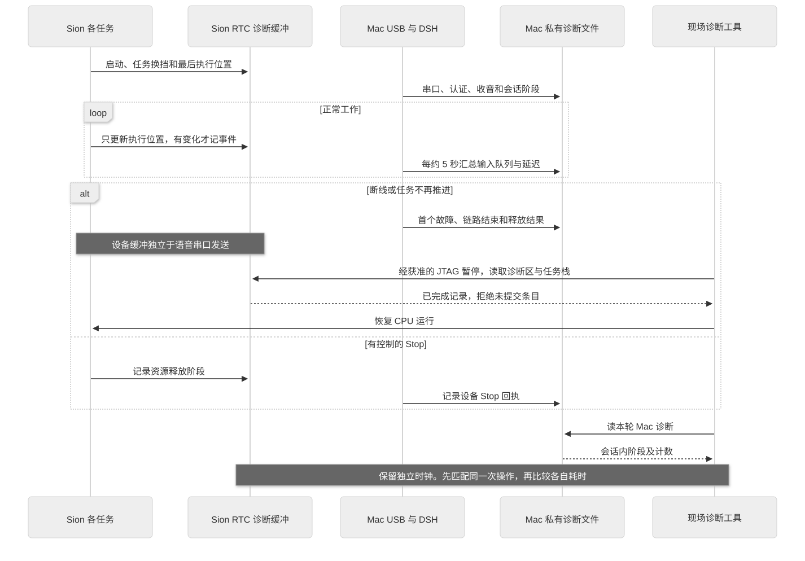

# 真机只读检查与恢复材料

这是 [P0/P1](product-plan.md#按依赖推进的工作包) 的真机检查记录与后续门槛。2026-11-18 用户明确授权只读检查与备份；已访问串口、读取并返回原固件，**没有执行 Flash 写入、擦除、配对写入或安装新固件**。最新结果见 [v26 现场只读预检](#v26-现场只读预检)。恢复写入与新固件真机验收仍未执行。

## 2026-11-18 实际结果

私有证据目录为 `.local/backups/20261118T080713Z/`，目录权限 0700、文件 0600，受 Git 忽略；不上传镜像、凭据或原始串口日志。两份全量镜像在同一台 Mac，不等于异地冗余。

| 检查 | 结果 | 证据与限制 |
|---|---|---|
| USB 与芯片 | USB Serial/JTAG，ESP32-S3 QFN56 rev v0.2，实际 Flash 16 MB | esptool v5.6.0；打开前确认端口未占用 |
| 安全状态 | Secure Boot Disabled；Flash Encryption Disabled | `security-info.txt`；未修改 eFuse |
| 完整备份 | A/B 各 16,777,216 字节，逐字节相同 | SHA-256 `33553259023c7a537a4c3810ef28d5682617e91b6359845bcef3d61ac312c218`；`verification.json` |
| 分区表 | MD5、范围及不重叠检查通过；与源码基线的分区表字节相同 | `partition-inspection.json`；实际 OTA 数据与源码初始数据不同，不能写入初始 OTA 数据 |
| 原助手 | `ota_1`，0x510000，stack-chan v1.6.2，IDF v6.1 | esptool 离线 image-info 校验和/SHA 有效；启动日志再次确认版本及槽偏移 |
| 另一应用槽 | `ota_0`，0x20000，ir_remote / 1b7145c | 镜像本身校验有效，但 OTA 状态 ABORTED；不是可声称能恢复原助手的备用镜像 |
| 配置 | 原 NVS 已完整保存，三页 CRC 有效，另有空页；未发现条目/数据 CRC 或缺块错误 | 官方 NVS parser/checker；两个未使用 namespace 提示（misc、assets）不属于 CRC 错误 |
| 本地身份与服务配置 | 存在 board/uuid、Wi-Fi、MQTT、WebSocket 凭据项，以及音量、舵机校准等项 | 只记录键存在，不公开值；不能从这些键推导已导出云端绑定 |
| 返回原固件 | esptool hard-reset 成功；日志显示 v1.6.2、Wi-Fi 连接、`activating → idle`，采样期间无 panic | 串口已关闭；用户于 2026-11-18 现场确认：能正常回答，手机 App 绑定仍在 |

实际分区为：nvs 0x9000/0x4000；otadata 0xd000/0x2000；phy_init 0xf000/0x1000；ota_0 0x20000/0x4f0000；ota_1 0x510000/0x4f0000；assets 0xa00000/0x400000；coredump 0xe00000/0x10000。两条 OTA 元数据 CRC 均有效；sequence 3 / state 4（ABORTED）被排除，sequence 2 / state 2（VALID）选择 ota_1；依据锁定 IDF 的 `bootloader_common_loader.c` 与 `bootloader_utility.c`，并用实际启动日志交叉确认。

**恢复结论：原设备的 Flash 恢复材料已读出并验证，尚未做恢复写入试验。** 原 bootloader、实际分区表、OTA 元数据、应用、资产与 NVS 都包含在全量镜像里。同设备恢复时须重新核对芯片/安全状态，恢复这次匹配的镜像与 OTA 选择，不能拿初始 OTA 数据或“另一个槽”代替。eFuse 和厂商云端账户不是 Flash 备份的一部分；本次未更改它们，也不声称可以离线重建已删除的云端绑定。官方文档明确解绑会清除 AI Agent 配置/历史，因此本次没有调用解绑或恢复出厂设置。

这里的“没有写入”指本次工具未发出 Flash/NVS/eFuse 写命令；原固件正常启动时可能自行维护运行配置，不能将读回镜像哈希称作重启后整机永不改变的证明。

## 本次执行范围与后续复查

2026-11-19，Mac 通过系统 USB 枚举找到一个候选，设备标识与已保存的 Sion 一致。此轮未打开串口、重启或新读 Flash，只验证 Mac 能看到接口。Grove Port B 的物理触发与开发槽冷启动须在实体设备上另验。

只确认目标芯片、实际容量、安全状态和实际分区，保存原机完整可读备份并验证。不在同一步安装新固件、配对或修改原语音配置。进入下载模式会暂时中断当前助手；检查结束后需要返回原固件启动。安全启动/加密/下载权限若不允许读取，就停止分析，不尝试绕过限制。

1. 重新枚举并对准 Sion 的 USB 端口，确认当前没有用户正在使用的串口程序占用；不按上次端口名盲连。
2. 用已安装 esptool v5.6.0 查询 security info、芯片/Flash ID。只有在确认此步骤后才打开串口；必要时按官方流程让用户按设备按钮进入下载模式。
3. 从报告取得真实容量，读取完整 Flash 两次，比较长度与 SHA-256。保存到 0700 的 `.local/backups/<本次时间>/`，文件 0600，不上传也不贴内容。容量或哈希不符就停止。
4. 对备份运行 [离线检查器](../scripts/inspect_backup.py)，检查 0x8000 的 ESP-IDF 分区表及 MD5、分区范围和 SHA-256；不推断当前 OTA 槽、密钥或加密状态。非预期分区表直接拒绝。
5. 从实际 OTA 元数据和安全状态核对可恢复路径；把本次固件 app 与实际应用槽比较。当前构建分区表和初始 OTA 数据与官方源码基线相同，**不证明原机相同**。
6. 退出下载模式、启动原固件，让原助手实际唤醒/说话并确认手机绑定还在。记录结果，然后再形成确切安装/恢复写入清单。

## 只读操作的命令形态

以下是脱敏后的命令形态，准确参数、退出码与读取日志保存在私有目录的 actions.json。复查时 DEVICE_PORT 和 DETECTED_FLASH_BYTES 必须重新确认。

```sh
python -m esptool --chip esp32s3 --port DEVICE_PORT --before default-reset --after no-reset --no-stub get-security-info
python -m esptool --chip esp32s3 --port DEVICE_PORT --before no-reset --after no-reset --no-stub flash-id
python -m esptool --chip esp32s3 --port DEVICE_PORT --before no-reset --after no-reset read-flash 0 DETECTED_FLASH_BYTES PRIVATE_BACKUP_A
python -m esptool --chip esp32s3 --port DEVICE_PORT --before no-reset --after no-reset read-flash 0 DETECTED_FLASH_BYTES PRIVATE_BACKUP_B
python3 scripts/inspect_backup.py PRIVATE_BACKUP_A
```

esptool 可能向 RAM 装载读取 stub，这不是 Flash 写入；仍属于真机操作。最后的返回原固件启动方式按实际连接/安全状态选择，不在本页提供未经核对的整机写入命令。

## 后续安装方案与门槛

新应用本次产物、大小与 SHA-256 在 [构建收据](../firmware/sion-build.json)。不直接执行 SDK 打印的整套 flash 命令：它会涉及 bootloader、分区表、初始 otadata 与资产。启用 HTTPS/控制台配置后本次 bootloader 哈希也与旧基线不同，不能把它顺带写入。

本轮后续离线审查已形成 [安装与分级恢复方案](installation-recovery.md)：拟用 ota_0 放新应用，保留原 ota_1 和共用数据。后续 preservation-trial-v3 已补 NVS/资源/更新保护与显式试运行确认并完成构建，但官方生产鉴权未公开、长期凭据刷新和真机兼容未解决，因此仍不可安装。只读备份已完成不代表候选能保留原语音/绑定；后续确切文件、恢复范围和现场验收必须在刷写前交用户确认。

依据：[官方 esptool 基础命令](https://docs.espressif.com/projects/esptool/en/latest/esp32s3/esptool/basic-commands.html)、[StackChan 文档](https://docs.m5stack.com/en/StackChan)。本轮使用 esptool 读取与复位、官方 NVS 工具离线检查；未使用 M5Burner 执行烧录。

## v24 现场只读预检

这次预检的目的，是把旧包绑定的保存状态与 Sion **当前**状态做比较。之前的授权和备份记录只证明当时的状态。按 [M5Stack 官方下载模式说明](https://docs.m5stack.com/en/StackChan/#download-mode)，底座 USB 可用于维护。预检会短暂中断原厂助手，操作者进入下载模式后重新确认当前 USB 串口。预检完成后退出下载模式、正常返回原厂，再用原唤醒词及手机 App 检查回答和绑定。日常应用内返回仍用上滑 Home。

[采集工具](../scripts/capture_agent_preflight.py) 固定 esptool 5.6.0，并要求显式传入已经识别的 Mac USB 串口和全新的私有目录。它先用 ROM 查询芯片、安全状态、实际容量和硬件 MAC，和历史读取记录一致后才从地址零读取两次完整 16 MiB。两个读出必须逐字节相同，且采集日志中的设备身份与探测一致。读取可使用 esptool 的 RAM stub。命令使用前后均不自动复位的选项，串口打开尝试次数为一次。探测和备份日志都保存在本地，摘要输出不包含 MAC。见 [esptool 复位选项](https://docs.espressif.com/projects/esptool/en/latest/esp32s3/esptool/advanced-options.html#reset-modes)。

[离线比较器](../scripts/check_agent_preflight.py) 接着核对保存的两套日志、两次读出和现有五个离线文件。返回 bytes-match 仅证明传入证据和选定阶段对得上，现场步骤仍负责确认读取时间和设备，工具不会将旧材料当作现场预检。若只是 NVS 或崩溃日志发生变化，按新鲜证据重审并重做包。启动器、原表、原厂应用、OTA 记录变化，或尾部出现数据时停用旧计划，调查变化来源。

2026-11-19 用户授权后，先用 USB Serial/JTAG 设备序列标识与历史证据比对，确认串口空闲。esptool 通过 USB 控制线进入 ROM 并再次匹配芯片标识。现场读到 ESP32-S3 rev v0.2、16 MiB、Secure Boot 与 Flash Encryption 均关闭。两份 16,777,216 字节读取相同，收据和原始日志仅存本机私有目录。没有发出 Flash 写入、擦除、eFuse 更改或解绑命令。随后通过 esptool 完成正常复位。

与 2026-11-18 快照整片比较，仅原 NVS 的一个 4 KiB 扇区有差异。启动器、分区表、OTA 记录、两份应用、原资产及尾部一致。使用锁定 SDK 的 NVS 工具检查新读回，三页 CRC 有效并保有一个空页，诊断与历史检查一致。正常复位已通过 esptool 控制日志确认，本次复位后的原唤醒、云端应答与手机绑定待实机观察。

以这次双备份重建 [v24 离线安装包](installation-recovery.md#最新现场基线与包复核)。五个安装和恢复文件与上一轮逐字节一致，换新的基线后比较器返回 bytes-match。测量 Grove 输入、候选写入与写入后的原厂和 DSH 验收是后续独立步骤。

## v26 现场只读预检

2026-11-19，用户授权真机检查。先从 macOS USB 树核对 Espressif USB Serial/JTAG 与历史 Sion 的硬件标识，再经 USB 控制线进入 ROM。实际检测 ESP32-S3 rev v0.2、16 MiB Flash，安全启动和 Flash 加密关闭。读取两份 16,777,216 字节，逐字节一致。对照已审查的 v26 包，阶段零返回 `bytes-match`，相对于安装基线无变化。通过同一已识别连接执行正常复位，Mac 再次枚举 USB 串口。收据保存于本机忽略目录。

本批没有发出 Flash 写入、分区或启动配置变更、擦除、解绑指令。整片相同确认原厂 Flash 中保存的配置和 OTA 记录在读回时仍与基线一致；本批未观察复位后的唤醒应答和手机 App。独立入口需要先用实际 Grove Port B 夹具验证 GPIO9 的按下和松开；Mac 当前仅能验证 USB 维护路径。参见 [维护部署图](installation-recovery.md#v26-维护部署边界)、[启动状态图](dual-boot-updates.md#启动选择与返回状态) 及 [M5Stack 手册](https://docs.m5stack.com/zh_CN/StackChan/#下载模式)。

## v35 现场只读预检

2026-11-19 14:32 UTC，Mac 从 USB 描述符匹配同一台 Sion，并确认串口空闲。通过现有 USB 连接进入 ROM，esptool 5.6.0 再次确认 ESP32‑S3 rev v0.2、16 MiB Flash，以及关闭的 Secure Boot 和 Flash Encryption。新采集的两份 16,777,216 字节读回相同，并与 v26 现场快照整片相同。通过正常复位退出 ROM 后，同一设备重新出现在 Mac 的 USB 列表。 [M5Stack 下载入口](https://docs.m5stack.com/en/StackChan/#download-mode) · [Espressif 复位选项](https://docs.espressif.com/projects/esptool/en/latest/esp32s3/esptool/advanced-options.html#reset-modes)

离线复核确认现有 OTA 仍选原厂 v1.6.2，镜像校验通过，NVS 三页 CRC 正常并保留一页空页。设备备份、ROM 控制日志与 NVS 检查结果仅存本机。该次采集只包含 ROM 查询、只读 RAM stub 和复位。复位后原厂唤醒、回答和手机绑定需另行观察。设备 Grove Port B 接线、电气测试、实际试装与回退仍待验收。 [v35 正式写入前的核对点](installation-recovery.md#v35-relay-候选离线审查)

### 单次 USB 联调的现场只读核对

2026-11-20 06:37 UTC，按用户同意做本轮只读核对。Mac 通过底座 USB 匹配历史设备身份，确认串口空闲，再通过 USB 控制进入 ROM 下载模式。ESP32-S3 rev v0.2、16 MiB Flash、安全启动及 Flash 加密状态均与历史一致。两份 16,777,216 字节读回逐字节相同。Mac 日志记录了正常复位请求以及随后同一设备的 USB 枚举。用户现场确认由自己手动重启回原厂。此轮 ROM 操作只有查询、读取及复位。 [官方下载模式与复位](https://docs.m5stack.com/en/StackChan/#download-mode)

当前双读较 v35 历史基线只有 NVS 内一个扇区的字节不同。固定 SDK 检查没有发现 NVS 完整性异常，原厂生效设置逐项一致。原厂 v1.6.2 在 `ota_1` 且状态为 VALID，`ota_0` 中原 IR Remote 保持原字节且状态为 ABORTED，独立区空白。重启后用户现场确认原助手能回答，手机绑定仍在。当前双读、还原预览及设备探测日志保存在本机私有目录。 [真机读回对应的方案](installation-recovery.md#v54-保留原厂的单次联调)

### v54 真机联调与恢复

2026-11-20 06:49–07:05 UTC，用户批准单次 v54 USB 联调。普通网络设置保持原样。两份新备份一致，原厂设置有效值与上一批一致。实际先写 `0x20000–0x1d0000` 的 v54 镜像，再写 `0xd000–0xe000` 的一次性 NEW 记录。每段读回 16 MiB 与相应预期相同。候选用 ESP32-S3 watchdog 请求普通启动。 [执行步骤](installation-recovery.md#v54-保留原厂的单次联调) · [Espressif 复位模式](https://docs.espressif.com/projects/esptool/en/latest/esp32s3/esptool/advanced-options.html#reset-modes)

Mac 在同一 USB 设备上多次发送独立配对状态请求，未收到应答。重新进入 ROM 的两份整片读数一致。`ota_0` 已恢复为原基线的 ABORTED 记录，原厂 `ota_1` 仍为 VALID。发现新写入的合法独立归属标记，证明 v54 进入了布局、原厂回退镜像核对后的初始化。独立配置分区为空。未建立测试配对，也未验证实际屏幕、USB 音频、触屏或 Home。记录无法定位候选退出是在 HAL 初始化、USB 驱动启动，还是之后的运行阶段。 [初始化顺序](../firmware/agent/device_main.cc) · [归属记录](../firmware/app-center/tail_storage.cc)

恢复实际写入旧 IR Remote 的 432 个扇区和新的独立归属标记 1 个扇区。每段分别做整片读回，最后完整的 16 MiB 与本次试装前的新双读完全一致。随后通过 watchdog 请求普通启动，Mac 能再次匹配同一 USB 设备。试装后原助手的实际回答和手机绑定待现场确认。备份、恢复证据和设备标识均保存在本机私有目录。 [验收记录](validation.md#v54-单次真机试装)

后续离线诊断已就绪。对应 v54 的 GDB 探针分别观察板级初始化返回、USB 任务创建和 USB 驱动就绪。QEMU 用恢复前的试装摘要匹配虚拟 Flash，验证了板级 panic 回溯和 USB worker 先于任务创建调用返回的情况。实体设备仍需经确认后执行一次受控诊断。 [启动诊断](device-compatibility.md#v54-启动与-usb-故障定位)

### v54 JTAG 联调的 Flash 电压差异

2026-11-20 07:20–07:32 UTC，用户批准另一轮临时 v54 启动诊断。OpenOCD 用同机 USB 描述符连接，读到了两条物理 JTAG TAP。下载模式的主核 CPU0 枚举成功，GDB 能通过只启用硬件断点的配置读当前 PC。副核在此阶段未通过检查。v54 的主任务和 USB 配对 worker 均绑定 CPU0。

本轮压缩和非压缩两次尝试都在暂存阶段遇到 Flash MD5 与候选不符，回报值等于原 IR Remote 区。执行器在选择记录前停止。第一次失败后以及重试后均用新的两份整片读数核对。各组与试验前 16 MiB 完全一致，无需回写任何扇区。未启动 v54，也未观察其真机 HAL 或 USB 启动。已请求原厂正常启动并再次匹配到同一 USB 设备，用户现场确认原助手能回答且 StackChan World 绑定仍在。

同一制造商和容量的 Flash 在之前成功安装及恢复的探测里报告 `3.3V`，这次每组 ROM 读数都报告 `1.8V`，两者均标记由启动绑定位选择。公开 CoreS3 v1.0 原理图将 16 MiB Flash 标为 3.3 V。现场证据为芯片报告的配置，电源轨未实测，尚未定位配置变化的触发条件。执行器已加入绑定位检查，在连接 Flash 和启动写入 stub 前拒绝与这台 Sion 已核对状态不一致的配置。下次先按官方 RST 流程进入下载模式并只读确认，再按对应授权决定是否继续；不改电压设置或 eFuse。 [Espressif 数据手册第 3.2 节](https://documentation.espressif.com/esp32_s3_datasheet_en.pdf) · [M5Stack 下载模式](https://docs.m5stack.com/en/StackChan/#download-mode) · [CoreS3 v1.0 原理图](https://m5stack-doc.oss-cn-shenzhen.aliyuncs.com/490/Sch_M5_CoreS3_v1.0.pdf)

### 手动 RST 的 Flash 配置对照

2026-11-20 07:36 UTC 用户先按官方 RST 流程进入下载模式。Mac 仅用 `--before no-reset --after no-reset --no-stub` 探测同一设备，报告 `3.3V`。随后请求正常重启，Mac 再次识别同一 USB 设备。另一次用户授权的诊断在首次手动进入时没有 ROM 应答，重复按键后接口恢复并再次报告 `3.3V`。这个对照观察的是芯片的采样结果，无法证明首次未应答的原因或直接测量电源。 [M5Stack 下载模式](https://docs.m5stack.com/en/StackChan/#download-mode)

Espressif 将 Flash 电压选择绑在 GPIO45。CoreS3 原理图把 GPIO45 同时连到相机 PCLK。公开原厂代码会在板级构造阶段初始化相机，独立应用把相机获取留给独立资源服务。因此相机状态是复位前后值得记录的变量，尚无现场波形证明它造成前一轮的 1.8 V 读数。USB Serial/JTAG 的核复位和会重新采样绑定位的系统复位分别记录。 [ESP32-S3 数据手册](https://documentation.espressif.com/esp32_s3_datasheet_en.pdf) · [CoreS3 PinMap](https://docs.m5stack.com/en/core/CoreS3) · [Espressif 复位行为](https://docs.espressif.com/projects/esptool/en/latest/esp32s3/troubleshooting.html#leaving-download-mode-in-usb-serial-jtag-mode)

### 手动入口下的 v54 启动与 USB 复位证据

用户授权这次试验后，以官方 RST 入口的 3.3 V 采样开始。两份安装前备份一致，紧接启动写入器前仍报告 3.3 V。v54 备用槽与本次 NEW 记录分开写入，各自整片读回逐字节匹配。JTAG `reset halt` 后调试器报告核复位且仍能同 ROM 通信，对侧记录依然为 NEW。按 Espressif 文档用 watchdog 系统复位后，一次性记录才被消费。 [Espressif 复位行为](https://docs.espressif.com/projects/esptool/en/latest/esp32s3/troubleshooting.html#leaving-download-mode-in-usb-serial-jtag-mode)

用已核对 v54 ELF 的 JTAG 回溯，看到 `app_main → show → create_home_indicator → Assets::LvglStrategy::CalculateChecksum`。这个位置在板级初始化和 USB 配对任务的调用之后，证明真机已到界面构建。对同一底座 USB 的状态查询无应答，随后一次 JTAG 采样两核均记录复位原因 21（USB UART reset）。这是一次时序观测，尚不能区分打开串口、串口挂断还是系统驱动中的具体控制线动作。回到 ROM 读到对侧记录已 ABORTED，原厂记录仍 VALID，独立区只新建了归属标记，未建立 DSH 配对。 [设备启动顺序](../firmware/agent/device_main.cc)

隔离伪终端已比较现有 helper 和跳过显式 DTR/RTS 的 pySerial 实验路径。后者保持双向数据传输，观测到的显式控制线 ioctl 从 1 次变为 0 次。伪终端无法反映 macOS 驱动的物理线路行为。下一步可用同一设备和 JTAG 做串口打开前、打开时、关闭后对照，先区别打开事件和关闭事件。 [pySerial 端口打开行为](https://pyserial.readthedocs.io/en/latest/pyserial_api.html#serial.Serial.open) · [ESP32-S3 USB 串口复位行为](https://docs.espressif.com/projects/esptool/en/latest/esp32s3/esptool/advanced-options.html#reset-modes)

本轮实际恢复只涉及旧 IR Remote 的 432 个扇区和未使用的归属标记 1 个扇区。每段读回符合预期，最终整片与本轮安装前的两份备份逐字节一致。已请求原厂正常启动并匹配同一 USB 描述符。用户随后确认原助手能回答、原手机绑定仍在。

### 原厂上的 Mac USB 串口打开对照

用户确认原厂状态正常并批准不刷机的对照。OpenOCD 禁用 Flash 支持，读取两次 CPU0 复位原因作为基线。先试候选包采用的省略显式 DTR/RTS 的打开方式，端口打开期间及关闭后的复位原因均为 12，与基线相同。切回旧方式，在端口仍打开、尚未关闭时，JTAG 报告 CPU0 复位原因 21（USB UART reset）并停在 ROM。全程未发送串口协议消息。这个对照复现了旧 Host 打开端口时的复位，也在同机同配置下验证了新方式的基本打开和关闭。 [候选包验收](validation.md#mac-受管-usb-数据端口候选)

复位期间首次 SMP 恢复返回错误。重新连接后先刷新 OpenOCD 目标状态再恢复，最后两核均报告运行中，USB 枚举继续匹配同一设备。对照没有写入 Flash，也未对原厂语音发起新请求。CPU 运行与 USB 枚举已复核。v54 在实体设备上的配对与语音闭环需使用新 Host 另验。 [ESP32-S3 调试命令](https://docs.espressif.com/projects/esp-idf/en/v6.1/esp32s3/api-guides/jtag-debugging/tips-and-quirks.html)

### v54 桌面更新与实体配对

2026-11-20，用户确认临时试装与收尾恢复。两份同机整片备份一致，ROM 读到 3.3 V。仅暂存 v54 到旧 IR Remote 所在的 A 槽并写入对侧一次性记录，每段均核对整片。用户看到 DSH.AGENT 后打开 Allow USB，Mac 识别设备、建立独立配对并在检查设备时读回同一身份。

日常 Mac 配置档通过签名应用随附 CLI 更新，使用原先选定的 DSH 会话。首轮语音启动暴露托管 USB 的默认授权错误，已在 Mac 修正并重装。下轮进入连接后在收音前断开。沿既定流程直接进入 ROM 恢复原厂，未用机身 Home 触发返回。 [对应验证与未完成项](validation.md#v54-实体配对与-usb-语音验收)

恢复前同机双读一致，原厂 NVS 与试装前逐字节相同。先撤销 `0xd000–0xe000` 的候选选择记录，再还原 `0x20000–0x1d0000` 的旧 IR Remote。每段均读回完整 16 MiB。最后一次实读匹配独立复算的整片目标，`0x000000–0xffb000` 与试装前逐字节一致，保留尾部归属及独立配对。与试装前相比只有尾部两个 4 KiB 扇区不同。通过 watchdog 请求普通启动，之后只枚举核对同一 USB 设备。用户现场确认原助手能通过原唤醒词回答，StackChan World 仍已绑定。 [现场恢复检查](installation-recovery.md#v54-保留原厂的单次联调) · [Espressif 复位模式](https://docs.espressif.com/projects/esptool/en/latest/esp32s3/esptool/advanced-options.html#reset-modes)

### v54 再次 USB 收音启动诊断

2026-11-20，用户批准一次 v54 USB 联调及恢复。新的整片双读通过。独立配对尾部与上次现场恢复的整片校验一致，旧审查参考以空尾部进行的检查之外只观察到原厂 NVS 一个扇区变化。执行前在副本上复演同一有配对的字节布局，验证暂存、选择及逐字节恢复，并确认尾部差异会拒绝执行。实体写入仍只有旧 IR Remote 所在的 A 槽和对侧一次性启动记录。两段整片校验通过，启动后只读确认已有独立配对。

使用 Mac 实际 `rc.5` 诊断包和原选会话开启 USB 待命。用户点一次 USB 后，Host 观察到认证连接及 `active`。v54 的 `started` 回执要求设备音频已进入 Running。这次进到了收音启动回执之后。随后待命终止，Host 报 `voice_usb_standby_interrupted`，未收到正常停止回执。用户看到「waiting for Mac」后感觉画面卡住。此次未取得实际问答、说「停止」、拍照或 Home 的验收证据。开始恢复后保留两端的观察，不凭公共错误码判断首个底层原因。 [诊断边界](voice-runtime.md#收音启动阶段诊断)

恢复前两份实读一致，原厂 NVS 与本轮安装前逐字节一致。在下载模式撤销待确认的启动记录，再恢复旧 IR Remote，每段均读回 16 MiB。最后整片实读与本轮试装前双读逐字节一致，包括原厂设置和已有独立配对。已发出原厂普通启动请求并重新匹配同一 USB 设备，日常 Mac 桌面已重开。 [恢复方案](installation-recovery.md#v54-保留原厂的单次联调)

### v54 活动收音的首个异常

2026-11-20，用户批准一次 v54 和 Mac 诊断包的临时联调及恢复。试装前两份 16 MiB 实读一致，核对原厂和已有配对后只暂存 v54 到旧 IR Remote 所在备用槽，并写一次性启动记录。两段分别整片校验。普通启动后只读核对已有配对。用户在设备端点一次 USB，屏幕显示「waiting for Mac」。Mac 记录认证及 `active`。

收音启动后 58,306 ms，Mac 正式 Host 的首条异常日志为 `transport / input-overflow`，并确认本地语音层已经读到输入音频。该错误表示 Host 的 32 帧录音队列当时已满。每帧 10 ms，满队列约等于 320 ms 的 PCM。用户确认还没开口就看到「USB disconnected」，随后界面卡住。此条日志定位到了触发断线的保护条件。USB 到帧是否成批涌入，以及 Mac 本地输入处理或调度是否停顿，仍需要分别测量。随后 USB 待命终止，设备空闲未确认，按同机备份恢复。 [输入队列实现](../src/agent-transport.mjs) · [日志说明](voice-runtime.md#收音后的首个异常记录)

本轮恢复只撤销一次性启动记录和还原旧 IR Remote。每段整片校验通过，最终实读 16 MiB 与本轮试装前的双份备份逐字节一致，包括原厂设置和独立配对。发出原厂普通启动请求后匹配同一 USB 设备。Mac 原插件归档的 81 个安装文件与试装前一致，配置覆写逐字节一致，已重开日常 DSH。 [恢复方案](installation-recovery.md#v54-保留原厂的单次联调)

### USB 断线与触屏无响应的对照

Mac 的输入满队列解释了上一轮为何关闭连接。断线后 Sion 是否仍响应触摸是独立验收项。v54 的 USB worker 报告连接关闭后，应用等待收放音、其他已占用资源和载体完成。等待期间重复点 USB 会被忽略，Home 也可能等资源回执。主页上的 Settings 与 Settings 内的 Back 在这段时间应能切换页面。现场用这两个操作区分重连被挡和界面失去响应。

v54 的同一轮应用循环持有 LVGL 锁再取载体事件、处理资源释放并刷新页面。实际 USB worker 在另一任务中处理 TLS 退出及必要的驱动卸载、重装。界面无响应可能涉及运行任务、锁或板级驱动，Mac 日志无法说明 Sion 卡在哪一步。主机 UI 夹具覆盖假载体关闭和延迟完成；实体触屏、USB 驱动退出和固件任务状态保留为现场待核对项。 [UI 循环](../firmware/agent/device_main.cc) · [设备 USB worker](../firmware/agent/pairing_usb.cc) · [验证](validation.md#v54-断线后界面响应)

### 双端诊断时间线

v55 诊断候选为 ESP32-S3 的应用启动、UI、USB、音频、网络各留一条独立任务记录。每条最多 32 个阶段事件和一个最近执行位置，当时合计 3336 字节，放在 RTC slow RAM。每条写入先清提交序号，字段写好后才提交。调试器暂停时若碰到未写完的条目，解码时跳过。正常运行时没有设备日志文件、Flash/NVS 写入或额外 USB 音频流量。各 Lane 写入由所有者串行化。 [记录格式](../firmware/agent/device_trace.h) · [v56 新增阶段](#v56-触屏动作到屏幕传输的日志)



| 记录来源 | 能回答的问题 |
|---|---|
| Boot | 是否到达独立应用，启动原因、原厂兼容检查、尾区初始化、板级启动和首屏各走到哪一步？ |
| UI | 最近一次触摸意图何时被取走，上次走到拿 LVGL 锁、处理输入、协议状态、资源释放还是绘制？ |
| USB | 是否见到 Mac 就绪信息、TLS 是否成功、为何跳出数据循环、是否卡在 TLS 退出／排空／重装／释放？ |
| Audio | codec 是否打开，最近在读取、写入、播放屏障或关闭，AudioEngine 报了什么错？ |
| Network | Wi-Fi、时钟、连接和 SDK 清理走到哪里；LAN 和 Relay 使用同一日志通道。 |
| Mac | 是否有来帧，谁积压，转写、DSH、播放、拍照与附件导入，以及设备停止是否实际确认。 [Mac 字段](voice-runtime.md#mac-语音诊断日志) |

先观察和记录无调试器时的触屏表现。需要 JTAG 取证时，使用 `device_trace.py openocd` 为同一设备生成配置。它在载入板定义前关闭 ESP Flash 支持，同时关闭 GDB 的 Flash 写入及内存映射，并默认 `noinit`。核对后显式初始化，按对应 ELF 生成的 `sion-capture` 暂停两核，读固定诊断区与任务栈，最后请求继续运行。Mac 日志保留 Unix 端的同时段背景。解码器可读取两份设备记录和旋转的 Mac JSONL，分别保留时钟，须根据本轮接通、Stop 或人工标记对齐。只有两份均有有效检查点时才判断是否有推进，否则输出 `null`。 [生成与解码](../scripts/device_trace.py) · [Espressif JTAG 文档](https://docs.espressif.com/projects/esp-idf/en/stable/esp32s3/api-guides/jtag-debugging/tips-and-quirks.html)

`device_trace.py decode <本次设备快照> --previous-device <上次设备快照> --mac <旧 JSONL> --mac <当前 JSONL>` 输出设备各 Lane 与 Mac 的本轮记录。只提供 `--mac` 也可读取，损坏或缺失的设备快照不会让同一次 Mac 日志丢失。

设备还在线时可取 RAM 照片。USB 音频通道关闭后，JTAG 可达时仍能读取记录。部分复位保留 RTC 内容，解码会按启动代次显示。完全掉电、RTC 丢失、整条 USB 调试链路不可达、或故障发生在独立应用启动前时，以 Mac 已写记录和现场观察为据。开机、音频、UI 和网络仍须以当次真机证据判定。

#### v55 真机启动与触屏无响应

2026-11-20，用户授权一次 v55 和新版 Mac 插件临时联调及恢复。新的两份 16 MiB 读回一致，核对同机独立配对与 3.3 V。只暂存 v55 到 `0x20000–0x1d0000`，再写 `0xd000–0xe000` 的对侧一次性记录。两段分别以整片读回校验。正常启动后，用户看见 DSH.AGENT。

Mac 第一次只读配对查询在任何调试器接入之前返回 `device_state_unavailable`。首个 OpenOCD 连接虽禁用了 GDB Flash 编程，日志明确记录了因内存保护而请求 `reset halt`、实际软复位和暂停两核，随后 Flash 探测失败。之后同时关闭 Flash 支持及 GDB 内存映射探测，成功读取 3336 字节 RTC 以及现场任务栈。设备记录 Boot、StockCheck、StorageReady、HalReady、Workers、FirstScreen。USB 驱动就绪，最后记录为启动后 4236 ms 的 `UsbPairingReply`，表示处理器生成过答复。实际是否入队、发完以及 Mac 是否读到该答复无法由此事件确认。

第二次只读配对查询仍失败。根据本次双读的同机独立区和 Host 原活动记录，Mac 按现有配对开启待命。用户报告画面按键均无响应。Mac 的最后连接阶段是 `usb-opened`，没有就绪信号、TLS 完成或收音启动事件，最终由设置侧主动结束等待。第二份 RTC 和第一份逐字节一致，两个取样点的设备任务栈均保留。两次成功取样均在首轮调试影响之后，卡死发生的起点无从确定。 [Mac 阶段字段](voice-runtime.md#mac-语音诊断日志) · [现场验收](validation.md#v55-双端诊断真机结果)

两份任务快照的应用主线程都显示在 `Hal::delay`，USB 任务都显示在接收环形缓冲。UI 最近执行位置的原始条目带有与本轮不符的启动代次，解码已将该条目标记为空。只能使用有效事件及任务栈定位阶段。首次调试探测后的这两个取样点，无法证明整机一直停在同一指令。

取证后关闭临时 Mac Host。恢复前两份整片读回一致，原厂 NVS 和独立配置与试装前相同。先撤销一次性启动记录，后恢复旧 IR Remote，每段均整片校验。最终实读与本轮试装前两份 16 MiB 的摘要相同。正常启动后被动匹配同一 USB 设备。Mac 恢复了试装前原插件的 81 个文件和一条 bundle 登记，设置文件逐字节一致，日常桌面已重开。证据在外置 SSD `work/active/device-trace/physical-v55.F1qanV1W` 的私有目录内。

#### v56 空闲启动与 USB 的分段验收

设备首页的连接状态和麦克风状态只在实际文字变化时更新。UI 每 10 秒在 LVGL 锁外记录一次循环最大间隔、内部堆剩余及连续空间、内部堆历史低水位、任务栈低水位和 PSRAM 剩余。时间用毫秒，内存用字节。采样前的检查点可辨别是否停在资源采样中。USB 日志分别标记配对答复已生成、已入发送队列、USB 驱动实际排空，以及是否收到待命探测、是否成功将 READY 放进队列。驱动排空之后仍以 Mac 实际收到的完整回复为准。 [UI 实现](../firmware/agent/device_main.cc) · [设备记录](../firmware/agent/device_trace.cc) · [USB 任务](../firmware/agent/pairing_usb.cc) · [ESP-IDF 堆内存和碎片](https://docs.espressif.com/projects/esp-idf/en/v6.1/esp32s3/api-reference/system/heap_debug.html#heap-information)

下一轮真机获明确授权后，先控制变量。进入 DSH.AGENT 后，保持 Mac Host 未待命、调试器未接入，留首页静置五分钟，然后点一次 Settings 检查是否能切页，记录时间。上轮从启动到报告无响应约五分钟，以此作为第一段对照窗口。只有界面通过这段，才依次做只读 USB 状态查询和待命握手。出现故障时先保留两端当时的线索，必要时用新配置取 JTAG 快照，再按同机备份恢复。 [离线验收](validation.md#v56-空闲界面与-usb-阶段离线验收)

v56 真机这轮的候选写入通过，发出启动指令后却未到达可观察的 DSH.AGENT 首页。后来两份整片读回的一次性记录仍为 `NEW`。下一轮把看到首页作为静置的计时起点。若启动失败，保留真实屏幕现象和 OTA 记录，转入启动诊断。 [现场结果](validation.md#v56-触屏真机联调与恢复)

同一镜像随后在实体 Sion 上改用官方手册的短按 RST，用户确实看到首页。实际静置超过五分钟后一次 Settings 点击切页，Mac 导出的设备记录确认 LCD 传输完成。短按路径在该轮有效，先前自动复位未进应用的底层原因仍待定位。 [复测证据](validation.md#v56-短按-rst-触屏复测) · [M5Stack 手册的复位说明](https://docs.m5stack.com/zh_CN/StackChan/#开关机说明)

#### v56 触屏动作到屏幕传输的日志

| 生产阶段 | 真实接线 | Mac 用来判读的证据 |
|---|---|---|
| FT6336 触摸采样 | 板级轮询保留电平边沿、首次坐标、I²C 失败和恢复，通过 HAL 同步携带点击序号 | `TouchDown/Up`、`TouchPosition`、驱动采样时间。这里只有屏幕输入，顶部 Si12T 手势属于原有独立通道 |
| LVGL 到应用 | LVGL 指针读取同一采样序号。按钮将动作排入应用循环，同一轮可合并多次输入。应用记开始和完成 | `TouchLvglDown/Up`、`UiActionQueued/Started/Finished`。屏幕空白区、手势取消或禁用控件可能没有按钮回调。Home 的延迟回调会记录动作批次，来源触摸序号标为空 |
| 页面构建和同页状态 | 切页记开始和构建完成。首页、设置、配对、文字界面的状态文案实际变化时也发布待刷版本 | `PageBuildStart/ContentChanged/Built`。只保留点击和页面编号、顺序和时间 |
| LCD 传输 | LVGL 最后一块像素提交前挂上页面版本。SPI 完成回调回执，继续向 LVGL 报告原有 flush ready | `PageFlushStarted/Completed`。该回执确认最后一块像素传输结束，实体面板的实际显示用现场观察验证。被后续页面覆盖的中间页面可能只有构建日志 |

日志继续使用有界 RTC 环形区，无文件、Flash 写入或 USB 音频流量。新增四条通道，合计 5992 字节。`device_trace.py decode` 输出 `touchscreen`，按同一启动代次聚合触摸、应用批次和页面版本，给出最后观察到的阶段，也输出驱动/LVGL 采样时间和无法归因到触摸的动作。旧版 3336 字节快照继续可读。使用对应 ELF 生成快照命令，现场先观察屏幕再接入已有安全配置的调试器。 [采集与解码](../scripts/device_trace.py) · [长度与状态约定](../firmware/agent/device_trace.h) · [SPI LCD 回执](https://docs.espressif.com/projects/esp-idf/en/v6.1/esp32s3/api-reference/peripherals/lcd/index.html)

### v54 Home 返回前的离线探针

`prepare_stock_trial_debug.py --probe home` 先核对 v54 BIN/ELF 的发布收据，再从 `app_main` 的反汇编定位受原厂核对约束的 Home 重启调用。同一函数的普通设置重启在另一条分支。生成后的 GDB 命令只声明一个硬件断点，加载脚本本身只定义命令。一次性断点命中后保留暂停，现场须保持调试连接。实体连接、双核暂停和后续恢复交接仍待受控验收。 [探针生成器](../scripts/prepare_stock_trial_debug.py) · [Espressif 硬件断点](https://docs.espressif.com/projects/esp-idf/en/v6.1/esp32s3/api-guides/jtag-debugging/tips-and-quirks.html#breakpoints-and-watchpoints-available)

在 QEMU 执行生成命令，命中时原厂尚未启动，候选仍为 PENDING_VERIFY。对照运行同一编译分支时，原版启动器选择原厂并到达 v1.6.2 应用入口。模拟跳过硬件 ADC、HAL 与触屏输入，资源释放和机身 Home 的实体动作沿用现场验收。 [结果](validation.md#v54-原厂镜像单次联调演练)

### 原厂 NVS 的离线完整性检查

对原厂和故障后保存的双读目录，可运行 [check_stock_nvs.py](../scripts/check_stock_nvs.py)。它先核对设备读出收据与芯片探测日志，再拿原厂 `0x9000–0xd000` 的 16 KiB 配置分区交给锁定 ESP-IDF v5.5.4 的完整性检查器。调用从 Git 固定提交取检查模块，用私有进程管道提供配置分区。结果只输出页数、已写条目数和匿名诊断计数，没有键名、配置值、设备标识或录音。 [ESP-IDF NVS 结构](https://docs.espressif.com/projects/esp-idf/en/v5.5.4/esp32s3/api-reference/storage/nvs_flash.html) · [固定 SDK 检查器](https://github.com/espressif/esp-idf/tree/735507283d5b2f9fb363a1901172dbd9e847945d/components/nvs_flash/nvs_partition_tool)

~~~sh
python3 scripts/check_stock_nvs.py <双读目录>
~~~

状态 `checked` 表示检测过页头、条目、可变数据和已识别格式，没有异常指标，并发现已写条目。缺少已写条目或发现结构问题时退出码为 2，留待人工确认；备份或工具读取失败用退出码 1。Sion 的 v26 与 v35 保存备份均为 4 页、1 个空页和 46 个已写条目，SDK 有 2 个「未使用命名空间」提示。此检查只读文件，语音服务和手机绑定的可用性仍以实际原厂开机后验收为准。 [测试证据](validation.md#原厂-nvs-完整性复核)

使用 `python3 scripts/check_stock_nvs.py <安装前双读> --compare-to <当前双读>` 可核对同一设备的当前设置。先验证两组双读和厂商分区表，再在私有子进程里对比仍生效的值。页位置、命名空间编号和 blob 分块方式变化都以值为准，保留名称、类型与值的对应关系。报告只列公开的 `app_dsh_menu/launch_v1` 与 `feature_toggles/dsh_visible`，其他设置只报告变更数量。空基线、不一致或不可解析的记录返回 `inconclusive`。其他设置发生变化以及快捷设置类型或长度不合契约时返回 `needs-review`。此项说明保存的设置是否对得上。云端原语音和同一手机绑定仍以设备上线后的操作验收为准。 [安装与撤销使用方式](installation-recovery.md#带主菜单快捷入口的候选)

显式加 `--check-ai-autostart` 可报告保存的原厂 AI 开机行为。只在完整性通过、页状态可解释、目标记录唯一且类型符合时报告 `enabled` 或 `disabled`，缺记录报告 `not-recorded`，证据有疑义报告 `unknown`。Sion 保存的 v35 安装基线读数为 `enabled`，其原厂 v1.6.2 镜像中也有该设置的标记。这是备份时的状态。着手首装时重查当天双读，并在可能启动原厂之前确认外网隔离。 [原厂保存设置源码](https://github.com/m5stack/StackChan/blob/28b9f0c8bd6acd81cb3c70f1a93c3e373b39d400/firmware/main/hal/board/hal_bridge.cc) · [原厂联网条件](installation-recovery.md#原厂返回与自动更新)
