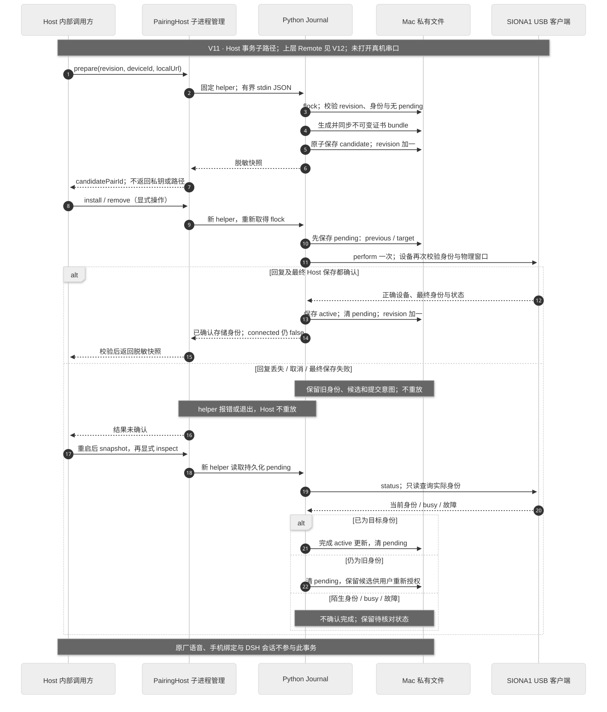
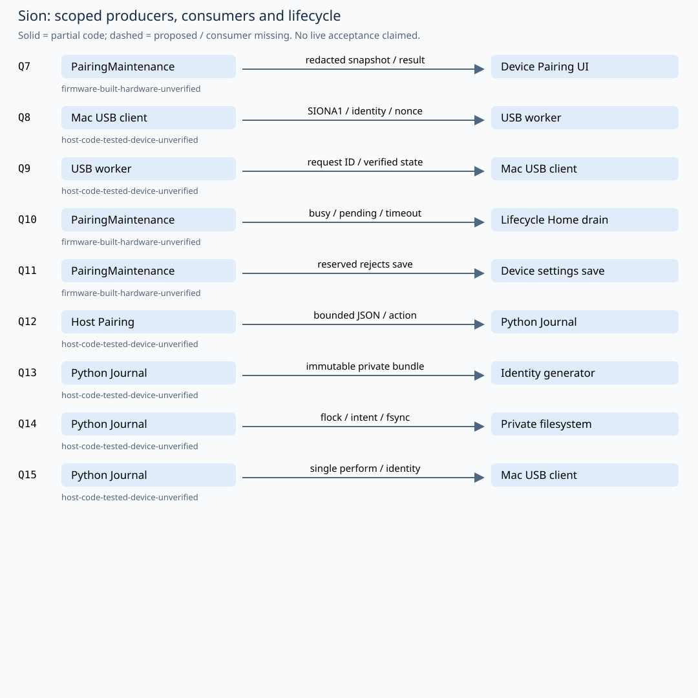
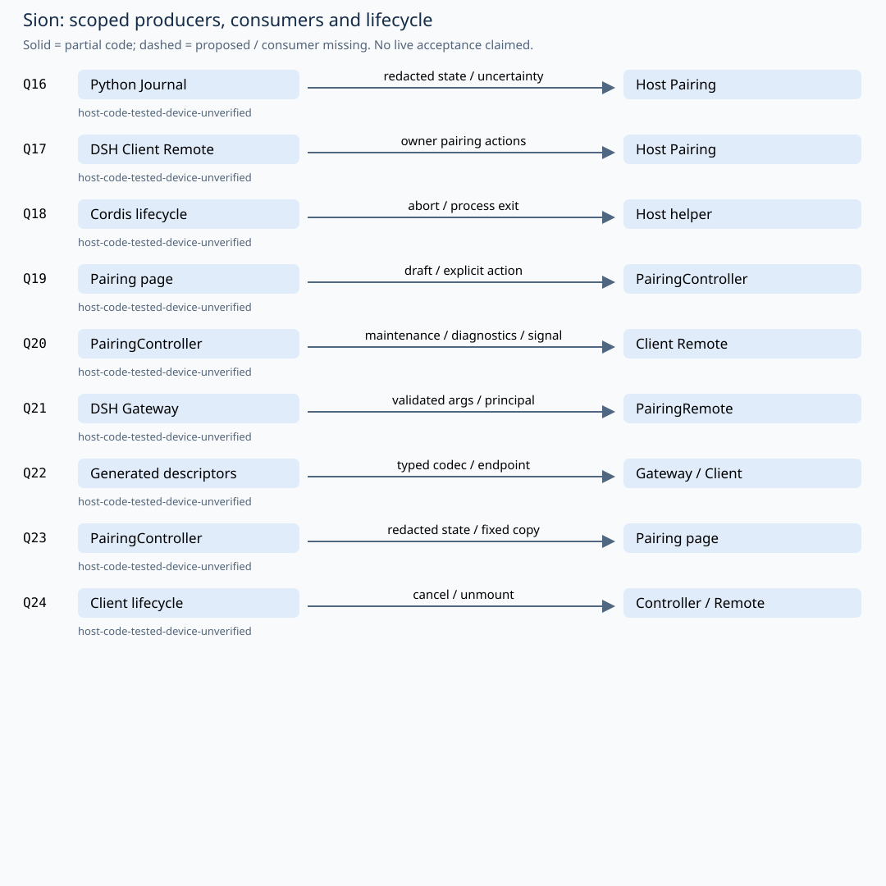
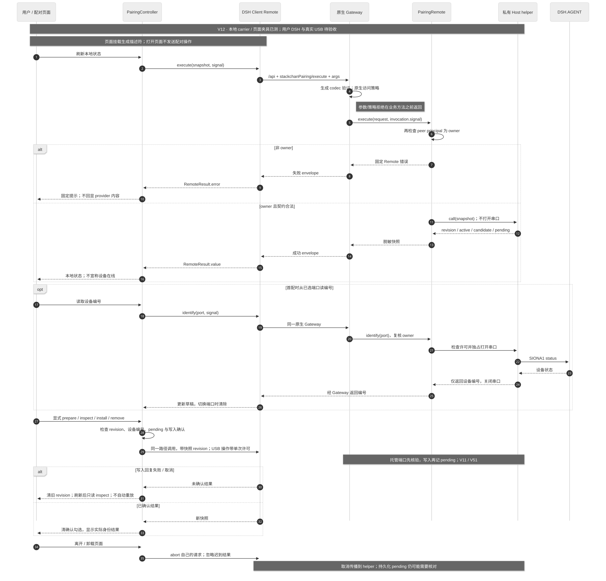
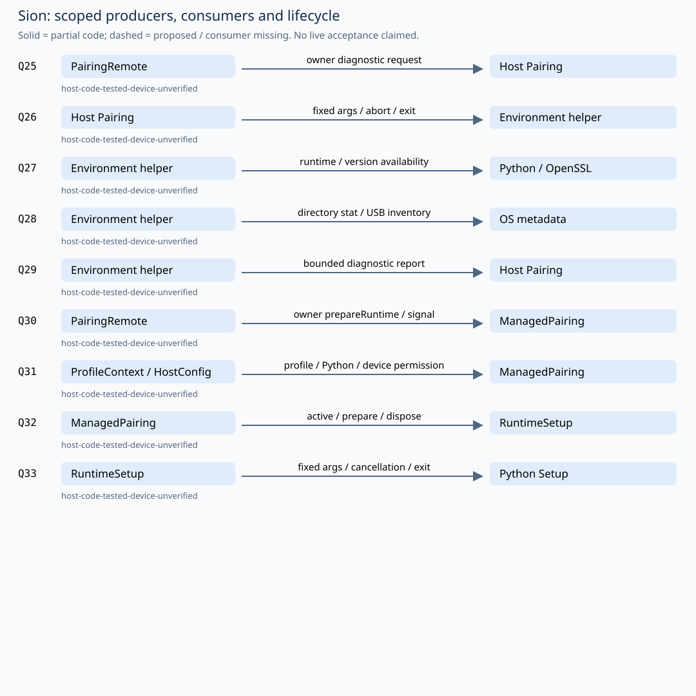
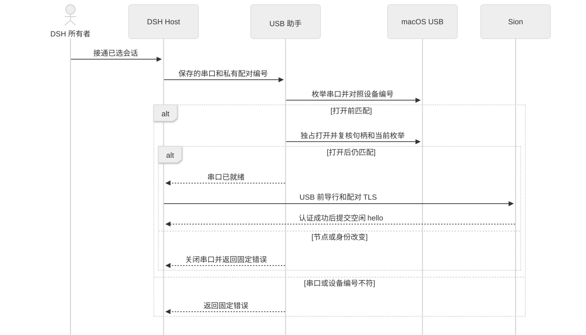

# DSH Host 配对事务与恢复

新增运行消费者：[身份租约与 V24](voice-runtime.md#配对身份租约与退出)。语音 listener 存续期间复用 Journal flock；包括 Stop 后仍保留身份锁，关闭服务并等待 helper 实际退出后才允许维护。Host 内部私有身份管道不经过 Remote，普通配对快照继续脱敏。

归属 P8/A9；入口是 [两端设置](settings-ui.md)，设备契约见 [独立 USB 配对](agent-pairing.md)。本页负责 Mac 私有身份的准备、提交意图、未知结果和重启恢复。`src/plugin.mjs` 注册真实 Cordis 服务 `stackchanPairing`，默认安装和打开设置均不访问设备；准备托管环境后可在指明端口的单次 owner 操作内申请访问。原生 Remote、生成描述符和手动配对页面已接入；真实 Gateway/Client 的本地 carrier 测试通过，页面已提供环境检查和 USB 候选枚举；实际固件识别、安装配置及用户 DSH 与真机验收仍缺。

## 操作、字段与权限边界

新增独立 `diagnose(signal)` Remote，沿相同 owner/取消边界。只读目录元数据、检查选定 Python/pySerial/OpenSSL，并用 pySerial `comports()` 枚举 Mac USB 候选；不打开串口、不创建目录、不读取日志/凭据、不探测网络。页面必须显式触发，不自动选择候选，USB 序列号不能作为 SIONA1 设备身份。依赖可用与真正配对/在线分别报告；自动安装和语音地址发现仍是后续工作。依据 [pySerial tools](https://pyserial.readthedocs.io/en/latest/tools.html)（Mac IOKit 枚举、USB 属性可能缺失）及 [StackChan 手册](https://docs.m5stack.com/en/StackChan/) 的 USB 数据接口；实现/验收见下方环境检查。

Remote 已实现：固定 0.2.2-rc.3 官方 Typert generator 从 `src/remote-api/index.ts` 生成 Host/Client descriptor 与 codec，提供 `stackchanPairing.execute(request, signal)`。Host 内部服务仍持有目录和设备许可；非 owner 请求即使被其他宽泛策略放行，也在业务入口拒绝。Client 只消费脱敏返回，不发送解释器、目录或安装级 deviceAccess。设备操作可以声明单次 authorizeUsb。官方生成器要求 packages/ 工作区，因此 `scripts/build_remote.mjs` 在忽略的 work 中准备权威源文件副本、固定 protocol 原样源码与最小 manifest，再生成回本包 lib；描述符源码位置中的 packages/stackchan 是构建工作区，实际源码为本仓 src/remote-api/index.ts，声明 map 指回该实际路径。

`src/pairing-host.mjs::createPairingHost` 是 Host 组合入口，目录、Python 解释器和 deviceAccess 由安装配置提供，不接受 Client 请求改变。它异步启动固定脚本，不用 shell，限制请求/回复为 4096 字节，45 秒超时，取消/卸载终止进程组并等待 helper 退出。失败只返回固定码；stderr 不送 UI。构造服务不创建文件、枚举串口或录音。

插件保留非 volatile 的 `pairing.directory/python/deviceAccess`。默认 directory 为空；未显式设置 deviceAccess 的托管环境可授权单次操作。自定义安装目录和显式 true/false 保留安装方策略。已有 preferences 的会话/语音字段继续通过原生配置保存。尚未配置返回 host_unconfigured；Helper 每次独立接收许可，未授权请求无法访问设备。Remote 使用原生 Gateway 权限检查并在 PairingRemote.execute 再检查 owner；没有 SRC fallback 或额外 HTTP 服务。未知命名参数拒绝；SDK 的普通生成 codec 会剥离对象中未声明字段，严格 input 视图则拒绝额外字段；两种路径都不能改变 Host 安装选项。字符串长度、revision 与业务身份语义仍由 Host 校验。

| action | 输入（除此之外拒绝额外字段） | 副作用及结果 |
|---|---|---|
| snapshot | action | 只读私有日志，必要时创建 0700 根目录/锁；不打开串口 |
| identify | 独立 owner Remote 的 `port` | 在所选 USB 串口做一次 SIONA1 status，仅返回 12 位设备编号。无需现有 revision，绕过配对日志读写。 |
| prepare | revision、deviceId、localUrl | 离线生成新的 X.509 bundle、fsync 后记录 candidate；不安装设备 |
| inspect | revision、deviceId、port、可选 authorizeUsb | 显式读取设备状态；如有 pending，用实际身份核对结果；不重放写入 |
| install | revision、deviceId、port、可选 authorizeUsb | 保存意图后调用一次 SIONA1 install；设备仍要求物理授权窗口 |
| remove | revision、deviceId、port、可选 authorizeUsb | 同样先记录意图再撤销本插件身份；不操作原厂手机解绑 |

deviceId 为 12 位小写十六进制，配对 ID 为 32 位，revision 为有界安全整数。port 限当前 Mac `/dev/cu.` 路径，显式诊断可枚举候选但不自动打开。localUrl 仍受原 RFC1918 WSS 校验。每个目录管理一个设备。更换草稿端口会清除从上一个端口读到的编号。固件核对写入请求的设备编号、当前配对身份和物理窗口。snapshot 返回 revision、设备与新旧 pair ID、pending、上次 observed。observed 是历史检查结果。

## 提交与未知结果时序

图表来源：`scripts/agent_pairing_host.py` 的 Journal.locked/load/save/bundle、execute 和 generate_bundle；`src/pairing-host.mjs` 的 call/dispose；设备交互复用 `scripts/agent_pairing_usb.py::perform`。图里的调用方为 Host 内部 API；上层 Client/Gateway 接线另见 V12。USB 结果丢失与最终 Host 保存失败均可留下 pending，恢复只查询。

章节来源：上述实际实现与 [Python flock](https://docs.python.org/3/library/fcntl.html)、[fsync/replace](https://docs.python.org/3/library/os.html)、[Node 子进程](https://nodejs.org/api/child_process.html) 文档。普通 fsync 和原子替换测试不是断电实测，更不承诺所有存储控制器的掉电持久性。

## 文件、状态及失败规则

仅使用 Host 提供的私有目录：根 0700，state.json、lock、pairing.json 为 0600；检查 uid、类型与 group/other 权限，拒绝根和私有文件的 symlink。父目录由可信 Host 安装位置提供；本实现不是同用户恶意进程的安全隔离。凭据放随机不可变子目录，日志只存内部目录 ID。原子写为同目录新文件 → flush/fsync → replace → 目录 fsync；credential 文件先同步，之后才记录 candidate。

配对日志操作持有同目录的非阻塞 POSIX flock，另一个进程得到 host_busy，进程死亡由内核释放。单次读取设备编号由 Host 串行化，使用 pySerial 独占打开用户选择的端口。坏 JSON、缺失活动 bundle、异常权限或无法确认磁盘写入时返回失败。修改请求需匹配 revision，多窗口陈旧请求不打开设备。

install/remove 先落 pending `{action,previous,target}`，再访问串口。成功回复需匹配设备、最终身份/状态并确认非 busy，随后才记录新的 active。若回复或最终落盘失败，保留旧和候选凭据；下一次 inspect：目标身份确认则完成；旧身份确认则清 pending、保留候选，允许用户重新授权后再次显式操作；其他身份或 busy/故障状态不冒充成功。pending 未核对时不能生成下一身份或再次写入。

首装时如果界面提示写入未确认，先点「刷新本地配对状态」，再点「检查设备并核对结果」。只读状态确认设备已持有候选身份时，Mac 会完成此次配对，可沿用原选会话启动语音服务。此路径已用正式安装包的 owner Remote、实际 pySerial 和 C++ 维护端点的隔离演练验证。 [配对与语音组合验收](validation.md#从配对写入到既有会话的首装演练)

撤销仅移除 active 引用，不自动擦除旧凭据；失败/被取代的候选目录也保留。清理/保留期限尚未实现，不能称已安全擦除。配对日志不包含人格、会话历史或 DeepSeek API key，当前不读取用户选定会话。

## 生产者、消费者与后续接缝

| ID | 生产者 → 消费者 | 当前状态 |
|---|---|---|
| Q12 | Host Pairing → Python Journal | 有界 stdin JSON action，固定结果码；已测试 |
| Q13 | Python Journal → Identity generator | 复用 createPairing，输出私有 bundle；已测试真实证书生成 |
| Q14 | Python Journal → Private filesystem | flock、身份、意图、原子状态；已做故障/重启检查 |
| Q15 | Python Journal → Mac USB client | 单次 perform；该 Host 层用假设备测试，真实串口未打开 |
| Q16 | Python Journal → Host Pairing | 脱敏快照/未知结果；真实子进程测试 |
| Q17 | DSH Client Remote → Host Pairing | 经 Gateway/PairingRemote，生成接口与 owner 检查；本地 carrier 已测试 |
| Q18 | Cordis lifecycle → Host helper | 卸载取消并等待子进程，已测试 |

编辑位置：Host 进程与脱敏在 src/pairing-host.mjs；日志/恢复在 scripts/agent_pairing_host.py；安装默认值在 src/plugin.mjs；设备帧契约不在此复制。包必须带 scripts/agent_pairing_host.py、agent_pairing_usb.py、pairing.mjs 和 src/pairing.mjs，npm pack dry-run 已核对。Python/pySerial 检查已见下方环境检查；依赖安装/目录配置仍待引导，离线生成不依赖 pySerial。

## 验证与未完成项

2026-11-18：`npm test` 55/55，其中新增 7 个 Host 集成检查，包含 11 个 Python 事务场景；真实生成临时 X.509 bundle、重启 helper 后读取、真实 Cordis 注册/卸载通过。故障覆盖设备提交但回复丢失、发送前失败、设备提交后 Host 最终保存失败、陌生身份、busy、陈旧 revision、坏文件/symlink、生成失败、并发进程持锁及 kill 后释放；子进程未知输出/额外秘密字段/超量回复拒绝。全部私有测试目录自动删除。日志 work/pairing-host-tests-v2.log；无串口、真实设备或用户 DSH profile 操作。

额外核对：真实 DSH 临时 profile 的 settings.mutate 拒绝修改 pairing.deviceAccess 或整个 pairing 对象，不能从偏好编辑入口开启设备权限；对应最终日志 work/pairing-host-tests-v3.log。CI 在 npm test 前准备 Python，支持新的跨语言检查。包 dry-run 验证 5 个必要 Host/helper 资产存在，未包含 work/.local。

这不是物理掉电、实际 USB、认证 TLS 或用户 DSH 实例验收。最新 Remote/页面实施与证据见下节；P8/A9 尚未完成。原固件构建未变，没有刷写。

## 原生 Remote 与手动配对页面

图表来源：`src/settings-pairing-controller.mjs::run/dispose`、`src/settings-view.mjs::apply/mountSettings`、`src/remote-api/index.ts::PairingRemote.execute`、官方生成 `lib/typert.*`。Gateway 和 Client 使用固定 SDK 0.2.2-rc.3；参照 [官方 Remote cookbook](https://github.com/deepseek-ai/deepseek-harness/blob/2e39e70496aa02986ca6a820c5d497e816b69d7e/docs/cookbook/adding-a-remote-api.md)。图描述已有代码，仍未装入用户运行实例。

页面挂载 `$mount` 生成贡献后，通过 `remote.stackchanPairing` 注入设置页。打开页面不发配对请求；用户点击“刷新本地状态”才读取日志。准备身份不访问设备；检查/写入/撤销都需显式点击。写入/撤销还需勾选已在设备 Allow USB，服务端仍独立验证物理窗口。发生未知写入结果时页面丢弃旧 revision，必须刷新本地记录再 inspect；pending 阻止下一次准备/写入。卸载取消自己的请求并忽略迟到返回，不取消 DSH 桌面任务。

Q19 页面 → PairingController：草稿、显式操作与确认；Q20 Controller → Client Remote：版本化请求与取消；Q21 Gateway → PairingRemote：已验证入参/调用者；Q22 生成描述符 → Gateway/Client：协议与 codec；Q23 Controller → 页面：脱敏状态/固定文案；Q24 Client 生命周期 → Controller/Remote：取消、贡献卸载。这些边与 Q17 共同列入统一关系账本/上图。

首配时先准备专用环境，选择底座数据口对应的 Mac 串口。点击「读取设备编号」会走 owner Remote，经 Host 许可和串口检查后向 DSH.AGENT 查询 SIONA1 状态。编号只填入草稿，亦可手填。页面保留已有本地配对的编号，切换草稿串口会清除自动读到的编号。随后刷新本地状态，选 WSS 地址，显式准备身份。在设备打开 Allow USB 后再确认写入。 [选择本地语音服务地址](#选择本地语音服务地址) · [单次 USB 授权](#默认托管安装的单次-usb-授权)

验证：`npm run build:remote` 使用官方 generator，同时执行 TS 诊断；`npm run build:plugin` 重建 Client；全套 67 项通过（含原 11 个 Python 场景）。新增真实 Gateway owner/非 owner、非法动作、固定错误、取消、真实 Client 命名空间挂载/卸载、本地 carrier 互通，以及 Gateway → 实际 Host helper 的临时证书与设备拒绝访问检查。7 个 Remote 检查和 5 个页面控制器检查均通过。实际打包 Client 也在原设置测试中渲染新字段。

浏览器在本地测试夹具中使用真实 PairingPanel/Controller、模拟 Remote：观察初始禁止写入 → 准备候选 → 显式确认 → 模拟回复丢失 → 禁止重复写入 → 刷新 pending → 只读 inspect 恢复。该浏览器测试未连接真实 Gateway/USB，Gateway 另由上述本地 carrier 测试覆盖；两者不能合并成真机端到端验收。临时预览服务已关闭。最终日志 work/remote-ui-tests-v3.log；CI 先生成 Remote，再构建 Client 并检查生成文件漂移。

构建复查：7 个 lib/Client 产物再次生成后逐文件 SHA-256 一致；声明 map 指向实际 TypeScript 源。npm pack dry-run 共 27 个文件，生成描述符、权威 API 源和三个 helper 均包含，未包含 work/.local。日志 work/remote-ui-repro-build.log 与 work/remote-ui-pack-final.json；这不等于已通过真实插件加载器的自动发现/安装验收。

## 环境检查与候选端口

专用环境安装已接原生 Remote 与设置按钮，配置档隔离、离线依赖、活动环境与取消恢复见 [运行环境安装](runtime-installation.md)。它不覆盖自定义配对目录，也不改变设备访问许可。

图表来源：`src/remote-api/index.ts::PairingRemote.diagnose`、`src/pairing-host.mjs::run/decodeEnvironment`、`scripts/agent_environment.py::report/storage_status/serial_inventory/usb_candidates/openssl_status`、`src/settings-pairing-controller.mjs::diagnose/choosePort`、`src/settings-pairing-view.mjs::PairingPanel`。这是已有实现的投影，不代表候选设备已通过协议验证。

Host 即使目录为空也注册服务；构造时仍无 I/O，配对 action 返回 host_unconfigured，独立 diagnose 可以检查依赖。请求无任何 Client 参数，不能传解释器/路径或开启 deviceAccess；实际配置由 Host 持有。与事务共用一次一个子进程、取消/卸载等待退出的机制，诊断限时 15 秒、stdout 16 KiB；OpenSSL version 子进程限时 3 秒，不回显输出。Node 收集有界 Buffer 后解码 UTF-8，避免中文描述在数据块中间被切断。异常输出、额外字段和启动失败返回固定 environment_unavailable；权限/取消仍由 Gateway 处理。

报告包括 platform（macos/unsupported）、pythonReady（>=3.10）、storage（unconfigured/absent/private/invalid/unavailable）、deviceAccess、可选 managedUsb、serial（available/missing/unavailable/not_checked）、openssl（available/missing/unavailable）、ports 和 truncated。Node 还会附上可选 localNetwork，含状态、候选及是否截断。目录检查只 lstat，private 表示当前 uid/目录类型且无 group/other 权限的条件，不证明内容正确、可写或父路径可信；absent 不自动创建目录。OpenSSL available 只证明 version 可执行，不代替证书生成测试。非 macOS 或旧 Python 不枚举 USB；无法启动解释器时整体检查失败，页面提示检查安装环境。

USB 仅收录有合法 VID/PID 与 `/dev/cu.` 路径的端口，去重/排序，最多 16 个；描述去控制字符并截到 96 个 Unicode 字符。不返回 serial_number、完整 hwid、位置或凭据；VID/PID 不用来认证或自动选中 Sion。没有候选与缺 pySerial 分别显示。列表是检查时快照，选择只更新页面草稿并清物理确认，不打开端口或改变 deviceId；重新查找清旧列表，失败不保留旧候选，但手填/已选端口草稿保留供核对。后续真实 inspect/install 仍检查实际身份，拔插不会被旧列表绕过。

影响边：Q19/Q20/Q23/Q24 复用页面输入、Remote 调用、状态投影和卸载取消；新增 Q25 PairingRemote → Host Pairing 的诊断请求，Q26 Host Pairing → Environment helper 的固定启动参数，Q27 helper → Python/OpenSSL 的版本/运行检查，Q28 helper → OS metadata 的目录 lstat 与 pySerial IOKit 枚举，Q29 helper → Host 的有界报告。所有边在统一账本与下图可定位。

验证：全套 74/74 JS 测试通过（其中环境 helper 执行 6 个 Python 场景，原事务仍有 11 个场景）。真实 Gateway/Client 的生成 diagnose 接口、owner 拒绝、额外参数拒绝、取消、Gateway 到实际 helper、空配置插件和不存在目录检查均通过；真实 helper 只进行环境/系统元数据查询，未打开串口。故障覆盖缺依赖、枚举失败、坏目录/链接、超量/额外字段、中文跨块、并发与子进程退出。首次额外参数测试误期望 gateway/input-invalid，按实际固定 SDK 改为 gateway/arguments-invalid；拒绝行为没有放宽。日志 work/environment-tests-v1.log、environment-tests-v2.log。

浏览器使用真实 Panel/Controller 和模拟 Remote，观察页面打开无检查、显式检查显示缺安装项、两候选初始未选中、选择只填串口、再次检查为空时清列表并禁用下拉。设备编号和配对写入仍未启用；没有用户 DSH 或真实设备交互。认证语音服务、自动依赖安装、实际固件确认及全新安装验收仍未完成。

本批打包复核：28 个文件包含新增 agent_environment.py，未包含 work/.local；7 个生成文件重建后 SHA-256 一致（work/environment-repro-build.log、environment-pack.json）。浏览器临时服务已关闭。固件未改，不重复无关目标构建。

本机只读探测（2026-11-18，本 shell，非用户 DSH 进程）：默认 python3 的 pythonReady=false，USB 因此 not_checked；Homebrew Python 满足版本但 serial=missing；两者 OpenSSL available。未配置目录、设备访问仍 false，没有候选可据此认定已找到 Sion。脱敏记录 work/environment-local-probe.json 不含端口/USB 序列号。下一步安装流程应提供明确的受管理 Python/pySerial 环境，而非假定桌面 DSH 的 PATH 与本 shell 相同；尚未安装或更改任何用户环境。

## 默认托管安装的单次 USB 授权

V51 回答默认安装怎样从显式点击走到一次 USB 操作。完成「准备插件专用环境」后，选择串口并读取设备编号，或用已有编号继续。读取编号、检查、写入或撤销会请求打开此端口。写入或撤销前仍需设备 Pairing 页的 Allow USB。初始化、枚举、选择端口、生成候选身份及刷新本地记录都不打开串口。

| 来源 → 消费者 | 约束与可见结果 |
|---|---|
| U1 设置页 → U2 原生 Remote 与 Host | 显式单次 `authorizeUsb: true` 只附于三个设备动作；owner 检查和取消仍执行。请求不持久化许可。 |
| U2 ManagedPairing → U3 Python | 仅默认的活动托管环境可使用单次许可。显式安装方 true/false 保留旧语义；自定义目录保留其设备配置。 |
| U3 macOS 设备元数据 → U4 私有日志 / U5 SIONA1 | 打开前要求当前枚举的 `/dev/cu.usbmodem…` 字符设备，USB VID/PID 为 303a:1001，拒绝链接和不匹配设备。先核对再记录 pending，实际打开前重核。USB 元数据只能筛选接口。 |
| U5 SIONA1 → U4 日志 → U1 页面 | 协议核对具体设备、旧配对及设备物理窗口。失联或结果未知保留旧身份与待核对状态；下一步只读检查。 |

设备模式和权限源为 [插件 Config](../src/plugin.mjs)、[托管配对](../src/managed-pairing.mjs)、[Native Remote](../src/remote-api/index.ts)、[Host helper](../scripts/agent_pairing_host.py) 的 `execute/verify_managed_usb_port/managed_device_call`。V12 仍描述 Gateway 顺序，V11 说明提交和恢复。实际 Mac 只读枚举确认当前接口匹配规则；未执行 SIONA1 查询或写入。证据见 [单次授权验收](validation.md#托管-usb-单次授权验收)。[M5Stack USB 说明](https://docs.m5stack.com/en/StackChan/#download-mode) · [Espressif USB Serial/JTAG](https://docs.espressif.com/projects/esp-idf/en/stable/esp32s3/api-guides/usb-serial-jtag-console.html)

## 选择本地语音服务地址

「检查环境与查找配对选项」返回 Mac 当前非内部接口上的 RFC1918 IPv4。为每个不同地址建议 `wss://<地址>:9080/audio`，同地址只列一次，最多 16 个。页面显示系统接口名，用户选择 Sion 能访问的网络。该选择只修改可编辑的地址草稿，建议端口可改。未找到地址或枚举失败时仍可手填。检查不会连接远端、打开监听、预留端口或写入配对。 [Node 网络接口](https://nodejs.org/api/os.html#osnetworkinterfaces) · [RFC 1918](https://www.rfc-editor.org/rfc/rfc1918.html)

使用 v50 和配套 Host 时，首配可以勾选「暂不配置局域网」。候选仍持有正常配对密钥及证书，`local_url` 保存为空字符串，USB 和另行配置的 Relay 使用同一份身份。写入前 Host 先向所选端口读一次 `optional_lan_status`，确认支持后才登记写入意图。一旦失败，现有配对与候选保留。填有私有 WSS 地址的配对沿用原流程。 [USB 加密传输](agent-transport.md#usb-有线音频的加密传输) · [设备契约](agent-pairing.md#可省略局域网地址)

随后要启用同网模式时，选择当前 Mac 地址，显式准备并授权写入替换的独立配对。配对 ID 轮换后若有 Relay，需据新身份重新配置两端。若回退到只支持带地址配对的旧 Host 或固件，先用当前配套版本写入含 WSS 地址的配对。日常 Mac 已准备的带地址候选可直接沿用。 [外出中继轮换](agent-pairing.md#relay-配置轮换与撤销)

| 来源 → 消费者 | 数据与后续 |
|---|---|
| macOS 接口 → PairingHost → owner Remote → 设置页 | `localNetwork` 返回状态、接口名和经过既有 WSS 策略解析的地址。没有 MAC 地址、子网掩码、凭据或证书。此信息只在显式环境检查或配对环境准备成功时返回。 |
| 用户 → PairingController → 私有 Journal | 先选当前候选或手填。主动点击「准备新的本机配对身份」后，已有事务验证地址并保存加密连接所需的候选。实际写入仍走 [V51](#默认托管安装的单次-usb-授权)。 |
| 已确认的地址 → AgentTransport → VoiceRuntime → 设置页 | 局域网模式启动时才尝试绑定。地址已不在本机时可接回原网络或用新地址配对。端口被占用时可释放原端口或改端口重新配对。启动失败仍关闭本次资源并释放身份锁。 |

图源 [V13](assets/views/environment-flow.svg)；接口由 [PairingHost](../src/pairing-host.mjs)、[Owner Remote](../src/remote-api/index.ts)、[配对控制器](../src/settings-pairing-controller.mjs) 与 [Transport](../src/agent-transport.mjs) 持有。新版在桌面应用内置 0.2.2-rc.3 官方 CLI 的隔离 Web 配置档验证，真实页面选择到的地址保存进 0600 的测试候选，无实体配对、监听或原厂数据变更。 [验收](validation.md#局域网地址选择与绑定失败验收)

## 串口音频的设备匹配

设置页继续只返回候选路径和公开描述。语音执行时，Host 从已确认的配对租约取设备编号，经子进程的独立匿名管道交给串口助手。ESP32-S3 当前设备构建用 Wi-Fi STA 的默认基址生成设备编号。本机只读枚举确认 Sion 底座的 USB 序列号与保存的设备身份一致。这个字段只用于排除错误串口，不授予音频会话权限。设备随后还要证明持有配对秘密并提交空闲 hello。首次独立配对仍使用设备端授权窗口和原有协议。 [设备标识源码](../firmware/agent/pairing_usb.cc) · [ESP-IDF MAC 规则](https://docs.espressif.com/projects/esp-idf/en/stable/esp32s3/api-reference/system/misc_system_api.html#mac-address)

V65 的端口由设置保存、配对租约提供编号、语音辅助进程消费这两项。打开前核对描述符，打开后复核真实句柄和当前枚举。仅就绪回执成功才允许 Host 发送音频开场行。错误通过固定原因到设置页，日志和 Remote 不返回 USB 序列号或配对编号。 [身份租约](../src/pairing-host.mjs) · [匿名管道](../src/usb-serial.mjs) · [打开前后检查](../scripts/agent_usb_audio.py)

v54 实体配对写入和读回通过。设备允许一次 USB 配对后，首次尝试机身语音仍被 Mac 默认策略拒绝。Host 修正了默认值处理，托管安装可以进入串口验证，安装方显式禁用仍优先。实体语音重试进入连接流程，随后在收音前断开，日志没有记录具体失败阶段。 [定向测试](../test/pairing-host.test.mjs) · [实体 USB 验收](validation.md#v54-实体配对与-usb-语音验收)

## DSH 图形外出配置

在现有 `stackchanPairing` 命名空间加入 `relay` 方法。`relay_check` 检查本机状态，无串口权限参数。`relay_inspect`、`relay_install`、`relay_remove` 需要 owner、明确勾选或检查动作、指定串口和当前独立配对日志版本。Host 从 `profileContext.dir` 解析固定文件位置，Gateway 的输入模式没有凭据字段。托管安装仍核对 Espressif USB 候选，安装方显式禁用仍优先。 [用户设置与 V54](settings-ui.md#外出中继设置) · [DSH Remote 官方规则](https://github.com/deepseek-ai/deepseek-harness/blob/master/docs/cookbook/adding-a-remote-api.md)

| 关系 | 来源、消费者和边界 |
|---|---|
| RR18 当前配置档 → Host/Python → DSH 设置页 | Python 在配对锁内读设备文件的结构和配对，再由 Host 读 Mac 文件。仅返回文件状态及待写入文件版本。未准备独立配对时不能写。 |
| RR19 DSH 设置页 → 一次 USB 检查 | 端口与配对版本来自用户检查，设备编号和当前身份来自私有日志。检查只返回经身份核对后的设备 Relay 脱敏状态。语音服务持有配对租约时拒绝。 |
| RR20 设置页 → Host/Python → Sion USB | 写入前核对待写入文件版本，并用同一次 USB 状态读取重新核对设备版本和物理窗口。通过后最多发一次变更。失败不重放，界面要求重新检查。配对日志、所选会话及两份本机配置文件均无修改。 |

接口实现见 [生成接口](../src/remote-api/index.ts)、[Host](../src/pairing-host.mjs)、[Python 持锁执行](../scripts/agent_pairing_host.py) 和 [USB 客户端](../scripts/agent_pairing_usb.py)。回执不包含快照凭据，浏览器界面没有凭据输入框。 [关系图 RR18–RR20](assets/relationships-31.svg)
