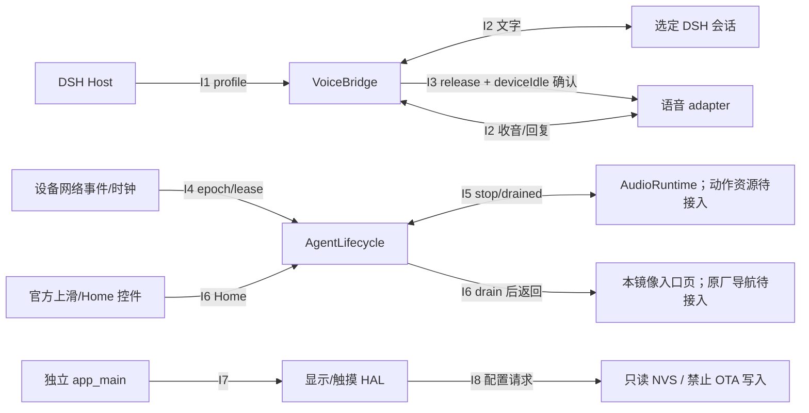
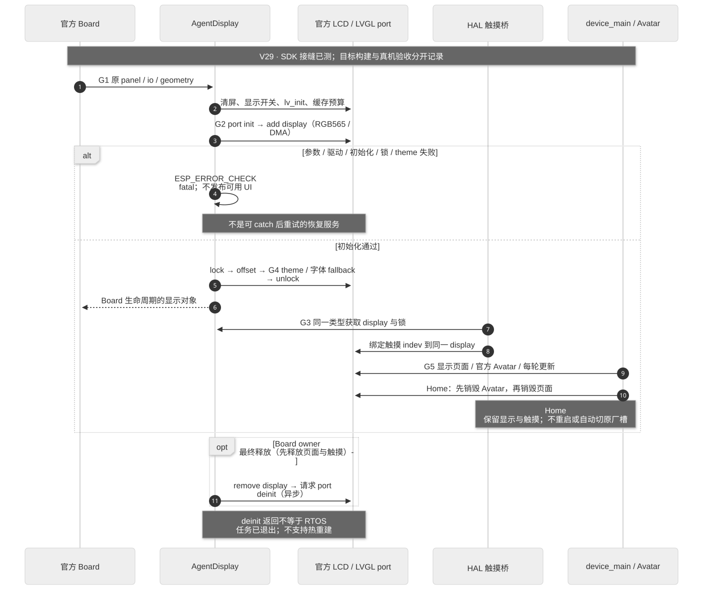
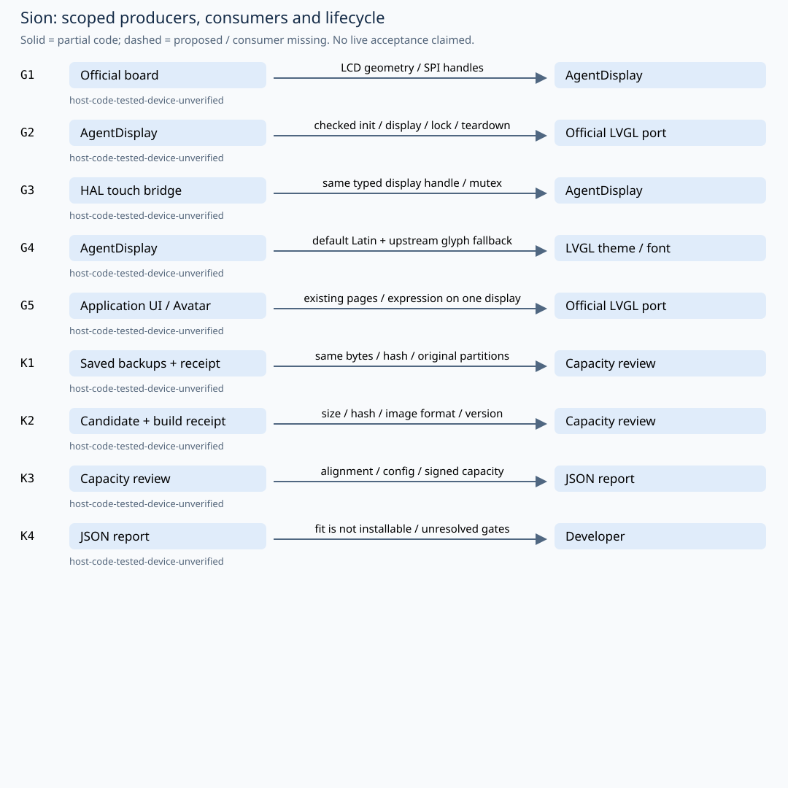

# 独立 DSH.AGENT：会话停止与 Home 生命周期

v32 在 Text 正文只读复用已验证的原厂中文字库。目标二进制 1,988,672 字节，独立区余 24 KiB。见 [字库契约](device-settings.md#中文字库)、[构建收据](../firmware/agent-caption-font-build.json)、[离线审查](installation-recovery.md#v32-中文字库候选离线审查)。

v31 增加可滚动的 [纯文字模式](device-settings.md#纯文字模式)，使用同一个选定 DSH 会话的转写和公开回答。完整目标镜像 1,987,568 字节，独立应用区余 24 KiB。见 [构建收据](../firmware/agent-captions-build.json) 和 [离线审查](installation-recovery.md#v31-文字候选离线审查)。

v30 新增设备 Display 设置及大肥鱼，复用认证表情并跟随音频驱动输出活动。1,984,960 字节的目标镜像保留 28 KiB 对齐余量。见 [设备外观](device-settings.md#默认脸与大肥鱼)、[构建收据](../firmware/agent-appearance-build.json) 和 [离线审查](installation-recovery.md#v30-外观候选离线审查)。

v29 只从独立构建里移除了无实际调用的原厂 OGG 提示音，保留双向语音、USB、局域网及默认表情路径。新镜像 1,983,136 字节，布局对齐后留 28 KiB。见 [构建收据](../firmware/agent-sdk-trim-build.json) 和 [v29 离线审查](installation-recovery.md#v29-独立镜像容量与离线审查)。

v28 将设备 USB 入口和 Mac 串口设置接到既有对话与硬件资源状态机，目标镜像为 2,014,720 字节。保留原厂分区及独立配置后，按扇区计算刚好容纳镜像。安装恢复已离线演练，实体接通待验收。见 [有线协议](agent-transport.md#usb-有线音频的加密传输)、[构建收据](../firmware/agent-usb-audio-build.json) 和 [离线安装审查](installation-recovery.md#v28-有线候选离线安装审查)。

v24 完整构建加入独立入口的原厂返回确认。镜像 1,991,920 字节，离线布局仍有 20 KiB 对齐余量。启动器候选、Home 与跨镜像返回的区别见 [V43](dual-boot-updates.md#选择器原型与-v24-原厂返回) 和 [应用收据](../firmware/agent-factory-return-build.json)。真机启动、原厂升级回退和恢复仍待验证。

v23 完整构建将应用从 2,165,120 缩至 1,991,344 字节。保留原厂分区及独立配置后对齐余量 20 KiB，追加布局已通过离线验证，启动入口、手动返回、实际升级与恢复仍待验证。见 [v23 构建收据](../firmware/agent-size-build.json) 和 [离线布局](installation-recovery.md#v23-容量与布局复现)。

前一版 v22 完整构建已接动作 v1、DSH 原生工具及两端设置，镜像 2,165,120 字节。离线布局在保留原分区和独立配置区后仍缺 148 KiB。可安装布局、原厂入口与真机验收仍待完成。见 [v22 构建收据](../firmware/agent-motion-control-build.json) 和 [动作请求时序](motion.md#认证动作与两端设置)。

历史 v21 已将动作资源组合、唯一 worker 与 Stop/Home 汇总接入设备主程序；默认动作许可关闭，认证动作请求/工具和两端动作设置仍待接。完整构建 `dsh-agent-v21` 为 2,160,400 字节，SHA256 `a2d9e72d78e2deb68b5bc2c5bf5770a286fde59ca6edaf0eed4af055a18c99f1`，见 [构建收据](../firmware/agent-motion-runtime-build.json)。最终 ELF 保留实际供电/UART/SCS/worker 路径，分区表与 v20 完全一致；保留原分区并预留独立配置后仍缺 147,456 字节（144 KiB），尚不可安装。语音、相机和表情已有链路保留；真实用户会话、机械反馈、原厂返回及恢复仍未验收。具体资源顺序见 [动作组合](motion.md#资源组合唯一任务与-home)，证据见 [验收](validation.md)。

历史 v20 已接设备与 DSH 两端相机状态，完整构建及本地 Host/C++/TLS 验证通过；设备许可、传输与 Host 保存阶段分别显示。镜像 2,143,632 字节，保留原分区并预留配置的候选仍缺 128 KiB，尚不可安装。配套版本、构建收据与恢复限制由 [安装方案](installation-recovery.md) 维护；[两端状态](camera.md#两端相机状态与照片保留说明) 和 [验收](validation.md) 说明实现与真机边界。

历史 v19（以下缺口为该批次记录，当前状态见页首）已将认证拍照请求、相机任务与有界图片回传接通；完整构建 `dsh-agent-v19` 为 2,141,376 字节，SHA256 `0944acd34384d93e7666650e32c386f61692bf705c98197340112a2b7651d48f`，见 [构建收据](../firmware/agent-camera-transfer-build.json)。比 v18 增加 4,800 字节，原分区表未变；对齐并预留配置后仍缺 126,976 字节（124 KiB），尚不可安装。真实 TLS/C++ 已验证合成包络的最大 256 KiB 回传、音频并行与取消；Host JPEG 解码/DSH 图片工具已接，DSH 相机设置投影、实体相机与安装恢复仍未完成。

此前 v18 已接相机 worker、设备许可与 Stop/Home 释放汇总，最终 ELF 保留实际驱动。完整构建为 `dsh-agent-v18`，2,136,576 字节，比 v17 增加 72,624 字节；[构建收据](../firmware/agent-camera-runtime-build.json)。分区表未变，按对齐并预留 16 KiB 配置后仍缺 122,880 字节，尚不可安装。拍照请求、传输、DSH 图片工具/设置和真机验收仍待完成，不声明相机能力。

此前 `independent-camera-port-v17` / `dsh-agent-v17` 完整构建通过，2,063,952 字节，SHA256 `788f5b18d56e66cc93a2e8cb026aed3a5e64bce313bffd95e12da11b9be4d193`；[收据](../firmware/agent-camera-port-build.json)。相机适配已目标编译和 SDK 错误注入，但没有运行任务/协议调用者，最终 ELF 未链接这些方法，不能拍照。明确将旧 camera_ 置空，启动仍不构造原 AI 相机。分区未变，预留配置后仍缺 49,152 字节；相机实际接入后的增长另算。详见 [相机边界](camera.md) 与 [验收](validation.md)，尚不可安装。

此前 `independent-logging-v16` / `dsh-agent-v16` 完整构建通过：2,063,952 字节，SHA256 `2154e2c64f5845e45e465004b0f1499d4eef9312d4043a0c5f1c95e4f34b072f`；[构建收据](../firmware/agent-logging-build.json)。在 v15 显示拆分基础上，仅把 ESP-IDF 应用默认/最大日志改为 Warning，减少 18,960 字节；TLS/原字体/设备协议保留，分区表未变。按扇区对齐并预留 16 KiB 配置区后仍缺 **49,152 字节**，见 [v16 只读容量报告](../firmware/agent-capacity-review.json)。尚不可安装，原语音、绑定与设备未操作。

历史 `independent-display-v15` / `dsh-agent-v15` 完整构建通过：2,082,912 字节，SHA256 `b97eb009be5c45d67d424eb6c0f99c7f01d9e7bb633ff261705ead6eb198df33`；[构建收据](../firmware/agent-display-build.json)。比 v14 减少 196,032 字节，来源/依赖锁、镜像 checksum/hash 与版本已核对，分区表未变。仍超出原尾部 51,296 字节，另外需要 16 KiB 独立配置区和后续能力预算，尚不可安装；未操作原语音、绑定或真机。

历史 `independent-identity-v14` 已完整构建，应用版本明确为 `dsh-agent-v14`：2,278,944 字节，SHA256 `fa2564cc615dde59a0af91b76635eb7df7c85015d89739234d38cd5005ff03da`；[构建收据](../firmware/agent-identity-build.json)。来源/依赖锁、实际镜像版本及 checksum/hash 通过；分区表与 v13/v12 字节一致，无 sion_cfg。镜像超出原尾部空闲区 247,328 字节，另需 16 KiB 配置区，仍不可安装。六种表情及此前音频链保留；未操作真机、原语音或绑定。

v14 身份修正记录：旧 v13 镜像继承官方 `PROJECT_VER=1.6.2`，不能据此识别原厂固件。准备脚本将新候选标为 `dsh-agent-v14`，构建后核对 IDF 项目版本并记录；协议/能力版本与应用版本分开，版本字符串不是设备认证或刷写许可。依据 [ESP-IDF PROJECT_VER](https://docs.espressif.com/projects/esp-idf/en/v6.1/esp32s3/api-guides/build-system.html#build-project-variables) 及锁定 SDK；新候选使用独立目录，旧收据保留；v14 实际镜像版本已通过离线解析。

历史 `independent-playback-v12` 已完整构建：2,276,736 字节，SHA256 `d6f158afe92de4c9051daecb9ff51e3516e85bdf1158fc1f283a0b980e5eb0dc`；[构建收据](../firmware/agent-playback-build.json)。来源/依赖锁复核、镜像 checksum/hash 和最终 ELF 的播放屏障/ISR/会话符号通过。分区表与 v11 字节一致，无 sion_cfg；镜像超出尾部空闲区 245,120 字节，另需 16 KiB 配置区，仍不可安装。未操作真机、原语音或绑定。

播放能力 v1 已连接 Mac → AgentSession → AudioEngine → CoreS3，明确区分 Write 接受和数字输出排空；单独打断保留输入，Stop 可抢占。见 [播放屏障](agent-transport.md#播放屏障能力-v1)。本地语音与 VAD/AEC 后端已通过真实模型合成检查，但[连续输入与 VoiceBridge 组合](local-voice.md)已测，[Host/设置运行控制](voice-runtime.md)已接并通过隔离测试；模型安装 UI、用户实例、相机/动作仍缺。

当前接线进展：独立入口已实例化 AgentSession，增加 Connect / retry，并接入 ESP 网络 worker、有界消息队列、配对身份预约和 Stop/Home 网络清理。代码/SDK 夹具与完整构建分别验证；真实 Sion、Mac 语音服务和原厂返回尚未验收。最新契约见 [ESP 网络所有者](agent-transport.md#esp-网络所有者与显式连接)。下方 v9/v8 数字是历史构建，不表示当前源码仍缺 main 消费者。

历史 `independent-network-v11`：2,274,256 字节，SHA256 `23ef0cf792857af5a622fead4d057a40adba3de1b0609d3d40b234c4f0ea2016`，收据 [agent-network-build.json](../firmware/agent-network-build.json)。来源、依赖锁、镜像 checksum/hash 均复核通过；最终 ELF 包含 AgentNetwork::Run/Start、AgentSession::AttachAuthenticated/Tick。目录 work/firmware-agent-network-v11-final；分区表与 v9 字节一致，无 sion_cfg，镜像超过尾部空闲区 242,640 字节，另需 16 KiB 配置区；installable=false / hardwareValidated=false。

本批 C++ ASan/UBSan 包括实际网络 worker 的 SDK 夹具、实际主界面的认证消息分发/音频打开/Stop、连接中 Home 等待、原存储/音频/协议及准备后 HAL 错误注入；全部通过。mailbox 和配对预约的并发场景另通过 TSan。v10 的无关依赖漂移已通过锁文件与构建后 verify 修正；没有把 SDK 夹具当实体 TLS/无线验收。Host active journal/本地语音/已有会话适配已由 VoiceRuntime 接线，仍需用户实例验收、完整网络与时间配置，以及安装/原厂返回方案。

时间顺序和当前状态图：[Stop/Home 资源释放时序](runtime-sequences.md#停止与-home)、[独立设备状态机](runtime-sequences.md#独立设备状态)。下方关系图主要用于影响范围，不能替代这两种视角。

历史状态（v9/v8）：会话 profile、Host 工厂、生命周期核心及设备音频服务已实现；当前最新构建为 `independent-session-v9`，设备会话核心目标编译与跨语言测试通过、尚无 main/ESP 网络消费者，详见 [认证传输](agent-transport.md)。此前完整构建为 `independent-usb-v8`（设备授权窗口、USB 配对与 Mac 协议客户端新增完成；未做真机验收）；设备设置/独立存储适配新增完成。最近 JS 48 项；本批 6 项生命周期、8 组音频、设备 UI/独立存储及驱动错误注入通过；未连接设备。

本轮实施范围：P1 的设备生命周期核心、显示/触摸/音频服务与 P4 的 Mac 退出契约。音频驱动已接入，USB 配对已接入新入口，认证网络传输仍未接入；没有真实语音链路验收，不把主机测试或编译当设备成品。

已按 [设备音频服务](agent-audio.md) 接入 CoreS3 驱动适配、有界 PCM 队列和实际 drain；认证传输准备好之前不启用收音，原镜像/配置保留要求不变。网络/本地语音消费者仍待接入。

已完成接线：`firmware/agent/device_main.cc` 提供独立 `app_main` 与官方 LVGL/Home 控件；启动显示/触摸所需的板级初始化（含供电管理）及惰性音频/相机工作任务（不自动采集），不启动原小智 Application、官方设置/配网、MCP、相机或舵机。Home 在本镜像内返回独立入口页；这不代表已返回原厂镜像。传输未就绪时保持 idle、麦克风关闭，不伪造 active。`DeviceEffects` 的 drain 已调用音频任务的关闭回执，并在音频 Done 后等待配对维护 busy 清除，不能用清空队列代替实际停硬件；v18 已汇总相机关闭，动作尚未接入。LVGL 回调只投递原子 intent，主任务处理并删除页面，避免在控件回调内销毁自身。重新进入页面调用 Reopen，保留 epoch，避免新旧会话代次重复。

`storage_guard.cc` 保持原分区和默认 NVS namespace 只读；仅许可经地址/大小验证的独立 sion_cfg 分区及 settings/pairing namespace，包含 SDK 页头使用的 write_raw。整区 NVS 擦除、OTA 写入/确认/启动选择仍拒绝；当前分区表无专用区，保存报告不可用。独立配对存储已目标编译并接入启动读取；USB 写入消费者已接入，认证网络消费者仍缺，见 [独立配对](agent-pairing.md)。未调用自动 OTA 健康确认。包装作用于所列链接 API，不承诺所有 Flash 字节不变或原云账户状态已恢复。旧构建及收据保留，新构建由下面的脚本生成；实际原厂返回执行器仍依赖安装布局。

用户进入后持续说话；“停止”释放本轮会话音频并停留 DSH 空闲。上滑显示 Home 后点击，先使旧回调失效、停止输入/播放/动作，确认资源释放，再请求返回；Home 失败保持明确 fault，不能显示原助手已恢复。触摸双滑是用户观察，待真机 UI 验收。操作基线见 [手册对齐](manual-alignment.md)。

| 边 | 生产者 → 消费者 | 实现/验收入口 |
|---|---|---|
| I1 | 正式 Host → VoiceBridge | src/host.mjs 的独立 Agent 工厂选择 device-idle；既有工厂默认 original，兼容旧行为 |
| I2 | 配对语音 adapter → 桥 → 已选 DSH | src/bridge.mjs：bind/acquire、连续文本、取消代次；不构造 system prompt 或历史 |
| I3 | 停止/断线 → adapter.release → idle 确认 | 独立 profile 必须返回 deviceIdle=true；原厂 profile 必须 originalReady=true。不能互相代替或凭空确认 |
| I4 | 固件主循环/网络回调 → AgentLifecycle | firmware/agent/session_lifecycle.h：连接、epoch、设备租约；主循环串行调用，网络回调必须带捕获 epoch |
| I5 | AgentLifecycle → AudioRuntime → drained | 先失效 epoch，再调用 StopResources；音频工作任务停硬件、清 DMA 后确认，失败/超时 fault。v18 已加入相机汇总，动作待接；未 drain 不执行 Home |
| I6 | 上滑/Home 事件 → AgentLifecycle → 返回执行器 | device_main.cc 已接官方 Home 控件，在 drain 后显示本镜像入口页；原厂镜像导航未接入，不报告 originalReady |
| I7 | 独立 app_main → 精简 Hal::init → 显示/触摸 | prepare_agent.py 在固定上游精确替换初始化；NVS 初始化错误直接失败，无清配置重试 |
| I8 | Settings / 依赖库 → AgentStorageGuard → NVS / OTA | component.cmake 包装默认/原分区写入与 OTA；仅专用 sion_cfg/settings 可写，额外覆盖 raw 页头写；范围见 device-settings.md |



设备状态 idle → connecting → active；停止/断线/租约到期 → draining → idle；Home → draining → home；释放失败或返回失败 → fault。每次会话和释放更新 epoch；旧连接/续租/断线不能污染新会话。租约与 drain 截止使用设备单调毫秒；具体值是配置，非声学指标。输入只允许配对连接在串行调度器中提交，网络认证不由状态机代替。

Host 的 device-idle 与原有自动归还 profile 分开校验 adapter 能力和回执。失败保留 recovering，不能开启第二条音频通道；重新进入不会等待旧模型回复。适配器释放必须先停止收音/播放/动作再确认。DSH 的已接受桌面任务不会被全局取消。

检查：`npm test`；`python3 scripts/test_agent.py`（C++17，ASan/UBSan）。验收覆盖未确认释放、延迟连接、旧回调、停止和 Home 竞态、时钟到期、重试及返回失败。真实麦克风、中文 ASR/TTS、播报中停止、官方返回和绑定保留仍未验证。软件边界已选定，分区和启动选择不在本轮修改范围。

I1–I15 已登记到统一 relationships.json；可视化见 [生命周期关系图](assets/relationships-5.svg) 和 [入口/音频关系图](assets/relationships-6.svg)。B37/B38 是旧候选的相邻保护边；虚线表示生产者或消费者仍缺失。

## 独立显示适配

本批从原 StackChanAvatarDisplay 拆出 AgentDisplay，只负责官方 LCD/LVGL port 的初始化、锁和显示句柄。Board 与 hal_bridge 同时改为新类型，触摸仍由 Hal::lvgl_init 绑定该句柄；官方 Avatar 仍由 device_main 持有。保留 panel 参数、旋转/RGB565/DMA 配置和文本字体；Latin 字号沿用当前 LV_FONT_DEFAULT，缺字使用上游文本字体 fallback。检查该固定字体的 cmap，包含 206 个 CJK 字形，但不含“停”“止”“置”；这保留原有字形来源，不代表完整中文设置或字幕已实现。原 AI 聊天主题/自动修饰器、预览计时器和启动 logo 不在独立显示适配器启动；相机能力后续由独立服务实现，不能误称原 preview 已接通。

初始化失败不得继续把空句柄交给触摸或 UI。绘制、port init、显示创建、锁与主题建立的错误需明确失败；SDK 接缝检查和实际目标构建分开记录。此更改不禁用 TLS CA bundle，不移除最终所需硬件能力，不改变原厂镜像。容量收益以新镜像实测为准。官方来源为固定 M5Stack 提交的 stackchan_display.cc / hal_bridge.cc，以及固定 esp_lvgl_port 与 LVGL 头文件。



图表来源：[AgentDisplay](../firmware/agent/agent_display.cc)、[准备脚本类型替换](../scripts/prepare_agent.py)、[device_main](../firmware/agent/device_main.cc) 与固定官方 hal_bridge.cc / Hal::lvgl_init。adapter 采用 fatal 初始化语义，错误不继续进入 UI；不是可热重试服务。SDK 夹具以异常观察 fatal 边界，不代表目标能够 catch 后恢复。显示属于整个 Board 生命周期；应用退出仅销毁页面，Home 不销毁 LCD/触摸服务。固定 LVGL port 的 deinit 仅请求任务停止并立即返回，所以析构不表示 RTOS 任务已退出，不提供热销毁/重建；必须先释放页面和触摸。

| ID | 生产者 → 消费者 | 契约与影响 |
|---|---|---|
| G1 | 官方 Board → AgentDisplay | 原 LCD/SPI 句柄、320×240、旋转和 offset；准备脚本与 bridge 同时换类型 |
| G2 | AgentDisplay → 官方 LVGL port | 检查初始化、DMA/RGB565、显示创建、30 秒锁；释放 display 后请求异步 deinit；不是任务退出回执或测得延迟 |
| G3 | HAL touch bridge → AgentDisplay | 同一显示句柄和 mutex，touch 仍在 Hal::lvgl_init 绑定 |
| G4 | AgentDisplay → LVGL theme/font | 保留 LV_FONT_DEFAULT Latin metrics；官方 BUILTIN_TEXT_FONT 作缺字 fallback；不是完整 CJK 覆盖保证 |
| G5 | device_main/Avatar → LVGL port | 既有页面和六表情沿用；无原 AI SetupUI/全局自动修饰器；页面与硬件生命周期分开 |



## 应用日志与容量策略

v16 仅调整独立应用的 ESP-IDF 默认/最大日志等级为 Warning（2），保留 Warning/Error 和动态向下调节；不改变启动器日志、协议回执、UI 状态、TLS 验证或原厂固件。普通 Info 日志不再作为该构建的运行诊断接口，不能运行时升回已移除的日志；需要深入诊断时应使用独立的更高日志构建并重新检查容量。组件显式 LOG_LOCAL_LEVEL 或直接日志函数可能保留额外消息，不承诺清空全部 Info 字符串。

依据 [ESP-IDF 日志等级文档](https://docs.espressif.com/projects/esp-idf/en/v6.1/esp32s3/api-reference/system/log.html#maximum-log-level-setting) 与固定 components/log/Kconfig.level：最高等级决定可编译内容，运行时调低并不能获得同样体积收益。只改 firmware/agent/sdkconfig.defaults，完整目标构建后核验实际生成的默认/最大等级、原保护/音频/TLS配置、镜像版本和大小。容量结果不预先承诺，也不能代替未完成的相机/动作增长预算。

## 独立入口的构建与下一步

### v35 干净目录重建

重建 v35 使用本地 `work/v35-frozen-source`，其中 70 份输入的 SHA-256 逐一对应 [v35 收据](../firmware/agent-relay-provision-build.json)。导出已锁定的 ESP-IDF 前，把已安装的 IDF Python 虚拟环境放在 `PATH` 前面。用新的准备目录重建并对照既有收据。

```sh
export IDF_TOOLS_PATH="$PWD/work/idf-tools"
export PATH="$IDF_TOOLS_PATH/python_env/idf6.1_py3.15_env/bin:$PATH"
source work/esp-idf/export.sh
frozen="$PWD/work/v35-frozen-source"
python3 "$frozen/scripts/prepare_agent.py" --destination work/v35-rebuild
python3 "$frozen/scripts/build_agent.py" --source work/v35-rebuild
python3 "$frozen/scripts/audit_agent_rebuild.py" work/firmware-agent-relay-provision-v35 work/v35-rebuild
```

比对器验证两份源码和构建收据、项目配置和构建分区表，并分别核对两份镜像的 ESP32-S3 校验和、镜像 SHA-256 及应用描述符中嵌入的 ELF SHA-256。比较芯片加载内容时只排除应用描述符的编译日期、时间、ELF 摘要和随之重算的镜像校验字段，其余字节必须完全一致。JSON 的 `applicationIdentical` 单独报告原始镜像是否完全相同；任一输入、配置、分区表或其余镜像字节不同均返回失败。此比对以构建收据为入口，安装器仍核对首装候选的原始摘要。 [验收证据](validation.md#v35-干净目录重建) · [ESP-IDF 应用镜像格式](https://docs.espressif.com/projects/esp-idf/en/stable/esp32s3/api-reference/system/app_image_format.html)

在两处源码分别试验 ESP-IDF 的可复现选项时，使用单独的 SDK 配置与构建目录。在已导出上述环境的 shell 中运行以下命令。需要两个新的准备目录，`idf.py` 只执行 `build`。试验输出没有安装收据。

```sh
trial="$PWD/work/v35-repro-trial"
mkdir -p "$trial"
printf '%s\n' 'CONFIG_APP_REPRODUCIBLE_BUILD=y' > "$trial/reproducible.defaults"
for name in a b; do
    python3 "$frozen/scripts/prepare_agent.py" --destination "$trial/$name"
    fw="$trial/$name/firmware"
    out="$trial/build-$name"
    idf.py -C "$fw" -B "$out" "-DSDKCONFIG=$out/agent-sdkconfig" \
        "-DSDKCONFIG_DEFAULTS=$fw/sdkconfig.defaults;$fw/main/agent/sdkconfig.defaults;$trial/reproducible.defaults" build
    python3 "$frozen/scripts/prepare_agent.py" --destination "$trial/$name"
done
cmp "$trial/build-a/stack-chan.bin" "$trial/build-b/stack-chan.bin"
cmp "$trial/build-a/stack-chan.elf" "$trial/build-b/stack-chan.elf"
```

### v36 电量候选

在上面的锁定 IDF 环境中，从本地 `work/v36-frozen-source/scripts/` 调用 `prepare_agent.py --destination work/v36-rebuild` 和 `build_agent.py --source work/v36-rebuild`。v36 的 ESP32-S3 构建已通过，镜像为 1,998,880 字节。首装审查继续使用冻结的 v35 USB 包。 [v36 构建收据](../firmware/agent-battery-status-build.json) · [电量契约](device-capabilities.md#电量-v1)

### v37 光线与近接候选

使用本地 `work/v37-frozen-source/scripts` 下的 `prepare_agent.py --destination work/v37-rebuild` 和 `build_agent.py --source work/v37-rebuild` 可复现冻结输入。完整目标镜像为 2,002,320 字节，未进入安装白名单。 [v37 收据](../firmware/agent-ambient-status-build.json) · [首装与成品入口区别](app-center.md#从-sion-主菜单打开-dshagent)

### v38 触屏返回候选

复现原 v38 使用本机的 `work/v38-frozen-source/scripts`。运行其中的 `prepare_agent.py --menu-return --destination work/v38-rebuild` 和 `build_agent.py --source work/v38-rebuild`，在锁定 ESP-IDF v6.1 环境编译。原触屏候选的 78 项输入已与原收据逐项核对。公开菜单与配套启动器由 `python3 scripts/prepare_agent_menu.py --destination work/menu-v38-rebuild` 准备，分别用 v6.1 构建公开应用以及 v5.5.4 构建第二级启动器。生成实验目录时明确启用入口。对外审查补丁把启用配置单独放在 `sdkconfig.menu.defaults`，应用到干净的上游工程后默认关闭。 [Home 往返契约](app-center.md#home-返回同一主菜单) · [审查包](app-center.md#m5stack-入口审查包)

### v39 原版启动器候选

复现原 v39 使用本机 `work/v39-frozen-source/scripts`。运行其中的 `prepare_agent.py --app-center-baseline <已复核双读目录> --destination work/v39-rebuild`，然后在同一锁定 ESP-IDF 环境运行 `build_agent.py --source work/v39-rebuild`。冻结的 83 项输入已与原收据核对。候选在应用启动时核对原厂槽并登记独立存储，Home 在设备资源释放后再次检查原厂摘要。产物没有加入任何真机执行器的候选列表。 [生命周期和限制](app-center.md#v39-原版启动器候选)

### v40 头顶三分区触摸候选

重建 v40 使用本地 `work/v40-frozen-source/scripts`。在锁定的 ESP-IDF 环境，运行其中的 `prepare_agent.py --menu-return --destination work/v40-rebuild` 及 `build_agent.py --source work/v40-rebuild`。79 项冻结输入与 v40 收据一致。`dsh-agent-v40-menu` 增加 Si12T 三通道状态，并把传感器释放加入 Stop 与 Home 等待。镜像为 2,005,440 字节。沿用公开菜单及配套启动器的离线路径，使用独立的 `dsh_agent` 和 `sion_cfg`。 [构建收据](../firmware/agent-head-touch-build.json) · [分层验收](validation.md#v40-头顶三分区触摸)

### v41 独立应用的电源轮询

v40 的最终 ELF 中，工厂 `PowerSaveTimer` 为判断空闲而构造小智 `Application`。DSH 入口不会启动该状态机，初始 `Unknown` 无法通过 `CanEnterSleepMode()` 的 `Idle` 检查。v41 只在独立构建去掉这段节能计时器依赖，启动时在 PMIC 初始化后读取电源状态，之后仍每秒轮询 AXP2101，供电池百分比和充放电上报使用。该路径沿用触摸轮询任务、驱动及电量读取失败处理。原厂节能由原厂镜像运行。 [独立板准备](../scripts/prepare_agent.py) · [M5Stack 电池说明](https://docs.m5stack.com/en/arduino/stackchan/battery) · [ESP-IDF 定位链接依赖](https://docs.espressif.com/projects/esp-idf/en/v6.1/esp32s3/api-guides/performance/size.html#linker-map-file)

Home 图标使用原有 `assets::get_image`。资产策略的虚表仍会保留一个应用阶段的语音识别模型装载入口。独立构建从策略里移除该调用，继续保留图标和字体的资源读取。设备语音走 Mac 本地 ASR/TTS。原厂语音模型和运行路径由原厂固件管理。

v41 的输入按当时收据保存在 `work/v41-frozen-source`。用分层验收核对最终 ELF、启动交接和历史备份恢复。 [v41 验收](validation.md#v41-独立应用容量与回归)

### v42 惯性与 v43 触屏候选

v42 加入 BMI270 惯性采样和带能力协商的 DSH 读数。v43 延续协议，新增头像中央轻点开始或停止。两份镜像各余 4 KiB 对齐空间，输入分别按收据保存在 `work/v42-frozen-source` 和 `work/v43-frozen-source`。 [惯性协议](device-capabilities.md#惯性读数-v1) · [触屏约定](device-settings.md#点脸开始和停止) · [v43 验收](validation.md#v43-点脸开始和停止)

### v44 头顶手势候选

v44 需要支持头顶触摸 v2 的 Mac 插件。镜像为 2,010,592 字节，独立运行槽余 4 KiB 对齐空间。对应输入按收据保存在 `work/v44-frozen-source`。 [头顶手势与消费者](device-capabilities.md#头顶手势-v2) · [构建收据](../firmware/agent-head-gestures-build.json)

### v45 对话灯与触摸去抖

v45 配套 Mac 插件接收 `voice_indicator:1`，设备基于本机灯光许可渲染语音状态。头顶手势新增去抖及稳定滑动阈值，触屏保持已有控制。目标镜像 2,012,576 字节，扇区对齐后占满 2,015,232 字节的独立运行槽。对应输入按收据保存在 `work/v45-frozen-source`。 [构建收据](../firmware/agent-interaction-feedback-build.json) · [真机调试](device-compatibility.md#底座-usb-c-真机调试)

### v46 Home 资源诊断

v45 的最终链接中，从 Home 图标获取函数可进入 Mooncake 的格式化与 C++ locale。v46 的独立准备脚本将缺少图片、图片头过短和未知类型回退的日志迁到 ESP-IDF，保留错误或警告的级别和现有资源处理分支。生成源码的其余变化只有应用版本。复验时核对最终 ELF 和 `stack-chan.map`，再检查界面、协议和启动恢复。 [准备脚本](../scripts/prepare_agent.py) · [ESP-IDF 容量检查](https://docs.espressif.com/projects/esp-idf/en/v6.1/esp32s3/api-guides/performance/size.html) · [v46 验收](validation.md#v46-资源诊断与容量)

目标镜像由 2,012,576 字节降为 1,759,536 字节。按 4 KiB 扇区对齐后，在现有独立槽剩 248 KiB。SDK 产物配置与 v45 字节一致，Mac 继续使用兼容 v45 协议的配套插件。后续如加入独立唤醒模型，另计模型存放空间与运行内存。 [v46 构建收据](../firmware/agent-asset-diagnostics-build.json)

### v47 文字页会话控件

在文字页加入单独的 Start，沿用首页和头像的空闲检查与已选连接。连接中与资源释放时禁用 Start；正文区域继续滚动，Stop 和 Home 沿用原生命周期。协议能力、原厂资源和 Mac 配对交接沿用之前的版本。v46 的源码输入按收据存入 `work/v46-frozen-source`。v47 镜像为 1,759,664 字节，对齐后余 248 KiB。 [文字页操作与时序](device-settings.md#纯文字模式) · [v47 验收](validation.md#v47-文字页会话控件)

v47 也构建了原版启动器试验镜像 `dsh-agent-v47-ota`，1,766,720 字节。两份构建共有的 77 项输入摘要一致，入口变体决定应用分区与 Home 交接。复现时用锁定 ESP-IDF v6.1，先运行 `prepare_agent.py --app-center-baseline <已复核双读目录> --destination <新目录>`，再运行 `build_agent.py --source <新目录>`。准备过程从本机双读取得分区表及原厂镜像的校验信息。生成材料用于与同一份原厂基线复验。 [构建收据](../firmware/agent-text-app-center-build.json) · [条件与恢复](installation-recovery.md#v47-原版启动器的离线装载与恢复)

### v48 USB 待命候选

v48 在用户触屏进入 USB 等待窗口后才能回复 Mac 的就绪探测。回复一次后仍走原配对 TLS，原先的手动 USB 接入保持兼容。菜单镜像为 1,759,840 字节，独立槽按 4 KiB 对齐后剩 248 KiB。同版 CLI 与设备配对资料分别核对，固件刷写与实际底座待命单独验收。v47 菜单与原版启动器的输入按收据冻结于 `work/v47-frozen-source`。 [USB 协议](agent-transport.md#usb-有线音频的加密传输) · [v48 构建收据](../firmware/agent-usb-standby-build.json)

相同设备功能也可编译为保留原版启动器和分区表的试发行候选。复现沿用 `prepare_agent.py --app-center-baseline` 与 `build_agent.py`。 [原版启动器候选](app-center.md#v47-原版启动器候选)

### v49 头顶采样中断

设备在 Si12T 读数失败或采样间隔达到 300 ms 后重新等待稳定松开。菜单镜像为 1,759,872 字节，独立槽按扇区对齐后仍余 248 KiB。保留原版启动器的试验镜像为 1,766,944 字节。两套 SDK 产物配置和分区表各自与 v48 一致，头顶协议沿用 v2。复现仍分别用 `prepare_agent.py --menu-return` 或 `--app-center-baseline <已复核双读目录>` 加新目录，再用锁定 ESP-IDF 运行 `build_agent.py`。 [菜单构建收据](../firmware/agent-head-touch-filter-build.json) · [原版启动器构建收据](../firmware/agent-head-touch-filter-ota-build.json) · [手势规则和时序](device-capabilities.md#头顶手势-v2) · [离线验收](validation.md#v49-头顶采样中断与基础控制)

### v50 可省略同网地址

`dsh-agent-v50-menu` 为 1,760,016 字节，`dsh-agent-v50-ota` 为 1,767,072 字节。各自 SDK 配置和分区表与 v49 相同，现有独立菜单槽按扇区对齐后仍余 248 KiB。通过原版启动器和菜单离线验收。配对的 USB、LAN 和 Relay 入口沿用同一认证能力。复现沿用上文两种 `prepare_agent.py` 参数和锁定的 `build_agent.py`。 [菜单构建收据](../firmware/agent-optional-lan-build.json) · [原版启动器收据](../firmware/agent-optional-lan-ota-build.json) · [配对详情](agent-pairing.md#可省略局域网地址)

### v51 头顶手势松开确认

菜单候选 `dsh-agent-v51-menu` 为 1,760,032 字节，原版启动器候选 `dsh-agent-v51-ota` 为 1,767,120 字节。两套 SDK 配置和分区表各自与 v50 字节一致。设备头顶手势继续使用 v2 协议，Mac 沿用兼容的 v50 包。复现分别用 `prepare_agent.py --menu-return` 或 `--app-center-baseline <已复核双读目录>` 加新目录，再用锁定 ESP-IDF 运行 `build_agent.py`。 [菜单收据](../firmware/agent-head-touch-rearm-build.json) · [原版启动器收据](../firmware/agent-head-touch-rearm-ota-build.json) · [手势规则](device-capabilities.md#头顶手势-v2)

上述两份历史收据的确切输入可用本机 `work/v51-frozen-source/scripts` 重建。

### v52 配套 App Center Home

`dsh-agent-v52-home-ota` 完整构建为 1,767,280 字节。准备时同时指定 `--app-center-baseline <已复核双读目录>` 与 `--app-center-home-stock <配套公开版原厂镜像>`。先按审查说明构建接收方，再用 `build_agent.py --source <准备好的 DSH 源目录>`。两端按原版启动器的 OTA 规则交接，Home 请求由配套原厂应用消费。普通 App Center 构建仍使用双读中的原厂镜像核对。 [构建收据](../firmware/agent-app-center-home-build.json) · [构建选项](../contributions/m5stack-app-center-home/README.md) · [分层验收](validation.md#原版启动器的一次性-home)

### v53 从已确认原厂槽准备

`dsh-agent-v53-home-ota` 继续使用 v52 的命令和配套接收方。准备脚本从 OTA 记录核对当前确认的原厂位置，并接纳归属已验证的既有独立设置区。镜像校验仍绑定对应的原厂版本和确切摘要。同一个 v53 二进制在两种槽序下均完成离线往返、配对读回和撤销。v52、v53 的冻结输入分别在本机 `work/v52-frozen-source`、`work/v53-frozen-source`。 [v53 收据](../firmware/agent-app-center-dual-slot-build.json) · [分层验收](validation.md#v53-原厂两种槽位与升级后恢复)

### v54 头顶触摸防误触候选

`dsh-agent-v54-home-ota` 使用 v52 的准备命令、已复核双读和同一公开 App Center 配套接收方。锁定 ESP-IDF v6.1 的镜像为 1,767,264 字节。与上轮 App Center 快捷入口的 v53 配套开发构建相比，输入变化限于头顶识别逻辑和候选名称。应用 SDK 配置、分区表和原厂返回摘要逐字节相同。新的手势规则仍使用 v2 协议，匹配已有 Mac Host。 [v54 构建收据](../firmware/agent-head-touch-quiet-ota-build.json) · [手势规则](device-capabilities.md#头顶手势-v2) · [验证边界](validation.md#头顶轻点与基础输入隔离)

### v54 保留原厂的联调构建

`dsh-agent-v54-ota` 由 `prepare_agent.py --app-center-baseline <实读基线> --destination <新目录>` 准备，再用锁定 ESP-IDF v6.1 的 `build_agent.py --source <新目录>` 构建。保留原厂镜像身份并应用同一头顶手势变更。镜像为 1,767,152 字节，沿用原版启动器的待确认状态返回。Home 释放资源后，应用再次核实原厂仍是经确认的回退目标，然后用普通软件重启回原厂的既定开机页面。 [构建收据](../firmware/agent-stock-trial-v54-build.json) · [单次联调计划](installation-recovery.md#v54-保留原厂的单次联调)

### v55 Wi-Fi 地址变化处理

`dsh-agent-v55-home-ota` 沿用 v54 的公开接收方及准备命令，锁定 ESP-IDF v6.1 构建为 1,767,472 字节。与配套 v54 相比，构建输入只更新了网络 worker 与构建版本标识。SDK 配置、分区表和原厂返回摘要逐字节一致。Mac 与设备的通信协议不变。v54 两种历史构建的输入均保存在 `work/v54-frozen-source`，该目录也含用于核对单次联调的原脚本。 [v55 收据](../firmware/agent-ip-change-v55-build.json) · [Wi-Fi 过渡](agent-transport.md#v27-已存网络回退)

### 历史构建方法

v9：2,242,480 字节，收据 [agent-session-build.json](../firmware/agent-session-build.json)。真实 C++ AgentSession/AudioEngine 通过 Mac TLS carrier 验证，输出容量按驱动写入归还；目标对象已编译但最终 ELF 无 AgentSession，main/ESP 消费者缺失。分区表未变，未刷写，安装标志仍为 false。此前 v8 记录保留。

此前 v8：2,242,448 字节，USB 维护工作任务、协议和配对写入已链接；[配对证据](agent-pairing.md#v8-验证与边界)。以下保留历史构建。

v7：2,228,800 字节，新增配对状态读取和页面；写入函数缺少消费者而未保留在 ELF。见 [独立配对证据](agent-pairing.md#v7-构建与接通边界)。以下为历史构建。

v6：2,224,320 字节，实际控件/音量/禁麦/保存服务及新的专用区保护已链接；收据 [agent-settings-build.json](../firmware/agent-settings-build.json)，目录 work/firmware-agent-settings-v6。安装区、专用存储区与原厂入口均未部署，见 [设备设置证据](device-settings.md)。下述 v4 为前批构建与操作环境记录。

本机锁定 IDF 工具位于 `work/idf-tools`，不是默认的 `~/.espressif`。复现时先设置工具根目录与可用基础 Python，再导出固定 IDF；不要只把 PATH 设置在上一条 prepare 命令中。以下仅构建，不含设备操作：

```sh
export PATH=/opt/homebrew/bin:$PATH
export IDF_TOOLS_PATH="$PWD/work/idf-tools"
source work/esp-idf/export.sh
python3 scripts/build_agent.py --source work/firmware-agent-identity-v14
```

此路径是本工作区已安装工具的复现记录；其他机器应先安装锁定 IDF 所要求的工具。新候选需先由 prepare_agent 创建，已有/部分目录不覆盖。构建后的来源 verify 与项目版本核验失败时不签发新收据。

用 Python 3.10+ 执行 `scripts/prepare_agent.py --destination <新的工作目录>`；它复用锁定的上游及官方补丁，不叠加旧同进程后端，拒绝覆盖已有/部分准备目录。来源收据验证已记录源码、上游 HEAD 与 overlay 哈希。修改输入后使用新目录，不能偷偷改旧候选。导出锁定 ESP-IDF 环境后运行 `scripts/build_agent.py --source <工作目录>`，仅执行 `idf.py build`。SDK 输出的刷机建议不是安装方案，未执行。

历史 v4 准备/构建目录为 `work/firmware-agent-audio-v4`。已安装的 IDF Python 环境为 `work/idf-tools/python_env/idf6.1_py3.15_env`；导出前将其 bin 放到 PATH 首位，否则本机默认探测的 Python 3.11 没有对应 IDF 环境。当前镜像为 **2,219,904 字节**，哈希和 ELF/配置见 [音频构建记录](../firmware/agent-audio-build.json)，`installable=false`。它比当前尾部 2,031,616 字节大 188,288 字节，尚未添加传输；不能据此宣称尾部独立开发区可行。官方槽的容量足够也不等于 OTA 共存已解决。此前只含显示入口的 2,216,272 字节构建保留在 `work/firmware-agent-entry-v1` 与 [旧入口记录](../firmware/agent-build.json)。

ELF 中未保留 `Application::Initialize/Run`、`Hal::startXiaozhi`，保留了实际 AudioWorker 与 CoreS3 AgentOpen/Read/Write/Close/溢出 ISR。HAL 虚函数依赖仍带入部分 Application/音频/网络代码，后续需要裁剪和重新测量。源码启动审查、最终链接检查与真机行为是三种证据。下一步将认证传输接入已有音频服务，再接 Mac 本地语音与选定 DSH；原厂导航和安装恢复继续独立验收。

检查：`python3 scripts/test_agent.py --prepared-source work/firmware-agent-audio-v4/firmware` 包括生命周期、音频队列/取消、实际 CoreS3 扩展的错误注入、所有 namespace（包括未知 namespace）的只读请求、底层读取失败原样返回、9 类写操作拒绝，并提取实际准备后 `Hal::init` 做成功/3 类错误注入。没有以替写初始化逻辑代替实际方法。
