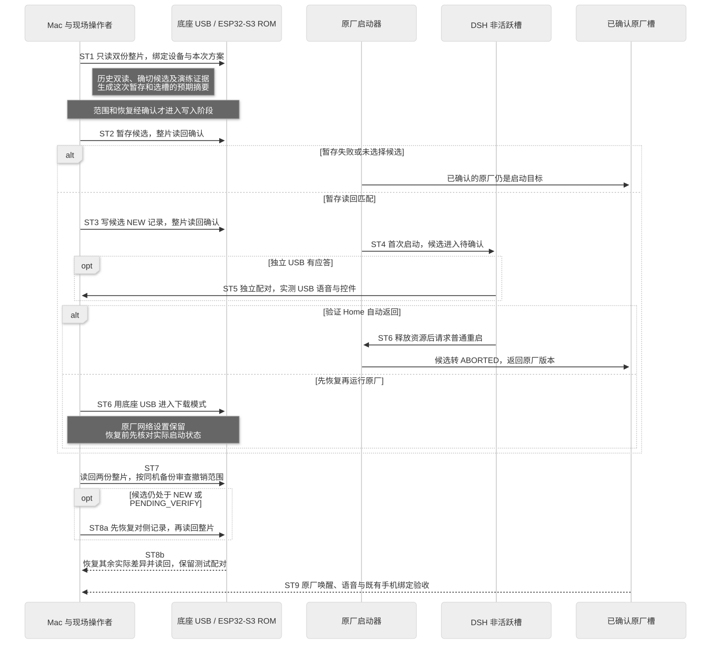
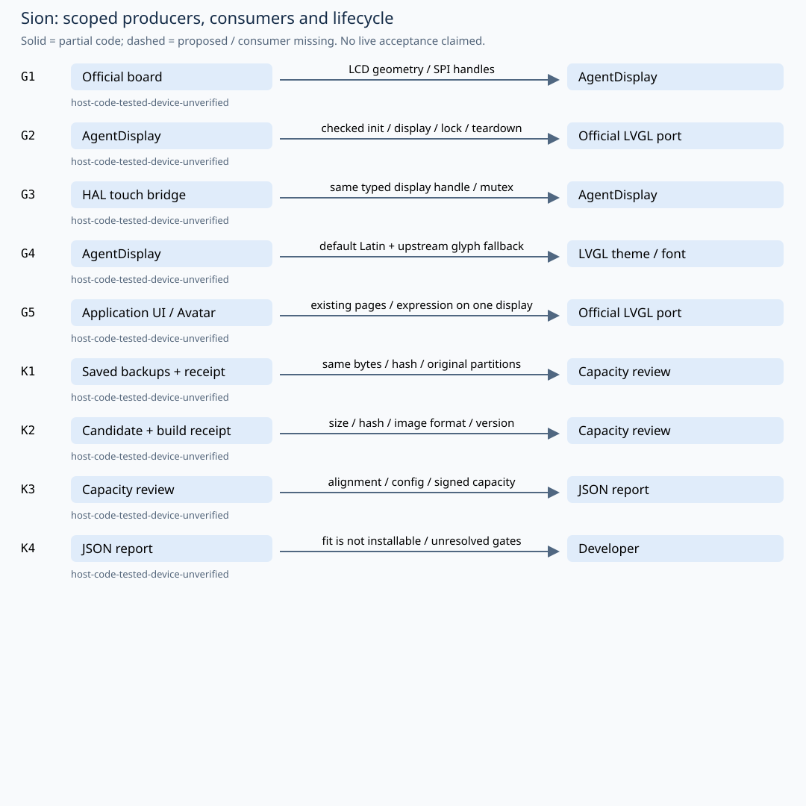
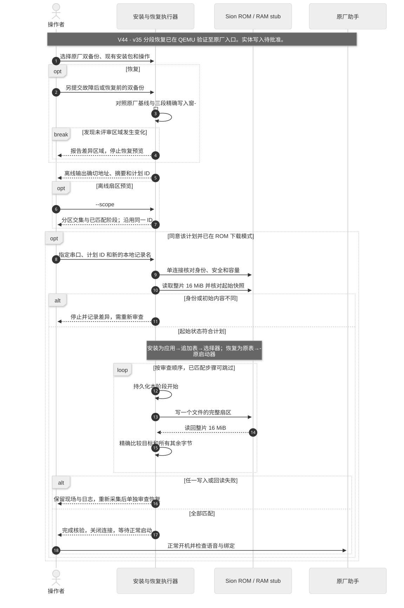

# 双模式固件安装与恢复方案

App Center 的最新实验室配套候选是 [v55](independent-agent.md#v55-wi-fi-地址变化处理)。对其确切镜像已用原版启动器、虚拟 Flash 和配套公开接收方检查两个槽位的写入、回退和 Home。现场首装仍需官方支持的入口、当前双读复核和具体方案确认。v54 审查包及单次联调各自对应已冻结的候选。 [v55 验收](validation.md#wi-fi-地址变化后的连接清理) · [双槽写入与撤销](#v53-双槽安装写入与撤销范围)

需要先验收实体语音及传感器时，可审阅 [v54 保留原厂的单次联调](#v54-保留原厂的单次联调)。

历史 v51 使用 v50 的 [Mac 归档](validation.md#v50-有线首配省略局域网)。若已写入省略地址的配对，回退旧版 DSH 前需另用配套版本写入一份含地址的独立配对。 [v51 构建](independent-agent.md#v51-头顶手势松开确认) · [v51 验收](validation.md#v51-头顶回弹过滤) · [配对回退](host-pairing.md#选择本地语音服务地址)

[v49 的首装与恢复核对](#v49-首装与恢复核对)记录适用于本轮离线审查的流程与扇区范围。下文 v35 核对单记录历史 USB 试装。各版本使用自己的构建摘要复核。

[v51 App Center 试发行的写入和撤销](#v51-app-center-试发行的写入和撤销)补充了实际 SDK 擦写顺序，确认下载中断时也需检查候选 OTA 记录。

### 一次性 Home 候选的安装边界

该功能要求出厂应用和 DSH 采用同一份 RTC 约定。已绑定的 Sion 当前量产 v1.6.2 没有接收方。原版启动器和分区表可以继续用，量产原厂应用中的菜单接收方仍需 M5Stack 发布。公开构建缺少量产服务鉴权，现阶段只用于离线验收。 [一次性 Home 协议](app-center.md#一次性-home-返回原厂菜单)

拿到官方支持的发行包后，先核对新双读、安装工具的实际写入范围，以及候选 DSH 绑定的原厂摘要。验收底缘上滑点 Home、再次开机仍按既有偏好、再从菜单进入 DSH，并核对原唤醒应答和手机绑定。撤销使用当天匹配的原厂应用和 OTA 选择，避开原厂 NVS 与语音资产，并另行核对独立配对区的归属和保留。具体写入和恢复范围须在知道发行包后复核并确认。当前测试已用历史备份副本撤销配套镜像并进入真实量产 v1.6.2 应用入口。 [离线恢复验证](validation.md#原版启动器的一次性-home) · [现有离线核对](#v49-首装与恢复核对)

复核配套发行时，用同一设备的独立配对完成两次 **Open → Home**，确认第二次无需重新下载或配对。系统更新后另行读回确认槽和镜像身份，再检查可用的 DSH 发行版与配对区归属。v52 的离线组合试验已验证两次往返后独立记录可读、已排队升级保留和旧摘要拒绝。 [两次往返与更新冲突](validation.md#配套-v52-的两次打开与返回)

v53 支持从更新后的双读准备。先依据确认记录识别原厂槽，再以另一槽和其对应的 OTA 记录计算审查范围。若另一槽是更新前仍有效的原厂镜像，安装范围会包含这份本机回退镜像，需在该次备份和写入确认中明示。撤销应恢复更新后的已审查基线，保留当时确认运行的原厂版本和现有配对区。两种槽序已分别在副本核对，具体发行包与设备当前状态仍是上机依据。 [双槽验收](validation.md#v53-原厂两种槽位与升级后恢复)

### 带主菜单快捷入口的候选

快捷入口接在 App Center 的安装与 Home 路线上。用户首次从 App Center 成功选择配套应用时，候选原厂接收方会在现有 NVS 内创建一个独立快捷入口记录，另有一个用户可修改的显示开关。后续从快捷入口启动只调整候选 OTA 选择记录。原厂发行升级后必须用精确配套的 DSH 构建，旧快捷入口摘要失效。 [记录读写和状态](app-center.md#app-center-应用的主菜单快捷入口)

在两个槽位方向的 SDK 仿真中，首次登记写入的范围限于合成 NVS 和候选 OTA 选择扇区。回退之后，同一探针仍能读取合成的原厂设置和快捷记录。离线再打开只写 OTA 记录。真实设备的 NVS 可能进行页内维护，撤销时保留现场原有 NVS，不根据合成试验推断真实绑定已恢复。 [快捷入口验收](validation.md#app-center-主菜单快捷入口)

主菜单路线使用两个基线。首次装机先保存当前原厂双读。取得受支持的量产接收方后核对其官方交付方式、分区表和预计写入范围，先取得对该步骤的明确同意。在设备原语音和手机绑定检查通过、量产接收方已确认启动后，为 App Center 安装另取一组双读。候选 DSH 需按这一组的原厂镜像身份配对。 [官方恢复入口](https://docs.m5stack.com/en/StackChan/#restore-factory-firmware)

| 检查点 | 可核对证据 |
| --- | --- |
| 首次从 App Center 安装或 Open | 对照 App Center 前的双读。另一 OTA 槽及候选选择扇区按实际镜像核对。原厂设置仅允许本次操作涉及的 `app_dsh_menu/launch_v1` 变化。测试显示开关时单独核对 `feature_toggles/dsh_visible`。 |
| 上滑点 Home 后再次从主菜单打开 | 核对两个动作的各自读回。离线再打开只改变候选 OTA 选择扇区。回到量产原厂界面后实际测试原唤醒、语音应答和 StackChan World 连接的同一个设备。 |
| 撤销 DSH 候选 | 等到读回确认原厂重新选中后，按 App Center 安装前的双读恢复另一镜像受影响的扇区和选择记录。保留现场现有原厂 NVS。若另需撤销量产配套发行，采用 M5Stack 支持的该发行回退方案，使用首次装机前的双读复核，另验免费语音和绑定。 |

原厂设置读回用 [NVS 双读比较](hardware-check.md#原厂-nvs-的离线完整性检查)。`needs-review` 或 `inconclusive` 需要查明差异再继续，报告本身不触碰 Flash。现有 v53 撤销审查的扇区结论仅对应下列版本。真实地址、官方发行工具和各阶段预计写入范围须按实际包复核后提交明确上机方案。

[量产接入审查包](app-center.md#app-center-的量产接入审查包)给生产构建与目录维护方提供补丁、可验证的配套关系及交付所需输入。现场计划仍由实际量产包和设备双读生成。

### App Center 首装证据预检

先取得发行方支持的接收方交付方案与许可，再在同一台确认能用原语音和手机绑定的设备上保存第二组双读。把这组双读、发行方的独立接收方应用、授权渠道保存的完整目录和下载镜像、配套 DSH 构建、已验收的 Mac 插件归档交给预检。目录 ID 以发行方为该接收方指定的数字为准。已保存的量产 v1.6.2 与公开候选接收方版本号相同，镜像身份不同。 [只读预检](../scripts/review_app_center_install.py) · [上游发行边界](app-center.md#app-center-的量产接入审查包)



在已固定的 ESP-IDF Python 环境运行下列命令。输出选择新的私有报告路径。

~~~sh
python3 scripts/review_app_center_install.py \
  --before "$before_double_read" --receiver "$paired_factory_app" \
  --agent-source "$paired_dsh_build" --catalogue "$saved_catalogue" \
  --catalog-url "$catalogue_https_url" --catalog-id "$publisher_catalogue_id" \
  --offered-image "$saved_companion_download" --host-archive "$tested_mac_plugin" \
  --output "$new_private_report"
~~~

| 生产者 → 消费者 | 核对和报告 |
| --- | --- |
| 受支持的发行方材料和授权渠道保存的下载 → App Center 预检 | 核对唯一匹配的数值 ID 和 HTTPS 地址。目录的 `reopenImageSha256` 使用 ESP 镜像尾随校验摘要。实际下载必须逐字节匹配带收据的配套 DSH 镜像。 |
| 同机双读 → 预检和恢复比较器 | 核对两份相同整片读数、确认状态、字节完全匹配的接收方、分区表、原厂返回头和独立区归属。报告绑定启动器、分区表和备份摘要。原厂待确认或身份不匹配时拒绝输出。 |
| Mac 构建 → 现场安装审核 | 记录所选插件归档的完整哈希，供审核者对上该版本的独立验收记录。 |
| 预检 → 现场审核和恢复审查 | 列出另一槽已有镜像、是否替换及准确的 OTA 扇区。已装同一镜像且状态为 ABORTED 时预计用 App Center Open，省去下载范围。返回状态变化后以另外实读的 Flash 为依据生成撤销范围。 |

报告中所有范围为半开区间。候选 OTA 记录覆盖开始、中止及选槽阶段实际可能修改的同一个扇区。NVS 行是物理分区包络，逻辑操作只登记 `app_dsh_menu/launch_v1`。空独立区首次启动可能写归属标记，既有配置保留。报告只证明输入相互匹配，发行证据、新鲜同机状态、原语音与绑定和具体操作仍须现场核对。 [双槽实写仿真](#v53-双槽安装写入与撤销范围) · [对应撤销预检](#撤销范围的只读核对)

### v53 双槽安装写入与撤销范围

下表是实际 ESP-IDF v6.1 writer 在两个备份副本上的半开区间。原厂当前在哪一槽由最新双读决定。表中记录扇区来自两个具体副本，现场不得用槽号推测 OTA 记录位置。 [v53 组合验收](validation.md#v53-双槽实际-sdk-写入与撤销) · [ESP-IDF 顺序擦写](https://docs.espressif.com/projects/esp-idf/en/v6.1/esp32s3/api-reference/system/ota.html#macros)

| 阶段 | 原厂 `ota_1`，DSH `ota_0` | 原厂 `ota_0`，DSH `ota_1` |
| --- | --- | --- |
| OTA 开始，应用字节尚未写入 | 擦另一槽的 OTA 记录 `0xd000–0xe000` | 擦另一槽的 OTA 记录 `0xe000–0xf000` |
| 写入 4,133 字节后中断 | 另擦写 `0x20000–0x22000` | 另擦写 `0x510000–0x512000` |
| 写完整 1,767,280 字节并校验通过 | `0x20000–0x1d0000`，再写 `0xd000–0xe000` 的 NEW 记录 | `0x510000–0x6c0000`，再写 `0xe000–0xf000` 的 NEW 记录 |
| 候选首次启动 | 原版启动器改为 PENDING_VERIFY。独立区为空时，应用仅在 `0xffb000–0xffc000` 写归属标记 | 原版启动器改为 PENDING_VERIFY。已认领的归属标记和配对区沿用原字节 |

未通过校验或中断下载时，从已确认的原厂状态重新核对镜像及 OTA 记录。完全撤销时，先读回并确认当前原厂已选中，再以该次备份恢复另一槽受影响的镜像扇区，校验读回后恢复它的 OTA 记录。中断在「镜像已恢复，OTA 记录尚未恢复」时，测试中的原版启动器仍选择已确认的原厂。新建的独立区如果尚无用户设置，可以恢复为空白归属扇区。已经写入配对时按独立区保留处理。 [组合验收](validation.md#v53-双槽实际-sdk-写入与撤销)

### 撤销范围的只读核对

拿到同一台设备安装前和当前的两份双读后，可以用当前配套 DSH 构建生成审查报告。原厂摘要、分区表和候选构建收据须匹配。输出只包含状态、摘要、需要恢复的有差异扇区及要保留的配置区。 [核对脚本](../scripts/review_app_center_recovery.py) · [测试记录](validation.md#app-center-撤销的双读预检)

```sh
python3 scripts/review_app_center_recovery.py \
  --before <安装前双读目录> --current <当前双读目录> \
  --agent-source <配套构建目录> --output <新的私有报告路径>
```

单次 USB 联调按同一参数格式调用 `work/v54-frozen-source/scripts/review_app_center_recovery.py --stock-trial`，并指定绑定该原厂摘要的 `dsh-agent-v54-ota` 构建目录。两种调用分别校验各自的候选和构建收据。 [单次联调范围](#v54-保留原厂的单次联调)



| 输入状态 | 报告与处理 |
| --- | --- |
| 已确认的原厂仍被选中，候选未开始写入、只写了可识别的连续字节，或已经回退 | 逐扇区列出差异。恢复次序是非活跃镜像、OTA 记录、仍空的新增归属标记。OTA 记录与旧记录相同时省去该项。 |
| 单次 USB 联调中断于暂存、写选择记录或逐扇区恢复 | 已确认原厂在 B 且对侧原记录空白或已退役时，可识别镜像先写及选槽记录的已知前缀。已恢复的完整原始扇区不再列出。无法识别的残缺字节需重新审查。若完整镜像仍在而对侧 ABORTED 记录和原字节相同，报告 `staged-or-returned`，两种历史使用同一恢复范围。 |
| DSH 记录是 NEW 或 PENDING_VERIFY，且镜像与构建吻合 | 返回 `await-confirmed-factory-readback`，恢复扇区列表为空。 |
| 原厂 NVS、崩溃日志或已认领的 DSH 设置有变化 | 报告要保留的区域名称，继续保留当前读回的字节。 |
| 候选明明不同于可信镜像或连续已写前缀，原厂应用变化，或其它受保护区有未审查的差异 | 拒绝出具恢复报告。继续使用当天双读重新审查。 |

脚本输出的地址是字节偏移，末地址不含。`flashAuthorized` 始终为 `false`，实际动作和上机验收沿用配套发行的确认流程。 [安装边界](#一次性-home-候选的安装边界)

v48 增加 USB 待命。菜单候选的目标镜像仍在此前的独立应用扇区范围内。原版启动器试发行候选也已构建，镜像 1,766,896 字节，对齐后延用 v47 的试验范围。两份候选都用同一原厂备份核对了模拟安装和恢复。官方发行入口与现场写入路径仍要分别确认。 [菜单构建收据](../firmware/agent-usb-standby-build.json) · [原版启动器构建收据](../firmware/agent-usb-standby-ota-build.json) · [安装阶段](#v40-主菜单候选的双读恢复演练)

v47 的应用镜像沿用 v46 的扇区边界。已针对 v47 原始摘要重跑菜单启动和中断恢复，现场安装方案仍须基于实际设备状态复核。 [v47 验收](validation.md#v47-文字页会话控件)

v46 的独立镜像按实际字节对齐后占 `0xe10000–0xfbe000`，现有独立应用槽内余 248 KiB。配对配置仍从 `0xffc000` 起，其他写入阶段沿用下表。此版本使用公开菜单和原备份作离线验收。量产入口、现场安装和真实原厂返回单独验收。 [v46 验收记录](validation.md#v46-资源诊断与容量)

v45 继续使用同一历史双读基线向备份副本写入。目标镜像对齐范围为 `0xe10000–0xffc000`，到独立配对配置起点为止；其他阶段与 v40 表一致。独立运行槽已无剩余扇区，后续容量变动须重新计算。恢复演练已核对原厂槽和保留资源，生产菜单发行支持及原厂语音、绑定仍需现场验收。 [v45 启动和恢复](validation.md#v45-对话灯与头顶去抖)

v44 使用同一套公开菜单、启动器和 Sion 历史双读基线进行离线演练。独立应用范围按实际字节对齐为 `0xe10000–0xffb000`，其余写入阶段边界与下面的表一致。完整恢复副本逐字节等于原备份。上机仍需具备原厂绑定的发行路径和针对真实设备当前状态的写入方案。 [v44 验收](validation.md#v44-头顶手势)

v41 独立应用沿用同一个菜单与原厂槽保护范围。镜像缩小后，第一阶段写入的独立应用区截止于 `0xff8000`，配置仍从 `0xffc000` 开始。其余历史模拟范围相同。 [v41 验收](validation.md#v41-独立应用容量与回归)

## v49 首装与恢复核对

目标是使 Sion 从屏幕打开 DSH.AGENT，接入既有 DSH 会话，再用 Home 返回能正常唤醒、回答且仍与 StackChan World 绑定的原厂助手。正式入口优先保留原版启动器和原厂镜像。官方 App Center 需要提供受支持的应用选择、重复进入和独立设置空间。公开菜单构建用于核对屏幕从主菜单进入及返回；实际原厂云语音和绑定的量产鉴权仍由原版应用处理。 [官方 App Center](https://docs.m5stack.com/en/StackChan/#app-center) · [M5Stack 鉴权说明](https://github.com/m5stack/StackChan/issues/134)

| 历史双读上的范围 | v49 原版启动器试验 | v49 公开菜单试验 |
|---|---|---|
| 启动器与分区表 | 沿用原版字节 | 启动器覆盖 `0x000000–0x006000`。在 `0x008000–0x009000` 的原表追加 `dsh_agent` 和 `sion_cfg` |
| 非活跃应用槽 | 模拟写入独立应用 `0x020000–0x1d0000`。正式下载器擦除范围需现场核对 | 带 DSH 图标的公开菜单写到 `0x020000–0x3bb000`，独立应用写到 `0xe10000–0xfbe000` |
| 候选启动记录 | `0x00d000–0x00e000` 由原版 OTA 流程更新 | 同范围在其他四个阶段完成后才置为 `NEW` |
| 独立偏好与配对 | 运行时核对并登记 `0xffb000–0x1000000`，首扇区为归属标记 | `0xffc000–0x1000000`，装载镜像时不写入，首次配对后才产生独立配置 |
| 原厂 v1.6.2 与绑定 | 保留原厂 `ota_1` 镜像、其 `VALID` 记录、原厂 NVS 和语音资产 | 保留同一批原厂区间及原始字节 |

表中末地址不含。完整撤销以本次写入前双读为恢复来源。原版启动器路线先回到原厂选择，再按实际读回恢复候选记录、非活跃槽受影响范围及经确认属于 DSH 的尾部扇区。公开菜单路线用 ROM 维护通道按顺序恢复候选记录、原分区表、原启动器、非活跃槽受影响范围和独立应用。是否保留已写的独立配对取决于现场目标和当时归属。两条路线的离线恢复都回到了原厂 v1.6.2 应用入口，且全片与演练前双读一致。 [原版启动器状态](app-center.md#v47-原版启动器候选) · [中断验收](validation.md#v49-首装与中断恢复)

现场先确立官方支持的进入和重新进入方式。完成新的整片双读，复核设备身份、原厂镜像、`VALID` 记录、原厂 NVS、语音资产及独立区归属，再用当天的字节计算最终安装和恢复范围并取得本次确认。以底座 USB 数据口完成首次配对与会话核对。随后验收两次屏幕进入、播报中 Stop 后留在 DSH、Home 后原厂唤醒应答及同一手机绑定、原厂升级和再次打开。原厂自动联网升级按[现场联网条件](#原厂返回与自动更新)另行核对。 [官方底座 USB 维护说明](https://docs.m5stack.com/en/StackChan/#restore-factory-firmware)

Mac 使用 [USB 读取设备编号候选](validation.md#首配读取设备编号)。旧包是 `work/dsh-desktop-install-20261119T104843Z/dsh-stackchan-0.1.0.tgz`，已逐文件核对日常 Desktop。完全退出 Desktop 后用原生插件入口换包并重开。在 StackChan 设置核对已有会话与两套本地语音后端。全新配对时选择底座串口，点击「读取设备编号」，核对后准备配对身份并按设备的 Allow USB 流程写入。Mac 单独回退时重新安装旧归档，并检查同一会话、工作目录和语音设置。确切新旧包已走隔离升级、配对、语音接入和回退。 [同版本插件升级与回退](settings-ui.md#本地安装包升级与回退)

### v51 App Center 试发行的写入和撤销

这条路线需要官方提供可用的试发行渠道。候选为 [v51 原版启动器镜像](../firmware/agent-head-touch-rearm-ota-build.json)，大小 1,767,120 字节。历史快照原厂 v1.6.2 处于 B 槽且已确认，A 槽是先前的 IR Remote。顺序和范围来自目标 ESP-IDF writer 在 16 MiB QEMU Flash 上的擦除跟踪与整片比对。区间的末地址不含。 [实际写入顺序 V69](app-center.md#v51-的实际-sdk-写入顺序)

| 阶段 | 这次副本的范围与检查 |
| --- | --- |
| SDK 开始接收 | 先擦旧 A 记录 `0xd000–0xe000`。固件只收到部分、尚未选择启动时，该扇区也可能已改变。已确认的 B 记录 `0xe000–0xf000` 保留。 |
| 流式写入应用 | 接收 4,133 字节时擦 `0x20000–0x22000`。完整 v51 擦 `0x20000–0x1d0000`，共 432 个扇区。校验失败也可能已写完这些扇区，此时 B 保持启动。 |
| 首次启动及退出 | 校验通过后由 SDK 选 A，原版启动器置为 PENDING_VERIFY，再次重启回已确认的 B。第一次进入 v51 HAL 前写 `0xffb000–0xffc000` 的归属记录。第二次通过下载进入后保留原记录。实际配对与偏好另使用 `0xffc000–0x1000000` 的独立 NVS。 |
| 完整撤销 | 先确认原厂 B 已被选定，再用写入前双读恢复 A 的 OTA 记录、实际受影响的应用扇区和已修改的归属扇区。若已保存独立配对或设置，按现场读回确认独立 NVS 的内容和处置。QEMU 恢复模拟发生变化的三个区间后，整片逐字节等于原始双读，并到达原厂入口。 |

现场先用当天的双读核对已确认槽、旧 OTA 记录、候选摘要及尾部归属，报告实际渠道和写入方案，再取得此次确认。若安装在选择启动前中断，先保存读回并逐区核对，即使屏幕已能进入原厂。原版启动器、分区表、原厂 NVS、语音资源和 B 的只读比对，与联网后的唤醒、应答、StackChan World 绑定核对分别验收。 [原厂自动升级条件](#原厂返回与自动更新) · [离线验收](validation.md#v51-app-center-实际-sdk-擦写)

复现先运行 `python3 scripts/audit_app_center_ota_writer.py prepare --source <新目录>`。用锁定的 ESP-IDF v6.1 运行 `idf.py -C <新目录> -DIDF_TARGET=esp32s3 build`。随后运行 `audit`，给出探针目录、Sion 历史双读、已验证的 v51 OTA 工程、官方公开源码、锁定 SDK 及 QEMU 工具地址。脚本核对原厂应用的 SDK 版本、探针构建与公开源码。原版启动器来自历史双读副本。 [完整参数](../scripts/audit_app_center_ota_writer.py)

## v40 主菜单候选的双读恢复演练

使用 Sion 历史两份一致的 16 MiB 备份、带 App visibility 开关的公开 v1.6.2 菜单、配套启动器和 v40 独立应用。备份中的 `ota_1` 是已确认的原厂镜像，`ota_0` 是已放弃启动的 IR Remote。以下范围只对应这次离线演练。最终量产候选仍需官方确认支持的发行接口和空间，再根据新双读生成具体方案。 [手册的 USB 维护方式](https://docs.m5stack.com/en/StackChan/#restore-factory-firmware) · [ESP-IDF 的 OTA 保护边界](https://docs.espressif.com/projects/esp-idf/en/release-v5.5/esp32s3/api-reference/system/ota.html) · [复验脚本](../scripts/audit_agent_menu_recovery.py)

| 模拟顺序 | 扇区范围（左闭右开） | 内容 |
|---|---|---|
| 1 | `0xe10000–0xffa000` | v40 独立应用。配置区 `0xffc000–0x1000000` 保持空白，供之后的独立配对使用。 |
| 2 | `0x20000–0x3bb000` | 将带 DSH 图标的公开菜单镜像放进非活跃 `ota_0`，保存此范围内原有 IR Remote 数据的恢复来源。 |
| 3 | `0x8000–0x9000` | 只在原分区表后加独立应用和配置两项。两版锁定 SDK 产生相同字节。 |
| 4 | `0x0–0x6000` | 配套第二级启动器。涉及启动器或分区表的断电恢复依赖 ROM 维护接入。 |
| 5 | `0xd000–0xe000` | 最后才把 `ota_0` 自己的记录置为 `NEW`。另一扇区的 `ota_1` 记录保留为 `VALID`。 |

模拟过程保留了原厂槽、原厂 NVS、语音资源和其他未列出的区域。只暂存候选时仍启动原厂。启用候选后第一次启动将其置为待确认，确认前重启则回到原厂槽。确认后的状态由仿真建模，以继续检查触屏进入、Home 和再次进入的启动交接。生产环境的菜单确认条件仍由实际官方应用负责。

完整撤销演练依次恢复候选 OTA 记录、原分区表、原启动器、`ota_0` 受影响的区域和独立应用写过的区域。安装和恢复各阶段都单独模拟擦除后部分写入，从原双读数据恢复受影响范围。整片恢复与备份逐字节相同，QEMU 再跑到原厂 v1.6.2 应用入口。实际设备用过软件、改过设置或执行过官方升级时，恢复前需要按当时状态重新双读和判断写入范围。 [验收与具体证据](validation.md#v40-双读安装与恢复)

真机操作前仍需 M5Stack 提供能保留 StackChan World 接入的候选或受支持的入口，复核两槽、启动器、分区、备份与维护通道，再由用户确认本次操作。回到真实原厂后，分别验证唤醒、语音回答、同一手机绑定和显示设置。 [原厂接入前提](app-center.md#m5stack-入口审查包)

## v38 触屏候选的装机边界

v38 的配套启动器、公开菜单和独立应用只用于离线验收。现有量产 v1.6.2 主菜单不会因重启或安装 Mac 插件而新增 DSH.AGENT。公开菜单镜像缺少 StackChan World 的量产鉴权，现有 v35 USB 试装材料也没有触屏入口。量产发行路径、对应的写入范围及原厂恢复要在任何 v38 真机操作前单独审查。 [触屏入口和官方鉴权依据](app-center.md#从-sion-主菜单打开-dshagent) · [v38 验收](validation.md#v38-触屏往返与原偏好)

触屏候选的公开菜单和配套启动器应成对审查，两端都有原厂 OTA 确认状态检查。实机若已有更新排队，等待原厂处理并重新读回启动状态。量产更新包仍须包含兼容的菜单入口，插件镜像独立留存本身不会让缺少入口的菜单显示 DSH。 [官方升级确认测试](validation.md#触屏入口的原厂升级回归)

保留原版启动器和分区表的 App Center 路径另做了标准 OTA 返回试验。若进入发行审查，范围应明确列出非活跃应用槽及它自己的 OTA 记录，并保留已确认的原厂槽与其 VALID 记录。任何配置存储空间要独立确认，官方升级与再次打开需要另做冲突验收。当前探针只验证返回，不是首装镜像。 [量产返回与边界](app-center.md#保留量产镜像的-ota-返回试验)

配对与偏好探针另外验证了可在不改分区表的情况下使用尾部 20 KiB。若获正式分配，从 `0xffb000` 起的五个扇区应纳入复查、备份与回收清单。回到原厂时可保持这五个扇区以便之后读回 DSH 配对。只有在明确撤销 DSH 且核对当前布局及归属后，才安排针对这五个扇区的恢复。旧安装包不会因此获得新地址的写入许可。 [独立保存验证](validation.md#原分区表下的配对与偏好)

### v39 原版启动器候选的写入与恢复边界

以历史双读的 v1.6.2 为例，`ota_1` 为已确认的原厂镜像，`ota_0` 可用作 App Center 独立应用槽。v39 只携带应用二进制。若官方允许在此布局下测试，需在现场重做只读双读审查，核对原厂镜像摘要、当前 slot、有效 OTA 记录及尾部状态，再按正式交付渠道确认写入范围。以下是历史布局中的边界，不是写入指令。

| 范围 | v39 计划和恢复行为 |
|---|---|
| `0x20000–0x510000` | 历史 `ota_0` 区间。应用 2,009,856 字节写入非活跃镜像槽，原厂安装器决定该槽的实际擦除范围。 |
| `0xd000–0xe000` | 历史 `ota_0` 启动记录。原版 OTA 和启动器负责选择、待确认与退出标记。DSH 应用没有刷新这一区的代码。 |
| `0xe000–0xf000`、`0x510000–0xa00000` | 历史已确认的量产启动记录和对应原厂镜像，要求保留。应用退出回到这份原厂镜像。 |
| `0xffb000–0x1000000` | 候选使用的五个配置扇区。已确认归属及官方分配后，可保留供下一次载入。 |
| 启动器、分区表、原厂 NVS 和语音资产 | v39 保持原厂内容与布局。 |

正常 Home 和候选首次启动中断均沿用启动器回退。返回后需验证原版 v1.6.2 启动、唤醒后答复及手机仍连接同一设备。仅在回退失败且用户批准恢复步骤时，依据那次现场双读重建原厂选择和受影响区域。正式目录和常驻入口、尾部空间的升级兼容及真机回归仍为未完成项。 [v39 验收范围](validation.md#v39-完整应用的原厂回退与存储)

### v54 保留原厂的单次联调

`dsh-agent-v54-ota` 直接绑定已核对的 Sion 原厂镜像摘要。用于同一台设备的一次受控 USB 联调，验收机身录音与出声、优先 Stop、实际触屏 Home 和头顶事件。日常入口仍按 App Center 配套发行验收。下面的地址来自历史双读，须用最新双读重新确认。原厂在 B 且记录状态为 VALID，另一槽内是此前的 IR Remote，其 OTA 记录为 ABORTED。方案会临时覆盖这份 IR Remote 镜像，撤销时按备份恢复被触及扇区。 [v54 单次联调构建](independent-agent.md#v54-保留原厂的联调构建) · [原厂 OTA 规则](https://docs.espressif.com/projects/esp-idf/en/v6.1/esp32s3/api-reference/system/ota.html#app-ota-state)

2026-11-20 06:37 UTC 的现场双读与下面列出的范围一致。只读预检用当前备份重算了暂存和选槽后的整片摘要。模拟正常 Home、独立配对仍空时，恢复只涉及被改动的 IR Remote 扇区和新建的归属标记，对侧 ABORTED 记录与基线相同。实际恢复范围以恢复前的新双读为准。 [现场只读记录](hardware-check.md#单次-usb-联调的现场只读核对)



| 阶段 | 核对与结果 |
| --- | --- |
| ST1 现场取基线 | 底座 USB-C，按官方下载模式做两份整片只读。核对同一设备、安全状态、已验证的 3.3 V Flash 绑定位配置、原版启动器、分区表、确认槽、另一槽已有镜像和独立区。电压配置不匹配时保留只读能力，停止写入并查硬件启动状态。需在 ROM 操作前安排短暂停机，刷新报告后对这次写入与恢复单独确认。 [只读工具](../scripts/capture_agent_preflight.py) · [官方下装模式](https://docs.m5stack.com/en/StackChan/#download-mode) |
| ST2 先暂存候选 | 历史试算为 `0x20000–0x1d0000`，按扇区对齐。暂存后读回整片，确认候选完整且其他区域与基线吻合。暂存中断时，已确认原厂仍可启动。 |
| ST3–ST4 再选择一次 | 单独写对侧 `0xd000–0xe000` 的 NEW 记录并读回。原版启动器首次运行将 DSH 置为 PENDING_VERIFY。原厂 B 的确认记录、启动器、分区表、原厂 NVS、语音资产均在暂存与选择范围之外。 |
| ST5–ST6 验收与返回 | DSH 可使用 `0xffb000–0x1000000` 的独立归属和配对/设置区。接入后按需验证同一 DSH 会话的连续对话、语音停止、触屏停止、摸头、相机和灯光。要验证屏幕 Home 自动回原厂时，现场先避免原厂自动更新。保留原联网设置的受控试装可在测试结束后直接进入 USB 下载模式，等恢复完成再普通启动。 |
| ST7–ST9 读回、撤销、原厂复验 | 用恢复前的新双读核对发现的实际差异。如果确切候选仍为 NEW 或 PENDING_VERIFY，以 `--cancel-selection` 先恢复对侧记录并读回整片，使同一原厂槽重新成为启动目标，然后恢复仍有差异的旧 IR Remote 扇区。已写入的独立配对保留，清理需另行确认。写后整片读回，再正常启动并检查原助手应答和同一手机绑定。 [撤销范围核对](#撤销范围的只读核对) |

现有真机证据已覆盖官方 ROM 入口的 3.3 V、候选运行到界面、整片恢复，以及新旧 Mac 串口打开方式的对照。下一次现场按一次完整联调安排。操作者用机身完成开始、连续问答、播报中 Stop、底缘上滑点 Home 与设备互动，Host 侧负责会话匹配、配对读回和资源回执。原厂语音与手机绑定在最终恢复后同一次确认。若启动或配对提前失败，记录该步和恢复结果，已有诊断结果可直接引用。USB 语音由 Mac 提供，原厂自动更新的观察条件只涉及跨回原厂的步骤。 [真机对照](hardware-check.md#原厂上的-mac-usb-串口打开对照) · [官方 Home 与 AI Agent 手册](https://docs.m5stack.com/en/StackChan/#ui-navigation)

进入设备维护前，按隔离验收用已核对的 Mac 归档换包并重开，核对同一已选会话及新版 USB helper，从 Mac 单独验证托管语音 v3 的准备状态。原有 v2 可回退。候选 Mac 包与 v54 镜像的摘要必须与当次预览相符。物理 USB 在启动后做一次配对读回再开始语音，这一步可判断此前的串口复位已经排除。 [同一份归档的验收](validation.md#mac-受管-usb-数据端口候选) · [桌面升级与回退](settings-ui.md#本地安装包升级与回退)

当前 `rc.5` Mac 包已安装分阶段诊断。再次使用冻结 v54 须核对新的同机双读、既有配对状态与当前恢复范围，并按新一轮方案取得写入确认。设备点一次 USB，记录串口打开、认证和收音结果。只有设备确认收音后才继续语音和相机验收。相机先开设备本地许可，再由用户在绑定会话中发起对准同意拍摄的对象。收音失败直接按同机备份恢复。 [Mac 诊断](voice-runtime.md#收音启动阶段诊断) · [相机授权](camera.md#两端相机状态与照片保留说明)

已配对时中止，独立区包含归属标记、配对和设置。撤销选择前后各核对整片，确保原厂 B 的选择记录仍有效，再恢复旧 IR Remote。若选择已恢复而应用恢复中断，用新双读重新出计划，仅处理仍有差异的已审查扇区。每次恢复按当次计划生成的整片预期逐字节核对。独立区若有配置，则保留恢复前读到的字节。原厂 NVS 若已有运行造成的差异，先记录来源并核对完整性。 [v54 确切镜像和实际 NVS 格式的离线演练](validation.md#v54-单次真机试装)

需要单独诊断 Home 时，可离线生成 [v54 Home 断点](hardware-check.md#v54-home-返回前的离线探针)。它在同一候选的原厂检查通过后、软件重启前暂停。QEMU 已在此处读回仍为待确认的候选。实体使用前须核对实机保持暂停和接管恢复的条件，调试器脱离可能继续执行重启。只有原厂完成正常启动并经现场确认，才记为真机返回通过。

在锁定的 ESP-IDF Python 环境，用当前双读生成联调核对单。历史参考须是启动与恢复演练使用的那份同机双读。输出使用新的私有文件。

```sh
python3 work/v54-frozen-source/scripts/review_stock_trial_install.py \
  --reference "$historical_double_read" --before "$current_double_read" \
  --agent-source "$stock_trial_build" --audit "$matching_qemu_report" \
  --host-archive "$tested_mac_plugin" --output "$new_private_report"
```

预览使用已冻结的 v54 构建输入和核对脚本。它核对设备、原厂镜像、分区表、另一槽旧镜像、返回及恢复证据，再列出当前状态下暂存、选槽和首次启动的预计范围。它重新计算在 ROM 中完成前两次写入后的整片摘要。原厂 NVS 或崩溃日志的日常变化会进入新的基线以及两段摘要。启动器、选槽、镜像、资源或独立区出现变化时需重新演练。读取时间、实际备份来源和用户同意由现场确认。v54 的 `--stock-trial` 恢复核对同样从冻结目录调用。 [只读首装预检源码](../scripts/review_stock_trial_install.py)

[联调执行器](../scripts/execute_stock_trial.py) 在冻结的 v54 工具下复用安装预览和恢复核对。默认只生成预览，连接真机须提供已在 ROM 中的同机端口、预览的计划 ID 和新的私有日志名。首次写入前及每一段后都读回整片，发现差异即停止。启动和网络由现场单独控制。原厂已换槽、实读无法归因到本次试装或尾部归属不明确时重新审查。 [精确镜像的离线证据](validation.md#v54-原厂镜像单次联调演练)

#### 断线与触屏的单次真机对照

沿用上次的冻结 v54，配套 Mac 使用已验收的实时收音恢复包。现场从同机的新双读重新生成安装范围。若仍符合预览，只临时写备用 IR Remote 槽 `0x20000–0x1d0000` 与对侧一次性启动记录 `0xd000–0xe000`。独立配对须与上次实际恢复的同机记录匹配，Mac 端读取已选会话并核对原配对。测试前原版 Mac 插件及偏好已有核对，结束后按新基线撤销两处改动并验证整片，再恢复日常桌面包。

1. 在已核实的实体 v54 页面等待 Mac 待命，再点一次 USB。保持安静至少 120 秒。Mac 要看到持续输入和诊断时间窗口。
2. 保留数据线。若自然断线，直接验证界面并保留首次异常。若收音稳定，Mac 记下精确时间后主动关闭已认证会话的串口 helper，一轮最多一次。串口关闭本身可能不会立刻反映在 Sion 上。设备端收到关闭或租约到期后，优先用 Settings／Back 检查触屏；若状态文字没有变化，也记录点击结果。此处 [断线工具](../scripts/usb_trial_control.mjs) 只关闭本次 Host 自己的子进程。
3. 触屏可操作时，重新接通并检查连续对话和播报中语音 Stop。若触屏不响应，先保留当时画面和 Mac 日志，再走同机恢复，避免重试连接盖住首个故障。

记下麦克风状态、触屏结果、端口是否仍能在 Mac 被枚举，以及正常 Stop 与断线各自有没有设备回执。实验室已通过模拟断线和受控 Mac 端关闭，实际 Sion 仍在原厂等待确认。 [断线验证](validation.md#v54-断线后界面响应)

#### 双端诊断候选

有设备日志的本次候选是 `dsh-agent-v55-ota` 和同批 Mac 包。已在同机历史备份上离线核对原厂兼容与恢复，预计两处临时写入范围仍为备用槽 `0x20000–0x1d0000` 和对侧启动记录 `0xd000–0xe000`。本次配对尾部预览以最近一次整片恢复已验证的同机副本为准。写入前须以当次双读重算实际范围，并按新候选审查操作输入。已有的 v54 固定执行器使用其自己的版本和收据。 [新候选证据](validation.md#v55-双端诊断候选)

现场先打开同批 Mac 观察，逐步验收启动、已有配对、两分钟空闲收音、对话和设备 Stop，并记录任何自然失败。出现异常时先采集现存证据。实体 JTAG 可达且当次授权覆盖时，用新 ELF 摘要和经校验的只读命令取样，再进入同机恢复。启动器、原厂 B 槽、原厂语音与绑定的边界仍按上文确认。 [诊断读取](hardware-check.md#双端诊断时间线)

### v47 原版启动器的离线装载与恢复

`dsh-agent-v47-ota` 在原分区表和原启动器上进入待确认的独立应用。它核对原厂槽和原厂镜像摘要，禁止以未知版本或未确认的 OTA 记录充当回退目标。普通 Home 先释放设备资源，再请求从原厂槽启动。真机返回后仍按原厂开机偏好显示界面。已打开原厂自动进 AI 的机器，可用原厂上滑 Home 回主菜单。 [设备返回代码](../firmware/app-center/return_to_stock.cc) · [手册导航](https://docs.m5stack.com/en/StackChan/#ui-navigation)

| 历史基线上的范围 | 离线试验及现场约束 |
|---|---|
| `0x20000–0x1d0000`（末尾不含） | 此次 1,766,720 字节应用的扇区对齐范围。实际 App Center OTA 下载器可能擦除更大的非活跃槽范围，发行时须复核该范围和原 IR Remote 的恢复。 |
| `0xd000–0xe000`（末尾不含） | 本次副本中 DSH 自己的 OTA 记录。原启动器负责推进待确认和回退状态。记录位置取自双读中已确认记录的对侧。 |
| `0xffb000–0x1000000`（末尾不含） | 独立设置拟用区域。识别未知内容时既有尾部保留，独立持久化不可用。官方仍需确认该区域可分配给应用，并说明后续升级是否会使用。 |
| 原厂启动器、分区表、已确认记录、v1.6.2 镜像、原厂 NVS 与语音资产 | 保留这些区域和各自原字节。以原厂实机唤醒、应答和手机仍可连接确认服务恢复。 |

若有官方支持的试发行，先重做同一设备的只读双读，核对下载器真实写入范围、OTA 状态和尾部归属，再以确切候选与恢复方案获得本次操作确认。只在历史状态上通过的写入范围不得套用于已升级或内容发生变化的设备。模拟恢复使用试验前双读，按模型涉及的扇区恢复完整副本。现场撤销要另审当天读回、配置变化和实际安装渠道。 [离线验收与限制](validation.md#v47-原版启动器装载与恢复) · [App Center 发行条件](app-center.md#v47-原版启动器候选)

## 历史构建与验证

v24 完整构建加入独立入口的原厂返回确认。镜像 1,991,920 字节，离线布局仍有 20 KiB 对齐余量。启动器候选、Home 与跨镜像返回的区别见 [V43](dual-boot-updates.md#选择器原型与-v24-原厂返回) 和 [应用收据](../firmware/agent-factory-return-build.json)。真机启动、原厂升级回退和恢复仍待验证。

v23 完整构建将应用从 2,165,120 缩至 1,991,344 字节。保留原厂分区及独立配置后对齐余量 20 KiB，追加布局已通过离线验证，启动入口、手动返回、实际升级与恢复仍待验证。见 [v23 构建收据](../firmware/agent-size-build.json) 和 [离线布局](#v23-容量与布局复现)。

前一版 v22 完整构建已接动作 v1、DSH 原生工具及两端设置，镜像 2,165,120 字节。离线布局在保留原分区和独立配置区后仍缺 148 KiB。可安装布局、原厂入口与真机验收仍待完成。见 [v22 构建收据](../firmware/agent-motion-control-build.json) 和 [动作请求时序](motion.md#认证动作与两端设置)。

历史 v21 已将动作资源组合、唯一 worker 与 Stop/Home 汇总接入设备主程序；默认动作许可关闭，认证动作请求/工具和两端动作设置仍待接。完整构建 `dsh-agent-v21` 为 2,160,400 字节，SHA256 `a2d9e72d78e2deb68b5bc2c5bf5770a286fde59ca6edaf0eed4af055a18c99f1`，见 [构建收据](../firmware/agent-motion-runtime-build.json)。最终 ELF 保留实际供电/UART/SCS/worker 路径，分区表与 v20 完全一致；保留原分区并预留独立配置后仍缺 147,456 字节（144 KiB），尚不可安装。语音、相机和表情已有链路保留；真实用户会话、机械反馈、原厂返回及恢复仍未验收。具体资源顺序见 [动作组合](motion.md#资源组合唯一任务与-home)，证据见 [验收](validation.md)。

历史 v20 已接两端相机状态：设备许可、硬件/传输阶段与最近错误经认证连接进入 DSH 设置，Host 另报验证保存、交付和取消等待。完整构建 `dsh-agent-v20` 为 2,143,632 字节，SHA256 `705ebce55b78c009573aaba3df5f285419eaa747d8f2c84398f0aabb520e0c5e`，见 [构建收据](../firmware/agent-camera-status-build.json)。源码/产物哈希、镜像校验与实际链接已核对，分区表与 v19 完全一致；按原备份布局对齐并预留 16 KiB 配置后仍缺 131,072 字节（128 KiB），尚不可安装。配套 Host 必须先更新；新 Host 可接旧设备，但旧 Host 的严格 hello 校验不接受 v20 状态字段。实际用户会话、实体相机、原厂返回与恢复仍未验收；[两端状态契约](camera.md#两端相机状态与照片保留说明)与[本批验收](validation.md)分别记录软件和真机边界。

历史 v19（以下缺口为该批次记录，当前状态见页首）已将认证拍照请求、相机任务与有界图片回传接通；完整构建 `dsh-agent-v19` 为 2,141,376 字节，SHA256 `0944acd34384d93e7666650e32c386f61692bf705c98197340112a2b7651d48f`，见 [构建收据](../firmware/agent-camera-transfer-build.json)。比 v18 增加 4,800 字节，原分区表未变；对齐并预留配置后仍缺 126,976 字节（124 KiB），尚不可安装。真实 TLS/C++ 已验证合成包络的最大 256 KiB 回传、音频并行与取消；真实 JPEG 解码、DSH 图片工具/设置、实体相机与安装恢复仍未完成。

此前 v18 已接相机 worker、设备许可与 Stop/Home 释放汇总，最终 ELF 保留实际驱动。完整构建为 `dsh-agent-v18`，2,136,576 字节，比 v17 增加 72,624 字节；[构建收据](../firmware/agent-camera-runtime-build.json)。分区表未变，按对齐并预留 16 KiB 配置后仍缺 122,880 字节，尚不可安装。拍照请求、传输、DSH 图片工具/设置和真机验收仍待完成，不声明相机能力。

此前 v17 相机适配编译检查通过：`dsh-agent-v17`、2,063,952 字节，[收据](../firmware/agent-camera-port-build.json)。相机代码没有任务/协议调用者，最终 ELF 未保留相关方法，不能当已接入相机的镜像。分区表与 v16 完全一致，最终候选再次通过保存备份/镜像容量审查，预留配置后仍缺 49,152 字节；后续能力增长未计入。安装入口、返回和 OTA 共存仍未完成，本页不提供刷写许可。

此前 `independent-logging-v16` / `dsh-agent-v16` 完整构建通过：2,063,952 字节，SHA256 `2154e2c64f5845e45e465004b0f1499d4eef9312d4043a0c5f1c95e4f34b072f`；[构建收据](../firmware/agent-logging-build.json)。在 v15 显示拆分基础上，仅把 ESP-IDF 应用默认/最大日志改为 Warning，减少 18,960 字节；TLS/原字体/设备协议保留，分区表未变。按扇区对齐并预留 16 KiB 配置区后仍缺 **49,152 字节**，见 [v16 只读容量报告](../firmware/agent-capacity-review.json)。尚不可安装，原语音、绑定与设备未操作。

历史 `independent-display-v15` / `dsh-agent-v15` 完整构建通过：2,082,912 字节，SHA256 `b97eb009be5c45d67d424eb6c0f99c7f01d9e7bb633ff261705ead6eb198df33`；[构建收据](../firmware/agent-display-build.json)。比 v14 减少 196,032 字节，来源/依赖锁、镜像 checksum/hash 与版本已核对，分区表未变。仍超出原尾部 51,296 字节，另外需要 16 KiB 独立配置区和后续能力预算，尚不可安装；未操作原语音、绑定或真机。

历史 `independent-identity-v14` 已完整构建，应用版本明确为 `dsh-agent-v14`：2,278,944 字节，SHA256 `fa2564cc615dde59a0af91b76635eb7df7c85015d89739234d38cd5005ff03da`；[构建收据](../firmware/agent-identity-build.json)。来源/依赖锁、实际镜像版本及 checksum/hash 通过；分区表与 v13/v12 字节一致，无 sion_cfg。镜像超出原尾部空闲区 247,328 字节，另需 16 KiB 配置区，仍不可安装。六种表情及此前音频链保留；未操作真机、原语音或绑定。

历史 `independent-playback-v12` 已完整构建：2,276,736 字节，SHA256 `d6f158afe92de4c9051daecb9ff51e3516e85bdf1158fc1f283a0b980e5eb0dc`；[构建收据](../firmware/agent-playback-build.json)。来源/依赖锁复核、镜像 checksum/hash 和最终 ELF 的播放屏障/ISR/会话符号通过。分区表与 v11 字节一致，无 sion_cfg；镜像超出尾部空闲区 245,120 字节，另需 16 KiB 配置区，仍不可安装。未操作真机、原语音或绑定。

历史 v11：独立网络任务与 main/UI 完整构建通过，2,274,256 字节，来源和依赖锁在构建后复核匹配；收据 [agent-network-build.json](../firmware/agent-network-build.json)。分区表与 v9 一致，未分配 sion_cfg，镜像比当前尾部空间大 242,640 字节，另需独立 16 KiB 配置区；仍不可安装。没有刷写、打开串口、修改启动选择或执行恢复。下面 v9 及更早方案按历史保留，不能直接用于 v11。

最新 v9：完整构建 2,242,480 字节，分区表与 v8 字节一致，未增加 sion_cfg 或改变启动选择。AgentSession 仅目标编译，main/ESP 网络未接入；比尾部空闲空间大 210,864 字节，仍不可安装。收据 [agent-session-build.json](../firmware/agent-session-build.json)，来源及验证见 [认证传输](agent-transport.md#设备会话本批证据)。下文旧构建与恢复论证保留为历史，不自动变成 v9 的刷写方案。

最新独立 USB 配对构建 v8 为 2,242,448 字节，未安装；[设备设置契约](device-settings.md) 新增独立 16 KiB NVS 需求，仅允许已核对尾部范围内的 sion_cfg，不改写原厂 nvs。当前分区表未新增该区，保存会明确不可用。软件适配已完成，不代表存储区已分配或获得刷写许可；详情见 [独立配对](agent-pairing.md)，v6/v4 及旧 preservation 记录继续作为历史证据。

归属 [P0/P1](product-plan.md#按依赖推进的工作包)，以 [原机检查记录](hardware-check.md) 为输入。2026-11-18：**方案与离线核验已准备，当前候选固件不可安装**。没有打开设备端口、生成启动选择扇区或执行刷写。用户要求“需要刷机时先给具体方案再动”，本页不是刷写授权。

独立方向进展：新 `independent-audio-v4` 包含显示/触摸入口、音频驱动适配和配置保护，完整构建大小 2,219,904 字节，已超过尾部空闲区；认证传输与本地语音未接通，没有新分区/启动器安装方案，不能复用下文旧同进程候选的试运行步骤。新镜像不自动确认 OTA，也没有接入试运行健康确认服务；`installable=false`。见 [独立入口构建](independent-agent.md#独立入口的构建与下一步)。

## 结论与完成条件

v23 已满足静态容量门槛，启动选择和恢复条件仍未闭合。下段“第一层完成”仅是早期同进程候选的历史判断，不适用于独立 Agent。v13 的应用版本仍显示上游 1.6.2，须结合收据/hash 识别；新候选改用独立应用版本，具体构建结果以最新收据为准。

用户已确认备份检查后原助手能回答、手机绑定仍在。这证明当前原机正常，不证明自编译固件具备量产固件的鉴权能力。安装条件分三层：镜像/布局可用；源码不会破坏原配置和救援槽；在设备上验证原语音与 App。第一层完成；第二层的本地保护代码已实现、构建和主机测试通过，但官方鉴权已被上游确认是公开构建的缺口，原服务凭据刷新仍未解决；第三层尚未开始。

本页负责安装文件、顺序、影响范围、故障恢复与现场验收；运行时双模式协议仍归 [固件契约](firmware-runtime.md)，日常配对归 [配对指南](pairing.md)。人格、记忆与 DSH 会话不参与固件安装。本轮不改变其绑定。

## 独立镜像容量检查（2026-11-19）

v28 有线候选为 **2,014,720 字节**，比 v27 多 14,320 字节。按 4 KiB 对齐后使用 **2,015,232 字节**，与保留原厂分区及 16 KiB 独立配置后可用的应用空间相等。余量为 0。离线复算使用同一台 Sion 的两份已保存镜像，报告保存在 `work/agent-capacity-v28.json`。现有 v26 安装恢复计划绑定其专属镜像和摘要。新增固件内容需要重新核算容量。见 [v28 构建收据](../firmware/agent-usb-audio-build.json) 和 [v28 离线安装审查](#v28-有线候选离线安装审查)。

v22 复算采用 2,165,120 字节镜像，按 4 KiB 对齐需 2,166,784 字节；保留原分区、对齐起点并预留 16 KiB 独立配置后仅有 2,015,232 字节，差 148 KiB。v21 至 v22 镜像增长 4,720 字节、对齐需求增长 4 KiB。离线结果保存为 work/agent-capacity-v22.json；无分区表或选择器产物。

离线基线 v13：应用 2,278,928 字节，原尾部空闲 2,031,616 字节，仅应用就超出 247,312 字节；独立配置另需 16 KiB。此差额还没有计入应用地址对齐、安装入口/返回机制和未来相机/动作增长，不得当作“删够这几个字节就能装”的承诺。未改原分区。

使用锁定工具链的 `python -m esp_idf_size --archives/--files --format json2 <stack-chan.map>`，并与 ELF `nm -S --size-sort` 及链接 map 交叉检查。工作记录：work/capability-v13-size.json、capability-v13-files-size.json、capability-v13-symbols.log。

| 候选接缝 | 观察到的占用/引用 | 下一步条件，非已证明收益 |
|---|---|---|
| 原显示主题字体 | xiaozhi-fonts archive 159,955 字节 Flash Data；StackChanAvatarDisplay 构造调用 InitializeLcdThemes | 拆分独立显示初始化与原 AI 聊天主题，保留所需中英显示/官方 Avatar；不能直接删字体造成缺字 |
| 全局 CA bundle | x509_crt_bundle 符号 67,817 字节；Agent 网络使用独立配对 CA | 先反查所有保留的 TLS 调用；不得为缩小镜像关闭服务端证书或名称验证 |
| 图像处理与 JPEG | esp_image_effects / esp_new_jpeg 有保留代码 | 相机是成品必需能力；不得以移除最终能力换取暂时可安装 |
| stdio 表面大对象 | size 工具把 128,016 字节 rodata 归到 stdio_vfs；map 的字符串段显示 size before relaxing 仅 0x4c | 合并字符串归属不能当独立可删除对象，不把该数字算作关闭 stdio 的收益 |

这些是链接占用归因，不是裁剪后的实测容量。仅在重构后完整构建、回归必要能力、重算最终镜像与布局，且明确双向启动和官方 OTA 共存后，才能提出可执行安装方案；原厂备份仍不能替代恢复写入验证。

## 独立容量审查器

新增只读 review_agent_capacity：读取两份已保存备份并验证相同/hash、解析原分区，核对候选二进制与构建收据及 ESP 镜像校验；分区解析重新读取的 hash/长度必须等于已验证备份，避免混合快照。仅计算保留全部原分区后的尾部：应用起点向上对齐 64 KiB、镜像占用向上对齐 4 KiB，并预留末尾 16 KiB 独立 NVS。报告保留 signed 剩余字节、当前镜像能否容纳、候选/备份 hash；不生成分区表、启动选择器或刷写命令，不访问设备。

容量能容纳不代表可安装。报告始终 installable=false，并列出原厂到开发入口、返回、OTA 共存、未来相机/动作增长及真机/恢复验收缺口；原备份只是当时快照。最终安装仍须新鲜设备检查和明确批准。审查器的候选地址只是离线计算，尚未采用分区类型或迁移方案。

当前 [v16 容量报告](../firmware/agent-capacity-review.json) 已由实际两份保存备份及候选生成：2,063,952 字节镜像按扇区计为 2,064,384 字节；预留配置区后应用可用 2,015,232 字节，仍缺 49,152 字节。v15 同算法缺 69,632 字节。没有把未来能力设为零成本，也没有把 tail 计算结果变成已选择的分区布局。

```sh
# 使用已安装的锁定 IDF Python；仅访问指定的本地文件，输出路径须尚不存在。
python scripts/review_agent_capacity.py --backup-dir <原备份目录> \
  --build-dir <候选的firmware/build目录> --receipt <构建收据.json> \
  --output <新的容量报告.json>
```



图表来源：[review_agent_capacity.py](../scripts/review_agent_capacity.py)、[原备份解析](../scripts/inspect_backup.py)、[复用镜像解析](../scripts/prepare_installation.py)。输入只读，输出用 exclusive create；报告不包含备份路径、原 NVS 内容或云凭据。字段 fitsCurrentImage 仅表示此静态候选在计算空间内；installable 始终 false。

| ID | 生产者 → 消费者 | 数据与失败 |
|---|---|---|
| K1 | 保存备份 A/B + verification → Capacity review | 字节相同、SHA256、分区 MD5/范围/重叠；不匹配拒绝报告 |
| K2 | Candidate + build receipt → Capacity review | 镜像 size/hash/version、芯片范围及 checksum/digest；不匹配拒绝报告 |
| K3 | Capacity review → JSON report | 起点/扇区对齐、预留配置、signed 剩余空间；永不授权安装 |
| K4 | JSON report → Developer | 容量结果与入口/返回/OTA/增长/验收缺口；不能自动刷写 |



## 已核验的文件与布局

候选为 `work/artifacts/sion-preservation/build/stack-chan.bin`，3,801,600 字节，SHA-256 `84614080e241d4b5b192acd83fd3a321f766fe47b52d9018ee36ed9916fc1b99`，对应 [构建收据](../firmware/sion-build.json)。它是本轮审查对象，**不是可刷发行文件**；修复后须重新构建、重新计算范围/哈希、重新审查。

原备份：`.local/backups/20261118T080713Z/flash-A.bin` 与 `flash-B.bin`，完整哈希及实际分区见硬件检查记录。原助手有效镜像长度 3,781,968 字节（所在槽长度 5,177,344 字节）；原启动器有效镜像长度 23,792 字节。三者均经 esptool 离线解析，校验和/SHA 有效，ESP32-S3 芯片/修订范围匹配，Flash 头设置均为 DIO / 80 MHz / 16 MB。保留原启动器；候选附带的 bootloader 不在安装列表内。头信息一致不代替真实启动/内存验证。[官方启动器兼容要求](https://docs.espressif.com/projects/esp-idf/en/v6.1/esp32s3/api-guides/bootloader.html)

| 分区/地址 | 拟处理 | 原因与限制 |
|---|---|---|
| bootloader，0x0–0x7fff 区域 | 保留 | 使用已部署的原启动器；不顺带更新 |
| 分区表，0x8000 | 保留 | 与候选表一致，无迁移需求 |
| NVS，0x9000 / 0x4000 | 安装阶段不写 | 原设备身份、服务凭据、Wi-Fi、校准保留；运行时对原身份/服务 namespace 加只读保护；并非整个 NVS 永不写入 |
| OTA 元数据，0xd000 / 0x2000 | 应用读回校验后才更新一个扇区 | 试运行选择拟写 0xd000 的 4 KB；保留 0xe000 中 seq=2、VALID 的原槽记录。**未生成或执行** |
| phy_init，0xf000 / 0x1000 | 保留 | 原校准区 |
| ota_0，0x20000 / 0x4f0000 | 拟放新应用 | 会替换已 ABORTED 的 ir_remote；当前候选导致的擦除范围为 [0x20000, 0x3c1000)，共 3,805,184 字节 |
| ota_1，0x510000 / 0x4f0000 | 保留完整原厂 v1.6.2 | 作为同机救援来源，必须同时阻止候选升级器覆写它 |
| assets，0xa00000 / 0x400000 | 保留原机资源 | 本轮原资源结构/校验有效；不写 generated_assets.bin |
| coredump，0xe00000 / 0x10000 | 安装阶段保留 | 设备异常运行可能自行写崩溃记录，不能保证运行后全 Flash 不变 |

原机资源与生成资源各有 42 个文件，格式 version=1，但字体不同，`srmodels.bin` 的 SHA-256 也不同。不能因为包名相同而称唤醒模型原样保留。原资源解析已通过；新固件实际加载原模型/字体仍需验证。模型字节不同本身不证明唤醒词必然不同。

## 当前保护实现与试运行契约

本节为 `preservation-trial-v3` 的真实源码契约，不代表设备验收。源目录为 `work/firmware-preservation/firmware/`；[当前收据](../firmware/sion-build.json) 固定补丁、overlay 和产物哈希。上一版收据保存在 [paired-build.json](../firmware/paired-build.json)。增量实现位于 [官方侧补丁](../firmware/patches/stackchan-preservation.patch)、[小智侧补丁](../firmware/patches/xiaozhi-preservation.patch)。

| 门槛 | 当前实现/证据 | 仍需结果 |
|---|---|---|
| 原 NVS 不被清空 | `Hal::init` 遇初始化错误直接失败；链接包装 `nvs_open` / `nvs_open_from_partition` 将 board、wifi、mqtt、websocket、assets、account、app_config 只读打开；拒绝整区擦除、恢复出厂及解绑。实际初始化函数和包装代码经主机错误注入测试 | 真机重启、Wi-Fi 和原服务兼容验证；只读打开不等于整个 NVS 字节冻结，sion_pair、warm_boot 等仍可正常写 |
| 官方鉴权兼容 | 上游 #134 确认生产鉴权没有公开组件，也没有可启用它的 SDKCONFIG；我们的构建仍只有公开占位实现 | 官方支持的构建接缝，或重新设计为保留原二进制运行。此项仍阻止安装 |
| 共用资源保留 | `CheckAssetsVersion` 只加载已有资源，`Assets::Download` 拒绝；未写 generated_assets.bin | 真实原模型、字体和唤醒加载验证；资源包格式一致不证明模型 ABI 兼容 |
| 试运行不提前确认 | 去掉 20 秒/配网/版本检查的自动确认；`FirmwareTrial` 独占确认，10 分钟试运行期限，USB 明确验收后确认 | 原启动器回滚和设备时序测试；未验证“所有失败必自动恢复” |
| 原服务与救援槽保护 | `Ota::CheckVersion` 只读取已有 MQTT/WS 连接配置，不 HTTP 刷新或激活；阻止官方更新、App Center 和通用 OTA 写入 | 长期凭据刷新方案仍缺失。缺凭据/过期时不能靠重新激活冒充无损恢复 |

[机器审查结论](../firmware/installation-review.json) 仍为不可安装。链接产物检查显示：有效应用的版本确认调用来自 `firmware_trial.cc`；SsidManager 等依赖也引用 NVS 包装入口；最终 ELF 未保留常规 `esp_ota_begin/write/set_boot_partition` 或整区 NVS 擦除实现。此为静态链接证据，不代替真机和完整运行路径验收。

状态实现见 [firmware_trial.cc](../firmware/overlay/sion/firmware_trial.cc)、[preservation_policy.h](../firmware/overlay/sion/preservation_policy.h)、[preservation_storage.cc](../firmware/overlay/sion/preservation_storage.cc)，生产者/消费者见 [B34–B38](design.md#接口与影响方)。

- 已是 VALID 的正常启动不创建试运行；PENDING_VERIFY 创建本次 boot_nonce、镜像校验摘要及 10 分钟倒计时。状态读取失败、意外 NEW/UNDEFINED 或任务创建失败进入受限故障状态，不能自动确认。
- 试运行期间原助手按现有凭据启动，USB 状态/确认可用；Sion 配对写入/撤销及网络模式控制不启用。若原配置缺失，不进入重配网或生成新身份的流程；计时器独立运行。
- `confirm_firmware` 必须同时匹配当前设备、本次随机 boot_nonce、当前镜像摘要，并由操作者明确提供原语音与手机 App 已验证的布尔值；不是工具自行推断健康。重复、旧启动、错镜像、超时或失败提交拒绝。确认失败进入故障，避免未知写入结果下自动重试。
- 镜像字段使用 IDF `esp_partition_get_sha256` 返回的校验摘要，本版为 `82de0b3bd3415f281871bb34599751867e4200adc8c5d3e1690b34c555d914ad`；**不同于上面整个 bin 文件的 SHA-256**。CLI 见 [pairing_usb.py](../scripts/pairing_usb.py)，默认 dry-run，`--apply` 还必须指定设备、expected-boot、expected-image 和 voice-and-app-verified。
- 未确认到期只尝试一次 IDF 回滚重启；若 API 返回失败，保持故障并要求按已审查方案 USB 救援。确认成功后本次启动仍限制配对/本地模式，需要操作者主动重启才解锁；不自动重启。10 分钟是代码配置，未作为实测验收时长认可。

## 官方鉴权与社区结论

2026-11-18 复查 [官方 issue #134](https://github.com/m5stack/StackChan/issues/134)：维护者明确区分 StackChan World/M5Stack 的生产鉴权与 AI.Agent 的独立小智连接。社区作者的自编译 v1.6.2 能继续使用 AI.Agent，却无法完成 Avatar/App 控制握手。因此不能从“能说话”推出“原 App 全部保留”，也不能从握手失败推出“云端绑定已删除”。本次没有发送鉴权测试请求。

本次检查的 stackchan-max 保留相同占位鉴权；stackchan-local-agent 提供本地语音路线；活跃的 stack-chan/stack-chan 是另一软件栈。尚未找到其中有已经验证、可直接复用的官方鉴权解决方案。提交日期、检查范围和来源统一维护在 [共享鉴权调查](../../StackChan/docs/authentication-audit-2026-11-18.md)。自建服务器及自己的密钥不能代替官方服务接受的身份，现有 NVS 备份也不能补上未公开的生产实现。

若官方鉴权无法获得，备选是“新应用处理 DSH、原二进制继续处理原助手，退出时重启返回”。它需要重新设计原固件进入 DSH 的入口、双方 OTA 保护与共享状态，且改变即时双模式体验；**本轮未采用、未实现，不视为现成方案**。不提取量产秘密或重放 token，也不以取消原 App 功能绕过用户的保留要求。

量产版接口与折中方案另见 [开发边界](production-boundaries.md)。若选择双启动或修改启动器，本页安装顺序必须重新审查；当前方案不包含启动器修改。

[最新共存审查](dual-boot-updates.md) 已确认两槽方案不能抵御原厂自动更新覆盖；当前 v3 包仍不是独立 test/非 OTA 开发固件，其试运行状态契约也不能直接搬到非 OTA 区。没有生成新分区表或启动器安装方案。

## 审查通过之后的安装顺序（尚未执行）

1. 将修复后的新构建、来源、哈希、范围、预期表现、回退触发条件及是否允许故障时自动执行哪一级恢复，一起交用户确认。当前候选不能仅凭用户同意跳过缺口。
2. 再枚举并识别同一台设备，核对实际安全状态和分区；重新做两份当时的完整备份。旧快照只是可用恢复材料，不能假设之后凭据/配置从未更新。比对结果有变化即重做安装计划。
3. 保持下载模式，**仅**写空闲应用槽；读回实际写入区，校验文件和擦除边界。启动选择仍指原助手。失败时不更新选择、不继续其他写入。
4. 全部门槛通过才提交试运行启动选择。当前布局拟用 seq=3、state=NEW 指向 ota_0，同时保留第二扇区 seq=2/VALID；CRC 按锁定 IDF 计算。不是擦除整个 otadata，也不是写源码初始 otadata。新选择文件必须在执行前生成、记录哈希并重新审查。
5. 用冷启动/硬复位进行试运行；新应用先启动原模式，**暂不安装 Sion 配对**。确认原唤醒/问答、手机账号连接、音色设置、Wi-Fi、舵机校准、资源加载与内存无异常；核对原 namespace 值是否有非预期变化。比较只在私有本机进行，不打印凭据。
6. 原模式通过后，在本次试运行期限内显式确认、再由操作者重启；确认和重启成功后，按另行审查的配对步骤写入 `sion_pair`，检查真实 NVS 剩余容量、提交和轮换失败处理；再验 HTTPS/WSS、退出、租约到期、Mac 失联和返回。先有完整本地语音/DSH 消费者才测试说“停止”，不能用控制命令代替语音验收。
7. 第 6 步中的确认只覆盖原模式健康条件，不表示 DSH 全链路已通过；语音、绑定、任何持久化异常都停止推进并进入已同意的恢复流程，不先尝试解绑、重新激活、换账号或清 NVS。

IDF 的 NEW → PENDING_VERIFY → VALID 与失败后回滚见 [官方 OTA 文档](https://docs.espressif.com/projects/esp-idf/en/v6.1/esp32s3/api-reference/system/ota.html)。原备份中存在 ABORTED 记录并不单独证明当前启动器的每种回滚路径；启动器行为仍需对应证据与受控试验。试运行设计必须兼顾原官方流程本身可能正常重启，不能把任何重启都无条件视为失败，也不能为配网提前确认成功。

## 分级恢复：先判断坏在哪里

安装操作与恢复操作分别记录来源/目标哈希、地址、长度、退出码与读回。下面是范围定义，未生成可执行写入脚本；恢复也是刷写，执行范围必须在之前的具体授权中覆盖。

| 情况 | 恢复动作 | 保留与代价 |
|---|---|---|
| 写新应用失败，尚未改变启动选择 | 不提交选择，硬复位回原槽 | 原助手仍在 ota_1；检查原槽与元数据完整后启动 |
| 新应用无法启动/原模式异常，原应用和共享数据未变 | 进入 ROM 下载模式，恢复经核对的原 `otadata.bin`，地址 0xd000，8,192 字节；读回核验后硬复位 | 选择回原 ota_1，不清 NVS；也不假定新应用能响应软件回退命令 |
| 原配置被改或配对造成配置异常 | 保存故障后快照作证据；恢复安装前 NVS（0x9000，16,384 字节）及必要 OTA 元数据 | 恢复快照会丢失快照后的配置更新；云端已刷新凭据可能还需原固件重新同步，不能承诺旧凭据永远有效 |
| 资源也被改 | 在前一层基础上，恢复原 assets（0xa00000，4,194,304 字节） | 原字体/语音模型字节回到匹配快照 |
| 原应用被误覆盖 | 恢复原 ota_1 完整槽（0x510000，5,177,344 字节）与匹配元数据，按损坏范围恢复共享数据 | 恢复文件必须来自同一经核验快照，不能混用发行包 |
| 启动器/表受损或范围无法确定 | 最后手段：同机完整 16 MB 快照恢复，范围 [0x0, 0x1000000) | 包含全部 Flash，不含 eFuse/云账户；重新核对安全状态，写回读回验证，随后实际原语音/App 验收 |

恢复完成标准是原 v1.6.2 在预期槽启动、唤醒回答与手机 App 正常、配置保留；“esptool 写入成功”不是完成标准。USB 不枚举时按官方 RST 下载模式流程重新枚举，仍无法连接则停止写入并报告；不猜端口、不清 eFuse、不把 M5Burner 重装最新版本当无损恢复。[官方设备操作说明](https://docs.m5stack.com/en/StackChan)

## 离线准备工具与核验

[prepare_installation.py](../scripts/prepare_installation.py) 只读本机备份/候选/收据，独占创建私有 JSON 报告；没有串口、联网、执行刷写、生成启动扇区或放行选项。它刻意只接受本次已审查的布局和 OTA 状态，不是通用刷机工具。`readyToFlash=false` 是固定边界，报告产出成功不表示可安装。

在仓库根目录，使用已安装的 ESP-IDF Python（含 esptool 5.6.0），参数如下：

```sh
work/idf-tools/python_env/idf6.1_py3.15_env/bin/python scripts/prepare_installation.py \
  --backup-dir .local/backups/20261118T080713Z \
  --artifacts work/artifacts/sion-preservation \
  --receipt firmware/sion-build.json \
  --review firmware/installation-review.json \
  --output .local/installation-review-preservation-20261118.json
```

报告已生成，输出文件存在时工具会拒绝覆盖。恢复分区提取文件必须在后续写入前与完整备份对应切片重新校验；不能仅相信文件名。原始凭据、镜像、日志均留在 `.local/`，不随公共方案发布。

本轮检查：真实备份/候选离线报告成功；9 个格式/CRC/边界/镜像损坏测试通过；5 个端到端拒绝场景通过（构建收据不符、候选审查不符、备份不一致、OTA 状态变化、分区表损坏）。没有设备写入、恢复实测或新固件运行证据。本轮保护代码完整构建、主机回归和离线报告通过；官方鉴权、长期凭据刷新、原资源/硬件兼容及回滚验收仍未闭合，候选继续禁止安装。

## v23 容量与布局复现

v23 将独立板交给已有 AgentNetwork 负责 Wi‑Fi 和 WSS。板级 LCD、触摸、供电、音频、相机、动作仍使用原有适配。设备 TLS 继续用配对记录的 CA 及 `sion-host` 名称检查。独立构建切断工厂联网虚函数路径，最终 ELF 不再包含工厂联网入口或公共根证书数据。原厂板 UUID 只读，缺失不创建。LVGL 关闭未用的运行时 PNG 解码，保留编译后的 Avatar 图元和字体回退；相机的 JPEG 仍由 Mac 消费。参见 [ESP-IDF 容量分析](https://docs.espressif.com/projects/esp-idf/en/v6.1/esp32s3/api-guides/performance/size.html)。

| 量 | v22 | v23 |
|---|---:|---:|
| 镜像字节 | 2,165,120 | 1,991,344 |
| 对齐后占用 | 2,166,784 | 1,994,752 |
| 保留原厂和 16 KiB 配置后的可用空间 | 2,015,232 | 2,015,232 |
| 余量 | −151,552 | 20,480 |

构建使用 [准备脚本](../scripts/prepare_agent.py) 的独立 v23 目录与 [构建脚本](../scripts/build_agent.py)，产物见 [构建收据](../firmware/agent-size-build.json)。使用锁定 ESP-IDF 的 Python 环境执行只读检查：

```sh
python scripts/audit_agent_layout.py \
  --backup-dir <本机已有完整备份目录> \
  --build-dir work/firmware-agent-board-size-v23/firmware/build \
  --receipt firmware/agent-size-build.json \
  --output <新的离线布局报告.json>
```

[审核器](../scripts/audit_agent_layout.py) 先复用容量审核验证双备份、镜像身份及 SHA256，再确认全部原厂记录可逐字节重现、OTA 槽恰为原来的两个、预留空间已擦除、加入候选记录后能由固定 IDF 工具复读。超过容量、原分区含未识别标记、存在另一 test 槽或尾部含数据时拒绝输出。实际报告保存在本地 `work/agent-layout-v23-final.json`。v23 构建附带的默认分区表仍与 v22 相同；报告没有修改分区表，也没有产出刷机文件。真实布局仍须在启动、原厂升级和返回方案闭合后审查，见 [启动时序 V43](dual-boot-updates.md#v23-尾部布局与返回时序)。

## v24 与 v5.5.4 候选的安装和恢复写入范围

本地已有 [独立应用 v24](../firmware/agent-factory-return-build.json) 和 [v5.5.4 启动器候选](../firmware/agent-selector-stock-build.json)。应用 1,991,920 字节，启动器 21,264 字节。两份保存备份上的 app/test + nvs 追加布局通过检查，原有七条记录保持原字节，按扇区对齐后仍余 20 KiB。原厂另一 OTA 槽保存着使用 v5.5.4 的 IR Remote，因此用 v5.5.4 构建第二阶段启动器候选。现场 OTA 记录已将 IR Remote 标记 ABORTED，恢复原助手使用当前 v1.6.2 槽及其真实 OTA 记录。实际回退能力须在真机验收。

| 预定写入范围 | 安装候选 | 故障时原样材料 |
|---|---|---|
| 尾部 app/test，自 0xe10000 起 | v24 应用，按独立候选范围核对回读 | 恢复原表后此处不再参与启动。是否擦除尾部和独立配置另行决定。 |
| 分区表扇区，自 0x8000 起 4 KiB | 七条原记录逐字节保留，追加 app/test 与独立 16 KiB NVS，使用 SDK 生成 MD5 | 同一批新鲜全量备份的原表扇区。 |
| 第二阶段启动器区，自 0x0 至 0x8000 | v5.5.4 选择器候选，复核长度、摘要和 Flash 头字段 | 同一批新鲜备份中的原启动器区。 |

拟定顺序是在官方 ROM 下载模式先写并校验独立应用，再写并校验追加分区表，最后写并校验启动器。所有回读匹配前保持同一次维护。默认路径由原 otadata 选择原厂槽，应用候选确认退出时只软件重启。原厂两个应用、otadata、NVS、assets、coredump 均不在新增写入范围。分区表或启动器写入断电后可能需要通过官方下载模式恢复。恢复预案先恢复原分区表、再恢复原启动器，逐项回读，最后用实际 v1.6.2 开机并验唤醒、回答和手机绑定。若官方升级已改动槽或状态，不能用历史备份回灌旧 otadata 或 NVS。

这是写入范围与顺序的初始审查。实际追加表、恢复扇区和模拟证据见下节。现场预检结果见 [最新现场基线](#最新现场基线与包复核)，物理输入和该方案的写入批准仍待完成。软件构建附带的默认表和通用烧录提示不适用于此方案。

## v24 离线安装包和恢复演练

[离线准备脚本](../scripts/prepare_agent_bundle.py) 已从既有双份备份、v24 应用和 v5.5.4 选择器生成私有包。它核验双份完整镜像、原有七条分区记录、保存的安全检查、原厂 OTA 选择和配套构建收据，再分别用锁定的 v5.5.4 和 v6.1 工具生成完全一致的追加表。仅写当前工作区的私有目录，目录权限 0700，文件权限 0600。提交标志是最后写出的 manifest.json，记录每一步的地址、长度、回读 SHA-256 和原厂保护分区摘要。每个包与对应快照绑定，现场证据及新包见 [最新现场基线](#最新现场基线与包复核)。参见 [ESP-IDF 分区表规则](https://docs.espressif.com/projects/esp-idf/en/v5.5.4/esp32s3/api-guides/partition-tables.html) 和 [Espressif 扇区擦写规则](https://docs.espressif.com/projects/esptool/en/latest/esp32s3/esptool/basic-commands.html#erasing-flash-before-write)。

| 顺序 | 离线文件 | 起始地址 | 结束地址（不含） | 字节 |
|---|---|---|---|---:|
| 安装 1 | stage-1-agent.bin | 0xe10000 | 0xff7000 | 1,994,752 |
| 安装 2 | stage-2-partitions.bin | 0x8000 | 0x9000 | 4,096 |
| 安装 3 | stage-3-selector.bin | 0x0 | 0x6000 | 24,576 |
| 恢复 1 | restore-1-partitions.bin | 0x8000 | 0x9000 | 4,096 |
| 恢复 2 | restore-2-bootloader.bin | 0x0 | 0x6000 | 24,576 |

原始二级启动器为 23,792 字节，候选为 21,264 字节，均装入同样六个扇区。0x6000–0x8000 不写。应用按 4 KiB 对齐，余下 20 KiB 到独立配置区之间保留空白。0xffc000 起的 16 KiB 独立配置区本轮也保持擦除态，准备工具不初始化它。未来写入时要保留二进制内的 Flash 模式、容量及频率字段，逐阶段回读并匹配文件哈希，核对通过才进入下一步。



V44 回答每一段何时可以写、下一段何时可以开始，以及失败时保留什么。源码为 [执行器](../scripts/execute_agent_bundle.py) 的 `load_plan`、`open_rom` 和 `run_stages`，适用于已审查候选。硬件连接及全量读回已在 Sion 上验证。v35 在内存夹具之外还验证了 [各阶段的原厂启动与恢复](#v35-中断后恢复到原厂启动)。

离线演练将各阶段只更新到旁路内存，核对所有未列入写入范围的字节。还在三个阶段分别模拟擦除后只写入开头，随后使用原表和原引导扇区恢复，得到相同的原厂范围。另模拟在安装后发生正常 OTA、原厂配置与独立配置变化，证明只恢复启动器和表不会把这些数据回退到历史快照。演练只验证及比较字节。另有 [候选启动器的七个 QEMU 场景](dual-boot-updates.md#v24-的-qemu-启动验证)，分别验证普通加载、独立入口和损坏回退。断电恢复仍需设备验收。恢复走官方 ROM 下载模式。恢复原厂表后尾部的 DSH 数据仍会留在 Flash，后续擦除须另行审查。

真机预检应确认是同一台设备，重新核对芯片、容量、安全状态、当前原厂版本及 A/B 选择，留新鲜双备份并比较。若原厂 OTA 或配置已变化，应以实际结果重新审查和生成计划。先确认 Grove 输入的实际接线与冷启动条件，再请用户批准上表的写入及故障恢复范围。未来完成写入也须分别通过原厂正常开机、唤醒回答和手机绑定，及 DSH 启动、选定会话、本地语音、Stop、Home 和返回原厂的实机验收。

复现使用锁定 ESP-IDF 的 Python 环境，目标目录必须是本仓 .local 中尚不存在的目录。

```sh
python scripts/prepare_agent_bundle.py \
  --backup-dir <已有双备份目录> \
  --app work/firmware-agent-factory-return-v24/firmware/build/stack-chan.bin \
  --selector work/agent-selector-v2-stock-final/build/bootloader/bootloader.bin \
  --output .local/<新的离线核验包目录>
```

### 审查新备份与阶段回读

现场采集与复位边界见 [v24 只读预检](hardware-check.md#v24-现场只读预检)。取得新鲜双备份后，用 [比较器](../scripts/check_agent_preflight.py) 检查 v24 包。它从历史备份和通过校验的构建重新生成预期文件、回读哈希及恢复字节，把五个落盘文件逐个比对。比较器只处理本地文件。

```sh
python scripts/check_agent_preflight.py \
  --historical <此包依据的原厂双备份目录> \
  --observed <现场只读预检目录> \
  --bundle .local/sion-v24-offline-review
```

预检默认 stage=0，要求整片与该包的原始基线一致。与包相符不等于证明快照是新读的，也不表示获得写入授权。场景检查如下。

| 情况 | 比较器结果及下一步 |
|---|---|
| 只改原 NVS/崩溃日志 | saved-data-changed-rebuild-review，保留新快照和配置，重新核验包。 |
| 原厂启动器、原表、原厂应用或 OTA 记录变化 | boot-layout-or-ota-changed-stop，先审查实际版本、槽和回退。 |
| 尾部或独立配置区已占用 | tail-not-original-stop，先确定来源及使用中数据。 |
| 其他内容不符 | unexpected-original-content-stop，定位变化，停止沿用旧包。 |
| 经明确批准后的分段回读 | 使用 --stage 1、2、3 分别只应用前一、二、三个计划写入。其余任意字节变化返回 readback-mismatch-stop。 |
| 经明确批准后的分段恢复 | 使用 --mode restore、--recovery-base 指定恢复前的实际只读快照，--stage 1 或 2 逐步比对。原厂数据和 DSH 尾部以恢复前的当前值为准。 |

本次用实际历史备份和产物做了 14 次对照。三个阶段的正常回读均匹配，对应各一个字节坏读均拒绝。配置、OTA、未分配区域与尾部变化均被定位。模拟恢复按恢复前快照保留后来变化。日志一致性及命令约束另有主机夹具。


### 最新现场基线与包复核

2026-11-19 使用官方 esptool 在同一设备上取得新的双份备份。见 [现场结果](hardware-check.md#v24-现场只读预检)。旧包比较返回 saved-data-changed-rebuild-review，整片只发现原 NVS 一区变化。保留旧包的审查证据，以新读回重建工作区私有包。新包通过双 SDK 表生成、阶段回读、部分写入后恢复演练，并在阶段零对照返回 bytes-match。三段安装文件与两段恢复文件均与上表旧产物逐字节相同。NVS 保持现场读回值，且始终不进入写入范围。

安装前还需核对 Grove Port B 的 GPIO9 电气与冷启动条件，预留下载模式恢复时间并确认本页的三段写入及两段恢复安排。现场预检和 QEMU 加载独立通过。候选尚未写入 Sion。


### 审查与执行 v24 安装或恢复

[执行器](../scripts/execute_agent_bundle.py) 默认只在 Mac 生成审查 JSON。用下方命令重新验证选定的双备份、安装文件和两个 SDK 所生成的分区扇区，并打印顺序、精确地址、写入 SHA-256 和计划 ID。安装的基线为外部保管的原厂双备份。恢复还需传入相同设备、故障后或恢复前取得的双备份 `--recovery-base`，使回读核对以恢复时的内容为准。

```sh
python scripts/execute_agent_bundle.py --mode install \
  --baseline <原厂双备份目录> --bundle <对应的私有安装包>
```

执行需事先核对 GPIO 和官方 ROM 恢复条件，并取得用户对本页实际写入和恢复范围的明确同意。操作者在确认串口后进入 ROM 下载。届时传入 `--port`、`--approve <已审查的计划 ID>` 和 `--run <新记录名>`。ID 绑定设备与操作，涵盖起始快照和各步地址、内容摘要，由操作者在得到同意后使用。

- **首个写入前**核对 ROM 芯片、身份、安全状态和 16 MiB 容量。使用同一连接读取整片，对照计划的起始快照。发现 NVS 或其他任何字节变化就暂停重新审查。
- **逐段写入后**读回整片 16 MiB。比较目标和其他所有字节，完全一致才可继续。同时保留原镜像的 Flash 模式、频率和容量参数。已经匹配的扇区直接通过核验。
- **写入异常或回读不同**即停止，私有记录目录保留已开始写入的阶段、前几步回读和差异分区。仍可通过官方 ROM 进入维护。重新做双备份并审查恢复计划，依次恢复原表，再恢复原启动器。工具执行期间不自动复位或转入恢复。写入失败后直接正常启动可能遇到不完整的启动器或分区表。
- **核验通过后**由操作者恢复正常启动，检查原助手的唤醒、回答和手机绑定，再试独立入口与返回。所有执行记录保存于忽略的 `.local/agent-flash-runs/`。

连接、同设备安全复核、整片读出及关闭已经通过实机只读测试，与上一轮双备份完全一致，测试后正常复位。真正编程、回读写入扇区、恢复和设备端业务验收仍未执行。依据 [esptool Python 接口](https://docs.espressif.com/projects/esptool/en/latest/esp32s3/esptool/scripting.html) 和 [Flash 扇区规则](https://docs.espressif.com/projects/esptool/en/latest/esp32s3/esptool/basic-commands.html#erasing-flash-before-write)。


## v26 的独立离线安装审查

v26 包含 [灯环 v1](device-capabilities.md#灯环-v1-的命令与退出)。本轮用已经双读的同一台 Sion 快照生成单独离线包。准备、对比、执行器预览与 QEMU 都可选 `--candidate v26`。默认及此前已有命令仍选 v24。新版计划 ID 绑定 v26 构建收据、各步地址与摘要。反向交叉试验拒绝把 v24 包给 v26，也拒绝把 v26 包给 v24。

| 安装 / 恢复顺序 | 开始地址 | 结束地址（不含） | v26 大小 |
|---|---:|---:|---:|
| 装入 v26 应用 | 0xe10000 | 0xff9000 | 2,002,944 字节 |
| 追加分区表 | 0x8000 | 0x9000 | 4,096 字节 |
| 装入 v5.5.4 启动选择器 | 0x0 | 0x6000 | 24,576 字节 |
| 恢复原分区表 | 0x8000 | 0x9000 | 4,096 字节 |
| 恢复原启动器 | 0x0 | 0x6000 | 24,576 字节 |

v26 隔离应用末尾到 0xffc000 的 16 KiB 专用配置区还留 12 KiB。后四个文件与 v24 包逐字节一致。恢复以恢复前的新鲜双备份为回读基线，原厂应用、OTA 和 NVS 继续保留恢复前的实际内容。设备运行并保存 v26 偏好后，其独立配置区的 v4 偏好可由 v26 读取，v24 不能读取，恢复原厂走原有的专用分区隔离路径。安装和恢复每步都整片比较。模拟断点、错误文件、重复读回和实际启动器加载见 [v26 QEMU](dual-boot-updates.md#v26-的-qemu-回归) 和 [验收](validation.md#v26-离线安装审查和摘要损坏回退)。

离线准备仍用锁定 ESP-IDF Python。输入为既有只读快照与锁定构建产物、输出为新的私有目录：

```sh
python scripts/prepare_agent_bundle.py --candidate v26 \
  --backup-dir <Sion 双备份目录> \
  --selector work/agent-selector-v2-stock-final/build/bootloader/bootloader.bin \
  --output .local/<新的-v26-离线审查目录>
python scripts/execute_agent_bundle.py --candidate v26 --mode install \
  --baseline <Sion 双备份目录> --bundle .local/<新的-v26-离线审查目录>
```

本地证据已验证启动器能加载 v26，设备未进入 v26 应用。[最新真机双读](hardware-check.md#v26-现场只读预检)与此包阶段零完全一致。用户已授权真机操作，实体 Grove 开关尚未实测，因此没有执行本包写入。原厂恢复及实际语音与绑定仍待验证。之前的 v24 计划 ID 仍可复算。

### v26 维护部署边界



V49 显示 Mac 的审查工具、USB 上的 ROM 下载与上电后在设备执行的选择器。实线是已复核的只读路径，虚线是安装和实体启动需验收的路径。ROM 维护使用底座 USB-C；外接 Port B 按键给冷启动选择器输入。原厂应用内返回从屏幕底缘上滑显示 Home。各项现场结果见 [真机预检](hardware-check.md)。

图源为 [只读采集](../scripts/capture_agent_preflight.py)、[三步写入和整片回读](../scripts/execute_agent_bundle.py) 及 [冷启动守卫](dual-boot-updates.md#grove-输入的现场前置检查)。ROM 入口和 GPIO9 所需物理条件见 [官方下载模式](https://docs.m5stack.com/zh_CN/StackChan/#下载模式) 与 [Grove 引脚表](https://docs.m5stack.com/en/StackChan/#expand-interface)。

## v28 有线候选离线安装审查

`--candidate v28` 绑定固定的 [v28 构建收据](../firmware/agent-usb-audio-build.json) 和旧选择器。使用同一台设备的两份原厂备份生成私有审查包。新包中的分区表、选择器与两个恢复文件和 v26 包逐字节相同；独立应用替换为 v28，占满对齐后的专用应用范围。

| 顺序 | 文件 | 范围（末尾不含） |
|---|---|---|
| 安装 1 | v28 独立应用 | `0xe10000`–`0xffc000` |
| 安装 2 | 追加独立分区后的表 | `0x8000`–`0x9000` |
| 安装 3 | v5.5.4 启动选择器 | `0x0000`–`0x6000` |
| 恢复 1 | 原厂分区表 | `0x8000`–`0x9000` |
| 恢复 2 | 原厂启动器 | `0x0000`–`0x6000` |

原厂应用、OTA 元数据、资产及 NVS 在写入范围之外。恢复以当时的双备份为准，保留安装后新增的原厂数据及尾部独立数据，不将旧快照抄回。整片比较和每一步中断后的恢复已在内存验证。QEMU 的八个场景用固定选择器，覆盖正常原厂启动、显式切入 v28、损坏 v28 回退原厂。模拟停在应用入口或复位，实体接口和原助手实际应答仍待核对。

离线复算使用锁定 ESP-IDF Python。命令不打开串口。

```sh
python scripts/prepare_agent_bundle.py --candidate v28 \
  --backup-dir <Sion 原厂双备份目录> \
  --selector work/agent-selector-v2-stock-final/build/bootloader/bootloader.bin \
  --output .local/<新的-v28-离线审查目录>
python scripts/execute_agent_bundle.py --candidate v28 --mode install \
  --baseline <Sion 原厂双备份目录> --bundle .local/<新的-v28-离线审查目录>
```

进入实际写入前仍须核对 Grove Port B 的 GPIO9 物理冷启动条件、底座 ROM 维护路径和当场回读，按新鲜状态重算计划并交用户明确确认。v28 预览保存在 `.local/sion-v28-offline-install-plan.json`，它只验证历史快照与这版文件。 [v28 验收记录](validation.md#mac-有线设置与-v28-离线审查) · [Espressif QEMU](https://docs.espressif.com/projects/esp-idf/en/stable/esp32s3/api-guides/tools/qemu.html)

## v29 独立镜像容量与离线审查

v29 镜像 1,983,136 字节，比 v28 小 31,584 字节。按 4 KiB 对齐占 1,986,560 字节，在 2,015,232 字节独立应用区内余 28,672 字节。已用同一历史双读备份通过 `--candidate v29` 生成私有审查包。只替换第一段应用文件，实际拟写范围为 `0xe10000`–`0xff5000`（末尾不含）。追加分区表、选择器和两份恢复文件都与 v28 逐字节一致。独立配置区、原厂应用、OTA 元数据、资产和原厂 NVS 均在写入范围之外。

安装预览已离线核验。恢复也用精确候选材料演练，但正式恢复预览须以当场双读快照计算。Grove 物理冷启动、底座 ROM、当场双读和按具体计划确认仍是实际写入前的必需步骤。 [构建收据](../firmware/agent-sdk-trim-build.json) · [验收记录](validation.md#v29-独立镜像容量与真实-web-设置)

## v30 外观候选离线审查

用 `--candidate v30` 和历史双备份生成预览。v30 应用镜像增至 1,984,960 字节，4 KiB 对齐后仍为 1,986,560 字节。第一段拟写范围仍为 `0xe10000`–`0xff5000`（末尾不含）。追加分区表、选择器和两个原厂恢复文件与 v29 逐字节相同。独立配置区及原厂应用、OTA 元数据、资产和 NVS 均在相应写入范围外。

真机仍待核对 Grove 冷启动与底座 ROM，实际安装需当场双读后确认具体写入方案。旧独立 DSH 固件读取新版鱼脸记录时会进入安全默认值。若计划回退到旧独立 DSH 固件，可先在 v30 选择并保存默认脸来写出 v4 记录。原厂启动及原厂恢复流程均不读取这份偏好。 [构建收据](../firmware/agent-appearance-build.json) · [偏好兼容性](device-settings.md#默认脸与大肥鱼)

## v31 文字候选离线审查

使用历史双读快照生成 `--candidate v31` 安装预览。镜像字节数为 1,987,568，4 KiB 对齐为 1,990,656，余 24,576。第一段拟写范围为 `0xe10000`–`0xff6000`（末尾不含）。其他两段安装文件和两段恢复文件与 v30 字节一致。QEMU 验证选择器进入独立应用入口，以及损坏时回退原厂；实体仍需核对 Grove、底座 ROM 和新鲜双读，确认具体写入方案。Text 需要 v31 配套 Host，回退旧独立固件前应先保存默认脸。 [构建收据](../firmware/agent-captions-build.json) · [设备设置兼容性](device-settings.md#纯文字模式)

## v32 中文字库候选离线审查

历史双读生成 `--candidate v32` 安装预览。二进制 1,988,672 字节，4 KiB 对齐后仍为 1,990,656 字节。第一段拟写范围仍为 `0xe10000`–`0xff6000`。其余安装及恢复文件与 v31 逐字节相同。原厂资产分区中的字库由独立应用只读访问，安装与恢复文件不替换该区。写入前仍须核对 Grove 物理触发、底座 ROM、当场双读与方案确认。 [构建收据](../firmware/agent-caption-font-build.json) · [字库契约](device-settings.md#中文字库)

## v35 Relay 候选离线审查

`--candidate v35` 绑定 v35 构建收据和同一台设备的双读。独立镜像 1,998,112 字节，按 4 KiB 对齐为 1,998,848 字节，尾部还有 16 KiB 空白，并另保留 16 KiB `sion_cfg`。最近 [现场只读预检](hardware-check.md#v35-现场只读预检) 已生成 `.local/sion-v35-live-preflight-review` 和 `.local/sion-v35-live-install-plan.json`，操作内容和计划 ID 均与恢复演练所用的方案一致。正式执行仍会在写入前读取整片，任何变化都须重新审查。

| 安装或恢复 | 起点 | 终点（不含） |
|---|---|---|
| 安装 1 · 独立应用 | `0xe10000` | `0xff8000` |
| 安装 2 · 追加分区表 | `0x8000` | `0x9000` |
| 安装 3 · 启动选择器 | `0x0` | `0x6000` |
| 恢复 1 · 原分区表 | `0x8000` | `0x9000` |
| 恢复 2 · 原启动器 | `0x0` | `0x6000` |

独立应用之外的四份文件与 v32 逐字节一致。分阶段模拟逐片核对，保留原厂应用、OTA、语音资源与 NVS。恢复以恢复前的新鲜双读为起始并逐段读回，切回原分区视图后独立配置字节还留在尾部。QEMU 八个场景检查原厂、独立入口及损坏回退，停在入口或预期复位。

现有 USB 接线已再次验证 ROM 可达、全片可读及正常复位。写入前仍要确认使用中的物理维护入口、Grove Port B 开关接线，并就此方案的写入范围获得授权。安装后先验独立入口、USB 配对及停止/Home，再验原厂返回和原厂服务。现场顺序见 [首装核对单](#sion-的首装核对单)。实体网络、掉电恢复及两段 ROM 恢复写入尚无验收。 [v35 构建收据](../firmware/agent-relay-provision-build.json) · [离线验收](validation.md#v35-relay-usb-配置和离线恢复)

### 离线扇区范围预览

在现有 `execute_agent_bundle.py` 审查命令加 `--scope`，以同一份双读和固件包核对每段写入与各区相交的扇区。示例使用锁定的 esptool 环境。恢复用 `--mode restore`，并传入同一设备在恢复前重新采集的 `--recovery-base`。

~~~sh
python scripts/execute_agent_bundle.py --candidate v35 --mode install --scope \
  --baseline <原厂双备份目录> --bundle <对应的私有安装包>
~~~

| 字段 | 含义 |
|---|---|
| `stages` | 扇区范围按原计划顺序输出。终点不含；`matchesStart` 表示该段在审查所用快照已逐字节匹配，按整片核对结果可跳过。 |
| `expectedEraseSectors` | 在现场读回仍与审查起始快照一致时，预计需要执行的整扇区数。一个待写阶段涵盖整个指定范围，即使其中只有部分字节不同。 |
| `regions` | 按整个 Flash 连续列出原厂区域、独立应用尾部及独立设置。每区 `plannedWriteSectors` 统计与所有计划窗口的交集，包含已匹配的计划段。为 0 时该操作没有写入该区域。 |

原厂 NVS、双 OTA 应用槽、OTA 选择记录、语音资源及独立 `sion_cfg` 均为 0。恢复原表与启动器时，尾部 DSH.AGENT 镜像保持现有字节，由原分区表隐藏。首装核对单还保存了对应 495 个预期扇区的历史双读预览，恢复预演分别得到 7、6 和 0 个待写扇区。实例使用内存副本；实际读取及审批仍以现场为准。附加预览不改变原计划 ID，与串口参数一起使用会在加载计划前拒绝。 [验证记录](validation.md#v35-安装与恢复扇区范围) · [Espressif 扇区擦除说明](https://docs.espressif.com/projects/esptool/en/latest/esp32s3/esptool/basic-commands.html#erasing-flash-before-write)

### USB 启动试验的独立安装预览

使用同一份历史双读，另生成 `.local/sion-v35-usb-entry-offline-review` 的初版离线预览。三段范围仍与上表相同，共 488、1、6 个扇区。只有第三段启动选择器的内容不同。独立应用、追加分区表、原分区表和原启动器四份文件逐字节相同。写入与恢复方案都不覆盖原厂应用、NVS、OTA 记录、语音资产或 `sion_cfg`。试验预览独立绑定启动器摘要、双读和 QEMU 证据，执行器会拒绝把这套文件当作已审查的 Grove 安装包。

从试验件逐段安装、任一步中断后恢复、恢复中断后重试的 11 种状态均在 QEMU 装载到原厂 v1.6.2。每次都比到应用入口时的整片虚拟 Flash。Mac 启动工具已能只读核对实际同一台 Sion 的 USB 身份，往返信号在伪终端通过。需要以现场双读复核范围、取得对这份试验启动器的明确确认，再确认底座 USB 的打开、复位时序和启动后接通。原厂联网验收仍遵循下文的更新条件。 [试验启动器](dual-boot-updates.md#仅用-usb-数据线的启动入口试验) · [安装与恢复复核](validation.md#usb-启动试验的安装与恢复复核)

生成器和执行器现在都支持显式 `--selector-variant usb-entry-experiment`。它只配合 `--candidate v35`，核对独立启动器的补丁、原始基线源码和试验镜像摘要。用历史双读生成的原生预览位于 `.local/sion-v35-usb-entry-native-review`。五份写入与恢复文件和初版 USB 预览相同，编号绑定这套试验选择器的收据及实际备份。省略参数时仍为 Grove，两个变体的包和编号不可混用。架构与按键备份入口见 [启动器试验](dual-boot-updates.md#仅用-usb-数据线的启动入口试验)。

```sh
python3 scripts/execute_agent_bundle.py --candidate v35 --selector-variant usb-entry-experiment \
  --mode install --scope --baseline <只读双读目录> --bundle <对应的原生离线包>
```

预览命令只读取文件。真机执行仍按本页 ROM 确认与逐段完整读回流程。试装后用 Mac 启动工具等待 Sion 的就绪提示，实体路径是否通畅由该轮首验确认。恢复继续使用原厂两份文件，并以恢复前的新双读生成独立的恢复编号。 [执行器和回归结果](validation.md#usb-启动试验的独立编号与执行边界)

### Sion 的首装核对单

本地核对单 `.local/sion-v35-first-install-review.json` 固定此次待审查的 v35 写入计划、恢复文件和已验收的 Mac 插件摘要。以既有两次现场双读重新生成的 v35 计划逐字节一致，五个文件和当前恢复模拟的 manifest 一致。此处的 USB 匹配只来自 macOS 设备树，未打开串口。实际执行以当天进入官方 ROM 模式后新采集的双读为准。

从锁定源码另起目录重建 v35 后，固件中除编译时间、ELF 摘要及镜像校验字段外的每一字节均吻合。原包按原始摘要通过离线预览，重建件的原始摘要不同，安装执行器拒绝用它替换已经审查的镜像。 [重建证据](validation.md#v35-干净目录重建)

Mac 候选包含按 ID 核对当前会话和短时收音积压修正。隔离演练覆盖 USB 伪终端、本机中继、Mac 私有地址上的局域网 WSS，以及旧包升级、回退和卸载。实际桌面保存的目标和已有历史另经只读核对。 [会话核对](validation.md#按-id-核对已选-dsh-会话) · [收音积压回归](validation.md#收音积压与语音停止)

核对单另记包含常驻 Whisper 的 Mac 候选包及隔离演练结果。该候选使用新版托管环境，同时保留旧 CLI 环境及回退路径。Sion 安装与恢复仍用相同的 v35 审查件。 [托管环境与回退](validation.md#常驻-whisper-的安装连续对话与回退)

首装核对单已关联预热期间设备 Stop/Home 的跨语言回归和新增软件返回的 QEMU 报告。软件复位场景跳过 Grove 入口并装载原厂槽。启动器及 v35 镜像仍使用已审查的摘要，真机返回验收按下列步骤确认原唤醒、声音和绑定。 [交叉验收](validation.md#合成启动时的设备退出与原厂返回)

同一首装核对单记录 Mac 候选的配对演练。假如写入回执未收到，先按配对页的只读核对流程确认设备身份，再开始语音。隔离演练已验证确认后的那份设备记录能接通 USB 语音，并在回退或卸载插件后保持测试会话与配对记录。 [首装演练](validation.md#从配对写入到既有会话的首装演练)

核对单另关联最新 Mac 候选及其包摘要。它在启动语音服务时准备首次 Kokoro 合成，USB、同网 WSS 和本机中继均已用该确切归档进行隔离演练；升级测试使用与日常桌面安装对应的旧归档，并保留测试会话和偏好。v35 设备安装计划沿用已保存的原计划。 [最新 Mac 候选](validation.md#首次合成提前到服务启动)

1. 确认底座 USB 数据线、此次审查的启动入口和现场外网隔离方式。USB 试装使用同一根数据线。选择 Grove 方案时，再确认 Port B 的无源常开按键，夹具脱离 Sion 后核对接线与通断。两个方案的 ROM 回退都使用底座数据口与机底 RST 下载入口。 [原厂联网条件](#原厂返回与自动更新) · [Grove 接线和通断检查](dual-boot-updates.md#grove-输入的现场前置检查) · [官方下载模式](https://docs.m5stack.com/en/StackChan/#download-mode)
2. 在 ROM 只读两份整片 Flash，核对设备、OTA、备份及计划 SHA，并按 [原厂 NVS 完整性检查](hardware-check.md#原厂-nvs-的离线完整性检查) 记录配置分区状态。若新读数与现有计划不同，重算后先审查。取得对新读数对应的**具体安装范围**的确认后，依上表写独立镜像、追加分区表、最后写启动选择器。每段整片读回无差异才继续。
3. 第一次正常重启前，确认 Sion 的外网隔离已生效。USB 选择窗口超时也可能走原厂启动。完成最后一段的整片读回并关闭 ROM 连接后，用该方案对应的入口启动独立应用。USB 试装用下节的 Mac 启动工具，Grove 方案用已核对的冷启动手势。 [原厂联网条件](#原厂返回与自动更新) · [Grove 冷启动手势](dual-boot-updates.md#grove-输入的现场前置检查)
4. Mac 端须在配对前完成插件升级、重开 DSH、核对已选会话并保存语音后端。设备先跑 USB 功能、独立区字节核对和原厂返回，再测同网。外出待命随后用手机热点，在 Mac 锁屏并保持唤醒后测试首连、断线和设备端重连。 [离线安装包升级](settings-ui.md#本地安装包升级与回退) · [统一声学采样和统计](voice-runtime.md#真机声学延迟)

遇到写入或读回不一致，保留 ROM 维护路径，停止后续写入，并走下节的故障后双读与恢复审核。正常使用的原厂菜单返回仍沿用底缘上滑和 Home。

### 仅用底座 USB-C 进入独立应用

本节用于 v35 的试装与硬件联调。成品验收要求从 Sion 机身主菜单点击进入 DSH.AGENT，详情见 [成品菜单入口](app-center.md#从-sion-主菜单打开-dshagent)。

已完成 USB 试装的三段写入和读回后，关闭占用串口的 ROM、配对或语音连接。用同一份已核对的原厂双读，先执行第一条命令，只枚举已匹配的 Sion。再用第二条打开该口，有 15 秒的整次等待时间。现场记录串口打开提示出现后，短按机底 RST 一次，验证这次普通重启是否进入 USB 选择窗口。官方所说的长按 3 秒是进入 ROM 维护的另一个动作。 [Mac 启动工具](../scripts/agent_usb_entry.py) · [M5Stack 通电与重启手册](https://docs.m5stack.com/en/StackChan/#power-onoff)

```sh
python3 scripts/agent_usb_entry.py --baseline <安装时的原厂双读目录>
python3 scripts/agent_usb_entry.py --baseline <安装时的原厂双读目录> --listen --timeout 15
```

使用已准备的 pySerial 3.5 环境。「Looking for the matched USB port」表示仍在寻找，「Matched USB port open」表示已打开并核对文件描述符。实际试装若出现重枚举，工具仅在本次窗口内等同一设备。观察是否收到 `request-queued`、屏幕是否进入 **DSH.AGENT**，再用 DSH 的认证连接证明设备到达。若工具超时或仍显示原厂菜单，保留现场结果并复核启动条件。发送结果不确定时，先看屏幕并确认当前模式。 [USB 选择器的真实条件](dual-boot-updates.md#仅用-usb-数据线的启动入口试验)

### 首次 USB 对话与原厂返回的现场记录

沿用本次安装记录的设备、审查计划和 Mac 归档摘要。现场按行填首次观察时间、实际结果和证据位置。尚未操作、未得到用户确认、联网不可用各自记录。会话 ID、语音或手机截图仅留私有目录。

| 观察点 | 实际通过条件 |
|---|---|
| 本次选择的启动入口 | USB 试装记录是否匹配实际 Sion、串口是否打开、请求状态与屏幕是否进入 **DSH.AGENT**。Grove 方案记录按住后松开的冷启动结果。 |
| DSH 配对与 USB | 从 Sion 的 Pairing 窗口完成独立配对，Mac 读到已确认身份。选择 USB 并接通后，设备与 Host 同时显示该连接，所选 DSH 会话保持原 ID。 |
| A1 连续与 A2 停止 | 至少 10 轮直接用机身麦克风和扬声器，其中一轮引用同一现有会话的上下文。分别在等待和播报时说「停止」，观察停声、收音停止和独立应用 Idle；对照说「不要停止」仍作为普通输入。 |
| Home 与释放 | 底缘上滑显示 Home，再点 Home。观察设备回独立入口、Host 断开本次连接，先前响应与动作不再到达。 |
| 无外接摇杆 | USB 试装以 Sion 底座数据线进入。用机身屏幕和语音完成连接、Stop、Home 及回原厂；摇杆是否插着不影响验收。 [可选摇杆](dual-boot-updates.md#可选的摇杆操作) |
| 独立设置的写入范围 | 在首次启动原厂前，从 Home 后已空闲的设备进入 ROM，只读两份完整 Flash。先前已完成三段严格读回。这组另验 DSH 配对、音量或外观保存之后，原厂区和安装镜像的字节是否仍吻合。 |
| 原厂返回 | 外网隔离期间，再用本次对应的入口启动独立应用。操作 **Factory assistant → Return**，核对启动原厂 v1.6.2。若原厂自动进入 AI Agent，用官方 Home 操作返回主菜单，然后确认版本。另留返回后的双读。原厂唤醒后可听回答、StackChan World 仍绑定各自记录。 |

Mac 已预先准备当前设备的待安装独立身份。新版 DSH 设置页点「刷新本地配对状态」，应显示已有待安装身份。现场核对设备编号和端口，等待独立 DSH.AGENT 的 Pairing 页开放一次 **Allow USB**，再从 DSH 写入。Sion 保持外网隔离即可完成有线这轮。Mac 的 DSH 会话仍按所选模型配置运行，云端模型如有需要由 Mac 访问。 [配对权限](host-pairing.md#默认托管安装的单次-usb-授权)

阶段 3 安装读回要求整片完全一致。`--after-agent-use` 用于安装结束后、实际使用独立模式且尚未启动原厂的新增只读快照。它把各阶段已经核对的安装窗口应用到原始基线，然后整片比较，只接受 `sion_cfg` 变化。报告 `runtime-protected-bytes-match` 时，`changedRegions` 仍列出独立区变化和扇区数；有原厂 NVS、OTA、资产、启动区或其他差异则退出 2，保留现场读数查原因。报告校验双读的一致性，现场负责确认采集时间和前序操作。 [工具](../scripts/check_agent_preflight.py) · [演练](validation.md#独立模式使用后的原厂区字节核对)

```sh
python3 scripts/check_agent_preflight.py --candidate v35 --stage 3 --after-agent-use \
  --selector-variant usb-entry-experiment \
  --historical <安装时的原厂双读目录> --observed <独立模式使用后的双读目录> \
  --bundle <对应的私有安装包>
```

上例为仅用底座 USB-C 的试装版本。Grove 方案用相应的私有安装包，并省略 `--selector-variant`。复核时所用变体须和本次写入的启动器一致。

### 原厂返回与自动更新

官方手册说明，进入原厂 **AI Agent** 会在线检查新版本，有可用更新时可能自动下载安装。Sion 的 v1.6.2 保存备份里，开机自动进入 AI Agent 已启用。因此首轮 USB 验收在第一次重启之前就要确认 Sion 无法访问外网，并保持到离线原厂返回完成。优先使用本次现场明确确认的设备级出站隔离，不重配 Sion 的 Wi-Fi 或手机绑定。不能确认隔离时保留 ROM 状态并暂停首轮普通启动。 [官方 AI Agent 手册](https://docs.m5stack.com/en/StackChan/#ai-agent) · [开机设置的离线核对](hardware-check.md#原厂-nvs-的离线完整性检查)

锁定的公开小智源码用同一版本查询响应提供 MQTT 或 WebSocket 配置及固件信息，随后按响应里的 URL 另取固件。已保存的原厂镜像能找到版本查询和语音协议相关标记。未验证量产服务的实际响应或固件下载地址，也未找到 v1.6.2 能保留原厂语音、关闭自动更新的受支持开关。仅屏蔽一个查询域名不能作为已确认的语音验收方案。外网开放前另行确认原厂在线应答涉及的更新条件。 [小智版本检查与下载源码](https://github.com/78/xiaozhi-esp32/blob/49b4380b3faa0ceadd28a3e78aaf0f311c46c57e/main/ota.cc) · [原厂 OTA 槽边界](dual-boot-updates.md#v35-原厂-ota-确认与回滚)

原厂离线启动验收后，再保存两份新的整片读数。使用安装前、独立模式使用后且原厂启动前、原厂返回后三份不同的双读目录。第一步重验中间那份只允许 `sion_cfg` 改变，再以中间那份为基线比较原厂启动后字节。原厂 NVS 变化单独列出，并用锁定的 SDK 检查完整性。原厂应用、OTA 选择记录、语音资源、启动区、独立区或崩溃记录有差异时停止并查原因。字节检查与手机 App 绑定状态、原厂语音真实应答各自验收。 [离线比较工具](../scripts/check_agent_preflight.py) · [NVS 完整性检查](hardware-check.md#原厂-nvs-的离线完整性检查)

```sh
python3 scripts/check_agent_preflight.py --candidate v35 --stage 3 \
  --selector-variant usb-entry-experiment \
  --historical <安装时的原厂双读目录> --stock-return-base <独立模式使用后的双读目录> \
  --observed <原厂返回后的双读目录> --bundle <对应的私有安装包>
```

Grove 方案省略 USB 变体参数并使用对应的包。`stock-return-protected-bytes-match` 表示两份保存读数没有出现上述区域变化。退出码 2 表示发现需调查的差异。读数先后及设备画面由现场记录，工具不连接设备或访问云端。

### v35 中断后恢复到原厂启动

基于 [v26 现场双读](hardware-check.md#v26-现场只读预检)重新生成 v35 私有审查包。三段安装、两段恢复的五个文件与上一份 v35 包逐字节相同。新审查绑定这次使用的历史快照。现场仍需取得安装当时的双读并复核。 [本轮验证](validation.md#v35-中断恢复启动验收)

| 发生时点 | 现场恢复范围 |
|---|---|
| 任一安装或恢复步骤写入失败，或整片读回比对失败 | 停止后续写入。先保持 ROM 维护条件并双读当前整片，检查有无计划所列窗口之外的差异。 |
| 损伤局限于本次写入范围，原厂应用及数据在预期状态 | 用故障后的双读生成恢复预览。取得对实际恢复操作的确认后，依序写回原分区表 `0x8000`–`0x9000` 和原启动器 `0x0`–`0x6000`。每步结束整片读回。已匹配的步骤可跳过。 |
| 恢复时再次中断 | 再采集双读，按此时的 Flash 内容重新审查。仍使用原厂两份恢复文件，完整读回后才正常开机。 |
| 发现原厂应用、OTA、语音资源或其他未评审区域有差异 | v35 两段恢复预览停止。先判断是原厂 OTA 后的合法变动还是异常，再审核对应的原厂启动和布局。只恢复启动区域的方案无法修复这些区。 |

恢复预览和阶段比较器都先将故障后双读与原厂基线比较，允许**确切的三段安装写入窗口**出现中断内容。其余区域中，原厂 NVS、崩溃记录和独立配置的差异按现场原样保留，并以 `restoreRetainedDifferences` 列出区域与扇区数。列表只能说明字节在哪变化，原厂绑定与语音仍要开机检查。原厂应用、OTA 元数据、语音资源、PHY 和安装范围之外其他扇区有差异时，工具停止生成此候选的恢复计划。既有离线安装计划和固件文件未变化；恢复计划仍按恢复前的现场双读单独计算。v35 的双槽确认和回滚模拟也验证，两种有效槽变更均触发原恢复计划的 `otadata` 差异拒绝。 [原厂 OTA 与旧恢复计划](dual-boot-updates.md#v35-原厂-ota-确认与回滚) [恢复比较实现](../scripts/check_agent_preflight.py) · [ESP-IDF OTA 元数据](https://docs.espressif.com/projects/esp-idf/en/v5.5.4/esp32s3/api-reference/system/ota.html#ota-data-partition)

按上述两段恢复的 11 个 QEMU 场景都加载到原厂 v1.6.2 的入口。模拟器使用审查过的安装和恢复文件、原厂可执行镜像及按既有槽状态重建的 OTA 记录。原厂绑定与唤醒应答需要在现场正常启动后分别验证。原厂应用内回菜单沿用官方的底缘上滑和 Home。 [启动测试范围](dual-boot-updates.md#按现场槽状态验证-v35-恢复) · [M5Stack 官方手册](https://docs.m5stack.com/en/StackChan/)
