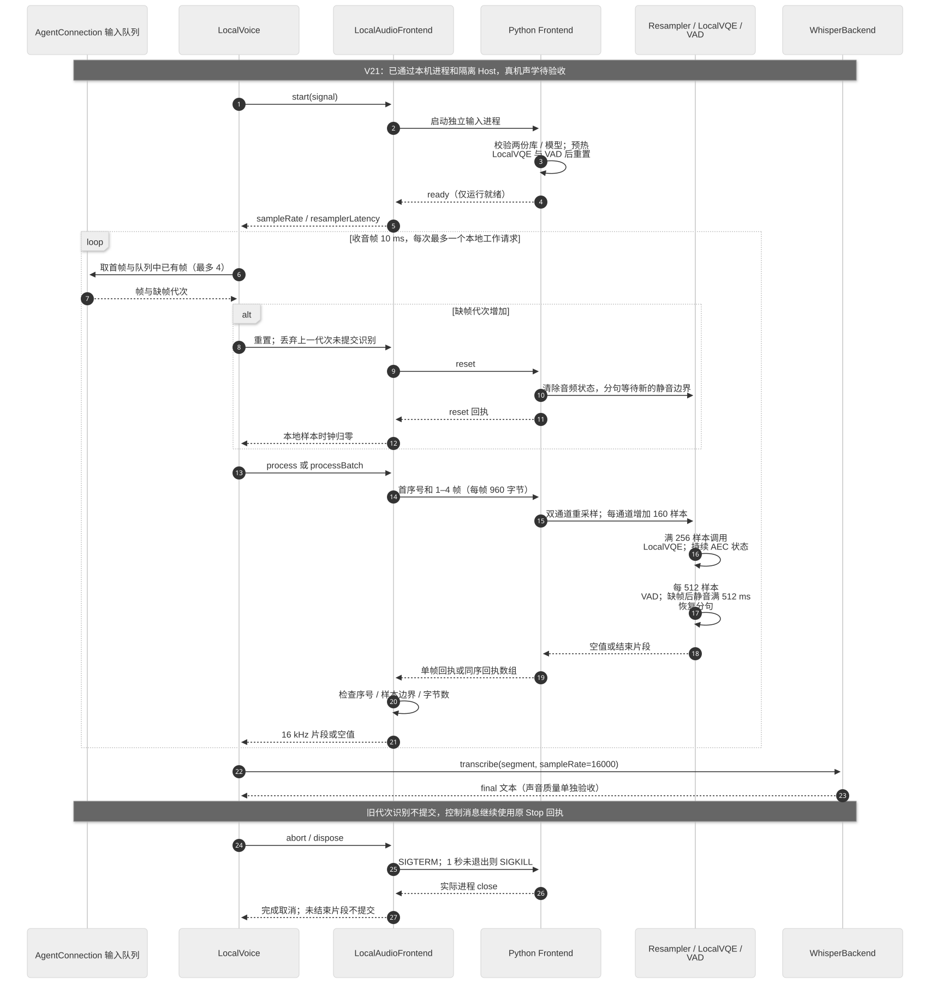
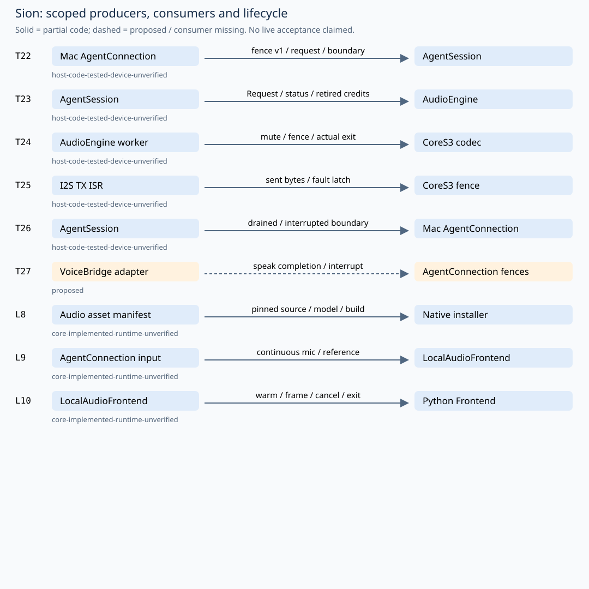
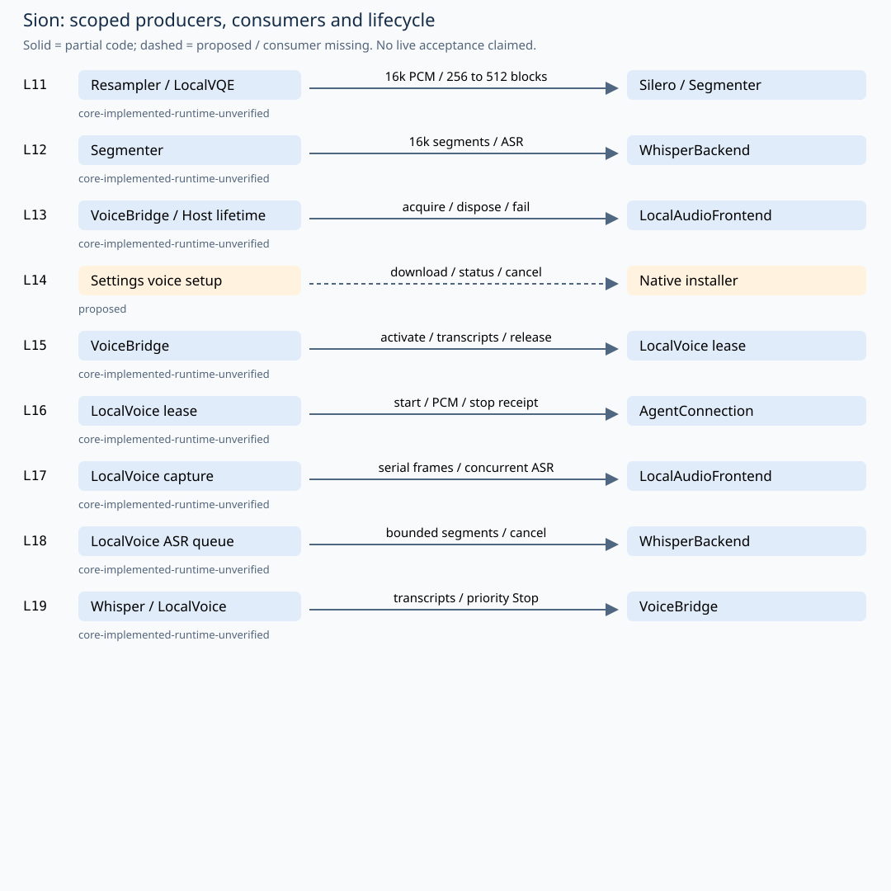

# Mac 输入音频：回声消除、重采样与分句

归属 P2/P4；本页维护设备到识别前的音频处理。LocalVQE v1.3 已通过六种合成场景，在另一份首帧停止样本失败。新准备的托管环境选择 v1.2，既有环境和自定义路径继续使用 v1.3。 [首帧对照](#正式包首帧停止的回声对照) · [托管环境生效条件](voice-installation.md#事务发布与恢复)。[连续本地语音组合](local-voice.md)已接 VoiceBridge 与传输接口。自然人声、真实房间与持续负载仍需实机验收。

## 当前实现与选型

固定输入的原始“停止”可识别；旧 Speex/AEC3 完整处理窗口与其 VAD 分句得到同样错误，故主要故障在 AEC，不能靠调低 VAD 阈值修复。分层结果位于私有 `.local/audio-diagnosis-01/recognition.json`，不含用户录音；失败回归保留在 work/audio-diagnosis-repro.log。旧候选及其失败证据见本页末尾。

采用 [LocalVQE](https://github.com/localai-org/LocalVQE) 的 GGML 流式 C API。源码固定 7f61cd05095d42e56a135b303f5bb4d761da22b9，GGML 子模块 c044a8eeae2591faa0950c8b5e514cbc4bbfc4ca，按上游 CMake 应用固定 GRU 补丁。代码/模型 Apache-2.0，GGML 另保留 MIT 许可。旧 v1.3 与新 v1.2 使用同一原生库、Silero、采样协议和 DSP 时钟。v1.2 需要 [固定权重](../vendor/audio/aec-v12.json)，由托管 v3 收据选定；权重缺失或损坏时拒绝启动。性能为本机观测，不引用上游机器的数字作为本机保证。

输入权威为 [PCM 传输](agent-transport.md)：每帧 10 ms、24 kHz、PCM16LE、240 个交错 mic/reference 样本对。固定 CoreS3 驱动 input_channels=2，AFE 按麦克风在前、参考在后构造 MR；来源为已准备上游的 cores3_audio_codec.cc 和 afe_audio_engine.cc。此映射是源码证据，真实通道幅度、延迟和房间回声还须真机验证。

处理顺序：SpeexDSP 1.2.1 仅负责双通道 24→16 kHz 有状态抗混叠重采样（quality=8）；每帧产生 160 样本/通道，累计 256 样本后交给 LocalVQE（16 ms hop、FFT 512、CPU 单线程）。每通道余量始终小于 256；每个输入请求最多处理一 hop。净化 PCM 每 512 样本交给 Silero VAD v6.2.3，再由有界分句器输出 16 kHz mono 给 Whisper。重采样延迟 80 样本只是该组件延迟，不能当整个识别链路延迟。

LocalVQE 不与旧 AEC 级联，不启用额外硬噪声门，也不在播放时关闭输入。每个输入进程持续保留 AEC/VAD 状态，预热后仅在报告 ready 前 reset；不在每句之间重置。独立输入进程不调用 TTS/DSH。真正 Host 消费者须持续读取设备帧，不能在这个循环中 await DSH 或等待整句播完。

官方依据：[LocalVQE GGML](https://github.com/localai-org/LocalVQE/tree/7f61cd05095d42e56a135b303f5bb4d761da22b9/ggml)、[SpeexDSP 手册](https://www.speex.org/docs/manual/speex-manual/node7.html)、[Silero VAD](https://github.com/snakers4/silero-vad)。Silero 固定提交 5cd7945676eb32225748052e2e6a0580e4686a08，模型禁止运行时隐式下载。Native 库 stdout 日志转 stderr，JSON 协议使用独立复制的输出 FD；Node 排空诊断，不向用户界面透传。

分句：高阈值 0.6，低阈值 0.35；96 ms 起音确认、256 ms 前导（包含起音确认的 3 块）、512 ms 连续尾部静音、至少 160 ms 语音、每段最多 20 s。时间轴为净化后的 16 kHz PCM，含 DSP 初始延迟，不当作设备硬件采样时间。长句按无重叠片段输出，continuation=true；这避免重放，但边界词可能截断，仍需 ASR 分段质量验收。断线/取消丢弃未提交尾段，不强制送 ASR。

验收分层：分句与协议边界、实际原生库/模型推理、合成回声与近端声音保存、最后才是真机全双工/房间/自然发音。成功加载模型不等于 AEC 有效；AEC 指标也不等于完整“停止”链路通过。

## 实际接口、顺序与影响方



图表来源：[LocalAudioFrontend](../src/local-audio.mjs) 的 start/processBatch/reset/dispose、[Frontend/AudioDsp/StereoResampler/LocalVqe/Silero/Segmenter/run](../scripts/local_audio.py)、[WhisperBackend](../src/local-speech.mjs)。V21 显示本机输入的批次、缺帧恢复和退出；LocalVoice 消费者的并行顺序见 [V22](local-voice.md#顺序与全部影响方)。已过真实本地音频进程和隔离 Host 验证，真机声学待验收。

| 接口 | 字段、所有权与失败 |
|---|---|
| `new LocalAudioFrontend({python,directory,aecV12,...})` | 绝对路径；构造不启动进程。使用既有 Python 3.11/Torch 环境，directory 为独立准备目录。仅托管 v3 传入 `aecV12`，使用额外校验的 v1.2 权重。worker override 用于隔离测试 |
| `start({signal})` | 每实例一次；固定资产与两份编译库校验、LocalVQE/VAD 预热与重置后 ready。默认 20 s 期限；此后 owner 才能请求设备 Start，LocalVoice.activate 已接此顺序，真机未验收 |
| `process(pcm,{signal})` / `processBatch(frames,{signal})` | 每帧恰好 960 字节交错双通道，批次一至四帧。一次仅一个 pending，无内部帧队列。默认 2 s 期限是故障边界 |
| 请求/响应 v1 | sequence 从 0 严格连续、受 JS 安全整数限制。单帧沿用原消息，批次使用有序的 data 和 frames 数组。输入 JSON 行 ≤5200 字符，每帧 canonical base64；响应总缓冲 ≤900000 字节 |
| `reset({signal})` | 独立请求，只有无在途请求时接受。进程重置 DSP/VAD/分句与时钟，等待新静音边界；Mac 在收到 reset 回执后从序号 0 开始 |
| 返回 | probability 为 null 或 0–1；segment 为 null 或 `{pcm,sampleRate:16000,sampleStart,sampleEnd,reason,continuation}`；样本边界与实际字节数严格对应，片段 ≤20 s，不超出已处理时钟、不重叠 |
| `dispose` / abort / timeout | 立即废弃旧响应，SIGTERM 后 1 s 未退出升级 SIGKILL；等 ChildProcess close 再拒绝/完成。进程退出丢弃 AEC/VAD 状态与未完成片段，不写录音文件 |
| Whisper 消费 | `transcribe(pcm,{sampleRate:16000,language,signal})`；默认 24 kHz 兼容原后端，限制按所选采样率计算 30 s。实际新 16 kHz 消费通过合成试验，LocalVoice 已实现有界 ASR 队列/停止抢占；用户 Host 未接 |

| ID | 生产者 → 消费者 | 状态与后续责任 |
|---|---|---|
| L8 | Audio asset manifest → Native installer | 固定 tar/model/license，hash 校验，私有原生构建与收据 |
| L9 | AgentConnection input → LocalAudioFrontend | LocalVoice 持续消费已通过 TLS carrier 与定时模型测试；真机未接 |
| L10 | LocalAudioFrontend → Python Frontend | 预热、单帧与一至四帧批次、缺帧时 reset、单 pending、取消和实际退出已测 |
| L11 | Stereo resampler / LocalVQE → Silero / Segmenter | 持续状态、160→256→512 样本缓冲与分句已测；六种合成场景通过 |
| L12 | Segmenter → WhisperBackend | 16 kHz 片段进入真实 Whisper；合成停止/否定停止通过，自然人声未验收 |
| L13 | VoiceBridge / Host lifetime → LocalAudioFrontend | LocalVoice owner 已接桥；实际进程退出与设备确认分别等待，正式插件卸载已接 VoiceRuntime，用户实例仍未验收 |
| L14 | Settings voice setup → Native installer | 模型状态、加载自检和取消 UI 已接 VoiceEnvironment；下载/安装仍缺，不能显示“可聊天” |




## 准备与复现

[prepare_audio.py](../scripts/prepare_audio.py) 复用 hash 下载器；包内 [清单](../vendor/audio/assets.json) 六文件共 40,541,251 字节，包括两份新增源码归档和 19,268,160 字节的 LocalVQE 模型。需 C 编译工具、make、git、CMake；脚本通过 configure/make 与 CMake 构建两份动态库，不全局安装。只验证 macOS arm64，其他平台明确拒绝。

安装目录私有 0700、编译库和收据 0600，构建锁单写者；解包只允许普通文件/目录，限制数量和展开大小。native.json v2 绑定清单、构建脚本、平台、源码提交、补丁 hash 与两个库的 hash。存在不匹配收据或半成品库时拒绝复用，使用新目录准备；旧 `.local/audio-dev` 保留为失败候选，不原地升级。编译 hash 是本次构建证据，不宣称跨机器二进制一致。

归档内应用 GGML GRU 补丁时设置 GIT_CEILING_DIRECTORIES，阻止 Git 向上发现用户仓库；依次执行 apply --check、apply、reverse --check，核实补丁确实应用。首次归档构建因 Git 在父仓前缀下跳过补丁而缺失 ggml_gru；修复后实际源码构建通过，不创建额外 Git 仓库或提交。日志 work/audio-vqe-prepare-v2.log；再次运行复用校验成功。

```sh
python3 scripts/prepare_audio.py --directory .local/audio-vqe-dev
# CMake 不在 PATH 时另传 --cmake /absolute/path/to/cmake
STACKCHAN_LOCAL_AUDIO_RUNTIME=.local/audio-vqe-dev .local/voice-dev/venv/bin/python scripts/test_local_audio.py
STACKCHAN_LOCAL_AUDIO_RUNTIME=.local/audio-vqe-dev node --test test/local-audio.test.mjs
STACKCHAN_LOCAL_AUDIO_RUNTIME=.local/audio-vqe-dev STACKCHAN_LOCAL_VOICE_RUNTIME=.local/voice-dev STACKCHAN_WHISPER_BINARY=work/whisper-v1.9.5/build-sion/bin/whisper-cli node --test test/local-audio.test.mjs
```

最后一条运行真实模型和六场景验收。可另传 `STACKCHAN_AUDIO_FIXTURE=.local/audio-fixture-01` 固定私有合成 PCM；不传则由已准备 Kokoro 合成。要复验托管 v3 的实际选择，把输入/语音目录改为同一托管 v3 环境，额外传 `STACKCHAN_AUDIO_AEC_V12=1`。默认 npm test 跳过未准备的大模型检查，须另报实际模型结果。未采集用户麦克风或播放扬声器。许可见 [NOTICE](../vendor/audio/NOTICE.md)。

## 当前实际验证

生产代码（无研究 worker override）：Python 原生 9/9 通过（work/audio-vqe-native-tests.log）；Node 音频测试 6/6 通过且无跳过（work/audio-vqe-end-to-end.log）。覆盖真正模型、连续 hop 时钟与有界余量、重采样抗混叠/通道隔离、非法帧/序号、协议限额、取消与实际进程退出。全套默认 JS 118 项：115 通过、3 个大模型测试跳过（work/audio-vqe-full-suite.log），包括实际 tarball Host Loader 与许可证包内容检查。

| 合成场景（每个 8 秒） | 实际片段/转写 | 处理时间 |
|---|---|---|
| 只有播报回声 | 0 片段 | 4741 ms |
| 起播即说停止 | 1 片段：“停止” | 4791 ms |
| 第 5 秒说停止 | 1 片段：“停止” | 4764 ms |
| 无播报、仅近端 | 1 片段：“停止” | 4790 ms |
| 播放中说不要停止 | 1 片段：“不要停止。”；isStop=false | 4883 ms |
| 主回声延迟从 20 ms 增至 80 ms | 1 片段：“停止” | 4805 ms |

这是 Mac CPU 单线程 DSP/VAD 加 Node 协议的离线耗时，ASR 在收集片段后运行；不代表真实连续投喂时的掉帧、并行 TTS/ASR 争用、停止响应延迟或最坏时延。六场景没有录制自然人声，没有非线性扬声器/移动房间验证。持续输入、有限 ASR 队列与优先 Stop 已由 [LocalVoice](local-voice.md)组合；下一步接正式 Host 和设置生命周期；P2/P4/P8 保持未完成。

### 正式包首帧停止的回声对照

在隔离原生 DSH 与 C++ 设备组合中，播放器首次写帧后立即输入合成「停止」。采集该代次的 16 秒合成 mic/reference PCM，逐样本从混音中核对 28,200 个近端样本，精确对齐到第 525 帧。离线用相同的托管 Python、LocalVQE v1.3、Silero 和常驻 Whisper 重放。自动切段和绕过 Silero 的完整时间窗共用同一份净化 PCM。

| 单变量对照 | 原生 Whisper 结果 |
| --- | --- |
| 原始双讲，原生自动切段 | 停止词所在片段识别为「嗯 只」 |
| 原始双讲，包含完整近端时段的净化 PCM | 识别为「不知」 |
| 仅移除夹具注入的已知回声，原样保留播放参考 | 自动切段和完整时间窗都识别为「停止」 |
| 仅移除近端停止词，继续播放并混入回声 | 问候后没有额外自动片段 |
| v1.3 播放参考音量 ×0.25、×0.5、×2 | 均未保住停止词 |
| v1.4-AEC 200K、2.7K | 200K 未保住停止词。2.7K 保住停止词，但纯回声对照也产生自动片段并把播报识别成发言 |
| 2.7K 级联 v1.3，级间参考对齐 0/16/32 ms | 三种均未保住停止词 |
| v1.2 | 原生切段和完整时间窗均识别为「停止」。无近端时无额外自动片段 |

原失败点在注入模拟回声后的前端输出。v1.2 补验同一时序下的「不要停止」、在问句里提到停止、扬声器独自播报「停止」，三个对照均未触发整句停止；六项既有固定合成场景也通过。测试对照留在 `work/sion-early-stop/`，`early-usb.pcm` 的 SHA-256 为 `7aa0730e61e2a84f41cc96ed68846fdf9e24a3344fa314c181fa87c6229d8247`。它来自合成夹具，Sion 的参考延迟、音量、非线性及自然人声仍需现场测量。 [正式包复现命令](voice-runtime.md#原生-dsh-与固件会话核心组合演练) · [LocalVQE 官方模型差异](https://github.com/localai-org/LocalVQE/blob/7f61cd05095d42e56a135b303f5bb4d761da22b9/README.md)

## 历史失败与选型依据

旧 SpeexDSP 候选原生 9 项检查通过：帧顺序/错误/关闭、静音模型、分句、重采样混叠和有界协议。稳定线性合成回声降低 35.31 dB，双讲独立信号输出 RMS 604.23；这些是固定随机种子和人工路径，不能推广为真实房间效果。Node 进程协议另测版本/序号/超大响应/伪造片段、挂起时取消、SIGKILL 与实际退出。

真实 Kokoro → 人工延迟混音 → Speex/Silero → Whisper：8 秒音频处理约 101–105 ms（离线快于实时投喂，非端到端/无线延迟）。近端在第 5 秒说“停止”，被完整识别；但只有远端播报时仍产生 1 个回声片段，识别为“現在更在…”等文字。质量验收失败，保留 work/local-audio-stop-experiment-v4.log。初次无残余抑制会转写完整播报；-15 dB 预处理还让双讲独立信号 RMS 降至 341.98，故改为保守 -6 dB，未借此声称回声问题已解。

比较试验：[strands-labs/pywebrtc-audio](https://github.com/strands-labs/pywebrtc-audio) 0.2.0，源码审查提交 1bc860a2051c2b9b3c10b8c778770794b9321d84，未归档、2026-09-03 最近推送（仓库仅 4 提交，不能仅凭组织名称推定成熟）。Mac arm64 CPython 3.11 wheel SHA256 b6b80b00590e1a2dc588906e381a2aebc4d5c5707687541014797b8f02b1223f；仅放私有研究目录，**未加入生产依赖或默认后端**。其 EchoCanceller 接 AEC3，双通道先等速重采样至 16 kHz，再按 10 ms 调用；0/20 ms stream delay 两组均不产生 echo-only 片段，却分别把近端“停止”识别为“風景”/“成绩”。日志 work/local-audio-aec3-experiment.log、local-audio-aec3-delay20.log；两个默认候选都未同时满足抑制回声和短命令保留。

当时决定先分离 AEC 失真、VAD 截断和短句 ASR，再比较处理后端；现在已完成分层诊断并用 LocalVQE 通过上述合成回归。不同音量、路径变化和自然语音仍待验证，不以起播静音窗口或关闭麦克风掩盖失败。

补充受控对比：早期各次重新 TTS 合成，音频并非逐字节相同，不能把单次转写改善归因为某个参数。现在比较可显式传 `STACKCHAN_AUDIO_FIXTURE=.local/audio-fixture-01`，读同一私有合成 PCM；测试输出两文件 hash。far 为 332400 字节、SHA256 8f15c60ec73230d084fa9f8d1dd17d4f3b4033d02d8e26a48f52e4230dc7702b；near 为 56400 字节、SHA256 19128665bec198652ce095fbe28761d1ddbec8b96a72fd13b50876e5cd4e6b63。它们不是用户录音；未加入公开包。新增 nearStartSeconds=0，检查初始双讲，测试没有调低验收要求。

| 同一固定样本 | 只有播报 | 起播即说停止 | 第 5 秒说停止 |
|---|---|---|---|
| 旧 Speex 候选 | 错误产生“現在正在” | 错识别“停在人” | 产生回声片段及正确“停止” |
| AEC3，前导缓存 512 ms | 无片段 | 未产生片段 | 错识别“同志” |

两者均失败，日志 work/local-audio-fixed-speex.log / local-audio-fixed-aec3.log；AEC3 的 512 ms 前导曾在另一份临时合成样本通过单个稳态案例，但扩展到初始双讲及固定样本后未通过，因此未采用。这一负例将约束下轮实现；不能只挑一次通过的日志。
