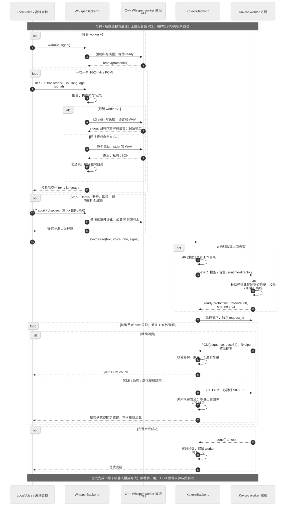
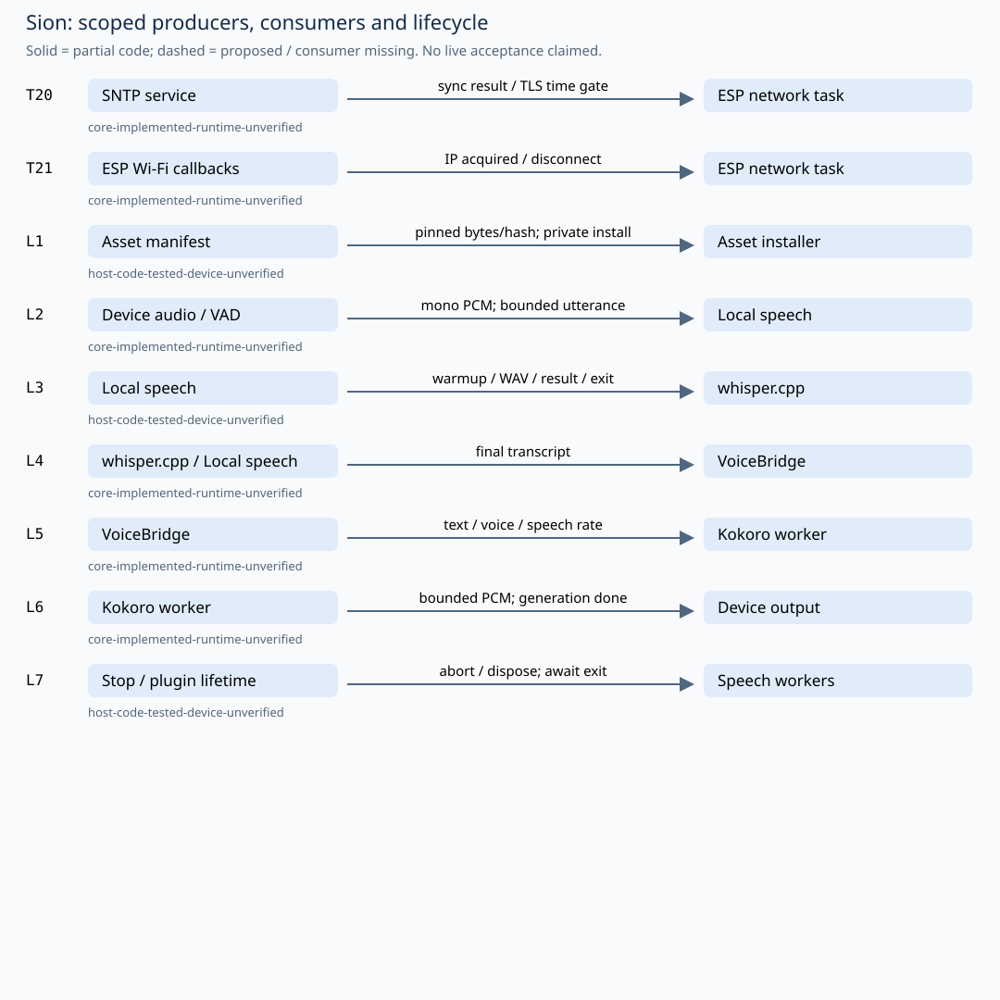
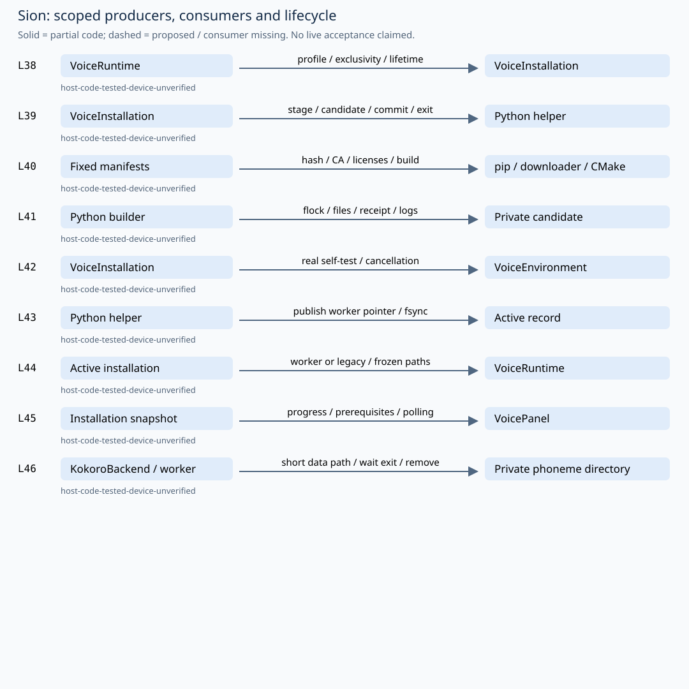

# Mac 本地识别与语音合成

归属 P2/P4/P8。本页负责音频/文本推理后端、模型来源和子进程生命周期；[VAD/AEC 输入候选](local-audio.md)已通过六种真实模型合成场景；自然人声/房间声学仍待验收，[LocalVoice](local-voice.md)已组合持续收音、停止词抢占和数字播放确认；正式 Host 运行控制已接，用户 DSH Session 与真机仍待验收。不能因为后端能产生文字/音频，就将 independentVoiceCapabilities 全部标为可用。

当前已实现 whisper.cpp PCM 识别、常驻 Kokoro 中文/英文合成、有界管道和进程取消。在项目私有目录准备固定模型并完成中文/英文合成样本往返识别；不读用户录音，不发 DSH prompt，不调用原厂云，不播放扬声器。准备程序与 DSH 设置页安装流程分别验收。已有配置枚举 whisper.cpp/kokoro 保留，用户人格、模型和记忆仍由原 DSH 会话拥有。

## 官方依据与选择

核对 [whisper.cpp v1.9.5](https://github.com/ggml-org/whisper.cpp/releases/tag/v1.9.5)，固定提交 d1be6fde11ac6e0407606b4e42fe72d34add8037。CLI 支持 WAV/JSON 输出，common-whisper.cpp 的 miniaudio decoder 负责转换至模型采样率；本项目不自行用线性插值冒充抗混叠重采样。引擎与 Whisper 模型为 MIT；模型文件取维护者的 [GGML 模型仓](https://huggingface.co/ggerganov/whisper.cpp)，固定 revision 与 SHA256。

核对 [Kokoro 官方中文模型卡](https://huggingface.co/hexgrad/Kokoro-82M-v1.1-zh/blob/01e7505bd6a7a2ac4975463114c3a7650a9f7218/README.md) 和 [官方 pipeline/model 实现](https://github.com/hexgrad/kokoro/tree/dfb907a02bba8152ca444717ca5d78747ccb4bec)。模型 Apache-2.0，输出 24 kHz；0.9.4 Python 包要求 Python >=3.10,<3.13，因此不能直接装进现有 Python 3.15 配对环境。使用独立 Python 3.11 环境；模型、config 和 voice 显式指定本地文件，推理阶段禁止隐式下载。普通音色为模型附带的 zf_001 / af_maple，不克隆用户声音。

选择小型组件组合而非社区整个 Agent：xiaozhi-server 自带 dialogue/intent/LLM 循环，warble HTTP ASR 请求取消不代表服务端计算已取消，且会保存调试录音。本项目不导入这些人格/持久录音策略；复用官方语音组件，只增子进程与协议适配。替代候选及维护调查见 [本地语音选型](local-voice-options.md)。

## 接口与生命周期（实施契约）

构造后端只保存显式本地路径。识别将有界 16/24 kHz PCM16 mono 包装成内存 WAV。新版托管环境经本机父子进程管道送进 `sion-whisper-worker`，每次语音连接复用一次模型加载，识别结果也只走管道。旧托管环境和自定义路径继续调用固定版 `whisper-cli -f -`，私有临时目录仅供短期 JSON 结果，校验后清理。Kokoro 合成以有界 JSON 行输入，输出有序 PCM16LE/24 kHz。界面接收固定错误码。 [Mac 后端](../src/local-speech.mjs) · [原生 worker](../vendor/voice/whisper-worker/main.cpp) · [固定版内存 WAV 解码](https://github.com/ggml-org/whisper.cpp/blob/d1be6fde11ac6e0407606b4e42fe72d34add8037/examples/common-whisper.cpp#L166)

ASR/TTS 分开占用进程与取消信号，TTS 不能阻塞识别。忙碌时拒绝第二个任务；超时/取消先 SIGTERM，必要时 SIGKILL，并等待实际进程退出后才释放所有权。迟到输出必须丢弃，临时文件在退出后清理。TTS 读取应受消费者背压约束，不能先无限缓存全部音频。参数与退出证据见下文；不能把本地生成完毕当设备播放完成。

模型清单记录固定来源、许可和大小，准备程序验证下载字节数与 SHA256 后发布。正式 DSH 设置已接环境状态、可取消离线自检、托管模型安装与本地音色试听。离线试听仅合成固定短句。持续对话需要认证设备和接通已选会话。 [环境与自检](voice-environment.md) · [模型安装](voice-installation.md) · [本地试听](voice-environment.md#本地音色试听)

| ID | 生产者 → 消费者 | 本批责任 / 后续缺口 |
|---|---|---|
| L1 | Asset manifest → Asset installer | 固定来源、大小、hash；验证后发布本地文件 |
| L2 | Device audio / VAD → Local speech | 识别输入；LocalVoice 已组合 VAD/AEC，真实设备未接 |
| L3 | Local speech → whisper.cpp | 有界 WAV 从 stdin 读取，JSON 从一次性私有目录回收；单语段取消关闭管道并等待进程退出。 |
| L4 | whisper.cpp → VoiceBridge | final 文本；后端输出与持续会话组合分别验收 |
| L5 | VoiceBridge → Kokoro worker | 本轮最终文本/音色/语速；不插入人格提示 |
| L6 | Kokoro worker → Device output | PCM chunks / 背压；后端生成不代表设备已播完 |
| L7 | Stop / plugin lifetime → Speech workers | 取消、等待退出、临时数据清理；真实持续停止仍待声学验收 |

验收须分别记录：实际模型推理、子进程失败/超时/取消/背压测试、真实无线和声学场景。合成语音往返转写是集成样本，不能证明自然中文准确率、主人声纹、回声消除或播放中停止延迟。


## 实际 API 与进程时序



图表来源：[WhisperBackend / KokoroBackend / launch / Lines](../src/local-speech.mjs)，[run / synthesize](../scripts/local_speech.py)。V19 描述隔离后端测试；新增 LocalVoice/VoiceBridge 消费者见 [V22](local-voice.md)，正式 Host/DSH 设置运行控制已接线，用户实例未安装。Python socket connect 被拒绝且 HF/Transformers 使用离线标志；这是对隐式下载的防护，不是第三方 native 代码的 OS 网络沙箱。

| 接缝 | 实际输入、输出与约束 |
|---|---|
| `new WhisperBackend({binary, model, temporaryDirectory, protocol=0, timeoutMs})` | 路径须绝对。托管 v2 和 v3 选择协议 1。CLI 路径使用私有临时目录并拒绝符号链接。 |
| `transcribe(pcm, {language, sampleRate=24000, signal})` | PCM16LE 单声道，16 或 24 kHz，最多 30 秒。语言为 auto/zh/en。返回 `{text, language}`，文字上限 8000 UTF-16 单位，默认期限 120 秒。 |
| 常驻识别协议 v1 | ready 后每次收一个 5 字节头，32 位小端 WAV 字节数加语言字节（auto=0、zh=1、en=2），随后读 WAV。stdout 返回一行 `result`，含语言和最多 24,000 字节 UTF‑8 的十六进制。Host 校验长度、编码和结构。 |
| 识别参数 | 与 CLI 的 `-oj -of -np -nt -t 4 -mc 0` 等效。每次请求清除历史文本条件。模型、工作缓冲和最近结果属于该子进程内存，关闭连接后结束进程。 |
| `new KokoroBackend({python, assets, worker?, timeoutMs})` | Python 3.11 独立环境；共享 CPU 模型可在 `warmup` 或首次请求中加载，成功后复用；取消或失败后销毁，下次重新加载；默认整次请求期限 180 秒含冷启动和消费暂停 |
| `warmup({signal})` | 收音等待前端与托管识别。首次 Kokoro 可在启动语音服务时准备，连接时接手；其它连接与输入并行加载。合成等待就绪。旧 CLI 随首条识别启动，仅字幕跳过合成。Stop 或取消会终止正在启动的 worker。 [调用和所有权](local-voice.md#实际接口与所有权) |
| `synthesize(text, {language, voice, speechRate, signal})` | AsyncGenerator；文本最多 8000 UTF-16 单位；语速 0.5–2；音色空值按语言选择 zf_001/af_maple，或显式选择这两者；auto 按汉字检测选择中文，否则英文 |
| worker 协议 v1 | ready 验证协议/24 kHz/单声道；request_id 为每次新 UUID；PCM sequence 从 0 连续；base64 严格校验，每块最多 24000 字节，整次最多 120 秒；done.frames 必须等于收到的采样帧数且非零 |
| 背压 | stdout 按消费请求拉取，最多一个 pipe buffer 加一个有界 JSON 行；不预收整个回复。模型仍按 Kokoro 句段生成，有句段级内存，不宣称整个模型逐采样流式 |
| 停止与卸载 | signal/超时/迭代提前退出发送 SIGTERM，1 秒后仍未退出则 SIGKILL；先关闭未消费管道，再等实际 ChildProcess close。dispose 可在消费者暂停时终止进程，不等待调用者继续取下一块 |
| 错误 | 子进程诊断直接排空。ASR 超时、取消或非法响应后先关闭管道并等待退出。旧 CLI 还清除结果目录。 |

默认音色和局部语言选择只决定发音，不修改 DSH 人格或会话记忆。`done` 是本机音频生成结束；设备驱动接受 ACK 也不是听完。设备数字排空/单独打断现已有 [播放能力 v1](agent-transport.md#播放屏障能力-v1)，本后端到该接口的消费者组合仍须实现。



L1/L3 已有实际实现与测试；L2/L4/L5/L6 已通过 LocalVoice 组合消费者；L7 已接桥 Stop 与实际进程释放，正式插件卸载已接 VoiceRuntime，用户实例未验收。该图同时包含相邻 T20/T21 网络关系，ID 全仓唯一。

## 固定环境与复现

模型五个文件总计 518383327 字节，固定 hash 见 manifest。开发环境使用 Python 3.11 和 [完整带 hash 依赖锁](../vendor/voice/requirements-macos-arm64.lock)，[第三方说明](../vendor/voice/NOTICE.md) 包括 eSpeak NG 的 GPL 依赖，不将整套环境误标成只有 MIT/Apache。

托管安装器将 [worker 源码](../vendor/voice/whisper-worker/) 加入固定版 whisper.cpp examples，以 CMake Release 静态构建，关闭 curl、上游测试与服务器，使用 Mac 的 Metal 和 BLAS。旧 CLI 用于开发对照与已有自定义环境。 [托管安装与回退](voice-installation.md)

以下在仓库根执行，所需 uv、Python 3.11 和上述 whisper-cli 先准备好。只在私有工作目录安装，无全局包写入；资产准备阶段需要网络，推理不下载。

```sh
uv venv --python python3.11 .local/voice-dev/venv
uv pip sync --python .local/voice-dev/venv/bin/python --require-hashes vendor/voice/requirements-macos-arm64.lock
python3 scripts/prepare_voice.py --directory .local/voice-dev/assets
STACKCHAN_LOCAL_VOICE_RUNTIME=.local/voice-dev STACKCHAN_WHISPER_BINARY=work/whisper-v1.9.5/build-sion/bin/whisper-cli node --test test/local-speech.test.mjs
```

安装器单写者锁防并发；有效文件重复校验后复用，损坏文件明确拒绝，不静默替换；取消/错误清理 partial，重新验证前撤下旧成功收据。Kokoro 启动重验实际模型 hash，不能只信 installed.json。默认测试无需大模型，实际推理检查仅在显式指定上述环境时运行。

## 实测与下一步

独立语音测试 v2 的中文合成 4.6 秒音频，冷启动到首块 7627 ms、合成总 7628 ms、识别 3988 ms；同一已加载 worker 的英文 2.85 秒音频，首块/合成 265 ms、识别 316 ms。这是本 Mac 单次合成样本，未隔离其他负载，不代表延迟保证或自然语音准确率。中文“希昂”识别为“西洋”，正文转成繁体；名字/读音与简繁策略仍待确认，不能声称 Hi Sion 或自定义唤醒已完成。

初次环境解析成功但真实加载失败：spaCy 3.8.11 仍依赖 Click，解析出的 typer-slim 0.24.0 转接新版 Typer 后没有安装 Click。固定 typer-slim 0.20.0 后实际加载/推理通过。另修复消费者暂停读取时仅 kill 进程却等待未排空 pipe 的退出挂起；回归覆盖提前 break、暂停期间 abort/dispose、SIGTERM 无响应升级 SIGKILL。

设备双通道 mic/reference 的 [VAD/AEC 候选](local-audio.md)及 16 kHz Whisper 消费现已实现；旧 AEC 的冷启动误识别已通过 LocalVQE 的固定六场景回归，LocalVoice 已组合 VoiceBridge 与播放排空/Stop 确认，下一步接插件生命周期；模型下载/状态/试听/取消必须接 DSH 设置 UI。原厂模式、用户 DSH 会话、实际麦克风和扬声器均未操作，P2/P4/P8 保持未完成。

### Whisper 输入和搜索参数对照

用固定版 whisper.cpp、`ggml-small-q5_1.bin` 和 Mac mini M4 Pro 跑八条中英文合成句，每种方式各重复五轮。每条句子的 WAV 在全部对照中逐字节一致，其中一条在中文否定与「停止」之间人工加入 350 ms 静音。每个试次新启动 CLI，按轮次轮换方式，先预热文件缓存。耗时从启动 CLI 到退出，涵盖本地识别，不含采集、分句、网络、DSH 或播放。 [对照脚本](../scripts/benchmark_whisper.mjs) · [固定版 CLI 参数](https://github.com/ggml-org/whisper.cpp/blob/d1be6fde11ac6e0407606b4e42fe72d34add8037/examples/cli/cli.cpp)

| 方式 | 八条句子的耗时中位数再取中位数 | 与文件基线转写一致 | 停止分类符合样本标签 |
|---|---:|---:|---:|
| 原 WAV 文件与搜索参数 | 272.5 ms | 40/40 | 40/40 |
| stdin 管道，原搜索参数 | 274 ms | 40/40 | 40/40 |
| 随句长缩短音频上下文 | 193.5 ms | 30/40 | 40/40 |
| 搜索只保留一个候选 | 257.5 ms | 35/40 | 40/40 |

采用 stdin 消除录音临时文件。逐句提速介于慢 6 ms 和快 6 ms，本批没有稳定收益。缩短上下文逐句中位数省 65–96 ms，但会改写转写；两个搜索参数试验均出现中文否定停顿句的变化，暂留现有识别参数和句尾规则。稳态 CLI 的模型加载中位数约 58 ms。声学首音、自然中英文和实际停词抗干扰仍按 [A5 真机测量](voice-runtime.md#真机声学延迟) 验收。

```sh
node scripts/benchmark_whisper.mjs work/whisper-v1.9.5/build-sion/bin/whisper-cli .local/voice-dev 5
```

### 模型复用与语言检测开销

五轮配对对照使用相同的八条合成 WAV、固定模型和现行搜索参数。逐句启动 CLI 的计时从进程启动至该条推理完成标记。复用组在同一进程加载一次模型，先跑一条不计分的预热句，再计相邻完成标记的间隔。逐轮轮换句子顺序及两组的先后。表中每列先取同一句五轮的中位数，再取同组中位数。 [固定版 CLI 模型加载与逐文件循环](https://github.com/ggml-org/whisper.cpp/blob/d1be6fde11ac6e0407606b4e42fe72d34add8037/examples/cli/cli.cpp#L1124)

| 识别语言 | 独立启动 | 复用模型 | 配对节省 | 转写、语言结果与停词判定一致 |
|---|---:|---:|---:|---:|
| 中文 | 268 ms | 144 ms | 125 ms | 25/25 |
| 英文 | 262 ms | 133 ms | 127 ms | 15/15 |
| 自动选择 | 375 ms | 247.5 ms | 128.5 ms | 40/40 |

两组的停词判定均符合合成样本标签，包含「不要停止」。对同一 WAV，自动选择语言比显式语言的配对中位数多 112.5 ms（独立启动）和 109 ms（复用组）。上述收益包含进程和模型初始化。这组数据来自 CLI 批处理，下面另列实际运行后端的对照。

```sh
node scripts/benchmark_whisper.mjs work/whisper-v1.9.5/build-sion/bin/whisper-cli .local/voice-dev 5 --reuse-model
```

### 常驻识别后端对照

同一批 24 kHz 合成句经旧 CLI 和新 worker 的实际 Node 后端，五轮交替先后顺序并轮换句序。每条都运行显式语言和自动选择；同一常驻实例交替处理中文、英文和自动选择。80 对的完整转写、识别语言和预期停词判定逐条匹配。计时从调用识别到收到结果。单次冷预热为 3,655 ms，计入连接阶段，后续各句复用。样本覆盖中英文停词、否定和带停顿的否定，实体采音和首音仍按声学验收。

| 语言设置 | 配对数 | 旧 CLI 中位数 | 常驻中位数 | 配对节省中位数 |
|---|---:|---:|---:|---:|
| 显式中文或英文 | 40 | 285 ms | 136 ms | 146 ms |
| 自动选择 | 40 | 393 ms | 245 ms | 143 ms |

```sh
node scripts/benchmark_whisper.mjs work/whisper-v1.9.5/build-sion/bin/whisper-cli .local/voice-dev 5 \
  --worker=work/whisper-worker-verified/engine/bin/sion-whisper-worker
```

## Kokoro 冷启动分段与线程对照

托管 v3 在同一台 Mac 以实际 `KokoroBackend` 和固定环境执行四种候选，各三次新进程，交错顺序。就绪从 Node 调用 `warmup` 到 `ready`，后三列从提交同一合成样本到收到第一块 PCM。无 DSH、ASR、网络或实体设备参与。单次之前的基线为 5,353 ms。本表只比较同批运行，文件缓存和系统负载会影响绝对值。 [后端和 worker](../src/local-speech.mjs) · [Kokoro 固定版的发音管线](https://github.com/hexgrad/kokoro/blob/dfb907a02bba8152ca444717ca5d78747ccb4bec/kokoro/pipeline.py)

| 方式 | 就绪中位数 | 中文首块 | 中英混合首块 | 英文首块 |
| --- | ---: | ---: | ---: | ---: |
| 现有 4 个推理线程 | 3,749 ms | 453 ms | 304 ms | 217 ms |
| 模型权重与发音管线并行，4 个推理线程 | 3,609 ms | 442 ms | 300 ms | 218 ms |
| 2 个推理线程 | 3,677 ms | 518 ms | 390 ms | 277 ms |
| 1 个推理线程 | 3,751 ms | 656 ms | 586 ms | 403 ms |

独立 cProfile 样本覆盖完整 `load`。受计时开销影响，总计 7.5 秒，其中导入累计约 5.2 秒，模型构建约 0.43 秒。两条发音管线的累计时间约 2.8 秒，包含各自发生的导入，不能与总导入时间相加。四种候选的同句音频帧数一致。基线本身在重跑时 PCM 摘要不同，帧数只能说明长短一致。并行的 140 ms 变化不足以承担额外的初始化路径，保留现有线程与加载次序。本轮使用的合成输入、参数和私有计时脚本保存在 `work/sion-kokoro-cold/`。使用者的完整语音首帧仍按 [设备链路对照](validation.md#托管-v3-的局域网语音验收) 测量。

## 长安装路径与发音数据目录（2026-11-19）

真实托管环境首次自检在 synthesis 失败：espeakng-loader 0.2.4 的本地库在数据路径达到 160 字节时忽略该路径，回落到不存在的上游 CI 路径并退出。实际短开发目录能用、长 profile 目录失败；两个环境的库、phontab 和 wrapper 字节相同。上游已有 [issue #10](https://github.com/thewh1teagle/espeakng-loader/issues/10)，当前 PyPI 最新仍为 0.2.4；不能用缩短用户工作区路径作为产品要求。

KokoroBackend 每个 worker 先创建随机 0700 短临时目录，给固定 worker 传 `--runtime-directory`；TMPDIR 太长时用 POSIX `/tmp` 下随机私有目录。worker 只在 eSpeak 数据实际绝对路径的 UTF-8 字节数达到 160 时，复制其已安装词典数据到短目录，并在 Misaki 导入后、KPipeline 初始化前通过 EspeakWrapper.set_data_path 指向副本。检查临时目录所有者/权限/类型和最终路径字节数；不修改 site-packages、模型、用户 HOME 或全局库。

L46：KokoroBackend / worker → Private phoneme directory。Node 持有目录生命周期，正常退出、启动失败、取消与 SIGKILL 后均等 close 再删；dispose 也等待尚在创建目录的启动步骤，不能留下迟到 worker。只有词典副本，不保存用户语音/正文。该生命周期加入 [V19](#实际-api-与进程时序) 与关系账本；真实长路径候选的八项检查和中英文合成/识别自检通过，完整安装发布仍另由 [安装页](voice-installation.md) 验收。


