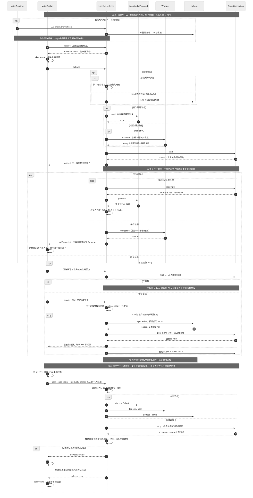
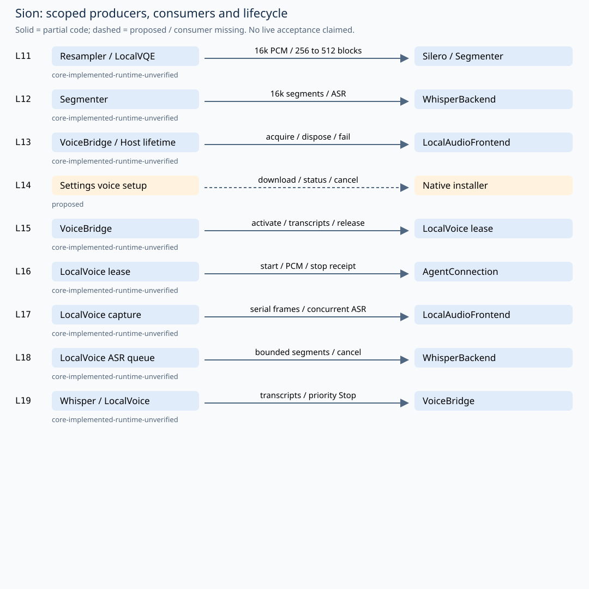
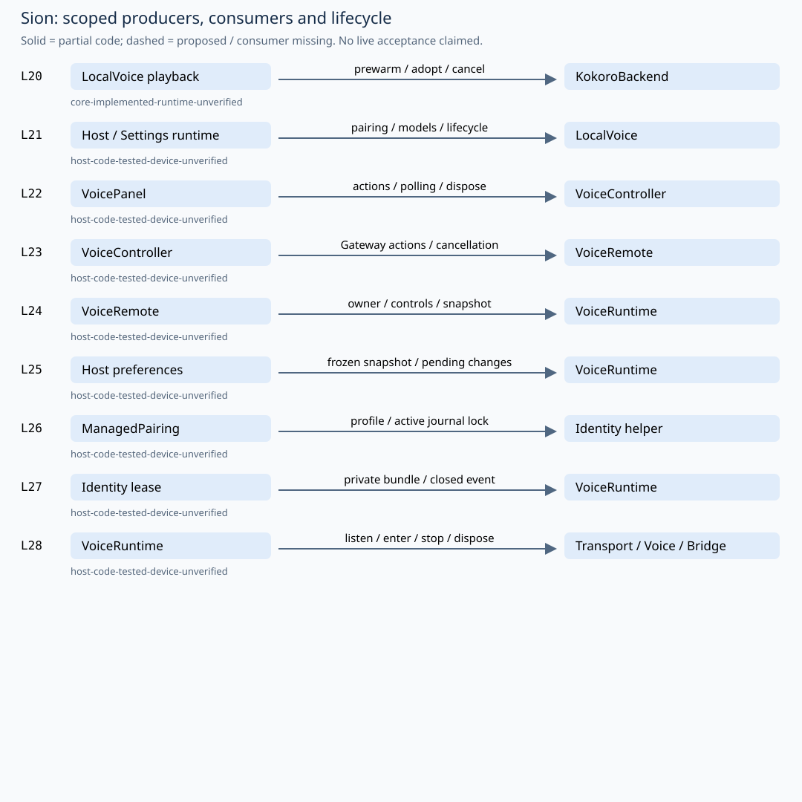

# 连续本地语音与会话桥

归属 P2/P4。本页负责 LocalAudioFrontend、Whisper、Kokoro、AgentConnection 和 VoiceBridge 的实际组合。组合实现已通过本地测试、真实 TLS carrier 和实际模型定时输入；正式插件运行控制已接入并通过隔离测试；用户实例及真机仍未接入；不得将构造 adapter 解释为设备已经可用。

## 设计与完成条件

每次语音 lease 独占一个已认证、空闲的连接，并持有输入、识别与播报进程。DSP 与托管版 Whisper 准备完成后立即 Start 设备并等待回执，收到回执就能说话。连接可接手服务启动或待命中已加载的 Kokoro。首句预合成和正式播报等待同一就绪结果，两处等待都能取消。仅字幕跳过 Kokoro，旧 CLI 保留逐句启动。Stop、Home 或断线时，收音与识别任务退出，合成资源依据待命状态和设备释放回执清理。 [识别与合成协议](local-speech.md#实际-api-与进程时序)

持续输入只等待 DSP，每次消费已经收到的一至四帧，不等待 ASR、DSH 或 TTS。ASR 串行消费有限片段队列，完成转写后调用 onTranscript 但不等待其普通问答 Promise；Stop 由 VoiceBridge 整句判定并优先取消。识别积压超出上限时结束租约。时间/容量是配置，实际声学验收另见[验证](validation.md)。

TTS 按 24 kHz 单声道 480 字节帧发送，尾段补零；按最多 8 帧的窗口等待实际传输 ACK，句末等待数字播放排空。输入同时运行。整个 lease 被取消时用完整 Stop 抢占播放屏障，不用取消屏障的 signal 误关连接；仅匹配 resources_stopped 回执才能报告 deviceIdle。等待本地子进程实际退出后完成释放；断线不能伪造 idle。

「仅字幕」由 DSH `captionOnly` 偏好产生，启动服务时冻结，LocalVoice 只接受声明 `caption:1` 的认证连接。该分支准备 VAD/AEC 与 Whisper，跳过 Kokoro 初始化、预测合成和发送 PCM。VoiceBridge 仍检查回合归属，发送当前转写和已完成的公开回答。字幕不能入队时以固定错误停止当次语音会话；已经提交的 DSH 回合继续由原会话保存。Stop 和 Home 沿用已有链路。 [V22](#顺序与全部影响方) · [设置](settings-ui.md#仅字幕)

检查须覆盖：连续两句、识别/问答/播放并行、DSH 未返回时的 Stop、播放排空等待中的 Stop、旧转写/旧播放丢弃、队列上限、激活失败/不确定启动、未确认释放和重复进入。本批分别验证真实 TLS carrier 与实际模型组合。与原厂 Home/返回路径分开；不改变原语音/绑定。

## 编辑与影响范围

`src/local-voice.mjs` 为组合入口；输入契约在 local-audio.md，ASR/TTS 在 local-speech.md，认证/资源确认在 agent-transport.md，会话人格/记忆仍归 runtime.md 和原 DSH Session。[VoiceRuntime](voice-runtime.md) 已将已保存偏好冻结后传入此服务；仅桥 active 时报告 applied。用户 profile 安装与模型准备 UI 仍缺。

## 实际接口与所有权

`createLocalVoice({getConnection,audio,recognition,synthesis,language,voice,speechRate,maxQueuedSegments})` 构造被动；三个后端配置沿用对应类的绝对路径契约。连接由调用者的已认证 listener 提供，不枚举 USB、不读取配对秘密、不创建 DSH 会话。测试可注入 factories；正式默认使用真实三个后端。仅 device-idle profile；必须空闲且显式支持 playback_fence=1，旧 peer 在开收音前拒绝。

`prewarmSynthesis` 由 Host 显式启动语音服务后调用。播报模式只预备一个 Mac 合成 worker，期间不打开设备、不取麦克风、不合成文本。首次 `acquire` 预约 lease，并接手这个尚在加载或已就绪的 worker；`activate` 每 lease 一次。每次 Kokoro 启动最多等待 25 秒。若等待设备期间已预热失败，首次连接时重试一次。Mac 停止或关闭服务会取消并等待尚未交接的 worker 退出；交接后由 lease 负责相同的清理。开始收音前已经收到的合成启动失败使激活报错，开始收音后发生的失败主动结束当前 lease。首句预合成在等待 Kokoro 时遇到替换，只取消该预览，最终答复可使用仍在预热的进程。「停止」取消预览、合成启动和收音；若设备已启动，另等 `resources_stopped`。若 Start 已发出且回执丢失，保留 recovering。正式 VoiceRuntime 的连接和释放预算为 25 秒，真实设备启动时延仍待验收。

输入循环同一时刻只等待一个批次读取或一个 DSP 请求。识别最多一个在途 + 默认两个待识别片段（配置允许 1–4）；每段上限 20 s/16 kHz PCM16，共默认至多 1.92 MB PCM，不含模型与进程开销。队列满时报 voice-recognition-overflow 并停止通道，错误留在 bridge.lastError 和 voice.status.failure。onTranscript Promise 不阻塞识别循环，因此普通 DSH/TTS 等待不阻止后续 Stop。问答队列仍由桥限制为 4。

每条转写 ID 为 lease UUID + 单调计数；长句 limit 段及 continuation 段携带 commandEligible=false，仍进入普通文本处理，但不把截断片段当完整停止命令。旧转写生产者不提供该字段时保留旧行为。取消后的识别结果丢弃，不重放给下一次 lease。

`prepareSpeech` 每轮最多提前拉取一块有效 PCM，单块上限 24,000 字节。准备过程只用当前 Mac lease 内的 Kokoro worker，不调用设备或字幕端点。`speak` 收到同一个准备句柄并验证正文前缀后，先复用已准备的音频迭代器，再合成正文余下部分，整轮共用一次 `drainOutput`。预合成失败或最终文本无法复用时，在结束旧合成后按完整正文播放。Stop 等待已准备的音频迭代器关闭。 [起播时序与测试](voice-runtime.md#首句预合成)

长答复由同一个 Kokoro 进程按段合成。Mac 从已确认的完整答复选定语言。每段中文最多 120 个 UTF-16 码元，英文最多 240 个。分段优先在后半段内找句末、换行，其次找词间空白。无分隔符时保护 Unicode 代理对。输出窗口为 8 帧。设备 ACK 刷新桥的 180 秒无进展期限，DSH 请求、单个 Kokoro 请求和传输确认各有独立期限。Stop 取消当前片段、后续合成及未播音频。完整答复仍由原 DSH 会话持有，设备字幕走同一份完整文本和既有显示上限。 [Kokoro 分词及音素上限](https://github.com/hexgrad/kokoro/blob/main/kokoro/pipeline.py) · [合成实现](../src/local-voice.mjs) · [桥的计时](../src/bridge.mjs)

播放每帧 480 字节（24 kHz mono/10 ms），最多 8 帧未 ACK；块尾余量小于 480 字节，句末补零后等所有 ACK，再发 drainOutput。ACK 仅驱动接受，排空也不代表声学尾音测量。整个 lease 取消时不把取消 signal 传给 drainOutput，避免其取消规则关闭 socket；使用完整 Stop 抢占，再等待 resources_stopped。`interrupt()` 在桥已取消 lease 时复用完整释放；单独 interrupt 保持输入，但正在等待 drain 时返回 voice-playback-draining，当前未提供“暂停播报”的产品按钮。

释放先取消本地工作并清队列，等激活操作结束，再请求设备 Stop。本地清理与设备关闭可并行。最后等待输入、识别和播放任务退出。已确认 idle 且本地任务收束才能解锁新的 acquire。断线、未知启动或未确认回执为 fault，桥为 recovering。Home 的设备退出事件沿 disconnect 处理。 [设备释放](agent-transport.md)

### 待命中的合成进程

VoiceRuntime 通过内部的 `keepSynthesisWarm()` 提供待命许可。它要求本次服务仍在运行、待命仍有效，且已保存偏好与启动时冻结的一致。LocalVoice 在调用设备 Stop 前确认 Kokoro 已就绪且没有播报或首句预合成在途，然后在设备确认释放、音频和识别任务退出后再次检查许可。成功时只交回一个空闲 Kokoro 进程，前次的语音 lease、队列和连接已解除。接下来的会话仍需新认证连接、麦克风许可和同一份已有 DSH 会话。 [Host 待命循环](../src/voice-runtime.mjs) · [合成进程所有权](../src/local-voice.mjs)

如果 Stop 抢占正在播报或预合成的句子，结束原 Kokoro 进程。待设备确认收放音已停、旧连接关闭后，如果待命仍有效，Host 可开始加载下一进程。没有设备释放回执时关闭旧进程。Mac 撤销待命、关闭服务、Host 异常或设置不再匹配导致待命结束时，Host 等待闲置合成进程退出。



### 输入连续性丢失后的恢复

传输队列淘汰帧后增加本机缺帧代次。LocalVoice 丢弃旧待识别片段、旧 DSP 在途结果和同一旧代次的迟到 ASR 结果。已提交给 DSH 的完整回合由原会话继续持有。新代次先重置重采样、回声消除、VAD 和分句状态，保留已加载的模型进程。分句要等连续 16 个低于 VAD offset 阈值的 32 ms 块（512 ms）才重新启用，减少把被截断的「不要停止」尾部识别成指令的风险。在这段时间内，Sion 触屏 Stop 和 Mac 停止仍可用。

2026-11-21 复核：上述代次隔离仍在，当前 400 帧 FIFO 不按帧龄淘汰；反复淘汰触发 `voice-input-overloaded` 属于旧候选行为，当前 LocalVoice 不再实现该三次淘汰停止策略。v56 原包受限，不能用当前源码替旧现场归因。设备断线后的界面、人声效果、语音与触屏 Stop 耗时均待真机。 [设备与队列边界](agent-transport.md#实时收音过载恢复) · [V21 输入时序](local-audio.md#实际接口顺序与影响方)

## 顺序与全部影响方



图表来源为 `createLocalVoice` 的 acquire、activate、capture、recognize、speak、release 与 VoiceBridge 的 enter、receive、stop。图中设备 Start 只等待输入两项，播报额外等待 Kokoro。首次预热由 Host 持有，预约时交给 lease。桥在启动前保存 lease，Stop 可插入收音、识别、播放及等待合成就绪阶段。 [LocalVoice](../src/local-voice.mjs) · [VoiceBridge](../src/bridge.mjs)

| ID | 生产者 → 消费者 | 范围与证据 |
|---|---|---|
| L15 | VoiceBridge → LocalVoice lease | 先保存后 activate、连续转写、取消和真实释放条件；本地集成已测 |
| L16 | LocalVoice lease ↔ AgentConnection | 显式 Start、持续输入、8 帧输出窗口和 Stop/idle 回执。AgentConnection 的音频 ACK 经 LocalVoice 刷新 VoiceBridge 播报期限。 |
| L17 | LocalVoice capture → LocalAudioFrontend | 逐帧串行输入，识别并行；真实模型定时投喂已测 |
| L18 | LocalVoice ASR queue → WhisperBackend | 最多一个识别任务与有限队列；真实模型与过载故障已测 |
| L19 | Whisper / LocalVoice → VoiceBridge | 不等待普通回复，唯一事件 ID、长句命令隔离、Stop 抢占；真实模型 / 桥测试 |
| L20 | LocalVoice playback → KokoroBackend | 启动服务时预热。语音 lease 接手给当前轮次使用。首句预览和正式播报都等待就绪，长正文逐段提交。 |
| L21 | Host / Settings runtime → LocalVoice | 使用已确认的配对、冻结偏好和待命许可。LocalVoice 判断 Stop 回执、空闲模型和任务退出，决定是否把合成进程交回待命。 |




## 验证与未完成项

后续已在 [官方 DSH 隔离会话中组合验证](voice-runtime.md#原生-dsh-连续语音演练) 原生会话历史、回环 WSS、实际本地 ASR/TTS、语音停止和迟到回复。

新增组合测试覆盖连续两句沿用一次绑定、DSH 未返回时识别 Stop、合成挂起时继续收音、播放排空中的 Stop、初始化失败/未知启动、识别过载、迟到结果、长句片段与重入。真实本机 TLS/WSS 对端单独验证输入/播放 ACK/排空被 Stop 抢占并收到资源确认；对端模拟设备，不是 ESP 真机。

真实模型组合另使用 10 ms 定时输入、20 帧输入上限、模拟播放参考与 40 ms 延迟回声，实际 LocalVQE/Silero/Whisper/Kokoro 与 VoiceBridge 同时运行；DSH 回答为固定测试文本。首句“不要停止”进入问答；实际 TTS 播放后加入合成“停止”，检查正常退出且不把停止词送进问答。自然用户语音、真实无线、扬声器非线性、真实选定 DSH Session 和用户 profile 均未操作。

首次组合测试在看到 releasing 时便断言 idle，失败记录 work/local-voice-native-integration.log；修正测试等待完整退出，不修改产品释放条件。成功/最终测试计数在 validation.md 维护。P2/P3/P4/P8 仍未关闭；Host/设置生命周期组合见 [V23/V24](voice-runtime.md)；下一步是模型状态/安装界面、用户实例与真实会话验收。


复现：默认 `npm test` 不自动下载或运行大模型。已按 local-audio.md / local-speech.md 准备私有环境后，可显式运行：

```sh
STACKCHAN_AUDIO_FIXTURE=.local/audio-fixture-01 STACKCHAN_LOCAL_AUDIO_RUNTIME=.local/audio-vqe-dev STACKCHAN_LOCAL_VOICE_RUNTIME=.local/voice-dev STACKCHAN_WHISPER_BINARY=work/whisper-v1.9.5/build-sion/bin/whisper-cli node --test test/local-voice.test.mjs
```

其中 fixture 是私有合成音频，不是用户录音；未准备时这项检查明确跳过。测试在回环 TLS 或模拟设备上运行，不接实际设备/用户会话。
