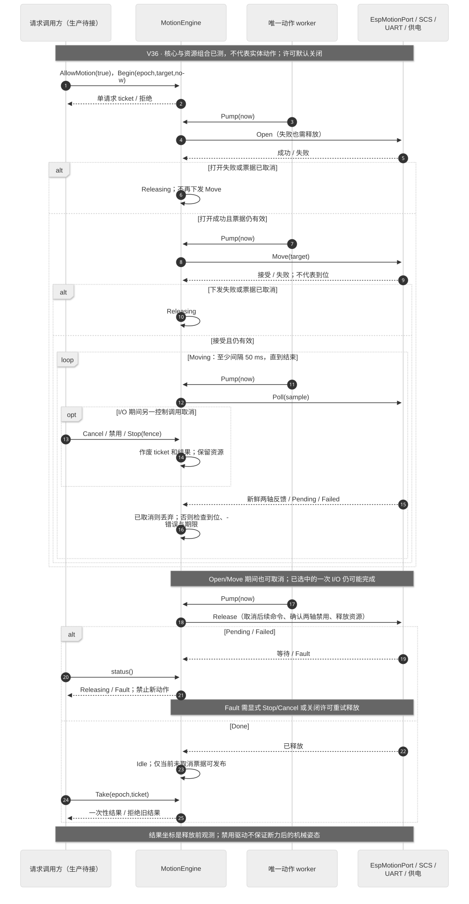
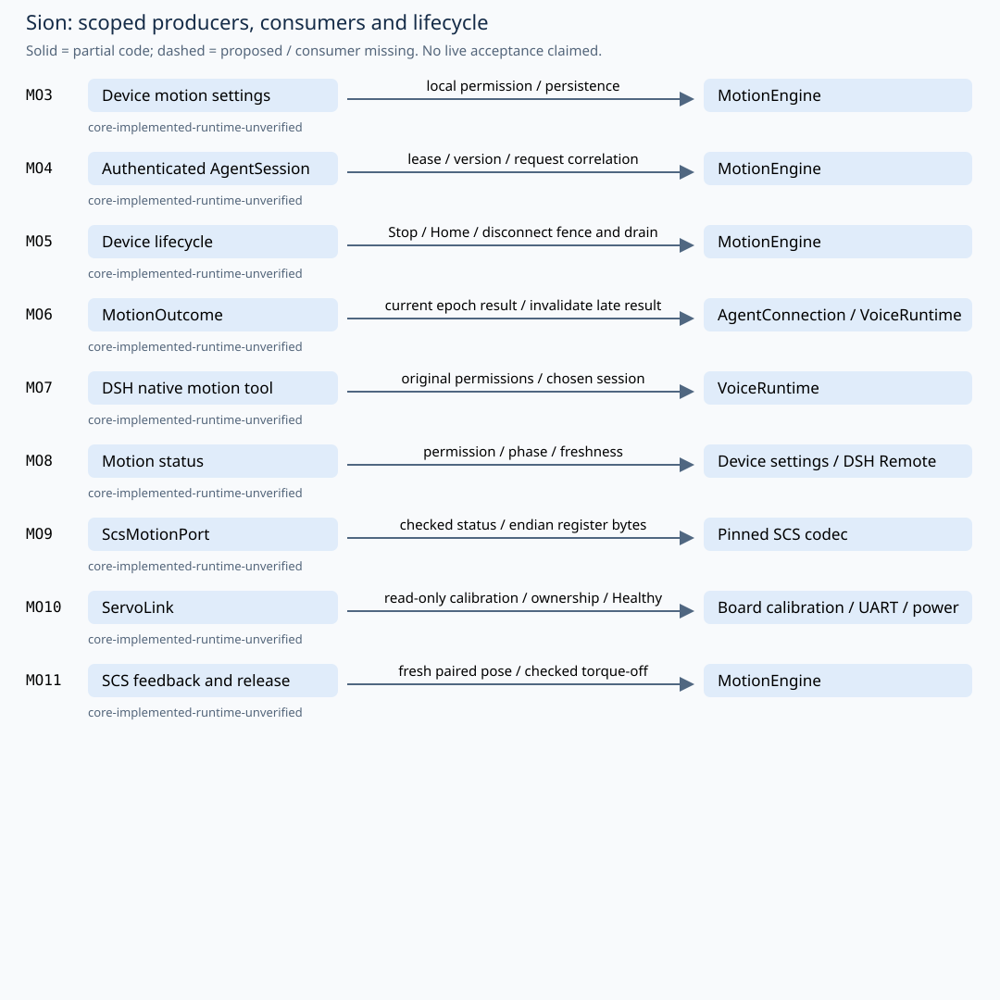
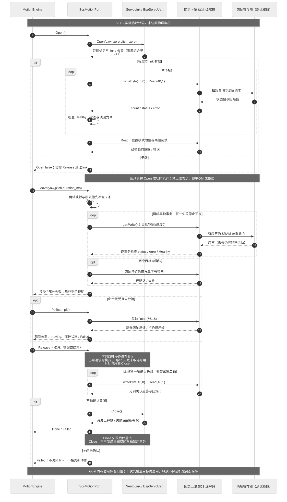
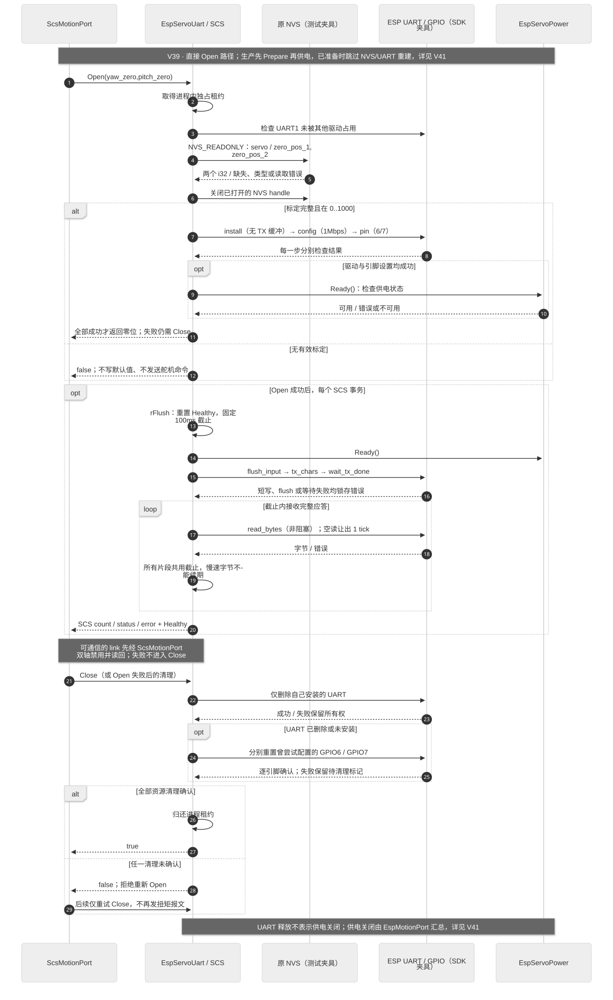
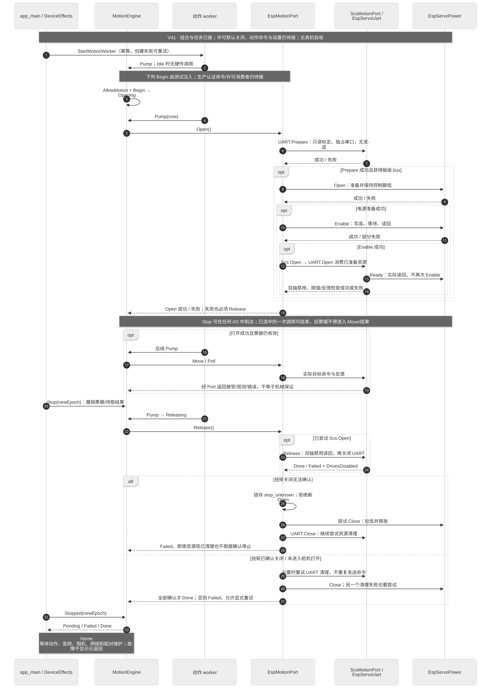
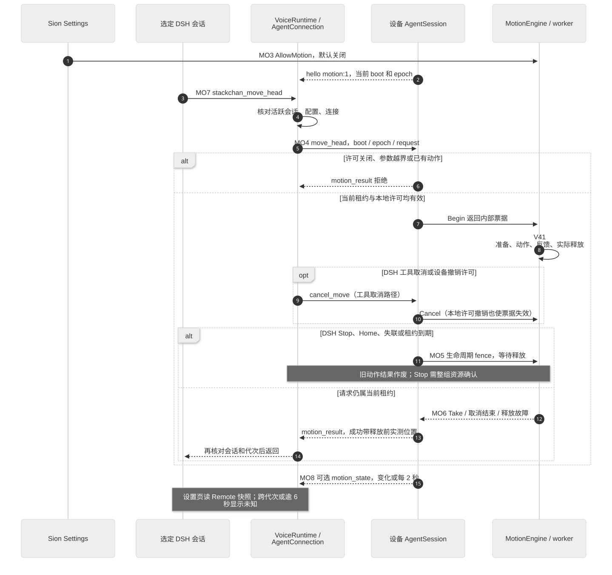

# 头部动作、反馈与停止

归属 P5/P8/A6/A9。动作 v1 已连接 DSH 原生工具、认证网络、设备许可、双轴位置反馈及两端设置。最新行为见 [V42 认证动作与两端设置](#认证动作与两端设置)。目标镜像 v22 已完整构建，真机验收与安装仍未完成。

## 官方依据与设计决定

2026-11-19 核对 [StackChan 手册](https://docs.m5stack.com/en/StackChan/) 和 [Arduino 舵机接口](https://docs.m5stack.com/en/arduino/stackchan/servo)。产品手册建议俯仰 5–85°，示例含 0/90°；本项目按当前产品约束拒绝越界。固定官方提交 `28b9f0c8bd6acd81cb3c70f1a93c3e373b39d400` 的 [hal_servo.cpp](https://github.com/m5stack/StackChan/blob/28b9f0c8bd6acd81cb3c70f1a93c3e373b39d400/firmware/main/hal/hal_servo.cpp) 位置模式 yaw 为 ±128°，角度单位是 0.1°。连续旋转是不同的 PWM 模式，仍需独立取消/模式恢复设计，不能通过超范围位置命令替代。

源码审查：Motion::stop 调用 move(getCurrentAngle)，不确认扭矩关闭；ScsServo::getCurrentAngle 在读取失败时回退动画角度；setTorqueEnabled 丢弃 EnableTorque 的返回值。servo_init 在缺少合法零位时尝试写原 NVS；本项目不能直接调用该初始化。SCS::Ack 返回 1 仍可能带非零舵机 status；ReadToqueEnable 使用 readWord，不能未经寄存器核实当单字节扭矩确认。实际适配需保留低层驱动，检查应答/status/位置反馈，并只读原标定，不写校准/EPROM 或隐式回零。

核心已实现顺序：默认禁止 → AllowMotion → Begin → Pump 调用 Open → Move → 连续两次间隔至少 50 ms 的有效位置/静止反馈 → Release 确认 → 发布结果。生产调用方仍须另行完成认证/活跃租约校验和设备许可页面；实际 worker 已接入，默认许可关闭。单请求、单结果槽，无动作自动循环。取消、禁用、Stop 先作废结果，再由唯一 worker 清理；超时或反馈失败也先清理，随后只交付错误结果；清理失败保持 Fault，禁止再次移动。释放只证明驱动不再施加该命令，不保证断力后机械姿态完全不变。

产品配置：位置目标 yaw −1280..1280、pitch 50..850（0.1°），duration_ms 100..3000 为请求运动时间，默认 1000 ms；不保证准确耗时；5 秒请求期限、50 ms 反馈周期、2°到位容差与两个连续样本均为待真机校准的配置，不是性能保证。期满与时钟倒退触发释放；实际 I/O 可能仍在等待，不将软件超时当已物理停止。

## 本轮影响与验收计划

新增 motion_engine.h、motion_engine_test.cc 与独立主机测试入口；接入 scripts/test_agent.py 的现有无设备回归。生命周期契约复用 Result，但暂不改 device_main、AgentSession、协议、偏好或 Host 工具。它们是后续必要消费者，本批不声明完成：设备本地许可/状态/保存、活跃会话权限、Stop/Home 资源汇总、认证结果关联、DSH 工具/设置、PWM/手势队列及实际 UART/供电所有者。

验收覆盖越界/禁用/陈旧 epoch、结果关联、部分打开/下发失败、反馈缺失/异常/堵转、超时/时钟倒退、释放失败与显式重试、取消跨 I/O 的并发屏障。核心首批没有目标编译或实体动作证据；后续适配与对象编译见本页末节，不能因接口存在宣告 Sion 会动。

## 核心接口与完成条件

权威源码：[motion_engine.h](../firmware/agent/motion_engine.h) 的 MotionTarget、MotionFeedback、MotionOutcome、MotionPort 和 MotionEngine；测试为 [motion_engine_test.cc](../firmware/agent/motion_engine_test.cc)，运行 `python3 scripts/test_agent_motion.py`。三个硬件完成事实必须由实际适配分别提供，不能从 void 的官方动画接口猜测。

| 接口/字段 | 约束与实际语义 |
|---|---|
| Begin(epoch, target, now) | 本地 allowed、有效递增身份、Idle 且无待取结果、合法目标才返回非零 ticket；不会启动替代会话 |
| target.yaw / pitch / duration_ms | 有符号整型，单位/范围见上；拒绝越界，不静默 clamp；暂不实现连续旋转 |
| Open / Move | 唯一 worker 调用；失败也可能已部分取得资源或下发一个轴，必须 Release |
| Poll(sample) | Pending 不使用 sample 且清连续计数；Failed 进入释放；Done 必须是两轴的新鲜有效读数。观察范围 yaw ±360°/pitch 0–90° 比命令宽，不能将异常读数夹成到位 |
| feedback.moving / stalled | 任一轴仍动不算到位；堵转进入错误释放。两轴都在 2°容差内并连续两个 50 ms 间隔样本静止才结束移动 |
| Release | Pending 等待；Failed 保留资源所有权与 Fault；Done 才归 Idle 并允许结果进入单槽。驱动必须确认两轴已禁用、无后续排队命令并释放其资源；舵机的 Goal 寄存器可能仍保留旧目标，下次动作须先覆盖目标再启用 |
| Take(epoch,ticket,outcome) | 仅匹配身份可消费一次，未取前不能开始新动作；反馈为释放前最后有效观测，不承诺断力后位置保持 |
| Stop / Cancel / AllowMotion(false) | 先作废票据与结果，再由 worker 释放。Stop 更新 epoch fence；请求 Cancel 与禁用不破坏整个音频会话 |
| Stopped(fence) | 匹配 fence 的 Idle 才 Done；释放中 Pending、Fault 为 Failed；旧请求不能确认新会话已停 |

| 当前状态与事件 | 下一状态与行为 |
|---|---|
| Idle + 合法 Begin | Opening，保留 epoch/ticket/目标；重复、禁用、越界或已有结果拒绝 |
| Opening + Open 成功/失败 | Commanding / Releasing(Open 错误) |
| Commanding + Move 成功/失败 | Moving / Releasing(Command 错误) |
| Moving + Pending/未到位 | 留在 Moving，清连续到位样本 |
| Moving + 有效连续到位 | Releasing，尚不发布成功 |
| Moving + 失败/异常/堵转 | Releasing，固定 Feedback/Stall 错误 |
| Opening/Commanding/Moving + 超时或时钟倒退 | Releasing(Timeout)；检查的是 Pump 提供的单调时间，未证明物理停机时限 |
| 任意非 Idle + 取消/Stop/禁用 | Releasing，旧结果不得再发布；已被 worker 选中的一次 I/O 仍可能完成 |
| Releasing + Pending/Done/Failed | 等待 / Idle / Fault；只有非取消且未过 fence 的结果可发布 |
| Fault + 普通 Pump/Begin | 保持 Fault / 拒绝；显式 Stop、匹配 Cancel 或从允许切为禁用可重试清理，不自动反复驱动 |

核心锁不跨硬件调用；实际 worker 必须唯一、对象必须活到清理完成，不能强制删除任务后报告 Done。Release 没有伪造成功的本地超时：外层生命周期可以报 Fault，但仍要保留实际资源所有者。当前表为关键转换投影，未声明穷尽所有状态×参数组合。

图表来源：MotionEngine::Begin/Pump/Take/Stop 与 MotionPort 四方法；测试消费者实线，生产调用者标待接。取消与释放失败有独立分支；不代表真实舵机已停止。

图表来源：MotionPhase、MotionError、Current/CancelLocked；epoch/ticket/fence 约束见表。图未把状态回 Idle 当返回原厂助手。

## v21 生产者、消费者与当时的缺口

| ID | 生产者 → 消费者 | 当前状态/后续验收 |
|---|---|---|
| MO1 | 主机核心测试 → MotionEngine | 已测目标、反馈与各 I/O 阶段并发取消；假端口 |
| MO2 | MotionEngine → MotionPort | 已有 ScsMotionPort 真实寄存器消费者与协议夹具；ESP UART/原 NVS/供电已由 EspMotionPort 与 worker 组合，协议请求仍待接 |
| MO3 | Device settings → MotionEngine | 待接本地许可、显示和持久化，默认不自动动 |
| MO4 | Authenticated AgentSession → MotionEngine | 待接能力协商、当前会话/请求关联、命令/result/state |
| MO5 | Device lifecycle → MotionEngine | 已接 Stop/断线/租约/Home 的停止与汇总确认，UI 夹具验证等待/失败/重试；实体仍待验收 |
| MO6 | MotionOutcome → AgentConnection/VoiceRuntime | 待接原连接/epoch/会话验证，迟到结果作废 |
| MO7 | DSH native tool → VoiceRuntime | 待接原权限管线和版本化位置/观察能力；不复制情绪策略 |
| MO8 | Motion status → 两端设置/Remote | 待接设备许可、观测、错误、释放/未知状态；不从命令推断姿态 |

MO1/MO2 位于 [关系第 25 页](assets/relationships-25.svg)，完整清单见 relationships.json。生产消费者尚未接入时不发布 motion 能力。

## 社区复核与未采用部分

[StackChan-CustomFW](https://github.com/7H3-CH053N/StackChan-CustomFW) 有柔和动作、面部跟踪与自己的语音服务器；2026-11-19 GitHub API 显示未归档、MIT、最后推送 2026-10-22。README 明确替换原固件/云服务，包含覆盖整个 NVS 的安装步骤；不能直接作为保留原语音/绑定的安装方案。本批只审查公开说明，未审计或移植其驱动，不能说它已满足停止确认契约。[官方 BSP](https://github.com/m5stack/StackChan-BSP) 同日 API 显示未归档、MIT、最后推送 2026-10-29，可作接口参考；当前工程继续使用固定 ESP-IDF 源码，不切换 Arduino 工具链。

真实 SCS 应答与 ESP UART/NVS 故障测试已补；有错误回执的 PY32 供电适配也已独立验证；供电/UART 组合、单 worker 和生命周期也已接入；下一步补协议、DSH 工具和两端设置。原校准/绑定保留，不复用会重写零点的初始化。无已确认的完整上游能直接承担这些边界，本批未对外发 PR。

## SCS 寄存器适配与平台接缝

先复用固定上游 FTServo_Arduino 的 SCS.cpp/SCS.h/INST.h，而非其忽略 UART 错误和 teardown 返回的 SCSerial 包装。实际文件 LICENSE 为 MIT (c) 2024 ftservo；社区提到旧 SCServo_lib 的 GPL 不能套用到当前固定目录。ScsMotionPort 已消费实际 SCS 编解码，ServoLink 接缝负责原标定只读、UART/供电可用性与关闭；寄存器首批使用真实字节应答夹具；后续 ESP UART/NVS 实现见末节，板级供电与 worker 仍待接，不声称已连接硬件。

接口决定调整：此前 speed 1..1000 只是官方动画层尺度，并非原始 Goal Speed 的物理单位。尚无生产消费者，本批将 MotionTarget 改为 duration_ms 100..3000，默认 1000 ms；SCS Goal Time 用该值、Goal Speed 写 0，由实际反馈确认完成，不承诺精确耗时。保持 5 秒软件期限。连续旋转/PWM 仍另行设计，不能写 EPROM 角度限制偷换模式。

接口要求 Open 从 ServoLink 取得合法零位后（现有 EspServoUart 的原 NVS 只读已实现/夹具验证，实际 Sion 标定未读取），禁用并单字节读回两轴扭矩，再读原位置限值与当前反馈；不自动回零。Move 先校验两轴映射及原位置范围，写位置/时间后检查应答和两轴扭矩；任一部分失败交给 Release。Poll 必须从完整应答解码两轴，不使用动画值回退。Release 尽力清理两轴，即使第一轴失败也尝试第二轴；两轴扭矩回读 0 后才关闭自己持有的 link。UART 关闭失败必须保留失败状态，显式重试不能跳过未确认的资源。

读取/校验范围：SCS status 非零、错误 ID/长度/校验和、缺字节、底层短写/flush 失败均拒绝；未确认的禁用回执不能报已释放。夹具记录所有写入地址，禁止 EPROM、校准、模式切换与广播。两轴命令非硬件原子操作，第一轴可能先动；失败/取消要清理而不能称无副作用。实际电源管理接口仍需接入。

实现入口：[ScsMotionPort](../firmware/agent/motion_scs.h)、[寄存器操作](../firmware/agent/motion_scs.cc)、[真实协议测试](../firmware/agent/motion_scs_test.cc)。生产端包含固定上游 `hal/drivers/FTServo_Arduino/src/SCS.h`；主机测试以 [原样副本](../firmware/tests/vendor/ftservo/SCS.cpp) 和 [MIT 许可](../firmware/tests/vendor/ftservo/LICENSE) 编译同一适配。通过 git show 固定提交逐字节比对三份源文件与许可证；未采用另一个社区驱动。

SCS 使用 big-endian、Level=1；不允许广播或关 ACK。只写 SRAM 40（扭矩 1 字节）、42 起 6 字节（位置、时间、速度）；位置模式范围读 9/11 两个 word，反馈读 56..70 共 15 字节。原限制为 0/0 视为 PWM，拒绝初始化而不写模式。原标定或硬件范围不允许的目标拒绝，不夹成别的目标。原范围与原零位只读，错误释放也不校准/复位。请求落在两个单轴写入之间时仍可能有一个轴已运动，不能称双轴原子提交。

反馈位置限制为原始 0..1000，moving 必须 0/1；异常帧不更改调用方的输出对象。检测保护沿用官方绝对阈值：离目标至少 8 个 raw step、相邻位置变化不超过 1 step，load ≥650 或 current ≥350 时连续两次可触发保护；这些是原始寄存器量和配置阈值，不能标成已标定的 mA/力矩或保证抓住所有堵转。模型不应根据静止反馈推断电源已关闭。

供电/UART 接缝约束（当前 UART/NVS 实现见末节）：Open 失败但有部分 link 资源时仍需 Close；未成功取得 link 前不会发送舵机命令。每个 SCS transaction 开始重置 Healthy，短写或 flush 失败要保持到整个事务完成；不能靠 SCS 的成功返回忽略驱动错误。Close 失败保持所有权，后续不能重新 Open 越过它。不调用 void 的 Hal::setServoPowerEnabled 就假称已断电；本批没有物理供电切换实现。

图表来源：ScsMotionPort::Open/Move/ReadAxes/DisableBoth/Release，固定 SCS::Read/genWrite/Ack 和测试 Device 字节应答。对端与 ServoLink 仍为夹具；序列中的状态包验证是真实解析，物理动作/串口时限不是实测。

新增影响：MO9（ScsMotionPort → SCS 编解码）、MO10（ServoLink → 标定/串口/供电）、MO11（SCS 反馈/清理 → MotionEngine）、MO12（实际线协议测试 → 寄存器适配）。MO9–MO11 见 [关系第 26 页](assets/relationships-26.svg)，MO12 见 [关系第 27 页](assets/relationships-27.svg)；完整关系文件保持统一来源。

## ESP 串口、原标定与部分清理

实现：[motion_uart.h](../firmware/agent/motion_uart.h)、[motion_uart.cc](../firmware/agent/motion_uart.cc)；[SDK 故障夹具](../firmware/agent/motion_uart_test.cc) 经 test_agent_motion.py 与真实 SCS.cpp/ScsMotionPort 组合。2026-11-19 先复核 [ESP-IDF UART 文档](https://docs.espressif.com/projects/esp-idf/en/stable/esp32s3/api-reference/peripherals/uart.html)、[NVS 文档](https://docs.espressif.com/projects/esp-idf/en/stable/esp32s3/api-reference/storage/nvs_flash.html)，再以固定 IDF 6.1 头文件目标编译，不升级工具链。

Open 先取得本进程 UART 租约并拒绝已有 UART1 驱动；以 NVS_READONLY 打开原 nvs/servo，读取 i32 zero_pos_1/zero_pos_2 并关闭 handle。缺 key、类型错误或值不在 0..1000 时失败，不写默认值，不初始化/擦除 NVS。两项都合法后安装自己的 UART1（1Mbps、8N1、TX6/RX7、RX 256 字节、无 TX ring），每一步检查；只有供电状态接口 Ready 返回成功才交付零位。原 HAL 舵机所有者必须继续禁用，进程内租约不能仲裁不合作的外部驱动。

每个 SCS transaction 的 rFlush 重置 Healthy 和 100ms 绝对截止；刷新接收、非阻塞 uart_tx_chars、等待发送完成及读取均检查返回值。所有分段读取共用同一截止；空读让出 1 个 RTOS tick，慢速字节不能无限续期。短写、时钟倒退、超时或 SDK 错误锁存到该事务结束，后续片段不能清除。100ms 为配置，任务调度和 SDK 内部锁仍影响实际耗时；不是实体停止延迟保证。

Close 只删除成功安装的驱动，删除失败保持所有权；删除成功后分别确认 GPIO6/7 复位。引脚失败保留待清理标记及独占租约，拒绝 Open，下一次 Close 只重试未完成清理。ScsMotionPort 已在两轴禁用读回成功后固定该事实：Close 部分失败后的重试不再向可能已删除的 UART 发送报文。若驱动在持有期间无故消失，则拒绝假称释放成功。

ServoPowerStatus 是借用的供电状态接口：实现者须实际检查板级错误并让供电活到 link 释放；现已有 EspServoPower 实现（末节），生产组合由末节 EspMotionPort 管理。固定官方 Hal::setServoPowerEnabled/digitalWrite 不返回错误，getWriteValue/digitalRead 又把读取失败折成 false，因此不能直接当确认接口。板级 PY32 供电的有界访问、所有权和初次上电行为仍须独立实现/验证；UART 关闭不等于断电，也不保证机械保持。

图表来源：EspServoUart::Open/Close/rFlushSCS/readSCS/writeSCS/wFlushSCS、Calibration 和 ScsMotionPort::Release。MO13 原标定、MO14 实际 UART 消费、MO15 待接供电所有者见 [关系第 27 页](assets/relationships-27.svg)，间接结果/停止消费者沿 MO2/MO5/MO6/MO11。源文件通过真实 ESP32-S3 编译器与固定 SDK 生成独立对象；未加入组件/worker、未做最终链接，v20 镜像不包含本批代码。软件故障测试和目标对象都不能证明实体通信或原标定存在。

## PY32 供电控制与所有权

入口：[motion_power.h](../firmware/agent/motion_power.h)、[实际 I2C 适配](../firmware/agent/motion_power.cc)、[故障夹具](../firmware/agent/motion_power_test.cc)。2026-11-19 先复核 [StackChan 手册](https://docs.m5stack.com/en/StackChan/) 与 [ESP-IDF I2C 文档](https://docs.espressif.com/projects/esp-idf/en/stable/esp32s3/api-reference/peripherals/i2c.html)，并逐项核对固定官方 hal_io_expander.cpp/PY32IOExpander_Class.cpp 与固定 SDK i2c_master.c。端口现由末节 EspMotionPort 与 worker 组合；认证动作命令和许可尚未接入，不能据此声明完整动作能力。

EspServoPower 借用板级 I2C bus，经共享 PY32 使用 0x6f、100 kHz device handle。它只释放自己的所有权，board bus 仍由 HAL 持有。Open 获得舵机所有权、读取版本（拒绝 0/255），先将 GPIO0 输出锁存清低并读回，才允许设为输出；随后设置推挽、无下拉/上拉并确认低。所有 read-modify-write 仅改低 bank 的 bit0，其他位保持。读失败绝不折成零后写整个寄存器。原 HAL 的扩展芯片初始化保持禁用。LED/IR 应共用同一个仲裁者，不能独立并发改这些字节。

Enable 才显式写高，等待 200ms 后读取方向、输出和输入寄存器。开始时即消费 prepared，失败可能已经上电，禁止直接重复 Enable，须先 Close。Ready 每次重新检查三个寄存器，失败返回 false；enabled 只是上次 Enable 成功的历史事实，不表示当前电源仍可用。GPIO 读回是控制信号确认，不是测得 VM 电压、舵机响应或机械静止。200ms 为沿官方初始化选择的等待配置，不是实测稳定时间。

版本识别失败时没有接管 GPIO，Close 仅移除自有 handle，不写未识别设备的寄存器，也不证明先前电源已关闭。成功识别并开始接管 GPIO 后，Close 先撤销软件准备/启用状态，再拉低并回读，成功后删除自己创建的 I2C device；失败保留所有权，拒绝新 Open，后续显式重试。若输出清低失败，不把引脚强设为输出，避免用旧的高锁存值意外开启。删除失败时 handle 保留，不释放共享 bus，也不假称断电。通常调用顺序须先完成舵机/串口清理，再结束供电；串口失联时如何优先拉低并汇总真实释放失败，需要生产组合补齐，不能简单等待串口成功而永远不执行供电清理。

固定 SDK 的 add-device 错误路径忽略内部 rm-device 的返回值，且不交付 handle；共享 bus 忙时可能无法证明回滚完成。适配将此状态锁存为 allocation_unknown，保留租约、拒绝 Close 成功或重新 Open，直至板级重启；不会在运行中自行重启。其余已取得 handle 的失败允许有证据的清理重试。每次 I2C 传输采用 20ms 超时，但 SDK 的资源表锁使用 portMAX_DELAY；这些数值不构成整个打开/关闭的硬实时上限。

图表来源：EspServoPower 的 lease/prepared/enabled/allocation_unknown 与 Open/Enable/Ready/Close；是软件状态投影，不是电源状态测量。MO16 是实际 PY32 消费边，MO17 是待接生产所有者，MO18 是 SDK 故障测试；见 [关系第 27 页](assets/relationships-27.svg)。间接 UART 检查沿 MO15，动作 Stop/Home 与工具仍沿 MO5/MO6/MO7。当前目标编译只生成对象，没有完整新固件、物理 I2C 或启动电机测试；初次上电是否运动仍须在具体安装/真机验收方案中核实。

## 资源组合、唯一任务与 Home

本节记录 v21 资源接线。认证命令和设置随后在 [v22](#认证动作与两端设置) 接入。

实际入口：[EspMotionPort](../firmware/agent/motion_hardware.cc)、[motion_runtime.cc](../firmware/agent/motion_runtime.cc) 的 DeviceMotion/StartMotionWorker，以及 [device_main.cc](../firmware/agent/device_main.cc) 的 DeviceEffects、motion_idle 与启动调用。实施前复核 [ESP-IDF UART](https://docs.espressif.com/projects/esp-idf/en/stable/esp32s3/api-reference/peripherals/uart.html)、[IDF FreeRTOS 任务](https://docs.espressif.com/projects/esp-idf/en/stable/esp32s3/api-reference/system/freertos_idf.html) 和固定 SDK。6,144 字节任务栈、优先级 1、空闲循环约 10ms 是配置，未测栈水位或停止时延。

app_main 在板级初始化后启动唯一动作任务。对象构造/Idle Pump 不读取标定、不打开串口、不操作电源；许可默认 false。UART.Prepare 先只读原标定并独占配置串口，不发送字节；成功后才用板级 bus 执行 Power.Open（低）和 Enable（高）。Scs.Open 调用 UART.Open 时消费已准备的标定/串口，不重新分配；Ready 检查已启用供电，再执行双轴扭矩关闭、原限值和反馈读取。Prepare/校准失败不会接触 PY32；任何部分失败仍进入释放。初次上电仍可能存在舵机自身行为，须真机核实，不能由不发送目标命令推断机械绝不运动。

唯一 worker 调用 MotionEngine::Pump 和端口全部 I/O；UI/网络只应调用短锁控制接口。任务创建失败返回 false，app 保存 worker_ready；重复成功启动不创建第二个任务。当前没有设备许可/认证 Begin 消费者，软件组合测试显式注入请求，不将空闲任务称为用户已能控制动作。

正常 Release 先双轴禁用读回，再关闭 UART/引脚，最后关闭供电；某一路清理失败不能阻止另一路尝试。DrivesDisabled 是 worker 内的关闭回读事实，在启用命令可能生效前即撤销。扭矩关闭已确认、但 UART/引脚关闭失败时，可在供电关闭后仅重试资源清理，不再发舵机报文；全部清理确认才 Done。若双轴扭矩关闭无法确认，EspMotionPort 锁存 stop_unknown，立即尝试 Power.Close 与 UART.Close，后续显式重试仍继续清理，但始终 Failed、拒绝重新 Open；不会因 GPIO 已低就伪造扭矩应答。该不确定故障需要板级重启和现场检查，代码不自动重启。

Stop/Home/断线/租约沿 DeviceEffects 同时撤销动作、音频和相机，再汇总各自 Stopped 与网络/配对状态；动作 Pending 保持 Draining，Failed 保持 Fault，不提前切回入口。普通清理故障可显式重试，stop_unknown 不因重试消失。Home 当前仍只回独立镜像入口，并非已实现原厂槽返回。Connect、USB 授权和设置 Save 还要求 Motion Idle 且无待取结果，防止动作期间进入维护；此守卫不等于完整动作设置页。

图表来源：EspMotionPort::Open/Release、EspServoUart::Prepare/Open、ScsMotionPort::DrivesDisabled/Release、StartMotionWorker 和 DeviceEffects。MO5/MO15/MO17 现已有真实消费者，新增 MO19 worker→实际组合、MO20 app→worker/维护守卫，见 [关系第 27 页](assets/relationships-27.svg)。MO3/MO4/MO6/MO7/MO8（许可、认证请求、结果协议、DSH 工具和两端状态）仍缺；当前默认关闭且不发布 motion 能力。

组合测试把真实 MotionEngine、EspMotionPort、PY32、UART、SCS 编解码和任务循环放在同一 SDK 夹具中，检查标定失败不供电、到位后释放、Enable 等待中 Stop 阻止 Move、失联仍关闭供电、部分资源重试不发旧命令、启动失败/幂等及 Idle 无 I/O。实际 device_main 的 UI 夹具另验证 Save 拒绝、Home 等待、失败保留页面及清理后返回；测试注入的 FakeMotion 不证明真机反馈。完整构建与容量结论另见验收记录。

v21 完整构建证据：[agent-motion-runtime-build.json](../firmware/agent-motion-runtime-build.json) 固定源码/工具链/产物；镜像 2,160,400 字节。最终 ELF 包含 StartMotionWorker、EspMotionPort::Open/Release、ScsMotionPort::Move、EspServoUart::Prepare、EspServoPower::Enable 和原存储写保护 wrapper。分区表未变；离线容量审查仍缺 144 KiB，安装/恢复及实体动作未验证。旧对象编译段落记录的是当时单端口证据，不能替代本次最终链接证据，也不意味着当前已有 DSH 动作工具。

## 认证动作与两端设置

目标是让当前接通的 DSH 会话显式请求单次转头。2026-11-19 复核 [M5Stack 产品手册的俯仰限制与 Home 导航](https://docs.m5stack.com/en/StackChan/) 和 [Arduino 舵机参考](https://docs.m5stack.com/en/arduino/stackchan/servo)。当前实现仅提供标定后的双轴位置控制，俯仰 5°–85°，偏航按固定官方位置模式限制为 ±128°。具体机械表现须在实体板上验收。

图表来源：[设备会话](../firmware/agent/agent_session.cc) 的 Text、FinishMotion、PublishMotionState，[Host 连接](../src/agent-transport.mjs) 的 moveHead/receive/motionSnapshot、[VoiceRuntime](../src/voice-runtime.mjs) 的 moveHead，以及 [DSH 工具](../src/capability-tools.mjs)。图中动作与释放阶段可以被取消打断。板级资源时序见 V41，影响方在 [关系第 26 页](assets/relationships-26.svg)（MO3–MO8）。

| 接缝 | 契约及失败 |
|---|---|
| Settings → Motion | 默认关闭，开启本身不产生位置请求。当前运行立即生效，关闭时撤销进行中的请求。Save 仅在维护空闲时写入独立 sion_cfg 的 v3 偏好 bit 3。读 v1/v2 时动作默认关闭；旧应用识别不了 v3 时进入其保守默认。 |
| DSH 原生工具 → VoiceRuntime | `stackchan_move_head` 通过原生工具权限调用，只接受冻结配置中已接通的会话，发送前和交付前都核查运行版本、连接及会话。宿主不会替换会话或设定动作性格。 |
| Host → AgentSession | 设备任务创建成功时 hello 加 `motion:1`。当前 Mac 插件同时支持不带字段的旧设备。v22 设备要求识别该字段的插件，旧严格解析器会拒绝。控制帧带 boot、epoch 和 32 字符 request_id，yaw/pitch 为整数字符串（0.1°），duration_ms 为整数字符串（100–3000）。同一连接只允许一项进行，Host 不自动重发。 |
| AgentSession → worker | 租约有效且许可开启才 Begin。参数越界、关闭、忙或释放故障返回明确错误。当前请求与内部票据分别关联。匹配的 cancel_move 取消该票，不关闭语音。请求已结束后的 cancel 无副作用。 |
| worker → Host → DSH | 两次新鲜反馈到位、驱动与资源释放确认才返回 reached。成功包含释放前 yaw/pitch，Host 再核对距目标 ≤2°。释放未确认报告 release-unconfirmed。Stop/Home/失联使旧请求失效，Stop 仅在全部资源确认后成功。Host 等待上限 20 秒，超时关闭连接并依赖设备围栏清理。 |
| worker → 两端状态页 | 设备页读实时 phase/error。认证运动状态变化或每约 2 秒上报，低优先级队列拒绝时重试。DSH 插件通过 owner Remote 读取已认证的当前 epoch；报告缺失、过期（6 秒）或连接失效时展示未知。状态不把请求目标当作当前姿态。 |

验证包括设备偏好 v1/v2 只读迁移、v3 保存读回、真实回环 TLS/C++ 的工具、取消、同会话继续与 Stop，以及 DSH 旧 epoch 结果拒绝和界面过期。硬件轮廓、原厂返回、用户 DSH 会话和实体反馈仍待验收。见 [v22 验收](validation.md) 与 [安装恢复](installation-recovery.md)。

### 共用 PY32 后的动作供电

动作任务的 EspServoPower 现在通过 [V45 共享 PY32](device-capabilities.md#灯环与舵机共用的-py32) 申请自己的寄存器组。灯环驱动通过 SDK 夹具复用同一设备句柄，不能访问 VM_EN。全部使用方都释放才移除句柄。动作启动、位置反馈和 Stop/Home 仍沿既有 MotionEngine 生命周期，实机电气验收待完成。
