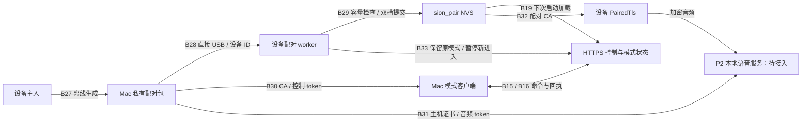

# 配对、撤销与日常模式控制

范围说明：本页保留此前同进程候选的实现契约，并非新独立应用已部署的行为。新的独立分区/状态实现见 [独立配对](agent-pairing.md)，当前入口见 [独立 Agent](independent-agent.md)，用户操作见 [官方手册对齐](manual-alignment.md)。

归属 [P1](product-plan.md#按依赖推进的工作包)。本页是配对操作入口，设备音频状态和失败语义见 [固件运行契约](firmware-runtime.md)。当前代码、完整构建和主机测试已通过；没有在 Sion 安装或验证。用户现有原助手、手机绑定与 DSH 会话均未改变。

## 所有权与数据流

设备主人在 Mac 离线生成一对私有身份，通过直接 USB 传入设备一侧配置。物理 USB 访问是首次授权边界；局域网不开放无凭据的配对接口。配对只给设备/语音通道权限，不授予 DSH 会话、电脑工具或记忆访问权限。

| 接缝 | 实现和读写者 |
|---|---|
| Mac 生成身份 | [pairing.mjs](../src/pairing.mjs) / [CLI](../scripts/pairing.mjs)：EC P-256、命名曲线、SHA-256、独立 control/audio token；保存 0700 目录中的 0600 bundle |
| USB 传输 | [Python 客户端](../scripts/pairing_usb.py) → [设备 worker](../firmware/overlay/sion/pairing_usb.cc)：SION1 JSON 帧、request_id、设备 ID 与 expected_pair_id 检查；不回显密钥 |
| 校验与持久化 | [配置解析](../firmware/overlay/sion/pairing_config.h)、[存储](../firmware/overlay/sion/pairing_store.cc)：只操作 sion_pair 命名空间的 slot0/slot1/active |
| 控制与模式客户端 | [BackendRuntime](../firmware/overlay/sion/backend_runtime.cc) ↔ [DeviceModeClient](../src/device-mode.mjs) / [CLI](../scripts/device_mode.mjs)：HTTPS、请求回执、单次进入、心跳、归还确认 |
| 本地声音 TLS | [PairedNetwork](../firmware/overlay/sion/paired_network.h) / [PairedTls](../firmware/overlay/sion/paired_tls.cc) → 后续 P2 服务：只信任该配对 CA 和 sion-host 名称，原云继续原网络实现 |



配对包包含设备与主机私钥，是敏感本地文件；不上传 GitHub、Wiki、日志或云服务。CA 签名私钥生成两张证书后删除，现有 bundle 仍保留恢复所需私钥。证书有效期为生成后 10 年；轮换使用新的完整配对包。证书解析/握手失败时不开通控制或进入本地模式，不回退明文。

## 配置和提交语义

设备记录格式由 ParsePairing 定义：version=1、role=sion-device、pair_id（32 位十六进制）、control_key/local_token（各 64 位不同十六进制）、local_url、ca/cert/key。整体 ≤4096 字节；URL 必须是私有 IPv4 的 wss 地址。该 schema 不是官方 StackChan 云接口。

写入先校验当前 pair ID；先提交非活动槽并读回，再提交 active 指针。中途中断可留下完整旧记录或完整新记录；Mac 收不到确认时先查 status，不能盲目重新生成身份。容量不足或写入失败会明确拒绝，不调用擦除整个 NVS/Flash 的 API。

删除先提交撤销记录再清理旧槽，启动读取不会回退到旧配对。它是逻辑撤销，Flash 磨损均衡可能保留旧物理字节，不宣称安全擦除。原 wifi/mqtt/websocket、激活和手机绑定命名空间没有配对写入调用。

USB 写入只在原模式、Application 可用时取得维护预约；本地模式/切换途中拒绝并要求先返回。预约后暂停新的网络模式命令，原助手保持可用。安装、轮换或撤销通过**下一次用户主动重启**启用新配置，工具不自动重启；失败的写入预约也保持暂停直到重启，避免半更新身份继续接受控制。日常 enter/leave 不需要 USB 或重启。

启动默认原模式；没有配对记录时没有 HTTPS 控制服务。USB 配对 worker 在原 AI Application 完成初始化后启动，不是 bootloader 接口。preservation-trial-v3 只读已有 MQTT/WS 配置，不执行远端刷新、激活或固件更新；长期凭据刷新仍待解决。试运行只开放状态/确认，确认后须主动重启才允许 Sion 配对和网络模式控制，见 [试运行契约](installation-recovery.md#当前保护实现与试运行契约)。

## 工具与操作顺序

当前只是可复现命令说明，**本轮未执行以下真机步骤**。相关物理边界见 [真机检查单](hardware-check.md)。

离线准备（先确定 Mac 的局域网地址，目录必须位于私有忽略路径）：

```sh
mkdir -p .local/pairings
node scripts/pairing.mjs prepare .local/pairings/sion wss://192.168.1.10:8766/audio
python3 scripts/pairing_usb.py install --bundle .local/pairings/sion/pairing.json
```

第二条 Python 命令只有 dry-run，不打开串口。示例 IP 是占位值，不是已发现的本机 IP。AiFlow/原厂云 token、Wi-Fi 密码和 DSH session ID 不需要放入配对包。

在备份、固件安装及设备许可都已完成之后，才使用：

```sh
python3 scripts/pairing_usb.py status --port DEVICE_PORT --apply
python3 scripts/pairing_usb.py install --port DEVICE_PORT --apply \
  --expected-device DEVICE_ID --expected-pair CURRENT_PAIR_ID \
  --bundle .local/pairings/sion/pairing.json
```

首次未配对时省略 expected-pair，默认空字符串；轮换必须提供查询到的旧 ID。remove 使用相同设备/旧配对身份检查。status 也会打开端口，不能因为是查询就绕过真机边界。pySerial 在 open 前设置 DTR/RTS=false，但操作系统仍可能产生控制线变化，所以没有“绝不重启”的承诺。

重启生效并有 P2 兼容 WSS 服务后，可用模式 CLI 查询/持有。默认也只生成计划，增加 `--apply` 才连接设备：

```sh
node scripts/device_mode.mjs status --pairing .local/pairings/sion/pairing.json --address https://DEVICE_IP:8765
node scripts/device_mode.mjs hold --pairing .local/pairings/sion/pairing.json --address https://DEVICE_IP:8765
```

hold 一次进入后每 4 秒续租，Ctrl-C 归还并等 original_ready；CLI 自己不实现 ASR/TTS，不假装已接通 DSH。崩溃后由设备 15 秒租约到期走恢复。未来 voice adapter 组合 DeviceModeClient 与 P2 收音/播报组件，不直接把它当成完整 VoiceBridge voice provider。

## 已验证和真机门槛

29 项 JS 测试含真实本地 HTTPS 证书握手：正确设备证书成功，同一个 CA 签发的主机证书不能冒充设备，认证失败时 HTTP 请求及 bearer 不发给对方。另有回执丢失、明确拒绝、旧/别人的租约、取消、重启与恢复失败测试。主机测试不证明 ESP32 的 TLS/USB 驱动运行正常。

实际 PairingStore 的 C++ 主机测试覆盖首次安装、旧 ID 拒绝、四个写入失败点、容量不足、轮换、撤销、无效记录和命名空间限制。NVS 是 stub，不能代替真实掉电测试。ESP-IDF 完整构建通过，第三方 TLS 派生源码许可见 [NOTICE](../firmware/NOTICE.md)。

还需真机：USB 驱动枚举/控制线行为、真实 NVS 空间与掉电恢复、设备双向 TLS、原 MQTT/WS 回连、音频 drain、内存峰值、物理返回和断 Mac。P2/P3 的真实语音与 DSH 接入仍在对应工作包，配对完成不能关闭 A1–A8。

官方依据：[NVS](https://docs.espressif.com/projects/esp-idf/en/v6.1/esp32s3/api-reference/storage/nvs_flash.html)、[HTTPS Server](https://docs.espressif.com/projects/esp-idf/en/v6.1/esp32s3/api-reference/protocols/esp_https_server.html)、[pySerial](https://pyserial.readthedocs.io/en/latest/pyserial_api.html)、[Node HTTPS](https://nodejs.org/api/https.html)；USB Serial/JTAG 与 ESP-TLS 同时核对了本地锁定 v6.1 文档及驱动示例。
