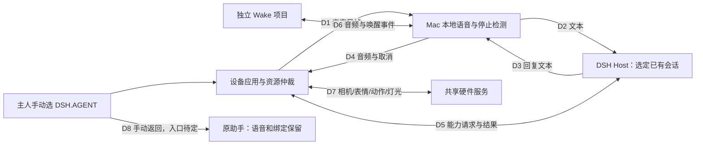

# Sion 成品实施计划

状态：2026-11-19，独立 DSH.AGENT 软件边界已选定；设备显示/触摸、音频、认证传输已接线并目标构建，Mac 本地语音/Host/设置组合与托管安装已通过隔离测试，安装条件检查及用户引导已补齐。用户实例、设备能力完整接入、真机安装与验收仍未完成，见 [独立 Agent](independent-agent.md)、[语音运行](voice-runtime.md) 和 [语音安装](voice-installation.md)。以下已构建镜像是此前同进程候选，不能当独立应用发行包；设备双模式扩展与官方基线均已完整构建通过，配对/撤销与 Mac 模式控制代码已补齐，真机安装和验证仍未执行。此页是两仓共享实施顺序的唯一记录，唤醒细节见 [Wake 计划](../../StackChan-Wake/wiki/product-plan.md)。内部阶段用于管理依赖，不作为缩水交付。

## 成品是什么

用户选择一个已有 DSH 会话，进入 Sion 的 DSH 模式后直接连续说话；Mac 本地识别，文字进入该会话，回复通过本地合成由机器人说出。人格、记忆、模型选择与工具决策继续属于 DSH。等待回复、播报和排队期间都能说整句“停止”，停止后退出 DSH 对话；用户可手动返回原厂助手，再次唤醒并说话。相机、麦克风、扬声器、表情、动作和实际硬件具备的其他能力都有明确接口、状态和验收记录。

独立 Wake 项目提供自定义短语（例如 Hi Sion）、主人声音注册和过滤、校准、停用、删除。它只产生唤醒/说话人判断；不携带另一套人格。两个项目可以独立安装，组合后共享设备音频仲裁和恢复机制。用户不必每轮要求调用工具。2026-11-18 用户放宽自动切换要求：允许手动选择助手；具体菜单/重启/维护工具方案尚待确定，不能推定接受日常反复刷机。停止仍须立即取消 DSH 收音转发、回复和动作，自动返回原助手改为可选；手动返回后的原语音与绑定仍须验证。

“只认主人”是需要测量的声学过滤，不能承诺零误识别或抵抗录音重放；不能只改显示名称。原助手保留的是固件功能、配置与绑定及返回能力，不能承诺官方云永远免费或永远在线。本地 ASR/TTS 下载后不依赖按次收费语音 API，DSH 的模型服务沿用用户自身配置。

## 已定边界和选择

| 决定 | 成熟度 | 理由与重开条件 |
|---|---|---|
| 两个开源仓库，桥与个性化唤醒分别维护 | 已选定 | 声学训练生命周期与会话/硬件控制不同；共享协议只在桥定义一次 |
| 保留 VoiceBridge + 精确已有 session 适配 | 已选定、部分代码 | 已有取消/代次/会话身份契约；补实际消费者，避免再造模型历史 |
| DSH 模式使用本地 ASR/TTS，原厂模式继续原服务 | 软件已接入，待真机验收 | Mac 托管模式使用常驻 whisper.cpp 和 Kokoro，原厂语音使用原 v1.6.2 助手。 [本地语音](local-speech.md) |
| 持续输入由桥持有，停止检测位于 Agent 之前 | 已选定、部分代码 | 不依赖云 LLM 每轮自行决定调用工具；停止不排在 DSH 工作之后 |
| 官方兼容固件，在同一个 Application 内切换协议/音频所有权 | 已实现并构建；因生产鉴权缺口重开选型 | 官方进入 AI 模式会销毁 App 管理器，Run 永不返回；双 App 的 close 不是回原助手。若资源或 SDK 生命周期不支持，重新比较，不能悄悄退为日常 USB 改配置 |
| 本地服务复用维护中的小智协议/语音组件，新增外部会话接缝 | 推荐，P2 决策门槛 | 优先评估 xiaozhi-esp32-server；warble 为小实现参考。不能只改 OpenAI base URL 就声称已绑定 DSH |
| 工具传能力、原文、结果，DSH 决定表情/动作策略 | 位置动作、表情和相机已接软件链 | schema/物理范围是设备约束；不加固定性格、儿童模式或第二个 system prompt |

源码依据和否决选项见 [设备切换决策](device-handoff.md)；社区维护与许可见 [候选](local-voice-options.md)。尚未发现同时满足全部条件、可直接安装的完整上游；这是已审查候选范围内的结论。

2026-11-18 兼容决策重开：原同进程实现不能获得公开生产鉴权。详见 [量产边界与折中](production-boundaries.md)；推荐研究保留原二进制的双启动，另有免刷 BLE/外部音频路线。尚未选择新架构，当时未改变 A1–A8；后续手动切换调整见下节。原厂→开发入口、双方 OTA 与共享配置保护是 P0/P1 继续进入真机的前置证据。

入口/升级审查进展：见 [双启动与官方更新](dual-boot-updates.md)。真实 SDK 选择函数的 10 个主机断言确认简单两槽/三个 OTA 槽均会覆盖开发程序；原厂管理 MCP 有安装处理器，但可达性未知且不提供已装槽选择。下一步建议评估纯本地固件容量及官方 A/B 外独立开发区，尚未选择启动器/分区迁移。

## 独立 DSH.AGENT 方向（手动切换已获允许）

2026-11-19 用户澄清日常入口为 **机身菜单 → DSH.AGENT**，采用和原厂 AI Agent 一样的点开方式，原语音与绑定一起保留。优先推进 DSH 与 StackChan 的菜单、会话、声音和返回闭环。遥控器、Grove 及其他传感器为附加能力。v35 的 USB 试装属于设备联调，成品的正向菜单入口单独验收。 [原厂菜单与发行边界](app-center.md#从-sion-主菜单打开-dshagent)

### 设备交互和调试验收

先验证基础控制，再丰富反馈。在 Sion 上确认灯、摸头和语音时，同步记录固件版本、启动路径、载体与实际事件时间。USB 调试、设备写入和量产主菜单登记分别验收。 [底座 USB 调试](device-compatibility.md#底座-usb-c-真机调试) · [官方 AI Agent 操作](https://docs.m5stack.com/en/StackChan/#ai-agent)

| 能力 | 交互与验收 |
| --- | --- |
| 触屏 | 普通脸和大肥鱼点一下开始、会话中点一下停止，资源释放时忽略连点，底边沿用 Home。v47 的文字页顶部有独立 Start 与 Stop，可在同页重连，正文保留滚动。基础路径真机通过后，再试可选长按菜单、免打扰和表情预览。 [触屏与字幕](device-settings.md#纯文字模式) |
| 头顶触摸 | 轻点、长按和滑动作为可选互动事件。所选会话查询最近四次，Mac 设置显示最近一次。启动、断采或一次手势后均须采到连续松开满 150 ms 才接受新手势。触屏和语音各自保有基础控制。现场验收要覆盖拿起、扶正和擦碰机身，收音或播报时触碰头顶，实体方向、轻点检出及误触率。 [头顶手势接口与验收](device-capabilities.md#头顶手势-v2) |
| 两排 RGB | v45 允许灯条显示收音绿、等待回复琥珀呼吸和播报蓝，并用第二组灯点显示实际 PCM 峰值。状态灯和限时灯效共用工作任务，本机许可、Stop/Home 优先。现场逐颗标定两排顺序，核对亮度、故障关闭、供电和 I²C 占用。 [对话状态灯](device-capabilities.md#对话状态灯-v1) |
| 语音唤醒 | v60 起按 [分离式设计](split-design.md) 由 Mac 识别「小D在吗」，设备只保持连接（[说明](voice-runtime.md#常连挂机与唤醒词)，实体未验收）；v58 的设备本机唤醒已删除。主人声音仍待做，下面是此前的计划。独立 Wake 项目负责本地识别。用户在 DSH 应用显式开启待命后，在设备上比对唤醒词，命中后与点脸共用启动意图。验证禁麦、手动 Stop 和 Home 后的关闭与重入。测 Hi Sion 的距离、背景噪声和别人说话的误唤醒，再评估声纹。 [ESP32-S3 WakeNet](https://docs.espressif.com/projects/esp-sr/en/latest/esp32s3/wake_word_engine/README.html) |

公开 v1.6.2 的触屏入口与 v38 Home 返回已通过双 SDK 编译、主机和启动器仿真。已补官方升级仍在确认时阻止 DSH 触屏重启的检查。仍需确定可保留原语音与 StackChan World 绑定的发行路径，并在同一台 Sion 上验收升级、屏幕进入会话、Home 返回、再次点开和原厂服务。 [触屏升级回归](validation.md#触屏入口的原厂升级回归)

已准备默认关闭的公开源码补丁及配套启动器审查资料，供量产团队评估常驻入口。启用的候选也在 App Visibility 提供独立的 DSH.AGENT 开关。真机验收加入隐藏图标、从 Setup 重新显示、前六项设置保持和两次触屏往返。 [上游接入入口](app-center.md#m5stack-入口审查包) · [显示设置](app-center.md#dshagent-显示设置)

保留原版启动器的 App Center 路线现有配套的公开接收方和 DSH v54。一次性 Home 在原厂分别位于 A、B 时均已通过离线交接验证，升级换槽后可以从有效独立配对区准备。量产入口仍取决于官方目录和带生产鉴权的配套发行，首装及恢复按该发行版本另验。Sion 的最新 v54 试装到达首页并完成实体 USB 独立配对，语音在收音前断开。机身 Home 与日常菜单入口继续单独验收。 [Home 接缝与时序 V71](app-center.md#一次性-home-返回原厂菜单) · [实体配对与语音验收](validation.md#v54-实体配对与-usb-语音验收)

同一路线已在公开配套原厂源码注册 **DSH.AGENT** 快捷入口。用户从 App Center 确立安装后能用主菜单离线打开，遇到系统升级或镜像摘要不匹配时提示。生产发行验收包括初次安装、离线再打开、显示设置、原厂语音与绑定。 [主菜单快捷入口](app-center.md#app-center-应用的主菜单快捷入口)

在 Sion 双读副本上验证了 v40 菜单候选的五个模拟写入范围及逐阶段恢复。未确认的候选可回到保留的原厂槽，完整恢复后的虚拟 Flash 与原始备份逐字节相同。 [写入与恢复边界](installation-recovery.md#v40-主菜单候选的双读恢复演练)

量产启动器和分区表保持原样时，已离线验证独立 OTA 应用可以返回经确认的同一份 v1.6.2 镜像，并通过独立存储保存配对和偏好、再次进入时读回。完整 v39 已接入这些接口并进行目标构建、Home 主机回归和启动仿真。当前 App Center 重复进入会再次下载。仍需落实可重复启动的入口、存储空间的正式分配及 Home 直回主菜单。成品继续以手指从机身菜单直接进入为准。 [v39 验收](validation.md#v39-完整应用的原厂回退与存储)

原厂 App Center 的公开源码补丁已提供可选 **Open**，可再次打开摘要匹配的本机镜像。配套 v52 两次 Open 与 Home 的组合验证通过，独立配对和偏好均可读回。Open 遇到系统更新已选槽或镜像被替换时会拒绝。官方目录支持与实体入口仍待验收。 [已安装应用入口](app-center.md#打开已安装应用的上游补丁) · [组合验收](validation.md#配套-v52-的两次打开与返回)

原版启动器试验已推进到 v47 完整应用，对应最新文字页和设备能力。保留原厂的 App Center 试发行与常驻菜单继续使用不同的验收条件。量产使用须核对官方分发入口、原厂升级、独立配置区域与 Home 返回行为。 [v47 的装载和恢复边界](installation-recovery.md#v47-原版启动器的离线装载与恢复)

用户最新提议允许手动选择助手，建议新增独立设备应用 DSH.AGENT；不再把无重启自动回原助手作为实施前置。此处是架构建议，尚未选定替换原固件、双启动或修改启动器。现有同进程固件是可复用工程资产，不是此建议已落地的证明。

官方菜单的 AI.AGENT 是编译进固件的 Mooncake 应用入口，`main/apps/app_ai_agent/app_ai_agent.cpp::onOpen` 请求启动小智；`main/main.cpp` 随后销毁菜单并进入永不返回的小智循环。可以在源码中增加 DSH.AGENT，但不能把这描述为往现有量产菜单直接安装插件。应用中心 `Hal::launchApp` 执行 OTA，也不是后台运行多个应用的系统。

关键修正：[官方 issue 134](https://github.com/m5stack/StackChan/issues/134) 中开发者已报告新增 M140 本地应用后原 AI.Agent 可用；维护者明确小智连接独立于 M5Stack/StackChan World 鉴权。因此生产鉴权缺失阻塞的是对应官方服务，不能推导成新增本地应用或原小智语音必然不可用。该报告不是 Sion 的长期语音、绑定或恢复实测。

建议按以下责任边界实现（所有新接口均为拟建）：

D1–D4 延用桥的会话身份、取消代次、断线回收与有界队列；Mac 负责 ASR/TTS，设备只负责采集/播放。D5 返回真实能力和失败，不支持图片的 DSH 模型不能假称看到了相机；由 DSH 选择视觉工具或模型。D6 不引入第二份人格/历史。D7 将舞蹈、表情等实现复用成能力，避免让 Agent 模拟点击另一个 App；互斥资源只能有一个所有者，运行中的 App 必须先释放。D8 与 DSH 内停止分开验收，启动原助手后才报告已恢复。

部署/访问：仅配对 Mac 可以调用设备能力；DSH 的电脑工具继续使用原会话权限。设备服务不因称为 Agent 而获得任意刷写、解绑或重置权限。人格、长期记忆与任务决策只在 DSH；设备保留连接和硬件状态。手动切换不等于可保留两个后台音频应用。

两条安装候选继续比较：① 自定义主固件增加 DSH.AGENT，同时保留原 AI.AGENT 代码及配置，单独验证小智长期可用；官方手机服务兼容仍未知。② 保留原二进制，另装纯设备终端，手动启动选择；原厂到开发入口、空间和 OTA 共存仍待解决。①更贴近菜单新增应用，②更有利于保留完整官方体验。原备份必须保留，任何刷写仍需具体安装/恢复方案；备份存在不等于已经证明恢复。

社区候选：[StackChan Agent by Henry Yuan](https://github.com/onehumanbeing/stackchan-agent)，2026-11-18 API 查询：未归档、MIT、最近推送 2026-11-07，固定 `bd38ea4be3109f250bd3e44178c7638d1b9764e0`。README 描述本地 whisper.cpp/Kokoro 与 USB/WS 设备控制；源码 `commands.cpp` 确有音频/动作接口。但 `audio.cpp::micStart` 拒绝播放期间收音，`play` 关闭麦克风；`cli/agent.py` 自设 SYSTEM 与 history。不直接采用它的 Agent 层，也不能把半双工当“播报中说停止”已完成。适合作为设备协议/驱动复用或贡献候选，尚未完整审查配对、取消、更新和原配置保护；未运行或刷写。复用须保留 MIT 版权与归属。

下一步工作：P1 先拆清菜单生命周期与共享硬件服务，比较已有 IDF HAL 与该社区实现，不先另造驱动；P2 验证全双工/回声与中文语音；P3 接真实已选 DSH 会话；P5 将能力接到 DSH 工具并回传结果。P0/P7 独立完成安装/恢复论证，不再用手机鉴权阻塞纯本地接口开发。验收仍需真实连续对话、播放中停止、断线释放、相机/动作结果及手动返回后的原助手可用，现有 mock 和构建不能替代。

应用中心方向补充：用户要求沿官方商店应用思路推进。已确认独立应用镜像 OTA 链路与管理员目录接口，采用同类设备应用作为开发方向；第三方官方上架、原厂进入 DSH 与 IR Remote 返回机制仍未核实，不能当安装许可或可恢复证明。见 [应用中心/IR Remote 审查](app-center.md)。

## 已定软件边界：独立设备 Agent，不依赖原 AI 运行时

2026-11-18，按用户“若 AI.AGENT 的特殊机制没有不可替代能力就确定方向”的条件，核对官方 HAL 与小智 Application 后，确定软件架构为独立 DSH.AGENT 设备应用 + Mac 本地语音 + 已选 DSH 会话。安装布局/原厂双向入口仍待验证，不能把软件决策当刷写许可。

用户操作以官方手册 UI Navigation 为准：从屏幕底部向上滑出 Home，再点 Home 返回主菜单，不需要用户按重启键。用户另外确认 Sion 可以上滑两次返回；这是用户真机观察，本轮查到的文字手册只明确上滑显示 Home，固定源码 HomeIndicator 也只确认手势显示按钮和按钮点击触发回调，未独立验证双滑路径。DSH.AGENT 的交互目标沿用上滑/Home，不能把内部生命周期说成用户必须重启。

AI.AGENT 的特殊之处是生命周期：菜单请求启动小智后销毁 Mooncake，进入 Application::Initialize/Run；官方 hal.cpp::_stackchan_update_task 添加 Home 指示器，其回调 requestWarmReboot(0) 通过 warm_boot/app_index 触发内部软件重启。此处仅描述固定公开源码，不推定用户量产版本的全部内部行为，更不要求用户手动重启。这是同一原厂镜像内的返回，不是另一个固件返回原厂槽的证明。没有发现该启动方式授予独立固件无法获得的硬件访问能力；不声称它是全仓唯一特殊应用。

值得复用的是公开组件：音频 codec、采集/播放队列、Opus、VAD/唤醒接缝、可配置 AEC/打断支持、板级驱动、表情动作实现、MCP 工具 schema。是否启用 AEC、能否播报中识别停止必须在本机验证，不能从编译选项存在推定有效。独立应用可以链接/适配这些组件，无须运行原云会话；复用须遵守对应许可并隔离 NVS/OTA 副作用。

原 AI 独有的服务组合——官方云对话、原音色、原云人格/记忆及手机设置——继续留在原厂模式。DSH 模式使用本地 ASR/TTS 与选定 DSH 的人格/记忆，不将云服务授权或原音色视为驱动库自带能力。M5Stack 手机服务鉴权与小智连接不同，见 issue 134；两者均不作为纯本地 DSH 数据路径的依赖。

实现优先级维持 P1/P2/P3/P5；停止、取消、断线回收保留。原配置保护和安装/恢复仍在 P0/P7 验收。今后不再围绕“把 DSH 嵌入原 AI 云会话”反复选型，除非出现明确的新需求。对应组件说明见 [应用中心审查](app-center.md) 和 [切换实现历史](device-handoff.md)。

## 责任、访问和部署

操作者是设备主人；访客声音是声学负例，不是 DSH 用户身份。主人在 Mac 配对设备、选择会话、管理声音 profile，只有配对客户端可以控制设备；唤醒事件不额外授予电脑工具权限。DSH 桌面和机器人是同一会话的不同输入客户端，原有权限与工作目录沿用 DSH。

目标部署：兼容固件上的模式/音频仲裁器；Mac 上 DSH Host 插件及本地语音服务；可选 Wake 后端。插件内部调用 Session Controller；跨进程音频/控制通道需版本协商、设备身份、配对凭据、取消与流量上限。具体监听地址/端口在 P2 确定：DSH 管理仅限本机，设备入口仅开放所需局域网接口并认证，默认不开放公网。原云凭据留在原设备配置，不发送给本地语音后端。

当前 Mac 已安装通过核对的 StackChan 插件并保存用户选定的会话。Sion 仍运行原厂 v1.6.2，设备端独立应用、三种连接和语音闭环待现场验收。真机只读双份备份一致，用户曾确认原助手可以回答且手机绑定仍在。v49 已用同一双读演练两套启动与恢复范围，正规入口和现场确认仍待闭合。既有模型、声音文件、音视频、绑定与凭据保存在本机私有目录。 [Mac 安装核对](settings-ui.md#桌面配置档安装与会话核对) · [v49 首装核对](installation-recovery.md#v49-首装与恢复核对)

## 用户配置界面与插件交付

2026-11-18 用户明确要求两端设置界面；采用 DSH StackChan 插件（Host + Client 配置页）与设备 DSH 设置页，字段归属、保存/生效区别、失败和原配置隔离由 [设置界面契约](settings-ui.md) 统一维护。新增 P8/A9 是完整交付门槛，不以 CLI 或后台服务替代；人格和记忆仍归已选会话。

## 按依赖推进的工作包

执行状态只在此表维护。路径标“拟建”表示尚无实现，不是可调用 API。

| ID / 结果 | 依赖 | 改动入口和交付物 | 退出证据与当前状态 |
|---|---|---|---|
| P0 兼容基线与恢复材料 | 无 | `wiki/implementation-sources.json`、`wiki/device-compatibility.md` 与 `firmware/upstream.lock.json`；确认设备型号、固件、分区、官方构建配置，建立版本/许可清单及备份恢复步骤 | 实体 ESP32-S3 / 16 MiB / v1.6.2 的两份全量备份一致，原 NVS 和镜像校验有效。用户曾确认基线原语音和手机绑定。[v35 现场双读](hardware-check.md#v35-现场只读预检) 与历史整片一致，并复核私有安装预览。[独立区安装与恢复](installation-recovery.md#v35-relay-候选离线审查) 已演练写入中断后加载原厂。[扇区范围预览](installation-recovery.md#离线扇区范围预览)可从同一审查材料计算写入与保留范围。实体开关、写入授权、实机安装及恢复仍待完成。原厂助手在保留的原厂镜像里继续使用其生产鉴权。 |
| P1 独立设备应用与本机退出 | P0 | `firmware/agent/`、prepare_agent.py、build_agent.py；入口 independent-agent.md、agent-audio.md、agent-transport.md | 生命周期、显示/触摸/Home、音频、只读原配置、独立 USB 配对及 USB、Wi-Fi 和 Relay 已接入。当前 v35 完整构建为 1,998,112 字节，已生成空间校验通过的私有安装与恢复包。Home 和原厂软返回已分别经主机夹具和 QEMU 核对；实体 Grove 入口、触摸、三路音频、原厂返回及手机绑定仍待首装验收。 [当前构建与安装边界](installation-recovery.md#v35-relay-候选离线审查) |
| P2 本地语音与协议接入 | P0；P1 契约 | `src/local-voice.mjs` 与本地语音服务配置/adapter；复用经审查的 Opus/VAD/ASR/TTS；新增纯转写/纯播报接缝 | [Mac 认证 PCM 传输](agent-transport.md)已实现并通过真实回环 TLS；设备 AgentSession 已目标编译并通过 C++/Mac TLS 互通；ESP 网络及 main/UI 已接线；[本地 ASR/TTS 后端](local-speech.md)已实现并通过中英合成往返，[数字播放排空/打断确认](agent-transport.md#播放屏障能力-v1)已实现/构建；[VAD/AEC 输入候选](local-audio.md)已实现并通过结构/原生检查和六种 LocalVQE 合成回声/短命令场景，自然语音与房间回声未验收；[LocalVoice 消费者](local-voice.md)已接传输与桥，真实模型定时输入/模拟回声/Stop 组合通过；正式 Host/设置控制、托管模型安装及基础条件引导已接并通过隔离测试；[日常桌面配置档的托管语音已完成实际安装和合成音频自检](validation.md#桌面配置档的托管语音预装)，新版桌面设置与真机声学仍待验收。中文和 Hi Sion 读音样本、离线 ASR/TTS、回放完成/打断、有限缓冲、依赖/模型许可清单；播报中仍能收到“停止”，不能用半双工演示代替 |
| P3 DSH Host 正式接入 | P0；可与 P1/P2 独立推进 | `src/host.mjs`、`src/dsh-session.mjs`、`src/plugin.mjs`、package/cordis manifest；Host 服务注册及卸载钩子 | 精确已有会话真实多轮；无 create/人格替换；同会话桌面并发、忙碌反馈、插件卸载可释放；被动设置插件已在真实 Cordis/隔离 DSH profile 加载，[语音 Host](voice-runtime.md) 已接 active 身份锁、listener、LocalVoice 和冻结偏好，临时 journal/TLS 组合通过；[用户桌面插件已启用，既有会话已保存并读回](settings-ui.md#桌面配置档安装与会话核对)；指定会话的语音接通与多轮仍待验收 |
| P4 连续会话与退出闭环 | P1 + P2 + P3 | `src/bridge.mjs` 与真正 voice adapter；对齐 acquire/speak/interrupt/release 的实际确认 | A1–A5 真机通过；尤其播报中停止、断网、Mac 崩溃、迟到回复、重新进入；新增独立 device-idle profile 和 Host 工厂已实现；[官方 DSH 连续语音隔离演练](voice-runtime.md#原生-dsh-连续语音演练)已观察既有历史、两轮实际 ASR/TTS 和等待中 Stop；真机 A1–A5 待验收 |
| P5 能力完整适配 | P1 + P3；与 P4 共享仲裁 | [设备能力](device-capabilities.md)、src/capability-tools.mjs、认证通道及 device_main；版本化能力、路由与取消；映射官方 HAL/MCP、相机及社区接缝 | 表情 v1 软件链已接原生 DSH 工具、认证通道、官方 Avatar 与页面，Host/C++/SDK 夹具已测；[相机](camera.md)已补采集核心、ESP 驱动适配和 SDK 错误注入，并已接 worker、设备许可与生命周期释放；有界回传/请求已接并经实际 C++/TLS 验证，Host 完整解码/原生拍照工具/原附件服务已接并通过生成 JPEG 的真实 TLS 组合；DSH 相机设置状态投影与照片保留说明已接，状态/过期、真实 C++/TLS 与隔离页面验证通过。[动作核心](motion.md)已有位置/反馈/释放与并发取消测试；SCS 寄存器适配已通过真实编解码/假串口测试；ESP UART/原标定只读已通过 SDK 故障测试与目标对象编译；PY32 供电适配已独立验证；供电/UART/SCS 的生产组合、worker 和 Stop/Home 已接并通过组合/UI 故障测试；动作 v1、DSH 原生工具及两端设置已接，回环 TLS/C++ 互通和 v22 全量构建已验证。[灯环 v1](device-capabilities.md#灯环-v1-的命令与退出)已接两端设置、任务、认证与 DSH 工具，v26 目标构建与回环 TLS/C++ 通过。所选会话与 owner 设置已接只读 [能力报告 v1](device-capabilities.md#设备能力状态查询)。传感器、其他未暴露接口和真机验收仍缺。A6；逐项输入 schema、结果、限制、取消、失败、可见状态。无接口项须实现或明确缺口，不能标 unsupported 就宣称全部完成 |
| P6 Wake 成品与集成 | P1 音频仲裁；模型工作可先行 | 独立 [Wake 工作包](../../StackChan-Wake/wiki/product-plan.md)；共享音频帧和事件协议不复制 | A7；注册、校准、启停、删除、非本人拒绝、本人接受、服务故障和与原助手切换；当前未实现 |
| P7 安装、恢复、文档和发布 | P4 + P5 + P6 + P8 | 可复现依赖/模型安装、版本兼容检查、卸载/恢复、两仓 README/wiki、贡献补丁、release 清单 | A8；从未配置的兼容环境走安装到退出恢复，模型许可与固件来源清楚，公开文档无本机凭据/会话 ID；已开始配对辅助环境的可复现离线安装，见 [运行环境安装](runtime-installation.md)；托管语音环境的真实安装/自检与基础工具引导已完成本地验证；旧环境清理、整机安装/恢复及发布仍未完成；v24 应用返回确认、启动器与实际尾部布局均有本地证据。私有安装及恢复包已通过扇区演练。[执行器](installation-recovery.md#审查与执行-v24-安装或恢复) 已完成整片比对的本地测试及真机只读连接验证。[v26 独立离线包](installation-recovery.md#v26-的独立离线安装审查)已通过容量、整片恢复演练与 QEMU 摘要损坏回退。刷写、真机入口、原厂 OTA 回退及恢复仍须验收。 |
| P8 两端设置与插件体验 | P1/P2/P3 契约；P5/P6 能力集成 | [设置契约](settings-ui.md)；DSH Host + Client 插件、设备 LVGL 设置、配置持久化/状态投影、配对与模型引导 | A9；首版 DSH 页面/Host 配置已实现，真实 DSH 0.2.2-rc.3 临时 profile 保存、陈旧写入拒绝及重启读取通过。新增 [Host 配对事务](host-pairing.md)、异步 helper 和未知结果恢复；全套 81 项 JS 通过，含 11 个 Python 事务场景。设备设置/音频控制/独立 NVS 适配已构建并经主机故障测试；相机许可 v2、v1 只读兼容及关闭等待已接，Host 相机投影已接并经本地验证，实体屏幕仍待验收；v35 安装布局已给独立设置保留 16 KiB，实体存储读回尚待首装；原生 Remote/手动配对页面已通过本地 carrier 与页面夹具检查；环境依赖检查、USB 候选枚举与配置档专用 venv 离线安装已接入；安装包原生 Host 自动加载/接口撤销已在隔离 profile 验证；语音运行面板/Remote/生命周期已接并通过隔离测试；[环境检查与离线自检](voice-environment.md)已接设置并通过真实私有模型验收；托管模型安装/修复/取消及基础工具检查/指引已接并通过本地验证；[官方安装器与实际 Web Client](settings-ui.md#官方-cli-安装和-web-设置验收)已在隔离 DSH_HOME 验证安装、设置加载及卸载。[托管 USB 单次授权](host-pairing.md#默认托管安装的单次-usb-授权)已接 owner、端口验证与设备写入窗口。[本地地址候选及监听故障提示](host-pairing.md#选择本地语音服务地址)已接。[桌面安装、读回及原生列表修正](settings-ui.md#桌面配置档安装与会话核对)已有独立证据。旧环境清理、桌面更新、真实 SIONA1 与语音闭环仍待完成 |

P1 先决定不可逆资源边界，再连 P2/P3；可以做独立源代码和构建工作，不因一个硬件门槛冻结所有实现。每个工作包结束回写事实、实际产物和失败记录；不以计划页/空接口/mock 测试关闭工作包。

P2/P4 当前候选已实现 [Mac 收音过载恢复](agent-transport.md#实时收音过载恢复) 和 [双端诊断](hardware-check.md#双端诊断时间线)。v55 诊断候选通过离线构建与撤回演练，现场验收覆盖启动、已配对接通、持续收音、对话、播报中 Stop、异常后诊断可读取及同机恢复。 [待真机验收](validation.md#v55-双端诊断候选)

P8 的 [本地音色试听](voice-environment.md#本地音色试听) 已接正式设置页，并在隔离 DSH 验证真实 Kokoro 合成、取消、显式播放和草稿隔离。日常 Desktop 更新和设备声学验收仍待现场确认。 [归档与验收](validation.md#mac-本地音色试听)

P5 的 [电量 v1](device-capabilities.md#电量-v1) 已接入 v36 和配套 Host。C++ 经回环 TLS 到 DSH 原生报告的路径已验收，设备电源实测仍待完成。首装继续使用冻结的 v35 USB 包。

P5 的 [光线与近接 v1](device-capabilities.md#光线与近接-v1) 已接入 v37 候选并完成目标构建和回环验收。实际读数及 [惯性传感器](device-capabilities.md#光线近接与惯性传感器) 仍待验证。现阶段优先完成机身入口、对话和原厂回归。

## 开发收尾与真机验收

v54 和 v55 的实体验收阻塞在不同阶段。最新 v56 候选已离线修复可复现的空闲界面资源开销，并补齐 USB 和调试取证阶段。代码、设置和安装/恢复材料进入验收阶段，后续改动限于可以复现的验收阻塞。本人唤醒属于独立的 [StackChan Wake 项目](../../StackChan-Wake/wiki/design.md)，仍按其原定范围验收。 [最新证据](validation.md#v56-空闲界面与-usb-阶段离线验收)

| 收尾点 | 通过条件 |
|---|---|
| Sion 的首次 USB 闭环 | 获本轮明确授权后临时启动对应候选。沿用两端已确认的独立配对，机身麦克风和扬声器接入已选 DSH 会话，连续对话沿用原有上下文。验证等待答复和播报中说「停止」、触屏停止、头顶事件，以及相机、表情、动作和灯的代表用例。上滑点 Home 释放设备和 Mac 的会话资源。 [单次联合验收](installation-recovery.md#v54-保留原厂的单次联调) |
| 恢复原厂 | 读回核对本次恢复范围，原厂 v1.6.2 正常启动。恢复完成后在同一轮核对原助手真实唤醒并回答、StackChan World 仍绑定。若任一关键步骤失败，先执行恢复和记录，再处理对应阻塞。 |
| 日常可用与发布 | 真实 Wi-Fi 与跨网 Relay 重连使用同一会话，设备断线能释放资源。两端设置、声学数据和能力清单按下表验收。量产原厂内的持久入口须有受支持的 App Center 发行或等价方案，并实测两次进入、Home 返回及原厂升级共存。厂商配套入口和量产鉴权接口仍是外部依赖。 [应用中心与上游进展](app-center.md) |

USB 临时联调通过后即可结束当前候选的开发迭代。发布验收须等三路连接、日常入口和保留原厂的现场结果齐备，再按下表关闭对应项目。

下一次实体工序先在不开 Mac 待命、不接调试器的条件下验证首页静置后的触屏响应。其后依次验证只读配对查询、USB READY、TLS 认证和收音启动。只有进入收音后才需要用户实际说话。已通过的独立配对沿用现有身份并按实际状态读回。 [分段验收](hardware-check.md#v56-空闲启动与-usb-的分段验收)

## 完整验收矩阵

首装先跑 [USB 对话、停止、Home 与写入范围核对](installation-recovery.md#首次-usb-对话与原厂返回的现场记录)。返回原厂菜单、原厂联网应答和手机绑定各自记录。原厂联网检查可能触发自动 OTA，按同一节的现场步骤确认处理条件。

以下均为待执行成品验收；数值是建议试验设计，不是已经测得的指标。执行时固定固件、Mac、DSH/插件/模型版本，并保留脱敏事件时间线和结果。

A1 与 A2 的 Mac 侧组合演练见[十轮持续对话与播报中停止](voice-runtime.md#十轮持续对话与播报中停止)和[切换已有会话](voice-runtime.md#切换已有的-dsh-会话)。用户指定会话的真实语音、设备进入及返回、实体连接和声学结果仍按表验收。 A3 的 Mac 进程被强制终止分支覆盖真实回环 WSS 与 C++ 设备会话夹具，以及隔离的完整 DSH Host 重开后沿用同一测试会话。现场重连及实际硬件恢复仍待实测。 [失联和设备租约](validation.md#mac-突然退出与设备租约到期) · [完整 Host 恢复](validation.md#完整-dsh-host-崩溃后的既有会话恢复)

| ID | 操作与变体 | 必须观察到的结果 |
|---|---|---|
| A1 连续与原会话 | 指定已有会话，至少连续 10 轮；重连后继续；切换为另一人格会话时退出并重新绑定 | 无逐轮手动工具调用；每条请求进入选定 ID，原人格/已配置记忆仍由 DSH 生效；旧会话不串音 |
| A2 停止与回归 | 分别在连接中、识别中、排队中、等待 DSH、TTS 播放中说“停止”；另测“不要停止” | 控制命令抢占；旧 TTS/帧/动作不迟到执行；停止后可停留 DSH 空闲；用户手动返回原助手后，确认真实唤醒并获得语音回复（不把停止回执当原助手已恢复） |
| A3 独立恢复 | 断 Wi-Fi、终止 Mac 语音服务、退出 DSH、设备重启；分别测试远程首连、切网和中继暂时掉线；原云不可达另测 | Mac 不可达时设备能自行回收音频。外出模式启用待命后，可从 Sion 发起首连和恢复到同一个已选会话。设备已 Stop 或 Home 时不自动恢复收音。按安装方案验证重启默认目标，并分别观察原模式已选择与原云就绪。 |
| A4 桌面共用、并发与重复 | 保持日常 DSH 桌面及已绑定的会话标签页打开，从桌面内的 StackChan 插件开启待命；随后分别验证语音接通、语音回合出现在同一标签页、桌面已有任务占用同一会话、重复事件、旧连接回调及停止后再接通 | 日常桌面进程内完成接通、转写和播报，全程无需退出桌面或关闭绑定标签。会话忙碌或失败有明确反馈；既有桌面任务继续独立运行，其他回合的输出不会播报，重复事件不会重复触发有副作用的工具 |
| A5 声音质量与资源 | 同一组短问在 USB、同网 Wi-Fi、外出热点比较。另测冷启动、中英文、背景声、扬声器回声、工具耗时和连续工作。 | 记录用户说完到 Sion 出声、说完「停止」到播报停止，以及转写错误、掉帧、峰值内存和温升。报告每种链路的 p50、p95、超时及无法判读次数；性能合格线经真机基线确认。 [测量方法](voice-runtime.md#真机声学延迟) |
| A6 硬件能力 | 相机、音频、表情、头部、LED，以及实际 manifest 列出的按钮/传感器/应用能力 | 真实结果可消费；超限/取消/占用反馈正确；DSH 可自主选择合法能力；支持数/硬件范围完整公开，未核实项保留为缺口 |
| A7 本人唤醒 | 新注册、重录、Hi Sion/另一个自定义词、留出录音、不同人、误触发、禁用/删除、Mac 故障 | 记录假接受/假拒绝分子分母；只在有效模型和来源下出事件；删除后不再加载/排队；明确词过滤与连续说话人过滤的验收范围 |
| A8 可安装可恢复 | 全新配置、升级/不兼容版本、缺模型、卸载、恢复官方；安装后在同一台 Sion 上两次从机身菜单点 DSH.AGENT，底缘上滑点 Home 返回，并验证原助手应答和手机绑定 | 日常往返只用触屏，底部 RST、USB 维护和重复写入均不作为日常切换步骤。用户能知道当前模式、处理失败和返回；发行包与文档匹配且许可齐全 |
| A9 双端设置 | DSH 插件完成配对、已有会话选择、语音配置；设备调音量/禁麦/开始停止/Home；冲突、离线、缺模型、卸载 | 真实保存并反馈实际应用状态；重启可读，陈旧写入拒绝；两端操作可见；原语音、绑定与会话人格未被覆盖；细项见 settings-ui.md |

## 状态、数据及取消约定

当前桥内 API 以 [runtime](runtime.md) 和 `src/bridge.mjs` 为准。设备控制协议已实现设备端（见 [固件契约](firmware-runtime.md)），Mac 模式客户端已实现，voice adapter 与音频端到端标识仍待 P2：需要设备 boot 身份、单调 generation、请求/租约 ID、能力版本、帧序号/格式与播放 ID；准确字段和序列化以协议源码为权威，不在 wiki 伪造已存在的官方接口。

桥的旧自动归还 profile 为 original → connecting → bridged → releasing → original；独立 profile 首尾为 idle，只确认 deviceIdle，Home 是独立设备动作。任一释放未确认进入 recovering。设备必须拥有自己的模式状态与租约到期机制；不能仅依赖 Mac 状态机。退出先阻止旧代次输入输出，再取消/清空音频，关闭本地路径并启用原路径；回报实际阶段。原云失败要显示原模式已选择但未就绪，不用 originalReady=true 掩盖。旧 boot/generation 的确认不可完成新租约。

DSH 已接受的工作与声音播放是两件事：退出终止这条声音通道，不全局取消桌面会话。若未来增加取消本次任务，必须有 requestId 所有权和 DSH 可验证的定向取消支持。自动重试不得重放已接受的提示或动作；未知提交结果留作明确错误。

当前 10 秒连接/归还、180 秒轮次、4 项队列是桥配置值，不是实测性能；设备心跳/到期、音频缓冲、VAD/AEC 和 Mac 资源预算由 P1/P2 设定并测量。不能仅继承上游默认值后声称覆盖最差情况。

## 影响范围、图与六视角

完整桥内直接/间接边见 [关系账本与图](design.md#接口与影响方)，新增设备模式恢复、原配置、语音后端、安装生命周期和 Wake 音频消费者也要在同一账本登记。Wake 内部训练/存储/删除边归 [Wake 关系图](../../StackChan-Wake/wiki/design.md#接口与影响方)。这是一份设计范围盘点，动态固件/第三方插件消费者仍需 P0/P5 反查，尚非实际全设备覆盖证据。

| 视角 | 本计划回答的位置 | 未闭合问题 |
|---|---|---|
| 架构 | [V1 责任结构](system-views.md#责任结构) 与关系账本 | P2 后端组件和正式运行服务接线 |
| 流程 | [V3 目标用户流程](system-views.md#目标用户流程)、P0–P8 / A1–A9 | 真机反馈与恢复 UI |
| 时序 | [V4/V5 对话和停止](runtime-sequences.md)、[V7 配对提交](agent-pairing.md#配对提交时序)、[V8 设置保存](settings-ui.md#原生设置保存时序) | 实际认证 adapter、协议握手与声学停止验收 |
| 数据 | [V9 设备记录](system-views.md#设备记录模型)；runtime 中的 binding/lease/generation；Wake profile | 完整线上音频/能力序列化与版本兼容 |
| 部署 | [V2 当前与目标部署](system-views.md#当前与目标部署) | 实际分区、进程封装、配对安装和资源测量 |
| 状态 | [V6 独立设备状态](runtime-sequences.md#独立设备状态)；桥与设备分别持有代次 | 认证 Begin 生产者、真实故障释放与原厂返回 |

设计审查结论：保留会话与转接核心；修正“第二 App 关闭就可回原助手”和“只要一个 LLM provider 就有连续停止”的假设；补设备模式仲裁及本地语音消费者。设计适用性有依据，实现仍部分缺失，证据为源码/契约测试，决策成熟度见表。此页不宣称独立审查或产品完成。

## 社区贡献与发布路径

通用 DSH 会话修复可独立贡献 howecheung；已准备补丁在 contributions。小智语音项目只提交通用外部会话/可取消音频接缝；M5Stack 侧提交不绑定 DeepSeek 的可回退后端选择/音频生命周期。自定义唤醒不混入人格桥。先验证对应贡献指南、兼容基线与维护活动，再针对性 PR；不向已经拒绝该方向的项目重复提交整套方案。

共享源码调查现在位于相邻 StackChan 仓库；P7 将其转为稳定公共文档来源，保持一个事实来源。当前没有公开仓库/PR/release；GitHub 已登录，创建 fork/repo 的工具缺口与账号授权不同。发布前交付可复现补丁、测试、许可与 wiki，无需为每个可逆本地步骤重新征求同意。

M5Stack 的 App Center 路线已生成待审源码包，记录可复核源码、配套镜像身份与离线验收。待量产团队确认接收方和发行接口后，再做正式目录配对及同机验收。当前归档保留在本机。 [评审包与责任](app-center.md#app-center-的量产接入审查包)

## 连接、声音和屏幕

V52 回答三个入口怎样共用同一既有 DSH 会话。设备和 Mac 已实现 USB、同网与外出模式，图中标有离线/回环测试和现场验收的边界。设备收音、播报、物理 USB、Wi-Fi 和跨网络通道延迟待真机验收。依据 [认证传输](agent-transport.md)、[本地语音](local-voice.md)、[DSH 回合归属](../src/dsh-session.mjs)、[独立界面](device-settings.md) 与 [StackChan 硬件说明](https://docs.m5stack.com/en/StackChan/#specifications)。

在 Mac 的 **DSH → 设置 → StackChan → 连接方式** 选择所需通道，保存后重新启动语音服务。在 Sion 的 **DSH.AGENT** 选择匹配入口。三种方式共用已选会话和独立配对，一次只连接一条通道。切换时先关闭本次语音服务，再应用新的连接偏好。 [Mac 连接设置](settings-ui.md#usb-有线与局域网设置) · [设备入口](device-settings.md)

| 场景 | 两端选择和验收范围 |
|---|---|
| 桌面插线 | 优先接底座 USB‑C 的数据线。Mac 选「USB 有线」及串口，开启 USB 待命后在 Sion v48 点 **USB**。数据线承载双向声音和设备控制。无额外封装的 10 ms PCM 双向合计 150,400 B/s，底座实测需覆盖持续吞吐与尾延迟。 [USB 待命](voice-runtime.md#usb-待命) · [ESP USB Serial/JTAG](https://docs.espressif.com/projects/esp-idf/en/stable/esp32s3/api-guides/usb-serial-jtag-console.html) |
| 同网无线 | Mac 选「局域网 Wi‑Fi」并开启待命，Sion 点 **Start** 或 **Connect / retry**。Sion 使用 2.4 GHz Wi‑Fi，能访问 Mac 私有地址即可，Mac 可用有线接入同一网络。 [局域网待命](voice-runtime.md#局域网待命) · [StackChan 网络规格](https://docs.m5stack.com/en/StackChan/#specifications) |
| 外出连接家中 Mac | Mac 选「外出中继」并开启待命，Sion 连 2.4 GHz 手机热点后点 **Relay**。两端都出站连接已部署且可访问的中继，家中无需开放入站端口。Mac 需保持唤醒，DSH Host 和语音服务需继续运行。DeepSeek 模型仍走所选会话的网络设置。候选已接三端配置和加密通道。真实跨网、现场重连和锁屏后首连待验收。 [外出中继](agent-transport.md#外出连接中继) · [DSH 外出设置](settings-ui.md#外出中继设置) |
| 麦克风和播报 | Sion 麦克风收音，Mac 做回声消除、分句与 whisper.cpp 转写，经既有会话获得答复，再由 Mac 上的 Kokoro 合成音频，Sion 自己的扬声器播放。两种模型在 Mac 上运行，语音处理无需单独的按次云语音服务。原厂免费语音与原音色由手动切回的原助手提供，DSH 本地音色归语音偏好。组合证据见 [隔离语音演练](voice-runtime.md#原生-dsh-连续语音演练)。 |
| 形象和文字 | 默认脸、大肥鱼与纯文字页可切换。文字页显示用户转写和该轮公开回答。DSH 的「仅字幕」保留收音和语音 Stop，Mac 跳过合成与播放传输。v32 起只读复用原厂中文字库，已测常用中文与长文本滚动。真实触摸、装载耗时与音频仍待验收。 [设备外观](device-settings.md#默认脸与大肥鱼) · [纯文字模式](device-settings.md#纯文字模式) |

首音从用户说完计到 Sion 扬声器出声。桌面预热、无需调用工具的短问答先以典型首音进入 1 秒内为设计目标，正式合格线在 A5 实测后确定。USB 主要减少链路时延和波动；默认句尾判定需要连续约 512 ms 的低语音概率音频，Whisper、DSH 回合和扬声器也各占时间。本地 Kokoro 可在 DSH 生成期间[预合成短首句](voice-runtime.md#首句预合成)，等该回合完成且内容通过核对才发给设备。是否能更早播报，取决于 DSH 是否能在生成期间确认可发布的答复。 [计时分解](voice-runtime.md#首帧延迟与连接预热)

Mac 的「测量语音延迟」会显示分句后 ASR、DSH、TTS 到首帧确认的耗时，便于判断等待发生在哪一段。收音准备完成即可开始提问或说「停止」，首问仍可能遇到 Kokoro 正在预热。实际会话已用模拟设备和本机 Relay 演练[显式重连](voice-runtime.md#断线后接回所选会话)。现场先对同一组预热短问答测 USB，再比较局域网和手机热点，单独记录冷启动、说完「停止」到播报停下的时间，以及 p50、p95 和失败数。真实首音以同一条录音轨上的用户句尾和 Sion 出声为准。 [设置页计时](voice-runtime.md#在设置页查看最近一轮) · [声学测量与 V56](voice-runtime.md#真机声学延迟)

### 外出时从 Sion 接通

候选 Host 已支持由 DSH 所有者开启可撤销的外出待命。单端会合窗口到期后 Mac 再次等待。外面由 Sion 点 **Relay** 发起接通或重接，继续使用冻结的已选会话。麦克风在待命时保持关闭，认证、绑定和输入就绪后才开始收音。设备 Stop、Home 与 Mac 关闭服务优先清理本次资源。现场验收使用家庭网络加手机热点，从 Mac 锁屏后首次连接开始，覆盖超出默认 30 秒、掉线、退出和再次接入。 [待命运行规则](voice-runtime.md#外出待命)

### 设备端显示与声音偏好

在 Sion 的 **Settings → Display** 可选 **Default**、**Chubby fish** 或 **Text**，空闲时保存到独立设置区。鱼脸响应同一套表情命令、眨眼及播报动嘴。Text 在 320×240 屏上显示连接或聆听状态，以及最近一轮用户转写和助手公开答复，可上下滚动。选入或选出 Text 前先断开并重新连接，让两端重新协商字幕。正文只留在设备内存，Stop、Home 或断线后清空。 [设备设置](device-settings.md#默认脸与大肥鱼) · [文字页](device-settings.md#纯文字模式) · [表情能力](device-capabilities.md)

播报与外观可独立选择。想边看边听，选 Text 并打开设备 **Sound**。想立即安静，关 **Sound**。如果还希望 Mac 跳过合成和回复音频传输，选 Text 后在 DSH 打开「仅字幕」，保存并重启语音服务。三种用法都可以用 Sion 收音和说「停止」。Mac 插件管理 Kokoro 音色，v32 及之后的文字正文只读使用已验证的原厂中文字库。 [仅字幕设置](settings-ui.md#仅字幕) · [字库验收范围](device-settings.md#中文字库)

自备形象导入待实现。内置大肥鱼提供了可复用的绘制、表情和播放状态接缝。可在后续版本给设备添加轻量皮肤资源导入与预览，继续由设备选择外观，由 DSH 会话决定何时用表情。爹选定社区鲸鱼娘作为可选皮肤参考。2026-11-21 已接通 Whale 选择、四层表情及摸头动画源码，但当前旧资源受布局门禁禁用，选中时回退 Default；逐图许可、新资源生成、完整固件构建及真机验收尚未完成，不能视作可用成品。验收须覆盖 320×240 预览、常用表情和讲话状态、损坏或超大资源回退、原厂返回。 [鱼脸实现](../firmware/agent/fish_avatar.h) · [鲸鱼娘参考与许可](device-settings.md#社区鲸鱼娘形象)
