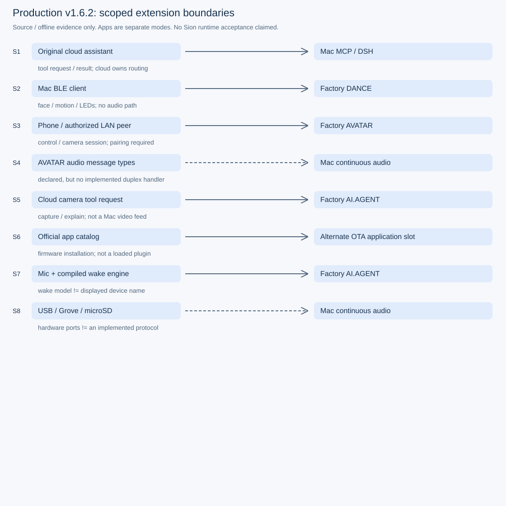
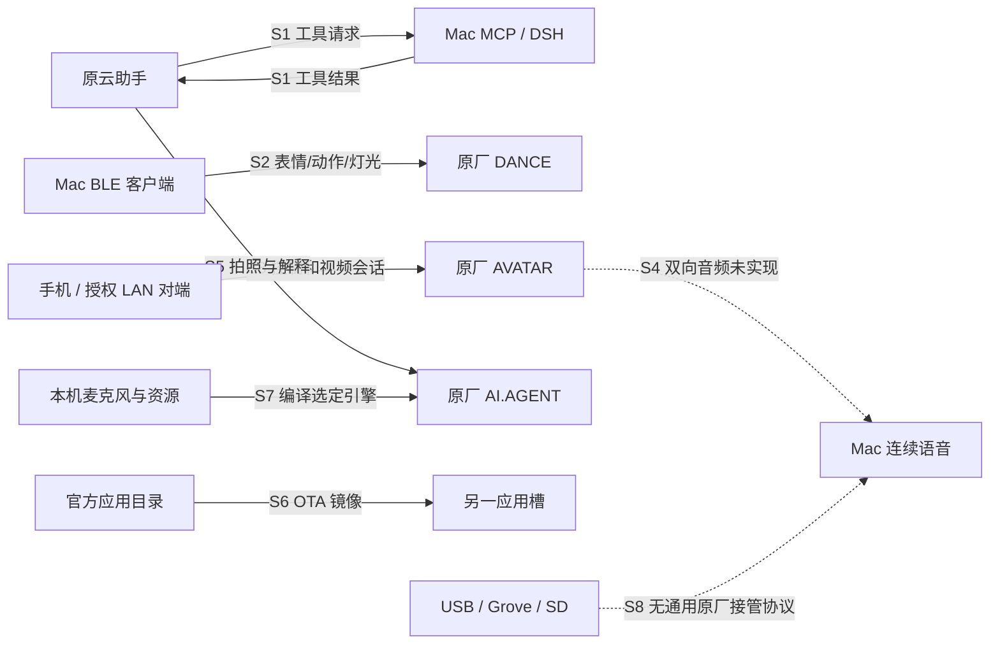

# 量产 v1.6.2 的开发边界与折中方案

最新约束已调整：允许手动切换，新增应用方向及鉴权范围修正见 [成品计划](product-plan.md#独立-dshagent-方向手动切换已获允许)。本文此前的自动回归/双启动推荐属于旧约束下的分析，不代表新架构已选定。

2026-11-18；归属 P0/P1 的兼容决策。**这是调查与候选设计，不是采用新架构或刷机授权。** 原同进程双模式实现保留，但官方集成缺口已触发重开选型。安装状态仍以 [安装审查](installation-recovery.md) 为准，执行顺序仍归 [成品计划](product-plan.md)。

最新后续：[量产入口与官方升级共存审查](dual-boot-updates.md) 已核对管理 MCP 安装入口、量产启动器入口和实际 IDF 选槽规则。简单两槽不能保证开发固件常驻；新的容量/启动选择研究见该页。

## 结论与证据强度

量产固件不是完全封闭，但其开放接口按应用分隔：AI.AGENT 的云端工具、DANCE 的 BLE、AVATAR 的手机/网络视频控制、ESPNOW.REMOTE 的遥控，不能直接拼成一个同时工作的完整 DSH 终端。当前最有实际复用价值的免刷折中是 **Mac 本地语音 + DANCE BLE 表情/动作**；更贴近完整硬件终端目标的是 **原厂二进制与开发固件分别运行**，但切换入口与双方升级保护尚未解决。

先读 [官方设备文档](https://docs.m5stack.com/en/StackChan/)、[官方鉴权说明 #134](https://github.com/m5stack/StackChan/issues/134)、[IDF v6.1 OTA](https://docs.espressif.com/projects/esp-idf/en/v6.1/esp32s3/api-reference/system/ota.html)。鉴权事实只在 [共享调查](../../StackChan/docs/authentication-audit-2026-11-18.md) 维护。不能从开源协议推断量产版的全部内部行为，也不能把公开源码同版本号视为相同二进制。

本轮仅离线读取已有备份中 ota_1 应用，校验完整备份 SHA 后对 11 个预先指定的非敏感字符串做存在性检查；AI.AGENT、DANCE、APP.CENTER、BLE 启动日志、相机流、头部/LED/相机 MCP、AppLanAddress 等 10 项存在，新增 sion_pair 不存在。证据在 `work/stock-boundary-research/production-marker-check.json`。这仅支持量产镜像包含相关标签，**不证明分支可达、鉴权成功或接口已在 Sion 实测**；未做鉴权秘密提取、二进制修补或设备请求。

## 能力边界

以下源码路径相对于官方固定 [28b9f0c8](https://github.com/m5stack/StackChan/tree/28b9f0c8bd6acd81cb3c70f1a93c3e373b39d400/firmware)；小智依据锁定 v2.5.2 加官方补丁。查看 prepared checkout 时须排除我们自己的 preservation/Sion 增量。

| 边界 ID / 入口 | 生产者 → 消费者 / 实际范围 | 缺口与开发界限 | 证据入口 |
|---|---|---|---|
| S1 原助手 MCP | 原云模型 → Mac 工具 → 工具结果回原云播报；设备自身也向原云暴露头部/LED 等工具 | 可调用 DSH 已有会话，但本地 MCP 工具不会因此获得设备全部 MCP 的反向客户端权限；每轮是否调用、是否转述仍由原模型决定 | `main/hal/hal_mcp.cpp`；`xiaozhi-esp32/main/mcp_server.cc`；[官方 #126](https://github.com/m5stack/StackChan/issues/126) |
| S2 DANCE BLE | 外部 BLE 客户端 → motion/avatar/RGB characteristics → 头部、眼睛/嘴、灯光 | 有比“开心/说话”更细的表情参数；未提供该通道的麦克风、扬声器或相机流，也未发现切换到 AI.AGENT 的命令 | `main/apps/app_dance/app_dance.cpp::onOpen/onRunning`；`main/hal/hal_ble.cpp::ble_init`；`stackchan/json/json_helper.cpp` |
| S3 AVATAR 网络 | 手机端 / LAN 对端 → WebSocket 消息 → 动作/表情/文字/摄像头 | 设备是连接手机 LAN 服务的客户端，不是任意本地 REST 服务。生产固件自己可生成握手证明，电脑仍需合法的配对/会话流程；不能将缺公开鉴权实现误解成原机无网络控制，也不能推断任意 Mac 可直接连接 | `main/hal/hal_ws_avatar.cpp`；`main/hal/utils/local_network/local_avatar_client.cpp::connect` |
| S4 AVATAR 声音与相机 | 原处理器 → 相机帧/文字事件；声明音频消息类型 | Start/StopAudioStream 是空分支，接收 Opus 分支被注释；TextMessage 产生文字事件，不能视为自由 TTS API。公开源码未形成持续双向音频链；不能据枚举名称宣称已可接管 | `hal_ws_avatar.cpp` 的相关 switch；`app_avatar.cpp` |
| S5 AI.AGENT 相机 | 原云 MCP → take_photo → Capture/Explain → 结果 | 有相机不代表 Mac 能订阅原始视频；直接 DSH 图像输入还需明确返回图像/访问路径 | `xiaozhi-esp32/main/mcp_server.cc::AddCommonTools`；`main/hal/board/stackchan_camera.cc` |
| S6 应用中心 | 官方目录 → firmwareUrl → launchApp → OTA → 下次启动 | 下载的是独立应用固件，不是动态载入原 AI.AGENT 的插件；未见用户任意 URL 导入/已装槽启动入口。内置 Mooncake App 则编译进主镜像，两种“App”需区分 | `main/hal/hal_app_center.cpp`；`main/hal/utils/ota/ota.c`；`main/main.cpp` |
| S7 唤醒与资源 | 麦克风 → 固件选定的唤醒引擎/模型 → 原云 | 改设备显示名不改唤醒模型。源码自定义词配置是构建选项；运行版支持哪些模型还取决于引擎和资源 ABI。个人声纹过滤未发现现成原厂接口 | `main/Kconfig.projbuild`；[官方 #94](https://github.com/m5stack/StackChan/issues/94)；原 assets 检查记录 |
| S8 USB / Grove / microSD | 芯片调试下载、已编译驱动 → 对应硬件 | USB CDC/JTAG 不等于 USB 麦克风/声卡；物理 UART/I2C/SD 也不是通用音频插槽或代码热加载器。更换线口不能自动补软件协议 | 官方硬件文档；当前 USB 识别及公开启动代码 |

DANCE 会启动 BLE 服务，而 AVATAR 的同一启动调用被注释。进入 AI.AGENT 后 `main.cpp` 卸载 App 管理器并运行不返回的语音 Application，故“DANCE 控身体，同时 AI.AGENT 交出原麦克风”在已审查版本中没有依据。S2 的控制通道不应触碰配置 characteristic；设备身份、角度限制、退出清理与掉线行为应由实际 adapter 验证，不能直接执行演示的任意整套动作。

图的可编辑 Mermaid 表达：

图仅覆盖此页审查边界，不表示上述应用并发，或 Mac adapter 已安装。

## 四种折中与代价

| 方案 | 原助手与绑定 | DSH 交互能做到什么 | 要让步的地方 / 判断 |
|---|---|---|---|
| A 保持原厂 + 更严格的 MCP 工具会话 | 原固件照常运行；现有路径已使用 | 让工具侧绑定精确 DSH 会话，保留其人格/记忆；改进工具说明、结果格式 | 路由和最终语音仍经过原模型；一次工具不能持续订阅之后所有语音。可维护为兼容模式，不冒充确定性接管 |
| B 原厂 DANCE + Mac 本地语音/唤醒 | 原固件与绑定保留，退出 DANCE 后手动返回原助手 | Mac 麦克风→本地 ASR→选定 DSH→本地 TTS；BLE 让 Sion 表情/动作随结果变化，停止检测可在 Mac 实现 | 声音来自 Mac/独立外设，非机身麦克风/扬声器；说停止能停止本地会话，但未发现自动切回 AI.AGENT 的原厂命令。免刷路线最清楚，仍未实机验证 |
| C 原厂二进制 + 独立 DSH 固件双启动 | 原模式实际运行原二进制，避免在自编译程序复现官方鉴权；共享配置必须保留 | 开发模式拥有本机音频、相机、动作、Wake，可由本地“停止”触发回原槽重启 | 接受模式切换重启；进入开发模式的日常入口、共享配置隔离、两边升级策略尚未解决。最贴近全硬件目标的折中候选，未选定/未实施 |
| D 量产二进制小范围修改 / 插入入口 | 可能保留原认证代码，但不能保证运行或云端接受 | 理论可修补一个切换入口，甚至注入音频接缝 | 无稳定插件 ABI/链接符号；每版定位、调度/内存/校验、异常恢复和发布权利均需审查，投入可能超过公开源码开发。只适合作为限界研究，不是当前首选 |

### B 的社区复用和维护

[yossitv/kawaii-home-studio](https://github.com/yossitv/kawaii-home-studio) 提供原厂 DANCE BLE 控制及直接从 Mac 使用 bleak 的脚本。已核对 `scripts/ble_state_demo.py` 和 `firmware/ble_controller/transport_ble.h`：确有眼睛/嘴形和头部 JSON 写入，而不是只凭 README 判断。其语音示例借助外部 OpenHome/DevKit，不能当作 StackChan 原生麦克风已经接管；我们可用本地语音与 DSH 替代外部链路，这是待实现设计。

2026-11-18 GitHub API：未 archived，main HEAD `e49d3d14ab2cb2b3a892819b618ddb3b234ac1af`，提交 2026-08-08 07:56:35 UTC，pushed_at 同日 07:58:36；近三个月未见新提交，不能标成持续活跃。API license=null，tree 未发现总许可证，README 列的是部分借用资产许可；复制代码前需明确许可，也可依据官方 MIT 协议独立实现。不部署其语音云、不运行其刷写步骤或动作脚本。

### C 不能省略的四个条件

1. **双向入口。** DSH → 原厂可设计 `esp_ota_set_boot_partition` 后重启，需实际验证；原厂 → DSH 尚未找到稳定的原厂调用接口。应用中心受目录控制且会安装镜像；USB 改选择属于维护动作。若采用自定义启动器/物理启动选择，会触及原 bootloader，必须重新做安装/恢复设计，不可沿用“保留原启动器”的旧方案默默刷入。
2. **OTA 槽不是写保护。** 当前原厂 ota_1、拟开发 ota_0；原厂执行下一次常规 OTA/应用中心下载，通常会覆盖 ota_0。开发侧可禁止覆写原厂槽，但无法靠自己的代码约束此刻正在运行的未修改原厂固件。必须定义官方升级时如何卸载/重装开发模式，或取得上游受支持的选择入口。
3. **共享状态要隔离。** 同一 CPU 每次只运行一套固件，不存在两个后台同时对话。原厂 NVS、assets 和板级配置不是另一份独立系统；开发侧不得清空/迁移原区或刷新原云身份。仅保留应用镜像并不足以保留原体验，底层 Wi-Fi/SDK 写入也需审查。
4. **退出体验与故障闭环。** “停止”在 DSH 本地识别后，先取消语音/动作，再记录明确切换意图、选择原槽、重启，最后原助手启动且实际可唤醒才算归还。不能把发送重启当原助手已恢复。Mac 掉线须有设备物理返回；启动器回退、断电和升级中断仍需测试。

### 量产二进制可研究到哪里

已有读回表明本机 Secure Boot/Flash Encryption 未启用，故技术上可开展离线镜像结构、非敏感字符串/函数对应、调用路径与资源 ABI 分析；这不代表修改后一定能启动，也不代表获得公开生产鉴权组件。可先回答“有没有量产特有的音频/应用选择入口”，再决定是否值得进一步反汇编。此前只做镜像结构和白名单标签验证；后续已补启动器入口的有界反汇编，见升级共存审查。**仍未完成量产固件完整反汇编/行为还原，未证明不存在所有隐藏入口**。

微改量产程序和“把认证代码单独摘出来链接”不是同一件事。后者还依赖初始化、上下文、服务端校验和分发条件，不能凭一个函数名或备份就承诺可移植。即使能保留整个认证路径，补麦克风仲裁、连续停止、表情控制也不是改一处字符串。资源替换也不是安全捷径：现有模型与生成模型不相同，自定义词还需要匹配引擎，不能仅改设备名/资源文件名。

## 推荐与下一步证据

**建议将 C 作为完整成品的优先可行性研究，B 作为明确标注局限的可选兼容实现；保留 A，暂缓扩大原同进程云兼容假设。** 这是推荐，不把用户目标改为只控制表情，也未选定 bootloader 修改。原 DSH 会话、人格和记忆边界不变。当前 v3 保护/配对/音频仲裁代码可复用，但不能原包直接当 C 的开发固件刷入。

下一轮可独立完成的工件：原厂“进入开发模式”入口清单与量产调用证据；双启动共享写入者/官方升级矩阵；BLE 只读发现与受限控制 adapter 的协议设计。关闭 C 的决策门槛必须同时说明双向进入/返回、原数据保留、升级策略和可执行恢复；如果只能反复 USB 改启动，仍属于开发工具，不能关闭成品验收。B 的关闭条件则要明确用户接受外部音频、手动应用切换，并有 Sion 真机 BLE 验证。任何真机操作另按已约定范围处理，本轮没有触发。
