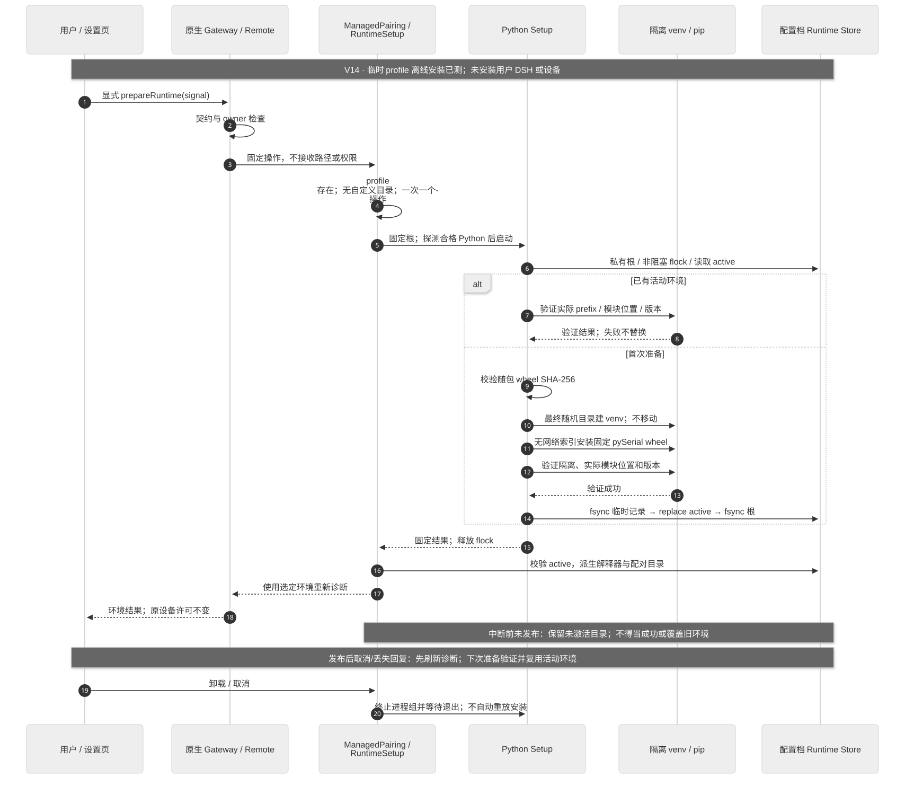
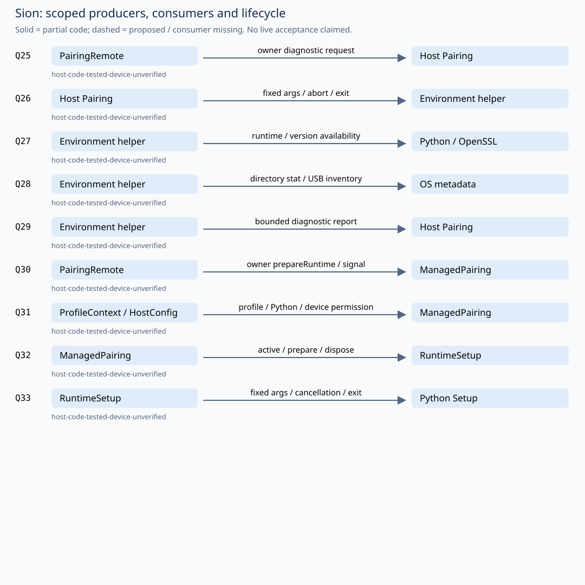
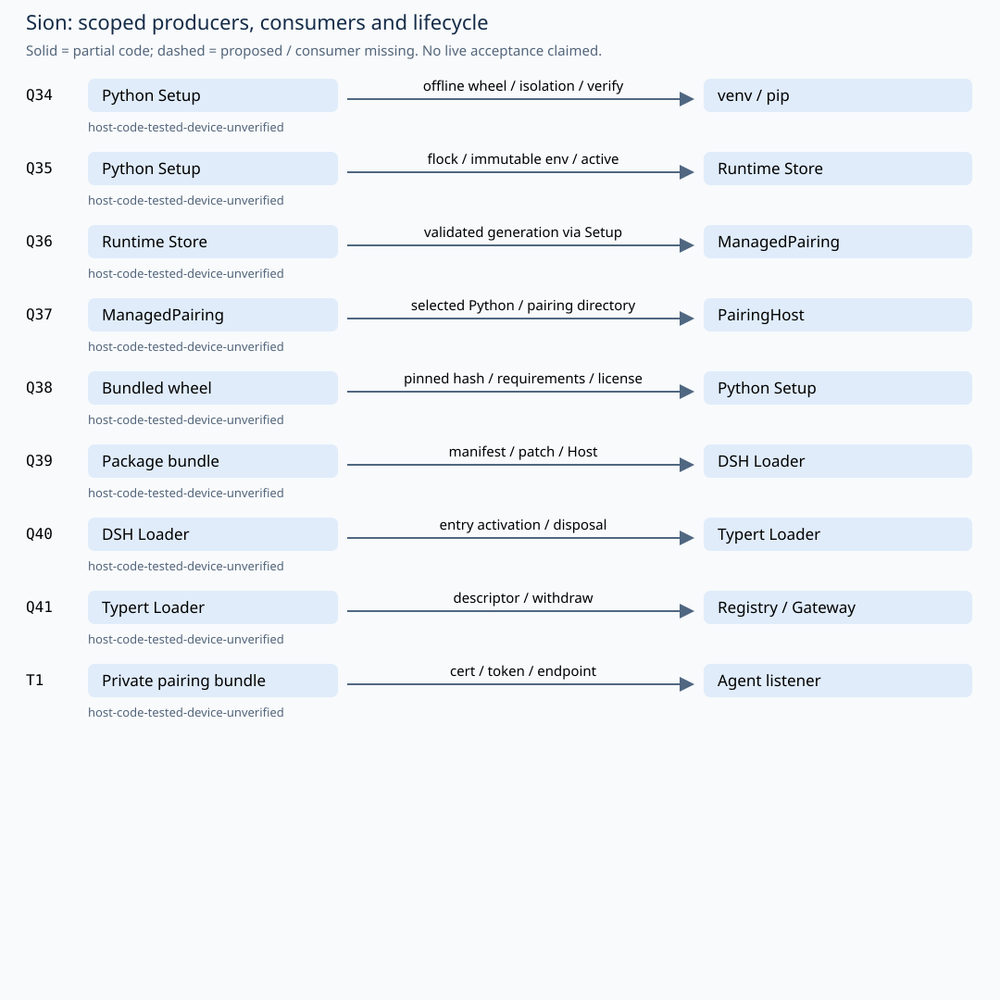

# 插件专用 Python 环境

本页维护配对辅助 Python/pySerial 环境。[VoiceRuntime](voice-runtime.md) 可复用它读取并持有配对身份。识别、播报和回声消除由 [托管语音环境](voice-installation.md) 单独准备。运行持有身份时，ManagedPairing 的安装、诊断和维护均返回 host_busy。

归属 P7/P8。入口在 [两端设置](settings-ui.md)，诊断报告与配对事务归 [Host 配对](host-pairing.md)。本页负责 owner 显式安装依赖、配置档隔离、活动环境选择、取消与重启。原生 Remote 和设置按钮已接。日常桌面配置档的配对辅助环境已安装并确认能被新版归档读回，独立设备的 SIONA1 协议和实际配对留待首验。 [桌面环境验收](validation.md#日常桌面配置档的配对环境预装)

## 官方依据与位置

- 固定 DSH SDK 0.2.2-rc.3 的 `@deepseek-ai/dsh-app-boot/src/profile-context.ts::ProfileContext.dir` 是启动器提供的当前配置档位置；`src/plugin.mjs::apply` 读取该服务，不从 shell cwd、DSH_HOME 或浏览器字段猜测配置档。
- [Python venv](https://docs.python.org/3/library/venv.html) 说明虚拟环境隔离包、依赖基础解释器且不应移动。本实现一开始就在最终随机目录创建，发布指针而不重命名 venv。
- [pip secure installs](https://pip.pypa.io/en/stable/topics/secure-installs/) 的固定版本、哈希与只允许 wheel 用于安装边界；这里额外禁用索引/依赖解析，运行时完全从随包目录安装。
- [pySerial 3.5 发布元数据](https://pypi.org/pypi/pyserial/3.5/json) 给出 wheel 的 URL/大小/SHA。随包 `vendor/pyserial/source.json` 固定来源；wheel 原样 90,585 字节，SHA-256 `c4451db6ba391ca6ca299fb3ec7bae67a5c55dde170964c7a14ceefec02f2cf0`。wheel 本身未含独立许可证，因此从同版、哈希核对的官方 sdist 提取 LICENSE.txt（BSD-3-Clause），一并分发；没有执行 sdist。

## 用户流程与权限

设置页显示“准备插件专用环境”，说明依赖、版本、许可和影响。打开页面不会安装；点击才通过生成的 `stackchanPairing.prepareRuntime(signal)`。Gateway 与业务方法继续要求 owner，方法无浏览器参数，不能传路径、命令、下载 URL 或设备权限。没有 native profileContext 时返回 runtime_profile_required；已指定自定义 pairing.directory 时返回 runtime_custom_installation，保留该部署。

Host 从已配置的 Python、Apple Silicon/Intel Homebrew 的标准 Python 路径与 python3 中依次探测 Python >=3.10 和 venv 模块；每项最多 5 秒。找不到返回 runtime_python_required，不联网安装 Python，不改变 PATH。基础 Python 之后被删除/升级可能使 venv 不可用；修复与清理引导尚缺，不能称自包含运行时。

目标根为 `<profileContext.dir>/.stackchan`，首次显式准备创建 0700 目录，私有 active.json/setup.lock 为 0600，随机 32 位十六进制子目录存 venv。配对身份另归 `.stackchan/pairing`，只有后续配对操作才创建；安装环境不生成身份、不打开串口。安装成功后的诊断可枚举系统端口，仍不打开设备。安装方可显式固定 `pairing.deviceAccess`。标准托管配置在准备后可使用 [单次 USB 授权](host-pairing.md#默认托管安装的单次-usb-授权)，仍需在页面主动发起。准备环境本身不会打开端口或改原厂绑定、偏好或 DSH 会话。

## 发布、取消与恢复时序

图表来源：`src/managed-pairing.mjs::run/select/dispose`、`src/runtime-setup.mjs::prepare/active/execute`、`scripts/prepare_runtime.py::prepare/verify/read_active/run`、`src/remote-api/index.ts::PairingRemote.prepareRuntime`、`src/settings-pairing-controller.mjs::diagnose`。图中阶段是代码投影，不是新增持久化状态字段。

所有配对/诊断/安装操作在 ManagedPairing 内一次一个，无排队重放；安装器还对 setup.lock 使用非阻塞 POSIX flock，进程退出释放，不根据锁文件内容推断是否在运行。构造服务不创建目录。已有活动环境先验证，成功原样复用；坏记录、缺失已发布目录或验证失败明确报错，不覆盖已有活动引用。

新环境：核对 wheel 哈希 → 在最终目录运行 `python -I -m venv --copies`（默认隔离基础 site-packages）→ 用该 venv 的 `python -I -m pip --isolated`，同时 `PIP_CONFIG_FILE=/dev/null`、`--no-index --no-deps --no-user --only-binary=:all: --require-hashes --no-cache-dir --no-input` → 验证 Python 版本、解析后的 sys.prefix、与 base_prefix 不同、pySerial 模块实际位于该目录且版本 3.5 → 写临时活动记录、fsync、replace、根目录 fsync。

不移动 venv，不对现有目录使用 --clear/--upgrade，不写全局包。pip/venv 每步最多 90 秒，验证最多 10 秒，Host helper 总计最多 240 秒；stdout 限 4096 字节，stderr 不回显。卸载/取消先终止整个子进程组，500 ms 后仍未退出则 SIGKILL，等待 close 后返回。公开错误为固定码，不暴露进程日志、私有路径或依赖输出。

活动记录只含 `{version:1,generation:<32hex>}`。Node 在 profile 根校验目录/uid/私有权限，以 O_NOFOLLOW 打开有界记录，派生 `<generation>/bin/python3`，不接受记录里的任意执行路径。缺失已发布 generation 不回落系统 Python。这个保护不是同用户恶意进程隔离；基础 Python 与 profile 父路径仍是可信安装输入。

提交前失败/中断会留下未激活目录，下一次显式准备使用新目录，不把半成品当成功。发布后取消/回复丢失可能已经生效：先重新检查环境，活动记录决定实际选择；重复准备只验证并复用它。失败目录保留以便诊断，自动清理/修复尚未实现。文件锁和原子引用测试不是物理掉电持久性实测；未逐个 fsync 整套 venv 文件，断电后的实际文件完整性仍需重新验证。

## 修改入口、生产者和消费者

| ID | 生产者 → 消费者 | 字段/行为及边界 |
|---|---|---|
| Q30 | PairingRemote → ManagedPairing | owner prepareRuntime 与取消；无 Client 安装参数 |
| Q31 | ProfileContext / HostConfig → ManagedPairing | 配置档根、解释器、原设备许可；自定义部署不覆盖 |
| Q32 | ManagedPairing → RuntimeSetup | active/prepare/dispose，串行占用 |
| Q33 | RuntimeSetup → Python Setup | 固定脚本/根与进程组取消，限时有界输出 |
| Q34 | Python Setup → venv / pip | 隔离创建、离线哈希安装与实际模块验证 |
| Q35 | Python Setup → Runtime Store | flock、不可变目录、原子活动记录；失败不发布 |
| Q36 | Runtime Store → ManagedPairing | 校验后的 generation 经 RuntimeSetup 解析为 Host 路径 |
| Q37 | ManagedPairing → PairingHost | 选定解释器/配对目录，沿用 Host 设备许可；正式配对仍走原事务 |
| Q38 | Bundled wheel → Python Setup | 固定 wheel、requirements 哈希、许可证与来源 |

页面、生成描述符、状态/错误投影与卸载的间接边继续使用 Q19–Q24；诊断依赖与 OS 元数据仍归 Q25–Q29。字段/方法权威是 Remote TS、实际安装器和生成描述符，不在 Wiki 另造可调用命令。

## 验证与未完成项

本批全套 JS 80 项通过，其中新增 installer 的 6 个 Python 故障场景。真实 Cordis 临时 profile + 原生 Gateway 走 prepareRuntime，验证 owner/额外参数拒绝、实际 venv/pip 离线安装与 import、重复复用、服务重启后选定同一环境、配对 snapshot 与设备访问拒绝；真实 Client namespace 本地传输另验证生成方法可调用。没有使用用户 profile 或修改全局 Python。

测试覆盖 wheel 损坏先于创建、未完成目录保留、新一轮不重用半成品、活动记录发布失败、坏记录/链接/缺 generation、旧活动验证失败不替换、flock 占用/释放、已进入运行阶段的 helper 取消并确认 PID 消失、并发调用拒绝、页面必须显式点击且不确认设备权限。首次真实验证被 macOS /var 与 /private/var 的等价路径误判；修为实际路径比较，同时加强模块位置/虚拟环境验证，未取消隔离检查。失败日志 work/runtime-setup-tests-v1.log，后续证据以最终测试日志为准。

后续已完成隔离 tarball 的原生 Host 自动加载和包内 helper 验证，见 [安装包验证](settings-ui.md#安装包与原生加载器验证)。

新版用户桌面插件加载、基础解释器变更后的修复、旧环境清理、实际 SIONA1 身份与配对验收仍待完成。既有 USB 端口已通过本机只读枚举。原厂 Wi-Fi 和 StackChan World 绑定不进入托管环境安装事务。 [桌面环境验收](validation.md#日常桌面配置档的配对环境预装)

最终证据：work/runtime-setup-tests-final.log 为 80/80；新增页面源/控制器有静态渲染和显式触发检查，本批没有另做浏览器交互验收。生成的 Host/Client 产物 7 个重建后字节一致；包 dry-run 验证 helper、受管理服务、固定 wheel/requirements/许可证/来源均在包中，排除 work/.local。记录 work/runtime-setup-repro-build.log 与 runtime-setup-pack.json。14 张图全量渲染，V14 及新增关系投影已经人工查看。
