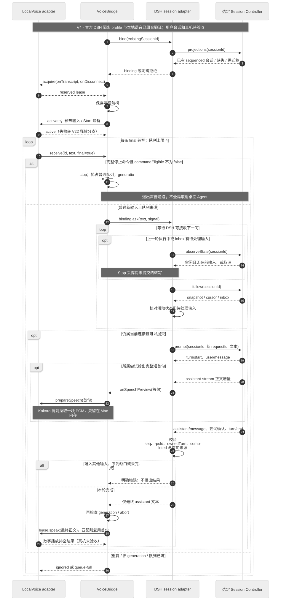
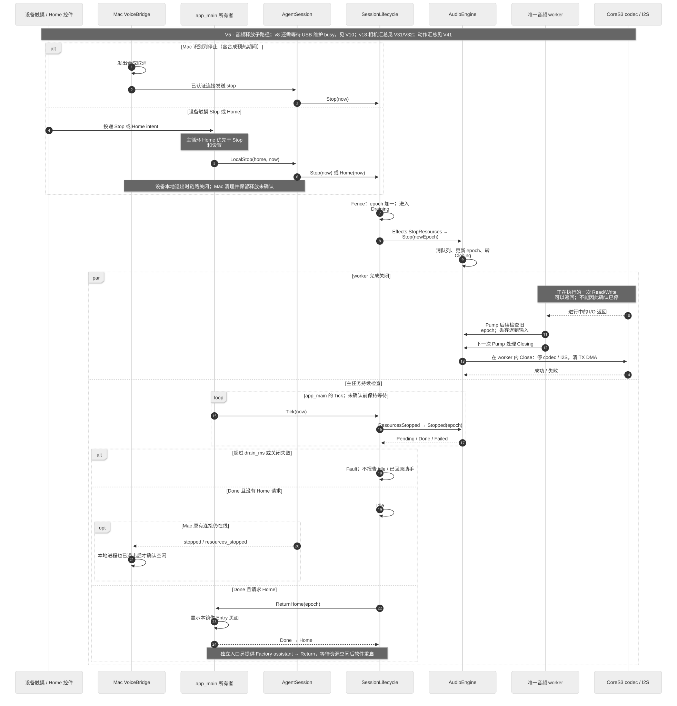

# 连续对话、停止与设备状态

这页负责时间顺序和状态 guard。接口字段/生产者清单仍归 [运行核心](runtime.md)、[独立设备](independent-agent.md) 和 [设备音频](agent-audio.md)。桥、DSH adapter 与设备各有自己的代次；没有认证 adapter 之前，不能把它们画成已接通的同一个计数器。

## 连续对话与既有会话

V4 回答“为什么不必每轮调用工具，以及为什么不会把另一个桌面回合播出来”。桥持有连接和有限队列；DSH adapter 只向选定会话发文本，先订阅再提交。LocalVoice 通过固定版本官方 DSH 隔离 profile 的端到端语音演练，详见 [复现与证据](voice-runtime.md#原生-dsh-连续语音演练)。用户实际会话和真机待验收。

图表来源：[bridge.mjs](../src/bridge.mjs) `enter/receive/stop/release`、[dsh-session.mjs](../src/dsh-session.mjs) `bind/ask/waitForInputSlot`。DSH 的 `observeState` 将 Agent 活动与待处理队列状态交给就绪等待，最终 `follow` 将同一会话的游标和事件交给请求归属检查。等待阶段仅保留本机转写，Stop 会取消订阅和未提交语音；DSH 仍可继续上一回合。图内新 requestId 由 DSH adapter 生成。混合输入、序号缺口、流结束或超时会使本次调用失败并开始释放。完成文本以外的 thinking/tool 内容不会进入设备。

支持 `prepareSpeech` 的 LocalVoice 开启官方 `assistantStream`，在 Mac 预合成同一请求的短首句。最终回合完成且首句、步骤、持久事件与尝试尾帧一致后，才把 PCM 送给设备。其他结果走完整最终答复的常规合成。 [DSH Session Controller](https://github.com/deepseek-ai/deepseek-harness/blob/master/packages/api/session-controller/README.md) · [首句预合成](voice-runtime.md#首句预合成)

章节来源：同一实现的 `maxQueued=4`、dedup 上限 1024、连接/释放默认 10 秒、DSH 请求 180 秒都是配置值。播报的 180 秒期限在设备确认音频帧后重新计时，单帧 ACK 和播放结束各自受传输期限约束。 [本地语音 V22](local-voice.md#顺序与全部影响方) · [首帧耗时](voice-runtime.md#首帧延迟与连接预热)

`finally` 取消本插件的 follow 读取，已接受的桌面任务继续运行。会话桥通过 DSH 0.2.2-rc.3 原生 Session Controller 的固定版本验证。真实用户会话和当前运行实例的集成仍待验收。

## 停止与 Home

V5 回答“清空队列为什么不等于已停止”。设备的 StopResources 先使旧代次无效；唯一音频 worker 才能关 codec、停 I2S 并清 DMA。等待期间的回执是 Pending，不能提前报告 deviceIdle。v8 真实入口汇总音频及 USB 维护 busy；下图聚焦音频子路径，维护等待见 [V10](agent-pairing.md#usb-授权与维护时序)。网络退出等待见 [V18](agent-transport.md#esp-网络所有者与显式连接)；v18 已加入相机释放确认，见 [V31/V32](camera.md)；动作释放现已汇总，见 [V41](motion.md#资源组合唯一任务与-home)，命令/许可仍待接。

图表来源：[device_main.cc](../firmware/agent/device_main.cc) `post/app_main/DeviceEffects`；[session_lifecycle.h](../firmware/agent/session_lifecycle.h) `Fence/Tick`；[audio_engine.h](../firmware/agent/audio_engine.h) `Stop/Pump/Stopped`；[core_audio_bridge.cc](../firmware/agent/core_audio_bridge.cc) `AgentClose`。LVGL 回调仅投递 intent，实际页面销毁在主任务中发生。运行中的一次读/写可能返回；新 epoch 阻止它发布旧输入，硬件关闭仍需下一次 Pump 确认。

章节来源：`SessionLifecycle` 的 lease 15 秒、drain 20 秒是配置。I2S 单次调用 50 ms 不约束所有初始化/I2C 等待。`ReturnHome` 执行 `show(Page::Entry)`；从入口选择 **Factory assistant → Return** 才请求软件重启。Mac 发出 Stop 后，收到当前资源确认并结束本机工作才报告空闲。设备本地 Home 会关闭连接，Mac 清理后保留旧租约的「设备释放未确认」，可在新认证空闲 hello 后重新接通。 [原厂返回](dual-boot-updates.md#按现场槽状态验证-v35-恢复)

播放中语音 Stop 的主机验收用正式插件和 10 ms 帧节拍，检查仍有待播 PCM 时发出停止、对端回复释放、原会话可继续使用。设备 codec、DMA 释放和跨应用返回仍以真机证据为准。 [复现](voice-runtime.md#十轮持续对话与播报中停止)

回环 TLS 将实际 C++ AgentSession 与 Mac 侧 LocalVoice 和 VoiceBridge 接在一起，固定保持合成启动未就绪。设备 AudioEngine 仍产生输入。向识别结果注入「停止」后，同一连接收到下一代次的资源确认。再次接通后触发设备 LocalStop 的 Home 路径，设备关 codec 夹具并进入 Home，Mac 取消合成并可重新接受连接，保留设备释放未确认。 [交叉验收](validation.md#合成启动时的设备退出与原厂返回)

## 独立设备状态

V6 取自当前独立应用的 SessionLifecycle，覆盖显式停止、Home、载体关闭及设备时钟到期。图只列状态推进和关键拒绝，不是完整状态×事件证明；旧 generation/epoch、边界时间和重入仍由实现/测试判定。

图表来源：[session_lifecycle.h](../firmware/agent/session_lifecycle.h) `Phase/Begin/Connected/Renew/Accept/Disconnected/Stop/Home/Tick/Reopen` 与 [生命周期测试](../firmware/agent/session_lifecycle_test.cc)。构造参数非法和 epoch 耗尽都会 Fault；除这些全局条件外，图示的连接、关闭和返回均有明确 guard。

| 容易遗漏的 guard | 当前行为 |
|---|---|
| Idle/Home 收到 Stop | 不做操作，不触发新的关闭 |
| 错 epoch 的 Connected/Renew/Disconnected | 不推进新会话；Accept 还要求 Active 且未过期 |
| 活动时载体关闭，或未收到关闭且租约到期 | 进入 Draining，关闭旧载体并退休 epoch；之后旧帧无法进入设备队列。 |
| Draining 中再收到 Home | 保留关闭过程，设置返回意图 |
| Draining 中收到新认证连接 | AgentSession 拒绝 Attach；资源释放完成后，认证 hello 仍保持空闲，Start 才打开音频。 |
| Fault 后 Stop/Home 重试 | 需能递增 epoch；已有 Home 意图保留，直到 Home 后 Reopen 清除 |
| Returning 超时 | 独立使用 drain_ms 期限；不把 Pending 当成功 |
| Home 后重进 | Reopen 回 Idle，epoch 不归零 |

章节来源：同一状态机及 [设备主循环](../firmware/agent/device_main.cc)。当前主循环已通过认证网络事件和 AgentSession 产生 Begin/Connected；真机未安装，图中 Active 仍不是 Sion 的运行实测。
