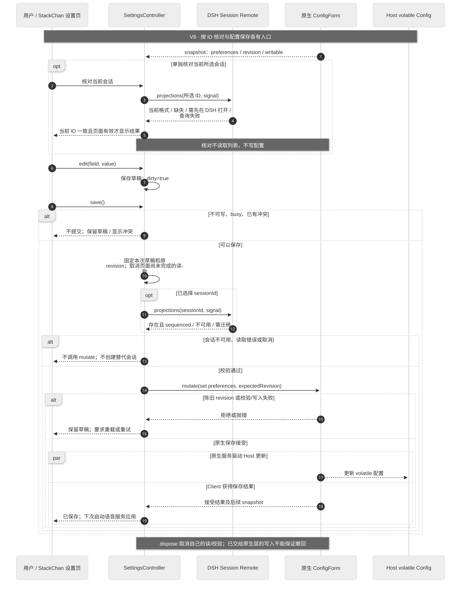
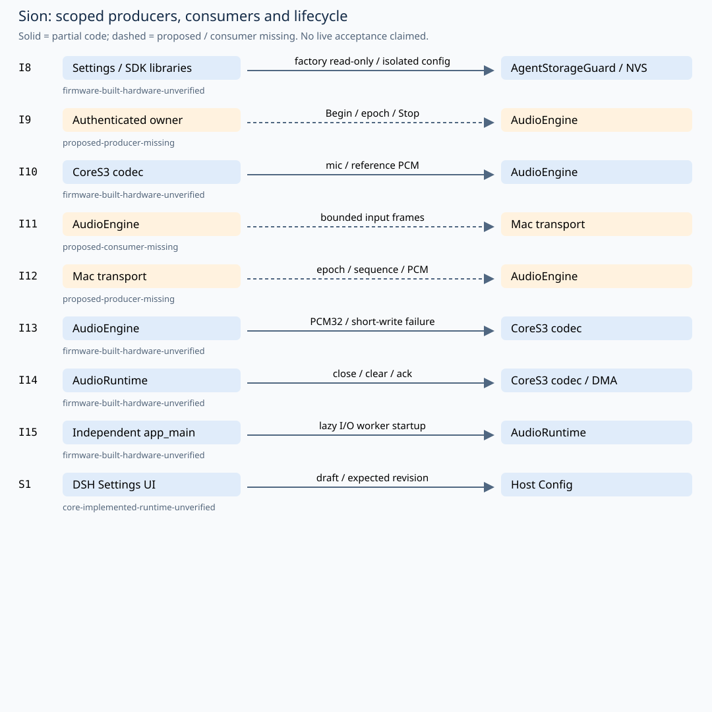
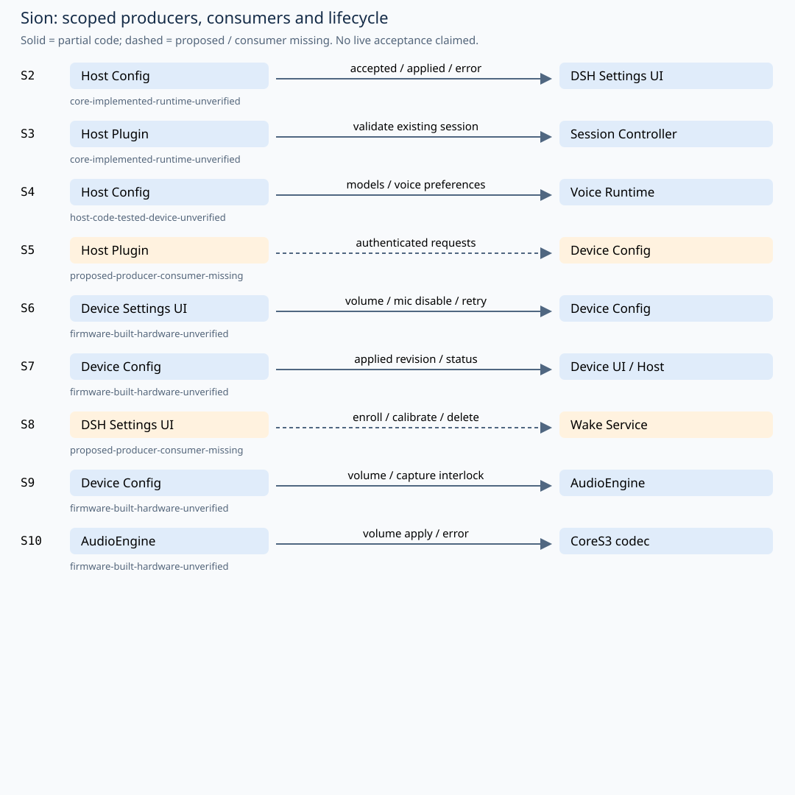
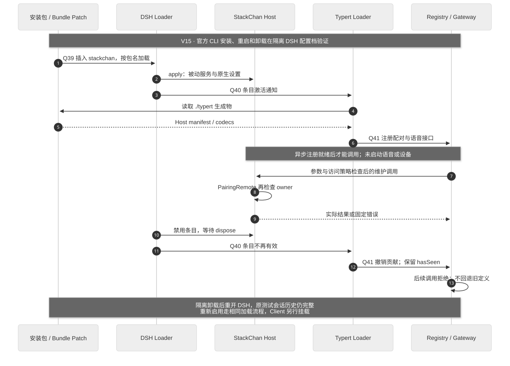
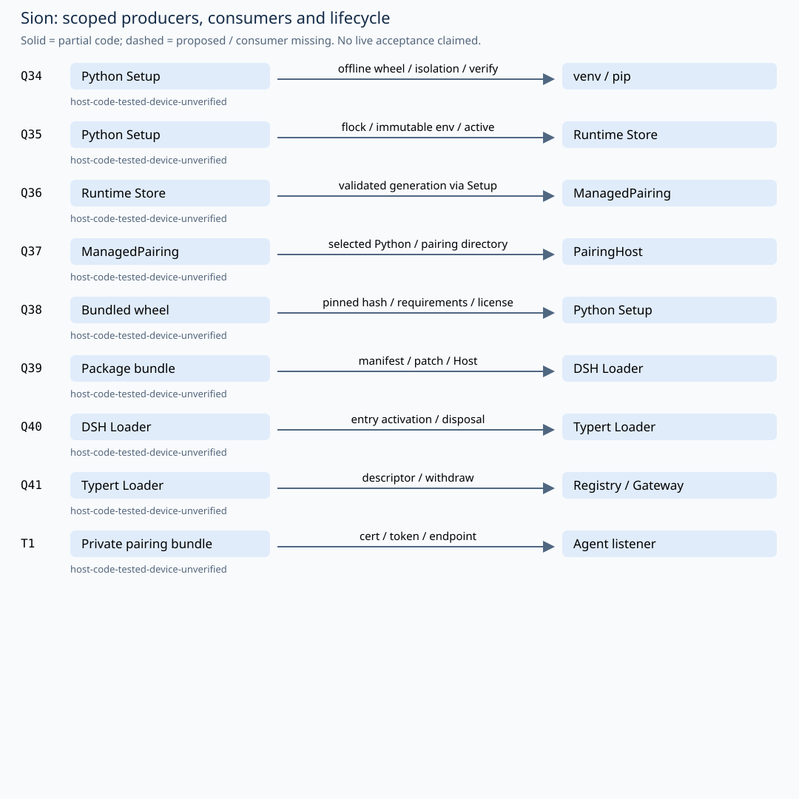
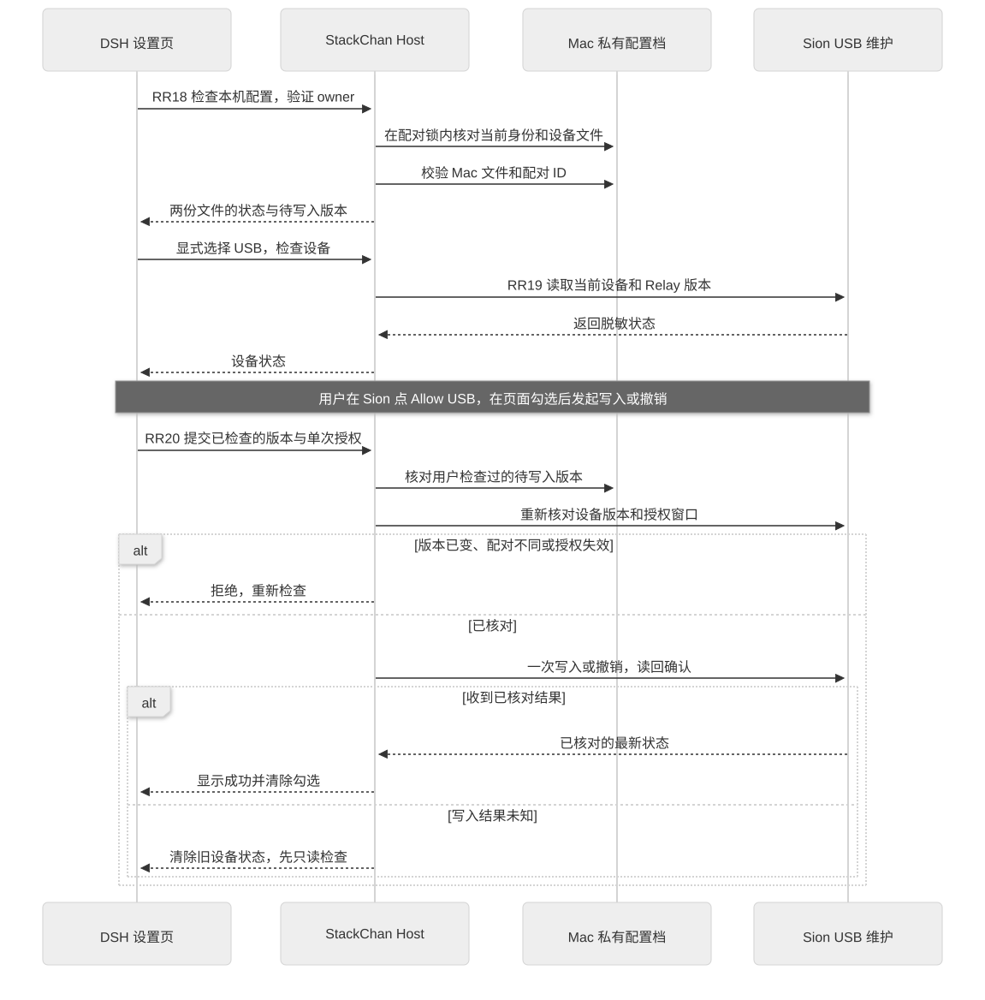

# DSH 插件与 StackChan 设置界面

[动作设置](motion.md#认证动作与两端设置)由设备 Settings → Motion 管理许可和保存，DSH 插件读当前认证连接的状态，随断线或过期降为未知。

设备新增 Settings → Camera：本地许可开关、显式保存、关闭中/释放失败状态，许可不触发拍照；v1/v2 兼容与原配置隔离见 [设备设置](device-settings.md)。DSH 图片工具、传输与附件导入已接；DSH 侧已接许可、设备阶段、Host 保存/取消状态与照片保留说明；过期或读取失败显示未知，打开设置不拍照。见 [两端相机状态](camera.md#两端相机状态与照片保留说明)；隔离浏览器已检视，用户实例和真机仍待验收。

设备 Avatar 页面支持 [Settings → Display 选择默认脸或大肥鱼](device-settings.md#默认脸与大肥鱼)。DSH 原生表情工具仅允许当前已接通的会话使用，未显示头像时返回 unavailable。DSH 语音页的「设备能力与限制」可查看当前支持、许可和限制。所选会话也能读取同一份 [能力快照](device-capabilities.md#设备能力状态查询)。

Display 选 Text 后，设备主动协商 [转写与回复字幕](device-settings.md#纯文字模式)。Mac 侧沿用当前连接和选定会话，无额外的字幕授权开关。旧 Host 可继续连接默认脸和鱼脸；文字模式使用 v31 配套 Host。

托管语音安装新进展：[准备、修复、取消与发布状态](voice-installation.md)已接设置页和 Host，沿用当前 profile；自定义路径不覆盖。新增“检查安装条件”及缺 Python/开发工具的官方安装指引；旧环境清理、用户实例和真机仍待完成。以下开发批次中的“安装尚缺”保留当时状态，最新安装能力以此入口为准。

使用含常驻识别的候选插件时，已有托管 CLI 环境仍可开始语音。语音服务关闭后，点「准备语音环境」才会为当前配置档构建并自检常驻版。原语音环境入口保留，回退插件仍可用。 [托管版本与发布规则](voice-installation.md#事务发布与恢复)

本地语音提供显式「检查语音环境」「运行离线自检」「取消检查」。八项基础检查与实际模型加载分别显示，安装和修复使用独立入口。选用 Kokoro 后，可在语音服务关闭时用尚未保存的语言、音色及语速生成样本，再点播放。 [报告、权限与 V25](voice-environment.md) · [音色试听与 V68](voice-environment.md#本地音色试听)

当前运行入口：[语音服务与 V23/V24](voice-runtime.md)。[原生 DSH 隔离演练](voice-runtime.md#原生-dsh-连续语音演练) 已核对加载后的插件能验证已有 Session Controller 会话，端到端声音另由仅回环的测试运行实例验证。页面区分保存、listener 运行、认证连接、active、释放未知；模型/环境准备仍需完成用户引导。下方按批次记录的测试数字是历史证据，最新计数统一见 [validation](validation.md)。

设备端最新进展：Connect / retry、联网/校时/认证/关闭反馈及主循环 AgentSession 已接线；Home 等待网络清理。Mac 配置页已接 [语音运行服务](voice-runtime.md)：显式启动/接通/停止/关闭与只读状态刷新；用户实例与真机仍未验收，A9 未完成。见 [设备网络实现](agent-transport.md#esp-网络所有者与显式连接)。

2026-11-18 用户明确要求：两端都要有可用的用户设置界面。它是成品验收的一部分，不能以 CLI、私有 JSON 或只有通信服务替代。归属 [P8 / A9](product-plan.md)，实现状态：首版 DSH 插件设置页、原生配置保存和 Host 读取已实现并在隔离 profile 验证；设备音量/静音/禁麦/保存页面及驱动适配已实现和构建；Host 配对/语音服务组合已通过隔离测试，模型引导与真机生效闭环尚未完成。当前开发固件已有 Settings/Back、音量、静音、禁麦、显式保存、Stop 和 Home；`src/host.mjs` 仍是语音组合接缝；`src/plugin.mjs` 已提供独立的被动设置插件入口，尚未安装到用户 DSH。

## 原生设置保存时序

图表来源：[settings-controller.mjs](../src/settings-controller.mjs) `checkSession/save/#refresh/dispose`、[plugin.mjs](../src/plugin.mjs) `Config/apply`，以及 [settings.test.mjs](../test/settings.test.mjs) 的真实 DSH 临时 profile 检查。Host volatile 更新和 Client 收到结果由原生配置服务驱动，图不保证二者的通知先后。只有保存接受后才显示「已保存」。

章节来源：上述实现及本页字段/生效契约。并发窗口通过 expectedRevision 检查；缺失会话不会新建替代。卸载取消自己的读取，不保证已经提交到原生层的写入能撤回。设备、语音尚未接通时不展示已应用成功。

## 官方接缝与版本边界

DSH 侧采用 **StackChan 插件包：Host 服务 + Client 配置页**。复用 DSH 的插件管理和设置机制，不另建一套人格、记忆或模型配置。以下是官方源码审查，不代表本机版本兼容或已安装：

- 固定官方提交 `2e39e70496aa02986ca6a820c5d497e816b69d7e` 的 [ui-settings](https://github.com/deepseek-ai/deepseek-harness/blob/2e39e70496aa02986ca6a820c5d497e816b69d7e/packages/client/ui-settings/README.md)：`settings.section`、`settings.section.view` 与 `ctx.configForms.get(entryId)` 提供页面、共享配置快照和带 revision 的保存。
- 同提交的 [ui-plugin-manager](https://github.com/deepseek-ai/deepseek-harness/blob/2e39e70496aa02986ca6a820c5d497e816b69d7e/packages/client/ui-plugin-manager/README.md)：`plugins.bundle.config` / `plugins.row.config` 接收插件配置页，也可按归属复用 `settings.section`。实现时选单一页面，不重复维护两个编辑器。
- 同提交的 [settings](https://github.com/deepseek-ai/deepseek-harness/blob/2e39e70496aa02986ca6a820c5d497e816b69d7e/packages/settings/settings/README.md)：可编辑字段来自 `.volatile()` Config；秘密字段脱敏、陈旧写入拒绝。自动表单标志存在不等于已有客户端自动生成页面，因此必须交付实际 Client UI。
- [StackChan 官方手册](https://docs.m5stack.com/en/StackChan/) 与本仓 [手册基线](manual-alignment.md)：设备界面适配 320×240 触屏，沿用上滑显示 Home 的导航。DSH 设置不调用官方解绑/重置，不把显示名字当自定义唤醒词。

本仓已缓存的 DSH SDK package 为 0.2.2-rc.3；这不证明上述最新源码接口与已运行实例相同。P3/P8 必须检查实际运行版本、打包入口、配置 schema、页面插槽和卸载生命周期，再声明支持范围；不自动升级用户 DSH。源码审查保存在忽略目录 `work/dsh-settings-review`，不将其下载视为依赖安装。

## 用户路径与字段归属

StackChan 设置顶部有四个选项卡。**连接与会话**管理已有会话、连接方式和语音运行。**设备配对**管理底座 USB 和独立身份。**本地语音**管理识别、音色、试听、安装和离线自检。**设备能力**查看相机、动作、灯和传感器。保存栏与草稿在各页共享，切页保留尚未保存的选项。语音状态继续刷新，其他选项卡可停止正在进行的对话或待命。键盘方向键及 Home、End 切换选项卡。 [页面实现](../src/settings-view.mjs) · [选项卡验收](validation.md#stackchan-设置选项卡)

首次有线配对时，打开 **DeepSeek Harness → 设置 → StackChan → 设备配对**。准备插件专用环境后，选择底座的 USB 串口并点「读取设备编号」。刷新本地配对状态，选「暂不配置局域网」或填入语音服务地址，再点「准备新的本机配对身份」。在 Sion 的 DSH.AGENT 中点 **Pairing → Allow USB**，回 Mac 勾选确认并点「将配对身份写入设备」。用「检查设备并核对结果」确认身份。已有配对可从「刷新本地配对状态」查看。原厂手机配对在 StackChan World 管理。 [实体配对结果](validation.md#v54-实体配对与-usb-语音验收)

| 位置 | 用户能做什么 | 权威写入者 / 消费者与边界 |
|---|---|---|
| DSH → StackChan 插件 → 设备 | 选择 USB 串口、读取设备编号、配对引导、查看设备与连接状态、移除此插件的配对 | Host 配对服务。读取只填草稿，之后准备身份及物理授权写入各自需要操作。原厂手机绑定由官方应用管理。 |
| DSH → 会话 | 列出并选择可用的已有会话、显示当前选择与不可用原因 | DSH Session Controller 验证现有 ID；不创建替代会话，不复制人格/记忆。初次使用沿用已指定的私有绑定 |
| DSH → 本地语音 | ASR/TTS 后端、语言、模型安装状态、音色、语速、显式试听和识别测试 | 本地语音服务；下载前展示来源/许可/体积，缺模型时阻止开始。测试须用户点击，打开设置不自动录音 |
| DSH → 设备能力 | 查看相机/麦克风/动作等支持与启用状态，控制本插件可用范围 | Host 策略与设备实际 capability 共同决定有效权限；DSH 保持工具决策权，不用表情模板覆写人格 |
| DSH → Wake 集成 | 后续提供自定义词、注册/校准/启停/删除入口 | Wake 项目持有声学 profile；本插件只做集成和状态投影，不复制训练数据；未实现时清楚标示不可用 |
| StackChan → DSH 设置 | 查看配对 Mac 和连接/错误、重连、设备信息；DSH 音量/静音与麦克风禁用 | 设备专属配置与资源服务；不写原厂 audio、Wi-Fi、云配置及绑定。音量 0 保留静音 |
| StackChan → DSH 主界面 | 显示连接中/就绪/聆听/思考/播报/停止中/故障，开始、停止、进入设置，上滑/Home | 设备生命周期为权威；设置页面不会阻挡 Stop/Home，状态不由按钮点击乐观假定 |

会话列表/标题只在有权限的 DSH 客户端显示；设备默认仅显示必要的连接信息，不复制会话 ID、聊天记录或密钥。配对秘密留 Host 私有存储/设备专属命名空间，UI 和诊断仅返回 presence/状态。公开仓库不保存用户当前会话或地址。

DSH 插件是能力与设置提供者，不是新助手：模型、系统提示、人格、长期记忆、工作目录及电脑工具权限继续由所选 DSH 会话持有。插件无需让用户再次填写 DeepSeek API key。

## 生效、冲突与退出

配置快照区分草稿、已保存 revision、设备/语音服务已应用 revision，以及失败原因；保存成功不等于设备执行成功。设备离线时可保存 Host 偏好，但不得显示已连接/已应用，重连须重新验证身份、能力和配置版本。

可在运行中保存另一个已有会话。语音面板提示有待应用的配置，当前连接继续使用启动时选定的会话。要切过去，先停止当前对话并等待设备释放，再关闭并启动**语音服务**，重新接通 Sion。旧会话已经提交的 DSH 回合会在原会话中完成。设备本地禁用麦克风时，新连接仍受禁用设置约束。停止和配置保存使用独立优先通道。 [切换验收](validation.md#已有会话切换与迟到回复隔离)

多窗口和两端设置冲突使用 revision 校验，不做无声覆盖；Host 服务持有会话/语音偏好，设备持有本地硬件偏好。远端调整设备音量走设备命令和确认，不直接改本地缓存冒充生效。DSH 与原厂音量分别保存，回原助手不继承本插件改动。首次默认值可只读原厂音量，但之后写入必须隔离。

禁用或卸载插件须撤销监听和能力，等待本插件音频释放，并保留原助手绑定及桌面会话任务。隔离 DSH 已验证活动 USB 连接和等待设备时的热禁用，以及重新启用后同一会话的偏好读回。 [热禁用验收](validation.md#对话中禁用与重新启用插件)Home 仍受安装方案约束：当前构建只回本镜像入口，UI 不得提前声称回到原助手。

## 生产者与消费者

关系使用全仓账本 S1–S8：S1/S2 的 UI 草稿、原生保存及 Host 读取已有离线证据；S3 已接只读会话查询/校验，实际会话绑定仍待接入；S6/S7 的设备本地部分已构建，Host 投影/重连仍缺；S4 已接 VoiceRuntime 冻结快照与 LocalVoice，模型安装 UI 尚缺；S5/S8 尚未接通。

| ID | 生产者 → 消费者 | 内容 / 失败 |
|---|---|---|
| S1 | DSH Settings UI → Host Config | 草稿与 expected revision；校验/权限/冲突失败保留草稿 |
| S2 | Host Config → DSH Settings UI | 已接受配置、应用状态、脱敏错误；断线显示不可用 |
| S3 | Host Plugin → Session Controller | 选择并验证已有会话；缺失/忙碌不创建替代 |
| S4 | Host Config → Voice Runtime | 后端/模型/音色；缺模型、加载失败、切换时释放 |
| S5 | Host Plugin → Device Config | 认证控制/能力限制/硬件偏好请求；需设备确认 |
| S6 | Device Settings UI → Device Config | 音量、麦克风禁用、重连；本地停止优先 |
| S7 | Device Config → Device UI / Host | 应用 revision、配对及硬件状态；不泄露秘密 |
| S8 | DSH Settings UI → Wake Service | 注册/校准/启停/删除；跨仓声学生命周期 |

## 实施与验收

P8 横跨 P1/P2/P3/P5/P6。先完成可验证的状态/配置服务，再连接 DSH Client 页面与设备 LVGL 页面；两端从真实服务读取，不以成功 toast 或静态演示关闭验收。新模块路径确定后登记 development-workflow 的路由并执行 gate。当前 seam：`src/host.mjs`、`src/dsh-session.mjs`、`firmware/agent/device_main.cc`；manifest/Client 已创建；持久化复用 DSH Settings，不新增配置数据库。

A9 至少覆盖：全新配置流程；沿用指定会话；会话不存在；未配对/证书失效/离线；缺模型；保存后重启读取；两窗口陈旧 revision；设备应用失败；静音保持；本地禁麦；切换会话拒绝旧回复；进入设置仍能停止/Home；插件禁用/卸载释放；原语音和绑定未被修改。浏览器预览、模拟服务、目标构建和真机分别记录。

本轮闭合：读取计划、手册、配对历史、Host 工厂和设备入口，并核对官方设置文档/注册示例；发现原计划仅写“插件注册”，缺少两端用户配置的明确验收。新设本页负责界面/字段/生效语义，计划只保留 P8/A9 和链接。配对密码学、音频格式、安装布局未改变，追踪在这些接口边界停止。当前仅落计划与证据，不能声称页面已实现。

## 本批实现边界：原生设置与已有会话选择

先交付 `src/plugin.mjs` 的 Cordis Config/生命周期服务，`src/settings-controller.mjs` 的草稿/冲突/会话验证，以及 `src/settings-view.mjs` 的原生设置页。使用 DSH 自己的 configForms 保存一个 preferences 对象，不另建 JSON 配置数据库。初始会话为空，已选私有绑定在最终安装步骤导入，代码不内嵌它。会话列表/校验仅走已认证的 remote.session.list/projections，不创建/发 prompt。原生配置的 revision 成功只表示已保存；设备、语音、Wake 尚未接入时明确说明不可用。

字段暂为 sessionId、language、asrBackend、ttsBackend、voice、speechRate；这是偏好配置，不含凭据、人格或模型指令。运行服务读取已接受的 Config，checkSession 只校验身份；现已提供独立运行面板；保存不触发 Start，运行/身份契约见 [VoiceRuntime](voice-runtime.md)。正式运行集成必须在应用变化前停止旧租约，再确认应用版本，不能把 Config 更新当硬件确认。

安装包 runtime.json 与 app.asar 内 package.json 确认安装版本 0.2.2-rc.3 / Cordis 4.1.0 / Schemastery 3.19.0；本批只读提取 SDK 到 work/dsh-plugin-sdk，没有加载到真实 DSH。早期 runtime.md 的 0.2.1-rc.3 是旧检查记录，不能当本轮版本。Manifest 暂仅声明这条已查版本，最终 runtime 验收后才扩大范围。

包根导出将指向 Host 插件；原桥 API 保留具名 VoiceBridge 导出和 ./bridge 子路径，./dsh 不变。Client 通过标准 ModuleLoader factory 打包，源代码和构建脚本纳入仓库。测试覆盖迟到校验、并发配置冲突、保存失败保留草稿、插件退出取消检查与配置读取；原生保存完整链路与真机接通仍分开验收。

## 首版原生插件验证（2026-11-18）

- `npm ci --ignore-scripts` 安装仓库开发依赖；`npm run build:plugin` 生成标准 Client factory，`npm test` 当前 48/48。CI 增加依赖安装、Client 重建与生成物一致性检查。包根重导出全部旧 bridge API，./bridge 与 ./dsh 保留。
- 真实 Cordis 4.1.0 加载/卸载插件通过；仅注册设置服务，不创建 Session、监听端口或启动录音。退出取消尚未完成的身份校验。
- 真实 DSH 0.2.2-rc.3 的 app-boot / config-editor / settings 在临时 profile 中保存配置，Host 的 volatile 引用读到更新；陈旧 revision、非法语速拒绝且不改文件；销毁并重启 profile 后读取一致。此测试没有用户 profile、真实 Session 或网络服务。运行中用户 DSH 是否已重启使用磁盘安装版本仍未核实。
- 首次集成用最新上游 fixture 的 overlayPaths 失败，已按安装版本实际 readProfilePatches 改成 overlays；失败日志保留 work/settings-native-v1.log，成功 work/settings-native-v2.log。不能将上游 master 测试直接视为旧发行版兼容。
- 12 项新增测试包括草稿保留、并发保存/列表/退出、秘密错误不回显、会话不存在或旧格式拒绝、只读状态、已打包 Client 的注册与 React 渲染。mock Remote 没有证明真实用户会话可用。
- 浏览器读取由实际 SettingsPage 生成的 HTML，确认字段标签、未接通说明、默认禁用保存按钮与原绑定说明可见；这是静态预览与辅助功能树检查，不是运行中 DSH 的交互验收。预览服务器检查后关闭。
- npm pack dry-run 排除 .local/work/node_modules；尚未发布、安装、启用或重启用户 DSH。没有打开设备或读取聊天正文。

配置草稿刷新和保存先由 Session Remote 校验已有 ID，再携带原 revision 调用 configForms.mutate；Host schema 校验最终写入。启动语音时仍必须重新验证当前 ID/权限、停止旧租约并报告应用版本，不能依赖设置页预检来授权音频。配对、模型安装、试听、能力开关、设备 UI 和实际运行状态尚未完成，P3/P8 不关闭。

设备端进展：参见 [设备设置与独立存储](device-settings.md)。本地设置实际接 AudioEngine/CoreS3，保存仅走独立 sion_cfg，不复用原厂 NVS。当前真实分区不存在，不能持久化到 Sion；界面报告存储未安装。主机 UI/存储检查和目标构建均通过，真机手势、音量/禁麦效果与掉电保存尚未验收。

独立配对进展（v7）：设备主界面新增 Pairing 状态页，显示专用存储读取的状态，提供 Stop/Back/Home。该页明确 USB 尚未接通；不显示可用的安装/移除按钮，不报告网络连接成功。DSH 配对引导与真实保存/生效仍待接入，见 [独立配对](agent-pairing.md)。

独立 USB 进展（v8）：Pairing 页已新增 Allow USB，一次性 120 秒窗口；Stop/Back/Home 关闭窗口，界面显示实际 busy/结果。Mac 协议客户端已与 C++ 端点管道互通，DSH 原生配对向导仍未实现；CLI 不替代 P8。接口和局限归 [独立配对](agent-pairing.md#usb-授权与维护时序)。

Host 配对首批进展（历史）：真实插件已注册 stackchanPairing，新增非 volatile 安装配置 pairing.directory/python/deviceAccess，默认不配置目录、不允许设备访问。用户偏好 schema 和原生保存仍独立。持久化候选/意图及重启核对、helper 取消/卸载已经实现，见 [Host 配对事务](host-pairing.md)。当前全套 55 项 JS 检查通过（含 11 个 Python 事务场景），尚未注册 Client Remote 或给页面提供配对按钮。官方 Remote cookbook 要求声明、生成、权限、Client 消费和两端测试；下一步沿该链路，不用内部 Cordis provide 冒充浏览器可调用 API。

最新 Remote/页面进展：官方 Typert generator 已生成 Host/Client 描述符和 codec，PairingRemote 执行 owner 检查，设置页已提供本地状态、准备、检查、写入、撤销和结果未确认的核对流程。详见 [配对接口与页面](host-pairing.md#原生-remote-与手动配对页面)。全套 67 项测试及本地浏览器夹具交互通过；尚需手动输入编号/串口/服务地址，自动发现、安装检测、用户 DSH 与真机验收未完成。P8/A9 仍开放。

最新环境检查：新增显式“检查环境与查找 USB 端口”，空配置时也可报告 Python/pySerial/OpenSSL、私有目录条件与设备访问配置。候选只更新串口草稿，不自动填设备身份或打开端口；缺依赖、零候选与检查失败分别提示。实现、只读边界、74 项测试及浏览器夹具证据归 [环境检查](host-pairing.md#环境检查与候选端口)。依赖安装、服务地址发现、实际固件识别和全新安装流程仍未完成。

最新专用环境安装：页面新增显式准备按钮，展示 pySerial 版本/许可/随包大小；owner 通过原生 Remote，在当前 profile 的私有目录离线建 venv、验证并发布活动环境。默认设备访问仍关闭。临时 profile 真实安装/复用/重启、权限和中断检查见 [运行环境安装](runtime-installation.md)，全套 80 项；用户运行实例安装、修复/清理及语音环境仍未完成。

## 安装包与原生加载器验证

固定 SDK 0.2.2-rc.3 的官方 [Typert Loader 文档](https://github.com/deepseek-ai/deepseek-harness/tree/2e39e70496aa02986ca6a820c5d497e816b69d7e/packages/typert/loader) 与实际安装源码说明：Loader composition 中，Host 的 `./typert` 由 Typert Loader 自动发现；Client 仍由页面 `$mount` 注册。仅导出描述符不等于运行中已注册。Host composition 必须提供 Registry、Typert Loader 和 Gateway；本包不重复挂载宿主基础服务。Loader 发现是异步的，接口使用者须等描述符就绪；启用前缓存的缺失导出需要重启才能重新判断。

图表来源：`cordis.patch.yml`、`package.json::exports/dsh`、`src/plugin.mjs::apply`，固定 SDK `dsh-app-boot::boot/readProfilePatches`、`dsh-typert-loader::apply/processOne` 与 `dsh-typert-registry::local`。验证入口为 [packaged-plugin.test.mjs](../test/packaged-plugin.test.mjs)。卸载后 Gateway 不降级到旧描述符的反射调用；重新启用重新注册。本图表示隔离 Host 加载验收，不表示已通过用户桌面 Client 安装流程。

| ID | 生产者 → 消费者 | 数据与生命周期 |
|---|---|---|
| Q39 | Package bundle → DSH Loader | manifest 中 patch 插入唯一 stackchan 条目，按包名导入真实 tarball Host |
| Q40 | DSH Loader → Typert Loader | 条目激活/禁用触发生成 Host 描述符注册/撤销 |
| Q41 | Typert Loader → Registry / Gateway | 已就绪的严格 codec 和调用描述；撤销后 hasSeen 防止回退 |

上述路径用实际 `npm pack --ignore-scripts` tarball 解压到临时 node_modules，复用锁文件固定的官方依赖；没有 builtin 替换本插件或手动 `register(TYPERT)`。实际原生 bundle patch 加载 Host、注册三个配对方法、原生 Settings 描述、owner/非法输入拒绝、禁用时全部撤销、重启用后恢复均通过。再经 Gateway 执行解包后的安装器与内置 wheel，真实离线准备 venv、诊断与空配对 snapshot 通过，设备权限仍关闭。

全套 81/81，日志 `work/packaged-plugin-tests.log`。这是包内容与 SDK 原生 Host composition 的验收；依赖复用现有固定安装，不等于全新机器的包管理器安装。Client 这里只验证声明与文件存在，已有 bundle/React 测试不等于真实桌面加载器、浏览器会话或用户操作验收。没有安装到用户 profile、调用指定会话或打开设备。

## 本地语音后端准备进展

[本地识别与合成后端](local-speech.md)已完成固定模型、独立 Python 3.11 环境与中英合成样本验证。npm 包包含后端、worker、资产准备 helper、固定清单和依赖锁。设置页已接显式运行控制、安装进度、取消和音色试听。保存偏好后，环境实际通过检查且启动、认证设备及接通会话，才会进入持续对话。 [托管语音安装](voice-installation.md) · [音色试听](voice-environment.md#本地音色试听)

## 官方 CLI 安装和 Web 设置验收

在 Mac 上用桌面发行包随附的运行时验证本地 tarball。实际 `dsh --profile desktop` 启动请求仍由 Electron 管理。应用内「插件 → 添加插件」支持本地路径。Desktop 随附的专用 `dsh` 入口也能管理已初始化的 desktop 配置档，使用前需完全退出桌面 App。普通 npm CLI 的 desktop 管理请求仍受限制。 [官方打包与安装](https://github.com/deepseek-ai/deepseek-harness/blob/2e39e70496aa02986ca6a820c5d497e816b69d7e/docs/user/develop/basic/publish.md) · [官方桌面命令](https://github.com/deepseek-ai/deepseek-harness/blob/2e39e70496aa02986ca6a820c5d497e816b69d7e/apps/desktop/README.md#bundled-command-runtime)

| 操作 | 实际观察 |
|---|---|
| `npm pack --ignore-scripts` → `dsh plugin --profile web add <tarball> --ignore-scripts` | 官方 pnpm 安装和 bundle 登记完成。单独的隔离 CLI 配置档确认导入 Host 入口、读取 Client 及 Typert 产物，`sharp` 的 Mac 原生 JPEG 编码工作。 |
| `dsh --profile web --host 127.0.0.1 --port 0 --no-open` | 官方 Web 实例显示安装组件 `stackchan Running`。本地浏览器打开 Settings → StackChan，页面显示已有会话、设备配对、语音运行及离线能力状态。 |
| 展开设备能力与限制 | 六项均显示未取得能力，说明真实 Host 的结构化快照已到达实际设置页。此配置档没有配对设备，无现有用户会话。 |
| 关闭实例后 `dsh plugin --profile web remove dsh-stackchan` | 安装目录不再解析该包，重新生成的 composition 无该组件。此版 pnpm 的 remove 不接受 `--ignore-scripts`，按该子命令帮助直接重跑成功。 |

图示使用 [V15](#安装包与原生加载器验证) 描述 bundle 到 Host、Typert 和 Client 的加载关系。上表是此前官方安装器及真实 Web Client 的证据。实际桌面 Host 加载、保存用户所选会话和 Sion 配对的状态见下一节。

### 首句预合成开发包安装与卸载

新一轮以同一份含首句预合成的 tarball 实测完整周期。先在隔离 Web 配置档建立一段测试会话，再由 DSH 0.2.2-rc.3 官方 CLI 安装。使用原生 Settings 保存该既有会话、中文本地语音和 Relay 偏好。重启后读回相同偏好，语音运行与配对 helper 从临时配置档内实际安装的包导入。语音会话结束后由官方 CLI 卸载，再重启时 StackChan 服务已撤销，原测试会话的历史事件、preset 和工作目录照常可读。 [语音与复现步骤](voice-runtime.md#从安装包演练已有会话)

### 本地安装包升级与回退

设备首装使用包含「开启外出待命」和「测量语音延迟」的 Host 候选 tarball，旧包仍保留。可以在 Desktop 内用「添加插件」安装，完成后完全退出再打开。也可以在桌面版完全退出后，使用它随附的 CLI 添加本地包。用同样方式添加已核对的旧包可回退。两份包都叫 `dsh-stackchan`，版本号相同，用归档摘要和实际加载的接口区分。 [官方桌面命令](https://github.com/deepseek-ai/deepseek-harness/blob/2e39e70496aa02986ca6a820c5d497e816b69d7e/apps/desktop/README.md#bundled-command-runtime)

~~~sh
"/Applications/DeepSeek Harness.app/Contents/Resources/runtime/cli/bin/dsh" \
  plugin --profile desktop add "/绝对路径/目标.tarball.tgz" --ignore-scripts
~~~

桌面 CLI 路径在签名的 0.2.2-rc.3 实测通过。隔离配置档用官方 Web 模板初始化，目录名为 `desktop`。先装原包并通过原生设置保存已有测试会话，再用新版换包，随后回退。同名同版本的两个归档使用不同文件路径。每次安装后逐文件核对包内容及唯一 bundle 登记，重新启动的正式桌面配置档运行器能读到同一会话和同一语音偏好。误传坏包时，原归档内容、配置和 pnpm 锁文件均保留。日常桌面版目前仍在运行，实际更新待其正常退出后执行。 [桌面升级演练](validation.md#桌面随附命令的同版本换包与回退)

在隔离环境用 [原生演练](../scripts/test_dsh_native_voice.mjs) 的 `--relay --capabilities --reconnect --relay-standby --latency-view --upgrade-from=<旧包> --package=<新包>`，验证从旧包保存同一测试会话、添加新包、跑外出待命及语音，再添加旧包回退。不同归档在独立 Node 进程加载，保持 DSH 配置档和会话数据连续。脚本按归档验证安装入口，比较兼容偏好、既有会话历史、preset 和工作目录，并在回退后验证旧接口拒绝外出待命动作。用户的实际 Desktop 配置档仍需现场验收。对应的真机包和 Mac 归档摘要见 [Sion 首装核对单](installation-recovery.md#sion-的首装核对单)。

### v40 的 Mac 插件归档

新包为 `work/sion-v40-mac-package/dsh-stackchan-0.1.0.tgz`。更新前保留旧归档 `work/dsh-desktop-install-20261119T104843Z/dsh-stackchan-0.1.0.tgz`，已将其 69 个归档文件和日常 Desktop 安装目录逐文件核对。两份归档版本号相同，以不同路径和摘要区分。Mac 需先加载新版，设备 v40 的 `head_touch:1` 才会被接受。新版可继续接旧设备，工具和设置页会按连接时的声明呈现设备能力。 [兼容与回退演练](validation.md#v40-mac-插件归档和兼容性)

演练使用桌面签名程序的 Electron Node 运行时和隔离 DSH 配置档。保留测试会话标识、历史、preset、工作目录及已有偏好，执行添加、重开、回退与卸载。实际 Desktop 中的会话选择只读核对。 [官方本地归档安装](https://github.com/deepseek-ai/deepseek-harness/blob/2e39e70496aa02986ca6a820c5d497e816b69d7e/docs/user/develop/basic/publish.md)

## 桌面配置档安装与会话核对

### DSH 0.2.2-rc.5 本地包

桌面已升级到 `0.2.2-rc.5`。此前的本地包把 `engines.dsh` 和三个 DSH 运行依赖锁为 `rc.3`，插件管理器因此判定当前版本不兼容。隔离复现仅改兼容声明后，配置档中的 `rc.3` 工具依赖仍会遮蔽 `rc.5` 自带的工具服务。当前包、依赖锁和生成的 Remote 与 Client 均按 `rc.5` 构建。旧 `rc.3` 归档用于相应旧版 Host。 [版本及依赖声明](../package.json) · [验收](validation.md#rc5-桌面兼容语音和相机)

Mac 日常配置档已通过桌面随附安装器换包并正常重开。安装包包含顶部选项卡和分阶段语音诊断。插件登记只有一条，配对与会话偏好沿用换包前的配置。下一次设备试装可使用已装的诊断界面。 [启动阶段诊断](voice-runtime.md#收音启动阶段诊断)

### 早期桌面安装记录

用户确认后，使用桌面版 0.2.2-rc.3 内置「添加插件」安装此前经确认的本地 0.1.0 tarball。插件管理器确认已安装并启用，Host 组件运行中。应用内自动重启提示当前进程不支持，正常退出并重开后出现 StackChan 设置分区。

安装的包在桌面设置页刷新会话列表时失败。目标会话的本地 v4 记录按精确 ID 核对，随后用 DSH 文档支持的 profile 覆写保存唯一的 `stackchan.config.preferences.sessionId`。使用 DSH 提供的文件锁和原子写入，保存前私有备份，覆写文件为 0600。实际设置页读回相同 ID 后缀并标「待核对」；未从此配置档向该会话发消息或启动服务。真实配置不纳入仓库。[官方配置覆写](https://github.com/deepseek-ai/deepseek-harness/blob/master/docs/user/develop/basic/config.md)

根因与修正见 [Client 安装入口](../src/settings-view.mjs)。API Gateway 把 Remote 命名空间以 `remote.<namespace>` 作为可追踪服务。StackChan 的配置面板现在显式依赖 `remote.session`，沿用内置 Session Controller 的相同注入约定。V8 已含会话列表和保存验证，调用顺序保持。新版包经官方 CLI 安装到新 Web profile，在实际客户端创建一个空夹具会话，刷新、选择并通过正常设置按钮保存成功。修正后的包尚未替换桌面已确认的包。 [DSH Remote 使用契约](https://github.com/deepseek-ai/deepseek-harness/blob/master/docs/cookbook/adding-a-remote-api.md)

日常 Desktop 配置档已准备新版插件可用的托管语音环境。已保存的会话选择仍在，自定义语音路径为空，Whisper.cpp 和 Kokoro 的使用偏好尚未保存。升级后在 StackChan 设置里核对既有会话、保存这两项语音后端，再进入设备配对和接通。 [实际预装验证](validation.md#桌面配置档的托管语音预装) · [本地包升级与回退](#本地安装包升级与回退)

正式首帧 Stop 演练采用托管语音 v3。日常 Desktop 目前保存 v2，启用 v3 所需的版本标记与模型目录先在隔离配置档完成切换、检查和回退。使用新版插件可回退到 v2。另有恢复旧插件归档的路线，恢复的是当时的插件、偏好和会话；旧插件只识别托管语音 v1。 [候选组合验收](validation.md#mac-受管-usb-数据端口候选)

同一配置档的 USB 配对辅助环境也已离线预装。新版设置可从托管解释器获取 USB 候选。配对要在独立 DSH.AGENT 已运行时完成，具体身份仍由设备维护协议核对。 [USB 配对环境预装](validation.md#日常桌面配置档的配对环境预装) · [单次 USB 授权](host-pairing.md#默认托管安装的单次-usb-授权)

### 按 ID 核对当前会话

在 **DSH → 设置 → StackChan → 使用已有会话** 下点「核对当前会话」。当前选择可来自原生保存偏好或尚未保存的草稿。即使未刷新列表、会话未列出或列表读取失败，此操作仍可使用。只有会话字段有值时按钮才可用，只读设置也可核对。通过后显示当前会话已核对，修改会话选择后清除旧结果。

`SettingsController.checkSession()` 共享保存时的 `remote.session.projections` 查询。DSH 的 `sequenced` 结果表示该会话当前可读，`null` 显示找不到，迁移提示引导先在 DSH 打开，查询失败显示可重试。设置页仅保留本次核对状态，且只将结果应用到仍在查看的会话。保存或关闭设置中止页面拥有的读取。核对不写偏好、不启动语音，也不创建会话或提交消息。语音运行仍在接通时用 Host 重新校验会话，不依赖设置页的结果。 [DSH Session Controller](https://github.com/deepseek-ai/deepseek-harness/blob/2e39e70496aa02986ca6a820c5d497e816b69d7e/packages/api/session-controller/README.md) · [V8 时序](#原生设置保存时序)

实际桌面配置只读复核确认 `stackchan` 的目标与用户选定的 ID 精确相符。用同版 DSH 的 v4 格式目录读到该会话原有历史，读前后配置和会话日志的摘要一致。公开记录仅保存通过状态。桌面现有插件包未替换，在运行中的 Desktop 里接通该会话仍待正式验收。 [验证记录](validation.md#按-id-核对已选-dsh-会话)

## USB 有线与局域网设置

「连接方式」保存到 DSH 原生配置。已有配置默认为局域网 Wi-Fi。有线选项使用原有配对环境的只读 USB 枚举，只显示匹配 Espressif USB Serial/JTAG 的候选。保存保留已有会话和语音设置，运行中的服务继续使用已冻结的偏好；关闭并重启服务后应用。

1. 在 Mac 的 DSH → Settings → StackChan 选择「USB 有线」，查找并选择端口，保存偏好。
2. 点击「启动语音服务」，等环境和身份就绪。
3. 在 Sion 的 DSH.AGENT 点 USB，再在 Mac 点「接通所选会话」。状态显示认证成功后进入语音。
4. 「停止对话」保留已认证的有线连接，可以再次接通。「关闭语音服务」等待串口实际关闭，才释放配对锁。

配合 v48 时，在第 2 步后于 Mac 点「开启 USB 待命」。随后在 Sion 的 DSH.AGENT 点 USB 即可接通。说「停止」后可以在 Sion 再点一次。Mac 可撤销待命或关闭服务，拔线后待命退出。 [USB 待命与时序](voice-runtime.md#usb-待命)

模式和端口仅由 DSH 配置保存。配置档安装方的设备访问策略继续生效。查找、设置页面加载、保存和 USB 模式的服务启动都不打开串口。接通时要核对该端口属于已配对的 Sion。核对失败会提示检查底座数据线并重新选择端口。 [有线传输](agent-transport.md#usb-有线音频的加密传输) · [本地验收](validation.md#usb-音频的配对设备匹配)

使用局域网时，在「连接方式」选「局域网 Wi-Fi」，保存后启动语音服务，选择「开启局域网待命」。Sion 同网时可在 **DSH.AGENT** 点 **Start** 或 **Connect / retry**，设备通过验证后会接通 Mac 所选会话。设备 Stop 或 Home 后可以再次接入。Mac 端可用「停止并关闭局域网待命」撤销。用户也可在设备已认证后手动选「接通所选会话」。 [待命规则和时序](voice-runtime.md#局域网待命)

## 仅字幕

在 Sion 断开当前连接，进入 **Settings → Display → Text**。在 DSH **设置 → StackChan** 勾选「仅字幕」并保存偏好，关闭再启动语音服务，然后接通同一会话。USB、局域网和外出中继使用同一规则，设备认证时声明 `caption:1` 后才开麦克风。未选 Text 时会显示原因并关闭这次链接，待命仍可等下一次设备接入。

展开「设备能力与限制」可读当前连接实际采用的回复方式，以及设备是否已请求字幕。保存后尚未重启服务时，面板仍显示当前对话的旧方式，避免把未应用的偏好当成生效。 [状态字段](device-capabilities.md#报告字段与生命周期)

该选项默认关闭，作为本次服务的启动偏好冻结。开启后 Mac 继续转写和提交所选 DSH 会话，但不启动 Kokoro，也不发送回复 PCM。当前仍通过同一套托管语音环境的文件检查。若要恢复播报，在 DSH 取消勾选，保存后重启服务，并核对设备 **Sound** 状态。回退旧插件时，用设备本身的 **Sound off** 静音。 [设备 Text 和声音开关](device-settings.md#纯文字模式) · [本地语音时序](local-voice.md#顺序与全部影响方)

## 语音延迟

在 DSH 的 **设置 → StackChan** 勾选「测量语音延迟」，点「保存偏好」。已启动的语音服务用原偏好；关闭并重新启动语音服务即可应用。新安装默认关闭。语音运行区在第一次完整播报后显示最近一轮耗时，支持 USB、局域网及外出中继。切到另一个连接或关闭服务时清除内存样本。 [分段定义与权限](voice-runtime.md#在设置页查看最近一轮)

## 外出中继设置

DSH → Settings → StackChan 的「连接方式」可保存「外出中继」。如果旧语音服务正在运行，先关闭再启动。模式保存不连接设备，也不更换所选会话。

**外出中继配置**区在选中「外出中继」后出现。它会引导检查配置、选端口、核对设备、写入和撤销。准备中继证书后，可以用 [三端配置生成器](agent-transport.md#从一份输入准备三端配置) 一次得到 Mac 文件、Sion 文件和中继配置。将生成目录 `profile/` 下的两份文件放入当前 DSH 配置档根目录，保留当前账户所有和 `0600` 权限。`.stackchan-relay-device.json` 的顶层只有 `record`，其中包含设备角色凭据、可信证书、热点和版本号。 [设备文件字段](agent-transport.md#外出连接中继) · [USB 协议与 CLI](agent-pairing.md#relay-配置轮换与撤销)

Mac 的 `.stackchan-relay.json` 使用以下字段。

| 字段 | 值 |
|---|---|
| version | 数字 `1` |
| endpoint | 中继 WSS 根地址，例如 `wss://relay.example.test/` |
| roomId | 中继的 32 位小写十六进制房间 ID |
| pairId | 当前已确认的独立配对 ID，32 位小写十六进制 |
| token | 中继的 Host 角色 token，64 位小写十六进制 |
| ca | 可选 PEM 文本，供私有证书颁发机构使用。默认走 Node 信任库 |

1. 关闭语音服务后点「检查本机中继配置」。页面只显示两份文件是否匹配当前独立配对，不探测中继，也不打开串口。
2. 查找并选择 Sion 的 USB 串口，点「检查设备外出配置」。换串口、重新检查本机文件或设备写入失败会让旧的设备读回失效。
3. 在 Sion 的 **Pairing** 页点 **Allow USB**，然后回 DSH 勾选确认并点写入或撤销。设备配置版本与待写入文件相同就直接显示已保存。失败或失去回复后，先检查设备才能再次授权。若要吊销原 token，还需更新中继服务端的角色凭据。
4. 保存「外出中继」偏好后重新启动语音服务。在 Mac 点「开启外出待命」，看到正在等待 Sion 后即可离开。Mac 保持唤醒、DSH Host 和语音服务继续运行。在 Sion 的独立 DSH.AGENT 点 **Relay** 发起接通，掉线或语音 Stop 后再点一次。Mac 上的「停止并关闭外出待命」撤销许可并等待本次资源退出，关闭语音服务进一步释放配对身份锁。

「接通所选会话」仍提供一次手动连接。手动连接中断后，Sion 重新选择 **Relay**，Mac 点重新接通。外出待命时由 Host 等待下一次 Sion Relay，窗口关闭后自动重新等待。手机热点或网络未就绪时，先让 Sion 完成网络连接。 [待命与退出](voice-runtime.md#外出待命) · [手动重连](voice-runtime.md#断线后接回所选会话)

RR18 的文件读取、RR19 的 USB 显式检查和 RR20 的单次写入都由 Host 执行。Remote 沿用原生 Gateway 的 owner 检查，只接收动作、端口、配对日志版本和 Relay 版本等控制字段，返回脱敏状态。端点、CA、SSID、密码、token 与路径不能由 Remote 提供或读取。文件预置和公网中继部署由本机操作者完成。 [Host 授权与并发](host-pairing.md#dsh-图形外出配置) · [配置关系 RR18–RR20](assets/relationships-31.svg) · [运行规则](voice-runtime.md#用户操作与状态)
