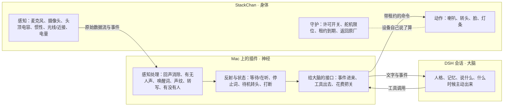

# 分离式设计：身体、神经和大脑各担什么

2026-11-21，按用户定下的方向写：**StackChan 只是一台外设，是 DeepSeek 体感的延伸；负荷主要在 Mac。** 本页是「一项功能该放哪一边」的判断依据，也列出现有实现里与它不符、需要搬走或删掉的部分。本页是设计，不是验收；各项实现状态见 [验收记录](validation.md)。

## 三层和一句话职责

| 层 | 在哪里跑 | 一句话职责 |
|---|---|---|
| 身体 | StackChan 固件 DSH.AGENT | 如实把感知送出去，如实执行动作，自己只管安全和即时反应。**不做判断。** |
| 神经 | Mac 上的 DSH 插件和本地语音进程 | 把原始感知变成「发生了什么」，处理不需要想的反射，决定哪些事值得打扰大脑。 |
| 大脑 | 用户选定的 DSH 会话 | 人格、记忆和一切需要想的决定：说什么、要不要看一眼、什么时候主动开口。 |

## 判断一项功能放哪边

按顺序问，第一条答「是」的就定了：

1. **Mac 不在时它还必须成立吗？** 只有安全和物理主人的意愿属于这一类 → 身体。
2. **它要在几十毫秒内跟手，或者是每帧都要做的事吗？** → 身体，但只做画面和信号层面的事，不带含义。
3. **它需要模型、较多算力或内存，但不需要「想」吗？** → 神经。
4. **它需要记忆、人格或权衡吗？** → 大脑。

顺带的两条硬规则：身体不保存对话内容，不决定连谁以外的任何事；神经不替大脑说有内容的话，只说固定的应答（如「我在。」）。

## 逐项分工

| 功能 | 身体 | 神经 | 大脑 |
|---|---|---|---|
| 收音 | 两路 24 kHz 原始声音（麦克风和播放参考）原样送出 | 回声消除、有无人声、分句 | 不碰声音 |
| 唤醒 | 不识别 | 在转写里认「小D在吗」，管理等待/在听 | 不知道唤醒词的存在 |
| 只认主人 | 不识别 | 声纹比对，不是主人就当没叫到 | 可被告知「是别人在说话」 |
| 听懂 | 无 | 语音转文字 | 理解和回答 |
| 说话 | 播放送来的声音，按音量动嘴 | 文字转语音，分段，被打断时停 | 写要说的话；可用 `stackchan_say` 主动说 |
| 停止与待机 | Stop 按钮（物理主人的硬开关） | 「停止」「待机」、静默超时 | 无 |
| 脸 | 画脸、眨眼、口型、被摸被戳的即时表情 | 把状态告诉设备（等待/在听/在想） | 选情绪表情 |
| 转头 | 执行一个目标角度，守限位，转完断电 | 待机时随机看看；将来看向说话的人 | 想转时用工具转 |
| 灯条 | 按状态或颜色点亮 | 等待时熄灭，听和说时亮 | 想用时用工具 |
| 头顶电容 | 采样、去抖，分出轻点/长按/滑动 | 赋予含义：长按唤醒、轻点打断、抚摸上报（限频） | 决定被摸时怎么回应 |
| 摄像头 | 被要求时拍一张，守相机许可 | 将来：本机判断画面里有没有人，只在变化时上报 | 决定要不要看、看到后说什么 |
| 光线/近接/晃动/电量 | 定期上报读数 | 将来：近接或晃动作为「有人靠近」的便宜触发 | 需要时读 |
| 主动出来 | 无 | 把「有人来了/走了/摸了」变成事件，限频 | 决定出不出来、说什么；定时也属于这里 |
| 连接 | 配对身份、发起和重连、租约到期自己关麦 | 待命、认证、保活 | 无 |
| 许可 | 麦克风、相机、转头、灯条四个开关和它们的保存 | 尊重设备的拒绝，不反复重试 | 被拒绝时知道原因 |
| 原厂功能 | Home 返回原厂，不动原厂分区 | 无 | 无 |

## 为什么这些留在身体上

不是为了让设备聪明，而是这几件事交给 Mac 会出问题：

- **安全**：舵机限位、堵转和转完断电；停止时清空功放缓冲；Mac 死掉后 15 秒内自己关麦（[会话租约](../firmware/agent/session_lifecycle.h)）。
- **物理主人的意愿**：四个许可开关和 Stop。它们必须是 Mac 上任何软件都绕不过去的。
- **跟手**：口型跟着实际播出的音量、被摸时立刻换脸。经过 Mac 再回来会慢一拍。
- **信号整理**：头顶电容 50 毫秒采一次，在设备上分出手势再上报，比把原始读数全送过去省事；手势的含义仍在 Mac。

## 现状与这份设计的差距

| 现状 | 是否符合 | 处理 |
|---|---|---|
| 常连挂机，Mac 认「小D在吗」，等待/在听在桥接里 | 符合 | 保留，作为唯一的挂机方式 |
| 待机转头由 Mac 下发（[idle-motion.mjs](../src/idle-motion.mjs)） | 符合 | 保留 |
| 头顶手势含义在 Mac，设备只分类 | 符合 | 保留 |
| `stackchan_say` 和其余设备工具 | 符合 | 保留 |
| **v58 设备本机唤醒（Wake local）**：设备加载原厂 WakeNet 模型、重采样、推理，另有只开麦克风的编解码器入口 | **不符合**：判断放在了身体上，还占 291 KiB 内存、132 KB 固件和一条额外的音频路径。Mac 不在时就算被叫醒也没有大脑可连 | **v60 已删除**。Wake 开关回到两档：关 / 开；固件比 v59 小 131 KB，设备不再加载任何语音模型 |
| v58 未连接时也采样头顶电容（摸头有反应） | 符合（即时反应，负荷极小） | 保留 |
| 设备按连接和指示状态选脸（离线犯困、等回复等） | 符合（画面层） | 保留；等待时的眼睛微动可在设备上补，属于画面 |
| 声纹 | 已在神经层实现（登记、比对、三档策略），未用真人声音验证 | 真机上校准阈值 |
| 「有没有人」 | 未实现 | 做在神经层，见下 |
| 事件进入大脑：v60 已有带限频和每小时上限的事件通道，目前只接了「抚摸」 | 符合 | 在场感知做好后接入同一通道 |

## 接下来按这个顺序做

| 步 | 内容 | 落在哪 | 需要用户决定的 |
|---|---|---|---|
| 1 | 删掉设备本机唤醒，固件回到「只收发、只执行」。**v60 已做** | 身体减负 | 无 |
| 2 | 声纹：登记主人的声音，等待时只有主人能叫醒；可选「对话中也只听主人」。**已做**，设备固件没有因此改动 | 神经 | 已同意下载模型 |
| 3 | 在场感知：近接/晃动触发 → 拍一张 → 本机判断有没有人 → 只在「来了/走了」时成为事件 | 神经 | 是否允许挂机时偶尔自动拍照 |
| 4 | 事件通道：摸头、来人、离开统一成事件交给会话，带限频和每小时上限。**v60 已做通道本身**，暂定同类 30 秒一次、合计每小时 12 次 | 神经 → 大脑 | 上限要不要调 |
| 5 | 主动行为的策略写给大脑：在 DSH 会话侧说明有哪些事件和工具、什么时候适合主动开口 | 大脑 | 人格和分寸由用户定 |
| 6 | 等待时的画面微动（眼神、表情小变化） | 身体（画面） | 无 |

每一步都不增加设备的计算负担；第 1 步是减少。

## 这样分的代价

- **挂机时麦克风的声音持续送到 Mac。** 在本机处理，不保存，没被叫到的话不进入会话；设备上的 Stop 和麦克风开关随时切断。
- **Mac 睡了或 DSH 没开，设备就只是一张犯困的脸。** 这是有意的：身体不带备用大脑。
- **常连对链路稳定性要求更高**，需要真机长时间验证。
- **Mac 持续跑有无人声检测，有人说话时跑转写**，占用未实测。

## 相关页面

[常连挂机与唤醒词](voice-runtime.md#常连挂机与唤醒词) · [设备上的挂机设置](device-settings.md#挂机待命与语音唤醒) · [设备能力与工具](device-capabilities.md) · [v59 验收与事实来源](validation.md#2026-11-21-v59-常连挂机小d在吗与主动说话) · [原有责任结构图](system-views.md#责任结构)
