# 结构、部署、用户流程与记录

与 [图示导航](diagrams.md) 配合阅读。结构图解释责任，部署图区分运行环境，用户流程解释目标操作，数据图解释持久化；它们不能互相替代。

## 责任结构

图表来源：[成品计划](product-plan.md#已定软件边界独立设备-agent不依赖原-ai-运行时) 的已定边界；[plugin.mjs](../src/plugin.mjs) `apply/Config`；[host.mjs](../src/host.mjs) `createHostAgent`；[device_main.cc](../firmware/agent/device_main.cc) 与 [audio_runtime.cc](../firmware/agent/audio_runtime.cc)。[LocalVoice](local-voice.md) 是语音组合来源；虚线表示缺失集成或图上标明的未验收边界，不表示已经部署。原厂助手属于保留路径，不是 DSH Agent 的云依赖。

章节来源：同一计划和 [设置字段归属](settings-ui.md#用户路径与字段归属)。人格、记忆、模型、电脑工具权限属于用户所选 DSH 会话；设备项目不提供替代人格。Wake 与本地语音仍有单独工作包，图不把组件名称当已部署功能。

## 当前与目标部署

图表来源：[真机检查](hardware-check.md)、[DSH 隔离 profile 加载](settings-ui.md#安装包与原生加载器验证)、[语音运行](voice-runtime.md) 和 [v26 安装范围](installation-recovery.md#v26-的独立离线安装审查)。实线表示当前已在相应环境中核验的边；虚线表示真机尚待验收。DSH 用户 profile 安装与 Sion 无线会话仍待接通。

章节来源：[成品计划的责任与部署](product-plan.md#责任访问和部署)。语音编排和选定会话控制器同属 DSH Host，AEC、识别与合成从本机子进程消费。独立 Agent 有自己的配置分区；原厂云语音和手机绑定沿原厂路径。恢复前后的语音和手机状态需现场复验。

安装维护时另见 [V49 维护部署](installation-recovery.md#v26-维护部署边界)，由底座 USB、片上 ROM 和冷启动选择器分别承担。

## 目标用户流程

图表来源：[P1–P8 与 A1–A9](product-plan.md#完整验收矩阵)、[两端设置](settings-ui.md)、[SessionLifecycle](../firmware/agent/session_lifecycle.h)。这是成品目标流程；前置条件、语音消费者和设备开始按钮未全部实现，不应照图在当前设备上操作。日常 Home 按官方上滑控件设计，不等于用户按重启键。

章节来源：[手册基线](manual-alignment.md) 与 [独立设备实现](independent-agent.md)。Stop 后停留 DSH 空闲，Home 另表达离开应用意图；这两个动作没有合并成“已回原助手”。原厂返回仍是具体安装方案的独立验收。

## 设备记录模型

图表来源：[preferences.h](../firmware/agent/preferences.h) `EncodePreferences/DecodePreferences`；[settings_store.cc](../firmware/agent/settings_store.cc) `Load/Save`；[pairing_store.cc](../firmware/agent/pairing_store.cc) `ReadActive/Save`；[共享配对 schema](../firmware/overlay/sion/pairing_config.h) `ParsePairing`；[storage_guard.cc](../firmware/agent/storage_guard.cc) `AgentConfigPartition`。

章节来源：上述序列化函数。v4 可读取 v1–v4，分别在 v2、v3 和 v4 引入 camera_allowed、motion_allowed 和 ring_allowed，旧记录缺失的许可默认关闭。显式保存才升级，见 [设置格式](device-settings.md#字段线程和失败)。12 字节偏好记录的 CRC 只用于损坏检测，不是认证；revision 是设备偏好 uint32，与 DSH 原生配置 revision 不共享。配对是最多 4096 字节的 JSON blob，不是图中字段的 C++ 内存布局；证书字段格式检查不等于证书链验证。active 只选择一个槽，另一个是非活动记录或已清理空间；tombstone 不代表物理安全擦除。16 KiB 是专用分区适配要求，已审查的尾部布局从 0xffc000 起，实际设备待安装；原厂 NVS/手机绑定不在此模型内。

临时能力报告的接口结构见 [V48 能力数据模型](device-capabilities.md#报告字段与生命周期)。
