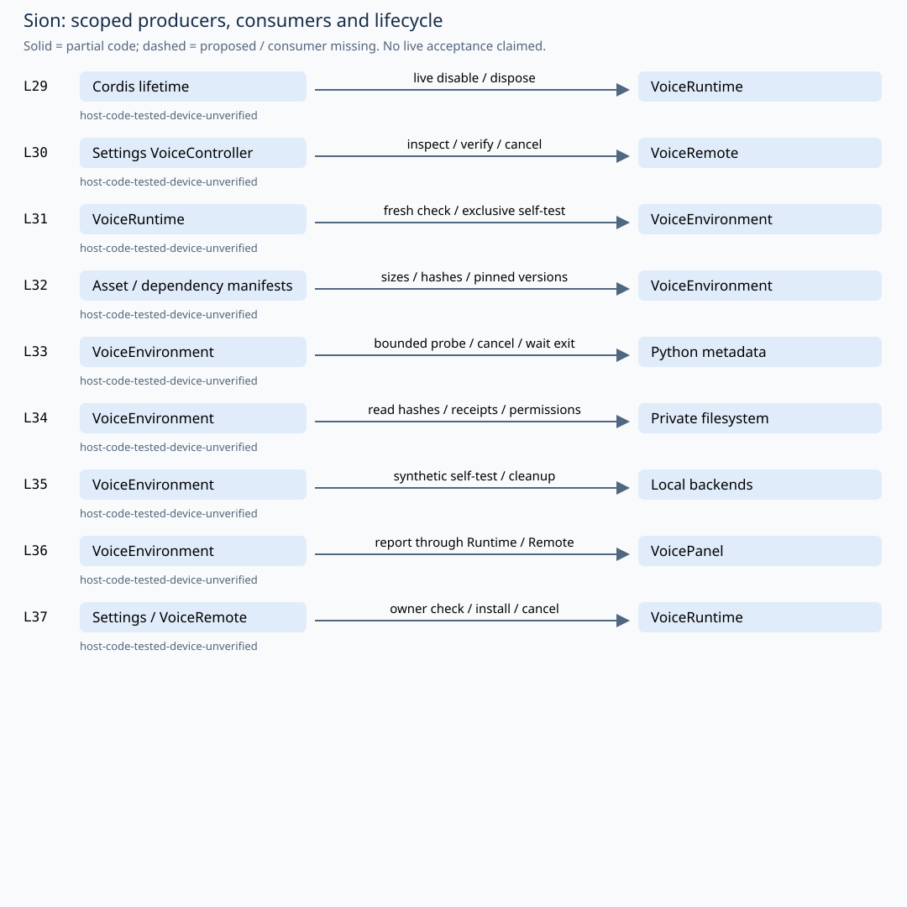
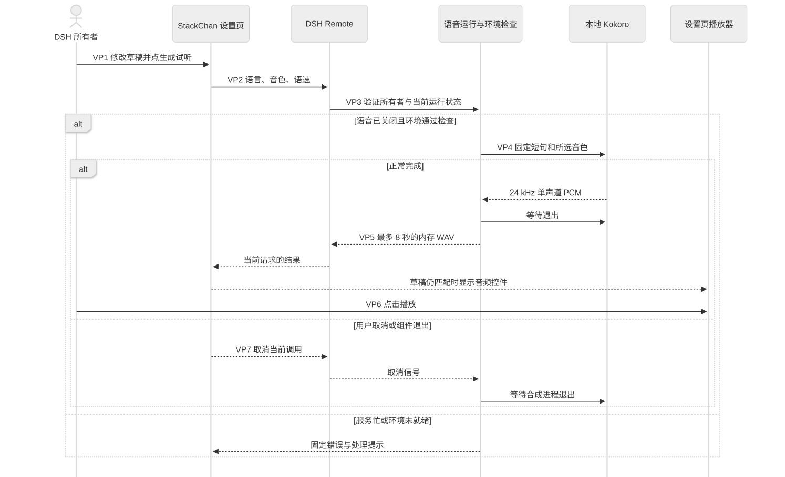

# 语音环境检查与离线自检

归属 P2/P7/P8；环境检查和离线自检已实现并通过本地验证，自动安装的独立实现/验证见 [托管环境](voice-installation.md)。入口为 [语音运行](voice-runtime.md) 和设置页。可信安装输入来自托管 active 或显式五个 Host 路径；Client 只选择检查或离线自检，不上传路径、Python 代码、模型 URL 或用户音频。

## 实施顺序与边界

检查分别报告平台、Python 3.11 独立环境、固定依赖版本、Whisper 可执行文件、语音模型 hash、DSP/VAD 资产与原生构建收据、私有临时目录。托管 v3 的音频资产项额外验证 LocalVQE v1.2，并在自检加载所选权重。目录不存在、文件损坏、版本不符与未配置不混成 ready。依赖元数据存在不证明 import 或模型加载成功；因此另有显式离线自检：预热 DSP/VAD、处理固定静音帧、本地合成固定中英文样本、将合成 PCM 交 Whisper，随后等待所有进程退出。不给设备播放、不采集声音、不提交 DSH prompt。

打开页面只刷新已有运行状态，不自动执行文件 hash、自检或下载。检查结果是一次观测；启动服务前重新检查基础环境，不能只信页面上次结果。离线自检和运行 Start 使用同一 Host 操作互斥；运行中不做重型自检。关闭服务/插件退出可取消检查，并等待退出后返回。

报告必须区分文件/依赖可用与 loadTest 的 not_run/passed/failed；passed 不代表设备、无线、声学质量或用户会话验收。错误固定且不回显路径、进程 stderr 或内容。检查不创建目录；自检只允许后端既有私有临时文件生命周期，完成后清理样本。

[托管安装](voice-installation.md) 维护 profile 专用 Python/依赖、固定来源与许可及下载体积、进度/取消、原生库与 whisper-cli 构建、成功后发布活动环境及显式修复；基础工具检查/指引已接，旧候选清理仍缺。环境检查与自检继续独立验收。

官方依据：[Python importlib.metadata](https://docs.python.org/3.11/library/importlib.metadata.html) 只反映包元数据；[Kokoro 中文模型](https://huggingface.co/hexgrad/Kokoro-82M-v1.1-zh/blob/01e7505bd6a7a2ac4975463114c3a7650a9f7218/README.md) 的模型许可/示例；固定实际运行契约仍以本仓 local-speech.md、local-audio.md 和资产清单为准。

## 已实现的报告与检查流程

`VoiceRemote.environment(action, signal)` 仅接受 inspect/verify，生成接口和业务入口均检查 owner；不能由 Client 传安装路径。`VoiceRuntime.environment` 仅在 stopped 且无其他操作时执行。打开页面不调用该方法；普通 snapshot 轮询不清掉环境检查错误。显式“取消检查”经 shutdown 取消当前操作、等待清理；检查中禁止并发 Start，服务停止的最后阶段也拒绝新 Start，避免旧 shutdown 覆盖新状态。

图表来源：[createVoiceEnvironment](../src/voice-environment.mjs) inspect/verify/probePython/fileHash、[Python metadata probe](../scripts/voice_environment.py) report、[VoiceRuntime](../src/voice-runtime.mjs) environment/start/shutdown、[VoiceRemote](../src/remote-api/index.ts) environment、[页面](../src/settings-voice-view.mjs) 和 [控制器](../src/settings-voice-controller.mjs)。V25 是控制流程，不意味着多个后端在同一进程，也不意味着检查会下载模型。

| 字段 / 检查 | 精确含义 |
|---|---|
| checkedAt | 本次完成观察的 Host 时间（毫秒）；不是永久有效凭证 |
| checks | 固定八项：platform/python/packages/whisper/speechAssets/audioAssets/nativeLibraries/temporaryDirectory |
| status | not_checked/unconfigured/missing/invalid/unsupported/available/verified；逐项显示，不透出原路径 |
| platform | 当前只支持已有锁定/构建证据的 macOS arm64 |
| python / packages | 可信解释器用 `-I` 启动固定脚本，Python 3.11 且 sys.prefix != base_prefix；完整锁文件的 == 版本和固定英文语言 wheel 版本匹配。包元数据匹配不是包字节签名或可 import 证明 |
| whisper | 可执行普通文件可访问；不把 X_OK 当固定构建来源证明，真正加载由自检验证 |
| speechAssets / audioAssets | 私有根目录、无中间/最终 symlink、普通文件、固定长度/SHA；逐块读取可取消，不信旧 installed.json |
| nativeLibraries | native.json v2 的平台、清单、builder hash 和两库实际 hash；这是本次构建收据，不是签名或跨机器重现证明 |
| temporaryDirectory | 已有目录必须本用户私有；缺失时只检查最近已有可信父目录的所有权/可写性，不创建目录。推理仍按后端自己的规则创建/清理 |
| filesVerified | 所有八项为 available 或 verified；仅基础条件通过，不保证模型能加载或设备能对话 |
| loadTest / failedStage | not_run/passed/failed；失败为 audio/synthesis/recognition/cleanup 的固定阶段；无模型输出正文 |
| assetBytes | 当前语音与输入固定清单合计 558,924,578 字节；不含 Python wheels、解释器、编译空间或 whisper.cpp 源码 |

Python metadata helper 不导入模型、不启动 pip。输出限制 1024 字节、期限 10 秒；未知字段/异常退出不透传原文。取消向其进程组 TERM，500 ms 未退出再 KILL，并等待 close。hash 检查只读，单文件限 600 MB，实际长度还须符合清单；这是当前可信 Host 安装目录上的检查，不是对同用户恶意并发修改的原子快照。

离线自检先 inspect，通过后 LocalAudioFrontend 预热并处理四个固定零帧，Kokoro 合成固定中英文短句。旧 CLI 识别中文，结果在私有临时目录短暂停留。托管 v2 用同一个 Whisper worker 顺序识别两句，经管道返回非空文字及对应语言。所有创建的后端均等待 dispose 后才返回自检结果，任一后端失败仍清理其他进程。逐字识别对照与真机声学另外验收。 [后端契约](local-speech.md#接口与生命周期实施契约)

Start 每次在读取身份和监听之前重新 inspect；基础条件不满足返回 voice_environment_required，未获取身份也未监听。Start 不强制耗时自检；Connect 仍真实加载输入模型，合成/识别的运行失败继续由 LocalVoice/桥处理。此前通过的自检不能绕过启动检查、认证设备、已有会话校验或设备资源确认。

## 生产者与消费者

| ID | 生产者 → 消费者 | 数据与边界 |
|---|---|---|
| L30 | Settings VoiceController → VoiceRemote | 显式 inspect/verify、取消、无路径参数 |
| L31 | VoiceRuntime → VoiceEnvironment | Start 重新 inspect；自检操作互斥和退出等待 |
| L32 | Asset / dependency manifests → VoiceEnvironment | 固定清单长度/hash/锁定版本；helper 也消费依赖锁 |
| L33 | VoiceEnvironment → Python metadata | 固定脚本、可信解释器、有界输出、进程组取消 |
| L34 | VoiceEnvironment → Private filesystem | 只读文件/元数据/收据；不依赖旧成功标签 |
| L35 | VoiceEnvironment → Local backends | 固定合成/静音数据、实际加载、取消并等待清理 |
| L36 | VoiceEnvironment → VoicePanel | 经 Runtime/Remote/Controller 返回逐项状态与固定失败阶段 |

间接消费者是 Python 包元数据、资产清单、实际音频/合成/识别子进程、临时样本目录及 Start 条件；其来源与失败规则由上表和 V25 明确。原厂配置、设备音频和 DSH Session 不消费自检样本。自动安装现已接此自检消费者，成功才发布活动引用；见 [V26](voice-installation.md)。

## 本地音色试听

在 DSH 的 StackChan 设置中，把本地合成选为 Kokoro，语音服务关闭时点「生成试听」。试听使用尚未保存的语言、音色与语速，播出前仍须点播放器的播放。同一次设置打开期间可以换音色或调语速再生成。页面隐藏与当前草稿不匹配的样本；重新载入后没有上一份样本。选「自动」时，Maple 朗读英语示例，默认和中文音色朗读普通话示例。已保存的未知音色可继续查看，改选支持的音色后才可试听。 [设置入口](../src/settings-view.mjs) · [播放器](../src/settings-voice-view.mjs)

| ID | 生产者 → 消费者 | 数据与限制 |
| --- | --- | --- |
| VP1 | 设置草稿 → 试听控件 | 语言、音色、语速；操作未调用保存、会话核对或配对。 [React 设置](../src/settings-view.mjs) |
| VP2 | VoiceController → Typert Remote | 仅三个命名字段，生成时固定草稿；请求不带任意文本、文件路径、设备或会话 ID。 [控制器](../src/settings-voice-controller.mjs) |
| VP3 | owner Remote → VoiceRuntime | 只有 DSH 所有者可请求，环境检查、试听和 Start 共用互斥；取消后等工作结束再让出运行位置。 [Remote](../src/remote-api/index.ts) · [运行服务](../src/voice-runtime.mjs) |
| VP4 | VoiceEnvironment → Kokoro | 复核已准备的本地语音环境。使用固定普通话或英语短句，合成期限 25 秒。只起合成 worker。 [环境与合成](../src/voice-environment.mjs) |
| VP5 | Kokoro → VoiceEnvironment → Remote → 页面 | 聚合 24 kHz PCM 为单声道 16 位 WAV，最多 8 秒，等 worker 退出再返回。WAV 在内存传递，页面只保留当前请求的结果。 [WAV 实现](../src/local-speech.mjs) |
| VP6 | 用户播放控件 → 浏览器音频 | 用户显式播放，在打开设置的客户端出声。Sion 的扬声器、麦克风和所选 DSH 会话不参与。 [播放器](../src/settings-voice-view.mjs) |
| VP7 | 取消按钮或页面卸载 → 当前 Remote 请求 | 只取消该请求。迟到样本丢弃，Host 等合成退出。环境未就绪、正在运行或参数无效时显示固定错误。 [取消](../src/settings-voice-controller.mjs) · [测试](../test/voice-runtime.test.mjs) |

实跑覆盖中文、慢速英文、取消及活动会话隔离，见 [验收](validation.md#mac-本地音色试听)。实际 Sion 播报音质和声学延迟由设备端链路单独验收。

## 验证与未完成项

[环境测试](../test/voice-environment.test.mjs) 覆盖被动构造、未配置、缺失/损坏/中间 symlink、检查不创建临时目录、错误输出脱敏、TERM 无响应时实际 kill/退出，以及自检失败/取消后的全部 worker 清理。[运行测试](../test/voice-runtime.test.mjs) 覆盖旧 readiness 不能授权新 Start、自检与 Start 互斥、shutdown 取消并等待、关闭最后阶段拒绝新启动，以及原生 Gateway owner/参数校验。[页面测试](../test/settings-voice.test.mjs) 覆盖显式检查、取消后丢弃迟到成功、状态轮询保留检查错误；实际打包 helper/接口另由 packaged-plugin.test.mjs 验证。

本机已有私有语音环境显式运行 7/7 通过，包括真实依赖/hash 与实际 DSP/VAD/Kokoro/Whisper 离线自检；未重新下载模型，未录音/播放/设备访问，未提交 DSH 文本。隔离浏览器使用真实 Panel/Controller、模拟 Remote，实际点击检查、自检和取消，不能等同用户 DSH 实例验收。计数和日志见 [validation](validation.md)。

自动安装、阶段进度与显式修复见 [托管环境](voice-installation.md)；旧候选清理、用户 DSH 实例与真机仍需独立验收。
