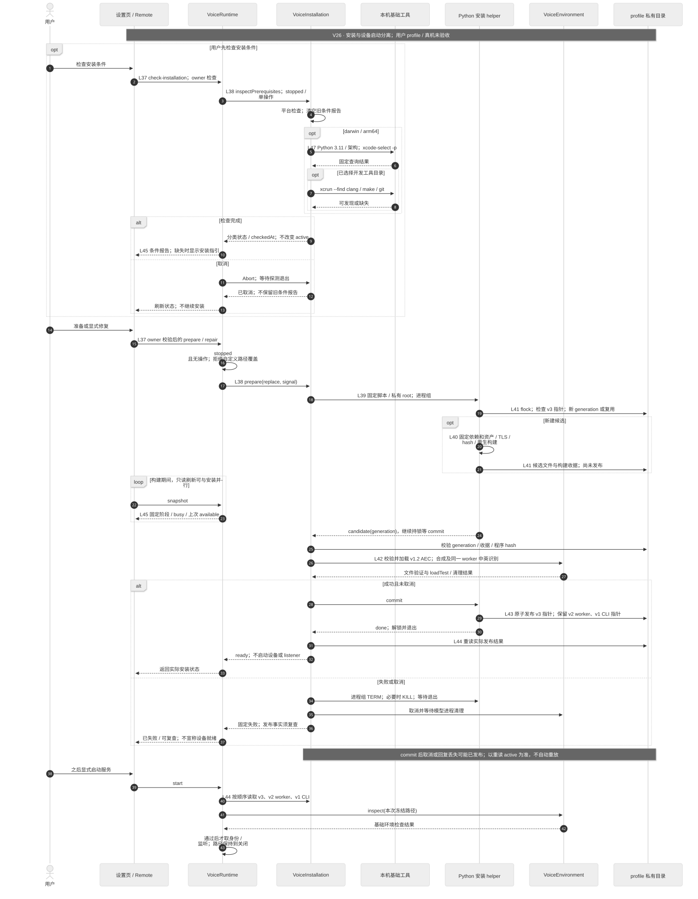
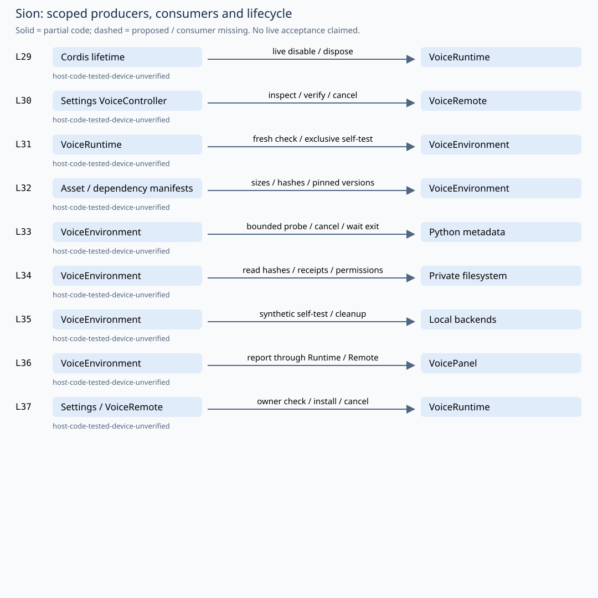
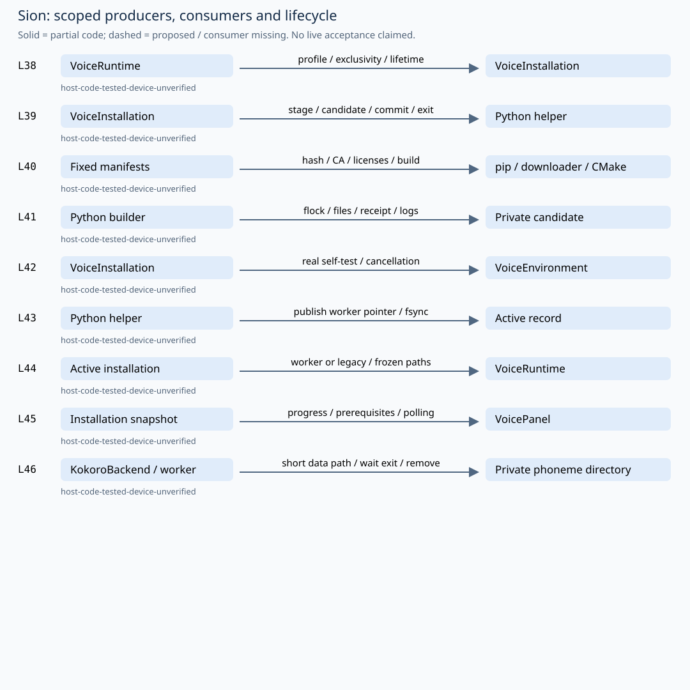
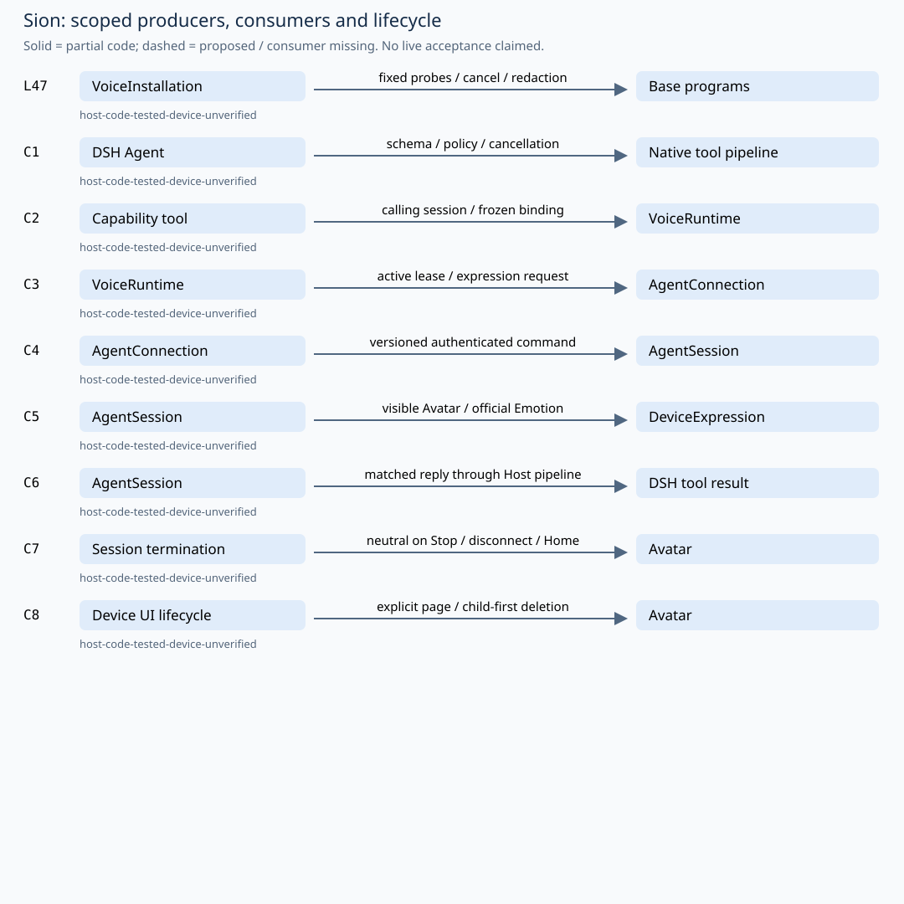

# 插件托管语音环境安装

归属 P2/P7/P8。Host 安装器、原生 Remote、DSH 设置页及运行时环境选择已接。Sion 的 Mac 桌面配置档已准备托管语音，并用新版候选的运行时读回和自检。显式准备成功后无需填写五个路径。配对 Python 与此环境独立，自定义 Host 安装配置优先。原厂语音、绑定、设备固件和 DSH Session 均在本机安装事务之外。 [桌面语音验收记录](validation.md#桌面配置档的托管语音预装)

## 用户入口、前置条件与完成条件

设置页提供“准备语音环境”“重新构建并修复”、阶段进度、取消、检查与离线自检。只有 owner 可调用；Client 不传路径、解释器、URL、依赖版本或设备访问许可。准备复查当前安装版本的 active。首次准备该版本或显式修复时，新建 generation，通过真实离线自检后才发布。安装不改变已保存偏好，用户另选既有会话及 Whisper.cpp/Kokoro 后保存。安装成功不启动 listener，不录音/播放、不提交 DSH prompt；后续 Start/Connect 仍独立要求身份、设备认证及既有会话。

当前仅 macOS arm64。需要已有 Python 3.11 基础解释器及 Apple 命令行开发工具；缺失返回固定码。CMake 固定 wheel 装入专用环境，不依赖开发工作区。基础解释器仍为外部前置条件，venv 使用标准 symlink，不能删除基础解释器；不自动调用 Homebrew 或系统安装器。设置页已提供显式安装条件检查及官方基础工具安装指引；多平台支持仍待完成。

固定模型、音频源码与 whisper.cpp 源码合计 573,729,122 字节，UI 按清单计算显示约 574 MB；另有 CMake wheel 49,242,707 字节、Python wheels 与编译空间，不将这当总磁盘预算。来源为 Hugging Face、GitHub、Xiph、PyPI；模型与各依赖许可见 [语音 NOTICE](../vendor/voice/NOTICE.md)、[音频 NOTICE](../vendor/audio/NOTICE.md)。依赖包含 GPL 组件。

## 首次安装条件检查与引导

`VoiceRemote.execute('check-installation')` 沿现有 owner/严格参数边界，经 VoiceRuntime 的 stopped/单操作门槛调用 `VoiceInstallation.inspectPrerequisites`。页面打开只刷新 snapshot，不自动检查；自定义 Host 环境不显示托管安装指引，也拒绝该动作。检查不创建 profile 文件、不下载、不打开系统安装器，不读取配对或 DSH 会话。

Host 先检查自身 darwin/arm64；不满足时返回 unsupported，其余项 not_checked，不运行探测。逐个固定候选解释器执行 `-I` 代码，要求 Python 3.11、venv 可导入、Darwin/arm64 和绝对 executable；不合格继续下一候选。真正安装也复用该选择逻辑，避免前面的 Rosetta Python 挡住后面的原生 Python。Client 无法传命令、路径或架构覆盖。

独立检查 `/usr/bin/xcode-select -p`；无选择时不调用工具 shim。存在选择才用 `/usr/bin/xcrun --find` 查 clang/make/git。每次探测有 5 秒及 4096 字符输出上限；异常或超时只记缺失，不回显原输出。检查只证明版本/工具发现，不执行编译，不证明 SDK/许可证/磁盘/网络与全部构建依赖正确。

`installation.prerequisites` 初始 null，每次显式检查先清空旧报告；结果有 checkedAt（Unix 毫秒）、platform（available/unsupported）、python 与 developerTools（available/missing/not_checked）、ready。ready 仅在三项 available 时成立，不能用于跳过安装器或 Start 的实际校验，也不改变 installation.available。报告只在 Host 内存中，snapshot 返回副本。检查期间 stage=checking、busy=true；成功/取消后还原先前安装 stage，不伪造 ready，也不擦除上次安装错误。共享 pending 阻止安装并发；Shutdown/卸载取消并等待探测退出，取消不保留旧检查报告。

页面缺条件时展开“首次安装指引”：先按 Apple 说明完成命令行工具，再按 Homebrew 说明安装 Apple 芯片版 Python 3.11，回来重新检查，再明确准备模型、选择已有会话及语音后端。`xcode-select --install` 与 `brew install python@3.11` 仅展示给用户执行；插件不会代为运行。完整 Xcode 已提供可用工具时无需另装 CLT。保留基础解释器，已有 venv 依赖它。

官方依据（2026-11-19 核对）：[Apple 安装命令行工具](https://developer.apple.com/documentation/xcode/installing-the-command-line-tools/)、[Homebrew 安装与支持范围](https://docs.brew.sh/Installation)、[Python 3.11 formula 与路径](https://formulae.brew.sh/formula/python@3.11)、[Python platform.machine](https://docs.python.org/3.11/library/platform.html#platform.machine)。这些是外部系统工具的用户安装路径，不等于插件已获得安装系统软件的权限。

## 事务、发布与恢复

图表来源：[Host manager](../src/voice-installation.mjs) inspectPrerequisites/checkPrerequisites/findPython、prepare/build/active/installation、[Python builder](../scripts/prepare_voice_installation.py) candidate/build/serve/publish、[VoiceRuntime](../src/voice-runtime.mjs) selectInstallation/execute/start/shutdown、[VoiceEnvironment](../src/voice-environment.mjs) verify。图中设置结果经原生 Gateway/VoiceRemote/Controller 返回，不是客户端直接读取私有文件。

目录归实际 profileContext.dir 下的 `.stackchan-voice`，仅本用户可访问。随机 generation 从一开始就在最终位置，venv 不移动；目录 0700、记录/日志 0600。helper 持非阻塞 OS flock，构建后仍持锁等待 Host 自检和 commit；锁文件存在不证明活进程。同一 Host 运行操作互斥，安装、环境检查、Start 不能并发；Shutdown 可取消并等待退出。跨进程遵守安装锁，但不锁住已经运行的旧 generation，故旧环境不自动删除。

依赖固定版本/hash、no-deps、no-build-isolation；仅 docopt 0.6.2 与 jieba 0.42.1 允许固定 sdist，其余使用 wheel。先装固定 setuptools/packaging/wheel/CMake；使用候选环境里固定 certifi CA 下载模型及源码，保持 HTTPS 校验，包括重定向。音频资产预下载后复用 prepare_audio 校验/构建。Whisper 从固定源码静态构建，保留许可证。v3 收据在 v2 十份输入及成品 worker 的 SHA-256 基础上增加 v1.2 权重清单。新权重放在 `audio/aec-v12`，原音频清单与构建收据仍按原字节校验。

Host 收到 candidate 后先校验私有路径、收据和新权重，实际加载 v1.2 跑 DSP/VAD，再运行 Kokoro 中英文与同一 Whisper worker 的连续两句识别。只有 filesVerified 且 loadTest=passed 才发送 commit。helper 原子发布 `active-aec-v12.json` 并 fsync。Host 等待 helper 退出，读回指针匹配后返回 ready。取消时等待 helper 进程组和自检 worker 退出。

开始语音服务时依次检查 v3、v2 的 `active-whisper-worker.json` 和 v1 的 `active.json`。旧安装器按对应已发布摘要核对，其余输入继续逐份校验。最高可见指针损坏时显式报错。已有 v2/v1 环境可以继续启动，显式「准备语音环境」才构建 v3。旧指针和旧 generation 仍供回退插件使用。Host 自定义路径继续走原 CLI 和 v1.3。 [实际后端选择](../src/voice-installation.mjs) · [语音协议](local-speech.md#实际-api-与进程时序)

图表来源：同一 Host manager 的 stage/busy/available 与 Python serve/publish；本图聚焦安装操作阶段，不含只读条件检查的临时 checking/还原分支（见 V26），不混用 VoiceRuntime.phase 或设备状态。旧 active 在构建和自检中保留，失败候选、旧版本与日志不自动删除。commit 后取消、fsync 失败或响应丢失可能已经切换 active；下一次 inspect/start/prepare 重读事实，不能自动重放或声称必然回滚。坏指针在 repair 时也拒绝，不静默清空。

## 接口与生效语义

`VoiceRemote.execute` 新增 check-installation / prepare-environment / repair-environment，与现有 owner/严格输入边界一致；无新路径参数。`VoiceSnapshot.installation` 包含 mode（managed/custom/unavailable）、stage、busy、available、固定 error 与上述 prerequisites 报告。stage 是阶段而非百分比；available 是本 manager 上次观察到有效发布记录，不代表完整模型实时健康，更不是设备在线。构造、普通 snapshot 不读取模型或自动下载；重启后初始 idle 需要显式检查/准备。

只要 Host 五项 voice 路径中任一非空，就认作 custom，自动安装拒绝；不把部分自定义配置悄悄回退托管路径。默认空配置从 active 派生五条路径；Start 冻结当前 generation，重新环境检查后才读取配对身份和监听。运行期间不切换 generation；关闭后再次 Start 才读新的 active。没有成功 active 时返回未配置；收据过期提示显式修复，损坏记录返回错误而非空环境。

页面只读 snapshot 请求独立于长操作，安装期间每轮完成后约 2 秒再刷新；不取消安装。操作代次及快照版本丢弃迟到轮询，不允许旧 models 状态覆盖 ready；Stop/Shutdown 可抢占普通操作。页面关闭取消自己的请求，不宣称用户 DSH/设备已释放。单独的环境错误不会被轮询清掉。不同窗口可以读取同一 Host 状态，但安装动作仍由 Host 排他。

未知异常不回显到 Remote；细节写当前候选 installation.log，音频构建另有 audio/build.log，均私有。错误码包含 python_required/tools_required/platform_unsupported、busy/storage_invalid/outdated、source_invalid/selftest_failed/cancelled/cleanup_unconfirmed/failed（统一 voice_installation_ 前缀）；自定义配置为 voice_installation_custom。

## 生产者与全部消费者

| ID | 生产者 → 消费者 | 输入、失败与间接影响 |
|---|---|---|
| L37 | Settings / VoiceRemote → VoiceRuntime | owner、检查条件/安装/修复/取消，无外部路径 |
| L38 | VoiceRuntime → VoiceInstallation | profile、互斥操作、关闭/卸载取消并等待 |
| L39 | VoiceInstallation → Python helper | 固定解释器探测、脚本、JSON 阶段、candidate/commit/退出 |
| L40 | Fixed manifests → pip / downloader / CMake | 版本/hash/CA/许可；本地依赖、音频库和 Whisper 构建 |
| L41 | Python builder → Private candidate | 随机最终目录、flock、收据与私有日志，不覆盖旧环境 |
| L42 | VoiceInstallation → VoiceEnvironment | 实际离线自检；间接创建 DSP/VAD/ASR/TTS，失败/取消等待清理 |
| L43 | Python helper → Active record | Host commit 后原子发布 v3 指针并 fsync。v2 worker 与 v1 CLI 指针保留，响应丢失以实际文件为准。 |
| L44 | Active installation → VoiceRuntime | Start/inspect 检查 worker 或旧 CLI，冻结路径和后端协议交给 LocalVoice。 |
| L45 | Installation snapshot → VoicePanel | 经 Runtime/Remote/Controller 返回阶段和条件报告；独立轮询与迟到拒绝 |
| L47 | VoiceInstallation → Base programs | 固定 Python / xcode-select / xcrun 查询；只返回分类状态，取消等待退出 |

与既有 L30–L36 自检、L22–L29 运行/退出共用接口；关系账本是完整影响清单，V26 聚焦发布顺序。配对 journal、用户会话人格和原厂绑定均不是安装器写入对象。

## 验证、来源与剩余工作

[安装事务测试](../test/voice-installation.test.mjs) 与 [Python 场景](../scripts/test_prepare_voice_installation.py) 检查 commit 屏障、重启读取、失败修复保留 active、flock、损坏记录、取消及忽略 TERM 的后代实际退出；重型构建在这些事务测试中替换为夹具，不冒充下载/模型验证。运行、设置、原生 Gateway 和实际打包加载测试分别检查托管路径接线、冻结、custom 保留、并发拒绝、退出等待、owner、参数拒绝和完整包内容。浏览器用真实 Panel/Controller 与模拟 Remote 验证进度与取消；不能合并称用户桌面端到端验收。

官方依据：[Python venv](https://docs.python.org/3.11/library/venv.html)、[pip secure installs](https://pip.pypa.io/en/stable/topics/secure-installs/)、[固定 whisper.cpp README](https://github.com/ggml-org/whisper.cpp/blob/d1be6fde11ac6e0407606b4e42fe72d34add8037/README.md)。固定输入由 [源码清单](../vendor/voice/installer-assets.json)、[工具锁](../vendor/voice/build-tools.lock) 和既有语音/音频清单维护。

本机私有测试 profile 的完整新安装、真实自检与发布通过；重启后复用同一 generation 再次自检通过，默认空路径的 Runtime 读取也通过。该新环境另通过 LocalVoice 12/12（含实际模型定时合成输入和模拟回声下停止）；详见验收记录。长路径 eSpeak 修复由 [本地语音生命周期](local-speech.md) 维护。

基础工具检查与用户引导已实现，本机只读探测、原生打包接口及模拟 Remote 浏览器流程通过；见验收记录。仍需完成可安全清理旧环境/候选的策略、试听、用户实例与既有 DSH 会话、真机声学和固件安装/原厂返回。自动安装本地通过也不关闭整个 P2/P7/P8。

日常 Desktop 配置档的托管环境已在目标路径构建。新版候选可读 v2 活动环境，并用桌面随附 Node 通过一次独立进程的语音自检。实际桌面插件升级、偏好保存和设备接通各有独立验收。 [桌面插件状态](settings-ui.md#桌面配置档安装与会话核对) · [桌面语音验收记录](validation.md#桌面配置档的托管语音预装)
