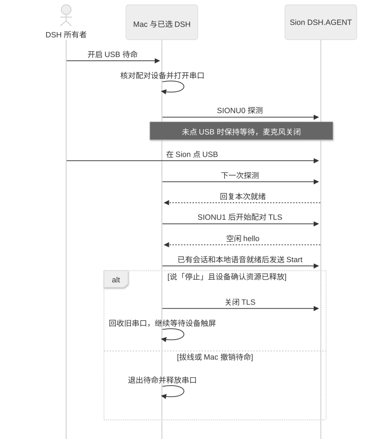
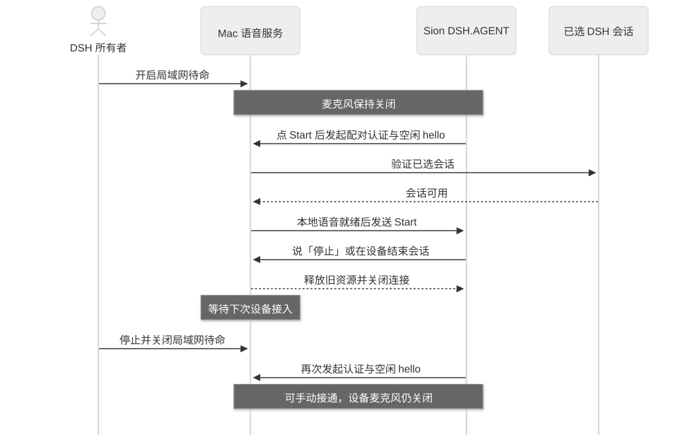
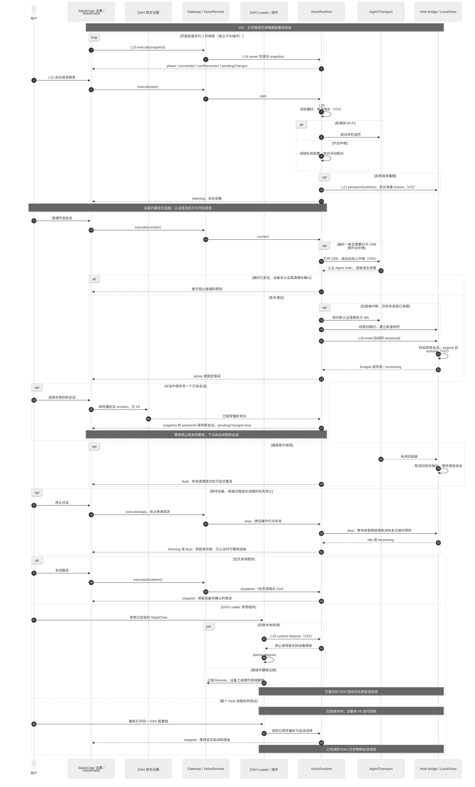
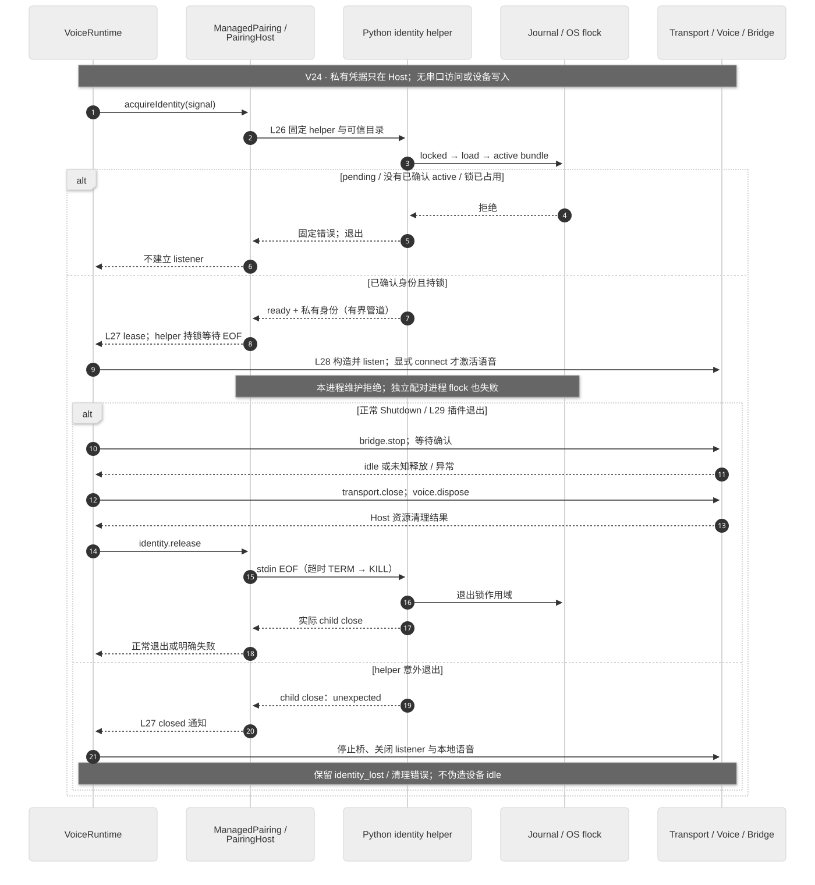
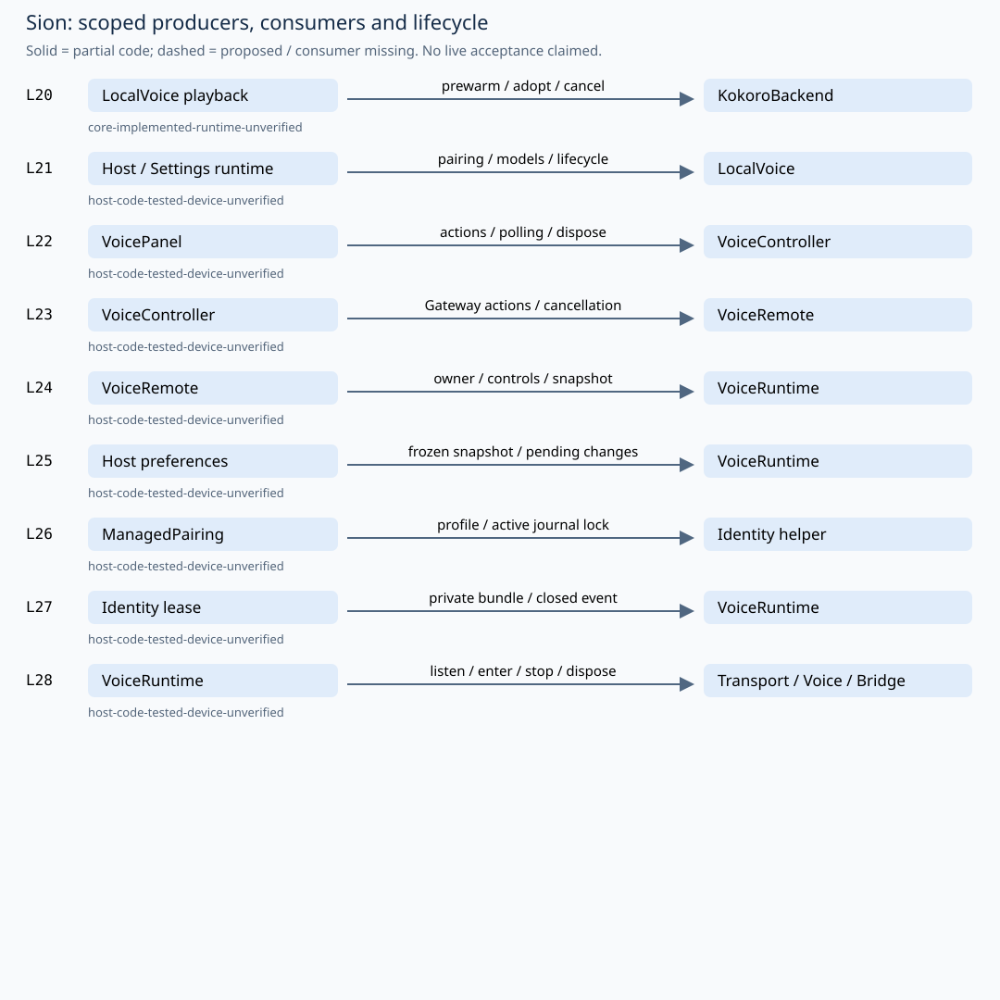
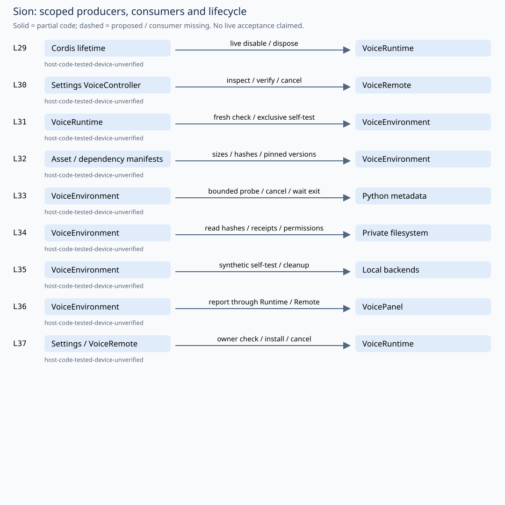

# DSH 语音运行服务与设置控制

相机 snapshot 已组合设备观测与 Host 图片处理状态；原生 owner-only Remote 和设置页已接，打开页面只读取。设备许可、状态新鲜度、附件保留与取消边界由 [两端相机状态](camera.md#两端相机状态与照片保留说明) 统一维护。

新增 Host 内部 photograph(agent,signal) 返回原 DSH 图片附件，按原会话/连接 epoch/操作代次拒绝迟到结果，详见 [相机消费](camera.md#dsh-图片消费与结果提交)。另有 expression(agent,value,signal)，只允许当前已接通的冻结会话；工具注册与错误语义见 [设备能力](device-capabilities.md)，不是新增 Client Remote 接口。

归属 P3/P8。正式 Host 插件已组合配对身份、认证 listener、LocalVoice 与既有 DSH 会话桥。原生 Remote 和设置页提供显式启动、接通、停止和关闭。实际 journal/helper、回环 TLS、Host/LocalVoice 组合及隔离打包加载已测。日常桌面配置档保存了用户选定的会话，并已准备托管语音。当前仍待新版桌面插件升级、实际会话连续对话、设备能力和固件安装恢复验收。 [桌面插件状态](settings-ui.md#桌面配置档安装与会话核对) · [托管语音预装](validation.md#桌面配置档的托管语音预装)

## 用户操作与状态

USB 模式先「启动语音服务」准备环境并锁定配对身份，再在 Sion 上点 USB，随后点「接通所选会话」。串口助手核对底座连接与已配对设备，打开后复核句柄。TLS 验证和设备 hello 成功才绑定会话，再预热与开始录音。停止已认证的对话可保留线路，关闭服务等待串口实际退出后释放身份。选错端口、拔线或握手失败可手动重试。没有可信设备回执时显示释放未知。 [连接方式和端口设置](settings-ui.md#usb-有线与局域网设置)

保存偏好只改变 DSH 原生配置。点击「启动语音服务」冻结当前会话、语音偏好和连接方式，重新检查语音环境并申请已确认的配对身份。仅局域网模式监听 local_url。若地址或端口不可用，释放本次身份锁并显示原因。设备认证后点「接通所选会话」，桥验证已有会话，输入前端和托管 Whisper 就绪后开收音。播报模式在语音服务启动时就预热 Mac 上的 Kokoro。首次接通可接手还在加载或已准备好的进程，越早接通并提问，越可能需要等首轮合成就绪。麦克风仍按设备认证、会话校验和输入就绪顺序打开。人格、记忆、模型与电脑工具继续由该 DSH 会话管理。 [语音环境](voice-environment.md) · [局域网地址恢复](host-pairing.md#选择本地语音服务地址)

插件提交的每轮消息只有已有会话 ID、请求 ID、入队方式和转写文本。DSH 决定该会话下一次请求使用的模型，切换模型后后续语音轮次沿该会话的选择。照片经过同一会话的工具结果交给模型。会话模型支持图片时发送图片，纯文字模型收到明确省略提示。 [提交接口](../src/dsh-session.mjs) · [相机消费](camera.md#dsh-图片消费与结果提交) · [真实适配器对照](validation.md#rc5-桌面兼容语音和相机)

### 收音启动阶段诊断

`rc.5` 诊断候选保留现有串口和配对握手提示。认证后分别显示所选会话不可读、Mac 本地语音启动失败、设备未确认收音，以及已认证链路在收音前关闭。设备收音失败和链路关闭只描述实际观测，释放确认仍独立计算。界面及 Remote 使用固定错误码，保留手动接通、各类待命重试及 Stop 的原有规则。 [错误投影](../src/voice-runtime.mjs) · [设置文案](../src/settings-voice-controller.mjs)

v54 的「USB connection ended」由设备成功完成 PSK TLS 认证并进入数据循环后产生。此前实体试装的该提示说明至少有一次经过认证。它不指出是本地输入准备、开始收音请求还是持续链接关闭导致退出。下一次先读取明确阶段结果，设备确认收音以后再做对话及相机实测。 [v54 实体情况](hardware-check.md#v54-桌面更新与实体配对)

### 收音后的首个异常记录

音频进入 active 后，Mac 的本地语音租约只记录它最先观察到的一次异常。正式 Host log 使用 `STACKCHAN_VOICE_FAULT`，包含连接方式、故障来源、固定错误码、激活后的毫秒数和本地语音层是否已读到第一帧。协议验证失败时，已知的细分码也会保留，例如 PCM 帧顺序错误会显示 `input-order`。无法识别的码显示 `unknown`。日志在资源释放开始前提交，后续清理结果仍从现有 Stop 回执读取。日志不含路径、任何 ID、录音、转写或密钥。

判读时分别看传输、本地输入处理、识别、合成和会话/播报。`disconnected` 表示 Host 先观察到链路结束，单凭这个码无法看出 Sion 的内部原因。正常停止不会发出这条日志。下次现场可先收集该记录并和固件当时的状态对照。 [Host 状态和投影](../src/voice-runtime.mjs) · [语音租约](../src/local-voice.mjs) · [Cordis 日志](https://github.com/deepseek-ai/deepseek-harness/blob/master/vendor/cordis/src/logger.ts)

### Mac 语音诊断日志

正式 Host 也输出 `STACKCHAN_VOICE_TRACE`。每条 JSON 指定 schema 版本 1、载体、每次打开服务新生成的随机 run、该 run 的收音编号以及 Mac 单调毫秒数。捕获期间每约 5 秒汇总，关闭、首个缺帧和阶段变化立即记事件。尝试正常退出时同时看 `capture-ended / stop-ack` 和 `lease-released / idle-confirmed`。链路结束后看后续释放结果，不能把 `link-ended` 解释为设备已停。

正常回合也有阶段点，从识别请求与返回、DSH 请求与完成，到实际播报排空。有线、局域网和中继共用这些记录。语音 Stop 与设置 Stop 单独标记。拍照包含设备回执和附件保存，转头与灯环记录结果阶段。所有事件都仅带阶段、结果和计时字段。 [识别](../src/local-voice.mjs) · [问答、字幕及播报](../src/bridge.mjs) · [Sion 的设备日志](hardware-check.md#双端诊断时间线)

| 生产者 | 字段与诊断用途 |
|---|---|
| VoiceRuntime / LocalVoice | USB 打开、设备就绪、TLS 认证、会话接通、本地音频就绪、前端重置、首次异常及释放结果 |
| 串口 helper 的 Mac 输出边界 | `usbReads`、`usbBytes`、`usbReadBytesMax`、`usbReadGapMsMax`。反映 Node 收到 helper 输出的节奏 |
| AgentConnection | `inputFrames`、`inputReads`、`inputGapMsMax`、`queueDepthMax`、`queueWaitMsMax`、`droppedByAge`、`droppedByCapacity`。队列等待从 Mac 解码开始 |
| LocalVoice / Host 时钟 | `frontendCalls`、`frontendFrames`、`frontendMsMean`、`frontendMsMax`、`frontendPendingFrames`、可能的 `frontendPendingMs`；50 ms 时钟采样的 `clockTicks` 与 `clockDelayMsMax` 估计 Host 未被调度的时间 |
| DSH 日志和本机诊断文件 | Cordis 收到同一事件，独立 profile 文件另写 ISO 时间。开发者或机器所有者用 run/capture 对齐前后顺序 |

在用户所用 DSH profile 下读取 `.stackchan-diagnostics/voice.jsonl` 和 `voice.previous.jsonl`。代码只在首次服务日志时创建私有目录（0700）和文件（0600），单文件 512 KiB，滚动保留两份，后台写入队列最多 32 条。存储不可用时 Cordis 记录固定警告，音频继续。日志保存状态、时长与计数，排除录音、转写、路径、会话/设备/配对 ID 和秘密。 [采集、落盘与轮转](../src/voice-diagnostics.mjs) · [USB 接收边界](../src/usb-serial.mjs)

诊断时先找首个缺帧，再对照上一窗口及同窗口。原始 USB 到达出现长间隔和大批次、同时前端稳定，优先查设备或串口路径。USB 节奏稳定但前端延时升高，优先查 Mac 音频进程。多项同时跳升且时钟延迟同步上升，检查 Host 调度。窗口峰值提供线索，较高峰值之间的因果顺序仍须结合阶段事件。v54 没有设备端取样时间戳，也不上传固件任务退出原因。Mac 看到 USB 停止后只能确定本端观察，Sion 屏幕恢复仍须现场看一次。 [候选验证](validation.md#v54-收音过载修复候选) · [ESP32-S3 USB 缓冲说明](https://docs.espressif.com/projects/esp-idf/en/stable/esp32s3/api-guides/usb-serial-jtag-console.html#data-buffering)

### USB 待命

启动 USB 语音服务后，所有者可以在 Mac 点击「开启 USB 待命」。它只使用已保存的串口和已确认的配对身份。Sion 仍需在 v48 独立应用内点 USB。开启待命后，设备发来的就绪行会启动 TLS 握手，再由 Host 校验并接通已保存的 DSH 会话。打开设置页、保存设置和单独启动语音服务均不打开串口。 [两端设置](settings-ui.md#usb-有线与局域网设置)

说「停止」并收到释放回执后，Mac 关闭该次 TLS 和串口，再等待下一次设备触屏。Mac 的「停止并关闭 USB 待命」或关闭服务结束这项授权。拔线、设备退出导致的链路中断或握手失败会结束 USB 待命。再次进入 DSH.AGENT 时，可以在 Mac 重新开启。 [有线协议和释放](agent-transport.md#usb-有线音频的加密传输)

### 常连挂机与唤醒词

v59/v60 源码，**实体未验收**。设备在 hello 里声明 `standby:2`（设备 Settings 的 **Wake on**）时，这条连接在没人对它说话时也保持着。桥接多一个「等待 / 在听」状态，[实现](../src/bridge.mjs)：

| 行为 | 规则 |
|---|---|
| 等待 | 接通后先处于等待：语音指示为 `standby`（设备灯条熄灭），识别出的文字只用来比对唤醒词，**不进入 DSH 会话**，包括「停止」。 |
| 唤醒词 | 「小D在吗」。比对的是本地 Whisper 的转写，所以同时接受「小弟/小迪/小第…在吗」等写法、前面的「嘿/你好」、以及「小D，帮我…」这种后面直接跟请求的说法（请求部分交给 DSH，唤醒词本身不交）。「小的时候」「小弟在家吗」这类不算。只说唤醒词时播一句「我在。」。 |
| 回到等待 | 说「停止」「待机」、点设备的脸、或连续 20 秒没有回合、播报和人声。正在生成或播放的回复被丢弃，排队的也丢弃。连接不释放。 |
| 设备请求注意 | 设备点脸发 `attention`：等待时唤醒并应答，在听时回到等待。 |
| 头顶触摸 | 长按唤醒；轻点打断当前这一句；抚摸作为身体事件上报。 |
| 身体事件 | 设备察觉到的事（目前只有抚摸）以一句平实描述交给会话，如「（摸了摸你的头）」，等待中的设备先被唤醒。同一种事件 30 秒内最多一次，所有事件合计每小时最多 12 次（常量 `eventCooldownMs`、`eventsPerHour`），超出的直接丢弃。怎么回应由会话决定。 |
| DSH 主动说话 | 工具 `stackchan_say`：所选会话的 Agent 可在设备已连接时主动播一段话（至多 400 字），等待中的设备被唤醒，播完后继续听 20 秒。用于它自己有事要说；对语音提问的回答仍由桥接自动播报。 |
| 看一眼 | 已有的 `stackchan_take_photo` 在常连下随时可用（设备上需允许相机）。**什么时候看、看到后说什么由 DSH 会话决定**；本插件没有定时触发。 |
| 待机转头 | 等待期间每 4–8 秒让头转到一个随机位置，比例和范围取自原厂 `idle_motion.h`（一半换个方向看、三成小幅漂移、一成侧视、一成回正；俯仰 5–60°，偏航 ±80°）。设备上的 Motion 许可是开关；被拒绝后 2 分钟内不再请求。对话中不动。 [实现](../src/idle-motion.mjs) |

常连意味着设备麦克风的声音在挂机期间持续送到这台 Mac，由本机的 VAD 和 Whisper 处理，不保存、不出本机；没被叫到的话不会进入 DSH。Mac 需处于待命才能被连上。

### 只认主人的声音

2026-11-21 源码，**没有用真人声音验证过**。全部在 Mac 上，设备固件不变。 [实现](../src/speaker-verify.mjs)

| 项目 | 行为与边界 |
|---|---|
| 模型与运行库 | 3D-Speaker CAM++（`3dspeaker_speech_campplus_sv_zh-cn_16k-common.onnx`，28,281,139 字节，SHA-256 `e6af4d4c…61ed25`，来自 sherpa-onnx 公开发布的说话人模型）。运行库用 DSH 应用自带的 sherpa-onnx，没有另装依赖。模型放在语音环境的 `assets/speaker/` 下；加载前核对长度和哈希，不符就不用。 |
| 登记 | DSH 设置的语音运行里点「登记我的声音」，需要 Sion 已接通。之后对着 Sion 说 5 句（建议就说「小D在吗」），每句至少 0.6 秒。登记期间说的话只取声音特征，不转写、不交给 DSH。5 句里有哪句和其余明显不像同一个人，整次登记作废、原有声纹不变。 |
| 保存的东西 | 一个 192 维的声音特征向量和登记时间，存在配置档的 `.stackchan-voice/owner-voice.json`，权限 0600。**不保存任何录音。**「删除我的声纹」会删掉这个文件。 |
| 策略 | 设置里的「只认我的声音」：关闭 / 只有我能叫醒（叫醒后谁说都听）/ 全程只听我的声音。默认关闭；关闭时不对任何人的声音做比对。 |
| 判断 | 每句话取前 6 秒算特征，与登记的向量比余弦相似度，不低于 0.6 算主人。 |
| 判断不了时 | 没登记、模型不可用、或这句话短于 0.6 秒，一律**当作不是主人**，不会退回到谁都能叫醒。此时点脸、长按头顶仍然能唤醒。 |
| 不受影响的 | 点脸、头顶手势、身体事件和 DSH 主动说话不是人声，不经过比对。「全程只听我」时别人说「停止」也无效。 |

阈值 0.6、登记 5 句、一致性 0.5 都是代码常量，依据只有两种合成人声的试算（同声 0.75–0.83，异声 0.28–0.50）；真人、远场、只说「小D在吗」这么短的一句时的通过率和误认率未知。Mac 管理式语音环境的安装脚本还不会自动放置这个模型，装进日常配置档时需要一并拷入。



V66 的设备意图来自 Sion 触屏，待命授权来自 DSH 所有者。串口待命只交换就绪信息，音频服务在认证并接通已有会话后启动。 [设备所有权](../firmware/agent/pairing_usb.cc) · [Mac 生命周期](../src/voice-runtime.mjs)

### 局域网待命

在已启动、空闲的局域网服务上，DSH 所有者点击「开启局域网待命」。Host 沿用配对时保存的私有地址和监听器，等已配对的 Sion 在 **DSH.AGENT** 中点 **Start** 或 **Connect / retry**。TLS、设备身份和空闲 hello 验证完成后，Host 校验并接通服务启动时选定的既有会话，再准备本地语音并向设备发送 Start。打开设置页、保存偏好和启动服务均不会开启待命或录音。 [DSH 设置](settings-ui.md#usb-有线与局域网设置) · [认证连接](agent-transport.md#通道共用的会话规则)

设备触屏 Stop、说「停止」或 Home 结束本次对话。待命继续等待下一次设备端接入，Mac 设置页可以关闭。若连接已断开，旧代次缺失的设备释放回执保持未知，只有 Mac 本地资源清理后才能接受新连接。若认证后验证期间出现替换连接，后一条连接独立验证后才可接入。保存新偏好会阻止自动接通并要求重启服务。Mac 的「停止并关闭局域网待命」、关闭服务或 Host 退出会撤销内存中的待命许可。 [Host 状态控制](../src/voice-runtime.mjs) · [原生演练](#正式包的局域网演练)



V63 对应 `armStandby`、`runStandby` 和 `connect`，设备接入由 `AgentTransport` 发布，录音由 `LocalVoice` 接通后启动。 [运行服务](../src/voice-runtime.mjs) · [认证事件](../src/agent-transport.mjs) · [音频启动](../src/local-voice.mjs)

### 外出待命

外出中继模式的 Start 读取私有 [Mac 中继配置](settings-ui.md#外出中继设置)，校验配对 ID 后冻结，暂不连接。一次手动 Connect 出站等待设备，通过端到端 TLS 和 hello 后绑定旧会话。等待中 Stop 会等待连接取消，已认证后正常 Stop 保留同一链路，并以资源回执确认设备空闲。关闭服务会关闭链路并释放身份锁。重启服务后才载入替换过的配置文件。

所有者在已启动、空闲的 Relay 语音服务中调用 `arm-relay`。Host 持有内存中的待命许可，不需要设置页持续打开。每次会合超时后按 250–2,000 ms 退避，建立下一次出站等待。重启、关闭服务或 Mac 端停止都会撤销许可。设备 v35 桌面中只有点 **Relay** 才会重新进入配对会合。等待时麦克风保持关闭，完成 PSK TLS 和空闲 hello、绑定冻结的既有会话、输入前端与托管 Whisper 就绪后才发 Start。

声音 Stop 后先取得资源释放结果，再关闭该次载体，等下一次 Sion Relay。设备触摸 Stop、Home 和断网也会让旧载体结束。Host 只有在旧连接已关闭且本地工作进程完成清理后才能接受下一段语音。缺少旧设备回执保持未知；下一次空闲 hello 仅用于新连接。若本地资源无法确认清理或偏好已变更，停止待命并显示错误。 [V53 中继时序](agent-transport.md#外出连接中继) · [DSH 设置](settings-ui.md#外出中继设置)

### 断线后接回所选会话

断线会停止该连接的采集和播报，并取消旧回合对字幕和音频的提交。旧 DSH 回合仍可能在原会话完成。手动接通模式下，如果旧通道已关闭、Mac 的音频和语音任务都已结束，设置显示「重新接通所选会话」。在 Sion 上重选连接方式，在 DSH 点重新接通。局域网要先等设备重新认证，USB 和中继由 Mac 按需打开。局域网或外出待命由 Host 等待下次设备请求。新连接必须用同一个配对身份通过 TLS 和空闲 hello，才能恢复该次服务已选的 DSH 会话，期间无需重新启动 Mac 语音服务。 [认证连接](agent-transport.md#通道共用的会话规则) · [DSH Session Controller](https://github.com/deepseek-ai/deepseek-harness/blob/2e39e70496aa02986ca6a820c5d497e816b69d7e/packages/api/session-controller/README.md)

设备 Wi-Fi 在关联保持时换地址或失去 IP，同样会关闭旧代次。外出待命继续由 Mac 等待 Sion 再点 Relay 并通过新认证。实际家庭 Wi-Fi 与手机热点切换仍按现场验收。 [设备侧事件](agent-transport.md#v27-已存网络回退)

旧连接缺少 Stop 回执时，旧的设备释放结果保持未知。新 hello 授权的是新连接。如果本机清理失败、清理仍在进行，或缺 Stop 回执的旧连接仍在线，禁止走重连路径。偏好变动仍需重启服务。重连后你可以在旧 DSH 回合完成前说下一句。Mac 等待同一会话可接收下一问，期间说「停止」即可丢弃还没提交的语音。旧 DSH 回合继续保存在原会话中。 [输入等待、取消和请求归属](runtime-sequences.md#连续对话与既有会话)

整个 DSH Host 退出后，新进程从同一配置档读回所选会话和已保存偏好，语音服务从 stopped 开始。重新启动服务和认证设备后，仍须显式接通同一个会话。已完成的语音回复随 DSH 保存的历史读回。隔离演练在一个完整语音回复落入历史之后、语音连接仍活动时强制终止正式 Host，并核对四个子进程退出、旧连接关闭和配置档重开。尚未完成的 DSH 回合如何恢复由原 DSH 会话机制管理。 [完整 Host 重启演练](#完整-dsh-host-退出后的演练)

「停止对话」优先取消接通或当前语音，并清理尚未交给对话的合成进程，保留 listener 和身份锁供再次接通。「关闭语音服务」或禁用插件依次停止桥、关闭 listener、等待本地语音清理和释放身份 helper。设备端 Home 释放属于设备生命周期。运行中保存新偏好时，`pendingChanges` 表示设置已接受，`sessionId` 仍报告本次启动冻结的会话。新的接通请求返回 `voice_restart_required`，关闭并重新启动语音服务后才读取新选择。旧会话中已发送给 DSH 的请求仍可在原处完成。 [切换验收](validation.md#已有会话切换与迟到回复隔离)

DSH Loader 禁用插件时，Cordis [插件 effect](../src/plugin.mjs) 调用 `VoiceRuntime.dispose`，等待运行资源退出后再关闭配对服务。已认证的连接先尝试取得设备 Stop 回执；还没接通时回收尚未交接的 Kokoro。Host 的 Remote 和设备工具注册也随插件撤销。已提交给 Session Controller 的 DSH 回合可以在同一会话继续完成，旧连接不会收到这条迟到回复。重新启用后回到 stopped，已保存的会话和偏好可读，实际收音仍需重新连接。 [隔离热禁用验收](validation.md#对话中禁用与重新启用插件) · [Cordis 生命周期](https://github.com/deepseek-ai/deepseek-harness/blob/master/docs/cordis-tutorial/02-lifecycle-and-effects.md)

页面挂载时以及每次只读请求结束约 2 秒后刷新 snapshot，只读请求独立于安装等长操作，迟到快照不能覆盖操作完成状态；不轮询设备、不自动启动服务。请求取消/页面退出后忽略迟到结果；页面关闭不等于关闭 Host 服务。Stop/Shutdown 可抢占普通页面请求，Host 独立执行释放；取消浏览器请求不能当设备释放回执。



图表来源：[VoiceController](../src/settings-voice-controller.mjs) run/watch/dispose、[VoicePanel](../src/settings-voice-view.mjs)、[VoiceRemote](../src/remote-api/index.ts) execute、[createVoiceRuntime](../src/voice-runtime.mjs) settings/start/connect/execute/shutdown、[Host bridge](../src/host.mjs) 与 [插件释放 effect](../src/plugin.mjs)。桥内部普通对话及优先 Stop 见 [V4](runtime-sequences.md)、音频组合见 [V22](local-voice.md)。V23 的结果箭头省略 Gateway 的逐层返回，均经原生 Remote 返回页面，并非另有直连通道。图中已测指隔离环境，非用户设备已安装。

## 接口、字段和权限

`stackchanVoice.execute(action, signal)` 允许 snapshot/start/connect/arm-lan/arm-usb/arm-relay/stop/shutdown，以及 check-installation/prepare-environment/repair-environment（见 [安装契约](voice-installation.md)）。沿用固定 SDK Typert 生成 codec、Gateway 和业务 owner 检查。Client 不提供路径、解释器、监听地址、凭据或待绑定 ID。ID 来自已保存偏好。只有 owner 可使用此入口。

| 返回字段 | 语义与消费者 |
|---|---|
| phase | stopped/starting/listening/connecting/active/stopping/fault/disposed；页面按钮/文案消费；listening 不代表已认证或录音 |
| connected | 当前 transport 有认证连接；不等于 active |
| transport | lan、usb、relay 或空。设置页面据此显示选定通道与接通条件。 |
| sessionId | 本次启动冻结的 ID；仅 owner 可见，不含历史/人格 |
| pendingChanges | 当前已接受 preferences 与冻结快照不同；阻止再次 connect，提示重启 |
| relayStandby | 已开启外出待命。DSH 设置用来显示等待状态及关闭待命入口；连接和语音状态继续由 connected、phase、applied 表示。 |
| lanStandby | 已开启局域网待命。设置显示等待 Sion 的状态和关闭入口。 |
| usbStandby | 已开启 USB 待命。设置提示在 Sion 上点 USB。 |
| applied | 仅 active 为 true；不是模型安装/设备持久化 revision 的证明 |
| lastError | 固定允许码；原始路径、TLS/进程异常和秘密不回显 |
| canReconnect | fault 下旧通道已关闭且本地语音已清理。接通仍要求新认证空闲连接和相同的冻结偏好。 |
| latency | 当前运行的诊断开关与最近一轮完整播报的整数毫秒。没有成功样本时 latest 为空；仅通过既有 owner snapshot 读取。 |
| deviceIdleConfirmed | 当前连接 idle 且桥 idle，或关闭前观察到的确认；关闭服务不自动置 true |
| installation | 托管/自定义模式、阶段、busy、上次 available、固定 error 与基础条件 prerequisites 报告，不含路径；发布与恢复见安装页 |

普通操作一次一个，重复启动返回 voice_busy。Stop/Shutdown 增加操作代次并取消在途 connect，迟到失败不能覆盖成功 Stop。桥 recovering 且无法安全继续时映射 fault。Shutdown 即使释放未确认仍关闭 Host 资源，并保留 lastError 和 deviceIdleConfirmed=false。重新 Start 后须由 Mac 手动接通，或开启待命后由设备发起，采集前需要验证新连接的空闲 hello。

默认从当前 profile 的 [托管活动环境](voice-installation.md) 选择并冻结本次运行路径；Host 非 volatile `voice` 可覆盖为五个绝对路径：python、audioDirectory、assetsDirectory、whisperBinary、temporaryDirectory。任一自定义字段非空便拒绝自动覆盖。偏好仍由原生 volatile preferences 保存（sessionId、language、asrBackend、ttsBackend、voice、speechRate）；仅支持 whisper.cpp/Kokoro，音色空值或 zf_001/af_maple。绝对路径检查不代表环境/模型就绪；实际 LocalVoice.activate 加载时验证。环境检查、离线加载自检、托管安装和修复已接设置页，Client 不可借偏好编辑任意执行路径。Host 桥明确用 25 秒连接/释放预算；不是实际延迟保证。

## 配对身份租约与退出

只接受 journal 已确认 active，candidate 或 pending 未核对均拒绝。`ManagedPairing.acquireIdentity` 沿既有 profile 活动环境选择 PairingHost；helper 在同一个 `Journal.locked()` 非阻塞 flock 内 load/bundle，向私有管道发 ready 后持锁等待 stdin EOF。Node 检查固定 envelope、身份字段与 48 KiB/15 秒启动上限，再把证书/token 交 transport；秘密不会进入 Remote、UI 或公开日志。该管道与普通配对 Remote 的 4096 字节脱敏响应不同。



图表来源：[identity helper](../scripts/agent_pairing_identity.py) serve、[Node lease](../src/pairing-identity.mjs) acquirePairingIdentity/release、[PairingHost](../src/pairing-host.mjs) acquireIdentity/dispose、[ManagedPairing](../src/managed-pairing.mjs) select/acquireIdentity/dispose、[VoiceRuntime](../src/voice-runtime.mjs) closeResources。官方锁语义见 [Python fcntl](https://docs.python.org/3/library/fcntl.html)；Remote 接缝见 [DSH cookbook](https://github.com/deepseek-ai/deepseek-harness/blob/2e39e70496aa02986ca6a820c5d497e816b69d7e/docs/cookbook/adding-a-remote-api.md)。

持锁期间本进程配对/诊断/环境安装返回 host_busy，独立遵守同一锁的配对进程也不能改变身份。Stop 保留锁；关闭 listener 后才向 helper 发 EOF，等待实际 close。500 ms 未退出则 TERM，再等 500 ms 后 KILL；非正常退出报 identity_release_unconfirmed。helper 异常死亡会触发 Host 关闭；这是协作进程的互斥和故障响应，不是同用户恶意进程隔离或死亡与 listener 关闭之间的原子安全屏障。

helper 不打开串口、不生成身份、不改 journal 内容；既有 Journal.locked 可能创建私有目录/锁文件。取消初始化会等 helper 退出，已获得身份后的普通操作取消先清理服务再解锁。原厂语音、手机绑定和默认配置未加入此身份模型。

## 生产者与全部消费者

| ID | 生产者 → 消费者 | 数据与失败边界 |
|---|---|---|
| L22 | VoicePanel → VoiceController | 显式动作、只读刷新和卸载；迟到响应丢弃 |
| L23 | VoiceController → VoiceRemote | Gateway 动作/取消；owner、严格字段、固定错误 |
| L24 | VoiceRemote → VoiceRuntime | 显式运行控制与脱敏状态。待命经认证后接通，停止与关闭优先。 |
| L25 | Host preferences → VoiceRuntime | 冻结已保存快照；变化提示重启，不改人格/历史 |
| L26 | ManagedPairing → Identity helper | profile/private directory 与 lease；并发 host_busy |
| L27 | Identity lease → VoiceRuntime | 私有 active bundle、关闭通知；丢锁关闭 listener |
| L28 | VoiceRuntime → Transport / Voice / Bridge | listener、真实后端、既有 Session；顺序清理 |
| L29 | Cordis lifetime → VoiceRuntime | 先 runtime.dispose，后 pairing.dispose；隔离 Host 验证对话中和等待设备时禁用，原会话保持 |




跨页 L21、S4、T1/T8、L7 分别记录语音组合、配置、listener 和子进程消费者；本页细分实际控制路径，不替代其底层协议。间接消费者包含 DSH Session Controller、设备 AgentConnection、输入/识别/合成进程、UI 状态与独立配对进程；V22/V24 和相邻章节保留其失败规则。

## 验证与下一步

测试入口：[身份租约](../test/pairing-identity.test.mjs)、[Host runtime](../test/voice-runtime.test.mjs)、[控制器/UI](../test/settings-voice.test.mjs)、[原生设置](../test/settings.test.mjs)、[实际打包加载](../test/packaged-plugin.test.mjs)。覆盖 active/pending 拒绝、真实 flock 跨进程互斥、取消/卸载、身份丢失、冻结偏好、Stop 抢占、未知设备释放及异常桥清理。另有真实临时 journal + TLS listener + Host bridge + LocalVoice 组合：设备对端、DSH 与 DSP/ASR/TTS 为夹具；不能冒充真实语音或用户会话验收。

隔离浏览器实际点击启动、接通、停止、关闭并观察状态；使用真实 VoicePanel/Controller 与模拟 Remote，不是用户 DSH 桌面端到端验收。包加载用真实 npm tarball/SDK 临时 profile，验证 VoiceRemote 注册、权限和卸载；模型真实组合证据仍归 [本地语音](local-voice.md)，不能把分别通过的测试合并称真机闭环。最终计数、失败原因和日志归 [验收记录](validation.md)。

环境就绪检查、可取消离线自检及托管安装/修复已有实现；基础工具检查与官方安装指引已接；旧环境清理仍缺，再验收用户实例与指定会话。相机/表情/动作、网络配置、原厂双向导航、安装恢复和真机仍是成品门槛。本批不访问设备或修改用户 profile。


## 原生 DSH 连续语音演练

[隔离演练](../scripts/test_dsh_native_voice.mjs) 启动官方 DSH 0.2.2-rc.3 Web profile，由原生 Loader 装载 StackChan 源码包并验证插件能读取选定的已有会话。在同一个 DSH context 内，测试用生产语音运行工厂、真实配对身份 helper 和真实证书校验的回环 WSS。该工厂仅把监听地址替换为回环临时端口。语音输入经 LocalVQE 和 Whisper，回复经 Kokoro 合成，并由模拟设备按协议确认播报排空。模型端通过本地 HTTP 夹具提供确定性的回复。[DSH 官方核心文档](https://github.com/deepseek-ai/deepseek-harness/blob/2e39e70496aa02986ca6a820c5d497e816b69d7e/docs/subsystems/core.md)

- DSH 的原生会话先收到一条桌面消息，再由同一语音 lease 连续输入两轮。逐轮校验已有桌面消息和前一条语音消息仍在模型上下文。会话 preset 和工作目录在结束前后相同。
- 第三轮由模型夹具延迟返回。Whisper 识别“停止”后，先收到设备协议的 resources_stopped，语音服务回到 listening，准备再次接通。夹具放行迟到回复后，回复进入原会话历史，播报帧计数保持不变。
- 关闭语音服务后，检查配对 identity helper 已释放，journal 可再次读取。整个过程使用临时 profile、临时配对和合成输入，用户实例、云模型、实际麦克风、Sion 固件和实体播放为独立验收项。

复现需本项目 npm 依赖、[同版本模型与本地音频环境](local-voice.md#验证与未完成项)、本地合成 Stop PCM 和固定版本的 DSH npm 包。开发资源的路径沿用已有私有工作目录：

```sh
npm install --prefix work/dsh-native-voice-rehearsal --ignore-scripts --save-exact @deepseek-ai/dsh@0.2.2-rc.3
env -i PATH="$PATH" LANG=en_US.UTF-8 node scripts/test_dsh_native_voice.mjs work/dsh-native-voice-rehearsal
```

官方 Web profile 会打印短期回环认证 URL，调试日志留在私有工作目录。默认演练只打开回环监听。原生设置写入、固件槽与实体资源释放仍以各自功能页的证据为准。

同一脚本追加 `--usb` 可以用双向内存管道上的真实 TLS 演练有线模式。演练使用原生 DSH 读取 USB 偏好、真实配对身份租约和生产 VoiceRuntime，替换具体串口打开。两轮的会话历史和 Stop 的迟到结果都照常校验，实体串口单独验收。

### 原生 DSH 与固件会话核心组合演练

隔离演练可用 `--cpp-device` 接入实际 C++ `AgentSession` 和 `AudioEngine`。手动接通支持 Mac 私有地址上的认证 WSS、随包 pySerial 转发的 USB 伪终端，以及回环中继内层认证 TLS。三种载体均使用正式安装包、原生 DSH 会话控制、真实 Whisper、LocalVQE、Kokoro。合成 PCM 进入 codec 夹具，夹具把播放器已写入的 PCM 延迟四帧后混入模拟收音。输出写入、排空、代次和 Stop 回执由 C++ 处理。Home 从设备端发起并等本地资源释放，Mac 依据链路关闭清理。手动 USB 接通在 Stop 后保留同一个串口进程，Home 后退出该进程。局域网模式验证空闲 hello 后才接通，Home 关闭 WebSocket，关闭语音服务后可重新绑定同一端口。 [会话与归属时序](runtime-sequences.md#停止与-home) · [原生会话文档](https://github.com/deepseek-ai/deepseek-harness/blob/master/docs/subsystems/session.md)

~~~sh
umask 077
mkdir -p work/native-device-rehearsal
python3 scripts/test_agent.py --session-probe-output work/native-device-rehearsal/agent-session-host
npm run build:remote
npm run build:plugin
npm pack --ignore-scripts --pack-destination work/native-device-rehearsal
DSH_RUNTIME="/Applications/DeepSeek Harness.app/Contents/MacOS/DeepSeek Harness"
ISOLATED_V3_PROFILE=work/sion-early-stop/managed-v3
ELECTRON_RUN_AS_NODE=1 "$DSH_RUNTIME" scripts/test_dsh_native_voice.mjs \
  work/dsh-native-voice-rehearsal --usb-pty --capabilities \
  --managed-from="$ISOLATED_V3_PROFILE" \
  --package=work/native-device-rehearsal/dsh-stackchan-0.1.0.tgz \
  --cpp-device=work/native-device-rehearsal/agent-session-host
~~~

将 `--usb-pty` 换成 `--relay` 或 `--lan-interface="$LAN_INTERFACE"`，分别复验中继或局域网。各次运行串行，避免临时模型副本挤满磁盘。默认在 codec 写入 100 个 10 ms 帧后注入「停止」。`--cpp-first-frame-stop` 改为首帧后注入。用旧 v2 托管目录可以复现漏停，换成本构建显式准备并发布的 v3 托管目录可验证修复。演练沿用桌面发行包附带的 pnpm，要求预先准备隔离托管模型，并自己建立临时 profile、配对凭据和合成语音。不会对实际桌面所选会话发送测试消息。原厂镜像装载、实体传感器、麦克风和扬声器另用本机验收。 [脚本和夹具](../scripts/test_dsh_native_device.mjs) · [首帧回声对照](local-audio.md#正式包首帧停止的回声对照)

在同一命令追加 `--model-photo=vision` 或 `--model-photo=text` 运行相机分支。该分支从合成语音发起拍照，按所选模型核对图片请求、原测试会话的附件和最终播报。再让第二次采集保持未完成，用设备 Home 检查释放与晚到图片作废。语音 Stop 的首帧注入选项用于原语音分支。 [相机合约](camera.md#deepseek-messages-图片回传演练)

### 正式包的局域网演练

`--lan-interface` 使用指定接口已分配的私有 IPv4 与临时端口。隔离配置档加载正式插件，Host 自己读取临时配对中的 `local_url` 并启动 WSS。端口占用先返回固定错误并释放配对身份，腾出端口后重试。模拟设备通过配对证书、Bearer 和设备标识接入，发送有效的空闲 hello 后才可启动。旧连接断开后，新的 hello 只授权新连接。关闭服务后用同一地址、端口重新绑定，检查监听已释放。 [连接契约](agent-transport.md#帧与会话权威) · [验证记录](validation.md#局域网正式-host-演练)

复现时将 `LAN_INTERFACE` 指向测试电脑上具有私有 IPv4 的接口。这一模式会在该接口临时开一个经过认证的设备入口。使用临时配对文件和模拟设备，DSH Web 管理端与模型夹具仍在回环。以下使用官方桌面 CLI 同款 Electron Node 启动方式和独立的 DSH 0.2.2-rc.3 开发配置档。

```sh
LAN_INTERFACE=en0
DSH_RUNTIME="/Applications/DeepSeek Harness.app/Contents/MacOS/DeepSeek Harness"
ELECTRON_RUN_AS_NODE=1 "$DSH_RUNTIME" scripts/test_dsh_native_voice.mjs \
  work/dsh-native-voice-rehearsal --lan-interface="$LAN_INTERFACE" \
  --package=work/settings-exact-session/dsh-stackchan-0.1.0.tgz \
  --capabilities --reconnect --latency-view --latency-logs
```

在同一演练追加 `--lan-standby` 可以验证设备主动接入。模拟设备完成认证和空闲 hello 后由 Host 自动接通，脚本核对断线、说「停止」后的重新接入，以及 Mac 撤销后设备再次认证仍保持空闲。 [验收记录](validation.md#局域网待命的-mac-候选)

使用同一隔离托管 v3 环境可复验首次合成预热。在待命演练中同时传 `--managed-from="$ISOLATED_V3_PROFILE"` 和 `--latency-view --latency-logs`。分别运行默认启动和加 `--wait-before-connect=13000` 的试验，核对 `VOICE_CONNECT_STAGES` 中的合成就绪位，以及 `VOICE_TIMINGS` 的 `ttsFirstPcmMs` 和 `segmentToFirstOutputAckMs`。等待时长只用于对照。 [v3 局域网观测](validation.md#托管-v3-的局域网语音验收)

### 组合同一正式包和设备载体

组合验收使用 `--usb-pty --capabilities --latency-view` 和 `--package=<候选归档>`。隔离配置档建在源码仓库之外，启动后核对 DSH 实际解析到已安装的 `dsh-stackchan`。设备枚举夹具只接本次测试自己创建的伪终端。安装包内的 Node 串口进程、Python pySerial helper、USB TLS 和本地语音均参与。模拟拔线关闭旧伪终端，确认本地资源退出后创建新伪终端，再接回原测试会话。实体 USB‑C、CDC 时延和扬声器实测仍待现场完成。 [有线契约](agent-transport.md#usb-有线音频的加密传输)

加入 `--pair-through-pty=<C++ 配对探针>` 时，语音演练先经包内 owner Remote 完成配对。探针用实际 PairingMaintenance 解读 pySerial 请求，使用临时存储夹具保存设备记录。演练丢弃安装成功回执，以只读查询确认配对，再用设备侧收到的凭据完成 USB TLS。配置档、设备存储和设备音频均为隔离夹具，Mac 使用实际本地语音模型。 [构建与验收](validation.md#从配对写入到既有会话的首装演练)

复现修正串口打开方式后的 v54 组合时，用 `scripts/test_agent.py` 的 `--prepared-source <v54 准备目录>/firmware --pairing-probe-output <新配对探针路径> --session-probe-output <新会话探针路径>` 同时生成两个主机探针。随包命令使用 `--usb-pty --capabilities --identify-device --no-lan-pairing --package=<已复核的 Mac 候选归档> --pair-through-pty=<配对探针> --cpp-device=<会话探针>`。本机已有的本地语音测试环境走默认路径，省去 `--managed-from`。此次使用默认的 100 帧播报触发点，覆盖等待答复和播报中的两次 Stop，以及独立的 Home 与头顶事件。 [候选记录](validation.md#mac-受管-usb-数据端口候选)

同一组合已加 `--managed-from=<隔离的托管 v3 配置档> --cpp-first-frame-stop` 复验首帧打断。macOS 演练用 `/bin/cp -cRpP` 克隆托管目录到另一个私有临时配置档，保留文件时间戳；同一 APFS 卷可共享磁盘块。安装包与生产安装器不受此演练变更影响。 [首帧回声对照](local-audio.md#正式包首帧停止的回声对照)

USB 伪终端演练使用本机没有绑定的私有地址作为配对记录里的 LAN URL，并校验设备收到的记录保持该地址。USB 启动仍可成功，配对和音频使用同一条串口接缝，局域网语音服务不会在 USB 模式启动。Mac 所选模型的网络依赖独立。 [复核结果](validation.md#未绑定局域网地址时的-usb-首配和对话)

追加 `--relay` 可验证 [外出中继](agent-transport.md#外出连接中继)。隔离 DSH 读取正式 relay 偏好和临时私有配置，生产 VoiceRuntime 在 Connect 调用 attachRelay 出站，配对租约、回合绑定、DSP、ASR/TTS 与字幕仍走原路径。双层 TLS 在回环运行，中继返回内层密文。ESP 固件、现场网络与真实用户配置档仍待验收。

v31 的模拟设备在 hello 选择字幕，两种传输各检查两组 user/assistant 正文和第三轮 user。Stop 自身和迟到的 assistant 不出现在设备字幕，迟到答复仍在同一 DSH 会话中。设备渲染与显示模式由 [纯文字页面](device-settings.md#纯文字模式) 管理。

### 从安装包演练已有会话

同一脚本提供 `--package=<tarball>`。它先在干净的临时 `DSH_HOME` 里创建并写入测试会话，之后调用官方 CLI `plugin add` 安装 tarball，使用原生设置保存该会话和连接偏好，重启读回后再运行语音。运行工厂、加密传输和配对 helper 从安装后的文件加载。最后关闭服务，官方 CLI 移除包，重启比较整份测试会话历史以及 preset/工作目录。Node 和 pnpm 通过 `PATH` 提供，本机用桌面发行包随附的 pnpm 11.28.5 通过。 [DSH 官方安装文档](https://github.com/deepseek-ai/deepseek-harness/blob/master/docs/user/develop/basic/publish.md)

```sh
npm pack --ignore-scripts --pack-destination work
node scripts/test_dsh_native_voice.mjs work/dsh-native-voice-rehearsal \
  --relay --slow-stream --package=work/dsh-stackchan-0.1.0.tgz
```

演练沿用已就绪的本地 ASR/TTS 资产和合成语音，模型后端与设备均为夹具。操作只在临时配置档和回环连接，不动用户桌面配置、选定会话、原厂语音或设备绑定。

在 `--relay --package=<tarball>` 基础上加 `--capabilities`，改用安装包正式注册的 `stackchanVoice` 服务和同一插件的原生工具。选定测试会话可读能力状态、切表情、转头、设置灯环、将模拟 JPEG 存成真实 DSH 图片附件。另一个测试会话被拒绝。发起第二次相机和动作后说「停止」，测试对端在 Stop 确认之后发送旧回执。旧工具失败且不给出图片，认证连接保留，原会话重新接通后可切换表情。测试直接调用 DSH 原生工具执行链，实际模型选择能力和实体资源状态仍需现场验证。 [原生工具契约](https://github.com/deepseek-ai/deepseek-harness/blob/2e39e70496aa02986ca6a820c5d497e816b69d7e/docs/cookbook/adding-a-tool.md)

再加 `--model-photo=vision` 或 `--model-photo=text`，使用固定 DSH 版本的原生 DeepSeek Messages 适配器。测试 API 只在回环响应，对第一个语音回合发出原生 `tool_use`，再核对携带 `tool_result` 的下一次请求。vision 走 `deepseek-flash`，text 走 `deepseek-v4-pro`，同时核对测试会话仍保有原图片且只有最终答复进入字幕和音频。真机和云端推理继续单独验收。 [相机验证细节](camera.md#deepseek-messages-图片回传演练)

以 `--relay --capabilities --reconnect --package=<tarball>` 演练中断后重连。保持 DSH 回合进行中并关闭模拟设备的 TLS 通道，等待旧 Mac 语音进程退出，再显式建立新连接。旧回合未完成时先送一句，并核对它还未进入 DSH。说「停止」、再次接通并提另一句，再放行旧回复。检查旧回复只写进原会话，新提问只提交一次，已停止的输入、旧音频、字幕和工具回执不会进入新连接。 [验收记录](validation.md#断线后接回已有会话验收)

### 音色试听演练

在 [组合 USB 演练](#组合同一正式包和设备载体) 加 `--check-voice-preview` 与 `--managed-from=<已完成安装的隔离配置档>`。正式插件安装并完成已有测试会话读回后，脚本从 owner Remote 生成普通话和英语短样本，核对 WAV 格式、时长和非静音内容，比较同一测试会话的前后投影和本机子进程。接着继续原有语音、Stop 和卸载回归。单独的 Chrome 演练从实际 Web 设置页显式播放，看播放器时间推进并复核未保存的草稿。 [演练入口](../scripts/test_dsh_native_voice.mjs) · [试听契约和时序](voice-environment.md#本地音色试听) · [验收](validation.md#mac-本地音色试听)

### 完整 DSH Host 退出后的演练

从已验证的隔离配置档和 LAN 演练开始。下列命令用实际安装包和原生 Gateway 驱动两个独立 DSH Host 子进程。第一个进程完成一轮、语音连接仍活动时被测试监督器强制终止，第二个进程通过同一配对和同一会话继续。检查应用重开时处于 stopped，原偏好、历史、工作目录和 preset 可读，显式 Start 和 Connect 后才提交新语音。Mac 模型推理走本机夹具；设备连接是同网 WSS 的模拟对端。 [验收记录](validation.md#完整-dsh-host-崩溃后的既有会话恢复)

~~~sh
DSH_RUNTIME="/Applications/DeepSeek Harness.app/Contents/MacOS/DeepSeek Harness"
ELECTRON_RUN_AS_NODE=1 "$DSH_RUNTIME" scripts/test_dsh_native_voice.mjs \
  work/dsh-native-voice-rehearsal --lan-interface="$LAN_INTERFACE" --capabilities --reconnect \
  --profile-recovery --managed-from=work/whisper-worker-verified/managed-profile \
  --package=work/conversation-report-verified/dsh-stackchan-0.1.0.tgz
~~~

旧包升级和回退可在同一演练附加 `--latency-view --upgrade-from=<旧归档>`。运行目录、句子、模型和配对身份均使用临时夹具。

对于支持头顶触摸的 v40 对端，在正式归档演练加 `--head-touch-v40`。测试发送三通道等级、过期读数和读取失败，使用同一测试会话的原生工具和 owner Remote 观察。USB 语音 Stop 后注入旧代次读数，Relay 或 LAN 重连时换成只声明旧版能力的设备夹具。 [Mac 归档验收](validation.md#v40-mac-插件归档和兼容性)

### 对话中禁用和重新启用

此路径在既有测试会话的一轮回复、相机和动作仍在途时，通过 DSH 配置 Loader 禁用插件。核对模拟设备的 Stop 回执、Mac 串口及 Whisper/Kokoro 子进程退出、独立配对锁可再获取、Remote/设备工具撤销。放行原 DSH 回复后核对历史和设备无迟到音频。重新启用后核对冻结前的会话与偏好，并重连。之后用第二次禁用测试显式 Start 与尚未连接之间的 Kokoro 回收。实体触摸和 Home 回退另按现场矩阵验收。 [证据与范围](validation.md#对话中禁用与重新启用插件)

~~~sh
DSH_RUNTIME="/Applications/DeepSeek Harness.app/Contents/MacOS/DeepSeek Harness"
ELECTRON_RUN_AS_NODE=1 "$DSH_RUNTIME" scripts/test_dsh_native_voice.mjs \
  work/dsh-native-voice-rehearsal --usb-pty --capabilities --live-disable \
  --managed-from=work/whisper-worker-verified/managed-profile \
  --package=work/start-tts-verified/dsh-stackchan-0.1.0.tgz
~~~

还可设置 `--pair-through-pty=<由 test_agent.py 构建的配对探针>` 先进行配对，或加 `--long-conversation` 验证恢复后十轮对话。此操作使用隔离配置档和伪终端。计时、切换会话和慢流式场景使用本页各自的命令。

### 十轮持续对话与播报中停止

在正式包演练加 `--long-conversation`，以一次手动接通连续完成十轮。每轮核对同一 DSH 会话、同一音频代次、预先写入的桌面上下文、上轮回答及对应的字幕和播放确认。第一轮给模拟麦克风注入合成的「不要停止」，检查它正常送进 DSH。

接着让本地模型夹具返回长答复。模拟设备按 10 ms 帧消耗真实 Kokoro PCM 并归还播放容量，同时用该 PCM 构造回声参考和延迟回声。消耗 100 帧后输入合成「停止」。断言设备收到停止控制、丢弃待播帧并回执释放，旧音频不再发往设备。「停止」不会额外进入 DSH 会话，已生成的长答复仍作为原历史供下一次接通使用。测试计数按模拟设备读写的帧计算，真机另测麦克风、扬声器和室内回声。[本批记录](validation.md#十轮持续对话与播报中停止验收)

```sh
DSH_RUNTIME="/Applications/DeepSeek Harness.app/Contents/MacOS/DeepSeek Harness"
ELECTRON_RUN_AS_NODE=1 "$DSH_RUNTIME" scripts/test_dsh_native_voice.mjs \
  work/dsh-native-voice-rehearsal --usb-pty --capabilities --latency-view \
  --long-conversation --package=work/capture-burst-verified/dsh-stackchan-0.1.0.tgz
```

同网可换成 `--lan-interface="$LAN_INTERFACE" --reconnect`，中继可换成 `--relay --reconnect`。两种均使用手动接通。外出待命继续由既有 `--relay-standby` 用例覆盖。

长答复回归在上述命令加 `--oversized-reply`，使用支持逐段合成的归档，并通过 `--managed-from=<隔离语音模型目录>` 提供已安装的本地模型。模型夹具产生 8,820 个 UTF-16 码元的答复，超过单个 Kokoro 请求的上限。该用例在播报中说「停止」，再接通并核对下一条 DSH 请求仍包含完整长答复。另用本地桥夹具将所有片段播完，核对最后一次播放完成回执和原字幕文本。 [合成顺序](local-voice.md#顺序与全部影响方)

### 切换已有的 DSH 会话

把上面的 `--long-conversation` 换成 `--switch-session`，检查手动切换。正式插件先接通原先已有历史的 `standard` 会话。它还有一条请求等回复时，通过 DSH 原生设置保存另一个也已有历史的 `minimal` 会话。运行服务在停止并重新启动后才读取新选择。脚本校验两个模型请求各自收到的会话历史和 DSH 原生系统引导。接通新的会话后，先等该会话回答，再放行旧回复，核对原历史收到旧回复，设备只收到新会话的字幕和音频。两个会话分别使用自己的工作目录。 [DSH Session Controller](https://github.com/deepseek-ai/deepseek-harness/blob/2e39e70496aa02986ca6a820c5d497e816b69d7e/packages/api/session-controller/README.md) · [记录](validation.md#已有会话切换与迟到回复隔离)

### 首帧延迟与连接预热

运行时通过 `createVoiceRuntime({ onLatency })` 订阅完整成功回合的单调时钟耗时。默认关闭。Stop 抢占、播放失败和迟到回复不会生成完整样本。以分句输出为起点，记录 ASR、队列、DSH 提交到首条归属明确的公开文本、整轮结束、TTS 首块、音频帧提交和 ACK。发送首帧前仍等待所属 DSH 回合完成。普通回环演练即时给出 ACK，播报中停止用例按 10 ms 节拍归还容量。实际音频驱动、扬声器和网络的时延需真机采样。连接耗时在开发夹具中单独输出为 `VOICE_CONNECT`。 [Node 单调时钟](https://nodejs.org/api/perf_hooks.html#performancenow)

#### 在设置页查看最近一轮

在 DSH 的 **设置 → StackChan** 勾选 **测量语音延迟**并保存偏好。下一次启动语音服务时生效。正常接通并完成一次播报后，语音运行区显示链路和各阶段毫秒数。页面使用已有只读刷新和 owner Remote。只保留一轮成功样本，Stop 后也可查看。再次接通或关闭语音服务时清掉样本。保存后的开关值由 DSH 原生设置管理，本次测量数据只在运行时内存中保存。 [设置页入口](settings-ui.md#语音延迟) · [验证](validation.md#设置页分段计时验收)

页面的总耗时从 Mac 完成分句到设备确认第一个音频帧，供诊断。[仅字幕](settings-ui.md#仅字幕) 没有首音样本。录音时间轴的[真机声学测试](#真机声学延迟)才覆盖说完到扬声器出声的完整过程。

#### 在正式 Host 上开启分段日志

在当前配置档的 Cordis patch 中给现有的 `stackchan` 项目合并 `voice.logLatency: true`，让 Host 重新加载该插件，然后正常启动和接通。关闭取 `false` 或删除此字段。诊断开关由 Host 配置管理，独立于语音环境的路径和用户会话选择。

~~~yaml
- id: stackchan
  config:
    voice:
      logLatency: true
~~~

每轮成功排空播放后，Host 原生 Cordis 日志接收一条 `stackchan-latency` 的 info 记录，前缀为 `STACKCHAN_VOICE_LATENCY`。JSON 仅包含版本 1、当轮连接方式和整数毫秒，无正文、录音、设备或会话 ID、网络地址、端点和配对资料。日志输出位置取决于 Host 的 exporter，设置页可独立测量和查看。隔离配置档通过原生 logger 读取，用户桌面日志导出仍待验收。 [Cordis 官方日志实现](https://github.com/deepseek-ai/deepseek-harness/blob/2e39e70496aa02986ca6a820c5d497e816b69d7e/vendor/cordis/src/logger.ts)

| 日志字段 | 区间和用途 |
|---|---|
| `asrQueueMs`、`asrMs`、`bridgeQueueMs` | 分句后等待 Whisper、识别本身、识别完成到语音桥开始执行。 |
| `dshAdmissionMs`、`dshPromptToTurnEndMs`、`dshMs` | 语音桥开始到提交 DSH，包括等待上一轮和打开订阅。提交后的时长包含模型、工具和 DSH 回合完成。`dshMs` 汇总语音桥开始至最终播报开始。 |
| `dshPromptToPublicTextMs`、`dshPublicTextToTurnEndMs` | 提交到本回合首个符合归属的已提交公开文本，再到回合结束。缺对应事件时字段缺省。 |
| `ttsFirstPcmMs`、`ttsPreparedBeforeTurnEndMs` | 最终播报开始到取得首块；仅当预合成被复用时还记录首块提前就绪的时间。复用时首个值可接近 0。 |
| `outputBufferMs`、`outputAckMs`、`dshTurnEndToOutputAckMs`、`segmentToFirstOutputAckMs` | 首块分帧、提交后的 ACK、模型回合结束至 ACK、以及分句至 ACK。可与 [声学验收](#真机声学延迟) 对照。 |

| Mac mini M4 Pro 隔离双轮样本 | 首轮合成到首块 | 分句完成到首个 ACK，第 1 轮 | 同指标，第 2 轮 |
|---|---:|---:|---:|
| 首次播报才加载合成模型 | 4,328 ms | 4,752 ms | 662 ms |
| 连接时并行加载 | 491 ms | 872 ms | 643 ms |

预热版本的 `connect` 为 3,695 ms。ASR 分别为 322 和 313 ms，DSH 分别为 58 和 60 ms，使用即时的本地模型响应夹具。总量从分句完成计。[当前句尾判定](../scripts/local_audio.py) 使用 16 个连续低语音概率块，每块为 16 kHz 的 512 个采样点，共 512 ms 清理后的音频。真实讲话的停顿、模型耗时、Wi-Fi/USB/远程及实际出声仍待测。数字来自每轮一次，不计算分位数。旧版 `connect` 未单独计时。

独立 [Whisper 输入对照](local-speech.md#whisper-输入和搜索参数对照) 把识别耗时与句尾等待分开。当前候选从 stdin 送语音给 Whisper；本机八条合成句未见稳定提速，转写保持一致。缩短上下文虽改善识别时间，转写也发生变化，暂保留现有算法。总首音仍用同一轨真机录音测量。

用同一 Mac 的 DSH 随附运行时，在隔离配置档安装当前候选包，以 `--usb-pty --capabilities --latency-view --latency-logs --package=<候选归档>` 复测。演练的 `VOICE_TIMINGS` 行仅输出已校验的数值样本及传输类型。输入为合成音频，DSH 模型服务为本机夹具，设备 ACK 来自虚拟串口对端。测量从分句完成开始，实体 USB、句尾等待和扬声器出声留给下节的声学测试。

| 回合 | Whisper 识别 | DSH | Kokoro 至首块 PCM | 首帧 ACK | 分句到首帧 ACK |
|---|---:|---:|---:|---:|---:|
| 第 1 轮 | 323 ms | 63 ms | 390 ms | 1 ms | 778 ms |
| 第 2 轮 | 332 ms | 19 ms | 157 ms | 0 ms | 508 ms |

上表使用旧版逐句 CLI。新版托管环境在 Connect 并行加载识别模型。单独跑实际后端的 80 对合成样本，常驻识别每轮的配对中位数少 143–146 ms。语音句尾、本地模型响应夹具和实体播报仍按各自测量边界解读。 [常驻识别对照](local-speech.md#常驻识别后端对照)

新版实际安装包在 USB 伪终端的两轮识别为 186 和 174 ms，分句至首帧 ACK 为 670 和 372 ms。隔离 USB 演练按组件记录首次接通，旧复制方式将 Python 源文件时间改为复制时刻，Kokoro 就绪耗时 17,033 ms，Whisper 为 266 ms。复制时保留源时间戳并重跑同一候选，Kokoro 就绪为 11,212 ms，Whisper 为 264 ms，整次接通为 11,281 ms。直接使用已安装的托管目录，两轮并行准备的 Kokoro 分别为 4,826 和 3,923 ms。剩余差距尚未定位。计时来自隔离安装及本机 USB 对端，实体首音单独验收。 [Python 缓存校验](https://docs.python.org/3.11/reference/import.html#cached-bytecode-invalidation) · [新版安装包验收](validation.md#常驻-whisper-的安装连续对话与回退)

#### 收音与播报分别就绪

对同一托管安装复制后，首个独立 Kokoro 启动中，导入 PyTorch 和 Kokoro 分别用时 3,080 和 8,410 ms。同一副本再启动时为 521 和 1,688 ms，原安装路径两次同类导入接近副本第二次。发音字典短路径处理为 54–79 ms，读取并构造模型为 380–395 ms。导入分段由 Python 跟踪和 `-X importtime` 取得，目录复制、首次 I/O、系统缓存及跟踪本身均影响观测。 [Python 导入计时](https://docs.python.org/3.11/using/cmdline.html#cmdoption-X)

使用同一托管环境、两个隔离 DSH 安装包和 USB 伪终端，各运行一次对照。Start 回执后立即发送固定合成语句，模型使用本机夹具。新版开收音后即可转写、提交 DSH 和收到语音 Stop，Kokoro 仍在并行加载。首句等待合成就绪的时间计入分句至首帧 ACK。

| USB 演练 | 点接通至允许收音 | Kokoro 就绪所属阶段 | 首轮分句至首帧 ACK | 第二轮分句至首帧 ACK |
|---|---:|---|---:|---:|
| 上一候选 | 11,727 ms | 开收音前 | 646 ms | 343 ms |
| 本轮候选 | 2,478 ms | 开收音后 | 5,532 ms | 347 ms |

实际人声、设备扬声器和云端 DSH 响应仍待验收。 [运行顺序](local-voice.md#顺序与全部影响方)

后续候选把首次 Kokoro 启动前移到 Mac 的「启动语音服务」。等待设备时可预备一个合成进程，将一部分加载时间与选设备或连接重叠。此时输入处理与麦克风保持停止。Mac 停止、服务关闭或插件卸载时回收。接通后由当前设备连接的语音 lease 管理，待命续接可接手已经空闲的进程。仅字幕模式跳过合成。 [首次预热验证](validation.md#首次合成提前到服务启动) · [待命续接](#待命续接的播报准备)

可用相同的正式包演练复现。以 `--usb-pty --capabilities --latency-view --latency-logs --managed-from=<隔离托管语音配置档> --wait-before-connect=13000` 分别运行 `--package=<上一候选>` 和 `--package=<当前候选>`。等候发生在服务启动后、USB 伪终端打开前。读取 `VOICE_WAIT_BEFORE_CONNECT`、`VOICE_CONNECT_STAGES` 和 `VOICE_TIMINGS`。段计时相对 Connect，合成的负起点表示已在等待期间启动。

#### 待命续接的播报准备

启用播报和待命时，Mac 在设备确认「停止」且本地输入结束后保留已加载、没有正在处理答复的 Kokoro。若 Stop 中断了播报或首句预合成，旧进程退出，仍在待命时从 Mac 重新预备。录音及 Whisper 每次正常退出，下次经过连接认证和会话校验才打开。手动接通、仅字幕和 Mac 撤销待命均沿用自己的资源释放规则。 [V67 和所有权](local-voice.md#待命中的合成进程)

在同一台 Mac 的隔离 DSH 上，用同一组输入做了一对 USB 伪终端测试。先完成两轮，再在 DSH 正等第三轮结果时说「停止」，随后在模拟设备上重新点 USB、立刻提问。结果记录重接后的第一句。 [验收记录](validation.md#待命续接的-kokoro-复用)

| 重接后的第一句 | Kokoro 到首块音频 | 分句完成到设备确认首帧 |
|---|---:|---:|
| 旧包重新启动 Kokoro | 957 ms | 1,161 ms |
| 新包接手空闲 Kokoro | 155 ms | 355 ms |

复现沿用安装包和隔离托管语音演练，附加 `--usb-pty --usb-standby --capabilities --latency-logs --standby-tts-check=cold`，新版将最后一项改为 `--standby-tts-check=retained`。脚本通过子进程生命周期核实收到确认的 Stop 后是否复用同一个 Kokoro，并验证 Mac 撤销待命时实际退出。两栏都从 Mac 内部事件计时，不含句尾静音、实体 USB 和扬声器。 [复现脚本](../scripts/test_dsh_native_voice.mjs)

### 真机声学延迟

用一台手机或外置麦克风同时收录用户和 Sion 扬声器，两端取同一文件的时间戳。测首音时，人工听辨用户问题的最后一声与 Sion 第一个可听回复。测 Stop 时，在较长的播报中说「停止」，标记命令最后一声到播报终止的间隔，并观察设备回空闲、播报没有恢复。若接近自然播完、两种声音盖在一起或录音削波，将该次标为无法判读。将文件保存在本地私有目录，录音、转写、会话 ID 和中继信息均不写入结果。



1. 固定 Sion 固件、Mac 插件、所选会话和模型、问题、音量及人与设备的距离。首轮和服务预热后的对话分别采样。三种链路每类以至少 20 次有效样本为目标，样本少时 p95 可能就是最大值。为超时预先选定观察窗口，全批沿用；保留卡顿和无回复，切网恢复单独按 [重连场景](#断线后接回所选会话) 验收。
2. 将每种连接的录音分别导入 Audacity。根据听辨和波形，为每次尝试创建一个区间标签。标签 `reply` 和 `stop` 的端点是上述声学事件。超过窗口用 `reply-timeout` 或 `stop-timeout`，无法可靠定位则用 `reply-unclear` 或 `stop-unclear`。英文标签只放固定类别；给无法测量的尝试保留其观察区间。
3. 对每种连接用 **File → Export Other → Export Labels**，使用 Standard 格式导出。一次输入一份不同标签文件。工具读文件计算结果，无需访问 DSH、网络、麦克风或录音原件。 [Audacity 区间标签](https://manual.audacityteam.org/man/label_tracks.html) · [标签导出格式](https://manual.audacityteam.org/man/importing_and_exporting_labels.html)

~~~sh
umask 077
python3 scripts/voice_latency.py --source hardware --phase warm \
  --usb .local/latency/usb.txt --lan .local/latency/lan.txt \
  --relay .local/latency/relay.txt > .local/latency/summary.json
~~~

| 生产者 → 消费者 | 实际数据与边界 |
|---|---|
| 同一录音轨 → 本地听辨和标签 | 秒为单位的起止位置，同一试次只标一个测量区间。三条链路分别保存，人工核对回复和安静环境。 |
| Audacity 标签 → [汇总器](../scripts/voice_latency.py) | TSV 的开始秒、结束秒、固定类别。空文件、无效时间、零时长、重复、重叠或多个模式误用同一文件均拒绝，避免产出部分报告。 |
| 汇总器 → A5 验收 | 每种链路分别给出首音和 Stop 的尝试数、成功数、超时数、无法判读数。仅成功样本进入 p50 中位数和 nearest-rank p95，四舍五入到毫秒。没有成功样本时分位数为空。source 由操作者声明并随报告保留。 |
| Mac 语音桥 → VoiceRuntime → 设置页或 Host 日志 | 设置页经 owner snapshot 读取最新一轮，Host 日志按独立配置处理每轮计时。Mac 和录音文件没有共享时钟，录音端到端耗时与桥的分段数字各自报告。 |

流程和计时工具已用合成输入检查。实测需 Sion 完成安装后逐条跑，三种链路的硬件基线目前无读数。记录批次使用的固件、插件、模型、距离和超时窗口，便于复测；报告只需发布数字。 [验证记录](validation.md#声学延迟测量工具)

### 首句预合成

DSH 0.2.2-rc.3 的 `assistantStream` 可以在持久回复事件之前提供正文增量。插件只取属于本次转写请求的尝试，最多选 96 个 UTF‑16 单元内以句号、问号或感叹号结束的首句。Kokoro 暂存一块 PCM，单块至多 24,000 字节。直到回合 `completed`、步骤和已提交的 `assistant/message` 序号一致、首句和完整正文的发音语言均匹配，才可以复用音频。失败尝试、替换文本、推理、工具中间消息不进入设备。字幕仍由同一份最终正文产生。Stop 同时取消本地合成与订阅并走原有设备资源回执。 [Session Controller 官方文档](https://github.com/deepseek-ai/deepseek-harness/blob/master/packages/api/session-controller/README.md) · [V4 连续对话时序](runtime-sequences.md#连续对话与既有会话)

以下是同一个 Mac、同一回环中继、实际 Whisper/Kokoro，以及在首句后固定等待 1,600 ms 的模型夹具。数字按两轮分别记录。

| 方案 | 分句完成到首帧 ACK | DSH 完成到首帧 ACK |
|---|---|---|
| DSH 完成后才开始合成 | 2,438 / 2,221 ms | 490 / 275 ms |
| Mac 提前合成短首句 | 1,947 / 1,938 ms | 2 / 1 ms |

观察到节省 491 / 283 ms。合成提前 1,211 / 1,442 ms 取得首块。对端确认是回环数字 ACK。此实验未测句尾静音、真实 DeepSeek、实体扬声器、跨网或物理 USB 的延迟。

```sh
node scripts/test_dsh_native_voice.mjs work/dsh-native-voice-rehearsal --relay --slow-stream --no-preview
node scripts/test_dsh_native_voice.mjs work/dsh-native-voice-rehearsal --relay --slow-stream
```

## 可选音色（2026-11-22）

用户试听后选定 **zf_038** 作为中文音色：比原来的 zf_001 年轻，但 Kokoro 82M 的语气整体偏平，用户也觉得不够自然。更自然的本地引擎另行调研。

- 清单：`vendor/voice/extra-voices.json`，与已安装模型同一 Hugging Face 版本，固定大小和 SHA-256。它不在安装指纹里，增加音色不会让已安装环境失效。
- 安装：`python3 -I scripts/add_voice.py --assets <安装目录>/assets --voice zf_038 [--source 本地文件]`。不带 `--source` 时下载固定地址。校验不通过不写入；已存在且一致返回 `present`；已存在但不同则拒绝。
- 使用：语音进程启动时只加载校验通过的可选音色。音色为「跟随语音语言」且文本是中文时用 zf_038，未安装时退回 zf_001；显式选 zf_038 但未安装时也退回 zf_001，不中断合成。
- 本机：已放入当前语音环境（`6351b581…/assets/kokoro/voices/zf_038.pt`）。日常插件仍是旧版，不认识它，换上新插件后才生效。 [代码](../scripts/local_speech.py) · [安装脚本](../scripts/add_voice.py)
